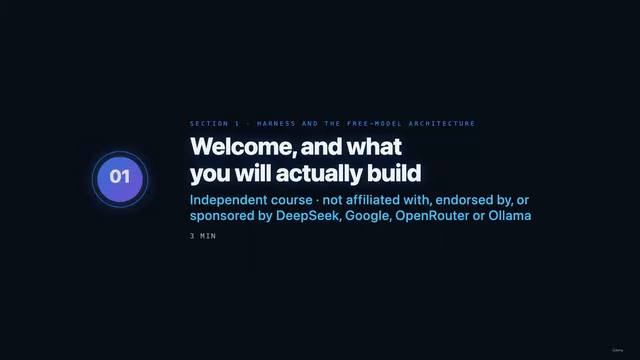
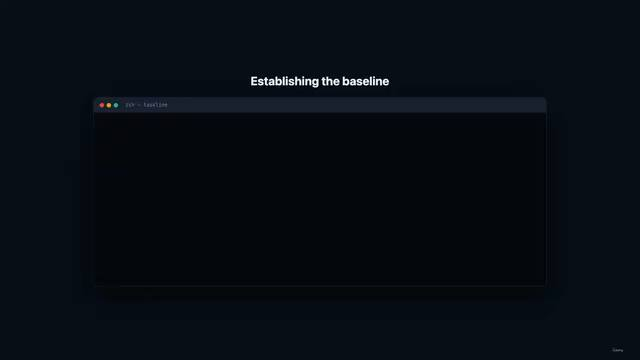
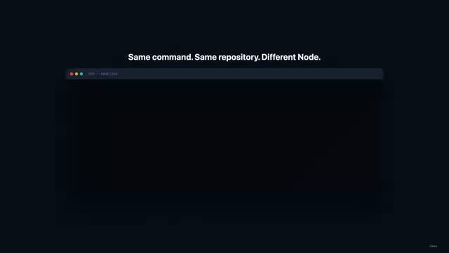
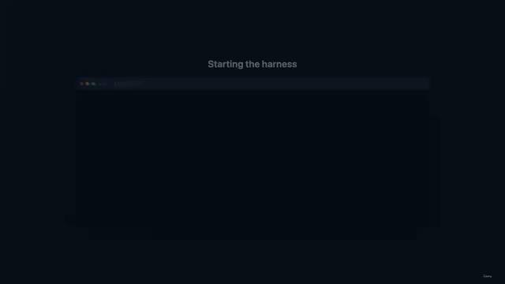
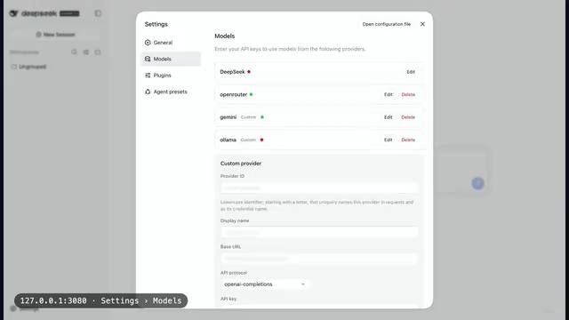
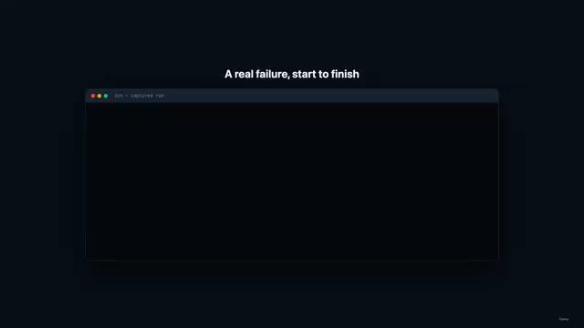
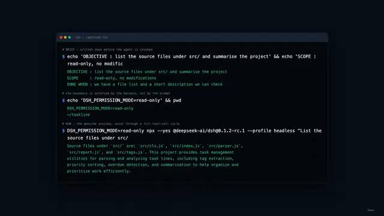

# DeepSeek Harness 从零复现手册（P1–P14）

> 本文档按「能照着跑起来」的标准编写。凡逐字稿没有交代的参数、变量名、仓库地址，一律标注「课里没讲」，并给出你应该怎么自己找出来——不猜、不编。

---

## 1. 这一节做什么

这一节不是「介绍一个工具」，而是**在你自己的笔记本上，把一个能动手的编程 Agent 跑起来，并且学会验证它到底做了什么**。

具体产物有三个，缺一个都算没跑通：

1. **一个本地运行、有边界的 workspace**。Agent 只能在你要它待的目录里活动，出了这个目录就是越界。
2. **一条能跑完完整工具循环（tool loop）的免费模型链路**。模型负责「想」，harness 负责「做」，光有一半不算通。
3. **一次可审计的只读会话**。跑完不是看它说了什么，而是打开 trajectory（轨迹）核对四件事：指令是否原样到达、是否真的发出了 tool call、调的是哪个工具、答案是否被工具返回的结果支撑。



课程最后要交付的那个东西，讲师在 P1 里描述得很具体：一个仓库维护 Agent，跑在零成本模型上，处理一个**真实的 issue**——「请求前四个任务只返回三个，且同优先级的任务顺序不合理」。它读代码、产出一行形如工具调用的文本、harness 把那一行抓出来真的执行，最后测试套件从 19 passing 变成 20 passing。注意这句话的分量：**不是 Agent 说它修好了，是测试真的跑了、输出我们能自己读到**。这就是整门课的主题——「说得流利是免费的，证据不是」。

### 你需要准备什么

| 项目 | 要求 | 说明 |
|---|---|---|
| 操作系统 | Windows / macOS / Linux 任一 | 三者差异不大，课里遇到再提 |
| Node.js | **22.19 或更新，或 24 及以上** | 这是硬门槛，不是建议，详见第 3 节 |
| Git | 任意较新版本 | 它在这里的主要身份是「撤销键」 |
| 浏览器 | 任意现代浏览器 | 因为 harness 的界面是跑在本地的 Web 应用 |
| 显卡 | **不需要** | 主路径是云端模型，推理不发生在你的机器上 |
| 付费订阅 | **不需要** | 用免费额度 |

### 架构一句话看懂


三块，只有两块在你机器上：

- **harness**：本地进程，从终端启动。解析工具调用、执行权限策略、保存会话日志。这些都不是推理，所以不需要显卡。
- **workspace**：本地目录。你的文件、你的终端、你的测试套件。harness 直接伸手进去——**所以「你从哪个目录启动」就等于「你给了它多大的边界」**。
- **模型**：在厂商的机器上。你的 prompt 走网络出去，文本走网络回来。

由此产生四条事实（p003 [01:22] 起）：不需要显卡；**你的代码确实离开了你的机器**；免费额度是商业决策不是软件属性；这个分工是可替换的——把网络调用指向别处即可，课程后面还会指向本机模型。

---

## 2. 讲师原话

按主题归类，不按页码流水账。

**关于模型 / Agent / harness 的边界**

> 「一个语言模型只做一件事：文本进，文本出。这就是全部能力。它打不开文件，跑不了命令，没有昨天的记忆，也没有办法验证它刚告诉你的是不是真的。」
> —— p002 [00:29]

> 「harness 就是那个『别的东西』。它是跑在你机器上的一个程序，它给模型一双手。」
> —— p002 [00:58]

> 「模型负责推理，harness 负责行动。」
> —— p002 [00:58]

**关于那个五步循环**

> 「第一步，你说一个目标。第二步，模型产出文本，其中一部分是普通推理，另一部分长得像要用工具。第三步，harness 读那段输出、把工具请求从中找出来。**这一步是大家最容易漏掉的：模型什么都不执行**，它只是写了一行看起来像调用的东西，由 harness 决定要不要照做。第四步，工具真的在你机器上跑了，结果原样回到对话里。第五步，再来一轮，模型此刻手上有它刚才没有的证据。」
> —— p002 [01:27]

> 「这就是『猜你的代码』和『看你的代码』的区别。」
> —— p002 [01:55]

**关于版本这件小事为什么是大事**

> 「这个版本要求是严格的，而工具不会替你检查。所以当你的版本太旧，你不会收到一条『请升级』的消息，你收到的是某种更让人困惑的东西，然后你会花 20 分钟在错的地方找原因。」
> —— p006 [00:00]

> 「大多数工具会声明自己支持哪些版本，包管理器在不支持的版本上拒绝安装，你下载之前就拿到清晰提示。**这一个什么都不声明。** 于是不支持的版本装得干干净净，然后在真正干活的半路、拿着一句跟它当时恰好碰到的那个东西有关的报错崩掉。」
> —— p006 [01:25]

> 「自己检查版本不是谨慎，这是唯一存在的检查。」
> —— p006 [01:25]

**关于「边界是你选的，不是事后发现的」**

> 「没有边界的 workspace 是默认的失败方式。Agent 从你启动 harness 的地方开始，那可能是你的家目录，它底下的所有东西都随便动。没有任何警告，你是事后才知道的。」
> —— p008 [00:52]

> 「有边界的 workspace 是你提前做的决定。一个小仓库、完全提交干净、从那个目录里面启动。爆炸半径现在是你刻意选的，而不是你事后发现的。」
> —— p008 [01:20]

**关于权限模式**

> 「有三个权限模式，最严格的那个允许查看，但完全不允许写入。第一次看任何一个不熟悉的仓库，就用那个。**礼貌地请求 Agent 别改东西，那只是个请求；设置模式，那是保证。**」
> —— p004 [02:19]

**关于凭证**

> 「密钥绝不进仓库。不写配置文件，不写注释，也不『我只是临时测一下』。『临时』这个词在这句话里造成的伤害最大，因为『临时』正是密钥流进 commit 历史的方式，而历史除非重写否则是永久的。」
> —— p012 [00:27]

> 「通过 harness 来存，而不是自己粘进一个文件。它把密钥写进自己的家目录，完全在你的项目之外，settings 里只留一个引用。这意味着密钥从一开始就没有被提交的机会，这比『记得别提交』强得多。」
> —— p012 [00:27]

> 「找到吊销按钮，现在就找，在什么都还没出错的时候。一个 30 秒能吊销的密钥只是个小麻烦；一个在你发现泄露的那一刻找不到吊销按钮的密钥，是一个真正糟糕的夜晚。」
> —— p012 [01:24]

**关于选 provider 的标准**

> 「功能调用要能完整跑完一个循环。这一条决定一切。Agent 必须能请求工具、收到结果、然后继续跑下去，一个只能完成前半段做不到后半段的模型，对我们毫无用处。」
> —— p011 [00:24]

> 「在免费额度上要小心，因为『免费』涵盖的范围非常大。有些免费额度一天给你几次请求，那和你能真正用来学习的免费额度完全是两回事。」
> —— p011 [00:52]

> 「Gemini 这些模型要求客户端在每一个工具结果里回传一个签名（signature），而 harness 在这个版本不会发它。第一次调用成功，后续就被拒，所以循环永远完不成。」
> —— p011 [01:46]

> 「OpenRouter 是我们真正跑 Agent 的地方，它的免费模型能跑完整个循环。这也是你在第一条路变化时保留第二条路的方式。」
> —— p011 [02:14]

**关于「配置 ≠ 选中」**

> 「有一个这一步在表单上根本不存在的动作，而且它是最容易漏的：**配置一个 provider 不等于选中它**。你创建了一条路由，而 harness 依然很乐意继续用之前那个——在全新安装上就是厂商自带、而你没有密钥的那个服务。」
> —— p013 [00:55]

> 「所以之后要在模型选择器里把模型选上。如果你跳过这步，你紧接着的那次运行会以一个『缺少凭证』的报错失败，而报错里点名的 provider 是你从来没配置过的，很容易误读成『我新配的这个坏了』。不是的，它压根没被试过。」
> —— p013 [01:22]

**关于第一次会话该怎么验**

> 「你已经有一个答案在屏幕上了。在你相信其中任何一个字之前，打开 trajectory，看四样东西。第一，指令是否按你的本意到达了。第二，模型发出的是真正的 tool call，还是普通 prose——这是弱模型最常见的失败方式，而且在最终答案里完全看不出来……第三，它选了哪个工具，这里必须严格。这次真实会话里，模型确实发出了 tool call，看起来像成功了，然后选了一个跟读文件毫无关系的工具，它什么都没打开。第四，答案是否被真正返回的结果支撑。这里不是。」
> —— p014 [00:58]

> 「回复流利、自信、具体，描述的是一个这个仓库根本不是的项目。措辞里没有任何破绽。trajectory 十秒钟就露馅了。」
> —— p014 [01:55]

---

## 3. 从零复现

按顺序做，每一步都有验收标准。

### 3.1 建目录（先建 workspace，再谈别的）

```bash
mkdir -p ~/work && cd ~/work
git init task-board
cd task-board
```

> ⚠️ 这一条是整节最重要的细节（p007 [00:52]）：「**你在哪个目录里运行它，哪个目录就成为 workspace 根。** 这是这一讲最重要的一个细节。在错误的文件夹里启动，你就给了 Agent 错误的边界，而它不会警告你。」

### 3.2 落地练习仓库的文件

把第 4 节的 `package.json`、`src/tasks.js`、`test/tasks.test.js`、`ISSUE.md`、`.gitignore`、`.env.example` 按相同路径写进去。

> 🔍 **课里没讲的部分**：练习仓库的地址和源码，逐字稿从头到尾没有口述过（p008 只说「我们用一条一条命令来做」，没有念出 URL，也没有念出源码）。第 4 节给出的是一份**按 p001 描述的现象等价重写**的最小仓库，用来复现同样的流程和有缺陷的行为，**不是课程仓库的原文**。如果你手上另有课程配套仓库，直接用它，然后跳到 3.3。

### 3.3 建立基线：先知道「绿」长什么样

```bash
node --version          # 必须是 v22.19+ 或 v24+
node --test             # 先跑一遍，把通过数量记下来
git add -A && git commit -m "baseline"
git status              # 必须 clean
```



验收标准（p008 [01:20] 的四条，我按你的实际情况改写）：

- [ ] 仓库已解包，并且在一个干净的 tag / commit 上
- [ ] 测试跑过一遍并且全部通过（课程仓库这个数字是 **16 passing**；你自己的数字以实际输出为准，**关键是先记下来**）
- [ ] 这个「绿」是你亲眼看过的，不是别人告诉你的
- [ ] later 启动 harness 时，你会 `cd` 进这个目录

> 📌 关于数字：p008 说基线是 16 个通过，p001 预告的结课演示是「19 passing → 20 passing」。**这两个数字之间的关系课里没讲**，别自己脑补成同一个快照。你只需要记住「跑之前是多少、跑之后是多少」。

### 3.4 环境四项检查（在装任何东西之前）



把第 4 节的 `check-env.mjs` 存到 `~/work/check-env.mjs`（**放在仓库外面**，它不属于练习项目），然后：

```bash
node ~/work/check-env.mjs
```

四项检查分别对应 p006 [00:28] 的四条：

| # | 检查内容 | 不通过的后果 |
|---|---|---|
| 1 | Node 版本 ≥ 22.19，或 ≥ 24 | 后面所有症状都是它的伪装 |
| 2 | npm 与 node 指向同一个安装 | 包管理器行为错乱 |
| 3 | 能真正执行代码，不只是回一个版本号 | 环境被裁剪过 |
| 4 | 那个「从 22.15 才进 Node 的压缩导出」存在 | **一条检查直接预测 harness 能不能起来** |

> 🔍 课里把这个导出称作「standard」（p010 [01:47]「the plugin imports standard at the top of the file」），并说它在 Node 22.15 才进入 Node 的 lib。逐字稿是语音转写，**这个导出的确切名字请以你实际运行时的报错为准**——第 4 节的脚本因此不写死名字，而是去 `node:zlib` 里探测匹配项并打印出来。

若版本不达标，**先升级，不要清缓存、不要重装**（p010 [00:28]：「如果版本低于地板，停下。什么都别试。别清缓存。别重装。先升级。」）。

### 3.5 启动 harness



```bash
cd ~/work/task-board        # ← 这一行就是权限决定
npx <包名>                   # 先看 help 输出，确认 web 子命令存在
npx <包名> web               # 启动 Web 界面
```

> 🔍 **课里没讲的两件事**：① 包名从没被口述过，讲师的原话只有「one command and it is genuinely the whole installation」（p007 [00:00]）；② 端口冲突时用什么参数换端口也没讲，p010 [01:10] 只说「把它挪到另一个端口上，而不是去找是谁占着」。**两件事都用 `--help` 解决**：先不带参数跑一次，help 会告诉你子命令和可选项。

版本锁定（p007 [01:19]）——当某一讲的行为和你看到的对不上时，**这是你的第一步**，不是最后一步：

```bash
npx <包名>@<录制版本号> web
```

启动后的特性（p007 [01:19]–[01:48]）：首次运行较慢因为要拉取；它会伺候一个**只有你能访问的本地地址**；停止就是「中断终端」，没有后台服务、没有卸载步骤、下次启动是同一条命令。

### 3.6 在首次会话之前做两个决定

**决定一：遥测。** p004 [01:21]——「会话遥测默认是开着的，并且会导出到厂商服务器。它由一个环境变量控制，你可以关掉。」→ **变量名课里没讲**，去 `--help` 输出或设置页里找，找到后 export 出来。要点是「让这件事成为你的决定，而不是你的发现」。

**决定二：权限模式。** p009 [00:29]——「General 里装着这门课最重要的那个设置，就是 Agent 运行在哪个权限模式之下。」三种模式里，**最严格的那个允许查看、完全不允许写入**，第一次面对任何陌生仓库就用它。模式名字课里没念，界面上照字面判断即可。

### 3.7 配置 provider



路径：**Settings → Models → Add provider**（p013 [00:27]）。表单上四件事：

1. **Identifier**：读清楚下面那行说明文字。p013 [00:55] 原话是「那个值是永久的，其他一切都回过头来引用它」——**想好了再填**。
2. **Base URL**：p013 [01:22]「base URL 不要带尾斜杠」。具体的 URL 值课里没给，去 provider 的控制台抄。
3. **API key**：只写（write-only），写进 harness 自己的家目录，**永远不进你的项目**。
4. **保存后还有一步不在表单上：去模型选择器里把模型选上。** 不做这一步，下一次运行会以「缺少凭证」失败，而点名的 provider 你根本没配过。

如果要用 Google 的免费额度来练「配置」这个动作（p011 [01:46]）：可以配，但**不要用它跑 Agent**——它要求每个工具结果回传签名，而这个版本的 harness 不发，第一次调用能成，后续被拒，**循环永远完不成**。这是演示失败的绝佳素材，不是可用路径。真正跑 Agent 用 OpenRouter（p011 [02:14]）。

### 3.8 跑第一次会话（只读）

按 p014 [00:28] 的要求，**先把三件事写下来**再发出去：

```text
目标：找出「请求前 4 个任务只返回 3 个」这条 issue 在 src/tasks.js 里的成因。
范围：只看 src/ 和 test/ 两个目录。
停止条件：给出你认为出问题的函数名 + 行号，以及你需要我确认的一个假设为止。
约束：只读。不要修改任何文件。不要运行 npm install。
```

让它至少跑完**一个完整的工具调用循环**（发出 tool call → 拿到结果 → 继续）。



> 📌 上面这张图是 p010 的失败演示，放在这里是为了让你提前认识「报错不说人话」长什么样：p010 [01:47] 说得很直白——「它从头到尾没有在任何地方提到你的 Node 版本。**缺失的导出才是线索。**」以后你看到「某某导出 undefined」，第一反应应该是回头查版本。

### 3.9 审计：不相信任何一句话，只看证据



打开 trajectory，逐条核对（p014 [00:58]–[02:21]）：

| # | 看什么 | 没通过的表现 |
|---|---|---|
| 1 | 指令是否按本意到达 | 你在错误的 workspace 里，它在看别的东西 |
| 2 | 是否发出真正的 tool call，而非 prose | 模型「描述它本来会查到什么」，最终答案里完全看不出来 |
| 3 | **调的是哪个工具** | 发出了 tool call 看起来像成功，但选了一个跟读文件无关的工具——它什么都没打开 |
| 4 | 答案是否被工具返回结果支撑 | 回复流利、自信、具体，描述的是另一个项目 |

然后**再核一次边界**：`git status` 必须仍然是 clean。只读的声明值多少钱，取决于你手上有多少证据。

---

## 4. 完整代码

> 以下四个文件构成一个可运行的最小等价练习仓库。零依赖、纯 Node 内置模块。**这不是课程仓库原文**（源码课里没给），是按 p001 描述的 issue 现象重写的一份可复现实现。

### 4.1 `package.json`

```json
{
  "name": "task-board",
  "version": "0.0.0",
  "private": true,
  "type": "module",
  "description": "课程练习仓库：零依赖，用 node --test 跑测试",
  "scripts": {
    "test": "node --test"
  }
}
```

### 4.2 `src/tasks.js`

```js
// src/tasks.js
// 任务板的核心查询。issue 就出在这里。
// 约定：priority 数字越小优先级越高（1 最高）。

/**
 * 取出优先级最高的 n 个任务。
 * @param {Array<{id: string, title: string, priority: number}>} tasks
 * @param {number} n
 * @returns {Array} 长度不超过 n 的任务数组
 */
export function topTasks(tasks, n) {
  const seen = new Set();
  const picked = [];

  // BUG 1：用 priority 当 key 去重，把「同优先级」的任务全吃掉了。
  for (const task of tasks) {
    const key = task.priority;
    if (seen.has(key)) continue;
    seen.add(key);
    picked.push(task);
  }

  // BUG 2：比较器返回的是 boolean，不是数字。
  // Array.prototype.sort 要求返回负数 / 0 / 正数，返回 boolean 时
  // 比较结果被当成 1 或 0，永远不会是负数 —— 顺序无从谈起。
  picked.sort((a, b) => a.priority < b.priority);

  return picked.slice(0, n);
}
```

### 4.3 `test/tasks.test.js`

```js
// test/tasks.test.js
// 注意：这些测试是「绿的」，但它们没有覆盖 issue 描述的那两个场景。
// 这正是这个练习的意义 —— 全绿的测试套件不等于没有缺陷。
import test from 'node:test';
import assert from 'node:assert/strict';
import { topTasks } from '../src/tasks.js';

const fourDistinct = () => [
  { id: 'a', title: '写周报',      priority: 1 },
  { id: 'b', title: '修登录框',    priority: 2 },
  { id: 'c', title: '补文档',      priority: 3 },
  { id: 'd', title: '清死代码',    priority: 4 },
];

test('空数组不炸', () => {
  assert.deepEqual(topTasks([], 3), []);
});

test('要多少给多少（当所有优先级互不相同时）', () => {
  const out = topTasks(fourDistinct(), 4);
  assert.equal(out.length, 4);
});

test('返回的条目都来自原数组', () => {
  const tasks = fourDistinct();
  for (const t of topTasks(tasks, 2)) {
    assert.ok(tasks.includes(t));
  }
});

test('n 大于数组长度时不会崩', () => {
  const out = topTasks(fourDistinct(), 99);
  assert.ok(Array.isArray(out));
});
```

### 4.4 `ISSUE.md`

```markdown
# 请求前 4 个任务，只返回了 3 个

**报告人**：一位使用者
**严重级别**：中

## 现象

我的任务板上有 4 个任务，优先级分别是 1、2、3、3。
我调用「取前 4 个」：

- 拿到的只有 **3 个**，不是 4 个。
- 两个优先级都是 3 的任务，返回的先后顺序不符合预期。

## 期望

1. 要 4 个就给 4 个（只要库里真的有 4 个）。
2. 优先级相同的任务，返回顺序应当是确定的、可预期的。

## 复现路径

见 `test/tasks.test.js`。说实话，现在的测试没覆盖这两个场景，所以一直是绿的，
这就导致问题一直没被发现。
```

### 4.5 `.gitignore`

```gitignore
# 真实的值只放在这台机器上，永远不进仓库
.env
.env.local
.env.*.local

# 依赖与运行时产物（本练习零依赖，写上是为了以后）
node_modules/
*.log
```

### 4.6 `.env.example`

```dotenv
# 只提交「名字」，不提交「值」。
# 真实值通过 harness 存进它自己的家目录，不落在这个文件里。
OPENROUTER_API_KEY=
GOOGLE_API_KEY=
```

### 4.7 `check-env.mjs`（放在仓库外面，比如 `~/work/check-env.mjs`）

```js
// ~/work/check-env.mjs
// 启动 harness 之前的四项检查。零依赖。
import { execFileSync } from 'node:child_process';
import path from 'node:path';
import { fileURLToPath } from 'node:url';

const isWin = process.platform === 'win32';
const results = [];

function record(name, ok, detail) {
  results.push({ name, ok, detail });
  console.log(`${ok ? '✓' : '✗'} ${name}  ${detail ?? ''}`);
}

function run(cmd, args) {
  return execFileSync(cmd, args, {
    encoding: 'utf8',
    shell: isWin,          // Windows 上 .cmd 需要 shell
    stdio: ['ignore', 'pipe', 'pipe'],
  }).trim();
}

// ---- 检查 1：Node 版本 ----
{
  const [major, minor] = process.versions.node.split('.').map(Number);
  const ok = (major === 22 && minor >= 19) || major >= 24;
  record(
    '检查1 Node 版本',
    ok,
    `当前 v${process.versions.node}，要求 22.19+ 或 24+`
  );
}

// ---- 检查 2：npm 存在且与 node 同一个安装 ----
{
  try {
    const npmVersion = run('npm', ['--version']);
    const npmPrefix = path.resolve(run('npm', ['prefix', '-g']));
    const nodePrefix = path.resolve(path.dirname(path.dirname(process.execPath)));
    const same = npmPrefix.toLowerCase() === nodePrefix.toLowerCase();
    record(
      '检查2 npm 与 node 同装',
      same,
      `npm ${npmVersion}｜npm prefix=${npmPrefix}｜node prefix=${nodePrefix}`
    );
  } catch (err) {
    record('检查2 npm 与 node 同装', false, `调不动 npm：${err.message}`);
  }
}

// ---- 检查 3：能真正执行，不只是回一个版本号 ----
{
  try {
    const out = run(process.execPath, ['-e', 'process.stdout.write("ok")']);
    record('检查3 可执行', out === 'ok', `子进程返回 "${out}"`);
  } catch (err) {
    record('检查3 可执行', false, err.message);
  }
}

// ---- 检查 4：那个「22.15 之后才进 Node」的压缩导出 ----
// 课里把它称作 "standard"，逐字稿是语音转写，确切名字以你机器的实际输出为准。
{
  try {
    const zlib = await import('node:zlib');
    const candidates = Object.keys(zlib).filter((k) => /zstd/i.test(k));
    const ok = candidates.length > 0;
    record(
      '检查4 压缩导出',
      ok,
      ok
        ? `找到：${candidates.join(', ')}`
        : '一个都没找到 —— 这正是 harness 起不来时那条「缺导出」报错的来源'
    );
  } catch (err) {
    record('检查4 压缩导出', false, err.message);
  }
}

const failed = results.filter((r) => !r.ok);
console.log(
  failed.length === 0
    ? '\n全部通过，可以进入下一步。'
    : `\n有 ${failed.length} 项没过。按顺序修，别跳步。`
);
process.exit(failed.length === 0 ? 0 : 1);
```

---

## 5. 逐行解释

### 5.1 `topTasks` 里那个排序比较器——前端最该记住的一行

```js
picked.sort((a, b) => a.priority < b.priority);
```

`Array.prototype.sort` 的比较器**必须返回数字**：负数表示 a 在前，正数表示 b 在前，0 表示平手。返回布尔值时，`true` 被当作 `1`、`false` 被当作 `0`——**永远不会有负数**，于是「谁该往前排」这个信息彻底丢失。V8 不会报错，TypeScript 的 `(a, b) => number` 签名在 `strict` 关掉或者项目里有人 `as any` 的时候也拦不住。结果就是：**小数组上看起来「大致能跑」，一多就乱**。

在 Node 里这条规则和浏览器里完全一样，没有额外差异。修法：

```js
picked.sort((a, b) => a.priority - b.priority);
```

顺带一提：`Array.prototype.sort` 从 ES2019 起是**稳定排序**，所以优先级相同时原顺序会保留——这正是 issue 里第 2 条期望想要的「确定、可预期」。

### 5.2 BUG 1 那个去重——它才是「4 个只回 3 个」的真凶

```js
const key = task.priority;
if (seen.has(key)) continue;
```

这段代码的作者想「按优先级去重」，但**去重的 key 选错了**：优先级不是唯一标识，`id` 才是。两个同优先级但不同 id 的任务，第二个直接被 `continue` 掉了。所以当数据是 `1, 2, 3, 3` 时，`picked` 只有 3 条，后面 `slice(0, 4)` 拿到 3 条也就顺理成章——**`slice` 是无辜的**。

这是这类缺陷的典型特征：**症状出现的位置（4 要 3）和成因的位置（去重 key）相隔很远**。这也是为什么 P14 那套「答案是否被工具返回结果支撑」的核对是必须的——光看 `slice(0, n)` 那行，你会以为问题在边界条件上。

### 5.3 `node --test`

`package.json` 里 `"test": "node --test"` 用的是 Node 内置测试运行器，**零依赖**，正好对上 p008 [00:52]「完全没有依赖，所以这里没有任何东西会因为你碰巧装了什么包而坏掉」。它会自动发现 `test/` 下形如 `*.test.js` 的文件。`node:test` 和 `node:assert/strict` 都是内置模块，不需要 `npm install`。

###

## 6. 复现检查清单

- [ ] workspace 边界：在 `~/work/task-board` 里执行 `pwd` 和 `git status`；应该看到当前目录是练习仓库，且 `git status` 为 clean。
- [ ] Node 版本：执行 `node --version`；应该看到 `v22.19+` 或 `v24+`。低于地板先升级，不要清缓存、不要重装。
- [ ] 环境四项检查：执行 `node ~/work/check-env.mjs`；应该看到四项都通过，最后输出「全部通过，可以进入下一步。」若检查 4 失败，应看到「一个都没找到」，并知道这是「缺导出」报错的来源。
- [ ] 基线测试：执行 `node --test`；应该看到全部通过，并记下通过数量（课程仓库是 16 passing；你自己的数字以实际输出为准）。
- [ ] 启动目录：执行 `cd ~/work/task-board` 后再启动 harness；应该看到 workspace 根就是这个练习仓库，而不是家目录或其他目录。
- [ ] 启动命令：执行 `npx <包名> web`；应该看到它服务一个只有你能访问的本地地址。包名课里没讲；补充：用你实际拿到的包名先跑 `--help`，确认 `web` 子命令存在。
- [ ] 遥测决定：确认已找到控制遥测的环境变量并 export，或明确保留默认；变量名课里没讲；补充：去 `--help` 输出或设置页里找，找到后让关闭成为你的决定。
- [ ] 权限模式：在 Settings → General 里选择最严格模式；应该看到它允许查看、完全不允许写入。模式名字课里没讲；补充：界面上照字面判断。
- [ ] provider 配置：走 Settings → Models → Add provider；应该看到 identifier 是永久的、base URL 不带尾斜杠、API key 是 write-only。
- [ ] provider 选中：保存后去模型选择器里把模型选上；应该看到选中的是你新配的模型。跳过这步，下一次运行会以「缺少凭证」失败，并点名一个你没配过的 provider。
- [ ] 首次会话 prompt：发出去之前先写清目标、范围、停止条件、只读约束；应该至少跑完一个完整工具调用循环：发出 tool call → 拿到结果 → 继续。
- [ ] trajectory 检查 1：打开 trajectory 看指令是否按本意到达；应该看到会话记录里的指令与你写的一致，workspace 是 `task-board`。
- [ ] trajectory 检查 2：看模型是否发出真正的 tool call，而不是 prose；应该看到工具调用记录，不是只有「它本来会查到什么」的描述。
- [ ] trajectory 检查 3：看它调的是哪个工具；应该看到它真的打开/读取了 `src/` 或 `test/` 里的文件，而不是选了一个跟读文件无关的工具。
- [ ] trajectory 检查 4：看答案是否被工具返回结果支撑；应该能对照实际文件内容和工具输出，而不是一个流利但属于另一个项目的回答。
- [ ] 只读边界：会话后再执行 `git status`；应该仍然是 clean，没有文件被修改。
- [ ] 复现 issue：用第 4 节代码构造优先级 `1,2,3,3` 取前 4 个；应该看到只返回 3 个，且同优先级顺序不符合预期。这是缺陷复现，不是失败。
- [ ] 测试全绿不等于没缺陷：`node --test` 全绿时，上面的 issue 场景仍然失败；应该确认现有测试没有覆盖「同优先级」和「取 4 个」这两个场景。

## 7. 课里没讲但你会撞上的

| 现象 | 原因 | 怎么办 |
|---|---|---|
| `node --test` 全绿，但 issue 场景仍然失败 | 现有测试没覆盖同优先级和取 4 个场景（文档 4.3 / ISSUE.md） | 手动构造 `1,2,3,3` 取 4 验证；不要把全绿当成修好。 |
| 取前 4 个只回 3 个 | 去重 key 用了 `priority`，同优先级任务被 `continue` 掉（文档 5.2） | 用唯一 `id` 做去重 key；`slice` 是无辜的。 |
| 同优先级任务顺序乱 | 比较器返回 boolean，`sort` 永远拿不到负数（文档 5.1） | 改成 `(a, b) => a.priority - b.priority`；ES2019 起稳定排序会保留同优先级原顺序。 |
| 启动时报缺导出 / `undefined` | Node 版本低于 22.19 或 24+；p010 的报错从头到尾不提 Node 版本 | 先 `node --version`；低于地板先升级，别清缓存、别重装。 |
| `check-env.mjs` 检查 2 失败 | npm 与 node 不是同一个安装（文档 3.4） | 补充：课里没讲具体修复命令；按脚本打印的 npm prefix 与 node prefix 对齐安装。 |
| 启动后本地地址打不开 | 端口被占用；p010 说把它挪到另一个端口 | 补充：课里没讲换端口的具体参数；用 `--help` 查。 |
| Agent 看不到你的项目，或边界明显不对 | 从错误目录启动 harness；p007 / p008 / p010 都强调启动目录就是 workspace 根 | `cd ~/work/task-board` 再启动；用 `pwd` 确认。 |
| 配置 provider 后仍报「缺少凭证」，且点名一个没配过的 provider | 配置一个 provider 不等于选中它（p013） | 去模型选择器里把新模型选上；否则下一次运行会失败。 |
| Gemini 第一次调用成功，后续被拒，循环永远完不成 | 它要求每个工具结果回传签名，而 harness 这个版本不发（p011） | 不要用它跑 Agent；用 OpenRouter 跑完整循环；可以把它当失败演示。 |
| 不知道 `npx` 后面该填什么包名 | 补充：课里没讲包名 | 补充：课里没讲；用你实际拿到的包名先跑 `--help`，确认 `web` 子命令。 |
| 不知道遥测环境变量叫什么 | 补充：课里没讲变量名 | 补充：去 `--help` 输出或设置页里找，找到后 export；让关闭成为决定。 |
| 不知道权限模式该选哪个名字 | 补充：课里没念模式名 | 补充：界面字面判断，选最严格、允许查看但完全不允许写入的那个。 |
| base URL 带了尾斜杠 | p013 明确说 base URL 不要带尾斜杠 | 去掉尾斜杠再保存。 |
| API key 差点写进仓库 | p012：密钥绝不进仓库，也不「临时」放一下 | 通过 harness 存；`.env` 忽略，只提交 `.env.example`；现在就找到吊销按钮。 |
