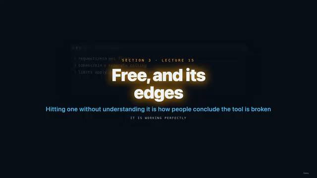
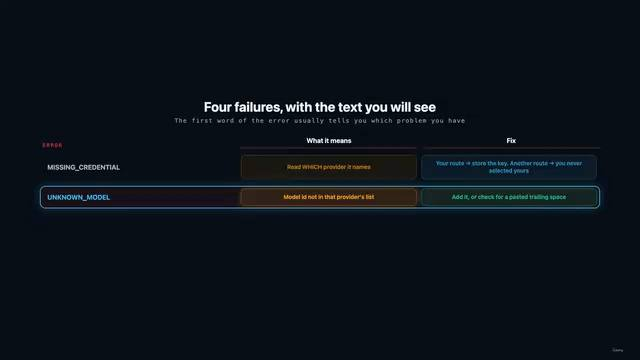
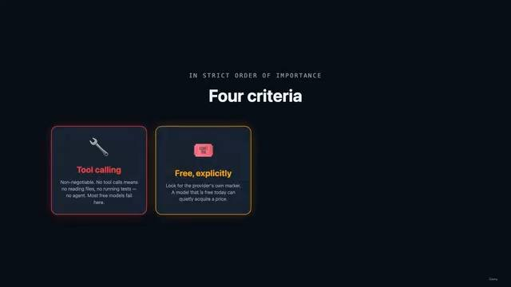
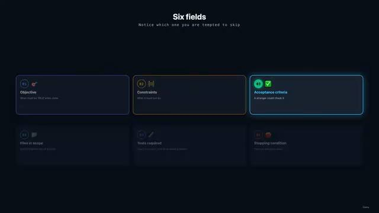
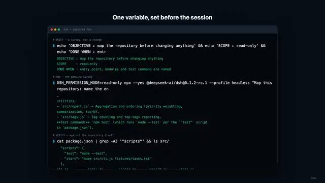
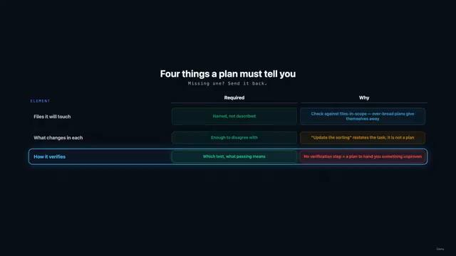
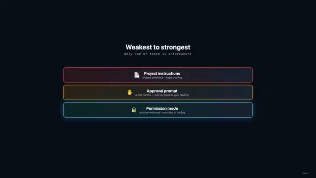
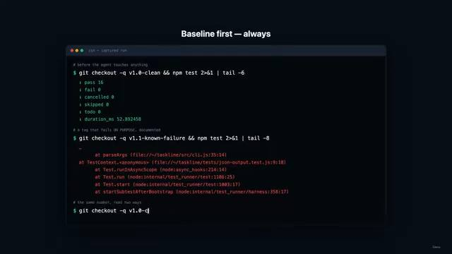
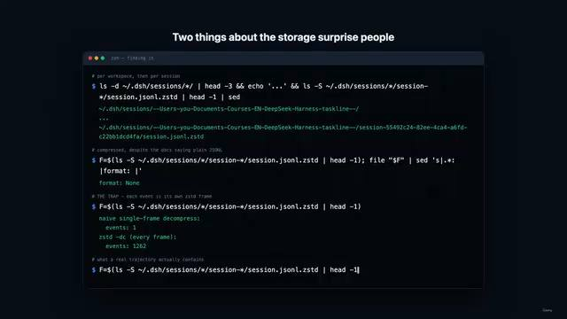
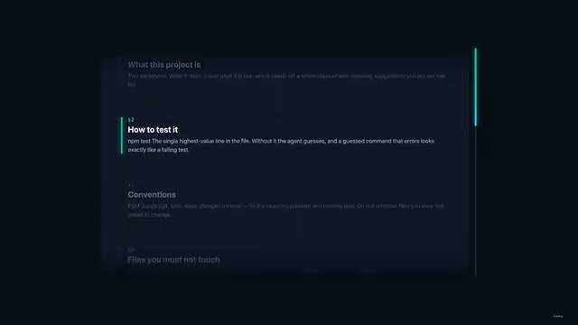

# DeepSeek Harness 实操文档：从单 Provider 到可审计的 Agent 工作流（P15–P30）

> **阅读前先看边界**：P15–P30 的逐字稿没有出现 harness 的可执行文件名、安装命令、配置文件格式、环境变量名、session 记录的绝对路径或解压命令。因此本文**不会虚构这些内容**。能直接执行的部分放在练习仓库里（Node.js 示例，无第三方依赖）；harness 部分按逐字稿描述为“在设置页/会话里操作”，未知处明确标注“课里没讲”。这样你既能照着练完整流程，又不会把网络上的别人的配置误当成这门课的内容。

---

## 1. 这一节做什么

这一节覆盖 P15–P30，目标不是“知道几个概念”，而是把下面这条链路跑通：

1. 认清免费额度的真实边界：每日请求数、每分钟请求数、每分钟 token 数，以及“限额按项目算，不按 key 算”。
2. 配置第二个 provider，让额度耗尽从“今天结束”变成“改一个设置继续”。
3. 用“工具调用能力 → 是否明确免费 → 上下文窗口 → 质量”的顺序选模型，而不是看 benchmark 名字。
4. 写六字段任务简报，先只读 survey，再 plan，再审批写盘。
5. 先跑测试基线，再让 agent 改代码；失败时读断言、不改测试、把真实失败文本喂回去。
6. 用 session 轨迹审计“它到底做了什么”，而不是相信 agent 的自我总结。
7. 把重复交代的约定写进项目根的项目说明文件，让后续 session 自动加载。

最终产出是一个可复现的练习仓库 `deepseek-harness-lab/`，以及一套可以反复套用的操作顺序。练习仓库用 Node.js 写一个极小的排序库，故意留下一个“已知失败测试”，用来演示基线、只读、计划、审批、修复、轨迹检查。**注意：这个 Node 仓库是本文为了让你有东西可操作而准备的教学载体，不是逐字稿里出现的项目。** 逐字稿只讲 harness 的工作流，没有规定你必须用 Node。



---

## 2. 讲师原话（按实现逻辑重组）

下面不是按 P 号流水账，而是按“你要做的动作”把关键原话拎出来。引用保留英文原文，后面用中文说明它在项目里对应什么。

### 2.1 限额先看“每天请求数”，再看 per project

> “Requests per day. Measure this one before you trust the word free... On the model we tested it was 20 requests in a day, and a single agent task can spend several of those...”
>
> —— p015 [00:28]

> “Limits are applied per project, not per key. Generating a second key in the same project gets you nothing at all...”
>
> —— p015 [00:55]

这两句决定了你的预算模型：不要用“我一个 key 能发多少”来估算，而要用“这个项目一天能发多少”来估算。一个 agent 任务可能包含多次工具调用，所以 20 次/天不是 20 个任务。你在前端里熟悉的 rate limiter 是“一个客户端共享一个桶”；这里更粗，是“一个项目共享一个桶”。



### 2.2 错误先读“它点名了哪个 provider”

> “Missing credential. The message names a provider route. Read which one because that single word tells you which of two completely different problems you have...”
>
> —— p016 [00:28]

> “Unknown model... Watch for a trailing space when you paste an identifier...”
>
> —— p016 [00:58]

排错顺序是：先看错误点名的 provider 是不是你配置的那个；再看模型标识有没有多一个尾随空格；再看是不是 rate limited；最后才怀疑“key 对、地址对、模型存在，但请求仍被拒”的请求形状问题。逐字稿把它归为四类：缺凭据、未知模型、限流、请求形状/兼容开关。文档里不要自己加第五类。

### 2.3 第二个 provider 的意义：只换路由，不换项目

> “Only the route changes. A base address, a protocol, a credential, and a model name. That is the entire surface area of switching providers.”
>
> —— p017 [01:18]

> “A green dot means a credential resolved and the endpoint answered. A red one means it did not...”
>
> —— p019 [00:28]

这就是“四字段”的来源：base address、protocol、credential、model name。你的仓库、权限模式、审批流、轨迹日志都不变。第二个 provider 不是迁移，是改路由。设置页里每个 provider 旁边有状态点，绿点表示凭据解析成功且端点有响应；红点先把问题缩小到凭据或连通性。


### 2.4 选模型的第一过滤器是 tool calling

> “Tool calling. Not negotiable and not optional. A model that cannot request a tool cannot read a file, cannot run a test, and therefore cannot be an agent...”
>
> —— p020 [00:27]

> “...there were hundreds of models and only 17 were both free and able to call tools.”
>
> —— p020 [00:27]

顺序是：**能调工具 → 明确免费 → 上下文窗口 → 质量**。免费模型目录会变，所以讲师强调“教方法而不是给名字”。你要在 provider 的模型列表里重新生成/过滤，而不是抄一张过期表格。



### 2.5 不要用“自动选一个免费模型”的路由做演示

> “With automatic routing you do not know [which model answers] and it can change between two runs of the same task... A router optimizing for availability can hand you a model that cannot call tools at all and the failure does not announce itself.”
>
> —— p021 [00:29]

自动路由适合“随便看看免费模型能干什么”，不适合教学、调试、基准比较，因为你需要知道“是谁产出的结果”。一旦你要解释“为什么这次行为不同”，就必须点名模型。

### 2.6 比较两个模型：六个维度，五个在轨迹里

> “Tools selection. Which tools did each one reach for and were they the right ones? ... Tool call count ... Result quality ... Speed ... Unrequested actions ... Self-verification.”
>
> —— p022 [00:28]

比较不是“跑两个问题，看哪个答案顺眼”。同一任务、同一仓库、同一初始 commit，只换 provider；然后看轨迹里的工具选择、调用轮数、未请求动作、是否自检。结果质量要对照事先写好的 acceptance criteria，而不是事后印象。

### 2.7 任务简报六字段

> “Objective. One sentence describing what must be true when this is finished. Not what to do, what must be true... Constraints... Acceptance criteria... Files in scope... Tests required... And the stopping condition.”
>
> —— p023 [00:29]



六字段里最容易跳过的是 stopping condition。它的作用不是“礼貌地让 agent 停”，而是把一次坏运行变短：什么时候必须停下来报告，而不是继续猜。

### 2.8 只读不是“请求”，是运行时强制

> “An instruction is a request. It works on a cooperative agent that understood you, and it quietly fails on a confused one... A permission mode is enforced by the runtime and recorded in the log.”
>
> —— p024 [00:56]



所以第一次接触代码库，不要只写“请不要改文件”。要在会话开始前设 read-only，让运行时不允许写；结束后用 `git status --porcelain` 和轨迹证明“只有读工具被调用”。

### 2.9 Plan 是“决定”和“执行”之间的闸门

> “What it will change in each in enough detail that you could disagree... How it will verify... and what it is deliberately not doing.”
>
> —— p025 [00:29]



计划要能让你“反驳”：点名文件、具体改什么、怎么验证、明确不做什么。没有验证步骤的计划，是“交东西但不证明”的计划。

### 2.10 三层防线，只有一层真正强制

> “Your instructions file says which paths are off limits. It shapes behavior and it stops nothing... The approval prompt, genuinely a control and only as good as your reading... The permission mode, enforced by the runtime... And underneath all of it, version control, not prevention, recovery.”
>
> —— p026 [00:00]



项目说明文件是“政策”，审批是“人工闸门”，权限模式是“运行时强制”，git 是“恢复”。审批时不要只看摘要行，要看实际 diff；审批不是事务，批准后不会自动回滚，git 才是恢复。

### 2.11 测试先建基线，失败后不要改测试

> “Establish the baseline first, always and before the agent starts... One failure means nothing on its own. It only means something against the number we wrote down first.”
>
> —— p027 [00:28]

> “Do not change the test because a test edited to pass is not a fix.”
>
> —— p028 [01:25]



失败后的三个错误动作：改测试让它过、不理解就 revert、把失败文本丢给 agent 让它“赶紧修”。正确动作：先自己读断言，再把真实失败文本和约束一起给 agent，最后确认测试文件没被改、全套测试重新跑。

### 2.12 轨迹是唯一账本

> “Every session is recorded, and that recording is the only account of what actually happened. Everything else, including the agent's own confidence summary, is a claim about it.”
>
> —— p029 [00:00]



轨迹里最有用的对照是 tool call 和 tool result：call 是“请求”，result 是“实际回来什么”。如果最终答案和这两者不匹配，你找到问题了。权限预设和 sandbox mode 也被记录，所以“边界有没有被强制执行”是可证明的。

### 2.13 项目说明文件：写一次，后面每个 session 自动加载

> “The file goes in the project route, and the harness picks it up on its own... Then the test command and this is the single highest value line in the file.”
>
> —— p030 [00:29]



逐字稿说文件在项目根、harness 自动读取，但**没有给出文件名**。所以下面代码里的 `PROJECT_RULES.md` 是占位文件名，不是课程认证的名字。你要把它替换成你的 harness 实际读取的文件名。

---

## 3. 从零复现

### 3.1 前置条件

- Node.js >= 20（练习仓库用 `node --test`；Node 18 可能也能跑，但建议 20）。
- Git（用于基线、diff、恢复）。
- 课程环境里已经能打开的 harness 界面。**harness 的安装命令、启动命令、CLI 名称课里没讲**，本文不虚构；你按课程环境启动即可。
- 两个 provider 的凭据。第一个已经可用；第二个准备一个 router 或另一家 provider。

### 3.2 创建练习仓库

在任意空目录执行：

```bash
mkdir deepseek-harness-lab
cd deepseek-harness-lab
git init
```

然后按第 4 节创建全部文件。创建完先不要急着让 agent 改代码，先做基线。

### 3.3 跑基线，记录“失败数字”

```bash
npm test
```

这个仓库故意让 `topN returns the highest-scoring items` 失败。你要把输出保存下来，最好用第 4 节的 `scripts/baseline.sh`：

```bash
chmod +x scripts/baseline.sh scripts/check-boundary.sh
./scripts/baseline.sh
```

它会记录当前 commit、`git status --porcelain`、`npm test` 的完整输出到 `evidence/`。`evidence/` 在 `.gitignore` 里，不会被提交，但本地保留。**基线不是“跑一下看看”，而是“把失败数字写下来”**。后面测试从 fail 到 pass，才有对照。

### 3.4 配置第二个 provider

在 harness 设置页里添加第二个 provider。逐字稿说切换 provider 的表面只有四个字段：

1. base address；
2. protocol；
3. credential；
4. model name。

凭据通过 harness 的存储机制保存，不要写进项目文件。逐字稿说 key 存在环境里并被 Git 忽略；但**具体环境变量名课里没讲**。如果你的 harness 用环境变量，变量名以你的 harness 文档为准。本文练习仓库不读取任何 key，所以不会因为变量名不同而跑不起来。

添加后看 provider 旁边的状态点：绿点表示凭据解析成功且端点有响应；红点表示没有。两个都绿，再继续。

### 3.5 选模型

在 provider 的模型列表里按顺序过滤：

1. 必须支持 tool calling；
2. 必须明确标记 free；
3. 看上下文窗口；
4. 最后看质量。

不要用“自动帮我选一个免费模型”的路由做本次练习。逐字稿说它可能在两次运行之间换模型，还可能悄悄给你一个不能调工具的模型。你要在轨迹里知道“是谁回答的”，所以点名模型。

### 3.6 写任务简报

把第 4 节的 `BRIEF.md` 填好。六字段都要有：Objective、Constraints、Acceptance criteria、Files in scope、Tests required、Stopping condition。Objective 写成“什么必须为真”，不是“去做什么”。Acceptance criteria 要能让别人不问你就能勾选。

### 3.7 只读 survey

在 harness 里把权限模式设为 read-only（具体模式名称以你的 UI 为准，课里没给枚举名）。然后让 agent 做一次 survey：

```text
Objective: Map this repository without changing it. Report the files, the test command, and which test currently fails.
Constraints: Do not edit, create, or delete any file. Do not install dependencies. Do not change git state.
Acceptance criteria:
- Report every file under src/, test/, scripts/.
- Report the exact npm test command from package.json.
- Name the currently failing test.
- Quote the failing assertion line.
Files in scope: read-only entire repository.
Tests required: Run `npm test` and quote the actual failing output.
Stopping condition: Stop after reporting. If you cannot run tests, stop and say why.
```

结束后执行：

```bash
./scripts/check-boundary.sh
```

确认 `git status --porcelain` 为空。再去轨迹里确认它只调用了读工具，没有写工具。逐字稿说“instruction is a request, mode is a guarantee”，这一步就是验证 guarantee。

### 3.8 Plan 模式

在写盘之前，让 agent 先出计划，不执行：

```text
Produce a plan only. Do not edit files.
The plan must name:
1. which file(s) will change;
2. what will change in each, specific enough that I can disagree;
3. how you will verify it (which test command, what passing looks like);
4. what you are deliberately not doing.
```

你审计计划：有没有点名 `src/sort.js`？有没有说清楚 `topN` 要改成最高分优先？有没有说跑 `npm test`？有没有明确“不改测试文件”？如果计划里出现不存在的函数或文件，说明它在猜。

### 3.9 审批写盘

切到可写模式（具体模式名以 UI 为准）。给一个窄指令：

```text
Change only src/sort.js so that topN(items, n) returns the highest-scoring n items first. Keep sortByScore ascending. Do not change any test file. Do not add dependencies. Run `npm test` and show the actual output.
```

审批时不要只看摘要行，点开 diff 看实际改了哪些行。批准后跑：

```bash
./scripts/check-boundary.sh
npm test
```

确认 diff 只在 `src/sort.js`，测试文件没动，测试从基线失败变成通过。

### 3.10 失败处理

如果测试失败，不要改测试。先自己读断言：它期望什么、实际是什么。然后把**真实失败文本**贴给 agent，而不是“测试挂了，你修一下”。约束写清楚：“测试文件不能改；只改 `src/sort.js`；如果一次修改后仍失败，停下来报告。” 修完后重新跑全套 `npm test`，再检查 diff。

### 3.11 审计轨迹

打开这次 session 的记录。逐字稿说 session 按 workspace、再按 session 存储，而且是压缩格式，不是文档里描述的 JSONL；每个事件是单独 frame，单独解压一个 frame 只能看到 header。**具体路径和解压命令课里没讲**，不要用 `cat` 当 JSONL 读。你要在轨迹里找：

- permission preset / sandbox mode：边界有没有被记录；
- tool call 和 tool result：请求和实际返回是否匹配；
- turn / step 边界：一个简单任务花了几轮；
- 最终答案是否被轨迹支持。

如果轨迹不支持最终答案，那它只是“一句话”，不是结果。

### 3.12 写项目说明文件

把第 4 节的 `PROJECT_RULES.md` 放到项目根，并替换成你的 harness 实际读取的文件名。然后问 agent 一个只有这个文件能回答的问题，例如：“这个仓库唯一的测试命令是什么？” 如果它回答 `npm test`，说明文件被读到了。最后把练习仓库恢复到下一节期望的状态（提交或清理临时文件）。

---

## 4. 完整代码

> 下面每个文件都是完整文件，可直接保存。`PROJECT_RULES.md` 是占位文件名；课程只说“项目根下有一个 harness 自动读取的文件”，没有给出文件名，真实文件名以你的 harness 为准。`BRIEF.md` 是任务简报，不是 harness 自动读取的文件。

### 4.1 目录结构

```text
deepseek-harness-lab/
├── .gitignore
├── package.json
├── BRIEF.md
├── PROJECT_RULES.md
├── src/
│   └── sort.js
├── test/
│   └── sort.test.js
└── scripts/
    ├── baseline.sh
    └── check-boundary.sh
```

### 4.2 `package.json`

```json
{
  "name": "deepseek-harness-lab",
  "version": "1.0.0",
  "private": true,
  "type": "module",
  "scripts": {
    "test": "node --test",
    "test:baseline": "node --test test/sort.test.js",
    "check:boundary": "bash scripts/check-boundary.sh"
  },
  "engines": {
    "node": ">=20"
  }
}
```

### 4.3 `.gitignore`

```gitignore
node_modules/
.env
evidence/
```

### 4.4 `src/sort.js`

```js
export function sortByScore(items) {
  return [...items].sort((a, b) => a.score - b.score);
}

export function topN(items, n) {
  if (!Number.isInteger(n) || n < 0) {
    throw new Error("n must be a non-negative integer");
  }
  return sortByScore(items).slice(0, n);
}
```

### 4.5 `test/sort.test.js`

```js
import test from "node:test";
import assert from "node:assert/strict";
import { sortByScore, topN } from "../src/sort.js";

test("sortByScore returns ascending order", () => {
  const input = [
    { id: "a", score: 2 },
    { id: "b", score: 1 }
  ];
  assert.deepEqual(sortByScore(input).map((x) => x.id), ["b", "a"]);
});

test("topN returns the highest-scoring items", () => {
  const input = [
    { id: "low", score: 1 },
    { id: "high", score: 9 },
    { id: "mid", score: 5 }
  ];
  assert.deepEqual(topN(input, 2).map((x) => x.id), ["high", "mid"]);
});
```

> 初始状态下第二个测试会失败，因为 `topN` 复用了升序排序后取前 n 个，拿到的是最低分。这个失败是故意的，用来练基线、只读、计划、审批和修复。你不需要手动改它；让 agent 按简报改 `src/sort.js`。

### 4.6 `scripts/baseline.sh`

```bash
#!/usr/bin/env bash
set -euo pipefail

mkdir -p evidence

{
  echo "git_commit=$(git rev-parse --short HEAD 2>/dev/null || echo no-git)"
  echo "git_status_before:"
  git status --porcelain 2>/dev/null || true
  echo "test_output:"
  npm test 2>&1 || true
} | tee "evidence/baseline-$(date +%Y%m%d-%H%M%S).txt"
```

### 4.7 `scripts/check-boundary.sh`

```bash
#!/usr/bin/env bash
set -euo pipefail

if ! git rev-parse --is-inside-work-tree >/dev/null 2>&1; then
  echo "not a git repository"
  exit 1
fi

echo "== git status --porcelain =="
git status --porcelain

echo "== changed files =="
git diff --name-only

echo "== staged files =="
git diff --cached --name-only
```

### 4.8 `BRIEF.md`

```markdown
# Task Brief

## Objective
When this is finished, `topN(items, n)` returns the highest-scoring `n` items in descending score order, and the existing ascending `sortByScore` behavior is unchanged.

## Constraints
- Do not change any test file.
- Do not reformat files outside `src/sort.js`.
- Do not add dependencies.
- Do not touch `.env`, lock files, or generated files.
- Do not change `package.json`.

## Acceptance criteria
- [ ] `npm test` exits 0.
- [ ] `topN` returns the highest scores first.
- [ ] `sortByScore` still returns ascending order.
- [ ] The diff is limited to `src/sort.js`.
- [ ] The test file `test/sort.test.js` is byte-for-byte unchanged.

## Files in scope
- `src/sort.js`

## Tests required
Run:

```bash
npm test
```

Passing means: all tests pass. Read the actual output; do not summarize it away. If a new test is added, it must prove that `topN` picks the highest scores, not the lowest.

## Stopping condition
Stop and report if:
- a test file must change;
- more than one source file must change;
- `npm test` still fails after one focused edit;
- the requested behavior is ambiguous.
```

### 4.9 `PROJECT_RULES.md`（占位文件名）

```markdown
# Project Rules

## What this project is
This is a tiny Node.js library for sorting score objects. It is not a web app, not a database, and not a UI project.

## Test command
```bash
npm test
```

This is the only test command for this repository.

## Conventions
- JavaScript, ESM, no dependencies.
- Keep changes minimal.
- Do not reformat files you were not asked to touch.
- Prefer named exports.

## Files that must not be touched
- `.env`
- `package-lock.json`
- `node_modules/`
- `test/` unless the brief explicitly allows it
- any generated file under `evidence/`

## Definition of done
- The root cause is named.
- The failing test fails before the change and passes after the change.
- The actual test output is shown.
- The diff is limited to the files in scope.
```

---

## 5. 逐行解释

### 5.1 `package.json`

`"type": "module"` 让 `.js` 文件按 ESM 解析，所以 `src/sort.js` 可以用 `export`，测试文件可以用 `import`。前端读者可以把它类比成 Vite/现代打包器默认的 ESM 语义；在 Node 里需要显式声明。`"test": "node --test"` 使用 Node 内置测试运行器，不需要 Jest/Vitest，也不产生依赖。`engines.node >=20` 是建议，不是强制；实际以你本机 `node -v` 为准。

### 5.2 `src/sort.js`

`sortByScore` 里 `[...items]` 先浅拷贝数组，再 `sort`，避免修改调用方传入的数组。JS 的 `Array.prototype.sort` 会原地排序，这是前端常见坑；这里用展开运算符规避。`topN` 先校验 `n` 是正整数或 0，非整数或负数直接抛错，避免 `slice` 出现奇怪行为。当前实现 `return sortByScore(items).slice(0, n)` 是错的：它取升序前 n 个，也就是最低分。任务简报要求改成最高分优先，但 `sortByScore` 保持升序不变。参考修复方向是让 `topN` 自己按分数降序排，或先升序再取末尾，但不要改测试。

### 5.3 `test/sort.test.js`

`node:test` 的 `test()` 类似 Jest 的 `test/it`；`node:assert/strict` 的 `assert.deepEqual` 类似 `expect(...).toEqual(...)`。第一个测试固定 `sortByScore` 的升序行为，防止 agent 为了修 `topN` 把公共排序函数改坏。第二个测试是当前失败点：输入 low=1、high=9、mid=5，期望 `topN(input, 2)` 返回 `["high","mid"]`，当前返回 `["low","mid"]`。这个失败是“基线数字”，不是环境坏了。

### 5.4 `scripts/baseline.sh`

`set -euo pipefail` 让脚本遇到错误就停，但 `npm test` 后面接了 `|| true`，所以测试失败不会中断记录。`git rev-parse --short HEAD` 记录当前 commit；如果没有 git 仓库，回退输出 `no-git`。`git status --porcelain` 记录开始前的工作区状态。`npm test 2>&1` 把 stderr 合并到 stdout，保证 `tee` 能保存完整输出。`tee` 同时写屏幕和 `evidence/baseline-时间戳.txt`。这个文件是后面判断“新失败还是旧失败”的唯一依据。

### 5.5 `scripts/check-boundary.sh`

先确认当前在 git 工作树里，否则直接退出。`git status --porcelain` 看未提交变化；`git diff --name-only` 看未暂存改动文件；`git diff --cached --name-only` 看已暂存文件。只读 survey 后，这三项都应该是空。写盘审批后，`changed files` 应该只有 `src/sort.js`。注意：如果 agent 自己 commit 了，`git diff` 可能看不到，所以逐字稿提醒“有时它留在工作区，有时它替你提交”，你要同时看 `git status` 和最近提交。本文脚本没有展开 commit 检查，你可以在 `check-boundary.sh` 里追加 `git log --oneline -5`，但课里没讲这个命令，属于你本地增强。

### 5.6 `BRIEF.md`

六字段对应逐字稿：Objective 写“什么必须为真”；Constraints 写“不能做什么”；Acceptance criteria 写“别人能勾选的清单”；Files in scope 写“只允许改哪些文件”；Tests required 写“确切命令和通过标准”；Stopping condition 写“什么时候停”。这里把“测试文件逐字节不变”写进 acceptance criteria，是因为失败后最容易发生的错误就是改测试让它过。`npm test` 的“passing means”没有硬编码具体字段名，因为 Node 版本不同输出格式可能不同；你以实际输出为准。

### 5.7 `PROJECT_RULES.md`

这是项目说明文件的占位模板。逐字稿说它要包含：项目是什么（两句话，也要说不是什么）、测试命令、约定、不能碰的文件、完成定义。测试命令是最高价值的一行，因为没有它 agent 会猜，而猜出来的命令报错看起来和测试失败一模一样。不能碰的文件是“政策不是保证”，它不能阻止一个困惑的 agent；真正强制的是权限模式。完成定义要求“根因、失败前/通过后、实际输出、diff 范围”，全是可检查的证据，不是“我觉得好了”。

### 5.8 关于并发/锁/事务的补充

这套流程里没有数据库事务。审批不是事务：你点批准后，agent 的修改不会自动回滚；git 才是恢复层。多个 agent 并发时，限额是 per project 共享的，类似前端多个请求共用一个 rate limiter；不要以为“再生成一个 key”就能绕过。只读模式是运行时策略，不是 JS 里的 `const`；它由 harness 执行，不是靠 prompt 自觉。

---

## 6. 复现检查清单

- [ ] Node >= 20，`node -v` 确认。
- [ ] 已 `git init`，并至少有一次干净提交；`git status --porcelain` 为空。
- [ ] 已创建第 4 节全部文件。
- [ ] `npm test` 能跑，初始失败是 `topN returns the highest-scoring items`，不是模块找不到。
- [ ] `./scripts/baseline.sh` 已生成 `evidence/baseline-*.txt`，里面有完整失败输出。
- [ ] harness 设置页里两个 provider 都存在，状态点都是绿。
- [ ] 第二个 provider 的 key 没有出现在 `git status` 里。
- [ ] 当前模型明确支持 tool calling，且明确标记 free。
- [ ] `BRIEF.md` 六字段齐全，acceptance criteria 每项可勾选。
- [ ] 只读 survey 后 `./scripts/check-boundary.sh` 输出为空。
- [ ] 轨迹里只看到读工具，没有写工具。
- [ ] plan 里点名了 `src/sort.js`、具体改法、`npm test` 验证、明确不改测试。
- [ ] 审批时你点开看了实际 diff，不是只看摘要行。
- [ ] 写盘后 diff 只在 `src/sort.js`。
- [ ] `test/sort.test.js` 未被修改。
- [ ] `npm test` 从基线失败变为通过，且你保存了实际输出。
- [ ] 轨迹里 tool call 和 tool result 与最终答案一致。
- [ ] 项目说明文件已放到项目根；问“唯一测试命令是什么”，agent 能回答 `npm test`。
- [ ] 练习仓库已清理临时文件，准备下一节。

---

## 7. 课里没讲但你会撞上的

1. **harness 的安装/启动/CLI 名称课里没讲。** 不要从本文抄一个不存在的命令。用课程环境已经打开的界面；如果换机器，按课程安装说明补。
2. **配置文件格式、字段名、权限模式枚举课里没讲。** 逐字稿只说“settings 里添加 provider”“read-only