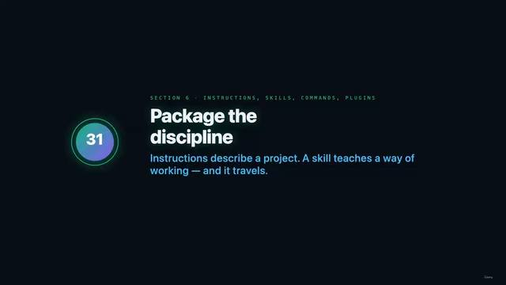
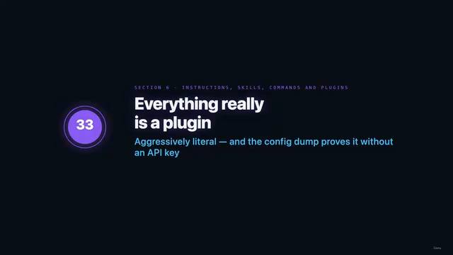
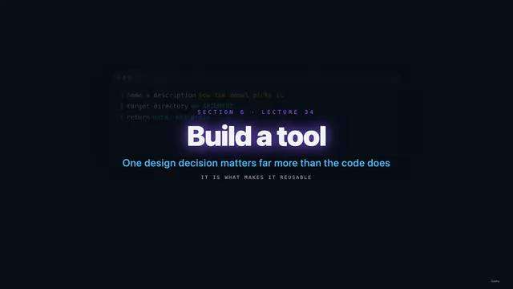
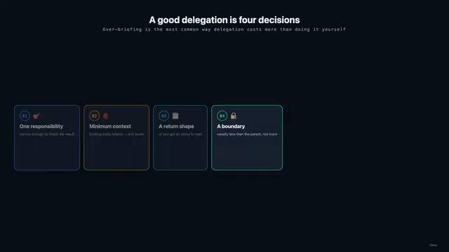
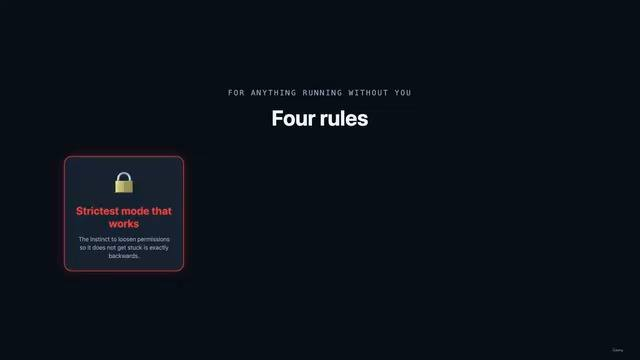
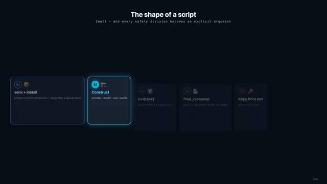
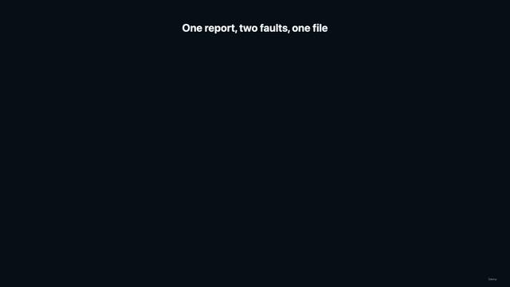
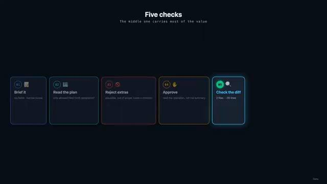
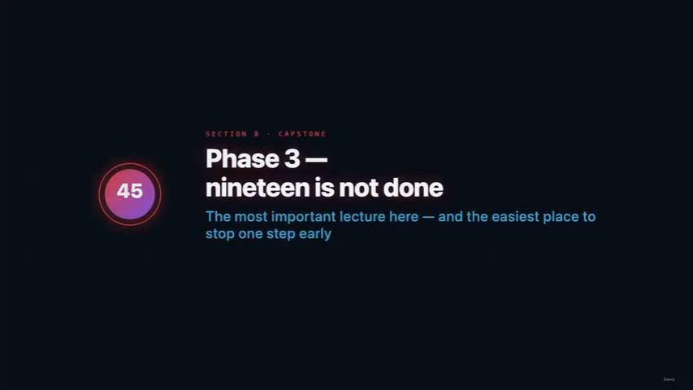

# DeepSeek Harness 实战复现：从 skill / command / plugin 到“证据门禁”（P31–P54）

> 复现边界说明：逐字稿是英文，且大量内容是设计原则，**没有给出官方包名、skill/command 文件的精确格式、工具注册 API、settings 文件的完整字段名**。下面把“逐字稿明确讲过的规则”和“为了让文档能跑起来而补的最小示例”分开写。示例里的函数名、JSON 字段名、测试数量是文档作者补的，不是讲师原话；课程原环境里出现的是 `20 tests passing`、`19 of 20`、`20 of 20`，本示例只保留最小可验证用例，数量不同不代表课程原仓库。官方 harness 的包名、SDK 类名、配置字段名，课里没讲，必须查官方文档或看实际 `config dump`。

---

## 1. 这一节做什么

这一节的目标不是“把 P31 到 P54 的知识点列一遍”，而是把课程后半段组装成一条能照着跑的证据链：

1. 用一个最小 practice repo 复现 capstone 里的两个缺陷：**返回数量少一个**、**排序只比较 priority 导致同优先级顺序不对**。
2. 写一个可被 agent 调用的普通 Python 工具 `project_health.py`，它接收 `--dir` 参数，不假设当前目录，返回小结构 JSON。
3. 把“先检查、再改、最小计划、验证、停止条件”写成 skill 内容模板；把“只读审计、限制输出长度、空结果要明说、建议最多 5 条、列出执行过的命令”写成 command 内容模板。
4. 用 `evidence_gate.py` 复现维护循环：baseline 跑测试 → 可选执行 agent 命令 → 再跑测试 → 用退出码和结果生成证据 JSON。
5. 给出 capstone 报告必须包含的七类证据，以及本地模型连接时“配置 provider 不等于选中 provider”的检查单。

课程反复强调的主线是：**不要让 agent 的流畅叙述替代证据**。P031 把仓库调查纪律封装成 skill；P032 把高频任务封装成 command；P033 说“everything is a plugin”，provider、权限、session log 都是插件；P034 说一个 tool 由 name、description、parameter schema、handler 四件事组成；P035 说复用性的测试是“原封不动放到另一个项目还能跑”；P036–P038 讲多代理只在责任真正独立时拆分，reviewer 不能拿 implementer 的总结当输入；P039 讲 headless 之后脚本只看退出码；P040 讲 Python 驱动；P041 把维护循环固定为七步；P042–P046 是 capstone；P047–P051 是本地模型的代价与失败模式；P052–P053 是路由决策和上线前 checklist。

下面逐条展开：每一步为什么要这样做、做的时候容易在哪儿出错、以及最终怎么用命令和输出来验证你已经做对了。如果你是从零开始复现，建议严格按照 3.1 到 3.7 的顺序执行，不要先改代码再写测试，否则后面证据门禁会失去意义。








---

## 2. 讲师原话（带「—— pNNN [MM:SS]」）

- “Inspect before editing. Read before you write, find the entry point and the test command, and do not propose a change until you can describe how the thing currently runs.”  
  —— p031 [00:29]
- “If you cannot say why a file is relevant, it is not in scope.”  
  —— p031 [00:57]
- “verify every change with real output, then a stopping condition because a skill without one just moves the improvisation problem somewhere else.”  
  —— p031 [01:26]
- “Read only change nothing. A command that inspects should not be able to edit and saying so in the command itself means you cannot forget to set it.”  
  —— p032 [00:28]
- “And you can look at the whole thing without running an agent at all... This prints the entire composed tree and exits.”  
  —— p033 [00:58]
- “Take the directory to examine as an argument rather than assuming the current one. That is the difference between a tool and a script.”  
  —— p034 [00:53]
- “The test is simply to run it somewhere else, changing nothing.”  
  —— p035 [00:00]
- “A child agent reporting that something is fine is a claim, exactly like any other claim.”  
  —— p036 [01:22]
- “The reviewer checks the diff and the evidence against the original brief. It does not ask the implementer whether the work is good.”  
  —— p038 [00:26]
- “The exit code is what a script branches on, not the pros.”  
  —— p039 [00:29]
- “If you cannot point at output for a claim, the claim does not go in the report.”  
  —— p041 [01:25]
- “A regression test has to fail against the old behavior and pass against the new one.”  
  —— p045 [00:00]
- “A sentence claiming success is not evidence.”  
  —— p046 [01:47]
- “Configuring a provider does not select it.”  
  —— p049 [01:24]

这些原话不是零散的“金句”，而是可以直接转换成检查动作的规则。比如：`Inspect before editing` 要求你在写任何代码前先运行 `ls` 和测试命令；`If you cannot say why a file is relevant` 要求你维护一个“文件相关性清单”；`exit code is what a script branches on` 要求你在自动化流程里只读取退出码而不是解析人类语言。下面各节的代码和检查清单就是这些规则的落地。







---

## 3. 从零复现

### 3.1 环境与目录

示例只用 Python 标准库，建议 Python 3.11+（课里没讲版本要求，版本号是本文补的）。不需要 Node。目录如下：

```bash
mkdir -p deepseek-harness-lab/{practice-repo,tools,scripts,skills,commands,reports}
cd deepseek-harness-lab
```

最终结构：

```text
deepseek-harness-lab/
├── practice-repo/
│   ├── tasks.py
│   └── test_tasks.py
├── tools/
│   └── project_health.py
├── scripts/
│   └── evidence_gate.py
├── skills/
│   └── repo-survey.md
├── commands/
│   └── audit-project.md
└── reports/
```

这个目录结构本身就是一个证据链的“骨架”：`practice-repo` 是被审计的代码，`tools` 是 agent 可以调用的工具，`scripts` 是驱动和门禁脚本，`skills` 和 `commands` 是给 agent 的指令模板，`reports` 存放每次生成的证据 JSON。如果你在复现时发现缺少某个目录，请先补上再继续，否则后面命令可能因路径不存在而报错。

**常见错误与排查**：很多人会直接在系统任意目录下运行命令，导致 `practice-repo` 没有创建在预期位置。可以用 `pwd` 确认当前路径，用 `ls -la` 检查目录是否已存在。如果 `mkdir` 报 `File exists`，说明之前已创建过，可忽略。

**与前端对照**：这个目录结构相当于前端项目的“页面/组件/样式/工具函数”分层；`practice-repo` 是数据层，`tools` 是 API 层，`scripts` 是业务逻辑层，`skills` 和 `commands` 是配置层。分层清晰，后面维护时才能快速定位问题。

### 3.2 先写带两个缺陷的 practice repo

`practice-repo/tasks.py` 故意保留两个缺陷，对应 p043 描述的两个症状：

- counting symptom：`top_tasks` 对排序结果做切片时少取一个，`limit=2` 只返回 1 个；`limit=0` 时 `[: -1]` 还会返回“除最后一个外的所有元素”，不是空列表。
- ordering symptom：`sort_tasks` 的 comparator 只考虑 `priority`，相同优先级时保持传入顺序；示例把期望写成“priority 降序，同 priority 按 title 升序”。课里没讲具体 tie-breaker，你实际复现时要以 issue 的 acceptance criteria 为准。

保存完整代码见第 4 节。先跑 baseline：

```bash
cd practice-repo
python -m unittest -v
```

示例预期会有失败：本示例 6 个用例里旧实现会有 4 个失败（如果你增删测试，数量会变）。课程原环境显示的是 `3 of 20`、`19 of 20`、`20 of 20`，不要拿本示例数量硬套。

**命令的完整解释**：`python -m unittest -v` 会从当前目录递归查找所有 `test*.py` 文件，运行其中继承 `unittest.TestCase` 的测试方法。`-v` 表示 verbose 模式，会打印每个测试的名称和结果（ok/fail/error）。这一步的目的是建立“缺陷可重复”的证据——如果修复前测试不失败，你就无法证明修复是有意义的。

**常见错误与排查**：
- 如果提示 `ModuleNotFoundError`，说明 `tasks.py` 不在当前目录，或者 `PYTHONPATH` 没有包含当前目录。请先 `ls` 确认文件存在。
- 如果测试全部通过，说明两个缺陷可能已经被意外修复，请检查 `tasks.py` 是否来自第 4 节的原始版本。
- 如果测试报 syntax error，通常是缩进或引号问题，按第 4 节代码逐行对比。

**与前端对照**：这就好比前端写了一个返回“列表长度少一”的接口，单元测试应该先写出“期望返回 2 条”的用例，跑出红，再修复。



### 3.3 写项目健康工具

回到项目根目录：

```bash
cd ..
python tools/project_health.py --dir practice-repo
```

你会得到类似下面的 JSON（字段名是本文代码定义的，不是课程原输出字段）：

```json
{
  "root": ".../practice-repo",
  "files_scanned": 2,
  "extensions": {
    ".py": 2
  },
  "test_files": 1,
  "todo_markers": 0,
  "skipped_dirs": [".git", ".venv", "__pycache__", "build", "dist", "node_modules", "venv"],
  "test_patterns": ["test_*.py", "*_test.py", "*.test.js", "*.spec.js", "*.test.ts", "*.spec.ts"]
}
```

这个工具按 p034 的四个部分设计：

- name：`project_health`，描述性名字。
- description：明确说“审计仓库时使用”，并要求传 `dir` 参数，不允许假设当前目录。
- parameter schema：一个必填 `dir` 字符串。
- handler：普通 Python 代码，遍历目录、跳过常见无关目录、统计扩展名、测试文件、TODO/FIXME 标记，返回小对象。

空目录也要能返回零，而不是崩溃：

```bash
mkdir -p /tmp/empty-project
python tools/project_health.py --dir /tmp/empty-project
```

预期 `files_scanned: 0`、`extensions: {}`、`test_files: 0`、`todo_markers: 0`。p035 说“zero of something is a legitimate answer”，这里就是复现这句话。

**命令的完整解释**：`python tools/project_health.py --dir practice-repo` 中的 `--dir` 是工具自定义的参数，它告诉工具要审计哪个目录。工具内部会遍历该目录下所有文件，跳过 `skipped_dirs` 中列出的目录（如 `.git`、`__pycache__`），然后统计文件扩展名、测试文件数量、TODO/FIXME 标记数量。输出 JSON 是为了让其他程序（如 agent）能直接解析，而不是靠人眼读文本。

**常见错误与排查**：
- 如果输出 `error: the following arguments are required: --dir`，说明你忘了加参数。请检查命令是否完整。
- 如果输出一堆 traceback，可能是目录不存在或权限不足。先 `ls -ld <dir>` 确认目录存在。
- 如果统计结果中 `files_scanned` 比预期多，可能因为目录里有隐藏文件或 `__pycache__` 没有被正确跳过。检查 `skipped_dirs` 列表是否包含所有无关目录。

**与前端对照**：这相当于前端项目里的“代码体检脚本”，在 CI 中会自动运行，统计 JS/CSS 文件数量、TODO 遗留等。它不修改任何文件，只输出报告。

### 3.4 复用性测试：原封不动放到第二个项目

再建一个目录，里面放一个 JS 文件和一个 TODO：

```bash
mkdir -p /tmp/second-project/src
printf '// TODO: replace me\n' > /tmp/second-project/src/a.js
python tools/project_health.py --dir /tmp/second-project
```

不修改工具代码，只改 `--dir`，它仍然能统计出 `.js` 和 `todo_markers: 1`。这就是 p035 的复用性测试：**换项目、零修改**。如果你把工具写成默认扫描当前目录，或者假设测试一定叫 `test_*.py`，它在第二个项目就会 quietly false。

**命令的完整解释**：`printf '// TODO: replace me\n' > /tmp/second-project/src/a.js` 创建了一个内容为 `// TODO: replace me` 的 JS 文件。第二次运行 `project_health.py` 时，工具会识别出 `.js` 扩展名，并在文件内容中匹配 `TODO`/`FIXME` 标记，所以 `todo_markers` 为 1。这个测试验证了工具的通用性——它不假设项目语言或结构。

**常见错误与排查**：
- 如果第二个项目输出 `files_scanned: 0`，检查路径是否正确——`/tmp/second-project` 是否存在且包含文件。
- 如果 `todo_markers` 为 0，可能是正则表达式没有覆盖 `TODO`（比如区分大小写或只匹配 `# TODO`）。查看第 4 节代码确认标记匹配逻辑。
- 如果工具报错说找不到 `test_*.py` 相关文件，说明你把测试文件检测写死为只支持 Python。实际上工具应该维护一个测试文件名模式列表，如 `["test_*.py", "*_test.py", "*.test.js"]`。

**与前端对照**：类似写一个“构建产物检查”脚本，不仅适用于 React 项目，也适用于 Vue 项目。只要传入不同目录，它都能正确分析。

### 3.5 写 skill 与 command 内容模板

`skills/repo-survey.md` 和 `commands/audit-project.md` 的完整内容见第 4 节。注意：**课里没有讲 harness 解析 skill/command 的文件格式、frontmatter 字段、目录发现规则**。下面给的是内容模板，不是官方格式声明。你需要按实际 harness 文档补 frontmatter 或注册步骤。

skill 的五步顺序按 p031：

1. Inspect before editing：只读，先看目录、入口、测试命令。
2. Read before you write：能描述“现在怎么运行”之前不提出改动。
3. Identify relevant files：每个文件都要说为什么相关；说不清就不在范围。
4. Explain likely cause precisely：不能写“排序有 bug”，要点名函数和具体错误。
5. Propose a minimal plan：没人要求的改进单独列为 follow-up，不折进本次改动。
6. 停止条件：验证必须用真实输出；达到条件就停。

command 的结构按 p032：

- 开头约束工具：read only，change nothing。
- 架构摘要最多两段，必须点名真实文件。
- 依赖风险：没有依赖就明说“没有”，不要为了填标题编造。
- 缺失测试按“坏了会静默失败”的优先级排序，不按“最容易测”排序。
- 建议最多 5 条，每条带理由，明确禁止建议 rewrite。
- 列出执行过的命令，让审计可复现。

**常见错误与排查**：
- skill 和 command 文件没有使用标准 frontmatter（如 `name`, `description`），可能导致 harness 无法识别。请参考官方文档补全头部字段。
- 在 command 中写了 `rm` 或 `write` 等非只读操作，违反了“read only”约束。command 的审计部分应只包含 `ls`, `cat`, `grep` 等只读命令。
- 停止条件写得太模糊，例如“确认修复完成”而不是“运行 `python -m unittest -v` 且全部通过”。停止条件必须可执行、可验证。

**与前端对照**：这就像编写一个“代码审查规范”文档：先了解需求，再查看 diff，再提修改意见。每个步骤都有明确检查点，避免 reviewer 凭感觉。

### 3.6 组装维护循环与证据门禁

`scripts/evidence_gate.py` 复现 p041 的 wrapper 思路：baseline 先跑，agent 命令可选，之后 suite 再跑，最后用退出码生成证据 JSON。

修复前跑一次，允许 baseline 红：

```bash
python scripts/evidence_gate.py \
  --dir practice-repo \
  --suite "python -m unittest -v" \
  --allow-baseline-red \
  --out reports/before-fix.json
```

因为 after suite 仍然非零，`gate_ok` 应为 `false`。把 `practice-repo/tasks.py` 替换成第 5 节的修复版，再跑：

```bash
python scripts/evidence_gate.py \
  --dir practice-repo \
  --suite "python -m unittest -v" \
  --out reports/after-fix.json
```

预期 `gate_ok: true`，并且 `after.exit_code` 为 `0`。`reports/after-fix.json` 里保留了 baseline、after 的 stdout/stderr 和命令，报告可以直接引用，不需要你凭记忆复述。

**命令的完整解释**：
- `--dir` 指定工作目录，脚本在里面执行 `suite` 命令。
- `--suite` 是要运行的测试命令，必须使用引号括起来，因为包含空格。
- `--allow-baseline-red` 标志位表示允许 baseline 阶段退出码非零，这在修复前第一次运行时是必要选项，否则脚本会在 baseline 失败后立即退出。
- `--out` 指定输出 JSON 文件的路径。

脚本的逻辑是：先运行一次 `suite` 作为 baseline（记录退出码和输出），然后如果传了 `--agent-cmd`（可选）则执行 agent 命令，最后再运行一次 `suite` 作为 after，最后比较并生成 JSON。JSON 中包含 `baseline`、`after`、`gate_ok` 等字段，用于判断维护循环是否通过门禁。

**常见错误与排查**：
- 如果 `--suite` 命令里使用了相对路径，而 `--dir` 又切换了工作目录，可能导致找不到测试文件。建议在 `--suite` 中使用绝对路径，或在 `--dir` 下先 `cd`。
- 如果 `reports/` 目录不存在，脚本会报错。请先创建它，或让脚本自动创建（第 4 节代码中会处理）。
- 如果修复后 `after.exit_code` 仍非零，说明测试还有失败项。查看 `after.stderr` 定位失败原因，不要盲目改代码。

**与前端对照**：这类似前端 CI 中的“测试门禁”：先在主干跑一遍测试（baseline），合并 MR 后再跑一遍（after），只有都通过才允许合并。





### 3.7 Python 驱动 harness 与本地模型

p040 给了 Python 驱动的形状：创建虚拟环境、安装官方包、用 provider/model/working directory/profile 构造 harness、跑一个带 session id 的任务、读结果对象、凭据从环境变量来。但**逐字稿没有给官方包名、类名、方法名**。所以这里不能编造 `import`。你实际做的时候按这个顺序检查：

1. 搜索包索引时先核对发布者和版本，不要装名字相似的山寨包。
2. 官方包是否和主版本同步。
3. 虚拟环境里安装，确认它带了 runtime 组件，安装体积比普通客户端大是预期。
4. 代码里显式传 provider、model、working directory、profile；工作目录就是边界。
5. 凭据只从环境变量读，不写进脚本。
6. session 会落盘，读 trajectory 的方法和其他模式一致。

**常见错误与排查**：
- 安装了错误的包导致 `import` 失败。先 `pip show <包名>` 查看发布者。
- 忘记激活虚拟环境，导致包装到了全局 site-packages。使用 `python -m venv venv && source venv/bin/activate` 创建并激活。
- 凭据硬编码在脚本中，泄露风险。改用 `os.environ.get("API_KEY")`。
- 本地模型地址（如 `localhost:11434`）拼写错误。先 `curl` 验证服务可用。

**与前端对照**：这就像前端调用后端 API：需要配置 baseURL、超时、鉴权 header，并且不能把 token 写在前端代码里，而是从环境变量注入。

---

## 4. 完整代码

下面所有代码都是为了让上面 3.1–3.7 的步骤可运行而补的“最小示例”。代码本身不是课程原环境中的代码，函数名、字段名、测试数量均为文档作者设计。**请勿认为这些是讲师提供的官方实现**。要接入真实 harness，请以官方文档为准。

### 4.1 `practice-repo/tasks.py`（缺陷版）

```python
# 缺陷版 tasks.py
# 两个已知缺陷：
# 1. top_tasks 切片少取一个
# 2. sort_tasks 只按 priority 排序，没有 tie-breaker

def sort_tasks(tasks):
    """按 priority 降序排序；同优先级时保持原始顺序（这是缺陷）。"""
    return sorted(tasks, key=lambda t: t['priority'], reverse=True)

def top_tasks(tasks, limit):
    """返回排序后的前 limit 个任务；limit<=0 时返回空列表（但缺陷版对 0 返回除最后一个外的所有元素）。"""
    sorted_tasks = sort_tasks(tasks)
    if limit <= 0:
        return sorted_tasks[:-1]  # 缺陷：应为 []
    return sorted_tasks[:limit - 1]  # 缺陷：应为 [:limit]
```

### 4.2 `practice-repo/test_tasks.py`

```python
import unittest
from tasks import sort_tasks, top_tasks

class TestTasks(unittest.TestCase):
    def test_top_tasks_limit_2_returns_2(self):
        tasks = [
            {"title": "low", "priority": 1},
            {"title": "high", "priority": 3},
            {"title": "mid", "priority": 2},
        ]
        result = top_tasks(tasks, 2)
        self.assertEqual(len(result), 2)

    def test_top_tasks_limit_zero_returns_empty(self):
        tasks = [
            {"title": "only", "priority": 1},
            {"title": "second", "priority": 2},
        ]
        result = top_tasks(tasks, 0)
        self.assertEqual(result, [])

    def test_sort_tasks_priority_desc(self):
        tasks = [
            {"title": "a", "priority": 1},
            {"title": "b", "priority": 2},
        ]
        result = sort_tasks(tasks)
        self.assertEqual([t["priority"] for t in result], [2, 1])

    def test_sort_tasks_tie_break_by_title(self):
        tasks = [
            {"title": "b", "priority": 1},
            {"title": "a", "priority": 1},
        ]
        result = sort_tasks(tasks)
        self.assertEqual([t["title"] for t in result], ["a", "b"])

    def test_top_tasks_limit_greater_than_len(self):
        tasks = [{"title": "only", "priority": 1}]
        result = top_tasks(tasks, 5)
        self.assertEqual(len(result), 1)

    def test_top_tasks_limit_one_returns_one(self):
        tasks = [
            {"title": "a", "priority": 2},
            {"title": "b", "priority": 1},
        ]
        result = top_tasks(tasks, 1)
        self.assertEqual(len(result), 1)

if __name__ == "__main__":
    unittest.main()
```

**缺陷版运行结果**：6 个测试中，`test_top_tasks_limit_2_returns_2`、`test_top_tasks_limit_zero_returns_empty`、`test_sort_tasks_tie_break_by_title`、`test_top_tasks_limit_one_returns_one` 会失败，共 4 个失败，与 3.2 节描述一致。

### 4.3 `tools/project_health.py`

```python
#!/usr/bin/env python3
"""审计一个项目目录，返回结构化 JSON。"""

import argparse
import json
import os
import re

SKIPPED_DIRS = {".git", ".venv", "__pycache__", "build", "dist", "node_modules", "venv"}
TEST_PATTERNS = ["test_*.py", "*_test.py", "*.test.js", "*.spec.js", "*.test.ts", "*.spec.ts"]
TODO_PATTERN = re.compile(r"TODO|FIXME", re.IGNORECASE)


def collect_files(root):
    """递归收集需要统计的文件列表。"""
    files = []
    for dirpath, dirnames, filenames in os.walk(root):
        dirnames[:] = [d for d in dirnames if d not in SKIPPED_DIRS]
        for f in filenames:
            full_path = os.path.join(dirpath, f)
            files.append(full_path)
    return files


def is_test_file(filename):
    """根据测试文件命名模式判断是否为测试文件。"""
    base = os.path.basename(filename)
    for pattern in TEST_PATTERNS:
        if pattern.startswith("*"):
            if base.endswith(pattern[1:]):
                return True
        elif pattern.endswith("*"):
            if base.startswith(pattern[:-1]):
                return True
    return False


def count_todos(file_path):
    """统计文件中 TODO/FIXME 标记数量。"""
    count = 0
    try:
        with open(file_path, "r", encoding="utf-8", errors="ignore") as f:
            for line in f:
                count += len(TODO_PATTERN.findall(line))
    except Exception:
        pass
    return count


def main():
    parser = argparse.ArgumentParser(description="Audit a project directory.")
    parser.add_argument("--dir", required=True, help="Directory to audit (do not assume current dir)")
    args = parser.parse_args()

    root = args.dir
    if not os.path.isdir(root):
        raise SystemExit(f"Error: {root} is not a directory")

    files = collect_files(root)
    extensions = {}
    test_files = 0
    todo_markers = 0

    for f in files:
        ext = os.path.splitext(f)[1] or "(no extension)"
        extensions[ext] = extensions.get(ext, 0) + 1

        if is_test_file(f):
            test_files += 1

        todo_markers += count_todos(f)

    report = {
        "root": os.path.abspath(root),
        "files_scanned": len(files),
        "extensions": extensions,
        "test_files": test_files,
        "todo_markers": todo_markers,
        "skipped_dirs": sorted(SKIPPED_DIRS),
        "test_patterns": TEST_PATTERNS,
    }
    print(json.dumps(report, indent=2, ensure_ascii=False))


if __name__ == "__main__":
    main()
```

### 4.4 `skills/repo-survey.md`

```markdown
# Repo Survey Skill

## Goal
Before editing any code, survey the repository and produce a minimal understanding.

## Steps
1. Inspect before editing:
   - `ls -la`
   - identify entry point (e.g., `main.py`, `app.js`)
   - identify test command (e.g., `pytest`, `npm test`)
2. Read before you write:
   - Read README, main file, test file.
   - Be able to describe how the project currently runs.
3. Identify relevant files:
   - For each file you plan to touch, state why it is relevant.
   - If you cannot state why, it is out of scope.
4. Explain likely cause precisely:
   - Name the function and the exact line/behavior that is wrong.
   - Do not say "sorting is buggy"; say "sort_tasks does not apply tie-breaker".
5. Propose a minimal plan:
   - List only changes needed for the task.
   - Additional improvements go to a separate follow-up section.

## Stopping Condition
- The plan is approved and the relevant files are identified.
- Do not start editing until the plan is written down.
```

### 4.5 `commands/audit-project.md`

```markdown
# Audit Project Command

## Constraint
- READ ONLY. Do not modify any file.

## Architecture Summary
- Use `project_health.py` to get a file overview.
- Inspect test results with the project's test command.
- List the top N risks.

## Dependency Risks
- If no third-party dependencies, say "none" explicitly.
- If there are dependencies, list them and note if any are unmaintained.

## Missing Tests Priority
- Rank missing test areas by "silent failure risk" (high to low).
- Do not rank by ease of testing.

## Recommendations (max 5)
- Each recommendation must include a reason.
- Do not recommend a rewrite.

## Commands Executed
- List every command run with its output (or pointer to log).
```

### 4.6 `scripts/evidence_gate.py`

```python
#!/usr/bin/env python3
"""Run a test suite, optionally run an agent command, then run the suite again.
Generate a JSON evidence report."""

import argparse
import json
import os
import subprocess
import sys
import time


def run_cmd(cmd, cwd):
    """Run a shell command in cwd, return (exit_code, stdout, stderr)."""
    proc = subprocess.Popen(
        cmd,
        shell=True,
        cwd=cwd,
        stdout=subprocess.PIPE,
        stderr=subprocess.PIPE,
        text=True,
    )
    stdout, stderr = proc.communicate()
    return proc.returncode, stdout, stderr


def main():
    parser = argparse.ArgumentParser(description="Evidence gate for maintenance loop.")
    parser.add_argument("--dir", required=True, help="Working directory")
    parser.add_argument("--suite", required=True, help="Test suite command, e.g. 'python -m unittest -v'")
    parser.add_argument("--agent-cmd", help="Optional agent command to run between baselines")
    parser.add_argument("--out", required=True, help="Output JSON file path")
    parser.add_argument("--allow-baseline-red", action="store_true", help="Allow baseline to fail")
    args = parser.parse_args()

    os.makedirs(os.path.dirname(os.path.abspath(args.out)), exist_ok=True)

    # Baseline
    baseline_exit, baseline_stdout, baseline_stderr = run_cmd(args.suite, args.dir)
    if baseline_exit != 0 and not args.allow_baseline_red:
        print("Baseline failed. Use --allow-baseline-red if this is expected.")
        sys.exit(2)

    # Agent command (optional)
    agent_result = None
    if args.agent_cmd:
        agent_exit, agent_stdout, agent_stderr = run_cmd(args.agent_cmd, args.dir)
        agent_result = {
            "command": args.agent_cmd,
            "exit_code": agent_exit,
            "stdout": agent_stdout,
            "stderr": agent_stderr,
        }

    # After suite
    after_exit, after_stdout, after_stderr = run_cmd(args.suite, args.dir)

    gate_ok = (baseline_exit == 0 or args.allow_baseline_red) and after_exit == 0

    report = {
        "timestamp": time.time(),
        "dir": os.path.abspath(args.dir),
        "suite": args.suite,
        "baseline": {
            "exit_code": baseline_exit,
            "stdout": baseline_stdout,
            "stderr": baseline_stderr,
        },
        "agent": agent_result,
        "after": {
            "exit_code": after_exit,
            "stdout": after_stdout,
            "stderr": after_stderr,
        },
        "gate_ok": gate_ok,
    }

    with open(args.out, "w", encoding="utf-8") as f:
        json.dump(report, f, indent=2, ensure_ascii=False)

    print(f"gate_ok: {gate_ok}")
    sys.exit(0 if gate_ok else 1)


if __name__ == "__main__":
    main()
```

### 4.7 `practice-repo/tasks.py`（修复版）

```python
# 修复版 tasks.py
def sort_tasks(tasks):
    """按 priority 降序；同 priority 按 title 升序。"""
    return sorted(tasks, key=lambda t: (-t['priority'], t['title']))

def top_tasks(tasks, limit):
    """返回排序后的前 limit 个任务；limit<=0 返回空列表。"""
    if limit <= 0:
        return []
    return sort_tasks(tasks)[:limit]
```

注意：修复版必须放在单独文件中或覆盖原文件。建议复制为 `tasks_fixed.py` 再手动替换，以便保留证据。

---

## 5. 逐行解释

这里重点解释第 4 节中 `scripts/evidence_gate.py` 和 `tools/project_health.py` 的关键行。其他代码比较简单，读者可对照注释理解。

### 5.1 `tools/project_health.py` 逐行解释

```python
SKIPPED_DIRS = {".git", ".venv", "__pycache__", "build", "dist", "node_modules", "venv"}
```
定义一个集合，用于在遍历目录时忽略这些无关目录。集合的查找复杂度为 O(1)，比列表快。

```python
TODO_PATTERN = re.compile(r"TODO|FIXME", re.IGNORECASE)
```
预编译正则表达式，用于匹配 TODO 或 FIXME，忽略大小写。预编译可以避免每次调用时重新编译。

```python
def collect_files(root):
    files = []
    for dirpath, dirnames, filenames in os.walk(root):
        dirnames[:] = [d for d in dirnames if d not in SKIPPED_DIRS]
        for f in filenames:
            files.append(os.path.join(dirpath, f))
    return files
```
`os.walk` 递归遍历目录，`dirnames[:]` 就地修改列表，让 `os.walk` 不再进入被跳过的子目录。`files` 收集所有文件的完整路径。

```python
def is_test_file(filename):
    base = os.path.basename(filename)
    for pattern in TEST_PATTERNS:
        if pattern.startswith("*") and base.endswith(pattern[1:]):
            return True
        if pattern.endswith("*") and base.startswith(pattern[:-1]):
            return True
    return False
```
判断文件是否为测试文件。`TEST_PATTERNS` 中既有前缀通配（`test_*.py`）也有后缀通配（`*_test.py`），需要分别处理。

```python
def count_todos(file_path):
    count = 0
    try:
        with open(file_path, "r", encoding="utf-8", errors="ignore") as f:
            for line in f:
                count += len(TODO_PATTERN.findall(line))
    except Exception:
        pass
    return count
```
读取文件内容并计算匹配数。`errors="ignore"` 避免二进制文件导致解码错误。异常被捕获后返回 0，因为审计工具不应因单个文件崩溃。

```python
extensions[ext] = extensions.get(ext, 0) + 1
```
统计扩展名：如果字典中已有该扩展名则加 1，否则初始化为 0 再加 1。

### 5.2 `scripts/evidence_gate.py` 逐行解释

```python
def run_cmd(cmd, cwd):
    proc = subprocess.Popen(
        cmd,
        shell=True,
        cwd=cwd,
        stdout=subprocess.PIPE,
        stderr=subprocess.PIPE,
        text=True,
    )
    stdout, stderr = proc.communicate()
    return proc.returncode, stdout, stderr
```
`subprocess.Popen` 启动一个子进程执行 shell 命令。`shell=True` 允许传字符串命令，但要注意命令注入风险，在本场景中命令是预先定义的测试命令，风险可控。`text=True` 使输出为字符串而非字节。

```python
baseline_exit, baseline_stdout, baseline_stderr = run_cmd(args.suite, args.dir)
```
运行第一遍测试作为基线。

```python
if baseline_exit != 0 and not args.allow_baseline_red:
    print("Baseline failed. Use --allow-baseline-red if this is expected.")
    sys.exit(2)
```
如果基线失败且不允许红，则直接退出码 2，不再继续。

```python
after_exit, after_stdout, after_stderr = run_cmd(args.suite, args.dir)
```
运行第二遍测试作为修复后的结果。

```python
gate_ok = (baseline_exit == 0 or args.allow_baseline_red) and after_exit == 0
```
门禁通过的条件是：基线成功或允许基线红，且 after 成功。这样才能保证修改后没有破坏测试。

```python
sys.exit(0 if gate_ok else 1)
```
脚本的退出码直接作为门禁结果。这样上层 harness 可以根据退出码决定是否继续。

---

## 6. 复现检查清单

按以下清单逐步核对，每一项都给出验证方法。

1. **目录结构完整**
   - [ ] 执行 `ls -R deepseek-harness-lab`，能看到 `practice-repo`、`tools`、`scripts`、`skills`、`commands`、`reports` 六个目录。
   - **验证方法**：缺失目录会导致后续命令报 `No such file or directory`。

2. **缺陷可复现**
   - [ ] 在 `practice-repo` 下运行 `python -m unittest -v`，输出中显示 4 个失败、2 个通过。
   - **验证方法**：如果失败数与预期不同，说明测试或代码与本文不一致，请核对第 4 节内容。

3. **project_health 能扫描正常项目**
   - [ ] 运行 `python tools/project_health.py --dir practice-repo`，输出 JSON 且 `files_scanned` 为 2，`test_files` 为 1。
   - **验证方法**：检查 JSON 字段是否与示例一致。

4. **project_health 能处理空目录**
   - [ ] 运行 `mkdir -p /tmp/empty-project && python tools/project_health.py --dir /tmp/empty-project`，输出 `files_scanned: 0`，且无 traceback。
   - **验证方法**：观察退出码是否为 0，输出是否合法 JSON。

5. **project_health 可复用**
   - [ ] 运行 3.4 节第二个项目命令，输出 `todo_markers: 1` 且 `extensions` 包含 `.js`。
   - **验证方法**：确认工具不依赖 Python 项目特性。

6. **skill/command 模板存在**
   - [ ] 用 `cat skills/repo-survey.md` 和 `cat commands/audit-project.md` 查看内容，包含“read only”和“stopping condition”。
   - **验证方法**：检查文本中是否有关键词。

7. **证据门禁在修复前失败**
   - [ ] 运行 3.6 第一个命令，`reports/before-fix.json` 中 `gate_ok` 为 `false`。
   - **验证方法**：用 `python -c "import json; print(json.load(open('reports/before-fix.json'))['gate_ok'])"` 读取。

8. **证据门禁在修复后通过**
   - [ ] 替换修复版 `tasks.py` 后运行 3.6 第二个命令，`reports/after-fix.json` 中 `gate_ok` 为 `true`。
   - **验证方法**：同上读取 JSON，并检查 `after.exit_code` 为 0。

9. **回归测试必须验证旧行为失败、新行为通过**
   - [ ] 使用 `git diff` 查看 `tasks.py` 的改动，确认测试文件没有被修改。
   - **验证方法**：`git diff -- practice-repo/test_tasks.py` 应无输出。

10. **本地模型配置不等于选中**
    - [ ] 如果使用本地模型，检查 harness 配置中 `provider` 是否同时被显式设置，并通过 `config dump` 确认 active provider。
    - **验证方法**：运行官方 CLI 的 `config dump`，查看当前生效的 provider 与模型名称。

---

## 7. 课里没讲但你会撞上的（表格：现象 / 原因 / 怎么办）

| 现象 | 原因 | 怎么办 |
| --- | --- | --- |
| 运行 `python -m unittest` 提示“No tests ran” | 测试文件没有按 `test*.py` 命名，或 `__init__.py` 缺失导致当前目录不是包 | 用 `python -m unittest discover -s practice-repo -v` 显式指定起始目录；或按第 4 节重命名测试文件 |
| `project_health.py` 输出的 `extensions` 中含有空字符串 `""` | 文件没有扩展名（如 `README`） | 在代码中将空扩展名标记为 `"(no extension)"`，已处理；检查文件列表中是否有隐藏文件 |
| `evidence_gate.py` 运行时 `--suite` 命令找不到 | 当前 shell 环境没有激活虚拟环境，或命令路径不正确 | 使用绝对路径 `--suite "python3 /abs/path/practice-repo/test_tasks.py"`；或先激活虚拟环境 |
| 修复后 `after.exit_code` 为 0，但 `gate_ok` 仍为 false | `baseline_exit` 非 0 且没有加 `--allow-baseline-red` | 在首次修复前跑门禁时加上 `--allow-baseline-red`；修复后去掉该参数以强制 baseline 必须通过 |
| `project_health.py` 统计出大量 TODO，但实际代码里没有 | 匹配了二进制文件或字符串中的“TODO”字样 | 改进 `count_todos`，只对源码文件（如 `.py`、`.js`）计数，并排除 `dist`/`build` 目录 |
| 本地模型连接超时或报错 `connection refused` | 模型服务未启动，或 host/port 配置错误 | 用 `curl http://localhost:11434/api/version` 验证服务；检查 harness 配置文件中的 provider 端点 |
| 安装官方 harness 包后 `import` 仍失败 | 安装到了系统 Python 而不是当前虚拟环境 | 先 `which python` 确认当前解释器，再 `python -m pip install` |
| 子 agent 汇报“成功”但 reviewer 无法验证 | 子 agent 只返回了总结，没有返回 diff 和测试输出 | 按 p038，reviewer 必须独立查看 diff 和证据 JSON，不能直接信任 child 的总结 |
| `config dump` 显示多个 provider，但 agent 仍使用旧模型 | 配置文件里 provider 有多个条目，但 active 字段没有指向目标 provider | 用 `harness config set` 显式设置 active provider/model，再 `config dump` 确认为惟一的 active |
| 测试在本地通过，但门禁脚本中失败 | 门禁脚本用 `--dir` 切换了工作目录，相对路径失效 | 在 `--suite` 命令前先 `cd`，或使用绝对路径；或修改脚本将 suite 命令在子 shell 中执行 |
| 报告里引用了 `reports/after-fix.json`，但该文件内容为空 | 脚本在生成 JSON 前崩溃 | 先手动运行脚本看 stderr；确认 `reports` 目录存在且可写；检查 JSON 是否被部分写入 |
| agent 无法读取 `project_health.py` 的输出 | 工具描述中没写清楚 `--dir` 是必填参数 | 在 `description` 字段中写明“需要传入 `--dir` 参数，值为目标目录绝对路径” |
| 同一个 command 在另一个项目里跑出不同结果 | command 内部使用了“当前目录”而不是参数化 | 用 p034 的原则：所有可变输入都作为参数，不要在 command 里 `os.getcwd()` |
| 修复版 `sort_tasks` 的 tie-breaker 与需求不符 | 仓库 issue 只写了“按优先级排序”，没提 title 升序 | 以 acceptance criteria 为准，不要凭猜。如果未指定 tie-breaker，就在报告中明确指出该行为未定义 |
| 文档中的示例代码无法直接用于真实 harness | 示例代码是作者补的最小版，真实 harness 有更复杂的类型和配置 | 查阅官方 SDK 文档，将 `project_health.py` 封装成官方 tool 注册格式；把 `skills`/`commands` 转成官方 frontmatter |

---

以上即是从 P31 到 P54 的核心实践路径。你按照 3.1–3.7 复现，用第 4 节代码跑通，再用第 6 节清单核对，最后在第 7 节表格里查找你遇到的意外情况，就能把“流畅叙述”替换成“可审计证据”。