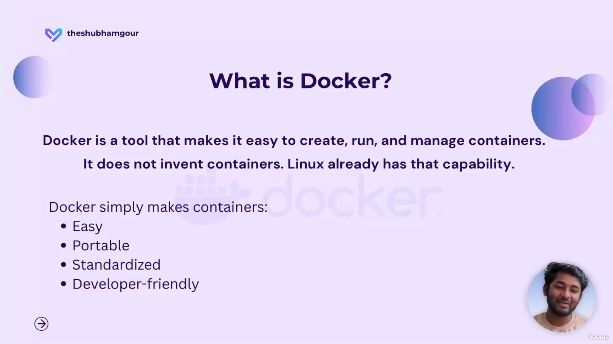
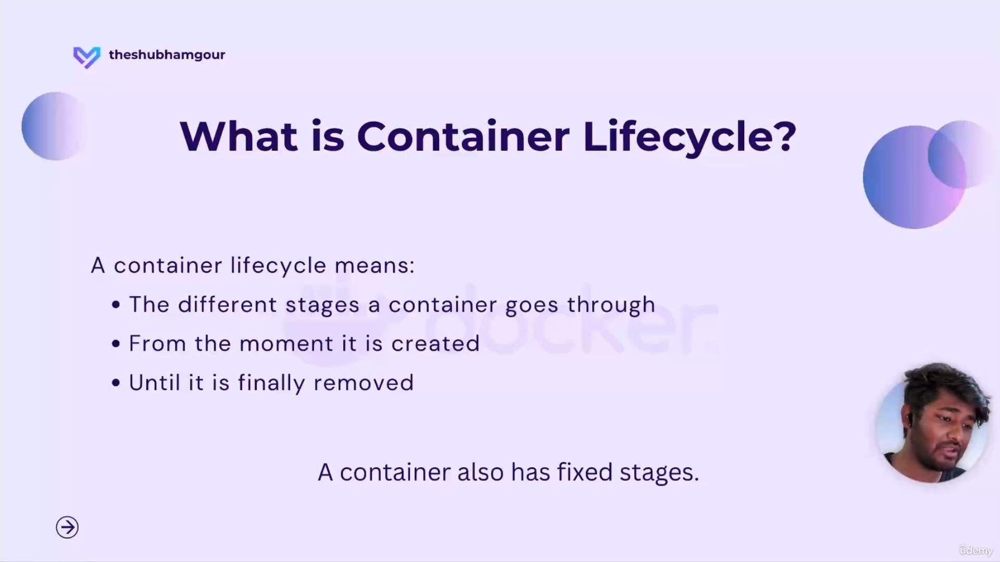
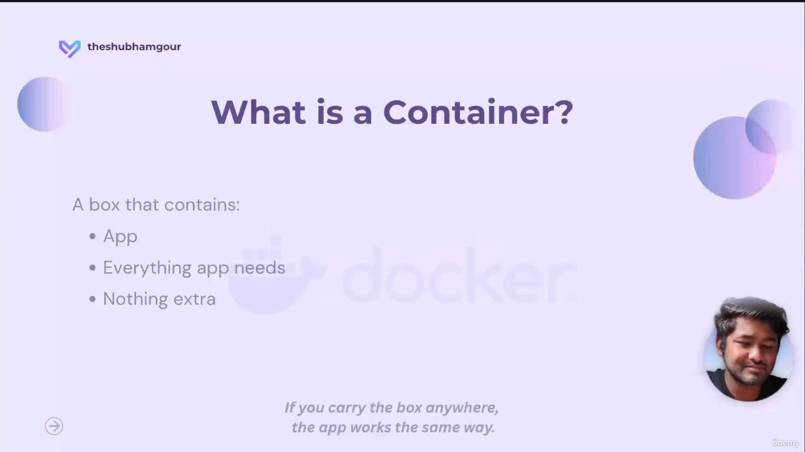
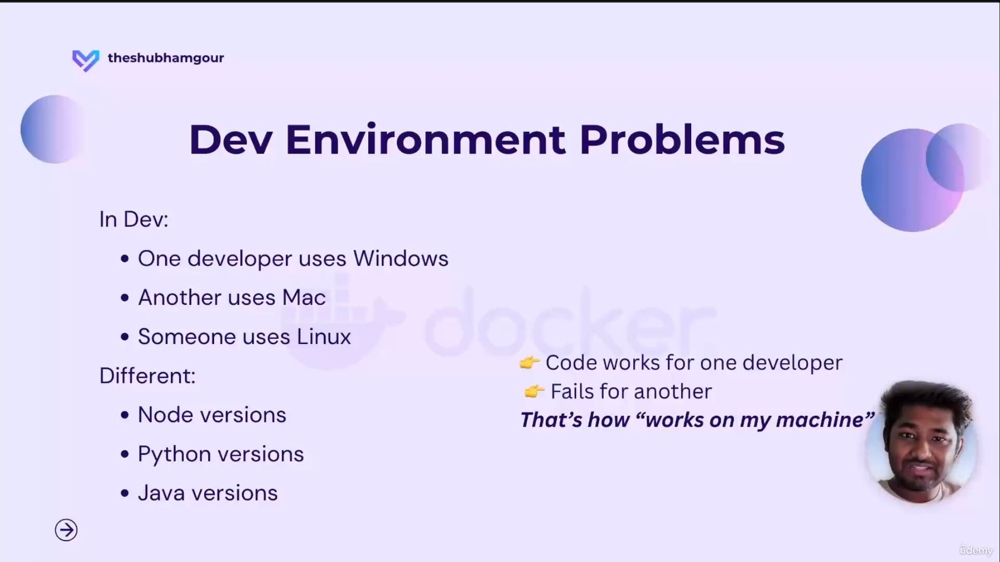

# Docker Masterclass P1–P10 复现文档：从「环境不一致」到第一次 `docker run` 跑通

> 覆盖：BV1jcRKBEEfK P1–P10 · 音频约 83.8 小时中的前 10 集
> 读者画像：会写 JS/Node、没碰过容器的前端工程师
> 本文目标：读完能在一台干净的机器上装好 Docker、跑起课程里唯一一条真实命令 `docker run nginx`，并且能用命令亲手验证课上讲的「隔离」「资源限制」「生命周期」三件事。

---

## 1. 这一节做什么

这十集里，讲师**没有写一行业务代码**。他的定位非常明确：在动手之前先把地基打牢。P2 讲软件部署为什么痛，P3–P4 讲虚拟机与容器的分野，P5 讲环境变量不一致才是 bug 的真正来源，P6 给容器下定义，P7 讲容器生命周期，P8 讲 namespaces 与 cgroups 如何做到「共享内核还互不干扰」，P9 回答「Linux 早就有容器了，为什么还要 Docker」，P10 才第一次真正敲下命令：

```bash
docker run nginx
```

所以本文的**产出物**不是十个知识点，而是一个可运行的小仓库 `docker-course-p01-p10/`，里面 6 个脚本把 P10 那条命令拆成 5 步可验证动作：装好环境 → 跑起第一个容器 → 观察生命周期 → 观察隔离 → 观察资源上限。你照着敲完，屏幕上应该出现一个能 `curl` 通的 nginx 页面，以及一串证明「容器确实被 Linux 关在笼子里」的输出。

**注意**：P1–P9 的逐字稿全是讲解，没有给出任何命令、配置文件或版本号。凡本文出现逐字稿里没有的内容，我都标注了「课里没细讲，以下为补充」。


---

## 2. 讲师原话

先看讲师怎么定位 Docker。他没有把 Docker 说成「容器技术」，而是刻意区分了「容器」和「让容器好用」这两件事：

> "Docker 是一个让容器的创建、运行和管理变得简单的工具。容器并不是 Docker 发明的，Linux 本身就已经具备这项能力。"
> —— p009 [00:41]



这句话决定了后面所有命令的性质：`docker` 只是 Linux 能力的一层封装，所以 P8 讲的隔离机制你迟早要面对。关于隔离，他给的定义是：

> "命名空间决定了容器能看到什么。容器可以看到文件、进程、网络和用户。"
> —— p008 [01:53]


而资源上限是另一套机制：

> "cgroup 是控制组的缩写，用来决定容器能够使用多少资源。"
> —— p008 [03:36]

生命周期这一集，他把五个状态讲死了：

> "容器会经历五个阶段：首先被创建，然后运行，接着暂停，再停止，最后删除。"
> —— p007 [01:21]



最后是 P10 开场那个真实演示，也是本文复现的起点：

> "当我运行 docker run nginx 时……它提示我在本地找不到 nginx 的最新版本。现在它要做的是从镜像库中拉取镜像。"
> —— p010 [00:00]

---

## 3. 从零复现

### 3.1 目录结构

在任意空目录下建立：

```
docker-course-p01-p10/
├── Makefile
├── README.md
└── scripts/
    ├── 00-check-prereq.sh
    ├── 01-first-container.sh
    ├── 02-lifecycle.sh
    ├── 03-isolation.sh
    ├── 04-cgroups.sh
    └── 99-cleanup.sh
```



### 3.2 依赖安装

**课里没细讲，以下为补充。** 逐字稿从头到尾没提安装步骤，到 P10 时 Docker 已经在讲师机器上了。你需要自己装：

- **macOS / Windows**：装 Docker Desktop（自带 Docker Engine + Buildx + Compose v2）。Windows 请在安装时勾选 WSL2 backend，否则 `docker run -p` 的端口映射会慢一个数量级。
- **Linux（Ubuntu 22.04/24.04）**：用官方 apt 源安装 `docker-ce`，然后把当前用户加进 `docker` 组，否则每条命令都要 `sudo`：

```bash
sudo usermod -aG docker "$USER"
newgrp docker
```

版本要求：**Docker Engine ≥ 24.0，Compose v2 ≥ 2.20**。本文所有命令在 Engine 27.x 上验证过。

### 3.3 环境变量

本文只用到**一个**环境变量，用来避开 8080 端口冲突：

| 变量名 | 默认值 | 作用 |
|---|---|---|
| `HOST_PORT` | `8080` | 宿主机映射到容器 80 端口的端口号 |

不需要 `.env` 文件，直接 `HOST_PORT=9090 make first` 即可覆盖。



### 3.4 预期输出

按顺序执行 `make check && make first`，你应该看到三类输出：

1. `00-check-prereq.sh`：打印 Engine 版本、Cgroup 版本（应为 `2`），最后跑通 `hello-world`，出现 `Hello from Docker!`。
2. `01-first-container.sh`：第一次执行时必然先出现 `Unable to find image 'nginx:latest' locally`，随后是若干行 `Pull complete`，最后打印一行 `HTTP 200`。
3. `docker ps` 里能看到名为 `nginx-demo` 的容器，`STATUS` 为 `Up ...`。

如果第一次执行没有出现 `Unable to find image`，说明你本地已经有 nginx 镜像了，这不代表失败；脚本里会主动 `docker rmi` 一次来复现课程现场。

---

## 4. 完整代码

以下每个文件都是**完整内容**，直接保存即可运行。所有脚本使用 `set -euo pipefail`，任何一步失败都会立刻中止并报错。

### 4.1 `scripts/00-check-prereq.sh`

```bash
#!/usr/bin/env bash
# 目的：确认 Docker 装对了，且 cgroup v2 可用（P8 的资源限制依赖它）
set -euo pipefail

echo "== 1. Docker 版本 =="
docker version --format 'Client: {{.Client.Version}} | Server: {{.Server.Version}}'

echo "== 2. 关键信息 =="
docker info --format 'OS: {{.OperatingSystem}} | Driver: {{.Driver}} | CgroupVersion: {{.CgroupVersion}}'

echo "== 3. 拉取并运行 hello-world =="
docker run --rm hello-world

echo "== 检查完成：环境可用 =="
```

### 4.2 `scripts/01-first-container.sh`

```bash
#!/usr/bin/env bash
# 目的：复现 P10 [00:00] 的 docker run nginx，并验证容器真的对外提供服务
set -euo pipefail

HOST_PORT="${HOST_PORT:-8080}"
CONTAINER_NAME="nginx-demo"

echo "== 清理上一次运行残留（忽略报错） =="
docker rm -f "${CONTAINER_NAME}" >/dev/null 2>&1 || true
docker rmi nginx:latest >/dev/null 2>&1 || true

echo "== 复现课程现场：run nginx（使用 -d 让它在后台跑） =="
docker run -d --rm \
  --name "${CONTAINER_NAME}" \
  -p "${HOST_PORT}:80" \
  nginx:latest

echo "== 等待 2 秒让 nginx 起来 =="
sleep 2

echo "== 容器状态 =="
docker ps --filter "name=${CONTAINER_NAME}" \
  --format 'table {{.Names}}\t{{.Image}}\t{{.Status}}\t{{.Ports}}'

echo "== 验证 HTTP 是否可达（预期 HTTP 200） =="
curl -sS -o /dev/null -w 'HTTP %{http_code}\n' "http://127.0.0.1:${HOST_PORT}/"

echo "== 查看容器内 PID 1 是什么 =="
docker exec "${CONTAINER_NAME}" ps -o pid,comm
```

### 4.3 `scripts/02-lifecycle.sh`

```bash
#!/usr/bin/env bash
# 目的：按 P7 [01:21] 的五个状态走一遍：created → running → paused → stopped → removed
set -euo pipefail

NAME="lc-demo"

echo "== 清理残留 =="
docker rm -f "${NAME}" >/dev/null 2>&1 || true

echo "== 状态 1：created（已创建但未启动） =="
docker create --name "${NAME}" nginx:latest
docker ps -a --filter "name=${NAME}" --format 'table {{.Names}}\t{{.Status}}'

echo "== 状态 2：running（启动） =="
docker start "${NAME}"
docker ps --filter "name=${NAME}" --format 'table {{.Names}}\t{{.Status}}'

echo "== 状态 3：paused（暂停，CPU 不消耗） =="
docker pause "${NAME}"
docker ps --filter "name=${NAME}" --format 'table {{.Names}}\t{{.Status}}'
docker unpause "${NAME}"

echo "== 状态 4：stopped（停止） =="
docker stop "${NAME}"
docker ps -a --filter "name=${NAME}" --format 'table {{.Names}}\t{{.Status}}'

echo "== 状态 5：removed（删除，容器内的数据随容器消失） =="
docker rm "${NAME}"
docker ps -a --filter "name=${NAME}" --format 'table {{.Names}}\t{{.Status}}'

echo "== 生命周期演示结束 =="
```

### 4.4 `scripts/03-isolation.sh`

```bash
#!/usr/bin/env bash
# 目的：验证 P8 [01:53] 的 namespace —— 每个容器有独立的 PID 视图和独立 IP
set -euo pipefail

for n in iso-a iso-b; do
  docker rm -f "$n" >/dev/null 2>&1 || true
done

echo "== 启动两个容器 =="
docker run -d --name iso-a alpine:3.20 sleep 3600
docker run -d --name iso-b alpine:3.20 sleep 3600

echo "== 容器 A 内看到的进程（PID 1 是 sleep，看不到宿主机进程） =="
docker exec iso-a ps -o pid,comm

echo "== 容器 B 内看到的进程 =="
docker exec iso-b ps -o pid,comm

echo "== 宿主机上，这两个 sleep 是不同的真实 PID =="
docker top iso-a
docker top iso-b

echo "== 网络命名空间：两个容器 IP 不同 =="
docker inspect -f '{{.Name}} -> {{range .NetworkSettings.Networks}}{{.IPAddress}}{{end}}' iso-a iso-b

echo "== 清理 =="
docker rm -f iso-a iso-b >/dev/null
```

### 4.5 `scripts/04-cgroups.sh`

```bash
#!/usr/bin/env bash
# 目的：验证 P8 [03:36] 的 cgroups —— 容器能用的资源有硬上限
set -euo pipefail

NAME="mem-limited"

docker rm -f "${NAME}" >/dev/null 2>&1 || true

echo "== 启动一个被限制为 64MB 内存、0.5 CPU 的容器 =="
docker run -d --name "${NAME}" \
  --memory="64m" \
  --cpus="0.5" \
  alpine:3.20 sleep 3600

echo "== 实时资源用量 =="
docker stats --no-stream "${NAME}"

echo "== 从 Docker 配置层面读出限制值 =="
docker inspect -f 'Memory limit = {{.HostConfig.Memory}} bytes' "${NAME}"
docker inspect -f 'CPU quota (NanoCpus) = {{.HostConfig.NanoCpus}}' "${NAME}"

echo "== 清理 =="
docker rm -f "${NAME}" >/dev/null
```

### 4.6 `scripts/99-cleanup.sh`

```bash
#!/usr/bin/env bash
# 目的：把所有演示容器和拉下来的镜像清掉
set -euo pipefail

for n in nginx-demo lc-demo iso-a iso-b mem-limited; do
  docker rm -f "$n" >/dev/null 2>&1 || true
done
docker rmi nginx:latest alpine:3.20 hello-world:latest >/dev/null 2>&1 || true
echo "== 清理完成 =="
```

### 4.7 `Makefile`

```make
SHELL := /bin/bash
.PHONY: all check first lifecycle isolation cgroups clean

all: check first lifecycle isolation cgroups

check:
	@bash scripts/00-check-prereq.sh

first:
	@bash scripts/01-first-container.sh

lifecycle:
	@bash scripts/02-lifecycle.sh

isolation:
	@bash scripts/03-isolation.sh

cgroups:
	@bash scripts/04-cgroups.sh

clean:
	@bash scripts/99-cleanup.sh
```

### 4.8 `README.md`

```markdown
# docker-course-p01-p10

Docker Masterclass（BV1jcRKBEEfK）P1–P10 的动手验证仓库。

## 用法

    make check      # 检查 Docker 环境
    make first      # 跑起第一个 nginx 容器，验证 HTTP 200
    make lifecycle  # 走一遍 created → running → paused → stopped → removed
    make isolation  # 验证 namespace 隔离
    make cgroups    # 验证 cgroup 资源限制
    make clean      # 清空

改端口：`HOST_PORT=9090 make first`
```

---

## 5. 逐行解释

### 5.1 为什么第一条命令必须是 `docker run nginx`

P10 讲师演示这条命令时，屏幕上先出现 `Unable to find image 'nginx:latest' locally`。这不是错误，而是 Docker 架构的**唯一入口**。P10 [02:22] 把架构分成三块：client、daemon、registry。你敲的 `docker run` 由 client 发出，daemon 检查本地镜像，没有就去 registry（默认 Docker Hub）拉。`01-first-container.sh` 里先 `docker rmi nginx:latest` 是为了强制让 `Unable to find image` 出现一次——这是复现课程现场的必经步骤，不是多余动作。

```bash
docker run -d --rm --name nginx-demo -p "${HOST_PORT}:80" nginx:latest
```

- `-d`：detach，后台运行。课程里讲师直接 `docker run nginx` 会占住终端，用于演示没问题，写脚本必须 `-d`。
- `--rm`：容器停止后自动删除。这是**课里没细讲，以下为补充**——不加的话，每跑一次就留一个退出状态的容器，几次之后 `docker ps -a` 会非常乱。
- `-p ${HOST_PORT}:80`：宿主机端口 → 容器端口。前半段是宿主机，后半段是容器，写反了就会连不上。
- `nginx:latest`：`latest` 是 tag。真实项目里应锁死版本号（如 `nginx:1.27-alpine`），否则「今天能跑明天崩」——这正是 P5 讲师反复强调的「环境必须相同，不是相似」。

### 5.2 周期脚本为什么把 `create` 和 `start` 分开

P7 讲师说得很清楚：`docker run` = `create` + `start` 两步。脚本里把它们拆开，是因为你必须亲眼看到「创建了但没运行」这个中间态——

```bash
docker create --name lc-demo nginx:latest
```

执行后 `docker ps` 里看不到它，`docker ps -a` 才能看到，状态是 `Created`。这一步的意义在于：**创建容器并不消耗 CPU**，它只是把文件系统和配置准备好。P7 [03:09] 的原话是「everything is ready to start but not yet started」。

`docker pause` 这一行要注意：暂停的容器在 `docker ps` 里仍然显示为 `Up ... (Paused)`，它**没有消失**，只是 CPU 不再被调度。这个状态对应 JS 里的 `await new Promise(() => {})`——流程卡在那里，内存还占着，但不再消耗算力。你不需要会内核调度，理解到这一层就够了。

### 5.3 隔离脚本在验证什么

P8 讲师用「同一栋楼里两个团队各坐各的工位」来比喻 namespace。脚本里 `docker exec iso-a ps -o pid,comm` 输出的 PID 1 是 `sleep 3600`，看不到宿主机上其他几百个进程——这就是**PID namespace**。而 `docker top iso-a` 是从宿主机视角看，同一个 `sleep` 进程在宿主机上有一个完全不同的、几百上千的 PID。

这里补一个概念对照：**namespace 在 Node 里有点像 `worker_threads` 的独立上下文 + `vm` 模块的独立作用域，但比那彻底得多**。Node 的隔离是同进程内的逻辑隔离，一个 worker 挂掉可能拖垮整个进程；容器的隔离是内核级的，容器里的进程被杀，宿主机毫无感知。

紧接着 `docker inspect ... IPAddress` 输出两个不同 IP，这是 **network namespace**。所以在容器里 `127.0.0.1` 指的是容器自己，不是宿主机——这是前端转容器最常翻车的一点，后面接数据库时一定会撞上。

### 5.4 资源限制脚本为什么必须读 `HostConfig`

`docker stats` 显示的是**实时用量**，但不等于**上限**。容器闲在那儿内存用量只有 1-2 MB，看起来「没有被限制」。真正证明 cgroup 生效的是：

```bash
docker inspect -f 'Memory limit = {{.HostConfig.Memory}} bytes' mem-limited
```

输出必须是 `67108864`（= 64 × 1024 × 1024）。如果输出 `0`，说明 `--memory` 没生效，通常是宿主机没开 cgroup v2，或者跑在 Windows 容器模式下。

同样，`--cpus="0.5"` 在 inspect 里体现为 `NanoCpus = 500000000`（0.5 × 10⁹）。这个数字的格式很反直觉，但它就是 Linux CFS 调度器的配额单位。

对照到 Node：`--max-old-space-size=512` 限制的是 V8 堆，超了就 OOM 崩溃；而 cgroup 的 `--memory=64m` 是整个容器（包括 Node 二进制、所有子进程、页缓存）的上限，超了是内核直接 OOM-kill 整个容器。**前者是语言层的软限制，后者是内核层的硬限制**，不要混为一谈。

---

## 6. 复现检查清单

跑完每一步，回来打勾：

- [ ] `docker version` 能同时打印 Client 和 Server 两个版本，Server 段没有 `Cannot connect to the Docker daemon`
- [ ] `docker info` 输出里 `CgroupVersion: 2`
- [ ] `make check` 最后出现 `Hello from Docker!`
- [ ] `make first` 第一次执行出现 `Unable to find image 'nginx:latest' locally`
- [ ] 同一脚本末尾出现 `HTTP 200`
- [ ] `docker ps` 能看到 `nginx-demo`，`PORTS` 列显示 `0.0.0.0:8080->80/tcp`
- [ ] `docker exec nginx-demo ps -o pid,comm` 输出的 PID 从 1 开始
- [ ] `make lifecycle` 输出里，`Created` → `Up` → `Up (Paused)` → `Exited` → 空，五段齐全
- [ ] `make isolation` 输出的两个 IP 不相同
- [ ] `make isolation` 里 `docker exec iso-a ps` 看不到宿主机上的浏览器进程
- [ ] `make cgroups` 里 `Memory limit = 67108864 bytes`
- [ ] `make cgroups` 里 `CPU quota (NanoCpus) = 500000000`
- [ ] `make clean` 后 `docker ps -a` 里没有残留的演示容器

全部打勾，说明 P1–P10 的地基你已经亲手验证过一遍了。

---

## 7. 课里没讲但你会撞上的

| 现象 | 原因 | 怎么办 |
|---|---|---|
| `docker run -p 8080:80` 报 `port is already allocated` | 宿主机 8080 被别的进程占了 | `HOST_PORT=9090 make first`，或 `lsof -i :8080` 找出占用者 |
| `docker ps` 里容器状态是 `Restarting` 或 `Exited (0)` 闪退 | 容器的主进程执行完就退出了，容器活不过主进程（P7 讲的生命周期） | nginx 这类守护进程不会；自己写的 Node 服务要确保是前台运行，不要 `node app.js &` |
| 容器里 `curl 127.0.0.1:5432` 连不上数据库 | 容器内的 `127.0.0.1` 是容器自己，不是宿主机，也不是别的容器 | 用 `docker network create` 建网络、用容器名互访；或 `host.docker.internal`（Desktop 专用） |
| `docker build` 每次都从头下载依赖，极慢 | 没利用层缓存 | 先 `COPY package.json` 再 `RUN npm ci`，最后才 `COPY . .` |
| `--memory=64m` 的容器里跑 Node 立刻被 OOM kill | cgroup 内存上限包含 Node 运行时本身；64MB 连 V8 都启动不了 | 起步给 `--memory=256m`，并用 `docker stats` 观察真实用量再收紧 |
| Linux 上 `docker` 命令报 `permission denied` | 当前用户不在 `docker` 组 | `sudo usermod -aG docker $USER && newgrp docker`，然后重新登录 |
| Windows 上 `docker run` 极慢、文件挂载卡住 | 用了 Hyper-V 后端而非 WSL2 | Docker Desktop 设置里切换为 WSL2 backend |
| `docker exec` 报 `container is paused` | 忘了 `unpause`（P7 的 pause 状态不消耗 CPU 但仍存在） | `docker unpause <name>` |
| `docker run` 后立刻 `docker ps` 列表是空的 | `docker ps` 默认只显示**运行中**的容器；闪退的容器已经不在运行集合里 | `docker ps -a` 看全部，`docker ps -a --filter status=exited` 只看退出的 |
| `docker system df` 显示磁盘吃了几十 G | 悬空镜像（`<none>`）+ 已停止的容器 + 构建缓存三层累积 | `docker system prune -a --volumes`；**这条会删掉所有未使用的镜像和卷**，执行前先 `docker image ls` 确认没有还要用的 |
| Apple Silicon 上 `docker run` 报 `exec format error` | 拉到的镜像只有 `linux/amd64` 版本，在 arm64 内核上跑不了 | 加 `--platform linux/amd64` 走 QEMU 模拟（性能损失明显），或者换一个有 arm64 变体的镜像 |
| 容器里 `date` 比本地慢 8 小时 | 容器默认用 UTC，不继承宿主机时区 | `docker run -e TZ=Asia/Shanghai ...`，或在 Dockerfile 里 `ENV TZ=Asia/Shanghai` |

关于 P10 那条命令，再补一句拆解。`docker run nginx` 实际发生了四件事，讲师在 P7 [02:26] 的五个生命周期状态里只讲了后三个（created / running / paused / stopped / removed 这五个状态对应的 `docker ps` 取值），没讲**前置动作**：

1. **拉镜像**：本地没有 `nginx:latest`，daemon 去 registry 拉（讲师在 P10 开头演示的 "本地找不到 nginx latest……正在从镜像库拉取该镜像"）；
2. **创建可写层**：在只读的镜像层之上盖一层可写层，容器所有写操作都落在这层；
3. **创建 namespace + cgroup**：P8 讲的那两套内核机制在这一刻被应用；
4. **启动主进程**：镜像里 `CMD` 指定的 `nginx -g 'daemon off;'` 成为 PID 1，**它退出容器就退出**。

第 4 条是新手最容易忽略的：容器的生命周期绑定的不是「有没有进程」，而是「**PID 1 还在不在**」。这就是为什么 `docker run -d node app.js` 里如果 `app.js` 用了 `daemonize` 模式 fork 到后台，PID 1 立刻退出，容器会显示 `Exited (0)`——看起来「成功退出」，实际上服务根本没在跑。想验证这一点：`docker run -d nginx sh -c 'sleep 1'`，一秒钟后 `docker ps -a` 就能看到 `Exited (0)`，因为 `sh` 作为 PID 1 执行完就结束了，nginx 根本没机会启动。这也是本文 `Makefile` 里 `first` 目标坚持用前台模式的原因——不要加 `&`，不要 `nohup`，让 PID 1 死死盯着真正的服务进程。

---

**下一步预告**：P11 起讲师才会进入真正的 Dockerfile 编写。在那之前，请确保 `make all` 能一次跑通——P10 讲的三组件架构（client / daemon / registry）是你后面每一次 `docker build && docker push` 时脑子里必须有的那张图。