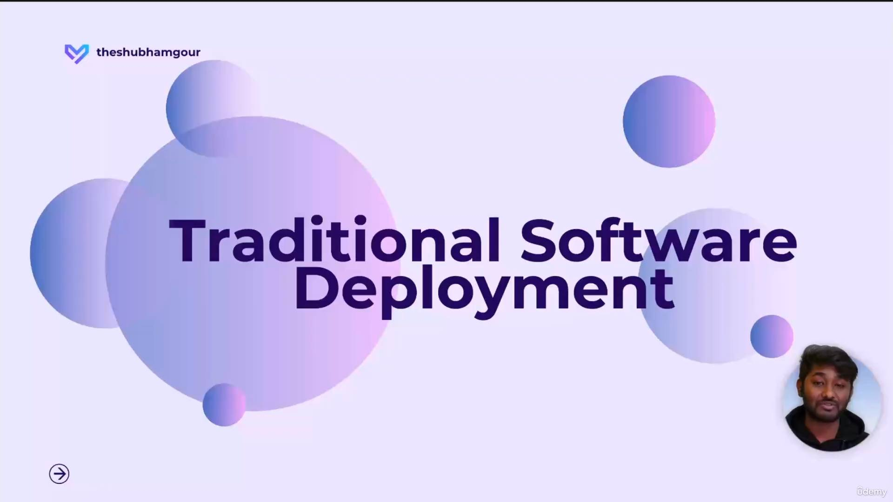
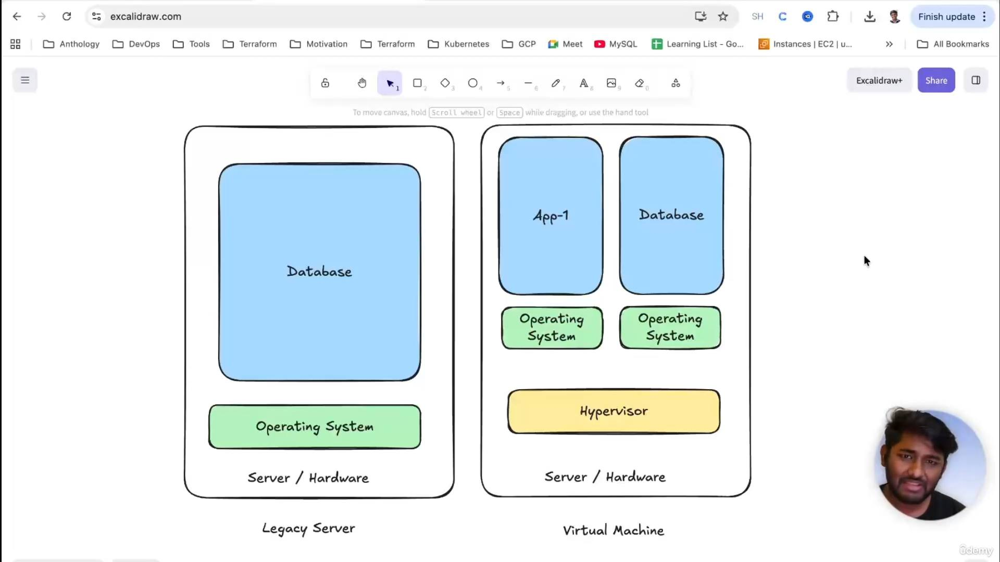
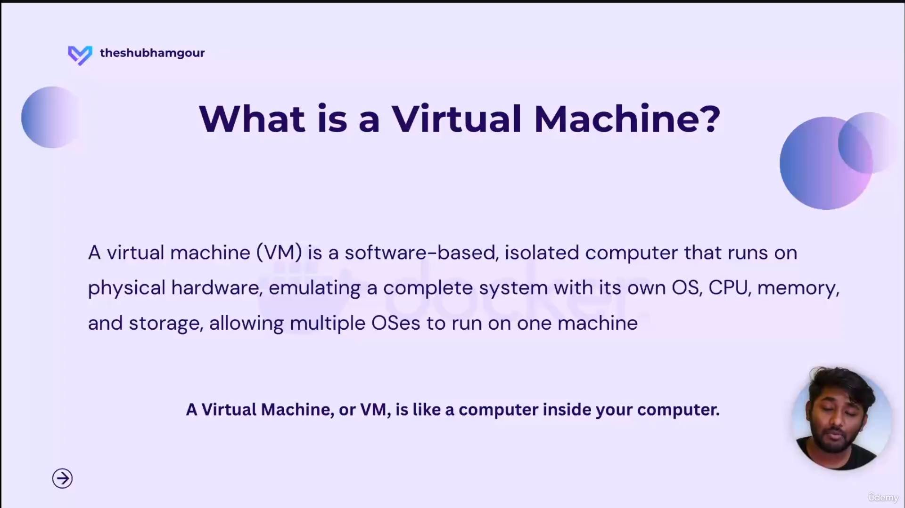
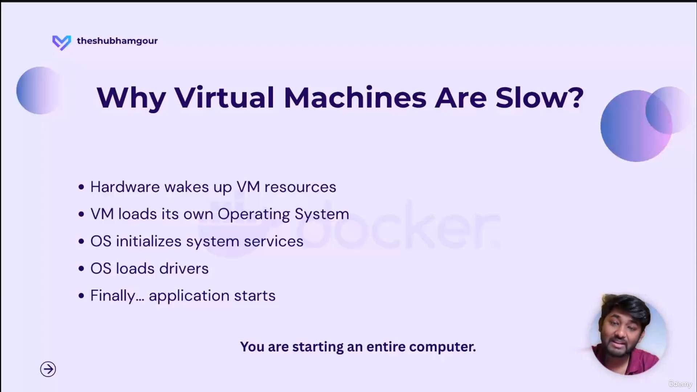
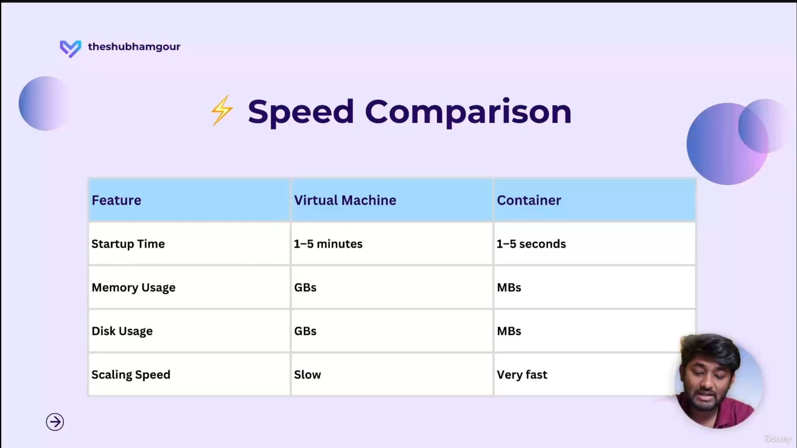

# Docker Masterclass P1–P4：从「部署为什么痛」到「容器为什么快」

> 本文档覆盖 BV1jcRKBEEfK 的前四集。
> **先说一句最重要的话**：这四集是纯概念课，讲师**没有写任何一行代码，没有敲任何一条 Docker 命令，也没有建任何项目目录**。所以本文里的“从零复现”，复现的不是一个仓库，而是**讲师的三张架构图和一组用量级数据**——你要能亲手把它们重建出来、亲手量一遍。第 4 节的完整脚本是**文档作者补的验证工具**，用来把讲师的结论落到你自己的机器上，凡是课程里没有的东西，我都会明确标注「课里没讲」。

---

## 1. 这一节做什么

这四集解决的问题只有一个：**你为什么需要 Docker**。

它没有急着教你 `docker run`，而是先把你按在椅子上，讲清楚三件事：

1. **部署原本有多痛**（P002）。代码在你笔记本上跑得好好的，一上线就炸；服务器之间配置不一致；回滚靠祈祷。讲师把这些统称为“it works on my machine”。
2. **为了止痛，人类先发明了虚拟机，但虚拟机自己也疼**（P003）。一台物理机只跑一个数据库是巨大的浪费，于是有了 hypervisor 和 VM；VM 解决了资源利用率，却带来了“每开一个应用就要开一整个操作系统”的新成本。
3. **容器是从 VM 的痛点上长出来的**（P003–P004）。容器不带走一套操作系统，只带走你的应用和它依赖的库，共用宿主机的内核，所以它能秒起。

学完这四集，你应该能产出下面这样一份「知识目录」——注意，这不是项目目录，**课里没有项目目录**，这只是把四集内容按逻辑归档：

```
BV1jcRKBEEfK/
├── p001  课程介绍：本课要交付的三项能力（Dockerfile / Compose / 容器化任意应用）
├── p002  软件部署：传统部署 vs 现代部署
├── p003  虚拟机 vs 容器：从 LEGACY SERVER → VM → CONTAINER 的架构演进
└── p004  为什么容器比 VM 快：要启动什么 / 加载多少数据 / 有几层
```

四项可验收的产出（也就是说，做完这四集你手上应该有这些东西）：

| # | 产出 | 验收标准 |
|---|---|---|
| 1 | 三张手绘架构图 | 能不看资料画出 LEGACY SERVER / VM / CONTAINER 三层结构，并指出 hypervisor 和 container engine 各自在哪一层 |
| 2 | 一张对比表 | 传统 vs 现代部署，至少 5 个维度 |
| 3 | 一组实测数字 | 自己机器上容器的启动耗时，与讲师给的 1–5 秒量级对得上 |
| 4 | 一套解释话术 | 用“要启动什么 / 加载多少数据 / 有几层”这三问，解释任意两个运行时谁更快 |


---

## 2. 讲师原话（带出处）

下面这些是我从逐字稿里摘的关键句，后面所有推导都以它们为准。括号里是集数和时间点。

**关于这门课的目标：**

> "到本视频结束时，你将非常有信心编写 Dockerfile、编写 Docker Compose 配置，甚至对把任何应用容器化都很有信心。"
> —— p001 [00:00]

**关于 Docker 在 DevOps 里的定位（这句话把 Docker 和 Git、Jenkins 摆在了同一张桌子上）：**

> "Git 被称为集中式版本控制。Jenkins 用于持续集成与持续交付……同样，Docker 用于容器化，被称为面向现代开发运维的容器化平台。"
> —— p002 [00:55]

**关于软件部署的定义：**

> "软件部署被定义为一个多阶段过程，目的是让软件系统可供使用。它通过在云服务器或本地设备等特定环境中安装、配置并启用应用，弥合开发与最终用户之间的差距。"
> —— p002 [01:20]

**关于没有规范部署会出什么事：**

> "不同服务器的行为会不一样……如果这些服务器不同步，回滚就会变得很痛苦，发布团队会说“上帝保佑我们”，团队也会互相争执，而不是去解决问题。"
> —— p002 [03:12]

**关于传统部署的本质——全靠人：**

> "他们手动安装所需软件，我重复一遍，他们手动安装所需软件，手动复制文件，手动启动应用……这里的每一步都依赖人。"
> —— p002 [04:36]

**关于传统部署的四个后遗症：**

> "它在我们的机器上能跑。存在环境不一致。部署时间更长。而且每次做部署时，我们心里都带着恐惧。"
> —— p002 [06:31]

**关于 hypervisor 是什么（讲师给了一个非常好用的等同关系）：**

> "如果你用过 VMware，对吧，那么虚拟机监控程序就等同于 VMware。"
> —— p003 [04:33]

**关于虚拟机最大的软肋：**

> "最大的缺点是应用过去要花很长时间启动，对吧，这也是虚拟机的缺点。"
> —— p003 [06:29]

**关于容器的定义（这句是全场最精炼的一句）：**

> "如果要把它概括成一句话，容器就像一个网页应用包，但它不携带操作系统。"
> —— p003 [13:32]

**关于容器的速度：**

> "它占用更少内存，能在数秒内启动，而且创建和销毁都很容易。"
> —— p003 [14:57]

**关于为什么快——讲师给的三问框架：**

> "有三个核心原则会影响虚拟机和容器的速度。第一是需要启动什么，第二是加载多少数据，第三是涉及多少层。"
> —— p004 [00:24]

**关于隔离性有没有被牺牲：**

> "Docker 容器中也可以实现隔离，这可以通过命名空间来实现，并可以通过控制组来加以限制……可以这样理解：每个容器都以为自己独处，但操作系统安全地控制着一切。"
> —— p004 [04:29 / 04:58]

**关于速度的最终结论：**

> "这里的速度等于可扩展性加可靠性。"
> —— p004 [06:22]

---

## 3. 从零复现

### 3.0 先明确：这一节要「复现」什么

课里没有仓库、没有 `package.json`、没有 `Dockerfile`。所以“复现”分两半：

- **A 部分（纯纸笔，必做）**：把讲师的三张架构图按顺序重建。这是 P002–P003 的全部内容，也是你以后和别人解释 Docker 时唯一需要用到的东西。
- **B 部分（动手，必做）**：把讲师的量级数字在你自己的机器上量一遍。这是 P004 的内容。

A 部分不需要电脑，B 部分需要一个能跑 Docker 的环境。**课里没讲怎么装 Docker**，安装步骤我在第 7 节补。

### 3.1 A 部分：重建三段架构

#### 步骤 1：LEGACY SERVER（物理机时代）

画一个方框代表 **hardware（服务器）**，框里再放**两层**：

```
┌───────────────────────────────┐
│          HARDWARE             │  ← 一台物理服务器
│  ┌─────────────────────────┐  │
│  │   Operating System      │  │  ← 只有一个 OS
│  │  ┌───────────────────┐  │  │
│  │  │  Application      │  │  │  ← 只能跑一个（或勉强挤几个）
│  │  └───────────────────┘  │  │
│  └─────────────────────────┘  │
└───────────────────────────────┘
```

讲师在这里讲的痛点是：**要网站就再买一台服务器，要数据库就再买一台服务器**。数据库根本吃不满一台机器，剩下的资源全浪费——这是“company loss of resources”。



#### 步骤 2：VIRTUAL MACHINE（虚拟化时代）

在 hardware 和 OS 之间**插入一层 hypervisor**：

```
┌────────────────────────────────────────────┐
│                HARDWARE                    │
│  ┌──────────────────────────────────────┐  │
│  │        HYPERVISOR (= VMware)         │  │  ← 新增的一层
│  │  ┌────────────┐   ┌────────────┐     │  │
│  │  │  OS #1     │   │  OS #2     │     │  │  ← 每个 VM 自带一套完整 OS
│  │  │ ┌────────┐ │   │ ┌────────┐ │     │  │
│  │  │ │ App 1  │ │   │ │  DB    │ │     │  │
│  │  │ └────────┘ │   │ └────────┘ │     │  │
│  │  └────────────┘   └────────────┘     │  │
│  └──────────────────────────────────────┘  │
└────────────────────────────────────────────┘
```

关键点（讲师反复强调的）：**VM 里每一个应用都自带一整套操作系统**。你装 VMware、挂 ISO、分配 16G 内存、装 Linux，这个过程和你装一台真机没有任何区别——只是它跑在另一台机器里面。

讲师给了一个必须记住的类比：**VM 就是“房子里的房子”**，每间都有独立卫生间、独立电表、独立厨房。



#### 步骤 3：CONTAINER（容器时代）

把 hypervisor 那一层换成 **container engine（Docker Engine）**，并且**把所有 OS 合并成宿主机的那一套**：

```
┌────────────────────────────────────────────┐
│                HARDWARE                    │
│  ┌──────────────────────────────────────┐  │
│  │      Host Operating System           │  │  ← 只有一套 OS
│  │  ┌────────────────────────────────┐  │  │
│  │  │   CONTAINER ENGINE (Docker)    │  │  │  ← 取代 hypervisor
│  │  │  ┌──────┐ ┌──────┐ ┌──────┐    │  │  │
│  │  │  │ App1 │ │ App2 │ │ App3 │    │  │  │  ← 只带应用 + 依赖库
│  │  │  └──────┘ └──────┘ └──────┘    │  │  │
│  │  └────────────────────────────────┘  │  │
│  └──────────────────────────────────────┘  │
└────────────────────────────────────────────┘
```

讲师在这里的类比是**外卖骑手（Swiggy / Zomato）**：骑手不关心厨房，他只负责打包和送达；厨房就是宿主机 OS，便当盒就是容器，饭就是你的应用。

画完这三张图，你应该能脱口而出下面这张对比表（这是 P003 后半段讲师逐条念的）：

| 维度 | 虚拟机 VM | 容器 Container |
|---|---|---|
| 是否自带 OS | 有，完整的 guest OS | 没有，共用宿主机内核 |
| 体积 | 重，GB 级 | 轻，MB 级 |
| 启动 | 慢，分钟级 | 快，秒级 |
| 隔离性 | 强隔离 | 够用的隔离（namespace + cgroup） |
| 靠什么实现 | hypervisor（VMware 等） | container engine（Docker） |
| 崩溃后重启 | 慢 | 近乎瞬时 |



#### 步骤 4：把「为什么快」拆成三问

P004 给了一个可以直接套用的分析框架。任何一对运行时（Node vs Deno、JVM vs Native、VM vs Container），你都用这三个问题去问：

1. **要启动什么？** VM 要启动一整套操作系统：硬件唤醒 → VM 加载 OS → OS 初始化系统服务 → OS 加载驱动 → 最后才轮到应用。容器只启动应用和它依赖的库。
2. **要加载多少数据？** VM 是 GB 级，容器是 MB 级。
3. **有几层？** VM 是「硬件 → hypervisor → OS → 应用」，容器是「硬件 → 宿主机 OS → engine → 应用」，层数少了，时间就短了。

讲师用两个类比把这件事钉死：

- **泡茶类比（VM）**：为了喝一杯茶，你得先买地、盖房、装水管、拉电线、装厨房，最后才能烧水。
- **租房类比（容器）**：房子和厨房已经在了，你只需要做饭、装盒、送出。



### 3.2 B 部分：把量级数字量一遍

讲师给出的对照组是：

| 指标 | VM | Container |
|---|---|---|
| 启动时间 | 1–5 分钟（另一处口径 2–3 分钟） | 1–5 秒 |
| 内存 / 磁盘占用 | GB 级 | MB 级 |
| 扩容速度 | 慢 | 快 |



这些数字**不能全信，必须自己量**——讲师自己也说了 “it depends upon the computer that you are running”。下面两步：

1. **量容器**：用第 4 节的脚本 `verify-container-speed.sh`，在你本机跑 5 轮取平均。
2. **量 VM**：如果你本机有 VirtualBox / VMware Fusion / 或云上一台实例，从「点击启动」到「SSH 能登进去」掐一次表。**课里没讲怎么装 VM**，如果你手上没有现成环境，这一步可以先跳过，只记讲师的量级即可。

把两次结果填进一张你自己的表，和讲师的口径对照。你会得到两个结论：

- 容器启动是**秒级**，这个结论一定复现得出来；
- VM 启动是**分钟级**，这个结论取决于你的硬件，在 NVMe + 现代 CPU 上可能只有 20–40 秒，讲师说的 2–3 分钟是更保守的口径。

**这两个结论的差距才是关键**：不是“容器快 60 倍”，而是“容器快一个数量级以上，而且差距会随并发扩容被放大”。P004 的收尾句就是这个意思——**speed = scalability + reliability**。

### 3.3 把 A、B 两部分接起来

到这里你手上应该有：三张架构图 + 一张传统/现代部署对比表 + 一张 VM/容器对比表 + 一组实测数字。这四样东西就是 P001–P004 的**全部交付物**，也是后面写 Dockerfile 时的概念底座——你之所以要写 Dockerfile，是因为「容器只带应用和依赖，不带系统」，所以你得把“应用和依赖”精确地声明出来。

---

## 4. 完整代码

**课程 P001–P004 里没有任何代码、没有任何 Docker 命令、没有任何可运行文件。**这一段我反复确认过：逐字稿里出现的全部是讲解语句，没有一条命令被敲出来。

所以这一节我给的，是**为了让上面的 B 部分能真的跑起来**而补的一个验证脚本。它不是一个“课程项目”，它是把讲师结论变成你机器上的数字的工具。

保存为 `verify-container-speed.sh`，和本文件放在同一目录即可。

```bash
#!/usr/bin/env bash
#
# 文件名：verify-container-speed.sh
# 用途：把 P004 里「容器 1–5 秒启动、MB 级占用」的结论在你自己的机器上量一遍。
# 声明：本课程 P001–P004 没有给出任何代码，本脚本是文档作者为「可复现」补充的验证工具。
# 依赖：Docker Engine 或 Docker Desktop（已启动）；Linux/macOS 的 bash。
#       注意：date +%s%N 是 GNU date 的扩展，macOS 上请先 brew install coreutils 并把 date 换成 gdate。
#
# 用法：
#   chmod +x verify-container-speed.sh
#   ./verify-container-speed.sh
#   IMAGE=alpine:3.20 ROUNDS=10 ./verify-container-speed.sh
#
set -euo pipefail

IMAGE="${IMAGE:-alpine:3.20}"
ROUNDS="${ROUNDS:-5}"

echo "== 0. 环境自检 =="
docker version --format 'Server 版本: {{.Server.Version}} / OS: {{.Server.Os}} / Arch: {{.Server.Arch}}'
echo "镜像: ${IMAGE}    轮数: ${ROUNDS}"
echo

echo "== 1. 预热：先把镜像拉到本地 =="
echo "目的：避免把 docker pull 的网络时间算进「启动时间」，讲师说的 1–5 秒指的是后者。"
docker pull "${IMAGE}" >/dev/null
echo "拉取完成。"
echo

echo "== 2. 冷启动计时（--rm，每次都是一个全新容器）=="
total=0
for i in $(seq 1 "${ROUNDS}"); do
  start=$(date +%s%N)
  docker run --rm "${IMAGE}" true
  end=$(date +%s%N)
  ms=$(( (end - start) / 1000000 ))
  echo "  第 ${i} 次: ${ms} ms"
  total=$(( total + ms ))
done
echo "  平均: $(( total / ROUNDS )) ms"
echo

echo "== 3. 容器内视角：它以为自己独占一台机器 =="
echo "（对应 P004 讲师说的 namespaces：每个容器都以为自己是一个人）"
docker run --rm "${IMAGE}" sh -c '
  echo "  PID  = $$"
  echo -n "  hostname = "; hostname
  echo "  /proc/1/cgroup 前 5 行:"
  head -n 5 /proc/1/cgroup | sed "s/^/    /"
'
echo

echo "== 4. 宿主机视角：同一批进程其实就在你的机器上 =="
echo "（对应 P004 讲师说的「the OS control everything safely」）"
docker run -d --name demo-sleeper "${IMAGE}" sleep 300 >/dev/null
echo "  宿主机看到的容器进程树："
docker top demo-sleeper | sed 's/^/    /'
docker rm -f demo-sleeper >/dev/null
echo

echo "== 5. 镜像体积：对比 VM 的 GB 级 =="
docker image inspect "${IMAGE}" --format '  镜像 {{.RepoTags}} 压缩后体积: {{.Size}} 字节'
echo "  换算成 MB: $(( $(docker image inspect "${IMAGE}" --format '{{.Size}}') / 1024 / 1024 )) MB"
echo
echo "== 完成。把第 2 步的平均值填进你和讲师口径的对照表。=="
```

---

## 5. 逐行解释

### 5.1 概念部分

**hypervisor 是什么？**
讲师给的等同关系是 `hypervisor = VMware`。你可以理解成“一台专门负责切分的总管家”：它坐在硬件和各个 guest OS 之间，把 CPU、内存、磁盘切成几份，每份都伪装成一台完整的电脑。在 Node 里，最接近的类比是你在主进程里 fork 出多个 `child_process`——但**差别在于**：Node 的子进程共用同一个 OS 内核，而 VM 里的每个 guest 都跑在**自己的一套内核**上。这就是为什么 VM 那么“重”。

**kernel 是什么？为什么“共用内核”能省这么多？**
内核是操作系统里管进程调度、内存、网络、文件的那一层。VM 的每一台机器都要把这一层重新加载一遍、初始化一遍；容器直接用宿主机已经在跑的那一份。**这是唯一一个真正的、数量级的差别**，P004 讲的所有“为什么快”最后都归到这一点上。

**namespace 和 cgroup（讲师点名但没展开的两个词）**
P004 说到容器隔离靠 `namespaces`、资源限制靠 `cgroups` 时，只给了「每个容器都以为自己是一个人」这句话，没有展开。展开来说：

- **namespace** 负责「看不见」。它让容器里的进程看不见宿主机上的其他进程、其他网络、其他挂载点。上面脚本第 3 步打印出的 `PID = 1` 就是这个效果——容器里那个 `sh` 认为自己是 1 号进程，其实它在你机器上的真实 PID 是好几千。
- **cgroup** 负责「用不了」。它给这组进程设一个 CPU / 内存的上限，超了就限制。**在 Node 里对应什么**：这更像 `--max-old-space-size` 的加强版——`--max-old-space-size` 只限制 V8 的堆，而 cgroup 限制的是整个进程组的物理内存，超了是 OOM Kill，不是 GC。

**VM 里“分配 16G 内存”的坑**
P003 里讲师提到：装 VM 时你会写死“这台机器给 16G 内存”。这部分内存对宿主机来说是**被预留掉的**，即使 guest 里一个进程都没跑。这就是他说的“hard coding”——也被他用来解释“为什么你笔记本风扇狂转、RAM 满”。容器的资源限制是弹性上限，不是一次性预扣。

**为什么部署这件事本身值得单独讲一集**
因为 P002 想说的是：**绝大多数生产事故发生在部署那一刻**。讲师给了四个传统部署的典型症状——`it works on our machine`、环境不一致、部署耗时长、每次发布都心惊肉跳。这四个症状的根因是同一个：**部署过程中的每一步都依赖“某个人记得该怎么做”**。现代部署（Git → 自动构建 → 自动测试 → 自动部署）做的全部事情，就是把“记得”换成“写下来”。Docker 在这个链条里负责的是“让运行环境本身也变成可以写下来、可以版本化的东西”。

### 5.2 脚本部分

| 行 | 解释 |
|---|---|
| `set -euo pipefail` | 出错即停、未定义变量即报错、管道中任一环失败即失败。写自动化脚本的标准开头。**课里没讲**——这是 shell 常识，但它决定了脚本失败时你是看到报错还是看到一堆假数据。 |
| `IMAGE="${IMAGE:-alpine:3.20}"` | 允许用环境变量覆盖默认镜像。默认选 alpine 是因为它只有几 MB，正好对应讲师说的“容器是 MB 级”。**版本号是示例，不是课程指定**。 |
| `docker version --format '...'` | 打印**服务端**（不是客户端）的版本和架构。**这一步很重要**：Apple Silicon 是 `arm64`，x86 服务器是 `amd64`，同一个镜像名在两个架构上拉的是不同文件，启动时间不可直接对比。 |
| `docker pull "${IMAGE}" >/dev/null` | 预热。**如果不预热，你量到的是网速，不是启动速度**。这是复现讲师数字时最容易踩的坑。 |
| `start=$(date +%s%N)` | 纳秒级时间戳。生产环境里更常用 `time` 或 `hyperfine`。 |
| `docker run --rm "${IMAGE}" true` | 起一个容器，在里面执行 `true`（什么也不做），然后立刻退出并删除。这是能构造出来的**最短生命周期容器**——它测的就是“创建并启动一个容器的开销”本身。 |
| `--rm` | 容器退出即删除。不加 `--rm` 的话，跑 5 轮会在你的机器上留下 5 个停止的容器。**课里没讲**容器生命周期，但这是复现时一定会撞上的东西。 |
| 循环 + 求平均 | 单次测量抖动很大（首次可能因为文件系统缓存而慢），5–10 轮取平均才有意义。对应讲师说的“1–5 秒”是个**范围**。 |
| `docker run --rm ... sh -c '...'` | 进容器执行一段 shell。里面 `$$` 是当前 shell 的 PID，`hostname` 打印容器自己的主机名。 |
| `head -n 5 /proc/1/cgroup` | 读 cgroup 文件。**这是第 4 步能“看到” cgroup 的唯一途径**——讲师只说了 cgroup 这个词，没演示过它在哪。 |
| `docker run -d --name demo-sleeper ... sleep 300` | `-d` 后台运行，`--name` 给个固定名字方便后面操作，容器里跑 `sleep 300` 让它活着。 |
| `docker top demo-sleeper` | **这是全场最有信息量的一条命令**：它列出这个容器里的进程，也列出它们在**宿主机**上的真实 PID。你能亲眼看到“容器里的 1 号进程”和“宿主机上的某号进程”是同一个东西。 |
| `docker rm -f demo-sleeper` | 强制删掉，清理现场。 |
| `docker image inspect ... {{.Size}}` | 读取镜像解压后的字节数，再换算成 MB。**注意这是解压后大小**，你 `docker pull` 时下载的压缩包会小一些。 |

---

## 6. 复现检查清单

照着打勾，全部打勾就说明这四集你吃透了。

**A. 概念**

- [ ] 我能不看资料画出 LEGACY SERVER / VM / CONTAINER 三段式架构，并指出 hypervisor 和 container engine 分别插在哪一层
- [ ] 我能说出 VM 的四个后遗症（体积重、启动慢、资源硬分配、成本高）
- [ ] 我能用“房子里的房子”“外卖骑手”“自己盖房泡茶 vs 租房做饭”三个类比中的任意一个讲清 VM 与容器的差别
- [ ] 我能背出 P002 的传统部署四症状：`it works on my machine`、环境不一致、部署耗时长、发布恐惧
- [ ] 我能用“要启动什么 / 加载多少数据 / 有几层”三问分析任意两个运行时的快慢
- [ ] 我知道容器隔离靠 namespace（看不见）、限制靠 cgroup（用不了）

**B. 动手**

- [ ] Docker 已经装好并且 `docker version` 能打印出 Server 段（不是只打印 Client 段）
- [ ] `verify-container-speed.sh` 已保存并 `chmod +x`
- [ ] 脚本第 0 步打印出的 Arch 和我预期的架构一致（`amd64` / `arm64`）
- [ ] 脚本第 2 步的平均值落在**秒级以内**，量级与讲师口径对得上
- [ ] 脚本第 3 步输出的 `PID` 是 `1`
- [ ] 脚本第 4 步里，`docker top` 显示的 PID 与容器内 PID 完全不同（证明 namespace 生效）
- [ ] 脚本第 5 步打出的镜像体积是 MB 级，不是 GB 级
- [ ] 我行有余力的话，还掐表量了一次 VM 的启动时间，并和容器做了对比

**C. 清理**

- [ ] `docker ps -a` 里没有残留的 `demo-sleeper` 或计时用的临时容器（脚本带了 `--rm` 和 `rm -f`，正常情况应该是空的）

---

## 7. 课里没讲但你会撞上的

这一节全部是**课程 P001–P004 没有涉及**的内容，但你要真的把上面脚本跑起来，一定会碰到。

### 7.1 怎么装 Docker——课里完全没讲

P001 开头讲师直接进入概念，从头到尾没有一句安装说明。实际路径是：

- **macOS**：装 Docker Desktop。注意 Apple Silicon 的机器默认拉 `arm64` 镜像，和课程演示的 `amd64` 不是同一个文件。
- **Windows**：装 Docker Desktop，需要开 WSL2（或 Hyper-V）。**这一步会要求重启**，而你多半会在重启之后忘记 Docker Desktop 需要开机自启。
- **Linux**：装 Docker Engine，然后必须把当前用户加进 `docker` 组，否则每条命令都要 `sudo`。

### 7.2 “Permission denied while trying to connect to the Docker daemon socket”

这是 Linux 上最高频的报错，**课里没讲**。原因是 Docker 守护进程的 socket 只允许 root 和 `docker` 组访问。

```bash
sudo usermod -aG docker "$USER"
# 然后必须重新登录（或 newgrp docker）才生效
```

### 7.3 Docker Desktop 里其实也有一台虚拟机

这可能有点反直觉：你在 macOS / Windows 上用 Docker，**底层跑的仍然是一台 Linux 虚拟机**（Docker Desktop 帮你管着它，WSL2 或 HyperKit）。所以：

- 容器“秒起”是相对于**那台已经跑着的 Linux 虚拟机**而言的，不是相对于你的 macOS 而言。
- 第一次启动 Docker Desktop 要等好几十秒，那不是容器慢，是那台幕后 VM 在开机。
- 这也正好印证了 P004 的结论：**虚拟机慢在“开机”，容器快在“不用开机”**。你在 Docker Desktop 上，两件事同时发生了。

### 7.4 容器里的文件，删了就没了

课里把容器说成“一个轻量的包”，但**没讲容器的文件系统是临时的**。容器一删，写进去的东西全丢。这在后面做数据库容器时是致命的，需要挂载 volume。P001–P004 完全没有涉及挂载。在 JS/Node 里对应什么：有点像你 `docker run` 出来的东西是“内存里的对象”，容器一停就是进程退出，内存里的东西自然没了。

### 7.5 端口映射——课里一个字都没提

容器里跑的服务在宿主机上默认**访问不到**，必须 `-p`。这是后面实战集的核心内容，P001–P004 里没出现。

### 7.6 `alpine` 里的 `sh` 不是 `bash`

脚本里我用了 `sh -c`，不是 `bash -c`。因为 `alpine` 默认**不装 bash**。如果你改成 `bash -c`，会得到 `bash: not found`。**课里没讲**这件事，但这是所有人在第一次用 alpine 时都会踩的坑。

### 7.7 镜像拉不动（网络问题）

`docker pull` 在国内经常挂。常见做法是配镜像加速器（`/etc/docker/daemon.json` 里配 `registry-mirrors`），或者用公司内网代理。**课里没讲**，但它会直接卡住你的第 2 步，让你以为脚本写错了。

### 7.8 讲师的数字是量级，不是承诺

P004 里的“VM 1–5 分钟、容器 1–5 秒、内存 GB vs MB”，讲师自己也补了一句 “it depends upon the computer that you are running”。这些数字的作用是**建立数量级直觉**，不是让你拿去写 SLA。如果你的实测是容器 300ms、VM 25 秒，那完全正常，结论不变；如果你的容器要 20 秒才起来，那 90% 是镜像没预热，或者你的 Docker Desktop 那台幕后 VM 正在冷启动。

### 7.9 这一节之后你缺什么

这四集只回答了 **why**，没有回答 **how**。你手上现在一没有 `Dockerfile`（怎么写、`FROM` / `RUN` / `CMD` 分别是什么意思），二没有 `docker-compose.yml`（怎么把应用和数据库串起来），三没有多阶段构建（怎么把前端产物打小）。这三样才是 P001 [00:00] 那句 “writing the Docker files, writing the Docker compose” 真正指的东西——**这四集只是把地基打好，房子在后面几集才盖**。