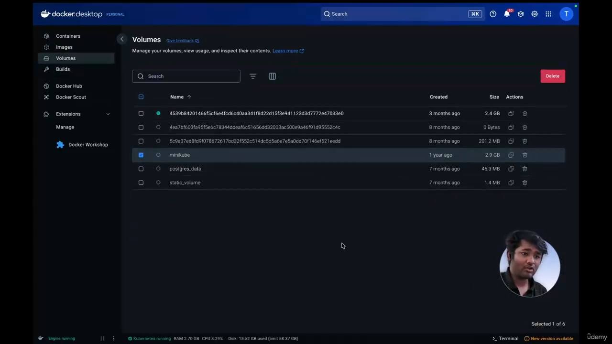
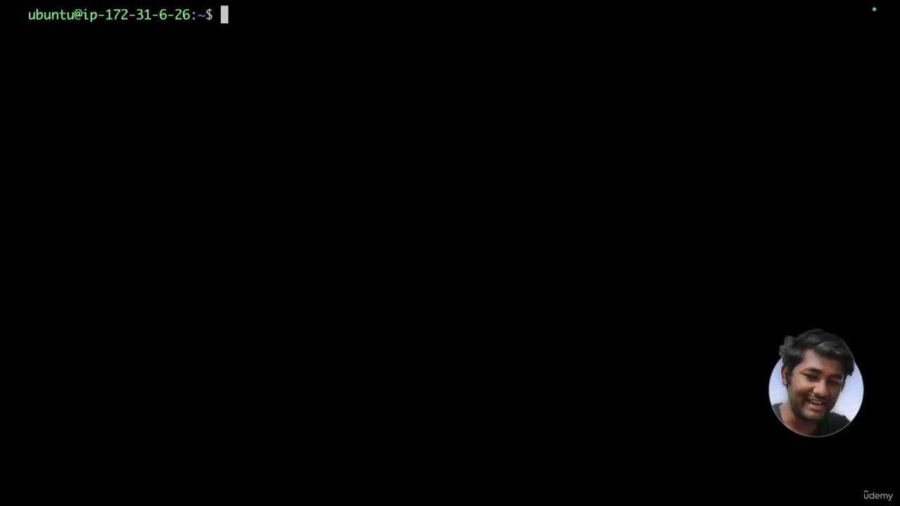
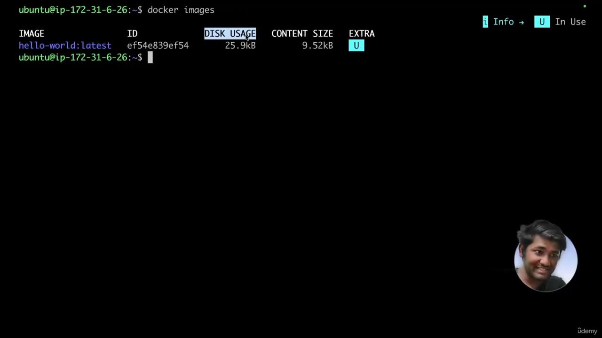
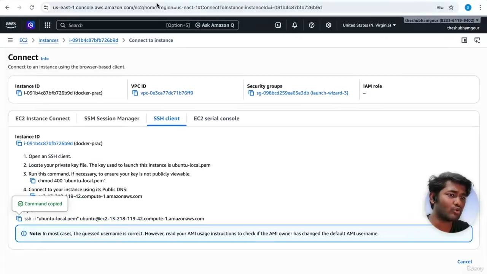
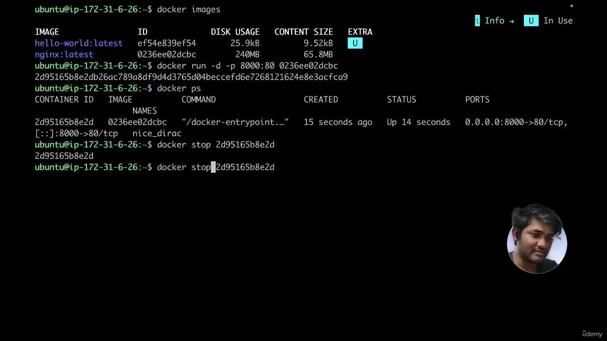
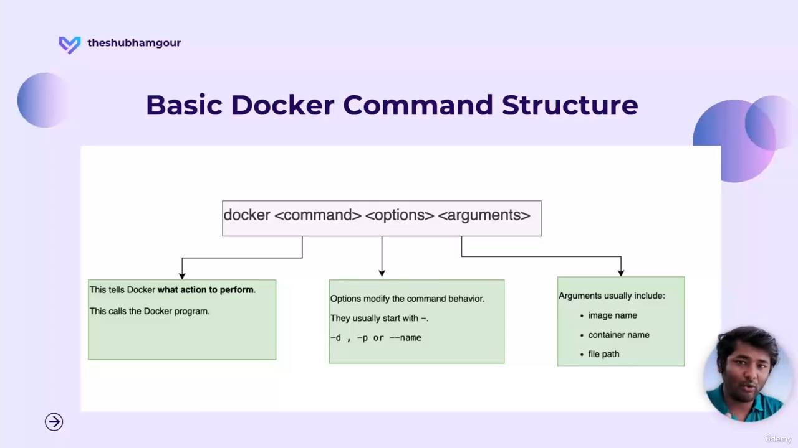
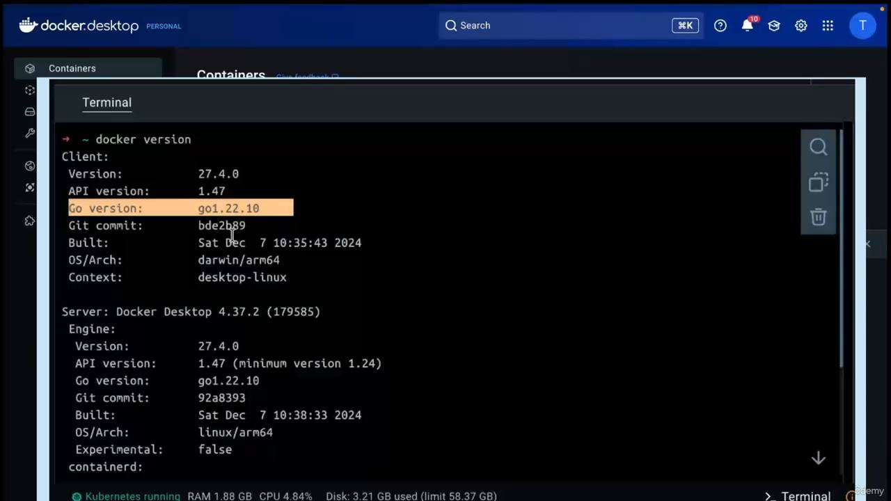
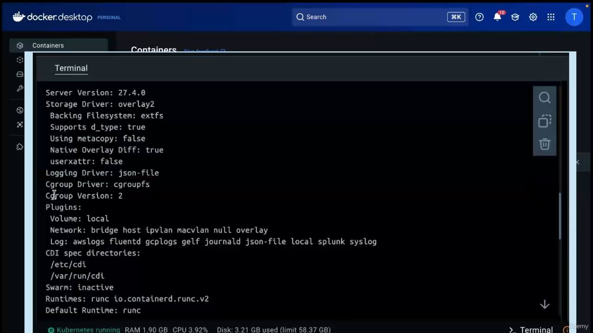

# Docker Masterclass P13–P16：从装好 Docker 到跑通第一个可访问容器

> 覆盖课程：BV1jcRKBEEfK 的 P13、P14、P15、P16。
> 读者定位：前端转 AI 应用工程师，已经完成上一节的 Docker 安装（Linux / Mac / Windows 任一）。
> 本节最终目标：用命令行把 `nginx` 跑起来，浏览器能访问 `http://<你的IP>:8000`，并学会用 `docker version` / `docker info` 做巡检。

---

## 1. 这一节做什么

P13–P16 四集连在一起，是一条完整的「从安装完成 → 跑通第一个 Web 服务 → 掌握命令结构 → 学会巡检」链路。四条主线：

1. **P13** 先解决一个新手普遍疑惑：既然装了 Docker Desktop 有图形界面，为什么还要学 Docker CLI？结论是：两者共用同一个 Docker Engine，Desktop = GUI + CLI，生产环境用 CLI，Desktop 只适合本地学习和调试。
2. **P14** 是整段的核心动手集。讲师在 EC2 Ubuntu 实例上依次执行：
   - `docker --version` / `systemctl status docker` 验证安装；
   - `docker run hello-world` 跑第一个容器，讲清「本地没有镜像 → 去 Docker Hub 拉 → 转成容器 → 执行完自动退出」的完整链路；
   - `docker images` / `docker ps` / `docker ps -a` 解释 IMAGE ID、TAG、SIZE、容器生命周期；
   - `docker pull nginx` + `docker run -d -p 8000:80 nginx` 跑出一个真正能从浏览器访问的服务；
   - 对比 `ubuntu`(190MB) / `alpine`(13MB) / `busybox`(更小) 三种基础镜像，用 `docker run -it` 进容器里验证 `cat /etc/os-release`。
3. **P15** 抽象出 Docker 命令的三段式结构：`docker [command] [options] [arguments]`，并把命令分成「镜像命令」和「容器命令」两类，配一套实操：`pull` / `images` / `rmi` / `rm` / `run -d -p - -name`。
4. **P16** 讲两个巡检命令：`docker version`（Client / Server / Runtime 三段）和 `docker info`（容器数、镜像数、存储驱动、日志驱动、cgroup、Kernel、CPU、内存、Root Dir），用于故障排查和生产服务器检查。

跑完这一节，你手上会有一个能访问的 nginx 容器，并且知道每一条命令为什么这么写。

---

## 2. 讲师原话（带 `—— pNNN [MM:SS]`）

> 「Docker Desktop 是 GUI + Docker engine，Docker CLI 就是纯命令。它们俩是同一个技术，不是两种东西，Docker Desktop 里面本身就带着 CLI。」
> —— p013 [02:18]

> 「如果我让你选，我 100% 建议你去用 Docker CLI，因为那是公司里用的，那是生产里用的。」
> —— p013 [05:01]

> 「每当你跑任何 Docker 命令，它先查本地有没有这个镜像，没有就去 Docker Hub，拉到本地，再转成容器，容器创建好你就能看到输出。」
> —— p014 [06:01]

> 「镜像就是蓝图、是原型，容器是镜像执行之后的产物。别人问你 image 和 container 区别，就说 image 是 prototype。」
> —— p014 [10:15]

> 「容器一旦把活干完就自动退出了，所以 `docker ps` 看不到 hello-world，要 `docker ps -a` 才看得到 Exited 的状态。」
> —— p014 [11:08]

> 「`docker run -d -p 8000:80 nginx`：`-d` 是后台跑，`-p` 是把宿主机的 8000 映射到容器的 80。」
> —— p015 [09:58]

> 「Docker 命令就三段：`docker` 告诉系统用 Docker，`command` 告诉 Docker 干什么，`option` 改行为，`argument` 是镜像名或容器名。」
> —— p015 [00:55]

> 「`docker version` 看 Client + Server + Runtime，`docker info` 看整个 Docker 环境细节。这两个命令是生产服务器巡检和排障用的。」
> —— p016 [11:46]

---

## 3. 从零复现

下面按「装好 Docker 之后你想干的第一件事 → 第二件事 → …」的顺序重排，而不是按集数顺序。

### 前置条件

- 一台 Linux 机器（讲师用 AWS EC2 Ubuntu；本地 VMware / WSL2 / Mac / Win 也都行）
- 已经装好 Docker（上一节内容）
- 你的用户已经在 `docker` 组里（否则每条命令都要 `sudo`）
- 如果是云服务器，安全组/防火墙要开你要用的端口（讲师用的是 8000、8001、8002）



> 上图是 P13 里讲师演示 Docker Desktop 的样子。注意：**本节所有实操都用 CLI 完成**，Desktop 只是对照。

### Step 0：验证 Docker 安装状态

在 Ubuntu 上：

```bash
docker --version
systemctl status docker
```

第二行会看到 `Active: active (running)` 说明服务在跑。如果显示 `inactive (dead)`：

```bash
sudo systemctl start docker
```

`systemctl` 在 **Mac 和 Windows 上不存在**——Mac/Win 用户跳过这一步，直接跑 `docker info` 里能看到 Server 段就说明 Desktop 的 engine 已经起来了（对应关系：`systemctl` 在 Node/前端世界相当于 `pm2 status` / `docker desktop` 托盘图标里的绿灯）。

### Step 1：跑第一个容器 hello-world

```bash
docker run hello-world
```

终端会打出一段 `Hello from Docker!` 的解释文字。这一条命令背后发生了：

1. Docker 先查本地有没有 `hello-world:latest` —— 第一次没有；
2. 去 Docker Hub 拉；
3. 拉下来之后转成容器；
4. 容器执行 `/hello` 这个入口程序，打印文字，**进程结束 → 容器自动退出**。



### Step 2：认识镜像和容器

```bash
docker images
```

会看到一列：`REPOSITORY / TAG / IMAGE ID / CREATED / SIZE`。

- 讲师跑完 hello-world 后 `SIZE` 是 `25.9MB`（后面还有一层 `9.5KB` 的 content size），这是压缩后的镜像大小；
- 你只写了 `hello-world`，没写冒号后面，Docker 默认补 `:latest`；
- `IMAGE ID` 是每张镜像的唯一 ID，等于身份证号，可以拿它代替镜像名。

```bash
docker ps          # 空 —— 因为 hello-world 执行完就退出了
docker ps -a       # 能看到 STATUS 是 Exited (0) 的记录
```

`docker ps -a` 输出的六列：`CONTAINER ID / IMAGE / COMMAND / CREATED / STATUS / NAMES`。`NAMES` 那一列是 Docker 自动随机生成的名字（讲师那台机器上叫 `recursing_briskall`），后面可以用 `--name` 自定义。



> 这一帧是 P14 里讲师逐个字段解释 `docker images` 输出的时刻，可以看到 IMAGE ID、TAG、SIZE 三列。

### Step 3：拉取并跑通一个真正可访问的 nginx

```bash
docker pull nginx
docker images        # 确认 nginx:latest 已经在本地
docker run -d -p 8000:80 nginx
docker ps            # STATUS 这一列是 Up xx seconds
```

关键参数：

- `-d` = detached，后台跑。在 JS/Node 里对应 `nohup node server.js &` 或 pm2 的 daemon 模式；
- `-p 8000:80` = 把宿主机的 8000 端口映射到容器的 80。**容器有自己独立的网络命名空间**，不加 `-p` 你在浏览器访问不到，这跟 Node 里 `app.listen(80)` 后直接访问不一样，多了一层 NAT；
- 最后一个 `nginx` 是 argument（镜像名）。

如果用云服务器，去安全组开一次 8000 的 TCP 入站，然后浏览器打开：

```
http://<你的公网IP>:8000
```

看到 `Welcome to nginx!` 就成功了。





### Step 4：三种基础镜像的大小对比

讲师刻意拉了三个 Linux 基础镜像对比体积，这在 AI 应用部署时极其重要（镜像体积决定冷启动下载时间）：

```bash
docker pull ubuntu     # 约 190MB（讲师机器上是 119MB，取决于 tag）
docker pull alpine     # 约 13MB
docker pull busybox    # 最小
docker images          # 三张并排看 SIZE
```

### Step 5：进容器里面做 Linux 操作

```bash
docker run -it ubuntu
# 提示符从 abc@ip 变成 root@<容器ID>:/#
ls
cat /etc/os-release     # 验证是 Ubuntu
exit                    # 退出，容器随之停止
```

`-it` 是两个参数合并：`-i`（interactive，保持 stdin 打开）+ `-t`（tty，分配伪终端）。在 Node 里类比 `node -i` 的 REPL 交互模式。

同样可以进 alpine：

```bash
docker run -it alpine
ls
cat /etc/os-release     # 显示 Alpine Linux
ls /bin                 # 能看到 busybox 这个二进制
exit
```

**alpine 的 shell 工具大多是 busybox 提供的软链接**——这就是讲师说的「alpine 基于 busybox」的实际意思。

### Step 6：清理（有破坏性，先看懂再跑）

```bash
docker stop <container_id>
docker rm <container_id>          # 删容器
docker rmi <image_name_or_id>     # 删镜像
```

顺序不能反：如果镜像还被任何容器引用（即使是 Exited 状态的），`docker rmi` 会报：

```
Error response from daemon: conflict: unable to delete ... (must be forced) - image is being used by stopped container ...
```

这就是讲师 P15 里踩的那个坑。正确顺序是 `docker ps -a` 找出引用它的容器 → `docker rm` 删容器 → `docker rmi` 删镜像。

### Step 7：命令结构总览（P15 核心）

记住三段式：

```
docker   <command>   <options>              <arguments>
docker   run         -d  -p 8000:80        nginx
docker   run         -it                   ubuntu
docker   pull                              nginx
docker   images
docker   rm                                <container_id>
docker   rmi                               <image_id>
```

- `command` 分两类：镜像命令（`pull` / `build` / `images` / `rmi`）和容器命令（`run` / `ps` / `start` / `stop` / `rm`）；
- `option` 是修饰行为的，必选时只是一个，多个可以连写；
- `argument` 是对象：镜像名、容器 ID、文件路径。



### Step 8：巡检命令

```bash
docker version
```

输出分成三段：

- **Client**：`Version`（CLI 版本）、`API version`、`Go version`、`GitCommit`、`Os/Arch`、`Context`；
- **Server**（Engine）：`Engine.Version`（讲师机器上是 `27.4.0`）、`API version`、`Minimum API version`、`Go version`、`GitCommit`、`Built`、`Os/Arch`、`Experimental`（默认 false）；
- **Runtime**：`containerd`（版本 `1.7.21`，负责容器生命周期管理）、`runc`（低层容器运行时，负责真正启动容器）、`docker-init`（`0.19.0`，容器里的 1 号进程，负责转发信号和回收僵尸进程）。



```bash
docker info
```

比 version 输出详细得多，重点看：

- **Containers**：总数 / Running / Paused / Stopped；
- **Images**：本地镜像数；
- **Storage Driver**：`overlay2`（现代 Linux 默认）；
- **Logging Driver**：`json-file`（对应后面会讲的 `docker logs`）；
- **Cgroup Driver / Version**：`systemd` / `2`；
- **Plugins**：`Volume: local`、`Network: bridge host ipvlan macvlan null overlay`；
- **Kernel Version / Operating System / Architecture / CPUs / Total Memory**；
- **Docker Root Dir**：`/var/lib/docker`，所有镜像、容器、卷、网络的落盘位置。



> 巡检时最常用的一句话：`docker info | grep -E "服务器版本、存储驱动、日志驱动、Docker 根目录"` 一秒钟拿到关键四行。

---

## 4. 完整代码

下面是一个可以直接保存执行的脚本。**里面有删镜像的破坏性操作，跑之前先看一眼 Step 6 的说明**。在 Mac/Linux 上直接 `bash docker-practice.sh`。

**文件路径**：`docker-practice.sh`

```bash
#!/usr/bin/env bash
# docker-practice.sh
# 对应课程 P13–P16 的全部 CLI 操作
# 用法：bash docker-practice.sh
# 前置：已安装 Docker；Linux 上用户已在 docker 组；云服务器安全组已开 8000 入站

set -euo pipefail

echo "==============================================="
echo "Step 0: 验证 Docker 服务状态"
echo "==============================================="
docker --version

# systemctl 只在 Linux 上有，Mac/Win 跳过
if command -v systemctl >/dev/null 2>&1; then
  systemctl status docker --no-pager || true
  # 如果显示 inactive，取消注释下面这一行启动
  # sudo systemctl start docker
fi

echo
echo "==============================================="
echo "Step 1: 跑 hello-world，观察 拉镜像 -> 跑容器 -> 自动退出"
echo "==============================================="
docker run hello-world

echo
echo "==============================================="
echo "Step 2: 认识 images / ps / ps -a"
echo "==============================================="
docker images
echo "--- docker ps（应为空，进程已退出） ---"
docker ps
echo "--- docker ps -a（应能看到 Exited 的 hello-world） ---"
docker ps -a

echo
echo "==============================================="
echo "Step 3: 拉取 nginx，跑在 8000 端口"
echo "==============================================="
docker pull nginx
docker images
docker run -d --name demo-nginx -p 8000:80 nginx
docker ps

echo
echo ">>> 现在打开浏览器访问 http://<你的公网IP>:8000"
echo ">>> 看到 Welcome to nginx! 就说明成功"
read -rp "按回车继续（别忘了先看一眼 nginx 页面）..." _

echo
echo "==============================================="
echo "Step 4: 对比三种基础镜像大小"
echo "==============================================="
docker pull ubuntu
docker pull alpine
docker pull busybox
docker images

echo
echo "==============================================="
echo "Step 5: 进容器做 Linux 操作（ubuntu）"
echo "==============================================="
docker run --rm -it ubuntu bash -c 'ls / && echo "---" && cat /etc/os-release'

echo
echo "--- 进 alpine 验证 busybox ---"
docker run --rm -it alpine sh -c 'ls / && echo "---" && cat /etc/os-release && ls /bin | head'

echo
echo "==============================================="
echo "Step 6: 清理（注意顺序：先删容器，再删镜像）"
echo "==============================================="
docker stop demo-nginx || true
docker rm demo-nginx || true
# demo-nginx 删掉后 nginx 镜像才允许被删
docker rmi nginx || true
docker rmi hello-world || true
docker images

echo
echo "==============================================="
echo "Step 7: 命令结构总览（供对照，不执行）"
echo "==============================================="
cat <<'EOF'
docker   <command>   <options>                <arguments>
docker   run         -d  -p 8000:80          nginx
docker   run         -it                     ubuntu
docker   pull                                nginx
docker   images
docker   rm                                  <container_id>
docker   rmi                                 <image_id>
EOF

echo
echo "==============================================="
echo "Step 8: 巡检命令"
echo "==============================================="
docker version
echo "--- 关键四行 ---"
docker info | grep -E "Server Version|Storage Driver|Logging Driver|Docker Root Dir" || true
```

**辅助文件 1**：`nginx-access.sh`，一次性验证两步——容器状态和端口访问：

```bash
#!/usr/bin/env bash
# nginx-access.sh
# 验证 nginx 容器是否 Up，并打印应访问的 URL
set -euo pipefail

NAME="${1:-demo-nginx}"
PORT="${2:-8000}"

if docker ps --format '{{.Names}}' | grep -q "^${NAME}$"; then
  echo "容器 ${NAME} 正在运行："
  docker ps --filter "name=${NAME}"
  echo
  echo "如有公网 IP：http://<你的公网IP>:${PORT}"
  echo "本机验证：  curl -s http://localhost:${PORT} | head -n 5"
else
  echo "容器 ${NAME} 没在跑，先执行：" >&2
  echo "  docker start ${NAME}   # 如果是 stop 了" >&2
  echo "  docker run -d --name ${NAME} -p ${PORT}:80 nginx   # 如果已经删了" >&2
  exit 1
fi
```

**辅助文件 2**：`cleanup.sh`，安全地「先容器后镜像」清理：

```bash
#!/usr/bin/env bash
# cleanup.sh
# 按 docker 的正确顺序清理：先删所有已停止容器，再删 dangling 镜像
# 注意：会把所有已停止容器和未被打标签的镜像都删掉，不要在生产机上跑
set -euo pipefail

echo ">>> 停止所有运行中的容器（如不想全停，按 Ctrl-C）"
docker ps -q | xargs -r docker stop

echo ">>> 删除所有已停止容器"
docker ps -aq | xargs -r docker rm

echo ">>> 删除 dangling 镜像（<none>:<none>）"
docker images -f "dangling=true" -q | xargs -r docker rmi

echo ">>> 当前状态"
docker ps -a
docker images
```

三个脚本放同一目录，`chmod +x *.sh` 后即可使用。

---

## 5. 逐行解释

### `docker-practice.sh`

**`set -euo pipefail`** — `-e` 任意命令非零退出即停；`-u` 使用未定义变量报错；`-o pipefail` 管道里任何一个命令失败都算失败。Node 里类比 `process.on('uncaughtException')` + `Promise.all` 只要一个 reject 就整体 reject。

**`docker --version`** — 只打印 CLI 版本号（形如 `Docker version 27.4.0, build <hash>`）。和 `docker version`（无横线）不同，后者输出三段完整信息。

**`systemctl status docker --no-pager`** — `systemctl` 是 systemd 的入口，Ubuntu/Debian/CentOS 都有，Mac 和 Windows 没有。`--no-pager` 防止输出进入 `less` 等待按键（在脚本里必加）。

**`command -v systemctl >/dev/null 2>&1`** — `command -v` 是 POSIX 里检查命令是否存在的标准写法。`command -v node` 在 Node 环境的 shell 里就等价于「node 装了吗」。

**`docker run hello-world`** — 注意没写 `-d`，所以是前台跑。Docker 会阻塞到容器退出，退出后立即返回。

**`docker images`** — 表格列：`REPOSITORY / TAG / IMAGE ID / CREATED / SIZE`。TAG 缺省是 `latest`。

**`docker ps`** vs **`docker ps -a`** — `ps` 只列 `Up`（Running）的，`-a`（`--all`）列所有包括 `Exited (0)`。Node 类比：`ps` 是 `pm2 list` 看 online 的，`ps -a` 是 `pm2 list --all` 看所有状态。

**`docker pull nginx`** — 不指定 tag 默认拉 `nginx:latest`。输出是分层下载（`d4a... : Pulling / Already exists`），因为 nginx 镜像由多层叠加而成。

**`docker run -d --name demo-nginx -p 8000:80 nginx`** 拆解：
- `-d` detached，后台；
- `--name demo-nginx` 覆盖默认随机名。**同名容器已存在时会直接报错**（这点讲师 P15 没明说，见第 7 节）；
- `-p 8000:80` 宿主机:容器；
- `nginx` 是 argument。

**`docker run --rm -it ubuntu bash -c '...'`** — `--rm` 表示容器退出后自动删除（不留在 `ps -a` 里）；`-it` 交互 + 伪终端；`bash -c` 让容器内的 bash 执行完引号里的一串命令就退出。**`-i` 对应 `stdin` 保持打开，`-t` 对应分配 tty**，两者缺一在 `bash -c '...'` 这种一次性命令里往往看不出差别，但真进交互式 shell 时必须两个都有。

**`docker pull alpine`** — 拉完只有约 13MB，是「带包管理器的最小 Linux」。

**`docker pull busybox`** — 更小，只提供核心 busybox 二进制。

**`docker stop demo-nginx`** → **`docker rm demo-nginx`** → **`docker rmi nginx`** — 三步严格顺序。为什么不能先 `rmi`：镜像相当于「模板文件」，容器相当于「打开这个模板的进程」。模板被任何进程（包括已退出的）引用着时就不允许删，这是 Docker 的保护机制。

**`docker info | grep -E "..."`** — `grep -E` 支持扩展正则，`|` 是或。这样从几百行里挑四行看。

### `nginx-access.sh`

**`docker ps --format '{{.Names}}'`** — Go template 语法，只取 NAMES 一列。`--format` 支持 `.ID .Image .Status .Ports .Names` 等字段。

**`grep -q "^${NAME}$"`** — `-q` 静默（不打印匹配内容），`^...$` 锚定整行，避免 `demo-nginx-2` 被 `demo-nginx` 误匹配。

**`curl -s http://localhost:${PORT}`** — 本机验证。`-s` 静默进度条。容器端口映射到宿主机了，所以 `localhost` 就通。

### `cleanup.sh`

**`docker ps -q | xargs -r docker stop`** — `-q` 只输出容器 ID；`xargs -r` 在输入为空时不执行后面命令（避免 `docker stop` 无参数报错）。

**`docker ps -aq`** — 所有容器 ID（含 Exited 的），`a` = all，`q` = quiet。

**`docker images -f "dangling=true" -q`** — `-f` 过滤器，只取 `<none>:<none>` 的虚悬镜像（构建失败或 tag 被覆盖后的中间层）。

---

## 6. 复现检查清单

跑完整个过程，按下面的清单逐条勾：

| # | 检查项 | 期望结果 | 不通过怎么办 |
|---|---|---|---|
| 1 | `docker --version` | 打印出 27.x 或 29.x 版本 | Docker 没装好，回上一节 |
| 2 | `systemctl status docker`（Linux） | `Active: active (running)` | `sudo systemctl start docker` |
| 3 | `docker info` 有 Server 段 | 能看到 `Server Version` | 服务没起来 / socket 权限不足，`sudo usermod -aG docker $USER` 后重登 |
| 4 | `docker run hello-world` | 输出 `Hello from Docker!` | 网络无法访问 Docker Hub，检查代理 / 换阿里云镜像加速 |
| 5 | `docker images` | 有 `hello-world:latest` | — |
| 6 | `docker ps` | 空 | 说明 hello-world 自动退出了，这是**对的** |
| 7 | `docker ps -a` | 能看到 `Exited (0)` 的 hello-world | — |
| 8 | `docker pull nginx` | `Status: Downloaded newer image for nginx:latest` | — |
| 9 | `docker run -d -p 8000:80 nginx` | 返回一长串 container ID | 8000 被占用 → 换 8001 |
| 10 | `docker ps` | 能看到 `Up ... 0.0.0.0:8000->80/tcp` | 没 Up 看 `docker logs <id>` |
| 11 | 浏览器 `http://<IP>:8000` | `Welcome to nginx!` | 云服务器安全组没开 8000；本机则检查防火墙 |
| 12 | `docker stop <id>` 后刷新浏览器 | `无法访问` | — |
| 13 | `docker start <id>` 后刷新浏览器 | 恢复 `Welcome to nginx!` | — |
| 14 | `docker pull ubuntu && docker pull alpine` | SIZE 差异巨大（190MB vs 13MB） | — |
| 15 | `docker run -it ubuntu` 后 `cat /etc/os-release` | 显示 `Ubuntu` | 若提示 `the input device is not a TTY` → 加 `!` 前缀或用真终端 |
| 16 | `docker run -it alpine` 后 `ls /bin` | 看到 `busybox` | — |
| 17 | `docker rmi nginx`（在容器存在时） | 报 `conflict ... must be forced` | **这是对的**，先 `docker rm` 容器 |
| 18 | `docker version` | 有 Client / Server / Runtime 三段 | Server 段空白 = engine 没连上 |
| 19 | `docker info \| grep Root Dir` | 打印 `/var/lib/docker`（Linux） | Mac 上是 Docker Desktop VM 里的路径，正常 |

---

## 7. 课里没讲但你会撞上的

以下是逐字稿没涉及、但实操必踩的坑。讲师说「课里没讲」的部分这里按经验补充，**标注清楚的**：

### 7.1 容器名冲突：`docker run --name` 同名会报错

讲师 P15 演示了 `--name nginx_container` 但没讲重名后果。真实情况：

```
Error response from daemon: Conflict. The container name "/demo-nginx" is already in use by container "abc123..."
```

处理方式：`docker rm demo-nginx` 删掉旧的，或 `docker start demo-nginx` 直接复用旧的，或换一个名字。**同一台 docker daemon 上容器名全局唯一**，这点和 Kubernetes Pod 里的容器名只在 Pod 内唯一不一样。

### 7.2 端口占用：`bind: address already in use`

`docker run -d -p 8000:80 nginx` 时如果宿主机 8000 已经被别的进程占了，会报 `Error starting userland proxy: listen tcp4 0.0.0.0:8000: bind: address already in use`。查占用：`lsof -i :8000` 或 `ss -tlnp | grep 8000`。

### 7.3 `systemctl` 只在 Linux 上有

P14 整集讲师都在 EC2 Ubuntu 上操作，所以 `systemctl` 可用。如果你在 **Mac / Windows + Docker Desktop** 上跑，`systemctl status docker` 会直接 `command not found`。这不是你装错了，是 Docker Desktop 把 engine 跑在一个轻量 VM 里，宿主机上没有 systemd 这一层。替代检查：

```bash
docker info | grep -E "Server Version|Docker Root Dir"
```

能打出来就说明 engine 是活的。

### 7.4 `permission denied while trying to connect to the Docker daemon socket`

加了 `sudo` 就没事，不加就报这个，说明当前用户不在 `docker` 组里。修复：

```bash
sudo usermod -aG docker $USER
# 重登或 newgrp docker 才生效
```

这条逐字稿里只在 P14 [02:43] 一带而过地说「我们加了 docker 组，所以会问密码」，没展开。

### 7.5 `-it` 在 CI 里会炸

`docker run -it ubuntu bash` 在 CI（Jenkins / GitHub Actions 非交互式终端）里会报：

```
the input device is not a TTY
```

解决：把 `-it` 换成 `-i`，或者去掉 tty：`docker run --rm ubuntu bash -c 'echo ok'`。讲师 P14 [22:06] 只演示了 `-it` 的正确用法，没讲 CI 场景。

### 7.6 `docker logs` —— 讲师原话里漏了但极常用

P16 里提到 `Logging Driver: json-file` 时顺嘴说「日志后面会讲，用 `docker logs <name>` 看」，但**P13–P16 没有专门演示**。查 nginx 报错、Node 应用 500 的第一条命令：

```bash
docker logs <container_id_or_name>
docker logs -f --tail 100 <name>      # 实时跟踪，等价 tail -f
```

在 Node 里差不多等于 `docker logs` 之于 `pm2 logs`。

### 7.7 容器退出码 & `Exited (0)` vs `Exited (1)`

hello-world 退出是 `Exited (0)`（成功）。如果你跑自己写的 Node 服务看到 `Exited (1)` 或 `Exited (127)`：

- `1` = 应用进程抛错了；
- `127` = 镜像里没有入口命令（`ENTRYPOINT` / `CMD` 配错）；
- `137` = 被 SIGKILL（OOM `kill -9`）；
- `143` = 被 SIGTERM（`docker stop` 默认行为）。

这些码逐字稿没讲，但排查时必须记住。

### 7.8 Docker Root Dir 满导致拉镜像失败

`docker info` 里那条 `/var/lib/docker` 磁盘满了会报：

```
no space left on device
```

排查：`docker system df` 看镜/容器/卷各占多少；清理：`docker system prune -a`（**会删掉所有未使用镜像**，生产机上别随便跑）。

### 7.9 `overlay2` 是什么

`docker info` 里 `Storage Driver: overlay2`。这是 Docker 如何把「镜像的只读层 + 容器的可写层」叠成一个文件系统。**前端类比**：类似浏览器渲染时把 DOM 树 + CSS 树合并成 Render Tree 的那一步——每一层都是不可变，最终访问到的视图是合并后的结果。这一层老师没细讲，属于后面镜像分层章节的内容。

### 7.10 `docker version` 和 `docker --version` 是两个命令

- `docker --version` → 只打印一行字符串版本号；
- `docker version` → 打印 Client / Server / Runtime 三大段结构化的信息。

P14 [01:23] 讲师说的是前者，P16 全程讲的是后者。别看错了。

### 7.11 云上跑完记得关实例

P14 [27:29] 讲师演示 Docker Desktop 前一句原话是「我先去把实例停了，别被继续收费」。如果你是云服务器跑这套，**跑完回控制台停掉或释放**，按小时计费的实例空转是纯浪费。

### 7.12 镜像拉不下来 = 网络问题，不是命令问题

国内直连 Docker Hub 经常超时，报 `TLS handshake timeout` / `net/http: request canceled`。这不是 `docker pull` 语法的问题，需要配镜像加速器（阿里云 ACR 加速地址 / 腾讯云 / USTC 镜像）。这门课全程在境外 EC2 上演示，所以没碰到这个问题，逐字稿里**完全没有提及镜像加速配置**。

---

**本节结束。** 到这里你应该：

1. 能用 `docker run -d -p 8000:80 nginx` 在 30 秒内起一个可访问的 Web 服务；
2. 能分清 `docker images` / `docker ps` / `docker ps -a` 三者输出；
3. 能用 `docker run -it <image>` 进任意 Linux 镜像里做调试；
4. 遇到「镜像删不掉」时知道要先 `docker rm` 容器；
5. 能用 `docker version` / `docker info` 快速判断一台陌生机器上 Docker 是不是健康的。

下一节应该进入 Dockerfile 和镜像构建（本集结束在 P16，没有展开）。