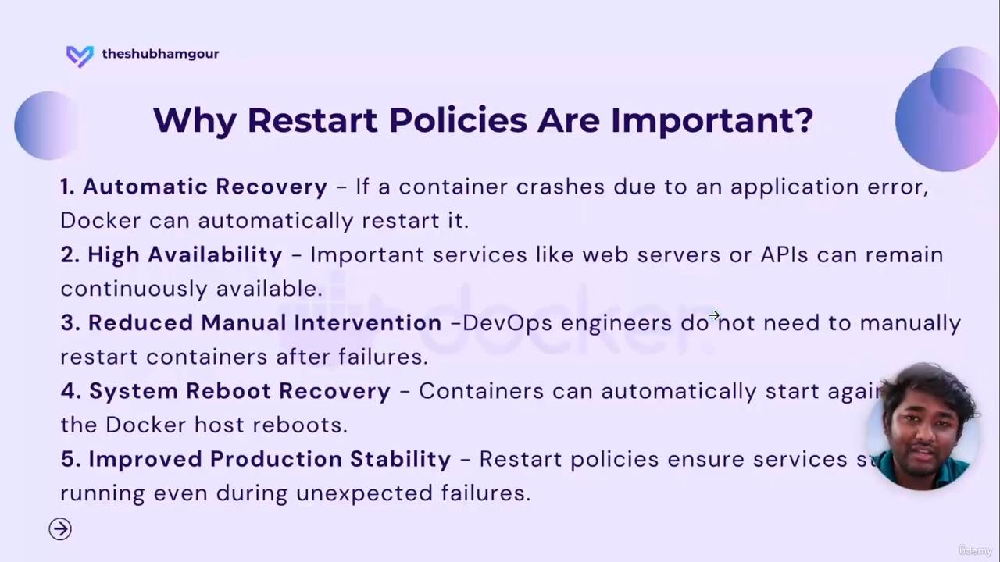
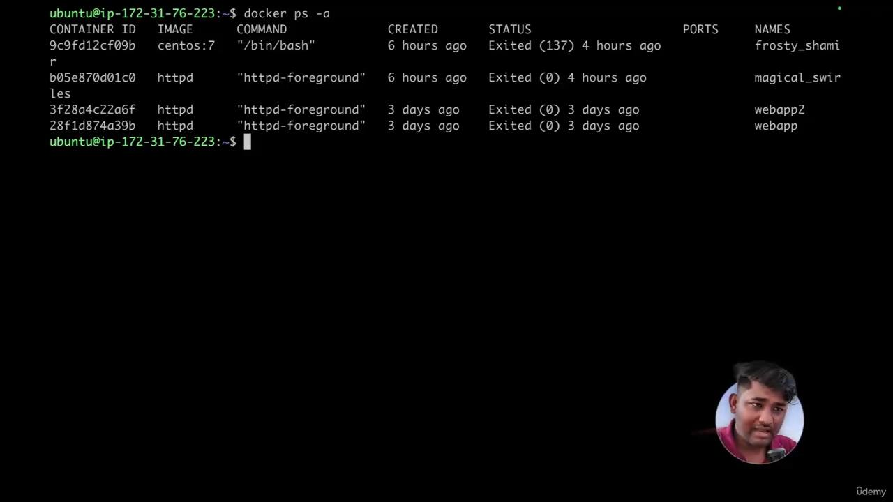
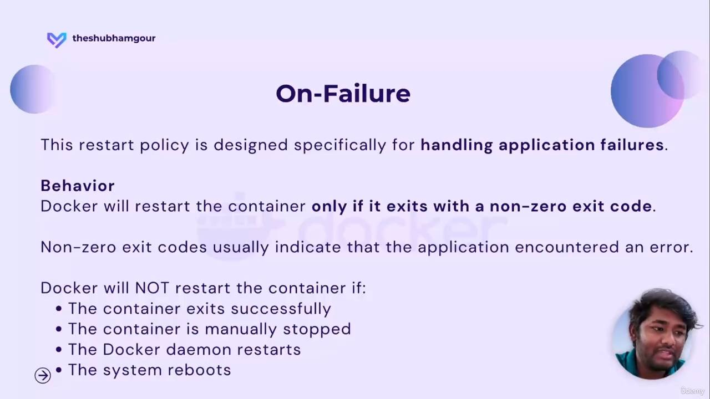
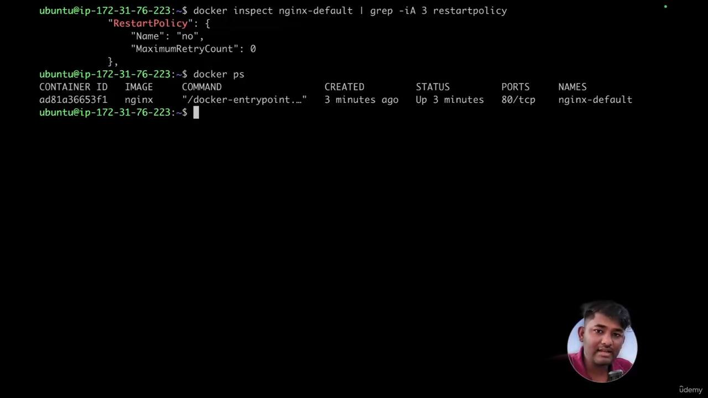
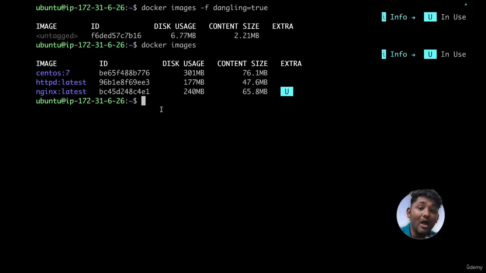
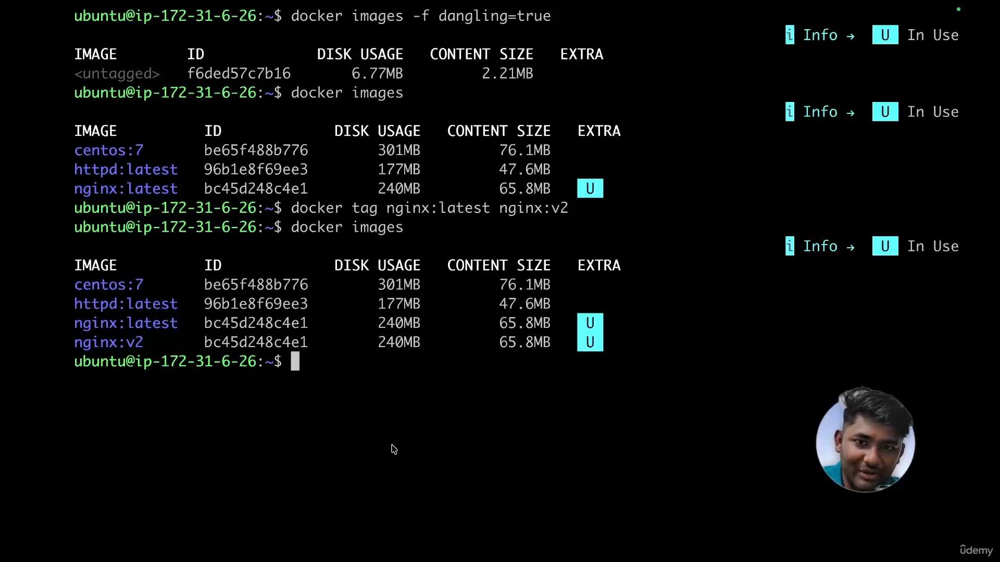
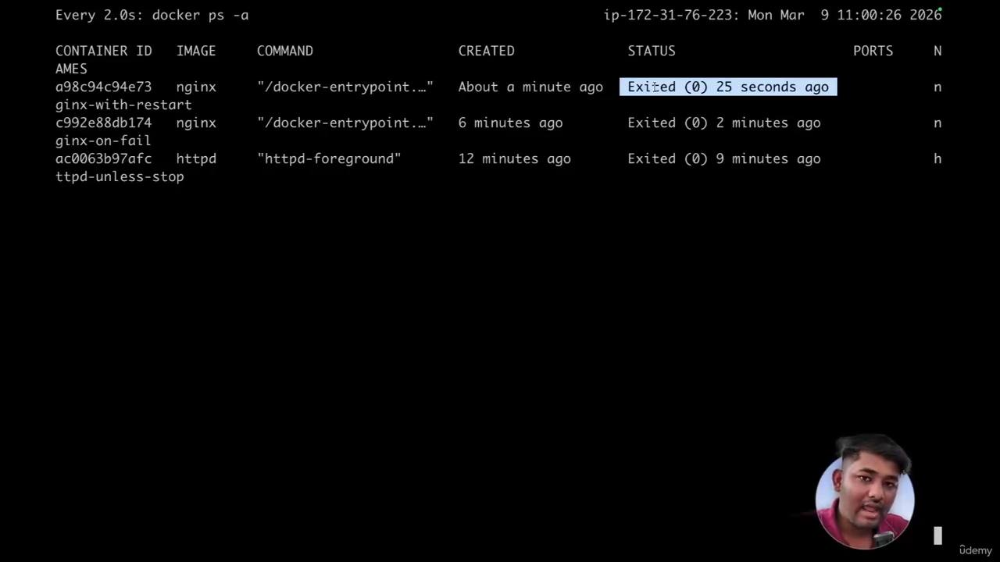
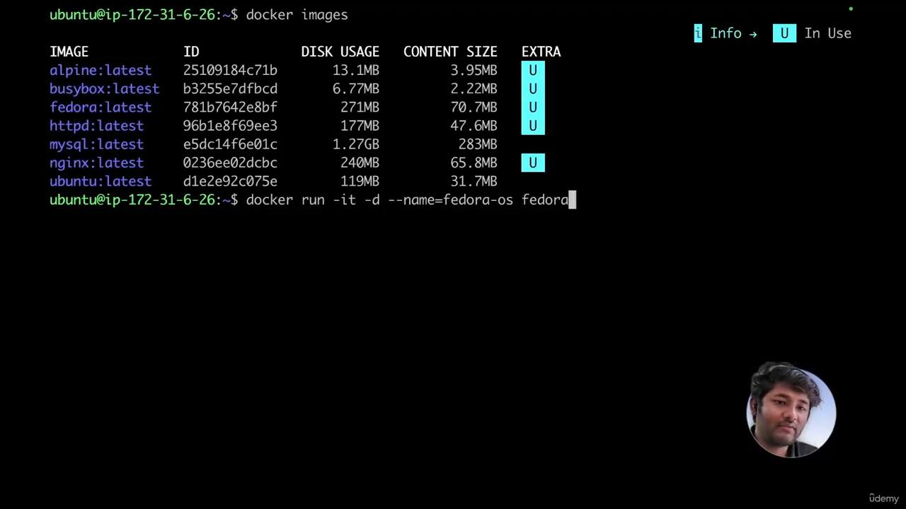

# Docker Masterclass P17–P20 复现文档：镜像/容器运维命令、重启策略、tag 与 dangling image

> 覆盖：P17（Docker 运维命令）· P18（重启策略理论）· P19（重启策略实操）· P20（tag 与 dangling image）
> 目标平台：AWS EC2 上的 Ubuntu 实例 + Docker Engine，通过 SSH 操作
> 读者假设：前端转 AI 应用工程师，不熟后端/运维术语，文中会补 JS/Node 类比

---

## 1. 这一节做什么

P17–P20 是整门课从「知道 Docker 是什么」跨到「能靠命令行把容器跑起来、跑挂了能自己爬起来」的分水岭。这四集的产出非常具体：

1. **P17**：用一套运维命令，把「拉镜像 → 看镜像元数据 → 跑成容器 → 看容器元数据 → 进容器 → 从宿主机往容器拷文件、再拷回来 → 看日志/看进程 → 批量删」这条链路完整走一遍。里面有两个反复出现的开关：`-it` 和 `-d`，讲师给的判定标准是——**基础操作系统镜像用 `-it`，后台服务镜像（nginx/httpd/mysql）用 `-d`**。
2. **P18 + P19**：讲重启策略（restart policy）的四种类别 `no / always / unless-stopped / on-failure`，并在真机上做实验：先 `systemctl restart docker` 重启 Docker 守护进程，再重启整台 EC2 实例，观察容器有没有自己回来。P18 全是理论，P19 全是实操，两集必须连起来看。
3. **P20**：拆两件事——`tag`（镜像版本标识，为什么生产不能用 `latest`）和 `dangling image`（没有 tag、不被任何容器引用的悬空镜像层，怎么列出、怎么 `prune` 掉）。

复现完成后你手上会有的东西：`~/docker-lab/` 目录下 4 个可直接 `bash` 执行的脚本 + 一份跑完留下的 `run-log.md`。**注意：这门课全程在讲命令行，没有任何源码文件、没有 Dockerfile、没有应用代码**，所以本文的「完整代码」就是 4 个 shell 脚本，不是应用工程。课里也没有出现任何环境变量名，本节也不引入。

---

## 2. 讲师原话（关键判断句）

先看讲师自己怎么定义这四集的核心概念，后面所有操作都围绕这几句展开。

关于重启策略是什么：

> "重启策略是定义容器行为的一组规则，有助于我们管理容器。"
> —— p018 [00:46]

> "重启策略大致分为四类：no、always、unless-stopped 和 on-failure。"
> —— p018 [04:14]

关于 `on-failure` 的触发条件（这句是整集最容易记错的地方）：

> "Docker 只有在容器以非零退出码退出时，才会重启该容器。"
> —— p018 [09:22]

关于「什么时候能加策略」，讲师给了个后来被自己推翻的说法：

> "重启策略只能在容器运行期间应用；但如果容器已经在运行，就不能再应用重启策略。"
> —— p018 [02:06]

这段在 P19 结尾被他自己用 `docker update --restart=always` 改掉了——运行中的容器是可以改重启策略的，只是**不能通过 `docker run` 补**。这是文档里必须点出来的矛盾，见第 7 节。

关于 `-it` 与 `-d` 的分工：

> "当我们处理交互式终端（也就是基础操作系统镜像）时会使用它；而在处理 nginx、httpd 这类服务时，我们会使用 -d。"
> —— p017 [20:20]

关于 `latest` 这个 tag：

> "latest 并不总是等同于 nginx 的最新更新版本……它只是 Docker 默认设置的标签。"
> —— p020 [03:39]

关于 `dangling` 镜像怎么处理：

> "Docker image prune……它会删除所有未被任何镜像或容器使用的镜像。"
> —— p020 [07:48]

关于删除镜像被拒的现场：

> "我们收到一个冲突错误：无法删除 fedora，因为某个容器正在使用它，而它是一个被引用的镜像。"
> —— p017 [17:37]




---

## 3. 从零复现

### 3.1 前置条件（课里假设已有，但你必须自己准备）

讲师在 P17 开头只说了 "我的实例已经启动并正在运行"——**意思是 Docker 已经装好了，安装过程课里没讲**。所以下面第 0 步是本文补的，其余全部按逐字稿走。

| 项 | 要求 | 说明 |
|---|---|---|
| 机器 | AWS EC2，Ubuntu | 讲师原话："Fedora 运行在 Ubuntu EC2 实例中"（p017 [13:51]） |
| 登录方式 | SSH + `.pem` 私钥 | 讲师说 "我就直接在终端里用 SSH 连接"（p019 [00:30]） |
| 安全组 | 开放 22 与 **80** | 80 是讲师现场手动加进去的，见 3.4 |
| 网络 | 能访问 Docker Hub | 全程 `docker pull` 依赖外网 |
| Docker 版本 | **课里没讲版本号** | 只要你机器上的 `docker` 支持 `--restart`、`docker image prune`、`docker update` 即可 |

### 3.2 目录结构（先建好）

```bash
ssh -i ~/.ssh/your-key.pem ubuntu@<你的EC2公网IP>
mkdir -p ~/docker-lab/notes
cd ~/docker-lab
```

最终目录如下，四个脚本在下一节完整给出：

```
~/docker-lab/
├── 00-install-docker.sh        # 补：课里没讲的安装步骤
├── p17-operations.sh           # P17 运维命令全流程
├── p19-restart-policies.sh     # P18+P19 重启策略全流程
├── p20-tag-dangling.sh         # P20 tag / dangling image
├── cleanup.sh                  # 一键清场（P17/P19 里反复用到）
├── new.txt                     # p17 脚本运行时生成
├── new2.txt                    # p17 脚本运行时生成
└── notes/
    └── run-log.md              # 你自己记录实验结论的地方
```

### 3.3 执行顺序

```bash
cd ~/docker-lab
bash 00-install-docker.sh          # 只需第一次
bash cleanup.sh                    # 每次实验前清场
bash p17-operations.sh             # P17
bash p19-restart-policies.sh       # P18 + P19
bash p20-tag-dangling.sh           # P20
```

`p17-operations.sh` 里原本有 `docker run -it fedora` 这种交互式命令，脚本里改成 `-dit`（后台 + 保留交互终端），否则脚本会卡在那里等人敲键盘。**这一点和逐字稿不同，已在脚本注释里标出**。

### 3.4 三个必须人工介入的点

这三个点是讲师在视频里手动操作的，脚本替不了，你必须自己来：

1. **开放 80 端口**（p017 [10:03]）。讲师跑完 `docker run -d --name nginx-app -p 80:80 nginx` 后浏览器打不开，回到 AWS 控制台 → 安全组 → 编辑入站规则 → 加自定义规则放行 80。你没做这步，第 4 节的 nginx 验证一定失败。
2. **重启整台 EC2 验证 always / unless-stopped**（p019 [09:02]、[20:23]）。`systemctl restart docker` 只能验证「守护进程重启」，验证不了「宿主机重启」。宿主机重启要去 EC2 控制台 → 实例状态 → 重启。SSH 会断，等 1~2 分钟重连。
3. **`docker image prune` 的 `y` 确认**（p020 [08:16]）。讲师是交互按 y 的，脚本里给了 `-f` 的等效写法。



---

## 4. 完整代码

### 4.1 `00-install-docker.sh`（课里没讲，补的）

```bash
#!/usr/bin/env bash
# 00-install-docker.sh
# 说明：P17 开课时讲师说"我的实例已经跑起来了"，安装过程课里没讲。
#       本脚本按 Docker 官方 apt 源安装，供复现使用。
set -eu

sudo apt-get update -y
sudo apt-get install -y ca-certificates curl gnupg

sudo install -m 0755 -d /etc/apt/keyrings
curl -fsSL https://download.docker.com/linux/ubuntu/gpg \
  | sudo gpg --dearmor -o /etc/apt/keyrings/docker.gpg
sudo chmod a+r /etc/apt/keyrings/docker.gpg

echo \
  "deb [arch=$(dpkg --print-architecture) signed-by=/etc/apt/keyrings/docker.gpg] \
  https://download.docker.com/linux/ubuntu $(. /etc/os-release && echo "$VERSION_CODENAME") stable" \
  | sudo tee /etc/apt/sources.list.d/docker.list > /dev/null

sudo apt-get update -y
sudo apt-get install -y docker-ce docker-ce-cli containerd.io docker-buildx-plugin docker-compose-plugin

# 让当前用户免 sudo 用 docker（需要重新登录生效）
sudo usermod -aG docker "$USER"

docker version
echo "安装完成。请执行 newgrp docker 或重新 SSH 登录后再跑后续脚本。"
```

### 4.2 `cleanup.sh`（P17 [19:25]、P19 [01:30] 的批量清理）

```bash
#!/usr/bin/env bash
# cleanup.sh
# 对应 P17：docker rm -f $(docker ps -aq) / docker rmi -f $(docker images -q)
set -u

echo "== 删除所有容器（含运行中的） =="
docker rm -f $(docker ps -aq) 2>/dev/null || echo "（没有容器可删）"

echo "== 删除所有镜像（强制） =="
docker rmi -f $(docker images -q) 2>/dev/null || echo "（没有镜像可删）"

echo "== 清理悬空镜像层 =="
docker image prune -f || true

echo "== 校验 =="
docker ps -a
docker images
```

### 4.3 `p17-operations.sh`（P17 全流程）

```bash
#!/usr/bin/env bash
# p17-operations.sh
# 对应逐字稿 P17：pull / images / inspect / run / ps / logs / top / exec / cp / 批量删除
# 注意：脚本里把交互式 -it 换成了 -dit，避免脚本阻塞；逐字稿用的是 -it。
set -u

echo "########## 0. 清场 ##########"
docker rm -f $(docker ps -aq) 2>/dev/null || true
docker rmi -f $(docker images -q) 2>/dev/null || true

echo "########## 1. docker pull（不写 tag = 拉 latest） ##########"
docker pull ubuntu
docker pull fedora
docker pull mysql

echo "########## 2. docker images：列出本地镜像 ##########"
docker images

echo "########## 3. docker image inspect：镜像元数据 ##########"
docker image inspect ubuntu
docker image inspect mysql

echo "########## 4. 跑 nginx 服务：-d + -p + --name ##########"
docker run -d --name nginx-app -p 80:80 nginx
docker ps

echo "########## 5. docker inspect 容器：只看 RestartPolicy 附近 ##########"
docker inspect nginx-app | grep -iA 3 "restart policy"

echo "########## 6. 只取容器 IP（逐字稿做法：inspect + grep） ##########"
docker inspect nginx-app | grep -i "IPAddress"

echo "########## 7. 基础镜像容器：-it 进 shell（脚本用 -dit 常驻） ##########"
docker run -dit --name fedora-os fedora
docker ps
docker exec fedora-os cat /etc/os-release

echo "########## 8. 删除被占用的镜像 → 预期报 conflict ##########"
docker rmi fedora || echo "（预期失败：容器仍在使用该镜像）"

echo "########## 9. 先停容器、再删容器、最后删镜像 ##########"
docker stop fedora-os
docker rm fedora-os
docker rmi fedora

echo "########## 10. 一键清空 ##########"
docker rm -f $(docker ps -aq) 2>/dev/null || true
docker rmi -f $(docker images -q) 2>/dev/null || true

echo "########## 11. 服务 vs 基础镜像：httpd 用 -d，centos 用 -dit ##########"
docker pull httpd
docker run -d --name httpd-app httpd
docker run -dit --name centos-app centos:7

echo "-- centos 里确认发行版 --"
docker exec centos-app cat /etc/os-release

echo "-- docker top：查看容器内进程 --"
docker top httpd-app
docker top centos-app

echo "########## 12. docker logs ##########"
docker logs httpd-app
docker logs centos-app

echo "########## 13. docker cp：宿主机 -> 容器 ##########"
echo "hi there" > new.txt
docker exec centos-app mkdir -p /folder
docker cp new.txt centos-app:/folder/new.txt
echo "-- 容器内验证 --"
docker exec centos-app cat /folder/new.txt

echo "########## 14. docker cp：容器 -> 宿主机 ##########"
docker exec centos-app sh -c 'echo "file from container" > /folder/new2.txt'
docker cp centos-app:/folder/new2.txt ./new2.txt
echo "-- 宿主机验证 --"
cat ./new2.txt

echo "########## 完成：docker ps -a / docker images 自查 ##########"
docker ps -a
docker images
```

### 4.4 `p19-restart-policies.sh`（P18 理论 + P19 实操）

```bash
#!/usr/bin/env bash
# p19-restart-policies.sh
# 对应逐字稿 P18（理论）+ P19（实操）
# 注意：本脚本只能验证"重启 docker 守护进程"；验证"重启宿主机"必须手动重启 EC2。
set -u

echo "########## 清场 ##########"
docker rm -f $(docker ps -aq) 2>/dev/null || true

echo "########## A. 默认策略 no ##########"
docker run -d --name nginx-default nginx
docker inspect nginx-default | grep -iA 3 "restart policy"
sudo systemctl restart docker
sleep 8
echo "-- 期望：docker ps 为空 ##########"
docker ps
echo "-- 期望：状态是 Exited (0) ##########"
docker ps -a

echo "########## B. --restart=always ##########"
docker run -d --name httpd-always --restart=always httpd
docker inspect httpd-always | grep -iA 3 "restart policy"
sudo systemctl restart docker
sleep 8
echo "-- 期望：httpd-always 仍在运行 ##########"
docker ps

echo "########## C. --restart=unless-stopped ##########"
docker run -d --name httpd-unless-stopped --restart=unless-stopped httpd
docker inspect httpd-unless-stopped | grep -iA 3 "restart policy"
sudo systemctl restart docker
sleep 8
echo "-- 期望：仍在运行 ##########"
docker ps

echo "-- 手动停掉后再次重启 daemon，这是与 always 的唯一区别 --"
docker stop httpd-unless-stopped
sudo systemctl restart docker
sleep 8
echo "-- 期望：不再自动起来 ##########"
docker ps
docker ps -a

echo "########## D. --restart=on-failure:6 ##########"
docker run -d --name nginx-onfail --restart=on-failure:6 nginx
docker inspect nginx-onfail | grep -iA 5 "restart policy"

echo "-- 故意破坏 nginx 配置，让容器以非 0 退出 --"
docker exec nginx-onfail sh -c 'echo broken > /etc/nginx/nginx.conf'

echo "-- 重启 daemon，观察重试 --"
sudo systemctl restart docker
sleep 25
docker ps -a
echo "-- 看重试次数上限（字段名以你机器实际输出为准） --"
docker inspect nginx-onfail | grep -i "retry"

echo "########## E. docker update：给已在运行的容器补策略 ##########"
docker run -d --name nginx-update nginx
echo "-- 改之前 --"
docker inspect nginx-update | grep -iA 3 "restart policy"
docker update --restart=always nginx-update
echo "-- 改之后，期望变成 always --"
docker inspect nginx-update | grep -iA 3 "restart policy"

echo "########## F. --rm：容器退出即自动删除 ##########"
docker run --rm --name ubuntu-tmp ubuntu echo "inside ubuntu, then gone"
echo "-- 期望：docker ps -a 里找不到 ubuntu-tmp ##########"
docker ps -a | grep ubuntu-tmp || echo "（已自动删除，符合预期）"

echo "########## 完成 ##########"
```

### 4.5 `p20-tag-dangling.sh`（P20）

```bash
#!/usr/bin/env bash
# p20-tag-dangling.sh
# 对应逐字稿 P20：tag 语义、latest 不是"最新版"、dangling image 的列出与清理
set -u

echo "########## 1. 清场后拉一个 nginx ##########"
docker rm -f $(docker ps -aq) 2>/dev/null || true
docker pull nginx
docker images

echo "########## 2. 给 nginx:latest 打一个版本 tag ##########"
docker tag nginx:latest nginx:v2
docker images | grep nginx

echo "########## 3. 用版本 tag 起容器（生产就该这么写） ##########"
docker run -d --name nginx-v2 nginx:v2
docker ps

echo "########## 4. 列出 dangling 镜像（无 tag、无容器引用的层） ##########"
docker images -f dangling=true

echo "########## 5. 清理 dangling 镜像 ##########"
# 逐字稿里是交互式按 y；这里 -f 等价跳过确认
docker image prune -f

echo "########## 6. 校验：应该什么都不剩 ##########"
docker images -f dangling=true
```

---

## 5. 逐行解释

### 5.1 镜像层：`pull` / `images` / `inspect`

`docker pull ubuntu` 不写 tag 时，Docker 先去本地找，本地没有才去 Docker Hub 拉 `latest`。讲师特别强调这个顺序（p017 [00:53]）——这也是 `docker run` 能「不 pull 直接跑」的原因。

`docker image inspect mysql` 输出的是一坨 JSON。讲师在视频里逐块点过：镜像 ID、架构、OS、层（layer）的 sha 值，以及 mysql 这种**服务型镜像**会多出来的东西——暴露的端口号、环境变量、entrypoint 命令、working directory。**这一段是全课信息密度最高的地方**：不用起容器，就能知道这个镜像跑起来会占哪个端口。

在 Node 世界里，`docker image inspect` 大致等于 `require('某个包的 package.json')`——不是看代码，是看元数据。

### 5.2 容器层：`run` 的四个关键开关

`docker run -d --name nginx-app -p 80:80 nginx` 这一条里塞了四件事：

- `-d`：detached，后台跑。不加就是前台占住终端——讲师现场演示过 `docker run nginx` 直接卡住，`Ctrl+C` 后 `docker ps -a` 里显示 `Exited (0)`（p017 [06:24]）。
- `--name nginx-app`：不指定的话 Docker 会随机起名（讲师原话提到了 "Crazy Barthik" 这种随机名，p017 [07:51]）。
- `-p 80:80`：`宿主机端口:容器端口`。课里这个映射的细节留到后面视频讲，本节只要知道左边是宿主机。
- 最后的 `nginx`：镜像名，等价于 `nginx:latest`。

`-it` 是 `-i`（保持 stdin 打开）+ `-t`（分配伪终端）的合写。**基础 OS 镜像（ubuntu / fedora / centos）必须配 `-it`**，因为这类镜像的启动命令就是一个 shell，不给它终端它立刻退出。反过来，nginx 这类服务镜像不需要 `-it`，要 `-d`。这条判定规则覆盖了 P17 后半段所有命令。

> 对应到 Node：`-it` 相当于前台 `node` REPL，`-d` 相当于 `pm2 start app.js`。

### 5.3 `docker inspect` + `grep` 的组合技

讲师在 P17 [12:52] 抛出一个实际的痛点：`docker inspect` 输出几百行，只想看 IP 怎么办？

```bash
docker inspect nginx-app | grep -i "IPAddress"
```

`|` 是管道，把前一条命令的 stdout 交给后一条；`grep -i` 是忽略大小写匹配。P19 里这个技巧被复用成查重启策略：

```bash
docker inspect nginx-default | grep -iA 3 "restart policy"
```

`-A 3` 表示「匹配行往后多打 3 行」。讲师现场把 `3` 改成 `5`，输出行数就跟着变多（p019 [25:10]）——这说明 `grep` 只是文本层过滤，**不是解析 JSON**。所以行数开太少会截断、开太多会混入下一个字段，具体显示几行取决于你机器上 Docker 版本的输出格式，以实际输出为准。

想稳一点，可以用 `--format` 直接取字段（这是本文补充，课里没讲）：

```bash
docker inspect -f '{{json .HostConfig.RestartPolicy}}' nginx-default
```

### 5.4 删除链路：为什么 `rmi` 会失败

P17 [17:37] 那个 `conflict` 报错是本节最重要的因果链：

```
镜像被容器引用  →  docker rmi 镜像  失败（conflict）
                  ↓
              先 docker stop 容器
                  ↓
              再 docker rm 容器
                  ↓
              最后 docker rmi 镜像  成功
```

而且注意：如果容器是 `-d` 起的（还在跑），**连 `docker rm` 都会被拒**，必须先 `stop`。讲师现场就撞了这一步（p017 [18:03]："因为我们传入了 -d 参数，所以容器正在运行"）。

批量清场用的是命令替换 `$(...)`：

```bash
docker rm -f $(docker ps -aq)     # -a 全部（含已退出） -q 只输出 ID
docker rmi -f $(docker images -q) # 同理
```

`-f` 是强制。讲师把这两条称作「省时操作」（p017 [20:20]）。

### 5.5 `logs` / `top` / `exec` / `cp` 四个观察与搬运工具

- `docker logs httpd-app`：打印容器主进程写到 stdout/stderr 的内容。对已经 `Exited` 的容器也能用，因为日志留在宿主机上。
- `docker top httpd-app`：看容器内当前进程。**对已退出的容器会报错**——讲师现场在 centos 上试了一次，报错，然后 `docker start` 之后再看，就只剩那个 shell 主进程（p017 [28:03]）。这条正好反证了「基础 OS 容器跑完就退出」。
- `docker exec -it centos-app /bin/bash`：进一个**正在运行**的容器。注意是 `exec` 不是 `run`，`run` 是新建容器。脚本里用非交互形式 `docker exec centos-app cat /etc/os-release`，等价但不会卡住。
- `docker cp new.txt centos-app:/folder/new.txt`：宿主机 → 容器；反过来 `docker cp centos-app:/folder/new2.txt ./new2.txt` 是容器 → 宿主机。**方向靠 `容器名:` 在哪一侧决定**，这是最容易写反的一条。

### 5.6 重启策略：四种语义的精确边界

| 策略 | 容器崩溃（非 0 退出） | `systemctl restart docker` | 宿主机重启 | 手动 `docker stop` 后 |
|---|---|---|---|---|
| `no`（默认） | 不重启 | 不重启 | 不重启 | 不重启 |
| `always` | 重启 | 重启 | 重启 | **daemon 重启后仍会重启** |
| `unless-stopped` | 重启 | 重启 | 重启 | **保持停止** |
| `on-failure[:N]` | 重启（最多 N 次） | 不重启* | 不重启 | 不重启 |

\* 讲师在 P19 [25:40] 把 `on-failure` 容器停掉后重启 daemon，容器没有回来——他用这点说明了 `on-failure` 只认「非 0 退出」，不认「daemon 重启」。**这是四种策略里唯一一个对 daemon 重启无感的策略**。

`always` 和 `unless-stopped` 的唯一区别就在表格最后一列：讲师让 `unless-stopped` 容器在手动 `stop` 之后又 `systemctl restart docker`，容器**没有**起来（p019 [22:44]），而同样操作下 `always` 会起来（p019 [16:30]）。讲师给的选型建议是：核心服务用 `always`，其余用 `unless-stopped`，「因为后者给你完全的控制权」（p019 [23:19]）。

`on-failure` 后面可以带冒号数字，`--restart=on-failure:6` 表示最多重试 6 次。讲师演示完后 `docker inspect` 查看了这个计数，称之为 maximum retry count（p019 [32:29]）。**注意：具体字段名请以你机器上的实际输出为准，课里只念了数值，没有念字段名。**





### 5.7 `--rm` 与 `docker update`

`--rm` 的作用是容器退出后立刻删除，不会在 `docker ps -a` 里留 `Exited` 尸体。讲师用 ubuntu 演示过（p019 [37:47]）——`exit` 之后 `docker ps -a` 里查不到。

`docker update --restart=always <容器ID>` 是给**已经在跑**的容器补策略。讲师在 P19 最后用它把默认的 `no` 改成了 `always`，`inspect` 复查确认生效（p019 [34:36]）。这条命令直接推翻了 P18 里「运行中的容器不能改策略」那句话。

### 5.8 tag 与 dangling image

`docker tag nginx:latest nginx:v2` 不是「复制镜像」，是给同一个镜像 ID 加一个别名。执行完 `docker images` 里会出现两行指向同一个 IMAGE ID 的记录。讲师用苹果店买手机类比：说「我要一个 iPhone」等于说 `latest`，说「我要 iPhone 15」才是 `nginx:v2`（p020 [04:55]）。

`latest` 的真相：它只是「拉取时没写 tag 的默认值」，**不代表维护者更新过**。要看真正的版本，得去 Docker Hub 的 tag 列表里翻（p020 [04:05]）。

`docker images -f dangling=true` 列出的是「没有 tag、也不被任何容器引用」的镜像层。来源是镜像分层构建时留下的中间层。`docker image prune` 就是清这些。注意它只清 dangling 的，**不会**删掉你有 tag 的镜像，所以比 `docker rmi -f $(docker images -q)` 安全得多。





---

## 6. 复现检查清单

按顺序勾选，每条都写清了「期望看到什么」。

**P17 部分**

- [ ] `docker pull ubuntu && docker pull fedora && docker pull mysql` 三条都成功
- [ ] `docker images` 里能看到刚拉的三个镜像，TAG 列是 `latest`
- [ ] `docker image inspect mysql` 的输出里能找到端口、entrypoint、working directory 相关字段（具体字段名以实际输出为准）
- [ ] `docker run -d --name nginx-app -p 80:80 nginx` 之后 `docker ps` 能看到 `nginx-app`，PORTS 列有 `0.0.0.0:80->80/tcp`
- [ ] **在 AWS 安全组放行 80 后**，浏览器访问 `http://<公网IP>` 能看到 nginx 欢迎页 ← 对应 p017 [10:49]
- [ ] `docker inspect nginx-app | grep -iA 3 "restart policy"` 能定位到 `no`
- [ ] `docker rmi fedora` 在容器使用中时**失败**（conflict）
- [ ] `docker stop` → `docker rm` → `docker rmi` 三步后镜像消失
- [ ] `docker rm -f $(docker ps -aq)` 和 `docker rmi -f $(docker images -q)` 之后 `docker ps -a` 与 `docker images` 都为空
- [ ] `docker exec centos-app cat /etc/os-release` 输出里含 CentOS
- [ ] `docker top httpd-app` 有输出；`docker top` 一个已退出容器时**报错**（预期行为）
- [ ] `docker cp` 双向都成功，`cat new2.txt` 输出 `file from container`

**P18/P19 部分**

- [ ] 默认容器重启 daemon 后 `docker ps -a` 显示 `Exited (0)`，不会自己回来
- [ ] `--restart=always` 的容器在 `systemctl restart docker` 后仍在跑
- [ ] `--restart=always` 的容器在 **EC2 重启**后仍在跑
- [ ] `--restart=unless-stopped` 的容器手动 `stop` 后，再重启 daemon **不起来**
- [ ] `--restart=on-failure:6` 的容器被破坏配置后，重启 daemon 会反复重启，`docker ps -a` 的状态时间戳不断刷新
- [ ] `docker update --restart=always nginx-update` 后 `inspect` 显示策略从 `no` 变成 `always`
- [ ] `docker run --rm ...` 的容器退出后 `docker ps -a` 里查不到

**P20 部分**

- [ ] `docker tag nginx:latest nginx:v2` 后 `docker images` 出现两行相同 IMAGE ID
- [ ] `docker images -f dangling=true` 能列出无 tag 的镜像（若为空属正常，需先制造悬空层）
- [ ] `docker image prune -f` 后该命令无输出





---

## 7. 课里没讲但你会撞上的

这一节全部是逐字稿之外的补充，逐条标注清楚，**不要当成讲师说过的内容**。

1. **Docker 安装过程课里完全没有。** 讲师开场就是 "我的实例已经启动并正在运行"。第 4.1 节那个脚本是本文补的，按官方 apt 源装。装完记得 `newgrp docker` 或重新登录，否则每条命令都要 `sudo`。

2. **P18 [02:06] 和 P19 [34:36] 是矛盾的。** 讲师在理论集说「运行中的容器不能应用重启策略」，在实操集末尾又用 `docker update --restart=always` 给运行中的容器改了策略且成功。准确的说法是：`docker run` 时如果没写 `--restart`，事后想补只能靠 `docker update`。如果你按 P18 那句话理解，会以为只能删了重建。

3. **`--rm` 和 `--restart` 不能一起用。** 讲师在 P19 里分别演示了 `--rm`（[37:21]）和 `--restart`（[29:44]），但没有一起用过。实际 Docker 会直接报冲突，因为「自动删除」和「自动重启」在语义上打架。课里没讲这条。

4. **`on-failure` 的重试有退避（backoff）机制，课里没讲。** 讲师只是让你 `watch docker ps -a` 盯时间戳，看到「33 秒」「一分钟前」这种跳变（p019 [31:06]）。实际上重试间隔会递增，不是固定 6 次等距重试。你如果想精确测 6 次，光看时间戳不够。

5. **`docker image prune` 只清 dangling，`docker system prune` 清的东西多得多**（含停止的容器、未使用的网络）。课里只讲了前者。别顺手敲成后者把镜像全清了。

6. **CentOS 镜像已经 EOL。** 讲师现场就撞了——`docker run centos` 直接失败，报 "本地找不到 centos / 无法解析引用"，然后他改用了 `centos:7`（p017 [22:39] 到 [24:21]）。如果你的 `centos:7` 也拉不下来，用 `ubuntu` 或 `alpine` 替代，脚本逻辑完全一样。

7. **`systemctl restart docker` 需要 sudo。** 讲师现场被问了一次密码（p019 [07:40]："它正在要求输入密码"）。脚本里已经写成 `sudo systemctl restart docker`。

8. **重启 EC2 之后公网 IP 可能变。** 除非你绑了 Elastic IP，否则实例重启后 IP 会换，SSH 配置要跟着改。课里没提这点。

9. **在容器里改 nginx 配置是「一次性的脏实验」。** P19 那个 `echo broken > /etc/nginx/nginx.conf` 是直接改运行中容器的文件系统，容器删了就没了。**不要把这个习惯带到真实项目**——正确做法是改镜像重新构建。课里没讲这个边界。

10. **`grep -A N` 的行数不是固定的。** 同一个命令在不同 Docker 版本上，`restart policy` 后面跟的行数可能不同。讲师自己就在 p019 [25:10] 现场把 3 改成 5 演示过。所以脚本里写的 `-A 3` 只是够用，不是标准。

11. **`docker inspect` 输出的字段名不要凭记忆写。** 本文里凡是提到字段的地方都做了保守处理。你要写 CI 脚本解析这些字段，先用 `docker inspect <name> |