# Docker Masterclass P21–P24：容器是什么、容器生命周期、Docker commit 快照

> 覆盖 P021–P024 四集。P021 讲「容器到底是什么」（概念 + PPT），P022 用 nginx 把容器生命周期在终端里走一遍，P023 讲 Docker commit 的原理与镜像分层（理论），P024 是 Docker commit 的完整动手实验。
>
> 说明：讲师全程英文授课，本文第 2 节的「讲师原话」为**中文意译**，句式以原话结构为准，不添加原文没有的结论。

---

## 1. 这一节做什么

这四集连起来只做三件事，但必须按顺序做，因为后一件事依赖前一件事的结论：

1. **建立正确的心智模型**：容器不是「小虚拟机」，它是**宿主机上的一个进程**，靠 namespace 和 cgroups 做隔离（—— p021 [03:15]）。镜像（image）是蓝图，容器（container）是这份蓝图的运行实例。这一条如果不接受，后面所有命令都会用错。
2. **把生命周期跑通**：用 `nginx` 这个「服务型镜像」当样本，亲手把容器从「不存在 → 运行 → 暂停 → 恢复 → 停止 → 重启 → 杀死 → 删除」全部推一遍，同时撞一次「镜像被容器引用所以删不掉」的墙——这是 P022 最有价值的部分，比命令本身重要。
3. **做一次快照**：进到运行中的容器里改掉 nginx 的 `index.html`，用 `docker commit` 把改动固化成 `webapp:v2` 镜像，然后把原容器和原镜像**全部删掉**，再用 `webapp:v2` 起一个新容器，证明改动确实被保存下来了（P024）。最后理解为什么这套做法只能用来看/调试，生产上要用 Dockerfile（P023 的理论落点）。

**最终产物**：本机多出一个 `webapp:v2` 镜像，用 `docker run -p 8080:80 webapp:v2` 起来后，`curl localhost:8080` 返回 `Welcome to Docker Commit`。

**读者定位说明**（前端转 AI 应用工程师）：本文会出现大量「进程」概念，请一律按 Node 的视角去理解——容器 ≈ 一个被隔离了文件系统和网络的进程，`docker run` ≈ `child_process.spawn` 一个长驻进程，`docker pause` ≈ `process.kill(pid, 'SIGSTOP')`，`docker stop` ≈ 先 `SIGTERM` 再 `SIGKILL`。下面第 5 节会逐条给出对应关系。

---

## 2. 讲师原话

关于镜像与容器的关系：

> 「镜像是创建容器的蓝图，容器是运行实例，是我们真正能看到、能体验应用的那个东西。可以把它想成食谱（Docker image）和做好的一道菜（container）。」
> —— p021 [00:29]

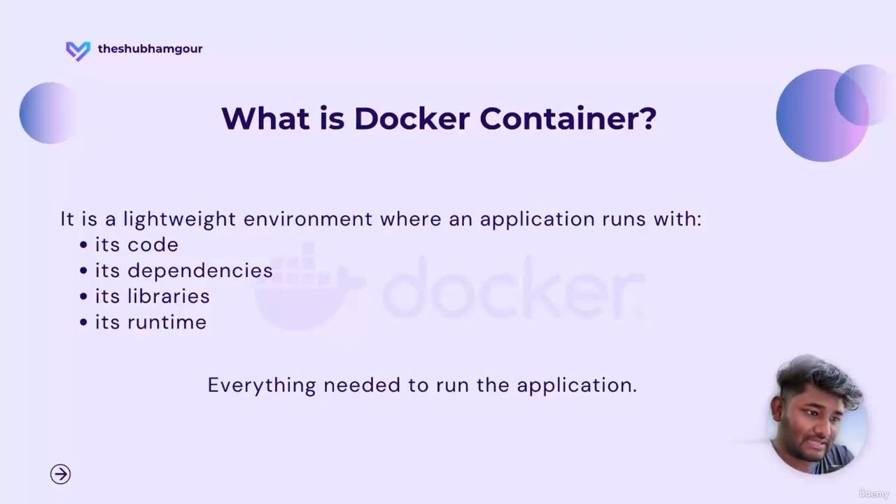

关于容器的本质（这一段是整节课的地基）：

> 「有一个最重要的概念你必须记住：**容器就是进程**。它不是虚拟机，它是你宿主机操作系统上正在运行的一个进程，只不过借助 namespace 和 cgroups 做了隔离。正因如此容器才轻量、启动才快、才高效。」
> —— p021 [03:15]

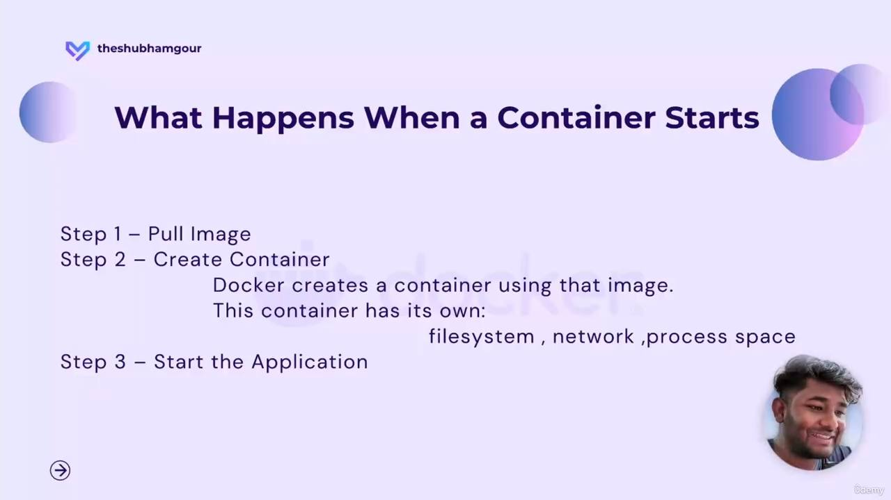

> 「一个容器里通常包含应用代码、依赖库、运行时和配置文件，但**不包含完整的操作系统**，这就是它和虚拟机的区别；容器共享宿主机的同一个内核，所以能瞬间启动。」
> —— p021 [04:37]

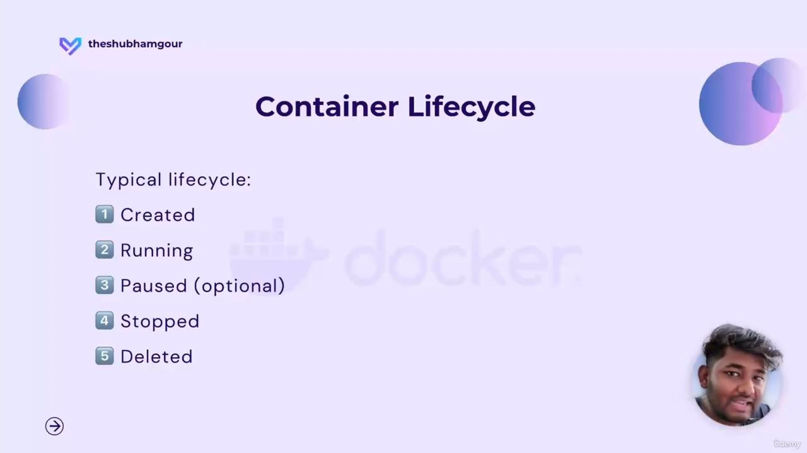

关于「删镜像删不掉」这件事（P022 的核心教学点）：

> 「它说 error response from the daemon，存在 conflict，无法删除 nginx latest 镜像，必须强制。为什么？因为有一个容器正在引用这个镜像，错误里还把这个容器的 ID 给你了。所以它在告诉你：**先删容器，再删镜像**。」
> —— p022 [01:21]

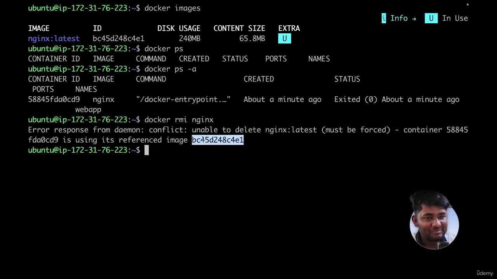

> 「如果我不加 `-d` 直接 `docker run nginx`，它就把我的终端占住了，我什么都打不了，因为它是个跑在后台的服务。要脱身就按 Ctrl+C，这等于给这个容器发了一个信号：你的活干完了。所以之后 `docker ps -a` 能看到它是 Exited 状态，退出码 0，说明它曾经正常运行、收到信号后终止。」
> —— p022 [04:06]

关于 Docker commit 是什么：

> 「Docker commit 就是把一个**运行中的容器**创建成一个新的 Docker 镜像。就像 Windows 记事本里的『另存为』：容器是你正在编辑的 `New.txt`，镜像是保存下来的那一份。」
> —— p023 [00:53]

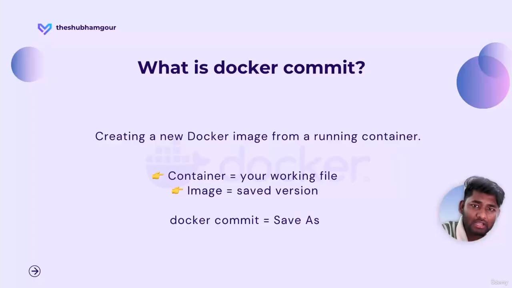

> 「语法是 `docker commit 容器名 镜像名`。容器名是你在上面做过改动的那个运行中的容器，镜像名是你要保存成的新镜像名。它会把当前容器状态、文件改动、安装的软件、配置改动一起抓下来，生成一个新镜像存在本地。」
> —— p023 [02:54]

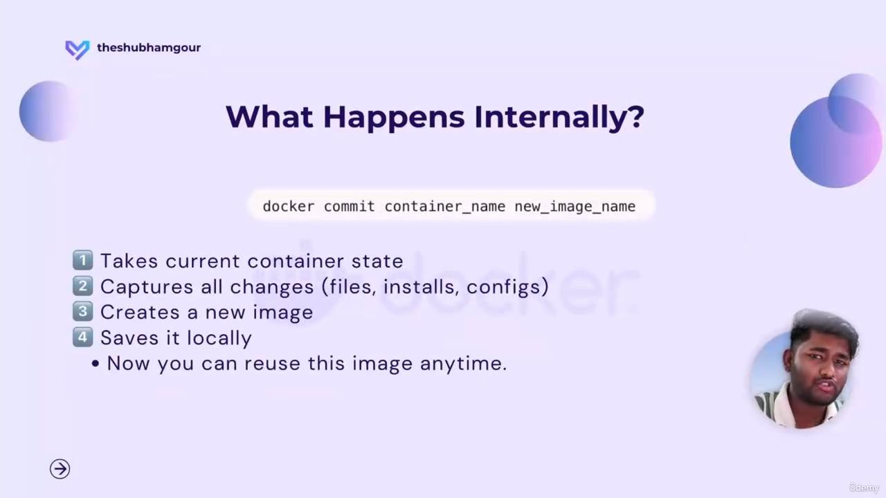

关于镜像分层：

> 「Docker 镜像是分层构成的。当你 commit 的时候，新的层会叠加在已有层之上。举个例子：以 Ubuntu 为基础镜像，在上面装了 nginx，然后 commit 出一个新镜像，那新镜像 = Ubuntu 层 + nginx 层。下次你运行这个新镜像，nginx 已经在了，不需要再装一遍。」
> —— p023 [03:54]

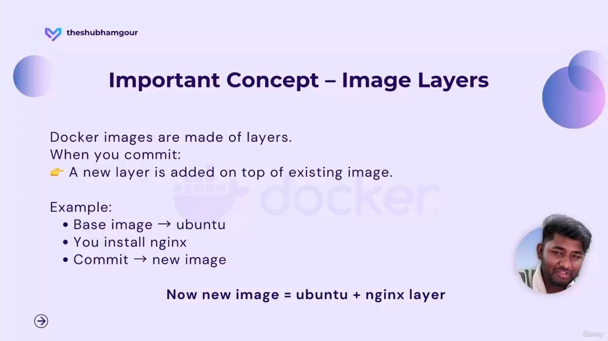

关于为什么生产环境不用 commit：

> 「在生产环境我们一般**不用** docker commit，因为这些改动是不可复现的。DevOps 工程师 A 在容器里改了东西、打了快照，别人接手时根本不知道改了什么。没有清晰的历史，很难追踪谁改了什么。所以我们改用 Dockerfile，它干净、能进版本控制、能自动化。」
> —— p023 [05:04]

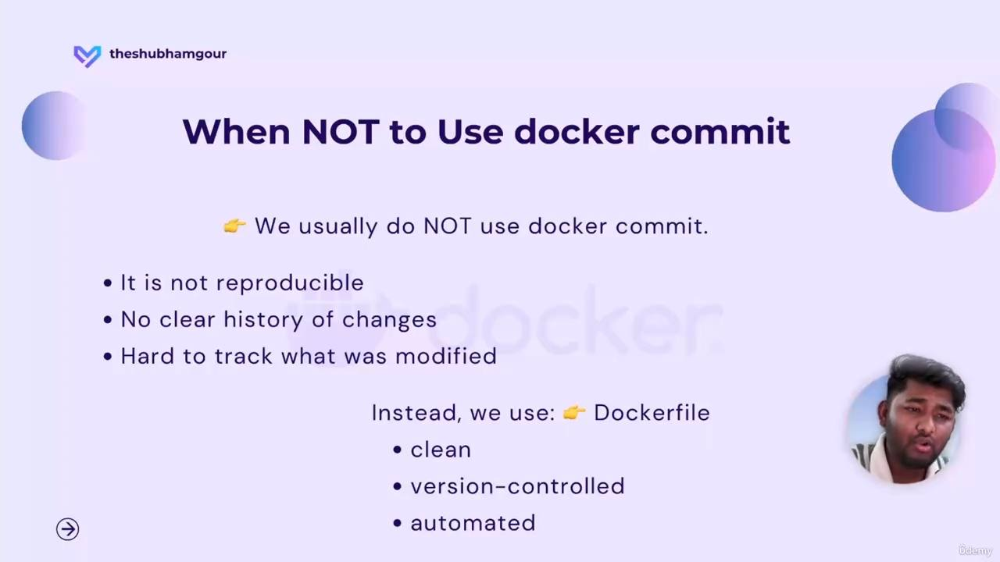

关于动手时的一个真实坑：

> 「因为这是 nginx 容器，**里面没有 vim**，所以我用最基础的命令把整个 `index.html` 覆盖掉。」
> —— p024 [05:49]

---

## 3. 从零复现

### 3.1 前置条件

| 项 | 要求 | 说明 |
|---|---|---|
| Docker Engine | 任意近期版本（能跑 `docker version` 且 Client / Server 两段都有输出） | 课里没讲具体版本号；本文所有命令都是 Docker 的稳定老命令，不依赖新特性 |
| 操作系统 | 讲师在 Linux/macOS 风格终端里演示 | Windows 用户请用 WSL2 或 Docker Desktop 的 Linux 容器模式，否则第 4 步的 `bash` 进容器会失败（见第 7 节） |
| 磁盘 | 需要能放下 `nginx:latest` 和一个 commit 出来的派生镜像 | nginx 本身很小，commit 出来的层是一层文件 diff，也很小 |
| 宿主端口 | **80** 和 **8080** 必须空闲 | 这是最容易翻车的地方，见第 7 节 |
| 权限 | 普通用户即可；只有第 3.4 步「看镜像层存在哪」需要 root | 课里讲师也说了「let me just turn it as a root user」 |

### 3.2 建目录、放脚本

在任意空目录下建这套结构（脚本内容见第 4 节，可直接复制保存）：

```
docker-masterclass-21-24/
├── 01-lifecycle.sh     # P021-P022：容器生命周期全流程
├── 02-commit.sh        # P023-P024：docker commit 全流程
└── README.md           # 命令清单与清理说明
```

```bash
mkdir -p docker-masterclass-21-24
cd docker-masterclass-21-24
# 用编辑器把第 4 节的三段内容分别存成上面三个文件
chmod +x 01-lifecycle.sh 02-commit.sh
```

### 3.3 第一轮：跑通容器生命周期（对应 P022）

**这是「先撞墙、再理解」的一轮，不要跳步。** 顺序严格按讲师的现场演示来：

**Step 0｜自检环境**

```bash
docker version
```

Client 和 Server 都要有输出。只有 Client 说明守护进程没起来——这一步课里没讲，但它是所有后续命令的前提。

**Step 1｜先看清楚现场有什么**

```bash
docker images     # 本地有哪些镜像
docker ps         # 有哪些「正在运行」的容器
docker ps -a      # 所有容器，不管什么状态
```

关键就在 `docker ps` 和 `docker ps -a` 的差别上：**`docker ps` 只列运行中的，`-a` 才列全部**。讲师现场就是靠这两个命令发现「有个叫 nginx 的容器正在用某个镜像，而它处于退出状态」。

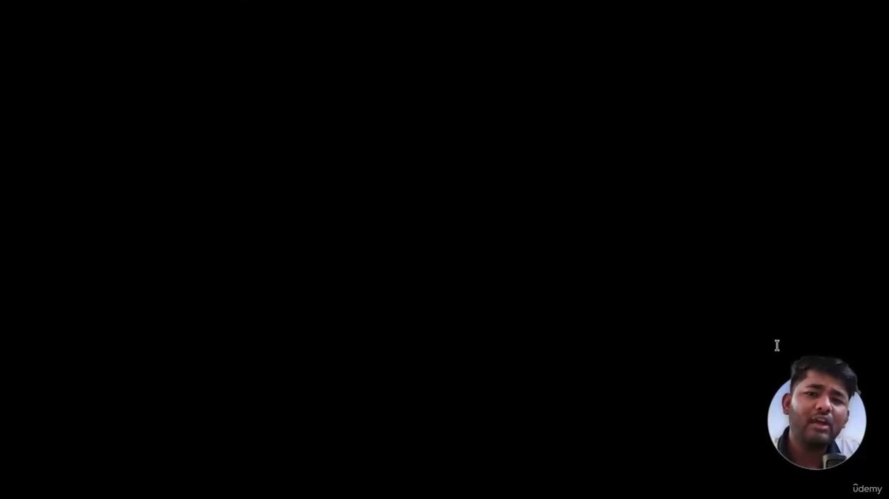

**Step 2｜故意制造「删镜像删不掉」（这一集最重要的一分钟）**

在有一个处于 Exited 状态、由 `nginx` 镜像创建的容器时，执行：

```bash
docker rmi nginx
```

你会拿到一个冲突错误，大意是：`error response from the daemon`，存在 conflict，无法删除 `nginx:latest`，必须强制（force），并且错误信息里会把这个**正在引用该镜像的容器 ID** 也列出来。

讲师在这里的解读是唯一正确的读法：**容器哪怕已经退出、已经不在运行，它对镜像的引用依然存在**，所以要先 `docker rm <容器ID>` 删容器，再 `docker rmi nginx` 删镜像。

```bash
docker rm <上一步错误里给出的容器ID>
docker ps -a          # 确认容器没了
docker rmi nginx      # 这次能删掉
docker images         # 确认镜像也没了
```

**Step 3｜拉镜像（注意 tag 的含义）**

```bash
docker pull nginx
docker images
```

讲师特别强调：**不写 tag 就等于 `latest`**；写了 tag 就拉指定的那个。本地没有才会去 Docker Hub 拉，本地有就直接用。

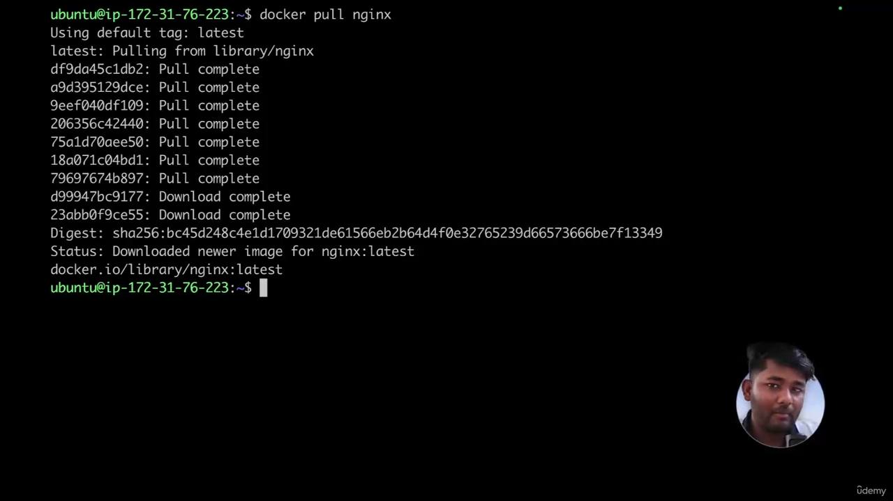

**Step 4｜前台运行，体验「终端被吃掉」**

```bash
docker run nginx
```

屏幕开始刷 nginx 日志，你的终端敲什么都没反应——因为 nginx 是服务型进程，它不会自己结束，前台运行就会一直占着终端。

按 `Ctrl+C`。这相当于给容器里的主进程发了终止信号，容器随之退出。

```bash
docker ps        # 空的，没有运行中的容器了
docker ps -a     # 那个容器还在，状态是 Exited（讲师看到的是退出码 0）
```

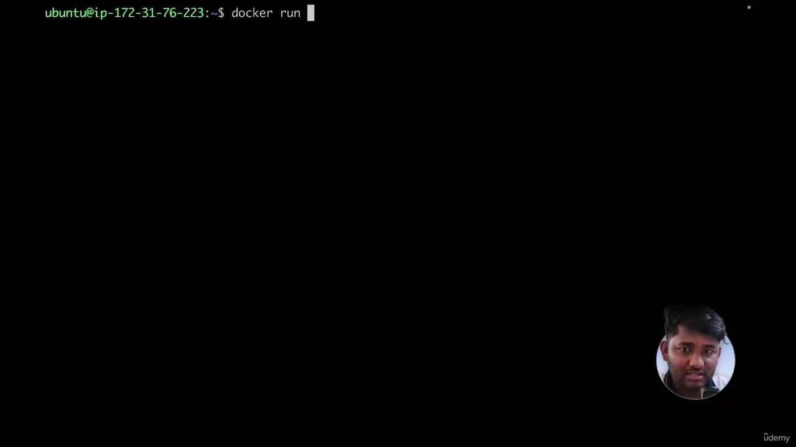

**Step 5｜后台运行 + 命名 + inspect**

```bash
docker rm <刚才那个退出容器的ID>          # 先清掉
docker run -d --name webapp nginx        # -d 后台，--name 起名
docker ps                                # 状态列显示 Up ...，说明在跑
docker inspect webapp                    # 全部元信息：网络、IP、状态、配置
```

`--name` 的意义就是后面所有命令都用 `webapp` 这个名字，不用手抄容器 ID。`docker inspect` 是这个容器的「全息照片」，讲师说网络信息、IP、容器是否在运行（true/false）都能在里面看到。

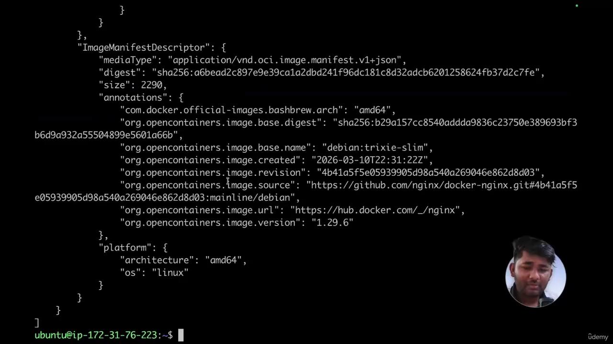

**Step 6｜暂停 / 恢复**

```bash
docker pause webapp
docker ps          # 状态列从 Up ... 变成 Paused
docker unpause webapp
docker ps          # 又回到 Up ...
```

注意 `pause` 不是「停止服务」，进程还在，只是被挂起了。

**Step 7｜软删除 → 启动 → 重启 → 硬删除 → 真删除**

```bash
docker stop webapp      # 软删除：容器进 Exited，对象还在
docker ps               # 空
docker ps -a            # 还在，Exited
docker start webapp     # 从 Exited 拉回 Up
docker ps
docker restart webapp   # 停+起，一步完成
docker ps
docker kill webapp      # 硬删除：直接干掉主进程
docker ps -a            # Exited
docker rm webapp        # 真正把容器对象删掉
docker ps -a            # 彻底没了
```

到这里，P022 的整条链路就走完了：`pull → run（前台被占）→ run -d --name（后台+命名）→ inspect → pause/unpause → stop/start/restart → kill → rm`。

**Step 8｜（可选，需 root）看一眼镜像层到底存在磁盘哪里**

讲师在 P024 开头带大家去看了镜像层的实际落盘位置：

```bash
sudo -i
cd /var/lib/containerd/io.containerd.content.v1.content/blobs/sha256
ls -l | head
docker images            # 记下 nginx 的 IMAGE ID
ls -l | grep <IMAGE_ID 的前几位>
```

> ⚠️ 这条路径是**讲师在他那台机器上**看到的（用了 containerd 的 content store）。不同 Docker 版本/存储驱动下路径会不一样，如果你的机器上没有这个目录，说明你的环境用的是别的存储布局——**该路径请以你本机实际输出为准**，课里没有讨论版本差异。

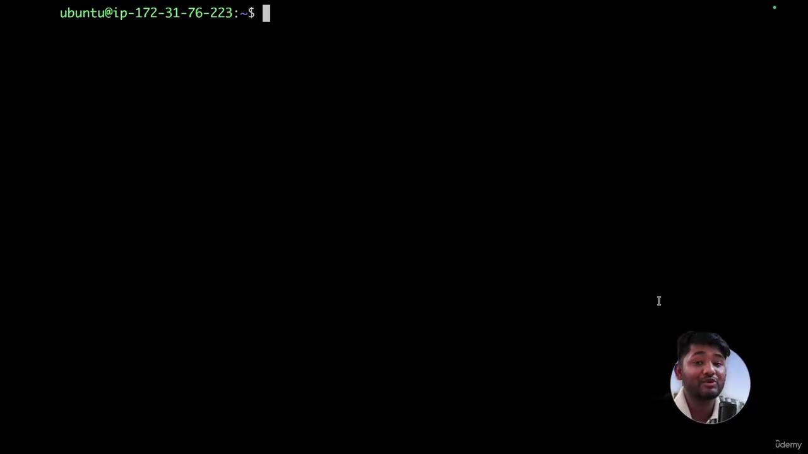

### 3.4 第二轮：Docker commit 快照实验（对应 P024）

这一轮的设计非常讲究，**必须按顺序做，中间不能省掉「删掉原容器和原镜像」那一步**，否则你无法证明改动真的被 commit 保存了。

**Step 1｜拉 nginx、起容器、映射端口**

```bash
docker pull nginx
docker run -d -p 80:80 --name webapp nginx
docker ps
```

`-p 80:80` 是「宿主端口 : 容器端口」。讲师的原话是：把容器端口和宿主端口做映射，之后你访问宿主机的 80，就等于访问容器里的 80。

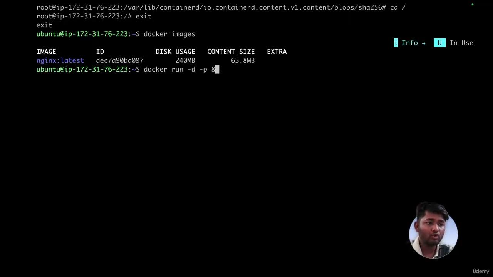

**Step 2｜验证服务真的在跑**

```bash
curl localhost
```

应该返回 nginx 的欢迎页 HTML。

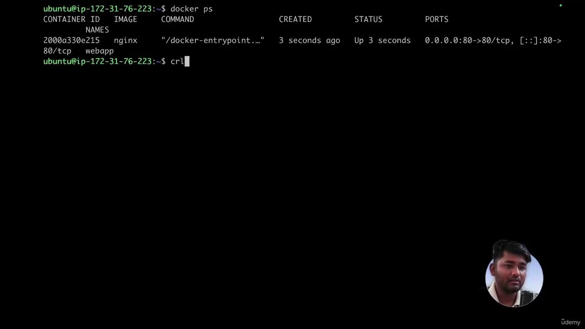

**Step 3｜拿容器 IP（顺带学 inspect 的过滤技巧）**

```bash
docker inspect webapp | grep -i -A 4 "IPAddress"
```

讲师的原话是：用 `grep`，加「忽略大小写」的选项，再取「IP 地址那一行之后的四行」。然后：

```bash
curl <上一步拿到的容器IP>
```

同样能拿到 nginx 欢迎页——说明「宿主端口访问」和「直接访问容器 IP」两条路都通。

**Step 4｜进容器，改掉首页**

```bash
docker exec -it webapp bash
```

`-i` 交互、`-t` 分配终端，最后一个参数是要执行的程序（`bash`）。

进容器后：

```bash
cat /usr/share/nginx/html/index.html      # 先看原始内容
```

**注意：这个镜像里没有 `vim`**（讲师明确踩过这个坑）。所以要覆盖就只用最基础的命令：

```bash
echo "Welcome to Docker Commit" > /usr/share/nginx/html/index.html
cat /usr/share/nginx/html/index.html      # 确认已经被覆盖
exit
```

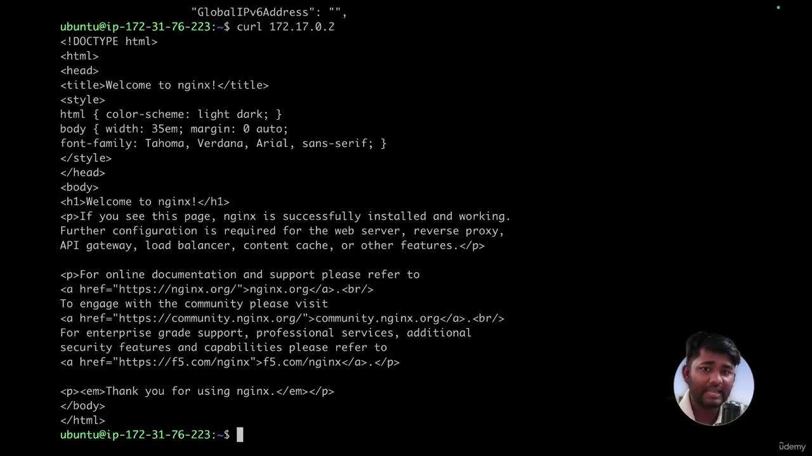

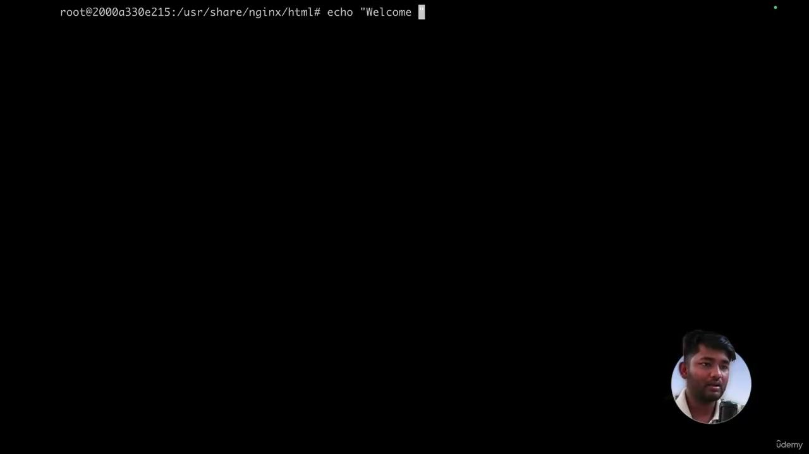

**Step 5｜出来再 curl，确认改动生效**

```bash
curl <容器IP>
# 或
curl localhost
```

返回 `Welcome to Docker Commit`。

**Step 6｜提交成新镜像**

```bash
docker commit webapp webapp:v2
docker images
```

`docker images` 里现在应该有 `webapp` 这个 repository、`v2` 这个 tag。

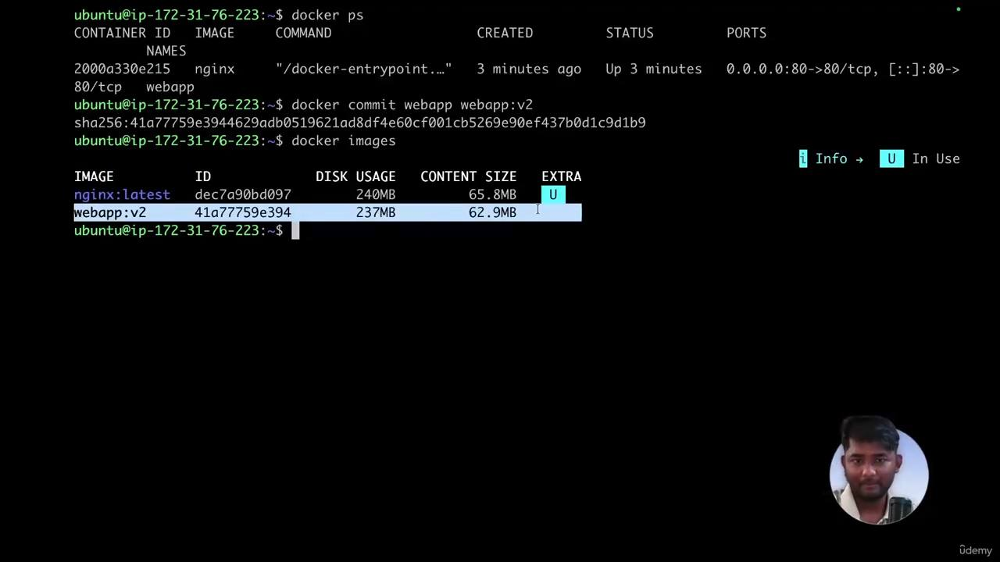

**Step 7｜毁灭性验证：删掉容器、删掉基础镜像**

```bash
docker rm -f webapp
docker rmi nginx:latest
docker ps -a          # 空
docker images         # 应该只剩 webapp:v2
```

这一步是整个实验的「证明环节」：原始容器没了、原始镜像也没了，改动如果还在，那它只可能存在于 `webapp:v2` 里。

**Step 8｜用 commit 出来的镜像重新起容器**

```bash
docker run -d -p 8080:80 --name newdockerapp webapp:v2
docker ps
curl localhost:8080
```

预期返回 `Welcome to Docker Commit`。

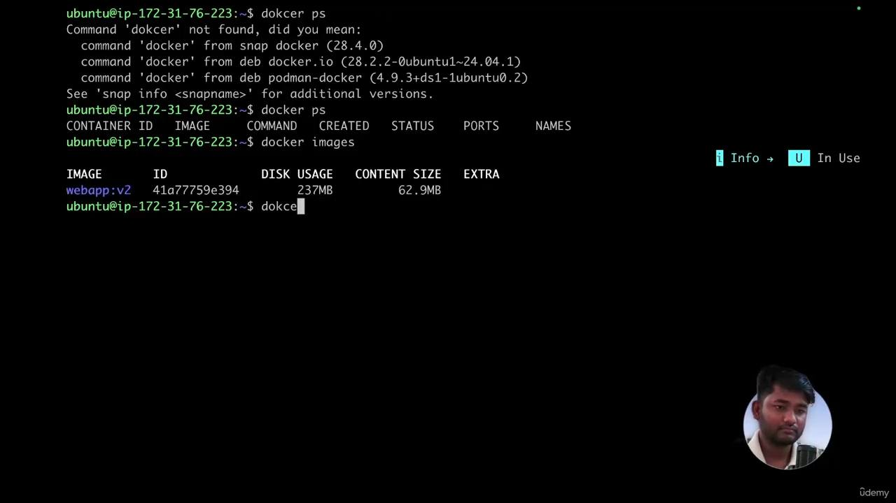

**Step 9｜顺手踩一下端口映射的坑（讲师现场演示过）**

```bash
curl localhost:80
```

会失败——因为这次新容器映射的是宿主 **8080**，不是 80。讲师的原话是「fail to connect to localhost port 80，连不上，为什么？因为宿主端口映射的是 8080，所以你必须显式指定」。

**Step 10｜清理**

```bash
docker rm -f newdockerapp
docker rmi webapp:v2
```

---

## 4. 完整代码

三个文件，全部可**直接保存运行**。脚本里对「课里讲过的命令」和「课里没讲、我为了脚本能自动跑而加的取值技巧」做了明确注释区分。

### 4.1 `01-lifecycle.sh`

```bash
#!/usr/bin/env bash
# ============================================================
# Docker Masterclass P021-P022 复现脚本：容器生命周期
#
# 目标：把「容器 = 镜像的运行实例 = 宿主机上的一个进程」亲手跑一遍，
#       并把 创建 -> 运行 -> 暂停 -> 恢复 -> 停止 -> 启动 -> 重启
#       -> 杀死 -> 删除 全流程走通。
#
# 用法：
#   1) 确保 docker 可用：docker version（Client 和 Server 都要有输出）
#   2) bash 01-lifecycle.sh
#
# 注意：
#   - 第 4 步会前台运行 nginx 并占住终端，请按 Ctrl+C 结束，脚本会自动继续
#   - 脚本会删除名为 webapp 的容器；如果你本机有同名容器，请先改 NAME
#   - 脚本不会自动删除 nginx 镜像（留给 02-commit.sh 用）
# ============================================================

set -u

IMG="nginx"
NAME="webapp"

step() {
  echo
  echo "=================================================="
  echo "== $*"
  echo "=================================================="
}

step "0. 环境自检：Docker 客户端 / 服务端是否都在"
docker version

step "1. 清理现场：先看清楚现在有什么"
docker images
docker ps
docker ps -a

step "2. 拉取镜像（不写 tag 就等于 latest）"
docker pull "$IMG"

step "3. 确认蓝图已经落到本地"
docker images

step "4. 前台运行：体验讲师说的『终端被吃掉』"
echo ">>> 下面会前台启动 nginx，看到日志后按 Ctrl+C，脚本会继续往下走。"
sleep 3
docker run "$IMG"

step "5. Ctrl+C 之后：容器应该已经从运行态变成退出态"
docker ps        # 空的，没有运行中的容器
docker ps -a     # 刚刚那个容器还在，状态是 Exited
echo ">>> 如果这里出现了由 nginx 镜像创建的 Exited 容器，"
echo ">>> 现在可以顺便试试删镜像会被拒绝：docker rmi nginx"
read -r -p ">>> 试完按回车继续..." _

step "6. 删掉刚才那个退出状态的容器，给后面腾位置"
# 课里是手抄容器 ID 再 docker rm <ID>；
# 下面这行 $(docker ps -lq) 是课里没讲的取值技巧，只为省掉手抄。
LAST_CID="$(docker ps -lq)"
if [ -n "$LAST_CID" ]; then
  docker rm "$LAST_CID"
fi

step "7. 后台运行 + 给容器起名：-d 与 --name 的价值"
docker rm -f "$NAME" >/dev/null 2>&1 || true
docker run -d --name "$NAME" "$IMG"
docker ps

step "8. inspect：拿到这个容器的全部元信息（网络、IP、运行状态）"
docker inspect "$NAME"

step "9. 暂停 / 恢复：服务还在，只是被挂起"
docker pause "$NAME"
docker ps
docker unpause "$NAME"
docker ps

step "10. 软删除：stop 之后容器并未消失，只是进入 Exited"
docker stop "$NAME"
docker ps
docker ps -a
docker start "$NAME"
docker ps
docker restart "$NAME"
docker ps

step "11. 硬删除：kill 直接干掉主进程"
docker kill "$NAME"
docker ps -a

step "12. 真正把容器对象删掉"
docker rm "$NAME"
docker ps -a

step "完成：镜像还在，容器已清空"
docker images
```

### 4.2 `02-commit.sh`

```bash
#!/usr/bin/env bash
# ============================================================
# Docker Masterclass P023-P024 复现脚本：Docker commit
#
# 目标：在运行中的容器里改掉 nginx 首页 -> commit 成 webapp:v2
#       -> 删掉原容器与原镜像 -> 用 webapp:v2 起新容器
#       -> 证明改动被固化在镜像里。
#
# 用法：bash 02-commit.sh
#
# 注意：
#   - 需要宿主 80 和 8080 端口空闲；被占用就把下面两个 HOST_PORT 改掉
#   - 脚本开头会强制删除同名容器/镜像，保证可以反复执行
#   - 结尾会提示清理命令
# ============================================================

set -u

BASE_IMAGE="nginx"            # 基础镜像（不写 tag 就是 latest）
BASE_NAME="webapp"            # 实验用容器名
BASE_HOST_PORT=80             # 第一次：宿主 80  -> 容器 80

NEW_IMAGE="webapp:v2"         # commit 出来的镜像，注意必须带 tag
NEW_NAME="newdockerapp"       # 用新镜像起的容器名
NEW_HOST_PORT=8080            # 第二次：宿主 8080 -> 容器 80

INDEX="/usr/share/nginx/html/index.html"   # nginx 首页在容器内的路径
TEXT="Welcome to Docker Commit"            # 要写进首页的新内容

step() {
  echo
  echo "=================================================="
  echo "== $*"
  echo "=================================================="
}

step "0. 清场：删掉同名容器与同名镜像，保证可重复执行"
docker rm -f "$BASE_NAME" "$NEW_NAME" >/dev/null 2>&1 || true
docker rmi -f "$NEW_IMAGE" >/dev/null 2>&1 || true

step "1. 拉基础镜像（不写 tag 就是 latest）"
docker pull "$BASE_IMAGE"

step "2. 起容器，宿主 ${BASE_HOST_PORT} 映射到容器 80"
docker run -d -p "${BASE_HOST_PORT}:80" --name "$BASE_NAME" "$BASE_IMAGE"
docker ps

step "3. 验证 nginx 已经在提供服务"
curl -s "http://localhost:${BASE_HOST_PORT}" | head -n 5

step "4. 进容器看 index.html 的原始内容"
docker exec -it "$BASE_NAME" cat "$INDEX"

step "5. 改页面：镜像里没有 vim，只能用 echo 覆盖"
docker exec -it "$BASE_NAME" bash -c "echo '$TEXT' > $INDEX"
docker exec -it "$BASE_NAME" cat "$INDEX"

step "6. 再请求一次，确认改动已经生效"
curl -s "http://localhost:${BASE_HOST_PORT}" | head -n 5

step "7. 提交：把运行中的容器保存成新镜像（= Windows 的『另存为』）"
docker commit "$BASE_NAME" "$NEW_IMAGE"
docker images

step "8. 毁灭性验证：删掉容器与基础镜像，改动只可能活在新镜像里"
docker rm -f "$BASE_NAME"
docker rmi "${BASE_IMAGE}:latest"
docker ps -a
docker images

step "9. 用 commit 出来的镜像重新起容器（image 必须写 webapp:v2）"
docker run -d -p "${NEW_HOST_PORT}:80" --name "$NEW_NAME" "$NEW_IMAGE"
docker ps

step "10. 验证：新容器里还是刚才改过的内容"
curl -s "http://localhost:${NEW_HOST_PORT}" | head -n 5

step "11. 顺手验证端口映射：映射到 ${NEW_HOST_PORT}，那 80 就应该是连不上的"
echo ">>> 下面这条预期失败，这是正常的"
curl -s "http://localhost:80" >/dev/null 2>&1 \
  && echo "!! 80 竟然通了，说明你本机有别的服务在占 80，请检查" \
  || echo "OK：80 连不上，符合预期（本次映射的是 ${NEW_HOST_PORT}）"

step "完成"
echo ">>> 清理：docker rm -f ${NEW_NAME} && docker rmi ${NEW_IMAGE}"
```

### 4.3 `README.md`

```markdown
# Docker Masterclass P21-P24 复现包

对应课程：容器是什么（P21）→ 容器生命周期（P22）→ Docker commit 理论（P23）→ Docker commit 动手（P24）

## 运行

    chmod +x 01-lifecycle.sh 02-commit.sh
    ./01-lifecycle.sh      # 容器生命周期，中途需要按一次 Ctrl+C 和一次回车
    ./02-commit.sh         # docker commit 快照实验

## 端口占用

| 脚本 | 宿主端口 | 容器端口 |
|---|---|---|
| 02-commit.sh 第一段 | 80   | 80 |
| 02-commit.sh 第二段 | 8080 | 80 |

若宿主端口被占用，改脚本顶部的 BASE_HOST_PORT / NEW_HOST_PORT。

## 命令与容器状态对照

| 命令 | 结果状态 |
|---|---|
| docker pull nginx | 只有镜像，还没有容器 |
| docker run nginx（前台） | 运行中，占住终端 |
| docker run -d --name webapp nginx | 后台运行 |
| docker pause webapp | Paused |
| docker unpause webapp | 回到运行中 |
| docker stop webapp | Exited（软删除） |
| docker start webapp | 回到运行中 |
| docker restart webapp | 停 + 起 |
| docker kill webapp | Exited（硬删除） |
| docker rm webapp | 容器对象消失 |

## 清理

    docker rm -f webapp newdockerapp
    docker rmi webapp:v2 nginx:latest
```

---

## 5. 逐行解释

### 5.1 生命周期脚本里的关键决策

**为什么 `docker pull` 要在 `docker run` 之前？** 讲师在 P021 [02:22] 把 `docker run` 拆成了三步：① 拉镜像（先查本地，本地没有才去 Docker Hub）② 用镜像创建容器（有独立文件系统、独立网络、独立空间）③ 启动容器里的主进程。所以 `docker pull` 不是必需品，`docker run` 自己会拉；单列出来是为了让「先有蓝图、再有实例」这个顺序**肉眼可见**。你在自动化脚本里完全可以省略这一步。

**`docker run nginx` 为什么会被「吃掉终端」？** 因为 `docker run` 默认是**前台**模式：容器的标准输入输出直接接到你的终端上，你的终端就变成了容器的控制台。nginx 是长驻服务进程，它不结束，终端就不还给你。这不是 bug，是前景运行的定义。

**`Ctrl+C` 到底发生了什么？** 讲师的原话是「它给了 nginx 容器一个信号：你的活干完了」。信号传到容器内的主进程 → 主进程退出 → 容器没有主进程了 → 容器进入 Exited。退出码 0 表示进程是正常终止的（不是崩溃）。**JS/Node 对应关系**：这就相当于你在 Node 里 `spawn` 了一个子进程，然后给前台发 `SIGINT`，子进程退出、`exitCode` 为 0。

**`-d` 和 `--name` 各解决什么问题？** `-d`（detach）把容器丢到后台，命令立刻返回、终端还给你，`docker ps` 里能看到它在跑；`--name` 给它一个人类可读的名字，之后所有命令（`inspect` / `pause` / `stop` / `rm`）都用名字而不是 12 位 ID。这两个是本集里「提升可操作性」最重要的两个参数。

**`docker inspect` 为什么不用过滤也值得跑一次？** 因为它是容器的完整快照：网络、IP、运行状态（是否运行中是布尔值）、启动配置全在里面。P024 里讲师拿 IP 时用了 `grep -i -A 4 "IPAddress"`——`-i` 忽略大小写，`-A 4` 表示「匹配行之后再打印四行」，因为 `docker inspect` 输出的是层级化的 JSON 文本，IP 值在键的下一行。**JS 对应**：`docker inspect webapp | grep ...` 差不多等于 `JSON.parse(await execFile('docker', ['inspect', 'webapp']))` 之后取字段，只不过课里用的是文本过滤而不是 JSON 解析。

**`pause` 和 `stop` 的区别是本集最容易被忽略的点。** `pause` 只是把容器内的进程挂起（进程还在，内存状态还在），`docker ps` 里状态从 `Up ...` 变成 `Paused`；`stop` 是让进程结束，容器进 Exited，但**容器这个对象还在**，所以 `docker ps -a` 还能看到它，`docker start` 能把它拉回来。**JS/Node 对应关系**：`pause` ≈ `process.kill(pid, 'SIGSTOP')`，`unpause` ≈ `process.kill(pid, 'SIGCONT')`，`stop` ≈ 先发 `SIGTERM`、超时再 `SIGKILL`，`kill` ≈ 直接 `SIGKILL`。

**`stop` / `start` / `restart` 三者的语义边界：** `stop` 之后容器是「存在但不在运行」，所以还能 `start`；`restart` 是 `stop` + `start` 的原子组合，用来让容器带着同样的配置重新跑一遍。而 `rm` 是**销毁对象**，删了就只能重新 `docker run`。

**为什么 `docker rm` 之前必须注意「容器是不是还在引用镜像」？** 这就是 P022

## 6. 复现检查清单

- [ ] 环境自检：运行 `docker version`，Client 和 Server 两段都有输出。若只有 Client，说明 Docker 守护进程没起来；这一步课里没讲，但文档把它列为所有后续命令的前提。
- [ ] 分清 `docker ps` 与 `docker ps -a`：先运行 `docker ps`，再运行 `docker ps -a`。应看到 `docker ps` 只列运行中的容器，`docker ps -a` 会列出所有状态的容器（包括 `Exited`）。P022 讲师就是靠这两个命令发现退出状态的 nginx 容器。
- [ ] 复现“镜像被容器引用所以删不掉”：在存在一个由 `nginx` 镜像创建、状态为 `Exited` 的容器时，运行 `docker rmi nginx`。应看到 daemon 返回 conflict / unable to delete `nginx:latest` / must be forced 一类错误，并且错误信息里给出引用该镜像的容器 ID。然后运行 `docker rm <上一步错误里的容器ID>`，再运行 `docker rmi nginx`，这次应删除成功；`docker images` 中不再有 nginx。
- [ ] 验证 pull 与 tag：运行 `docker pull nginx`，再运行 `docker images`。应看到 `nginx` 的 TAG 为 `latest`，因为不写 tag 默认就是 latest。首次拉取（本地没有该镜像时）的输出中应能看到多层 SHA，最后有 digest 和镜像 SHA；如果本地已有镜像，pull 会直接使用本地，不会重新逐层下载。
- [ ] 验证前台运行会占住终端：运行 `docker run nginx`，应看到 nginx 日志持续输出，终端输入没有反应。按 `Ctrl+C` 后，运行 `docker ps` 应为空（没有运行中容器）；运行 `docker ps -a` 应看到该容器处于 `Exited` 状态，讲师现场看到退出码为 0。不同 Docker 版本的 STATUS 文本可能略有差异，课里没讲版本差异。
- [ ] 验证后台运行与命名：运行 `docker run -d --name webapp nginx`，命令应立即返回、终端可继续输入。运行 `docker ps` 应看到名为 `webapp` 的容器，状态为 `Up ...`。
- [ ] 验证 inspect 元信息：运行 `docker inspect webapp`，应能看到网络、IP、容器是否运行（true/false）等完整元信息。也可以运行 `docker inspect webapp | grep -i -A 4 "IPAddress"`，应能取到 IP 地址；`-i` 表示忽略大小写，`-A 4` 表示打印匹配行之后的四行。
- [ ] 验证 pause / unpause：运行 `docker pause webapp`，再运行 `docker ps`，状态列应从 `Up ...` 变成 `Paused`。运行 `docker unpause webapp`，再运行 `docker ps`，状态应回到 `Up ...`。验证点：pause 不是停止服务，进程还在，只是被挂起。
- [ ] 验证 stop 是软删除：运行 `docker stop webapp`，`docker ps` 应为空，但 `docker ps -a` 仍能看到该容器，状态为 `Exited`。
- [ ] 验证 start / restart：在 Exited 状态下运行 `docker start webapp`，`docker ps` 应看到容器回到 `Up ...`；运行 `docker restart webapp`，再运行 `docker ps`，容器应仍是 `Up ...`（停 + 起一步完成）。
- [ ] 验证 kill 是硬删除：运行 `docker kill webapp`，`docker ps` 应为空；`docker ps -a` 应看到该容器为 `Exited`。
- [ ] 验证 rm 才真正删除容器对象：运行 `docker rm webapp`，再运行 `docker ps -a`，本次实验的 `webapp` 容器应彻底消失；若本机还有其他容器，不属于本检查范围。
- [ ] （可选，需 root）验证镜像层落盘位置：按 P024 讲师演示，切 root 后进入 `/var/lib/containerd/io.containerd.content.v1.content/blobs/sha256`，运行 `ls -l` 应看到多个层文件/目录。用 `docker images` 记下 nginx 的 IMAGE ID，再运行 `ls -l | grep <IMAGE_ID 前几位>`，应能匹配到对应 SHA。注意：文档强调这是讲师那台机器上的 containerd content store 路径，不同 Docker 版本/存储驱动路径会不同，课里没讲版本差异，应以本机实际输出为准。
- [ ] 验证 commit 实验起容器与端口映射：运行 `docker pull nginx`，再运行 `docker run -d -p 80:80 --name webapp nginx`。运行 `docker ps` 应看到 `webapp` 在运行，并且端口映射显示宿主 80 → 容器 80；`-p 80:80` 是“宿主端口 : 容器端口”。
- [ ] 验证 nginx 服务已在运行：运行 `curl localhost`，应返回 nginx 欢迎页 HTML。
- [ ] 验证可通过容器 IP 直连：运行 `docker inspect webapp | grep -i -A 4 "IPAddress"` 取得容器 IP，再运行 `curl <容器IP>`，应同样返回 nginx 欢迎页，说明“宿主端口访问”和“直接访问容器 IP”两条路都通。
- [ ] 验证进容器改首页：运行 `docker exec -it webapp bash` 进入容器。先运行 `cat /usr/share/nginx/html/index.html` 看到原始内容。课里明确说这个 nginx 容器里没有 `vim`，所以应使用基础命令覆盖：`echo "欢迎来到 Docker Commit" > /usr/share/nginx/html/index.html`，再运行 `cat /usr/share/nginx/html/index.html` 确认内容已被覆盖。最后 `exit` 退出容器。
- [ ] 验证改动在运行中的容器里生效：退出容器后运行 `curl localhost` 或 `curl <容器IP>`，应返回 `Welcome to Docker Commit`。
- [ ] 验证 commit 成新镜像：运行 `docker commit webapp webapp:v2`，再运行 `docker images`，应看到 repository 为 `webapp`、tag 为 `v2` 的新镜像。验证点：commit 会把运行中容器的当前状态（文件改动、安装的软件、配置改动）保存成新镜像；按 P023 的分层说法，新层会叠加在已有层之上。
- [ ] 验证毁灭性删除：运行 `docker rm -f webapp`，再运行 `docker rmi nginx:latest`，然后运行 `docker ps -a`，本次实验的 `webapp` 容器应不存在；运行 `docker images`，应看到 `webapp:v2` 仍存在，而 `nginx:latest` 已被删除。课里演示的干净环境中此时只剩 `webapp:v2`；若你本机还有其他镜像，至少应满足“nginx:latest 已消失、webapp:v2 仍存在”。这一步用来证明原始容器和原始镜像都没了，改动只可能保存在 `webapp:v2` 里。
- [ ] 验证用 commit 镜像起新容器：运行 `docker run -d -p 8080:80 --name newdockerapp webapp:v2`，再运行 `docker ps`，应看到 `newdockerapp` 在运行，端口映射为宿主 8080 → 容器 80。
- [ ] 验证快照内容仍在：运行 `curl localhost:8080`，应返回 `Welcome to Docker Commit`，证明改动确实被 commit 保存下来了。
- [ ] 验证端口映射的坑：运行 `curl localhost:80`，在宿主 80 没有被其他服务占用的情况下应连接失败，课里演示为 fail to connect to localhost port 80，因为新容器映射的是宿主 8080，不是 80。文档脚本也提示：如果 80 竟然通了，说明本机有别的服务在占用 80，需要检查；本机 80 被占用时怎么处理，课里没讲。
- [ ] 验证 tag 不能省：尝试用 `docker run ... webapp`（不带 `:v2`）时，按 P024 讲师说法应报错，因为 commit 出来的是带 tag 的 `webapp:v2`，不是 `latest`。具体错误原文课里没讲，验证时以实际错误为准。
- [ ] 验证清理：运行 `docker rm -f newdockerapp`，再运行 `docker rmi webapp:v2`；`docker ps -a` 和 `docker images` 中不应再有本次实验新建的容器/镜像。若本机原有其他容器或镜像，不属于本检查范围。
- [ ] 记录结论（非命令验证）：课里说生产环境不用 `docker commit`，因为改动不可复现、没有清晰历史、难以追踪谁改了什么；应改用 Dockerfile，它干净、能进版本控制、能自动化。Dockerfile 的具体写法课里没讲。检查方式：在 README 或笔记中写明这一点；如果没有写，补上。
