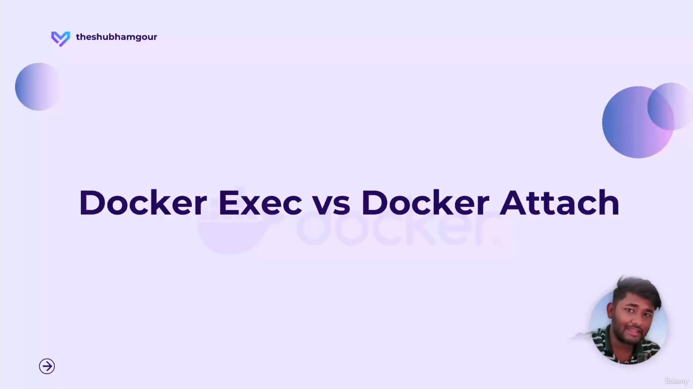
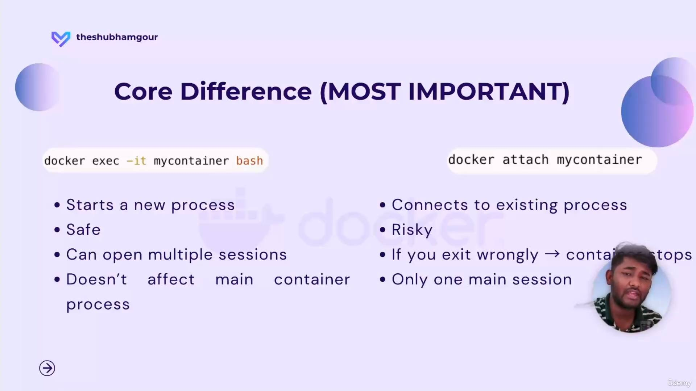
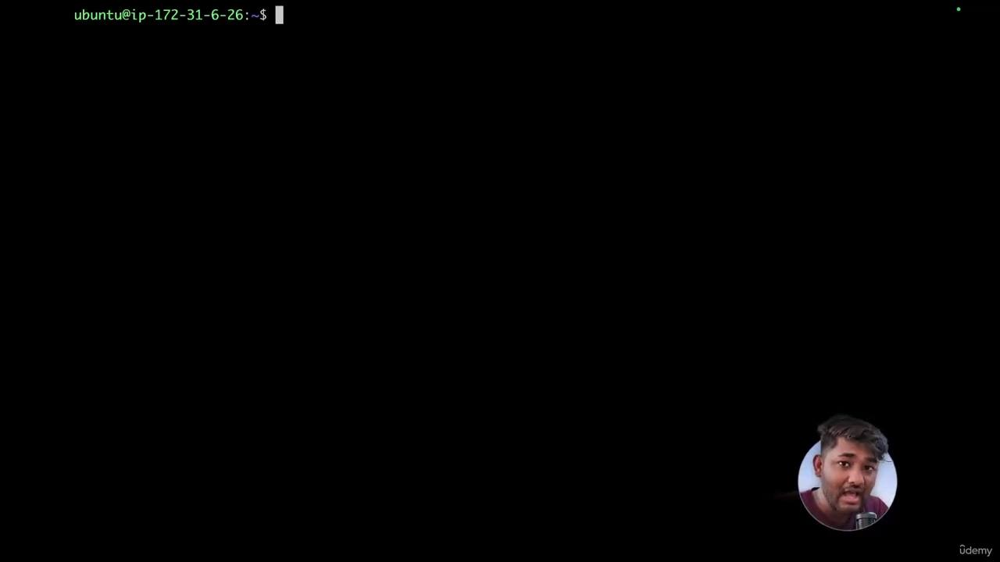
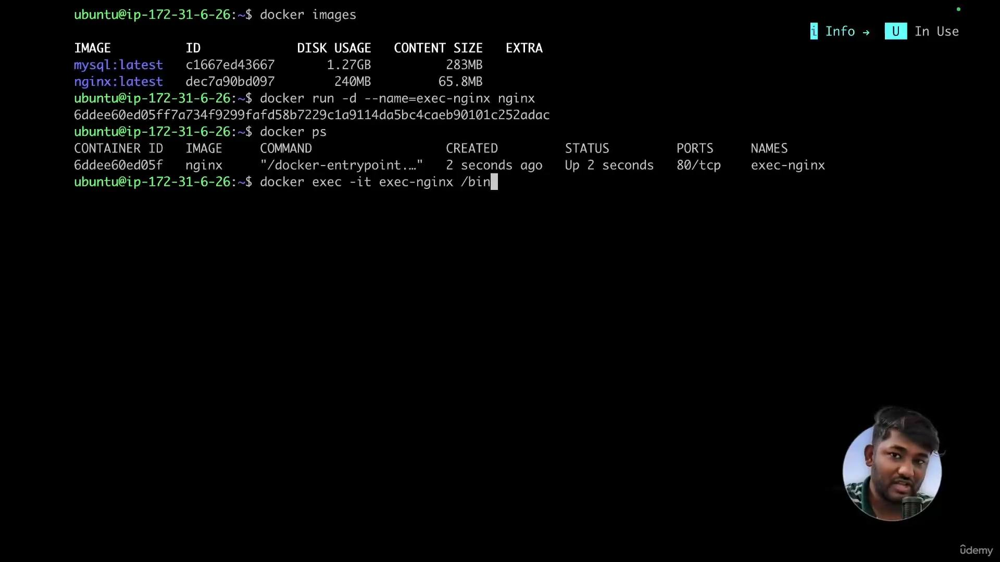
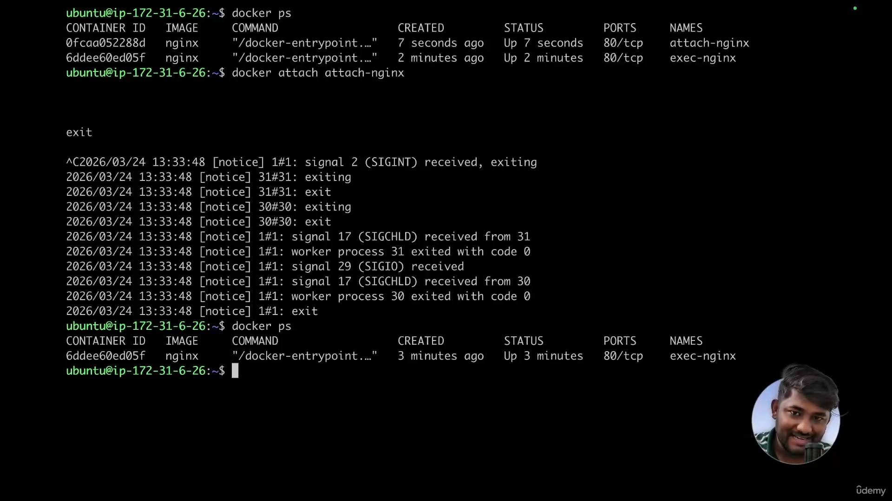
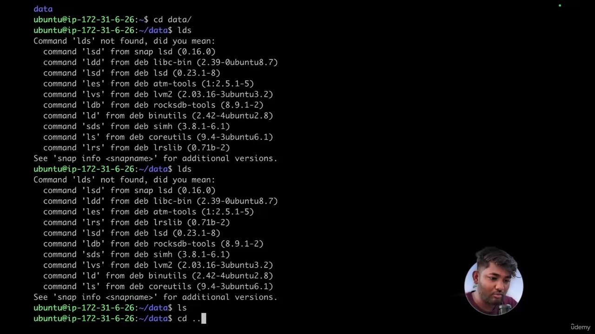
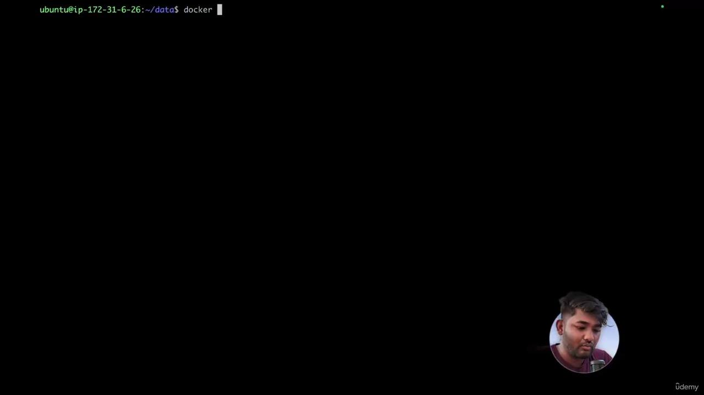
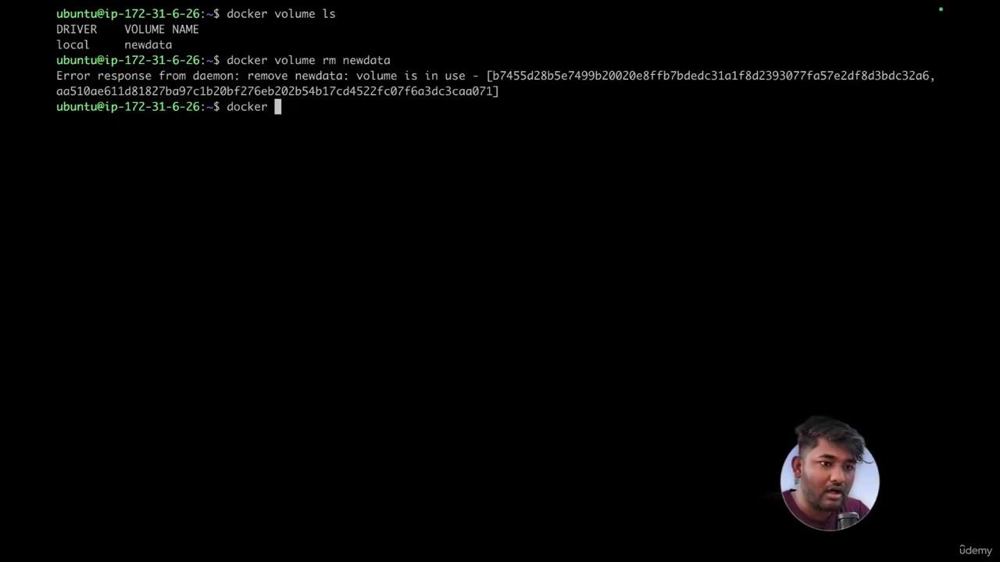
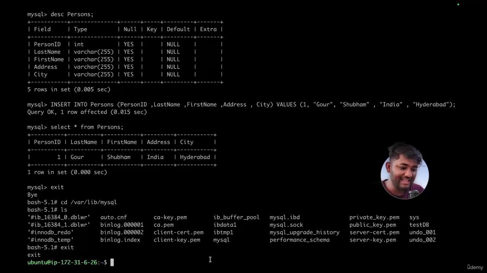

# Docker Masterclass P25–P28 复现文档：exec/attach、Docker Volume 与 MySQL 持久化

> 覆盖范围：P25–P28。  
> 目标：照着本文能复现四件事：  
> 1）理解并验证 `docker exec` 与 `docker attach` 的差异；  
> 2）用 nginx 复现“无 volume 数据丢失”；  
> 3）用 nginx 复现 bind mount 与 named volume；  
> 4）用 MySQL 复现“容器删了，数据还在”。  
> 说明：这几节没有应用源码文件，完整可复现内容就是下面的 Docker 命令与 MySQL SQL。课里没给 Docker 版本号，本文不锁定版本；镜像使用 `nginx`、`mysql` 的默认 `latest` 标签。Windows 建议用 WSL2 或 Git Bash，路径中的 `/home/ubuntu` 换成你的用户目录。

---

## 1. 这一节做什么

这一节先解决一个非常容易在生产环境出事的问题：**你进入一个正在运行的容器时，到底该用 `docker exec` 还是 `docker attach`？**

P25 先讲理论：`docker exec` 是在运行中的容器里**新起一个进程**，通常新起一个 shell；`docker attach` 是**直接连到容器的主进程**。前者安全，后者危险，因为你在 attach 的终端里按 `Ctrl+C`，很可能把信号发给容器主进程，容器直接退出。P26 用 nginx 做实战：先 `docker exec` 进去执行命令再退出，容器仍然活着；再 `docker attach` 进去按 `Ctrl+C`，容器变成退出状态。P26 还补了一个关键点：如果创建容器时加了 `-t`，可以用 `Ctrl+P` 然后 `Ctrl+Q` 从 attach 会话里脱离，而不杀容器。

P27 开始讲 Docker Volume。核心结论是：容器默认是“无状态”的，删掉容器，容器内写入的数据就没了；Volume 是挂在宿主机上的持久化存储，容器删除后数据还在。P27 区分了两类常见用法：**bind mount**（把宿主机某个目录挂进容器）和 **named volume**（Docker 管理的命名卷）。

P28 是完整实战：先用 nginx 演示“没有 volume 时，改完 `index.html` 再删容器，数据消失”；然后创建 `/home/ubuntu/data` 做 bind mount，让 `web1`、`web2` 共享同一个目录；再创建命名卷 `new_data`，让 `web3`、`web4` 共享同一个卷。最后用 MySQL 演示数据库持久化：没有 volume 时，删容器数据库就没了；有 bind mount 或 named volume 后，删容器再重建，`testdb`、`persons` 表和数据仍然存在。

从“前台/Node 服务”的角度对照，可以把容器理解成一个正在运行的服务进程：`docker exec` 更像是在服务旁边另开一个终端去执行命令，不会替换服务主进程；`docker attach` 更像直接接管服务主进程的输入输出，按 `Ctrl+C` 就相当于给主进程发中断信号。Volume 则像把数据目录放到容器外面，容器本身可以删掉重建，但外部目录还在，所以数据还在。



---

## 2. 讲师原话（带「—— pNNN [MM:SS]」）

> "docker exec 相当于在正在运行的容器中执行一条新命令。"
> —— p025 [02:00]  
> 中文：`docker exec` 等于在一个正在运行的容器里运行一个新命令。

> "docker attach 会连接到容器的主进程。"
> —— p025 [02:27]  
> 中文：`docker attach` 连接的是容器的主进程。

> "如果直接按下 Ctrl+C，实际上就是给容器发送一个信号，表示可以结束了，现在就可以终止容器。"
> —— p025 [03:37]  
> 中文：如果你按 `Ctrl+C`，你实际上给容器发了信号，容器可能就被杀掉了。

> "Docker 卷是一种持久化机制，用于保存 Docker 容器生成和使用的数据，确保即使使用该卷的容器已停止、删除或替换，数据仍然保持完整。"
> —— p027 [02:14]  
> 中文：Docker volume 是持久化容器生成和使用的数据的机制，容器停止、删除或替换后数据仍然完整。

> "Docker 卷存在于宿主机上……它不存在于容器中。"
> —— p027 [03:01]  
> 中文：Docker volume 存在你的宿主机上，不存在于容器内部。

> "这里可以看到挂载项存在，类型是绑定挂载。"
> —— p028 [09:28]  
> 中文：这里可以看到挂载存在，类型是 bind mount。

> "这次类型是卷。"
> —— p028 [20:04]  
> 中文：这次类型是 volume，也就是命名卷。



---

## 3. 从零复现

### 3.1 环境准备

你需要一台已经安装 Docker 的 Linux/macOS 机器，或者 Windows + WSL2。下面命令默认在 Linux 终端执行。课里使用的宿主机目录是：

```text
/home/ubuntu/data
/home/ubuntu/database
```

如果你不是 `ubuntu` 用户，把 `/home/ubuntu` 换成你的家目录即可。本文为了和逐字稿一致，仍然写 `/home/ubuntu/...`。

先确认 Docker 可用：

```bash
docker version
docker ps
docker images
```

这三条命令分别用于确认 Docker 客户端与服务端版本、查看当前运行中的容器、查看本地已有镜像。如果 `docker version` 能输出版本信息，说明 Docker 基本可用；如果 `docker ps` 报权限错误，说明当前用户没有 Docker 权限；如果 `docker images` 为空，说明本地还没有拉取镜像，后面执行 `docker pull nginx` 或 `docker pull mysql` 即可。

如果 `docker ps` 报权限错误，说明当前用户没有 Docker 权限；可以临时用 `sudo docker ...`，或者按你的系统文档把用户加入 `docker` 组。课里没讲权限配置，这里只提醒你会撞上。常见排查是：先确认 Docker 服务是否启动；再确认当前用户是否在 `docker` 组；如果刚加入组，通常需要重新登录终端才生效。Windows + WSL2 环境下，还要确认 Docker Desktop 的 WSL 集成是否开启。

---

### 3.2 实验一：`docker exec` 与 `docker attach` 的差异

先拉 nginx 镜像：

```bash
docker pull nginx
docker images
```

`docker pull nginx` 会从镜像仓库拉取默认 `latest` 标签的 nginx 镜像；`docker images` 用来确认本地已经存在 `nginx:latest`。常见错误是网络拉取失败、镜像名拼写错误、磁盘空间不足。排查时先看命令输出中的错误信息，再检查网络和磁盘。



创建一个后台容器，名字叫 `exec-nginx`：

```bash
docker run -d --name exec-nginx nginx
docker ps
```

`docker run` 创建并启动容器，`-d` 表示后台运行，`--name exec-nginx` 给容器指定名字，最后 `nginx` 是镜像名。`docker ps` 用来确认容器处于 Up 状态。常见错误是容器名重复，如果之前已经创建过同名容器，会提示名称冲突；可以先 `docker rm -f exec-nginx` 删除旧容器，或者换一个名字。

用 `docker exec` 进入容器：

```bash
docker exec -it exec-nginx /bin/bash
```

`-i` 保持标准输入打开，`-t` 分配一个终端，`exec` 表示在运行中的容器里新起一个命令，这里新起的是 `/bin/bash`。如果进入失败，先检查容器是否正在运行；如果提示找不到 `/bin/bash`，说明镜像里可能没有 bash，可以尝试 `/bin/sh`。本实验使用 nginx 默认镜像，按课程命令执行即可。

进去后可以执行：

```bash
ls
pwd
exit
```

`ls` 查看当前目录内容，`pwd` 查看当前路径，`exit` 退出这个新起的 bash 进程。退出后再次 `docker ps`，`exec-nginx` 仍然是 Up 状态。原因是 `docker exec` 只是在容器里新起了一个 bash 进程，退出这个 bash 不会影响 nginx 主进程。与前台/Node 对照：这相当于服务还在跑，你只是另开了一个终端进去看文件，退出终端不会把服务停掉。



再创建一个用于 attach 的容器：

```bash
docker run -d --name attach-nginx nginx
docker ps
docker attach attach-nginx
```

`docker attach` 连接的是容器主进程的标准输入输出。此时你直接按 `Ctrl+C`，然后查看：

```bash
docker ps
docker ps -a
```

你会看到 `attach-nginx` 已经退出，状态类似 `Exited (0)`。逐字稿里说“error code 0”，意思是退出码 0。这里不要在生产环境随便试，因为 `Ctrl+C` 可能真的把主进程停掉。常见排查：如果 `docker attach` 后按 `Ctrl+C` 容器退出了，这是本实验要观察的现象；如果容器没退出，确认你 attach 的是不是目标容器，以及终端是否真的把信号发给了容器主进程。与前台/Node 对照：这类似直接给 Node 主进程发 `SIGINT`，如果程序没有做信号处理，进程就会结束。



再演示“带 `-t` 时如何安全脱离 attach”。创建容器时加 `-itd`：

```bash
docker run -itd --name attach-nginx-t nginx
docker attach attach-nginx-t
```

在 attach 会话里按 `Ctrl+P`，再按 `Ctrl+Q`。你会回到宿主机终端，再执行：

```bash
docker ps
```

`attach-nginx-t` 仍然是 Up。原因是 `-t` 给容器分配了虚拟终端，`Ctrl+P Ctrl+Q` 才能被识别为脱离序列。逐字稿里特别强调：之前没加 `-t`，所以按 `P`、`Q` 没反应。常见错误是创建容器时漏掉 `-t`，或者按快捷键时顺序不对；如果按了没反应，先确认容器启动命令里是否有 `-t`。

---

### 3.3 实验二：nginx 没有 volume 时，删容器数据就没了

先创建一个没有挂载 volume 的 nginx 容器：

```bash
docker run -d -p 80:80 --name web-server nginx
docker ps
```

`-p 80:80` 把宿主机 80 端口映射到容器 80 端口。如果 80 端口被占用，把 `-p 80:80` 改成 `-p 8080:80`，后面 `curl` 也用 8080。常见错误是端口占用，报错里通常会出现 `address already in use`；此时换宿主机端口即可。

查看容器 IP：

```bash
docker inspect web-server
```

在输出里找到 `IPAddress`，然后：

```bash
curl http://<web-server-IP>
```

你应该看到 nginx 默认的 `Welcome to nginx!`。如果 `curl` 不通，先确认容器是否 Up、IP 是否复制正确、当前环境是否能直接访问容器 IP；也可以改用宿主机端口访问，例如 `curl http://localhost:80` 或 `curl http://localhost:8080`。

进入容器改文件：

```bash
docker exec -it web-server /bin/bash
cd /usr/share/nginx/html
ls
cat index.html
rm index.html
echo "This is without volume" > index.html
cat index.html
exit
```

这里 `cd /usr/share/nginx/html` 进入 nginx 默认站点目录；`rm index.html` 删除默认首页；`echo ... > index.html` 写入新内容；`cat` 用来确认内容。再 `curl` 一次，应该看到 `This is without volume`。

然后删除容器：

```bash
docker rm -f web-server
docker ps -a
```

`docker rm -f` 强制删除容器。再创建同名容器：

```bash
docker run -d -p 80:80 --name web-server nginx
curl http://<新的web-server-IP>
```

你会发现又回到默认的 `Welcome to nginx!`。刚才改的 `index.html` 没了。这就是容器无状态、删除后数据丢失。与前台/Node 对照：如果把文件只写在容器内部，就相当于把数据放在一个临时进程目录里，进程删掉，目录也没了；Volume 则是把数据放到容器外部。

---

### 3.4 实验三：bind mount，把宿主机目录挂进 nginx

先创建宿主机目录：

```bash
mkdir -p /home/ubuntu/data
ls -ld /home/ubuntu/data
```

`mkdir -p` 创建目录，如果已存在也不报错；`ls -ld` 查看目录本身权限和属主。常见错误是当前用户没有权限在目标路径创建目录，可以换成自己有权限的家目录。

创建容器，把宿主机目录挂到 nginx 的 html 目录：

```bash
docker run -d -p 80:80 \
  -v /home/ubuntu/data:/usr/share/nginx/html \
  --name web1 \
  nginx
docker ps
```

`-v /home/ubuntu/data:/usr/share/nginx/html` 是 bind mount：冒号左边是宿主机目录，右边是容器目录。查看挂载信息：

```bash
docker inspect web1
```

在 `Mounts` 里应该能看到：

```text
Type: bind
Source: /home/ubuntu/data
Destination: /usr/share/nginx/html
```

进入 `web1` 写文件：

```bash
docker exec -it web1 /bin/bash
cd /usr/share/nginx/html
echo "hi this is from Docker volume this is web one" > index.html
cat index.html
exit
```

回到宿主机查看：

```bash
ls -l /home/ubuntu/data
cat /home/ubuntu/data/index.html
```

你应该能在宿主机看到 `index.html`，内容就是刚才写的。再 `curl` 容器 IP，也会看到这段文字。常见错误是路径写错、宿主机目录不存在、SELinux 等权限限制；先确认 `docker inspect` 里的 `Source` 和 `Destination` 是否与命令一致。



再创建 `web2`，挂同一个宿主机目录：

```bash
docker run -d \
  -v /home/ubuntu/data:/usr/share/nginx/html \
  --name web2 \
  nginx
docker ps
docker inspect web2
```

进入 `web2`：

```bash
docker exec -it web2 /bin/bash
cd /usr/share/nginx/html
ls
cat index.html
echo "This is from web two container Thanks Docker volume" >> index.html
cat index.html
exit
```

再 `curl` `web1` 的 IP，你会看到 `web2` 追加的那一行也出现在 `web1` 里。因为两个容器挂的是同一个宿主机目录。与前台/Node 对照：这相当于两个服务进程共用同一个外部数据目录，一个进程写文件，另一个进程马上能读到。

---

### 3.5 实验四：named volume，Docker 管理的命名卷

bind mount 每次都要写宿主机绝对路径，比较麻烦。命名卷可以只写卷名：

```bash
docker volume create new_data
docker volume ls
docker inspect new_data
```

`docker volume create new_data` 创建命名卷；`docker volume ls` 列出卷；`docker inspect new_data` 查看卷详情。`docker inspect new_data` 里能看到 `Mountpoint`，类似：

```text
/var/lib/docker/volumes/new_data/_data
```

创建 `web3`，挂载命名卷：

```bash
docker run -d \
  --name web3 \
  -v new_data:/usr/share/nginx/html \
  nginx
docker ps
docker inspect web3
```

这次 `Mounts` 里应该是：

```text
Type: volume
Name: new_data
Source: /var/lib/docker/volumes/new_data/_data
Destination: /usr/share/nginx/html
```

进入 `web3` 写文件：

```bash
docker exec -it web3 /bin/bash
cd /usr/share/nginx/html
rm -f index.html
echo "This is from web three thanks Docker volume" > index.html
cat index.html
exit
```

再创建 `web4`，挂同一个命名卷：

```bash
docker run -d \
  --name web4 \
  -v new_data:/usr/share/nginx/html \
  nginx
docker ps
docker inspect web4
```

进入 `web4` 验证：

```bash
docker exec -it web4 /bin/bash
cd /usr/share/nginx/html
ls
cat index.html
echo "New line from web four" >> index.html
exit
```

再进入 `web3` 看：

```bash
docker exec -it web3 /bin/bash
cat /usr/share/nginx/html/index.html
exit
```

你应该能看到 `web4` 追加的那一行。说明 `web3` 和 `web4` 共享同一个命名卷。常见错误是卷名拼错，导致 Docker 新建了另一个卷；用 `docker volume ls` 和 `docker inspect` 可以核对。



删除卷之前，如果卷还在被容器使用，会报 “volume is in use”。先删容器：

```bash
docker rm -f web1 web2 web3 web4
docker volume rm new_data
docker volume ls
```

如果 `docker volume rm new_data` 报 “volume is in use”，说明还有容器引用这个卷；先 `docker ps -a` 找到相关容器并删除，再删卷。



---

### 3.6 实验五：MySQL 持久化，bind mount 与 named volume

先拉 MySQL 镜像：

```bash
docker pull mysql
docker images
```

#### 3.6.1 没有 volume 的 MySQL

```bash
docker run -d \
  -e MYSQL_ROOT_PASSWORD=admin \
  --name database \
  mysql
docker ps
```

`-e MYSQL_ROOT_PASSWORD=admin` 设置 MySQL root 密码。进入容器：

```bash
docker exec -it database /bin/bash
mysql -u root -p
```

输入密码 `admin`，然后执行：

```sql
show databases;
create database new_db;
show databases;
create database test_db;
show databases;
exit;
exit;
```

删除容器：

```bash
docker rm -f database
docker ps -a
```

再创建新容器，数据库就没了。因为数据在容器内部，容器删了数据就没了。常见错误是 MySQL 启动需要一点时间，如果刚启动就进入容器，可能连接失败；可以稍等再试，或用 `docker ps` 确认容器状态。

#### 3.6.2 MySQL + bind mount

创建宿主机目录：

```bash
mkdir -p /home/ubuntu/database
```

创建容器，把宿主机目录挂到 MySQL 数据目录：

```bash
docker run -d \
  -v /home/ubuntu/database:/var/lib/mysql \
  -e MYSQL_ROOT_PASSWORD=abc \
  --name db \
  mysql
docker ps
```

进入容器：

```bash
docker exec -it db /bin/bash
cd /var/lib/mysql
ls
mysql -u root -pabc
```

执行 SQL：

```sql
show databases;
create database testdb;
show databases;
use testdb;
create table persons (
  person_id int,
  last_name varchar(255),
  first_name varchar(255),
  address varchar(255),
  city varchar(255)
);
show tables;
desc persons;
insert into persons (person_id, last_name, first_name, address, city)
values (1, 'Gore', 'Shubham', 'India', 'Hyderabad');
select * from persons;
exit;
exit;
```

回到宿主机查看：

```bash
ls -l /home/ubuntu/database
```

你能看到 MySQL 数据文件已经落在宿主机目录里。

删除容器：

```bash
docker rm -f db
```

再用同一个宿主机目录创建新容器：

```bash
docker run -d \
  -e MYSQL_ROOT_PASSWORD=admin \
  -v /home/ubuntu/database:/var/lib/mysql \
  --name web-wall \
  mysql
docker ps
docker inspect web-wall
```

进入容器：

```bash
docker exec -it web-wall /bin/bash
mysql -u root -p
```

这里注意：逐字稿里用新密码 `admin` 登录失败，后来用旧密码 `abc` 成功。原因是 `/var/lib/mysql` 里已经有初始化好的用户和密码，`MYSQL_ROOT_PASSWORD` 只在数据目录为空时初始化。你这里输入旧密码 `abc`：

```sql
show databases;
use testdb;
show tables;
select * from persons;
exit;
exit;
```

你应该还能看到 `persons` 表和刚才插入的那条数据。常见错误就是误以为改了 `MYSQL_ROOT_PASSWORD` 就会改旧密码；实际上已有数据目录时，这个环境变量不会重新初始化密码。



#### 3.6.3 MySQL + named volume

先删掉刚才的容器：

```bash
docker rm -f web-wall
```

创建命名卷：

```bash
docker volume create db_data
docker volume ls
```

创建新容器：

```bash
docker run -d \
  --name new-db \
  -e MYSQL_ROOT_PASSWORD=admin \
  -v db_data:/var/lib/mysql \
  mysql
docker ps
docker inspect new-db
```

进入容器：

```bash
docker exec -it new-db /bin/bash
mysql -u root -padmin
```

执行：

```sql
show databases;
create database testdb2;
show databases;
use testdb2;
create table persons (
  person_id int,
  last_name varchar(255),
  first_name varchar(255)
);
show tables;
insert into persons (person_id, last_name, first_name)
values (1, 'Gore', 'Shubham');
select * from persons;
exit;
exit;
```

删除容器：

```bash
docker rm -f new-db
```

用同一个命名卷重建：

```bash
docker run -d \
  --name db-wall \
  -e MYSQL_ROOT_PASSWORD=admin \
  -v db_data:/var/lib/mysql \
  mysql
docker ps
docker inspect db-wall
```

进入容器验证：

```bash
docker exec -it db-wall /bin/bash
mysql -u root -padmin
```

执行：

```sql
show databases;
use testdb2;
show tables;
select * from persons;
exit;
exit;
```

你应该还能看到 `testdb2` 和 `persons` 表里的数据。最后清理：

```bash
docker rm -f db-wall
docker volume rm db_data
docker volume ls
```

---

## 4. 完整代码

> 下面按实验顺序给出完整命令。`<web1-IP>`、`<web-server-IP>` 需要你从 `docker inspect` 输出里手动复制。课里就是手动复制 IP 再 `curl`。

### 4.1 exec 与 attach 完整命令

```bash
# 拉取 nginx
docker pull nginx
docker images

# exec 实验
docker run -d --name exec-nginx nginx
docker ps
docker exec -it exec-nginx /bin/bash
# 容器内执行
ls
pwd
exit
docker ps

# attach 实验：Ctrl+C 会杀容器
docker run -d --name attach-nginx nginx
docker ps
docker attach attach-nginx
# 这里按 Ctrl+C
docker ps
docker ps -a

# 带 -t 的 attach：Ctrl+P 然后 Ctrl+Q 脱离
docker run -itd --name attach-nginx-t nginx
docker attach attach-nginx-t
# 这里按 Ctrl+P，再按 Ctrl+Q
docker ps
```

### 4.2 nginx 无 volume 完整命令

```bash
docker run -d -p 80:80 --name web-server nginx
docker ps
docker inspect web-server
# 复制 IPAddress 后执行
curl http://<web-server-IP>

docker exec -it web-server /bin/bash
cd /usr/share/nginx/html
ls
cat index.html
rm index.html
echo "This is without volume" > index.html
cat index.html
exit

curl http://<web-server-IP>

docker rm -f web-server
docker ps -a

docker run -d -p 80:80 --name web-server nginx
docker inspect web-server
curl http://<新的web-server-IP>
```

### 4.3 nginx bind mount 完整命令

```bash
mkdir -p /home/ubuntu/data
ls -ld /home/ubuntu/data

docker run -d -p 80:80 \
  -v /home/ubuntu/data:/usr/share/nginx/html \
  --name web1 \
  nginx
docker ps
docker inspect web1

docker exec -it web1 /bin/bash
cd /usr/share/nginx/html
echo "hi this is from Docker volume this is web one" > index.html
cat index.html
exit

ls -l /home/ubuntu/data
cat /home/ubuntu/data/index.html
curl http://<web1-IP>

docker run -d \
  -v /home/ubuntu/data:/usr/share/nginx/html \
  --name web2 \
  nginx
docker ps
docker inspect web2

docker exec -it web2 /bin/bash
cd /usr/share/nginx/html
ls
cat index.html
echo "This is from web two container Thanks Docker volume" >> index.html
cat index.html
exit

curl http://<web1-IP>
```

### 4.4 nginx named volume 完整命令

```bash
docker volume create new_data
docker volume ls
docker inspect new_data

docker run -d \
  --name web3 \
  -v new_data:/usr/share/nginx/html \
  nginx
docker ps
docker inspect web3

docker exec -it web3 /bin/bash
cd /usr/share/nginx/html
rm -f index.html
echo "This is from web three thanks Docker volume" > index.html
cat index.html
exit

docker run -d \
  --name web4 \
  -v new_data:/usr/share/nginx/html \
  nginx
docker ps
docker inspect web4

docker exec -it web4 /bin/bash
cd /usr/share/nginx/html
ls
cat index.html
echo "New line from web four" >> index.html
exit

docker exec -it web3 /bin/bash
cat /usr/share/nginx/html/index.html
exit

docker volume ls
docker inspect new_data
docker volume rm new_data
# 如果报 volume is in use，先删容器
docker rm -f web1 web2 web3 web4
docker volume rm new_data
docker volume ls
```

### 4.5 MySQL 无 volume 完整命令

```bash
docker pull mysql
docker images

docker run -d \
  -e MYSQL_ROOT_PASSWORD=admin \
  --name database \
  mysql
docker ps

docker exec -it database /bin/bash
mysql -u root -p
# 输入 admin
```

```sql
show databases;
create database new_db;
show databases;
create database test_db;
show databases;
exit;
exit;
```

```bash
docker rm -f database
docker ps -a
```

### 4.6 MySQL bind mount 完整命令

```bash
mkdir -p /home/ubuntu/database

docker run -d \
  -v /home/ubuntu/database:/var/lib/mysql \
  -e MYSQL_ROOT_PASSWORD=abc \
  --name db \
  mysql
docker ps

docker exec -it db /bin/bash
cd /var/lib/mysql
ls
mysql -u root -pabc
```

```sql
show databases;
create database testdb;
show databases;
use testdb;
create table persons (
  person_id int,
  last_name varchar(255),
  first_name varchar(255),
  address varchar(255),
  city varchar(255)
);
show tables;
desc persons;
insert into persons (person_id, last_name, first_name, address, city)
values (1, 'Gore', 'Shubham', 'India', 'Hyderabad');
select * from persons;
exit;
exit;
```

```bash
ls -l /home/ubuntu/database
docker rm -f db

docker run -d \
  -e MYSQL_ROOT_PASSWORD=admin \
  -v /home/ubuntu/database:/var/lib/mysql \
  --name web-wall \
  mysql
docker ps
docker inspect web-wall

docker exec -it web-wall /bin/bash
mysql -u root -p
# 这里输入旧密码 abc
```

```sql
show databases;
use testdb;
show tables;
select * from persons;
exit;
exit;
```

### 4.7 MySQL named volume 完整命令

```bash
docker rm -f web-wall

docker volume create db_data
docker volume ls

docker run -d \
  --name new-db \
  -e MYSQL_ROOT_PASSWORD=admin \
  -v db_data:/var/lib/mysql \
  mysql
docker ps
docker inspect new-db

docker exec -it new-db /bin/bash
mysql -u root -padmin
```

```sql
show databases;
create database testdb2;
show databases;
use testdb2;
create table persons (
  person_id int,
  last_name varchar(255),
  first_name varchar(255)
);
show tables;
insert into persons (person_id, last_name, first_name)
values (1, 'Gore', 'Shubham');
select * from persons;
exit;
exit;
```

```bash
docker rm -f new-db

docker run -d \
  --name db-wall \
  -e MYSQL_ROOT_PASSWORD=admin \
  -v db_data:/var/lib/mysql \
  mysql
docker ps
docker inspect db-wall

docker exec -it db-wall /bin/bash
mysql -u root -padmin
```

```sql
show databases;
use testdb2;
show tables;
select * from persons;
exit;
exit;
```

```bash
docker rm -f db-wall
docker volume rm db_data
docker volume ls
```

---

## 5. 逐行解释

`docker version`：查看 Docker 客户端和服务端版本，用来确认 Docker 是否安装成功、客户端能否连上服务端。常见错误是权限不足或 Docker 服务未启动。

`docker ps`：查看当前正在运行的容器。`docker ps -a` 会连已退出的容器一起显示，排查 attach 实验是否把容器停掉时要用它。

`docker images`：查看本地镜像列表，用来确认 `nginx`、`mysql` 是否已经拉取到本地。

`docker pull nginx`：拉取 nginx 默认 `latest` 镜像。常见错误是网络问题、镜像名写错、磁盘空间不足。

`docker run -d --name exec-nginx nginx`：`-d` 后台运行，`--name` 指定容器名，`nginx` 是镜像名。如果名称重复，先删除旧容器或换名。

`docker exec -it exec-nginx /bin/bash`：`-i` 保持标准输入打开，`-t` 分配终端，`exec` 在运行中的容器里新起一个 bash 进程。你退出 bash 只是退出这个新进程，不会影响 nginx 主进程。在 Node 里可以类比成“在正在运行的服务旁边另开一个 shell 会话”，不是替换主进程。常见错误是容器未运行、镜像里没有 `/bin/bash`，可以尝试 `/bin/sh`。

`docker attach attach-nginx`：attach 到容器主进程的标准输入输出。此时 `Ctrl+C` 会把 `SIGINT` 发给主进程，nginx 可能直接退出。在 Node 里类似你直接给主进程发 `SIGINT`，如果没做信号处理，进程就结束了。

`docker run -itd --name attach-nginx-t nginx`：`-itd` 里的 `-t` 很关键。没有 `-t`，`Ctrl+P Ctrl+Q` 不会被识别为脱离序列；有了 `-t`，Docker 才把它当成“从 attach 会话脱离”的快捷键。

`docker run -d -p 80:80 --name web-server nginx`：`-d` 后台运行，`-p 80:80` 把宿主机 80 端口映射到容器 80 端口。如果 80 被占用，改成 `-p 8080:80`。

`docker inspect web-server`：查看容器详情。课里用它找 `IPAddress`，也用它看 `Mounts`。`Mounts` 里常见字段是 `Type`、`Source`、`Destination`；命名卷还会有 `Name`。这些字段名以你本机实际输出为准。

`curl http://<web-server-IP>`：访问容器里的 nginx。常见错误是 IP 复制错、容器没启动、端口或网络环境不通；也可以改用宿主机端口访问。

`cd /usr/share/nginx/html`：进入 nginx 默认站点目录。`ls` 查看文件，`cat index.html` 查看内容，`rm index.html` 删除默认首页，`echo ... > index.html` 写入新内容。

`docker rm -f web-server`：强制删除容器。删除后容器内部临时写入的数据会丢失，这正是无 volume 实验要观察的现象。

`mkdir -p /home/ubuntu/data`：创建宿主机目录，`-p` 表示父目录不存在时一起创建，已存在也不报错。`ls -ld` 查看目录本身权限。

`-v /home/ubuntu/data:/usr/share/nginx/html`：冒号左边是宿主机目录，右边是容器目录。这是 bind mount。你在容器里写 `/usr/share/nginx/html/index.html`，实际落到宿主机 `/home/ubuntu/data/index.html`。

`-v new_data:/usr/share/nginx/html`：冒号左边是命名卷 `new_data`，不是宿主机路径。Docker 会把卷数据放在自己的管理目录里，`docker inspect new_data` 能看到 `Mountpoint`。这是 named volume。

`docker volume create new_data`：创建命名卷。`docker volume ls` 列出卷。`docker volume rm new_data` 删除卷；如果还有容器在用，会报 “volume is in use”，要先删容器。

`-e MYSQL_ROOT_PASSWORD=admin`：MySQL 官方镜像的环境变量，用来初始化 root 密码。注意：这个变量只在数据目录为空、第一次初始化时生效。如果你挂了一个已经有数据的 `/var/lib/mysql`，再改这个变量不会改掉旧密码。逐字稿里用 `admin` 登录失败、用旧密码 `abc` 成功，就是这个原因。

`mysql -u root -pabc`：`-p` 和密码之间不要有空格。课里也提醒了，如果你写成 `-p abc`，可能被当成数据库名或参数，容易报错。更稳妥的写法是 `mysql -u root -p`，回车后再输入密码。

`show databases;`、`create database testdb;`、`use testdb;`、`create table persons (...)`、`insert into persons ...`、`select * from persons;`：这些是 MySQL SQL 语法，不是 Docker 命令。课里没有讲 MySQL 锁、事务、隔离级别；如果你从 Node 连接 MySQL，连接池、事务、锁是另一个话题，本节不展开。

---

## 6. 复现检查清单

- [ ] `docker pull nginx` 成功，`docker images` 能看到 `nginx:latest`。  
  说明：如果看不到，先检查拉取命令是否报错；常见原因是网络、镜像名拼写、磁盘空间。只有镜像存在，后面的 `docker run` 才能正常创建容器。

- [ ] `docker run -d --name exec-nginx nginx` 后，`docker ps` 显示 `exec-nginx` 是 Up。  
  说明：如果容器没有 Up，先看 `docker ps -a` 和 `docker logs exec-nginx`；常见原因是名称冲突、镜像不存在、端口或启动参数错误。

- [ ] `docker exec -it exec-nginx /bin/bash` 能进入容器，`exit` 后容器仍然 Up。  
  说明：这是 `exec` 的核心现象。退出后如果容器还在 Up，说明你退出的是新起的 bash 进程，不是 nginx 主进程；如果进不去，先确认容器正在运行。

- [ ] `docker attach attach-nginx` 后按 `Ctrl+C`，`docker ps -a` 显示 `attach-nginx` 已经退出，状态类似 `Exited (0)`。  
  说明：这是 attach 的风险演示。看到退出是预期现象；如果没退出，确认 attach 的是目标容器，并确认终端确实把 `Ctrl+C` 发给了容器主进程。

- [ ] 使用 `docker run -itd --name attach-nginx-t nginx` 创建容器后，`docker attach attach-nginx-t`，按 `Ctrl+P` 再按 `Ctrl+Q`，`docker ps` 仍显示容器 Up。  
  说明：关键是创建时要有 `-t`。如果没有 `-t`，脱离快捷键可能不生效；如果按了没反应，先检查启动命令。

- [ ] 无 volume 的 nginx 实验中，修改 `index.html` 后 `curl` 能看到 `This is without volume`；删除并重建容器后，又回到默认 `Welcome to nginx!`。  
  说明：这证明容器内部数据随容器删除而丢失。若重建后还能看到旧内容，检查是否误挂了 volume，或是否访问了旧容器。

- [ ] bind mount 实验中，`docker inspect web1` 的 `Mounts` 里能看到 `Type: bind`、`Source: /home/ubuntu/data`、`Destination: /usr/share/nginx/html`。  
  说明：如果 `Type` 不是 bind，检查 `-v` 左边是否写成了宿主机绝对路径；如果路径不一致，检查命令是否复制完整。

- [ ] 在 `web1` 写入 `index.html` 后，宿主机 `/home/ubuntu/data/index.html` 能看到同样内容；`web2` 追加内容后，`web1` 也能看到。  
  说明：这证明两个容器共享同一个宿主机目录。若看不到，先检查两个容器挂载的 `Source` 是否完全相同。

- [ ] named volume 实验中，`docker inspect web3` 的 `Mounts` 里能看到 `Type: volume`、`Name: new_data`，并且 `web3`、`web4` 能互相看到写入内容。  
  说明：如果卷名不一致，Docker 会创建不同卷，数据就不会共享；用 `docker volume ls` 和 `docker inspect` 核对。

- [ ] 删除卷时如果报 “volume is in use”，先执行 `docker rm -f web1 web2 web3 web4`，再执行 `docker volume rm new_data`。  
  说明：只要还有容器引用卷，就不能直接删除；先删容器再删卷是正常排查顺序。

- [ ] MySQL 无 volume 实验中，删除 `database` 容器并重建后，之前创建的数据库消失。  
  说明：这是 MySQL 数据写在容器内部的结果。若没有消失，检查是否误挂了 `/var/lib/mysql`。

- [ ] MySQL + bind mount 实验中，删除 `db` 后用同一宿主机目录重建 `web-wall`，仍能用旧密码 `abc` 登录，并看到 `testdb`、`persons` 表和数据。  
  说明：`MYSQL_ROOT_PASSWORD` 只在数据目录为空时初始化；已有数据目录时，应使用旧密码。若新密码登录失败，这是预期现象。

- [ ] MySQL + named volume 实验中，删除 `new-db` 后用同一个 `db_data` 卷重建 `db-wall`，仍能看到 `testdb2` 和 `persons` 表数据。  
  说明：这证明命名卷可以跨容器删除和重建保留数据。最后清理时先 `docker rm -f db-wall`，再 `docker volume rm db_data`。

## 7. 课里没讲但你会撞上的

| 现象 | 原因 | 怎么办 |
|---|---|---|
| `docker ps` 报权限错误，或连不上 Docker daemon | 当前用户没有 Docker 权限，或 Docker 服务未启动；补充：课里没讲权限配置 | 临时用 `sudo docker ...`，或把用户加入 `docker` 组后重新登录；确认 Docker 服务已启动。补充：课里没讲 |
| `docker pull nginx` / `docker pull mysql` 失败 | 网络拉取失败、镜像名拼写错误、磁盘空间不足；补充：课里没讲 | 看命令报错，检查网络、镜像名、磁盘空间后重试。补充：课里没讲 |
| `docker run` 提示容器名冲突 | 之前已经创建过同名容器，例如 `exec-nginx`、`attach-nginx`、`web-server`、`web1`、`db` 等；补充：课里没讲 | `docker ps -a` 找到旧容器后 `docker rm -f <容器名>`，或换一个容器名。补充：课里没讲 |
| `docker run -p 80:80 ...` 报 `address already in use` | 宿主机 80 端口被占用；补充：课里没讲 | 改成 `-p 8080:80`，后续用 `curl http://localhost:8080` 访问。补充：课里没讲 |
| `docker exec -it ... /bin/bash` 进不去 | 容器未运行，或镜像里没有 `/bin/bash`；补充：课里没讲 | 先 `docker ps` 确认容器 Up；进不去时尝试 `/bin/sh`。补充：课里没讲 |
| `docker attach` 后不能像 `exec` 一样执行 `ls`，按 `Ctrl+C` 容器退出 | attach 连的是容器主进程，不是新起 shell；`Ctrl+C` 会把信号发给主进程。课里讲过 | 调试优先用 `docker exec`；必须 attach 时，创建容器要带 `-t`，并用 `Ctrl+P` 再 `Ctrl+Q` 脱离。课里讲过 |
| 按 `Ctrl+P`、`Ctrl+Q` 没反应，脱不开 attach 会话 | 创建容器时漏了 `-t`。课里讲过这个关键点 | 用 `docker run -itd --name attach-nginx-t nginx` 重建后再 attach。课里讲过 |
| `curl http://<容器IP>` 不通 | IP 复制错、容器没 Up、当前环境不能直接访问容器 IP；补充：课里没讲 | 先确认容器状态和 IP；改用 `curl http://localhost:80` 或映射端口访问。补充：课里没讲 |
| 无 volume 的 nginx 重建后仍看到旧内容 | 误挂了 volume，或 curl 访问了旧容器/IP；补充：课里没讲 | 用 `docker inspect` 看 `Mounts`；确认访问的是新建容器的 IP 或端口。补充：课里没讲 |
| bind mount 后宿主机看不到 `index.html`，或容器内写入失败 | `-v` 路径写错、宿主机目录不存在、SELinux 等权限限制；补充：课里没讲 | 核对 `docker inspect` 里的 `Source`、`Destination`；用绝对路径并确认目录权限。补充：课里没讲 |
| `web3`、`web4` 没有共享数据 | 卷名拼错，Docker 新建了另一个卷；补充：课里没讲 | 用 `docker volume ls` 和 `docker inspect` 核对卷名、`Name`、`Source`。补充：课里没讲 |
| `docker volume rm new_data` 报 `volume is in use` | 还有容器引用这个卷；补充：课里没讲 | `docker ps -a` 找到相关容器，先 `docker rm -f` 再删卷。补充：课里没讲 |
| MySQL 刚启动就 `docker exec` 或 `mysql` 连接失败 | MySQL 启动需要一点时间；补充：课里没讲启动等待 | `docker ps` 确认容器状态，稍等再进容器重试。补充：课里没讲 |
| MySQL 挂已有数据目录后，用新 `MYSQL_ROOT_PASSWORD=admin` 登录失败 | `/var/lib/mysql` 里已经有初始化好的用户和密码，`MYSQL_ROOT_PASSWORD` 只在数据目录为空时初始化。课里讲过 | 用旧密码，例如 `abc` 登录；不要以为改环境变量会改旧密码。课里讲过 |
| `mysql -u root -p abc` 报错或被当成参数 | `-p` 和密码之间多了空格。课里提醒过 | 写成 `mysql -u root -pabc`，或 `mysql -u root -p` 回车后再输入密码。课里讲过 |
| `docker inspect` 输出字段和文中不完全一致，找不到熟悉的 `IPAddress` / `Mounts` | Docker 版本不同，字段展示可能不同；补充：课里没讲 | 查看完整输出，以本机实际字段为准。补充：课里没讲 |
