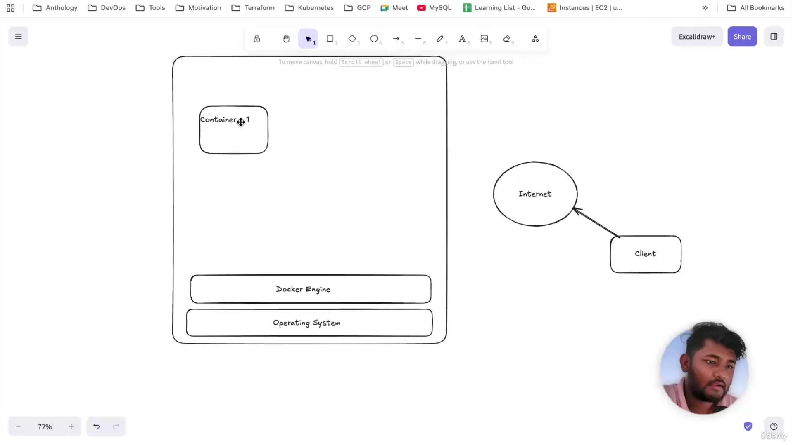
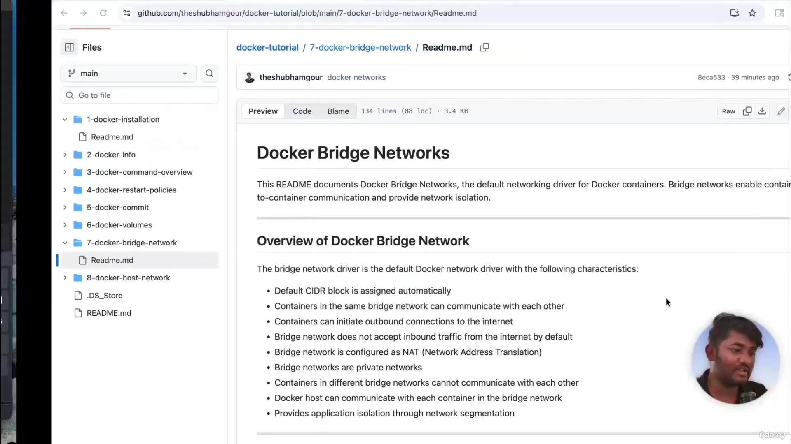
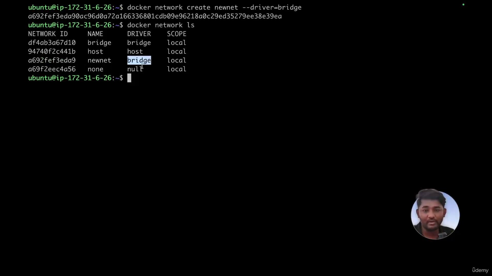
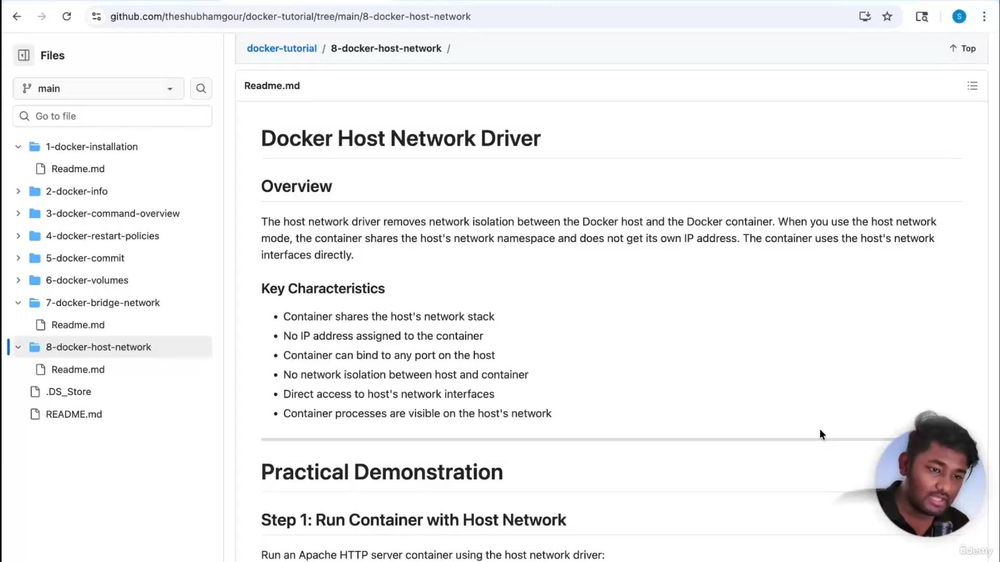
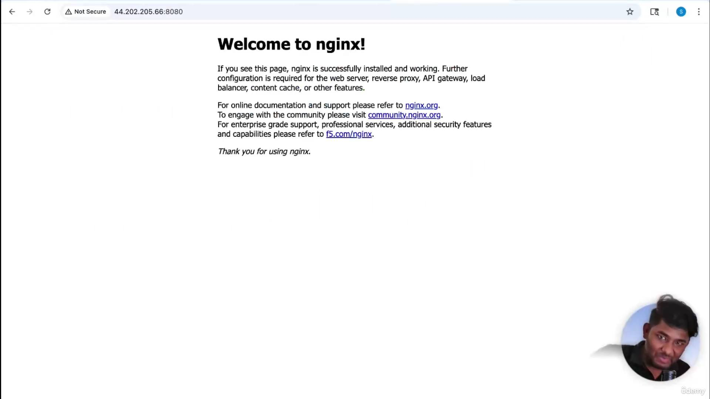
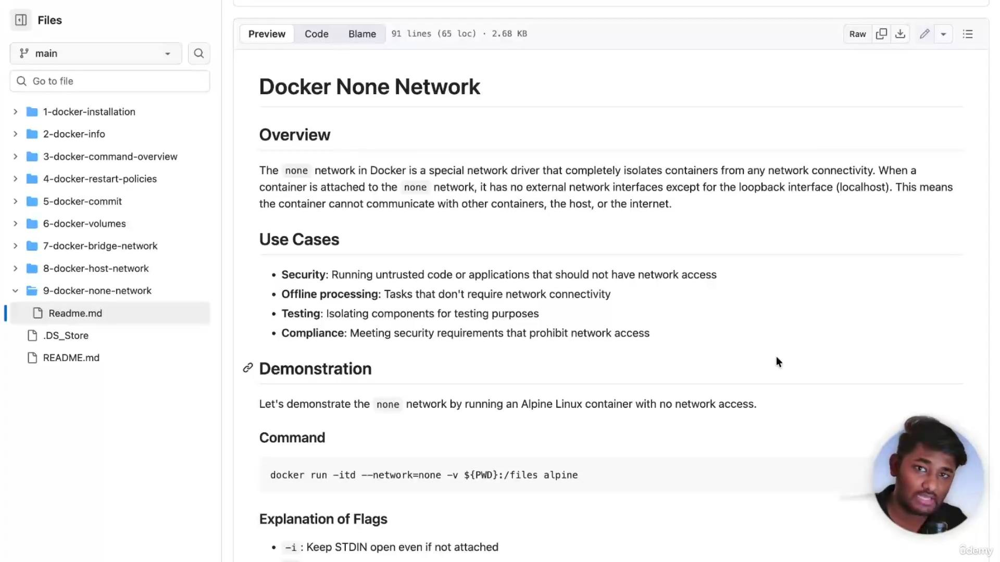
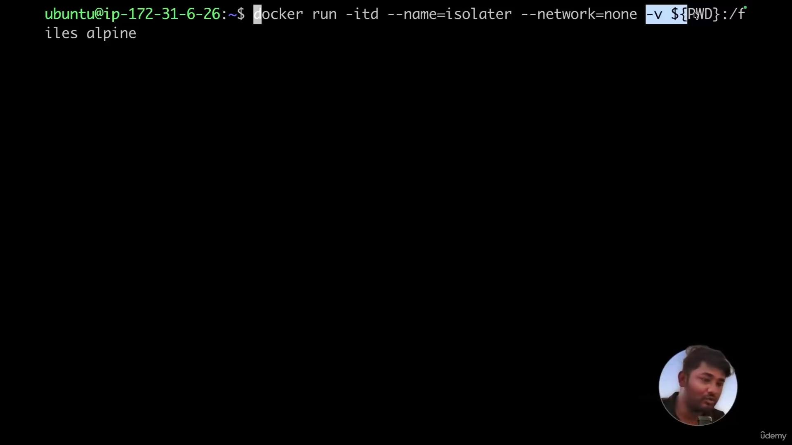
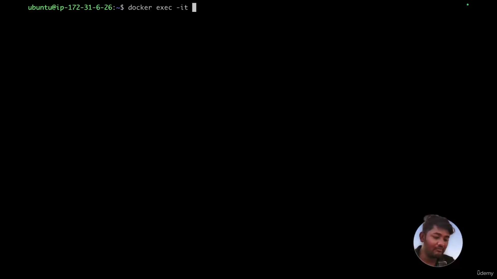

# Docker 网络实验：默认 bridge、自定义 bridge、host、none（P29–P32）

本文覆盖课程 P29–P32。原文按“问题引入 → bridge → host → none”推进；下面按**能照着跑起来**的顺序重排：先说明实验目标，再准备目录与脚本，然后依次验证默认 bridge、自定义 bridge 隔离、host 网络、none 网络，最后清理。所有命令都在 Linux 主机/EC2 上执行；课里没有讲 Docker 安装与版本，本文会把这一点标出来。

> 说明：本文在不改变课程事实、不编造实验结论的前提下，对命令解释、常见错误与排查、浏览器/前台访问对照、检查清单逐条说明做了扩写。课程原有引用、图片路径和代码块均保留。

---

## 1. 这一节做什么

这一节要回答一个非常具体的问题：**容器已经跑起来了，它怎么和另一个容器通信？怎么让某些容器不能通信？怎么让容器直接占用宿主机端口？怎么让容器完全断网？**

课程先用一张图把问题摆出来：客户端从笔记本发出请求，经过互联网到达服务器；服务器上有操作系统、Docker Engine，Engine 里跑着 container1 和 container2。过去我们访问容器，通常是把宿主机端口映射到容器端口；但 container1 如何连接 container2、container2 如何反向连接、互联网请求如何准确到达某个容器、两个容器都监听 80 端口时 Docker Engine 如何区分、如何把 container3 隔离出去——这些就是 Docker networking 要解决的问题。




P30 做默认 bridge 与自定义 bridge 的 hands-on；P31 做 host 网络；P32 做 none 网络。最终要得到三个可验证结论：

1. **默认 bridge**：不写 `--network` 时容器默认进入 `bridge`，同一 bridge 内的容器可以用 IP 互 ping，也可以出公网。
2. **自定义 bridge**：`docker network create --driver bridge newnet` 创建新网络，只有同一自定义网络内的容器能互 ping；跨网络即使都是 bridge driver，也会 100% packet loss。
3. **host 网络**：容器不拿独立 IP，直接共享宿主机网络命名空间，直接占用宿主机端口；宿主机 80 被占用后，再映射 80 会报端口冲突。
4. **none 网络**：容器没有外部网络接口，不能访问互联网，也不能被其他容器访问；但 loopback `127.0.0.1` 可用，volume 挂载仍然可用。

这里可以先建立三个基本概念，后文所有命令都围绕它们展开：

- **网络命名空间**：容器有自己的一套网络接口、路由表等；bridge 模式下 Docker 用虚拟网卡和路由规则把容器接入网络。host 模式则让容器共享宿主机命名空间，所以容器没有独立 IP。
- **网络驱动**：`bridge`、`host`、`none` 是不同驱动。默认不写 `--network` 时进 `bridge`；写 `--network host` 时共享宿主机网络；写 `--network none` 时只保留 loopback。
- **端口发布**：`-p 宿主机端口:容器端口` 是让宿主机监听一个端口，再把流量转发到容器端口。浏览器/前台通常只能看到宿主机 IP 和发布端口，不能直接看到容器内部 IP。

---

## 2. 讲师原话（带「—— pNNN [MM:SS]」）

> "bridge 网络是 Docker 默认自带的网络驱动……你甚至不需要显式指定，容器默认就会加入 bridge 网络。"
> —— p030 [00:28]  
> 中文：bridge 是 Docker 默认自带的网络驱动；不显式指定网络时，容器默认进入 bridge。

> "处于不同 bridge 网络的容器之间无法相互通信。"
> —— p030 [01:50]  
> 中文：不同 bridge 网络中的容器不能互相通信。这正是后面 `newnet` 隔离实验的理论依据。

> "容器没有自己的网卡，而是使用 Docker 宿主机的网卡。网络隔离是通过命名空间和路由规则实现的，而不是通过物理网卡实现的。"
> —— p030 [21:17]  
> 中文：容器没有自己的物理网卡，使用的是 Docker 宿主机的 NIC；网络隔离靠 namespace 和路由规则实现，不是靠物理网卡。

> "默认情况下，只有位于同一 bridge 网络上的容器才能相互通信。"
> —— p030 [21:42]  
> 中文：默认情况下，只有同一 bridge 网络上的容器可以互相通信。

> "host 网络驱动会移除 Docker 宿主机与 Docker 容器之间的网络隔离。"
> —— p031 [00:56]  
> 中文：host 网络驱动移除了 Docker 宿主机与容器之间的网络隔离。

> "使用 host 网络模式时，容器会共享宿主机的网络和命名空间，并且不会获得自己的 IP 地址。"
> —— p031 [00:56]  
> 中文：使用 host 网络模式时，容器共享宿主机网络命名空间，不会获得自己的 IP 地址。

> "Docker 的 None 网络是一种特殊的网络驱动，会将容器与任何网络完全隔离。"
> —— p032 [00:00]  
> 中文：Docker none 网络是一种特殊驱动，把容器从任何网络中完全隔离。

> "卷挂载仍然会正常工作，从而允许访问文件。"
> —— p032 [08:12]  
> 中文：none 网络下 volume 挂载仍然工作，文件访问不受影响。

---

## 3. 从零复现

### 3.1 前置条件与目录

课里是在 EC2 实例上操作，已经装好 Docker。**课里没讲 Docker 安装步骤，也没讲 Docker Engine 版本**；请先在目标机器执行：

```bash
docker --version
docker info
```

只要 `docker` 命令可用即可。`docker info` 还能帮助确认 Docker daemon 是否正在运行、当前用户是否有权限连接 Docker。本文假设工作目录是：

```text
~/docker-network-lab/
├── README.md
├── 01-default-bridge.sh
├── 02-custom-bridge.sh
├── 03-host-network.sh
├── 04-host-port-conflict.sh
├── 05-none-network.sh
├── 99-cleanup.sh
└── sample.txt
```

创建目录：

```bash
mkdir -p ~/docker-network-lab
cd ~/docker-network-lab
```

后面的完整文件放在第 4 节。保存后统一加执行权限：

```bash
chmod +x ~/docker-network-lab/*.sh
```

环境变量如下，脚本里都有默认值，也可以在执行时覆盖：

| 变量名 | 默认值 | 用途 |
|---|---|---|
| `LAB_IMAGE` | `centos:8` | 默认 bridge / 自定义 bridge 实验用的 Linux 镜像 |
| `LAB_NET` | `newnet` | 自定义 bridge 网络名 |
| `NGINX_IMAGE` | `nginx:latest` | host 网络实验镜像 |
| `MAPPED_PORT` | `8080` | 普通端口映射实验的宿主机端口 |
| `CONTAINER_PORT` | `80` | Nginx 容器端口 |
| `ALPINE_IMAGE` | `alpine:latest` | none 网络实验镜像 |
| `MOUNT_DIR` | 当前目录 | none 实验挂载到容器 `/files` 的宿主机目录 |

前置检查的常见问题：

- `docker: command not found`：Docker 未安装或 PATH 不含 Docker。
- `Cannot connect to the Docker daemon`：daemon 未启动，或当前用户无权访问 `/var/run/docker.sock`。
- `permission denied`：可把用户加入 `docker` 组后重新登录，或按课程环境使用有权限的账号。这里只说明排查方向，不改变课程实验步骤。

### 3.2 默认 bridge：先看 Docker 自带哪些网络

执行：

```bash
bash 01-default-bridge.sh
```

脚本会拉取/检查 `centos:8`，启动 `container1`、`container2`，然后打印 `docker ps`、`docker network ls`、`docker network inspect bridge`。

课程中对应位置是讲师先列网络：




你应该看到 `bridge`、`host`、`none` 三类网络。逐字稿里讲师表述为 “bridge, host and network none is present”，并强调这里的网络指的是 driver 类型。接着 inspect bridge：


手动验证同一默认 bridge 内互通。先取 `container2` 的 IP。课程里用的是 `docker inspect` 配合 `grep -iA4 "ip address"`：

```bash
docker inspect container2 | grep -iA4 "ip address"
```

然后进入 `container1`：

```bash
docker exec -it container1 /bin/bash
```

在容器里先验证出公网：

```bash
ping -c3 google.com
```

再 ping `container2` 的 IP（把 `<container2-ip>` 换成你上一步 inspect 看到的地址）：

```bash
ping -c3 <container2-ip>
exit
```

课程演示中出现过 `172.17.0.3` 作为 container2 的地址，这只是当次环境的示例；**不要写死 IP**，每次以 `docker inspect` / `docker network inspect` 的实际输出为准。

再反向验证：取 `container1` 的 IP，进入 `container2` ping 回去：

```bash
docker inspect container1 | grep -iA4 "ip address"
docker exec -it container2 /bin/bash
ping -c3 <container1-ip>
exit
```

课程在这里还让 container1 ping 了 Google，说明 bridge 容器默认可以发起 outbound 连接。

常见错误与排查：

- `docker inspect ... | grep` 没有输出：不同 Docker 版本字段大小写可能不同，可改用 `docker inspect -f '{{range .NetworkSettings.Networks}}{{.IPAddress}}{{end}}' container2`。
- `exec` 提示容器未运行：先 `docker ps -a` 看状态，再 `docker logs container1` 看容器为什么退出。
- `ping: command not found`：最小镜像可能没有安装 ping；课程环境能执行就以课程环境为准。排查看容器是否有网络可用时，也可以先检查 `ip addr` 是否存在；不要因为缺少 ping 就误判网络一定不通。
- `ping google.com` 失败但 `ping 8.8.8.8` 成功：更像 DNS 配置问题；若两者都失败，检查宿主机出网、Docker 网络和防火墙。
- 同一 bridge 内 ping 不通：确认两个容器是否都在默认 `bridge`，IP 是否取对，容器是否都在运行。

### 3.3 自定义 bridge：制造网络隔离

执行：

```bash
bash 02-custom-bridge.sh
```

脚本创建 `newnet`，driver 为 `bridge`，启动 `container3`、`container4` 加入该网络。课程对应命令是：

```bash
docker network create newnet --driver bridge
```

若 `docker network ls` 能看到 `newnet`，再 inspect：

```bash
docker network inspect newnet
```

课程里讲师先看到新网络中没有容器，随后创建 `container3` 时用 `--network newnet` 指定网络：

```bash
docker run -itd --name container3 --network newnet centos:8
```

然后用同样方式创建 `container4`。此时 `container3`、`container4` 都在 `newnet` 中：



现在做跨网络测试：从 `container2` ping `container3`。

先取 `container3` 的 IP：

```bash
docker network inspect newnet
```

进入 `container2`：

```bash
docker exec -it container2 /bin/bash
ping -c3 <container3-ip>
```

预期结果：**100% packet loss**。逐字稿中讲师明确说 “three packets transmitted, zero packets received, 100% packet loss”，原因是 container2 在默认 bridge，container3 在 newnet，两者被网络隔离。

再反向从 `container3` ping `container2`，同样取 `container2` 的 IP 后进入 `container3`：

```bash
docker inspect container2 | grep -iA4 "ip address"
docker exec -it container3 /bin/bash
ping -c3 <container2-ip>
```

预期同样是丢包。课程演示中出现过 `172.18.0.2` 作为 container3 的地址、`172.18.0.3` 作为 container4 的地址，仅供对照。

最后验证同一 `newnet` 内互通：从 `container4` ping `container3`，或从 `container3` ping `container4`。课程里两个方向都做了，均成功。原因是它们同属一个自定义 bridge 网络。

常见错误与排查：

- `network newnet already exists`：说明旧实验网络还在；脚本会先 `docker network rm newnet`，如果手动执行，先删容器再删网络。
- 容器没加入预期网络：用 `docker inspect -f '{{json .NetworkSettings.Networks}}' container3` 查看实际网络。
- 跨网络居然 ping 通：先确认是不是同一个容器名/同一次实验；再确认是否给容器额外接入了多个网络。课程实验里只使用一个 `--network`，按课程步骤应隔离。
- 同网络 ping 不通：确认两个容器都在 `newnet`，IP 是否取对，容器是否运行。自定义网络隔离实验看的是容器 IP 互访，不是宿主机端口访问。

### 3.4 host 网络：容器直接占用宿主机端口

执行：

```bash
bash 03-host-network.sh
```

脚本先启动一个普通端口映射的 Nginx：

```bash
docker run -d -p 8080:80 --name host-nginx nginx:latest
```

访问：

```text
http://<EC2公网IP>:8080
```

应看到 Nginx 欢迎页。然后启动 host 网络容器：

```bash
docker run -d --network host --name nginx nginx:latest
```

课程对应位置：





此时 `docker ps` 能看到容器运行；`docker network inspect host` 能看到 `nginx` 容器挂载在 host 网络，但**没有独立 IP**。访问时不再需要 `:8080`，直接：

```text
http://<EC2公网IP>
```

因为 host 网络容器直接占用宿主机 80 端口。课程里讲师说 “we don't have to do the port mapping why because it consume the host port number 80”。

接着做端口冲突实验：

```bash
bash 04-host-port-conflict.sh
```

脚本会尝试：

```bash
docker run -d -p 80:80 --name test nginx:latest
```

预期报错，输出中会出现类似 “port number 80 is already in use” 的信息。逐字稿里讲师的描述是 “driver failed programming external connectivity endpoint on test… port number 80 is already in use”。具体输出字段以你的 Docker 实际输出为准。

注意：如果要从公网访问 `8080` 和 `80`，需要在 EC2 安全组放行。课程里只演示了编辑 inbound rule 添加 8080；80 是否放行取决于你的安全组配置。**课里没讲完整安全组规则**，这里必须自己检查。

常见错误与排查：

- 访问 `http://公网IP:8080` 超时：先检查 EC2 安全组是否放行 8080，再检查 `docker ps` 中端口映射是否存在。
- 访问 `http://公网IP` 失败：检查 80 是否被安全组放行，检查 host 网络 nginx 是否成功启动，检查宿主机 80 是否被其他进程占用。
- `host 网络 nginx` 启动失败：常见原因是宿主机 80 已被占用。用 `sudo ss -lntp | grep :80` 或 `docker ps` 排查。
- `docker network inspect host` 看不到 IP：这是预期现象，host 模式共享宿主机网络命名空间，不分配独立容器 IP。
- 端口冲突脚本没有报错：说明 80 没有被 host 网络容器或宿主机进程占用；确认前面的 host 网络 nginx 是否真的在运行。

### 3.5 none 网络：完全隔离，但 volume 仍可用

执行：

```bash
bash 05-none-network.sh
```

脚本会创建 `sample.txt`，启动：

```bash
docker run -itd --name isolator --network none -v "$(pwd):/files" alpine:latest
```

课程对应位置：





查看网络：

```bash
docker network inspect none
```

能看到 `isolator` 容器，但没有 IP。进入容器：

```bash
docker exec -it isolator sh
```

注意 Alpine 用 `sh`，不是 `/bin/bash`。在容器里验证：

```bash
ping -c3 google.com
```

预期失败，逐字稿里输出表现为 `bad address`，并说明 100% packet loss。

再验证 loopback：

```bash
ping -c3 127.0.0.1
```

预期成功。最后验证挂载：

```bash
ls /files
cat /files/sample.txt
```

预期能看到宿主机当前目录下的 `sample.txt`。课程明确说 “volume mounts will still work allowing the file access”。



常见错误与排查：

- `docker exec` 提示找不到 `sh`：确认容器是否运行；Alpine 常见 shell 是 `sh`，不是 `/bin/bash`。
- `ping google.com` 失败：none 网络下这是预期结果。若想确认容器确实在 none 网络，执行 `docker inspect -f '{{json .NetworkSettings.Networks}}' isolator`。
- `ping 127.0.0.1` 也失败：检查容器是否运行、镜像里是否有 ping 命令；这不一定代表网络配置错误。
- `ls /files` 为空：检查 `-v "$(pwd):/files"` 的宿主机目录是否正确，检查 `docker inspect -f '{{json .Mounts}}' isolator`。
- `cat /files/sample.txt` 权限不足：检查宿主机文件权限和挂载路径；none 只隔离网络，不隔离文件系统。

### 3.6 清理

```bash
bash 99-cleanup.sh
```

脚本删除 `container1` 到 `container4`、`host-nginx`、`nginx`、`test`、`isolator`，再删除 `newnet`。最后打印 `docker ps -a` 与 `docker network ls` 供确认。

清理时常见问题：

- 网络删除失败：通常是有容器仍连接到 `newnet`。先删容器，再删网络；脚本已按这个顺序执行。
- 容器名冲突：重复实验时先执行清理脚本，或手动 `docker rm -f 容器名`。
- 删除后仍看到容器：用 `docker ps -a` 确认状态，可能容器名拼写不同或属于其他实验。

---

## 4. 完整代码

下面每个文件都可直接保存。脚本默认在 Linux/EC2 上运行；如果你用 Docker Desktop，host 网络与 volume 路径行为可能不同，见第 7 节。

### 4.1 `README.md`

````markdown
# Docker Network Lab

覆盖 Docker 网络实验：
- 默认 bridge
- 自定义 bridge（newnet）
- host
- none

## 使用

```bash
cd ~/docker-network-lab
chmod +x *.sh

bash 01-default-bridge.sh
bash 02-custom-bridge.sh
bash 03-host-network.sh
bash 04-host-port-conflict.sh
bash 05-none-network.sh
bash 99-cleanup.sh
```

## 环境变量

- LAB_IMAGE：默认 centos:8
- LAB_NET：默认 newnet
- NGINX_IMAGE：默认 nginx:latest
- MAPPED_PORT：默认 8080
- CONTAINER_PORT：默认 80
- ALPINE_IMAGE：默认 alpine:latest
- MOUNT_DIR：默认当前目录

## 注意

- 跨容器 ping 前先用 docker inspect 或 docker network inspect 查 IP。
- 课程中的 172.17.0.3、172.18.0.2、172.18.0.3 只是当次示例，不要写死。
- 公网访问需要在 EC2 安全组放行 8080/80。
````

### 4.2 `sample.txt`

```text
hello from host
```

### 4.3 `01-default-bridge.sh`

```bash
#!/usr/bin/env bash
set -euo pipefail

LAB_IMAGE="${LAB_IMAGE:-centos:8}"

docker rm -f container1 container2 2>/dev/null || true

if ! docker image inspect "$LAB_IMAGE" >/dev/null 2>&1; then
  docker pull "$LAB_IMAGE"
fi

docker run -itd --name container1 "$LAB_IMAGE"
docker run -itd --name container2 "$LAB_IMAGE"

echo "===== docker ps ====="
docker ps

echo "===== docker network ls ====="
docker network ls

echo "===== docker network inspect bridge ====="
docker network inspect bridge

echo
echo "下一步手动验证："
echo "1) docker inspect container2 | grep -iA4 \"ip address\""
echo "2) docker exec -it container1 /bin/bash"
echo "3) 在容器内：ping -c3 google.com"
echo "4) 在容器内：ping -c3 <container2-ip>"
echo "5) exit"
```

### 4.4 `02-custom-bridge.sh`

```bash
#!/usr/bin/env bash
set -euo pipefail

LAB_IMAGE="${LAB_IMAGE:-centos:8}"
LAB_NET="${LAB_NET:-newnet}"

docker rm -f container3 container4 2>/dev/null || true
docker network rm "$LAB_NET" 2>/dev/null || true

if ! docker image inspect "$LAB_IMAGE" >/dev/null 2>&1; then
  docker pull "$LAB_IMAGE"
fi

docker network create --driver bridge "$LAB_NET"
docker run -itd --name container3 --network "$LAB_NET" "$LAB_IMAGE"
docker run -itd --name container4 --network "$LAB_NET" "$LAB_IMAGE"

echo "===== docker network ls ====="
docker network ls

echo "===== docker network inspect $LAB_NET ====="
docker network inspect "$LAB_NET"

echo
echo "下一步手动验证："
echo "1) docker network inspect newnet  # 找 container3/container4 的 IP"
echo "2) docker exec -it container2 /bin/bash"
echo "3) ping -c3 <container3-ip>       # 预期 100% packet loss"
echo "4) exit"
echo "5) docker exec -it container4 /bin/bash"
echo "6) ping -c3 <container3-ip>       # 预期成功"
echo "7) exit"
```

### 4.5 `03-host-network.sh`

```bash
#!/usr/bin/env bash
set -euo pipefail

NGINX_IMAGE="${NGINX_IMAGE:-nginx:latest}"
MAPPED_PORT="${MAPPED_PORT:-8080}"
CONTAINER_PORT="${CONTAINER_PORT:-80}"

docker rm -f host-nginx nginx test 2>/dev/null || true

if ! docker image inspect "$NGINX_IMAGE" >/dev/null 2>&1; then
  docker pull "$NGINX_IMAGE"
fi

echo "===== 普通端口映射：宿主 ${MAPPED_PORT} -> 容器 ${CONTAINER_PORT} ====="
docker run -d -p "${MAPPED_PORT}:${CONTAINER_PORT}" --name host-nginx "$NGINX_IMAGE"

echo "===== host 网络容器 ====="
docker run -d --network host --name nginx "$NGINX_IMAGE"

echo "===== docker ps ====="
docker ps

echo "===== docker network inspect host ====="
docker network inspect host

echo
echo "访问验证："
echo "- http://<EC2公网IP>:${MAPPED_PORT}  普通端口映射"
echo "- http://<EC2公网IP>                host 网络直接占用 80"
echo
echo "注意：EC2 安全组需要放行 ${MAPPED_PORT} 和 80。"
```

### 4.6 `04-host-port-conflict.sh`

```bash
#!/usr/bin/env bash
set -euo pipefail

NGINX_IMAGE="${NGINX_IMAGE:-nginx:latest}"

docker rm -f test 2>/dev/null || true

if ! docker image inspect "$NGINX_IMAGE" >/dev/null 2>&1; then
  docker pull "$NGINX_IMAGE"
fi

echo "===== 尝试再次映射宿主机 80 端口，预期失败 ====="
set +e
output="$(docker run -d -p 80:80 --name test "$NGINX_IMAGE" 2>&1)"
status=$?
set -e

echo "$output"
echo "exit status: $status"
echo
echo "如果输出包含 port 80 already in use 之类的信息，说明 host 网络容器已经占用了 80。"
echo "具体字段名以你的 Docker 实际输出为准。"
```

### 4.7 `05-none-network.sh`

```bash
#!/usr/bin/env bash
set -euo pipefail

ALPINE_IMAGE="${ALPINE_IMAGE:-alpine:latest}"
MOUNT_DIR="${MOUNT_DIR:-$(pwd)}"

docker rm -f isolator 2>/dev/null || true

if ! docker image inspect "$ALPINE_IMAGE" >/dev/null 2>&1; then
  docker pull "$ALPINE_IMAGE"
fi

printf 'hello from host\n' > "$MOUNT_DIR/sample.txt"

docker run -itd \
  --name isolator \
  --network none \
  -v "$MOUNT_DIR:/files" \
  "$ALPINE_IMAGE"

echo "===== docker ps ====="
docker ps

echo "===== docker network inspect none ====="
docker network inspect none

echo
echo "进入容器："
echo "docker exec -it isolator sh"
echo
echo "在容器里执行："
echo "ping -c3 google.com      # 预期失败"
echo "ping -c3 127.0.0.1       # 预期成功"
echo "ls /files"
echo "cat /files/sample.txt"
```

### 4.8 `99-cleanup.sh`

```bash
#!/usr/bin/env bash
set -euo pipefail

LAB_NET="${LAB_NET:-newnet}"

docker rm -f \
  container1 container2 container3 container4 \
  host-nginx nginx test isolator \
  2>/dev/null || true

docker network rm "$LAB_NET" 2>/dev/null || true

echo "===== docker ps -a ====="
docker ps -a

echo "===== docker network ls ====="
docker network ls
```

---

## 5. 逐行解释、常见错误与排查、与前台的对照

### 5.1 脚本通用部分（逐条命令解释）

- `#!/usr/bin/env bash`：指定脚本用 bash 执行。常见错误是脚本在 Windows 上保存成 CRLF 换行后，Linux 报 `bad interpreter`；可把换行改为 LF，或直接用 `bash 脚本名` 执行。
- `set -euo pipefail`：`-e` 表示命令失败即退出；`-u` 表示使用未定义变量时报错；`-o pipefail` 表示管道中任一命令失败都算失败。它让实验脚本不会“报错了还继续往下跑”。常见误区是手动逐条命令时不加此设置，出错后仍继续操作，导致后面看到一堆连锁错误。
- `docker rm -f container1 container2 2>/dev/null || true`：先删旧容器，避免“容器名已存在”。`-f` 表示强制删除运行中的容器；`2>/dev/null` 隐藏“没有这个容器”的报错；`|| true` 表示即使删除失败也不终止脚本。常见错误是容器名拼错，导致旧容器没删掉；可用 `docker ps -a | grep 容器名` 检查。
- `if ! docker image inspect "$LAB_IMAGE" >/dev/null 2>&1; then docker pull "$LAB_IMAGE"; fi`：如果本地没有镜像才拉取。`docker image inspect` 只检查本地镜像，不会自动拉取；`>/dev/null 2>&1` 隐藏正常和错误输出。常见错误是镜像名写错、网络无法访问 Docker Hub、或 `centos:8` 拉取失败；先看 `docker pull` 的原始报错。
- `docker run -itd --name container1 "$LAB_IMAGE"`：`-i` 保持标准输入，`-t` 分配终端，`-d` 后台运行。课程用 `-itd` 让容器在后台保持可 `exec` 的状态。常见错误是容器启动后立刻退出：用 `docker ps -a` 看状态，用 `docker logs container1` 看原因；也可能是镜像默认命令不适合后台常驻。
- `docker ps`：只显示运行中的容器。若看不到预期容器，改用 `docker ps -a` 查看是否已退出。
- `docker network ls`：列出 Docker 网络，常见有 `bridge`、`host`、`none`。这里列的是网络对象，不是物理网卡。常见错误是把网络名和驱动名混为一谈；`bridge` 既是默认网络名，也是驱动类型名。
- `docker network inspect bridge`：查看 bridge 网络详情，包括哪些容器加入、地址信息。课程用这个命令证明 container1/container2 确实在默认 bridge 中。字段名以实际输出为准；不同 Docker 版本展示格式可能略有差异。
- `docker exec -it container1 /bin/bash`：进入正在运行的容器。`/bin/bash` 是 CentOS 容器里的 shell；Alpine 要用 `sh`。常见错误：容器未运行、镜像里没有 bash、命令路径不对。可先 `docker ps` 确认运行，再 `docker exec -it container1 sh` 尝试备用 shell。
- `ping -c3 <ip>`：发 3 个 ICMP 包。课程用 `-c3` 控制次数，观察是否 100% packet loss。常见错误：镜像没有 ping、DNS 解析失败、目标容器不在同一网络、目标 IP 写错。可先用 `docker inspect` 确认 IP。
- `docker network create --driver bridge "$LAB_NET"`：创建一个新的 bridge 网络。`--driver bridge` 明确驱动类型；课里命令是 `docker network create newnet --driver bridge`，参数顺序不影响。常见错误：网络已存在；先删旧网络或换名。
- `docker run ... --network "$LAB_NET" ...`：把容器接入指定网络。不写 `--network` 时默认进入 `bridge`。常见错误：网络名写错导致 `network not found`；或以为指定了网络就自动做端口映射，实际上容器间互访和宿主机端口发布是两件事。
- `docker run -d -p "${MAPPED_PORT}:${CONTAINER_PORT}" --name host-nginx "$NGINX_IMAGE"`：普通端口映射，宿主机 8080 映射到容器 80。浏览器访问 `http://公网IP:8080`。常见错误：宿主机端口已被占用、安全组未放行、Nginx 没启动成功。
- `docker run -d --network host --name nginx "$NGINX_IMAGE"`：host 网络模式。容器不拿独立 IP，直接共享宿主机网络，因此 Nginx 直接监听宿主机 80。课程里访问时不再带 `:8080`。常见错误：宿主机 80 已占用导致容器启动失败；或仍按 `-p` 思路访问 8080。
- `docker run -d -p 80:80 --name test "$NGINX_IMAGE"`：再次尝试占用宿主机 80。因为 host 网络的 nginx 已经占用 80，预期失败。常见错误：如果这一步成功，说明前一个 host 网络容器没有占用 80，或没有运行；检查 `docker ps` 和宿主机端口监听。
- `docker run -itd --name isolator --network none -v "$MOUNT_DIR:/files" "$ALPINE_IMAGE"`：none 网络 + volume 挂载。`-v 宿主机目录:/files` 把当前目录挂到容器 `/files`。none 网络只隔离网络，不隔离文件系统。常见错误：宿主机目录不存在、权限不足、路径写错。
- `docker exec -it isolator sh`：Alpine 使用 `sh`。进入后 `ping -c3 127.0.0.1` 验证 loopback 仍可用。常见错误：使用 `/bin/bash` 进入 Alpine 会失败。
- `docker network inspect none`：查看 none 网络中的容器。能看到容器名，但通常没有容器 IP，因为 none 网络不提供外部网络接口。
- `docker network rm "$LAB_NET"`：删除自定义网络。若仍有容器连接，会删除失败；先删容器再删网络。
- `docker ps -a`：查看所有容器，包括已退出的。清理后用它确认实验容器是否删除。

### 5.2 三个网络驱动对比

| 驱动 | 是否分配独立 IP | 能否出公网 | 能否被其他容器访问 | 典型用途 |
|---|---|---|---|---|
| `bridge` | 是 | 默认可以发起 outbound | 同一 bridge 内可以 | 默认容器互连、端口映射 |
| 自定义 `bridge` | 是 | 默认可以发起 outbound | 仅同一自定义网络内可以 | 按应用/微服务做网络隔离 |
| `host` | 否，共享宿主机 | 直接使用宿主机网络 | 直接占用宿主机端口 | 需要直接访问宿主机网络、追求更少网络虚拟化开销 |
| `none` | 否 | 否 | 否 | 完全隔离、离线处理、不可信代码 |

课程里讲师用酒店前台和自家房子的比喻解释 host：bridge 像住酒店，外部访问要先到前台；host 像住自己家，朋友可以直接找到你。这个比喻对应到命令上就是：bridge 需要端口映射，host 直接占用宿主机端口。

### 5.3 与前台的对照（浏览器/前端访问视角）

这里的“前台”可以理解为浏览器、前端页面或外部客户端。它通常不知道容器内部 IP，只根据宿主机地址和端口访问服务。对照如下：

| 实验场景 | 前台/浏览器访问地址 | 流量路径 | 注意点 |
|---|---|---|---|
| 默认 bridge + `-p 8080:80` | `http://<宿主机IP>:8080` | 浏览器 → 宿主机 8080 → Docker 端口转发 → 容器 80 | EC2 安全组要放行 8080 |
| 自定义 bridge + `-p 8080:80` | `http://<宿主机IP>:8080` | 浏览器 → 宿主机 8080 → Docker 转发 → 自定义网络内容器 80 | 自定义 bridge 的隔离主要影响容器之间互访，不影响已发布到宿主机的端口 |
| host 网络 | `http://<宿主机IP>` | 浏览器 → 宿主机 80 → 容器共享宿主机网络命名空间直接监听 80 | 不需要 `-p`；80 被占用会冲突 |
| none 网络 | 无法从浏览器访问 | 没有外部网络接口，不能接收外部请求 | 只能验证 loopback 和 volume |

对容器间通信来说，前台页面如果部署在某个容器里，它要访问后端容器时，需要二者在同一网络中，或通过宿主机发布端口访问。课程实验用 IP 互 ping 来验证网络隔离；前台访问则用宿主机端口映射来验证 bridge/host 的差异。

### 5.4 常见错误与排查总表

| 现象 | 可能原因 | 排查方式 |
|---|---|---|
| `docker: command not found` | Docker 未安装或 PATH 不对 | `docker --version`，检查安装与 PATH |
| `Cannot connect to the Docker daemon` | Docker 服务未启动或权限不足 | `docker info`，检查 daemon 与用户权限 |
| 容器名已存在 | 旧实验容器未删 | `docker ps -a`，`docker rm -f 容器名` |
| 容器启动后马上退出 | 镜像默认命令结束、参数不匹配 | `docker ps -a`，`docker logs 容器名` |
| `network not found` | `--network` 名称写错或未创建 | `docker network ls`，先创建网络 |
| 跨容器 ping 不通 | 不在同一网络、IP 写错、容器未运行 | `docker inspect` 看网络和 IP，`docker ps` 看状态 |
| 端口已占用 | 宿主机端口被其他进程或容器占用 | `docker ps`，`sudo ss -lntp | grep :端口` |
| 浏览器访问超时 | 安全组/防火墙未放行、服务未监听 | 检查安全组、`docker ps`、容器日志 |
| host 模式没有 IP | host 模式共享宿主机网络 | 这是预期，用宿主机 IP 访问 |
| none 模式能出网 | 容器未真正加入 none 网络 | `docker inspect -f '{{json .NetworkSettings.Networks}}' isolator` |
| none 模式文件看不到 | 挂载路径或权限问题 | `docker inspect -f '{{json .Mounts}}' isolator`，检查宿主机路径 |

---

## 6. 复现检查清单

| 检查项 | 命令 | 预期 |
|---|---|---|
| Docker 可用 | `docker --version` | 有版本输出；版本号以实际为准 |
| 默认网络存在 | `docker network ls` | 看到 `bridge`、`host`、`none` |
| 默认 bridge 容器启动 | `bash 01-default-bridge.sh` | `container1`、`container2` 在运行 |
| 默认 bridge 内容器可见 | `docker network inspect bridge` | 能看到 container1、container2；地址以实际输出为准 |
| 默认 bridge 出公网 | 进入 container1 后 `ping -c3 google.com` | 有回包 |
| 默认 bridge 内互 ping | 进入 container1 后 `ping -c3 <container2-ip>` | 有回包 |
| 自定义网络创建 | `bash 02-custom-bridge.sh` | `docker network ls` 出现 `newnet` |
| 自定义网络内容器 | `docker network inspect newnet` | 看到 container3、container4 |
| 跨网络隔离 | 进入 container2 后 `ping -c3 <container3-ip>` | 100% packet loss |
| 同网络互通 | 进入 container4 后 `ping -c3 <container3-ip>` | 有回包 |
| host 网络普通映射 | `bash 03-host-network.sh` 后访问 `http://公网IP:8080` | 看到 Nginx 欢迎页 |
| host 网络直接占用 80 | 访问 `http://公网IP` | 看到 Nginx 欢迎页 |
| host 网络无独立 IP | `docker network inspect host` | 看到 nginx 容器，但无独立 IP |
| host 端口冲突 | `bash 04-host-port-conflict.sh` | 报错，提示 80 已被占用 |
| none 网络无 IP | `docker network inspect none` | 看到 isolator，但无 IP |
| none 不能出网 | 进入 isolator 后 `ping -c3 google.com` | 失败，可能显示 bad address |
| none loopback 可用 | 进入 isolator 后 `ping -c3 127.0.0.1` | 成功 |
| none 卷挂载可用 | 进入 isolator 后 `ls /files` 和 `cat /files/sample.txt` | 看到 sample.txt 内容 |
| 清理 | `bash 99-cleanup.sh` | 实验容器和 newnet 被删除 |

如果某一步输出与预期不同，优先检查：容器是否真的在运行、IP 是否取对、EC2 安全组是否放行、端口是否已被占用。

### 6.1 检查清单逐条说明

1. **Docker 可用**：先确认 `docker --version` 有输出；如果命令不存在，后面所有实验都无法进行。再执行 `docker info` 看 daemon 是否可连接。
2. **默认网络存在**：`docker network ls` 正常应看到 `bridge`、`host`、`none`。若没有，通常说明 Docker 环境异常，而不是实验脚本问题。
3. **默认 bridge 容器启动**：执行脚本后，用 `docker ps` 确认 `container1`、`container2` 处于运行状态。若退出，先看 `docker ps -a` 和日志。
4. **默认 bridge 内容器可见**：`docker network inspect bridge` 应能看到两个容器。这里重点不是背 IP，而是确认容器确实挂在默认 bridge 上。
5. **默认 bridge 出公网**：进入 container1 后 `ping -c3 google.com`。有回包说明容器可以发起 outbound。若失败，再区分是 DNS 还是出网问题。
6. **默认 bridge 内互 ping**：进入 container1 ping container2 的 IP。成功说明同一默认 bridge 内容器可互通。失败时先确认 IP 和网络。
7. **自定义网络创建**：执行 `02-custom-bridge.sh` 后，`docker network ls` 应出现 `newnet`。若已存在，先清理旧网络。
8. **自定义网络内容器**：`docker network inspect newnet` 应看到 container3、container4。若没有，检查 `--network` 是否写对。
9. **跨网络隔离**：从默认 bridge 的 container2 ping 自定义网络的 container3，预期 100% packet loss。这验证了不同 bridge 网络默认隔离。
10. **同网络互通**：从 container4 ping container3，预期成功。说明同一自定义网络内可以通信。
11. **host 网络普通映射**：访问 `http://公网IP:8080` 能看到 Nginx 欢迎页，说明 `-p 8080:80` 的普通端口映射工作正常。
12. **host 网络直接占用 80**：访问 `http://公网IP` 能看到 Nginx 欢迎页，说明 host 网络容器直接监听宿主机 80，不需要 `-p`。
13. **host 网络无独立 IP**：`docker network inspect host` 中能看到容器，但没有独立 IP。这是 host 模式共享宿主机网络命名空间的预期表现。
14. **host 端口冲突**：再执行 `-p 80:80` 应失败，因为 80 已被 host 网络容器占用。若未失败，检查 host 网络容器是否真的在运行并监听 80。
15. **none 网络无 IP**：`docker network inspect none` 能看到 isolator，但没有外部网络 IP。这个结果是 none 网络隔离的体现。
16. **none 不能出网**：进入 isolator 后 ping 外网应失败。若成功，先确认容器是否真的在 none 网络。
17. **none loopback 可用**：`ping -c3 127.0.0.1` 应成功。none 隔离外部网络，但 loopback 仍在。
18. **none 卷挂载可用**：`ls /files` 和 `cat /files/sample.txt` 能看到宿主机文件。说明网络隔离不影响 volume 文件访问。
19. **清理**：执行清理脚本后，`docker ps -a` 和 `docker network ls` 中不应再看到本次实验的容器和 `newnet`。若还有残留，按名称手动删除。

---

## 7. 课里没讲但你会撞上的

1. **`centos:8` 可能拉不下来。** 课程里讲师说 CentOS 在 Docker Hub 已 deprecated，所以用了 `8` tag；但实际环境里 `centos:8` 仍可能不可用。若 `docker pull centos:8` 失败，可以改用本机已有 Linux 镜像，例如 `LAB_IMAGE=alpine:latest bash 01-default-bridge.sh`。注意 Alpine 默认 shell 是 `sh`，进入容器时若脚本提示 `/bin/bash`，应改用 `sh`。
2. **EC2 安全组不是 Docker 网络的一部分。** 浏览器访问 `8080` 或 `80` 失败时，不一定是容器网络错，可能是安全组 inbound rule 没放行。课程只演示了添加 8080，80 是否放行要自己检查。
3. **Docker Desktop 与 Linux/EC2 的 host 网络行为不完全相同。** 本文按课程在 Linux/EC2 上执行；如果你在 Docker Desktop 上复现，host 网络可能受虚拟机边界影响，不能简单等同于宿主机直接监听。
4. **容器 IP 会变化，不要写死。** 课程里出现的 `172.17.0.3`、`172.18.0.2`、`172.18.0.3` 只是当次环境示例。每次实验都用 `docker inspect` 或 `docker network inspect` 取实际地址。
5. **最小镜像可能没有 ping。** 如果 `ping: command not found`，先确认镜像内容；不要因为缺少 ping 就断定网络配置错误。课程环境能演示 ping，是因为该镜像里有相应命令。
6. **端口冲突要看宿主机监听。** 除了 `docker ps`，还可以用 `sudo ss -lntp | grep :80` 或 `sudo lsof -i :80` 检查宿主机 80 是否已被占用。
7. **none 网络不是“没有文件系统”。** none 只隔离网络，volume 挂载仍可用；文件访问问题应检查挂载路径、权限和 `docker inspect` 的 Mounts 信息。
8. **自定义 bridge 的隔离不等于端口发布被禁止。** 自定义网络主要约束容器之间按网络互访；如果给容器发布宿主机端口，浏览器仍然可以通过宿主机端口访问。课程跨网络测试用的是容器 IP 互 ping，不是浏览器访问。