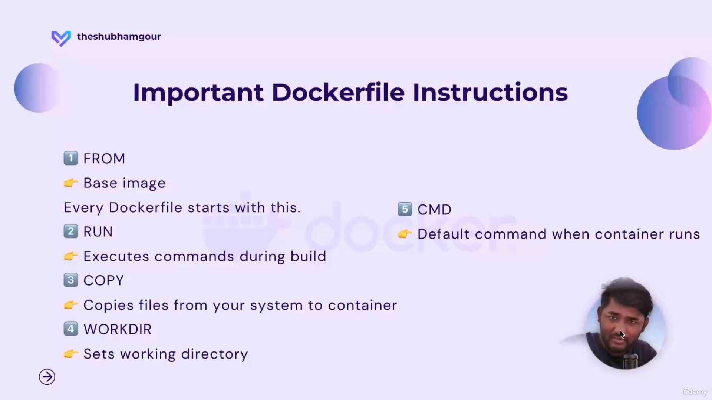
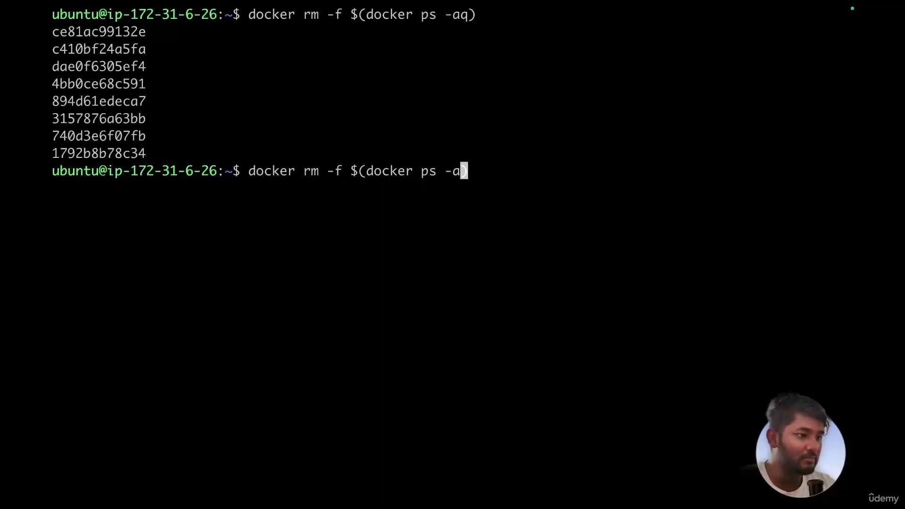
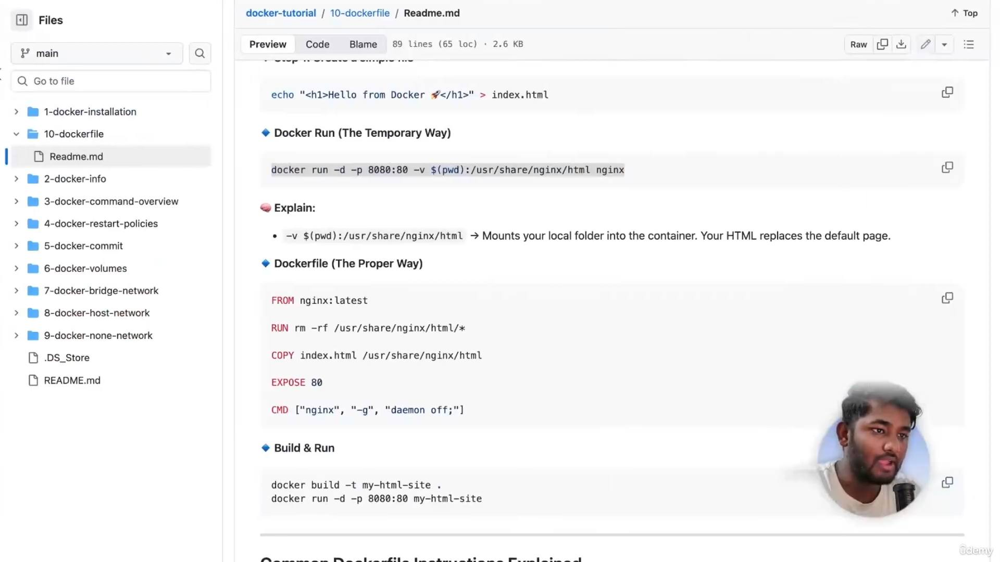
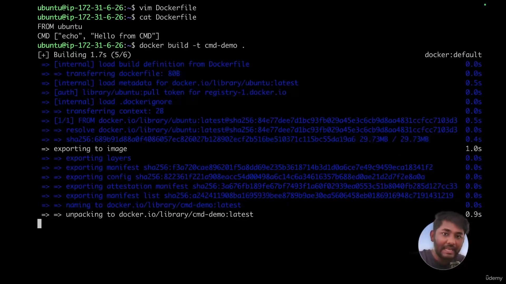
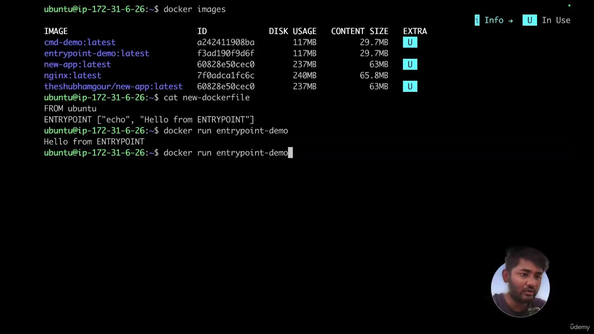
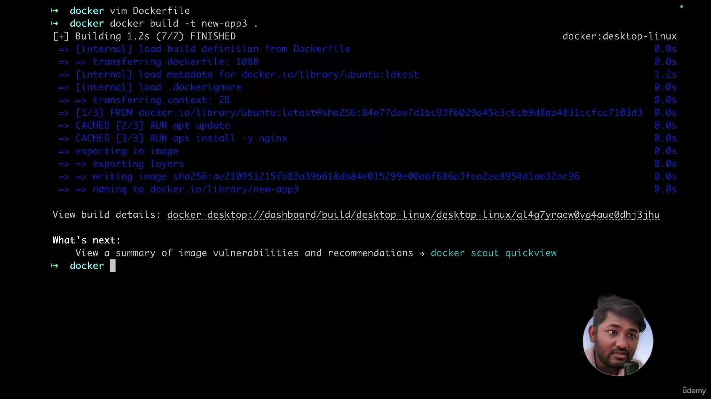
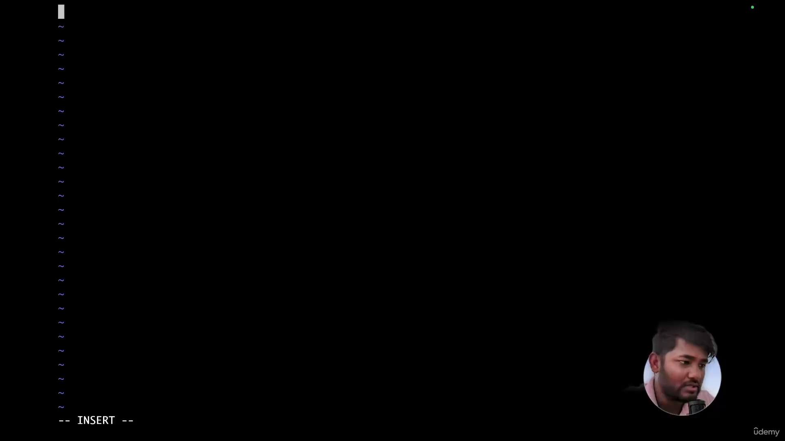
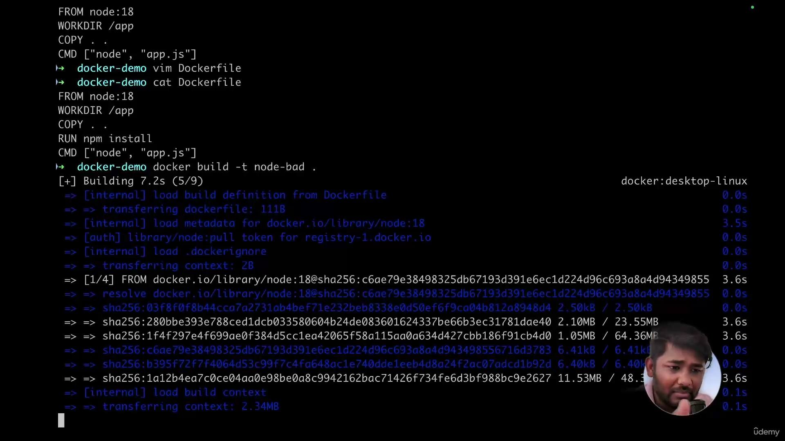

# Dockerfile 实战复现：nginx 静态页、CMD/ENTRYPOINT、镜像层与缓存

> 覆盖 P33–P36。目标是让你在一台装了 Docker 的机器上，按本文命令依次得到：  
> 1）一个能访问的自定义 nginx 静态页镜像；  
> 2）三组 `CMD` / `ENTRYPOINT` 对照实验；  
> 3）一个 Docker 层缓存实验；  
> 4）一个 Node 应用“坏 Dockerfile vs 优化 Dockerfile”的缓存对照。  
> 课里没有固定 Docker 版本号；本文按常见 Docker Engine 即可，镜像版本使用课里出现的 `nginx:latest`、`ubuntu`、`node:18`。

---

## 1. 这一节做什么

这一节不是单纯讲“Dockerfile 是什么”，而是把 Dockerfile 当成可执行的构建脚本：用文件把“装什么、复制什么、启动什么”固定下来，然后通过 `docker build` 生成镜像，再通过 `docker run` 变成容器。

最终你会得到一个可复现的目录 `dockerfile-demo/`，里面有五组实验：

- `nginx-static/`：把本地 `index.html` 打进 nginx 镜像，访问 `8080` 看到自己的页面。
- `cmd-entrypoint/`：分别验证 `CMD` 可被覆盖、`ENTRYPOINT` 会追加参数、两者组合时的行为。
- `layers-demo/`：同一个 Dockerfile 第二次构建为什么几乎瞬间完成；新增一条 `RUN` 后哪些层命中缓存。
- `node-cache-demo/`：先写一个“先 `COPY . .` 再 `npm install`”的坏例子，再改成“先复制 `package.json`、再 `npm install`、最后复制代码”的优化例子。
- 清理与排查：端口、目录、`-f` 指定自定义 Dockerfile、`EXPOSE` 与 `-p` 的区别。

课里 P34 的口述里出现过 “80 80:80” 和 “8080” 两种说法，但浏览器演示访问的是 `8080`。本文统一使用 `-p 8080:80`；如果你把宿主机端口改成 `80`，访问端口也要相应改成 `80`。

从学习路径上看，本节可以按“先手工运行、再固化成 Dockerfile、最后优化缓存”的顺序理解。先用 `docker run` 手工启动 nginx，是为了看清“镜像本身提供了什么”；再用 Dockerfile 构建自己的镜像，是为了看清“镜像如何被固定下来”；最后做层缓存和 Node 缓存实验，是为了看清“为什么同样能构建成功，不同的 Dockerfile 写法会导致完全不同的构建速度”。这三个层次对应同一个核心：镜像由一层层指令构成，容器则由镜像启动出来。


---

## 2. 讲师原话（带出处）

> "Docker 文件是一种文本文档，包含用于构建容器镜像的有序指令。"
> —— p033 [01:41]

> "Docker 文件是永久性的。而我们之前用的 Docker run 是临时性的。"
> —— p034 [01:13]

> "CMD 是可以随时更改的默认命令；至于 EntryPoint，它会把该命令追加进去。"
> —— p035 [00:18]

> "说到 EntryPoint 时，它实际上会追加输出……CMD 会替换整个输出，而 EntryPoint 会追加输出。"
> —— p035 [07:58]

> "Docker 文件中的每条指令都会在其上创建一个新层。"
> —— p036 [00:36]

> "最佳实践是只复制包，然后运行 npm install。"
> —— p036 [08:29]

这些原话分别对应四个关键点：第一，Dockerfile 是有顺序的构建说明；第二，Dockerfile 构建出的镜像相对“持久”，而 `docker run` 启动的容器是运行实例；第三，`CMD` 是默认命令，运行时可以替换，`ENTRYPOINT` 更固定，额外参数会追加；第四，每条指令会形成层，因此缓存优化要看指令顺序。后面的复现实验，都是围绕这四个点展开的。



---

## 3. 从零复现

### 3.0 环境与目录

先确认 Docker 可用：

```bash
docker version
docker info
```

`docker version` 用来分别查看 Docker 客户端和服务端版本；如果只看到客户端信息，而服务端部分报错，通常说明 Docker daemon 没有启动或当前用户无法连接 daemon。`docker info` 用来查看 Docker daemon 的详细信息，包括存储驱动、容器数量、镜像数量等。如果 `docker info` 报权限错误，说明当前用户没有权限访问 Docker daemon；这不是 Dockerfile 语法问题，先把 Docker 服务或用户权限处理好。

创建目录：

```bash
mkdir -p dockerfile-demo/nginx-static
mkdir -p dockerfile-demo/cmd-entrypoint
mkdir -p dockerfile-demo/layers-demo
mkdir -p dockerfile-demo/node-cache-demo
cd dockerfile-demo
```

`mkdir -p` 会递归创建目录，并且目录已存在时不会报错。把四组实验分目录放置，是为了让每个实验都有自己的构建上下文。Dockerfile 里的 `COPY` 源路径是相对于构建上下文解析的，所以执行 `docker build` 时所在的目录和最后那个 `.` 很重要。若在错误目录执行构建，常见现象就是 `COPY` 找不到文件，或者把不该复制的文件带入上下文。

最终目录结构：

```text
dockerfile-demo/
├── nginx-static/
│   ├── Dockerfile
│   └── index.html
├── cmd-entrypoint/
│   ├── Dockerfile.cmd
│   ├── Dockerfile.entrypoint
│   └── Dockerfile.combo
├── layers-demo/
│   ├── Dockerfile
│   └── Dockerfile.with-tree
├── node-cache-demo/
│   ├── Dockerfile.bad
│   ├── Dockerfile.optimized
│   ├── README.md
│   ├── app.js
│   └── package.json
└── README.md
```

依赖与版本说明：

- `nginx:latest`：课里用于 nginx 示例。
- `ubuntu`：课里用于 `CMD` / `ENTRYPOINT` 示例；没有写 tag，默认拉取 `latest`。
- `node:18`：课里用于 Node 缓存示例。
- Node 示例本文使用零第三方依赖的最小 HTTP 服务，避免引入课里没讲的库；`npm install` 仍会执行，缓存机制仍然成立。
- 环境变量：Node 示例只使用 `PORT`，默认 `3000`；nginx 示例不使用环境变量。课里没有讲 `ENV` / `ARG`，本文不引入。

如果第一次执行构建时本机没有对应基础镜像，Docker 会先拉取镜像。此时网络状况会影响耗时；不要把“首次拉取镜像慢”误判为 Dockerfile 写错。判断缓存实验时，应在同一台机器、同一构建上下文下比较多次构建。

---

### 3.1 先做对照：用 `docker run` 起一个 nginx

这一步对应课里“先用 `docker run`，再用 Dockerfile 做同样的事”的对照。

```bash
docker run -d -p 8080:80 --name nginx-manual nginx:latest
docker ps
```

`docker run` 表示从镜像创建并启动容器。`-d` 表示 detached，也就是让容器在后台运行，命令会立即返回容器 ID，而不是占住当前终端。`-p 8080:80` 表示把宿主机的 8080 端口映射到容器内的 80 端口，格式是“宿主机端口:容器端口”。`--name nginx-manual` 给容器起一个固定名字，方便后续停止和删除；如果不写名字，Docker 会随机生成一个名字。最后的 `nginx:latest` 是要运行的镜像。

`docker ps` 用来列出正在运行的容器。正常情况下，你会看到 `nginx-manual` 处于 `Up` 状态，并看到端口映射 `0.0.0.0:8080->80/tcp` 之类的信息。若没有看到容器，可以用 `docker ps -a` 查看所有容器，包括已经退出的容器。

浏览器访问：

```text
http://localhost:8080
```

如果你在云主机上，访问：

```text
http://你的公网IP:8080
```

应当看到 nginx 默认欢迎页。看完后停止并删除：

```bash
docker stop nginx-manual
docker rm nginx-manual
```

`docker stop` 会给容器发送停止信号，让容器从运行状态退出；`docker rm` 删除已经停止的容器。注意，停止容器不等于删除容器；停止后容器仍会出现在 `docker ps -a` 中，直到执行 `docker rm`。

注意：`-p 8080:80` 是“宿主机 8080 → 容器 80”。Dockerfile 里的 `EXPOSE 80` 只是声明容器监听 80，不会自动把端口发布到宿主机；真正发布端口的是 `docker run -p`。

如果这里启动失败，常见原因有：8080 端口已被占用、容器名 `nginx-manual` 已存在、镜像拉取失败、Docker daemon 不可用。端口占用时，Docker 通常会提示端口绑定失败；可以先执行 `docker ps -a` 查看是否有旧容器，或用 `docker rm -f nginx-manual` 删除同名旧容器。若只是想换端口，可以把宿主机端口改成别的，例如 `-p 8081:80`，访问地址也要相应变成 `http://localhost:8081`。

这里也体现“前台/后台”的对照：上面使用 `-d` 是后台运行，所以终端不会持续显示 nginx 日志；如果要看日志，应使用 `docker logs nginx-manual`。如果不加 `-d`，`docker run` 默认会把容器输出连接到当前终端，属于前台附着运行；容器主进程退出后，命令才返回。后面 `CMD` 与 `ENTRYPOINT` 实验中会频繁使用前台运行，以便直接看到 `echo` 输出。



---

### 3.2 用 Dockerfile 托管自己的 `index.html`

进入目录：

```bash
cd nginx-static
```

把第 4 节的 `index.html` 和 `Dockerfile` 保存进去。然后构建：

```bash
docker build -t new-nginx-app .
```

`docker build` 根据 Dockerfile 构建镜像。`-t new-nginx-app` 给构建出的镜像打标签，标签名是 `new-nginx-app`。最后的 `.` 表示构建上下文是当前目录；Dockerfile 默认也从这个上下文里查找名为 `Dockerfile` 的文件。`COPY index.html ...` 能成功，前提是当前目录下确实存在 `index.html`。

启动：

```bash
docker run -d -p 8080:80 --name nginx-custom new-nginx-app
```

这条命令把刚构建的 `new-nginx-app` 镜像启动成名为 `nginx-custom` 的容器，并把宿主机 8080 映射到容器 80。`-d` 仍然表示后台运行。启动后可以用 `docker ps` 确认容器正在运行。

访问：

```text
http://localhost:8080
```

应当看到你自己的页面，而不是 nginx 默认页。如果仍然是默认页，先检查 `index.html` 是否确实是第 4 节的内容，再检查 Dockerfile 中 `RUN rm -rf /usr/share/nginx/html/*` 是否写在 `COPY` 之前。因为删除默认文件和复制自定义页面有先后顺序：必须先把默认文件删掉，再把自己的 `index.html` 复制进去。若顺序反了，刚复制进去的文件可能又被删除。另一个常见原因是浏览器缓存或访问到了旧容器，可以先确认 `docker ps` 中运行的是不是 `nginx-custom`，必要时删除旧容器后重新运行。

如果 8080 被占用，先删掉旧容器：

```bash
docker rm -f nginx-custom nginx-manual 2>/dev/null || true
```

`docker rm -f` 会强制删除容器，即使它还在运行。后面的 `2>/dev/null || true` 是 shell 写法，用来忽略“容器不存在”这类错误，让命令在清理阶段不中断。注意，这只是清理旧容器，不会修改镜像。若端口仍被其他程序占用，需要换宿主机端口或停止占用端口的程序。



---

### 3.3 `CMD` 与 `ENTRYPOINT` 三组实验

进入目录：

```bash
cd ../cmd-entrypoint
```

`docker build -f Dockerfile.xxx .` 里的 `-f` 用于指定自定义 Dockerfile 文件名。因为本目录下没有默认的 `Dockerfile`，而是 `Dockerfile.cmd`、`Dockerfile.entrypoint`、`Dockerfile.combo`，所以必须用 `-f` 明确指定。最后的 `.` 仍然表示当前目录是构建上下文。

#### 实验 A：只有 `CMD`

构建：

```bash
docker build -t cmd-demo -f Dockerfile.cmd .
```

运行：

```bash
docker run --rm cmd-demo
```

预期输出：

```text
hello from cmd
```

`--rm` 表示容器退出后自动删除容器。对于这种只执行一次 `echo` 的实验，`--rm` 可以避免留下大量已退出容器。这里没有加 `-d`，所以是前台运行，容器内 `echo` 的输出会直接打印到当前终端。

覆盖 `CMD`。注意：因为 `Dockerfile.cmd` 用的是 exec 形式 `["echo", "hello from cmd"]`，覆盖时要把新的可执行命令也写出来，否则 Docker 会把第一个参数当成可执行文件：

```bash
docker run --rm cmd-demo echo "try override"
```

预期输出：

```text
try override
```

这里 `echo "try override"` 整体作为新的启动命令，替换了原来的 `CMD ["echo", "hello from cmd"]`。常见错误是写成 `docker run --rm cmd-demo try override`，这会让 Docker 尝试执行名为 `try` 的程序，而不是执行 `echo`。如果看到类似 `exec: "try": executable file not found` 的错误，就是覆盖 `CMD` 时没有把真正的可执行程序写完整。

#### 实验 B：只有 `ENTRYPOINT`

构建：

```bash
docker build -t entry-point-demo -f Dockerfile.entrypoint .
```

运行：

```bash
docker run --rm entry-point-demo
```

预期输出：

```text
hello from entry point
```

追加参数：

```bash
docker run --rm entry-point-demo try override
```

预期输出：

```text
hello from entry point try override
```

这里能看到 `ENTRYPOINT` 的 `echo` 没有被替换，额外参数被追加到后面。也就是说，`try override` 不是去替换 `echo`，而是作为 `echo` 的参数追加。若你想替换 `ENTRYPOINT`，需要显式使用 `--entrypoint` 这类运行时选项；本文实验不做这一步，重点是观察默认追加行为。

#### 实验 C：`ENTRYPOINT` + `CMD`

构建：

```bash
docker build -t combo-demo -f Dockerfile.combo .
```

运行：

```bash
docker run --rm combo-demo
```

预期输出：

```text
hello from combo file
```

覆盖：

```bash
docker run --rm combo-demo hi shubham
```

预期输出：

```text
hi shubham
```

解释：`ENTRYPOINT ["echo"]` 固定了“用 echo 执行”，`CMD ["来自组合文件的问候。"]` 是默认参数；运行时传入 `hi shubham` 后，`CMD` 被整体替换成新参数，但 `ENTRYPOINT` 仍然保留。于是最终执行效果相当于 `echo hi shubham`。

这三组实验也对应“前台运行”的观察方式：因为没有加 `-d`，容器输出直接显示在终端；容器内的命令执行完，容器退出，`--rm` 随后把容器删除。若把这几条命令加上 `-d`，容器会转到后台，终端不再直接显示输出，需要再执行 `docker logs 容器名` 才能看到结果。对于这类一次性的 `echo` 实验，前台运行更直观。





---

### 3.4 Docker 层与缓存实验

进入目录：

```bash
cd ../layers-demo
```

先构建第一次：

```bash
docker build -t new-app-one .
```

记录终端显示的耗时。课里第一次构建用了约 31.1 秒，第二次换 tag 再构建只用了约 1.5 秒；你的机器和网络不同，绝对时间会不同，但“第二次明显更快”是重点。`-t new-app-one` 只是给镜像打不同标签，不改变 Dockerfile 内容；第二次换 tag 构建时，Docker 仍然可以复用上一次构建形成的层。

第二次构建，只换 tag：

```bash
docker build -t new-app-two .
```

然后使用带 `tree` 的 Dockerfile 再构建一次：

```bash
docker build -t new-app-three -f Dockerfile.with-tree .
```

预期现象：前四条指令对应的层会命中缓存，只有新增的 `RUN apt install -y tree` 这一层需要真正执行。终端里会看到类似 `CACHED` 的提示；具体提示文字以你的 Docker 版本实际输出为准。

这里的关键是“每条指令形成一层”。`FROM ubuntu` 是基础层；`RUN apt update` 是一层；`RUN apt install -y nginx` 是一层；`COPY . /app` 是一层；新增的 `RUN apt install -y tree` 是最后一层。如果前面的 Dockerfile 指令和构建上下文没有变化，Docker 就可以直接复用已有层，所以新增一条后，前面的层通常仍显示缓存命中。

常见排查：如果第二次构建没有明显变快，先确认两次构建是否在同一个目录、是否使用同一个 Dockerfile、构建上下文里是否有文件变化。只要 `COPY . /app` 复制的内容发生变化，`COPY` 这一层就可能失效，后面的层也会受影响。若你怀疑缓存干扰实验，可以在确认命令无误后使用 `--no-cache` 做一次对照构建；这是排查手段，不是本文正常复现步骤。



---

### 3.5 Node 应用缓存优化实验

进入目录：

```bash
cd ../node-cache-demo
```

先构建“坏例子”：

```bash
docker build -t node-bad -f Dockerfile.bad .
```

再构建一次，观察缓存：

```bash
docker build -t node-bad-one -f Dockerfile.bad .
```

修改 `README.md`，模拟“代码目录里任意文件发生变化”：

```bash
printf '\nchange\n' >> README.md
docker build -t node-bad-two -f Dockerfile.bad .
```

`printf` 和 `>>` 把一行内容追加到 `README.md` 末尾。这里修改 `README.md` 的目的不是让 Node 应用运行结果变化，而是让构建上下文发生变化。因为 `Dockerfile.bad` 里先 `COPY . .` 再 `RUN npm install`，`README.md` 变化会让 `COPY . .` 这一层失效，后面的 `RUN npm install` 也跟着重新执行。课里第一次构建约 93.7 秒，重建约 0.8 秒；修改文件后缓存会被打破。

再构建优化版：

```bash
docker build -t node-new -f Dockerfile.optimized .
```

再改一次 `README.md`，重新构建：

```bash
printf '\nchange2\n' >> README.md
docker build -t node-new-two -f Dockerfile.optimized .
```

优化版里 `COPY package.json ./` 在前，`RUN npm install` 在后，最后才 `COPY . .`。只改 `README.md` 时，`COPY package.json` 和 `RUN npm install` 仍然命中缓存，只有最后的 `COPY . .` 需要重新执行。

启动 Node 服务验证：

```bash
docker run -d -p 3000:3000 --name node-cache-app node-new-two
curl http://localhost:3000
```

预期输出：

```text
Hello from Node cache demo
```

这里的 `-d` 让 Node 服务后台运行，`-p 3000:3000` 把宿主机 3000 映射到容器 3000，`--name node-cache-app` 给容器命名。`curl` 用来请求宿主机 3000 端口。如果 `curl` 失败，先执行 `docker ps` 确认容器是否在运行，再执行 `docker logs node-cache-app` 查看 Node 应用日志。若日志显示端口监听正常但宿主访问失败，重点检查 `-p` 映射是否写对；如果 3000 端口被占用，可以换一个宿主机端口，例如 `-p 3001:3000`，然后访问 `http://localhost:3001`。





---

## 4. 完整代码

下面所有文件都可以直接保存运行。路径以 `dockerfile-demo/` 为根目录。

### 4.1 `nginx-static/index.html`

```html
<!DOCTYPE html>
<html lang="en">
<head>
  <meta charset="UTF-8">
  <meta name="viewport" content="width=device-width, initial-scale=1.0">
  <title>Dockerfile Demo</title>
</head>
<body>
  <h1>Hello from Dockerfile</h1>
  <p>This page is baked into the nginx image by COPY.</p>
</body>
</html>
```

### 4.2 `nginx-static/Dockerfile`

```dockerfile
FROM nginx:latest

EXPOSE 80

RUN rm -rf /usr/share/nginx/html/*

COPY index.html /usr/share/nginx/html/index.html

CMD ["nginx", "-g", "daemon off;"]
```

### 4.3 `cmd-entrypoint/Dockerfile.cmd`

```dockerfile
FROM ubuntu

CMD ["echo", "hello from cmd"]
```

### 4.4 `cmd-entrypoint/Dockerfile.entrypoint`

```dockerfile
FROM ubuntu

ENTRYPOINT ["echo", "hello from entry point"]
```

### 4.5 `cmd-entrypoint/Dockerfile.combo`

```dockerfile
FROM ubuntu

ENTRYPOINT ["echo"]
CMD ["hello from combo file"]
```

### 4.6 `layers-demo/Dockerfile`

```dockerfile
FROM ubuntu

RUN apt update

RUN apt install -y nginx

COPY . /app
```

### 4.7 `layers-demo/Dockerfile.with-tree`

```dockerfile
FROM ubuntu

RUN apt update

RUN apt install -y nginx

COPY . /app

RUN apt install -y tree
```

### 4.8 `node-cache-demo/package.json`

```json
{
  "name": "node-cache-demo",
  "version": "1.0.0",
  "private": true,
  "main": "app.js",
  "scripts": {
    "start": "node app.js"
  }
}
```

### 4.9 `node-cache-demo/app.js`

```javascript
const http = require("http");

const PORT = process.env.PORT || 3000;

const server = http.createServer((req, res) => {
  res.writeHead(200, { "Content-Type": "text/plain; charset=utf-8" });
  res.end("Hello from Node cache demo\n");
});

server.listen(PORT, () => {
  console.log(`Server listening on ${PORT}`);
});
```

### 4.10 `node-cache-demo/Dockerfile.bad`

```dockerfile
FROM node:18

WORKDIR /app

COPY . .

RUN npm install

CMD ["node", "app.js"]
```

### 4.11 `node-cache-demo/Dockerfile.optimized`

```dockerfile
FROM node:18

WORKDIR /app

COPY package.json ./

RUN npm install

COPY . .

CMD ["node", "app.js"]
```

### 4.12 `node-cache-demo/README.md`

```markdown
# Node cache demo

Change this file to invalidate the `COPY . .` layer.

This file exists only for the Docker layer cache experiment.
```

### 4.13 根目录 `README.md`（可选）

```markdown
# Dockerfile demo

Experiments for P33-P36:

- nginx-static: custom nginx static page
- cmd-entrypoint: CMD vs ENTRYPOINT
- layers-demo: Docker layer cache
- node-cache-demo: bad vs optimized Node Dockerfile
```

---

## 5. 逐行解释

### 5.1 `nginx-static/Dockerfile`

```dockerfile
FROM nginx:latest
```

`FROM` 是 Dockerfile 的第一条有效指令，用来指定基础镜像。这里使用官方 `nginx:latest`。课里强调 `FROM` 是任何 Dockerfile 的起点；如果你做 Python 应用，基础镜像可能是 Python，这里做静态页就是 nginx。`latest` 是标签，表示使用该镜像的默认最新标签。由于课里没有固定版本号，本文按课里出现的 `nginx:latest` 复现。

```dockerfile
EXPOSE 80
```

声明容器打算监听 80 端口。注意 `EXPOSE` 不是端口发布；它更像文档说明。实际让宿主机访问，要靠 `docker run -p 8080:80`。课里也专门区分了“应用在容器里跑 80”和“宿主机映射到 8080”。因此，如果你只写了 `EXPOSE 80` 而没有写 `-p`，宿主机通常不能通过浏览器直接访问容器内服务。

```dockerfile
RUN rm -rf /usr/share/nginx/html/*
```

在构建镜像时删除 nginx 默认的 HTML 文件，避免默认欢迎页和我们的 `index.html` 冲突。课里叙述的顺序是先讲 `COPY` 再讲 `RUN` 删除默认文件；但真正可跑的顺序必须让删除发生在复制之前，否则会把刚复制进去的 `index.html` 也删掉。这一点是复现时必须注意的细节。`RUN` 在构建阶段执行，不是在容器运行时执行；它形成镜像层。

```dockerfile
COPY index.html /usr/share/nginx/html/index.html
```

把构建上下文里的 `index.html` 复制到镜像内的 nginx 静态目录。`COPY` 的源路径相对于构建上下文，也就是你执行 `docker build` 时最后那个 `.` 指向的目录。常见错误是构建目录不对，导致 `COPY` 找不到 `index.html`；此时应回到 `nginx-static/` 目录再执行构建，或检查文件名大小写是否一致。

```dockerfile
CMD ["nginx", "-g", "daemon off;"]
```

容器启动时默认执行 nginx，并让 nginx 在前台运行。`daemon off;` 很关键：容器需要前台进程保持运行，否则容器会立即退出。课里口述为“start nginx in the foreground to keep the container running”，这里用 exec 形式写成 JSON 数组。这里的“前台”指的是容器主进程不要转到后台守护进程，而不是前端页面。若去掉 `daemon off;`，nginx 可能在容器里转到后台，主进程退出后容器也随之退出。

### 5.2 `CMD` 与 `ENTRYPOINT`

`Dockerfile.cmd`：

```dockerfile
FROM ubuntu
CMD ["echo", "hello from cmd"]
```

`CMD` 是默认命令，运行时可以被替换。`docker run --rm cmd-demo` 不额外传命令时执行 `echo "hello from cmd"`。如果你传 `echo "try override"`，新的命令会覆盖默认的 `echo "hello from cmd"`。这里使用 exec 形式 JSON 数组，参数边界清晰；覆盖时也要把新命令按可执行程序加参数的方式写完整。

`Dockerfile.entrypoint`：

```dockerfile
FROM ubuntu
ENTRYPOINT ["echo", "hello from entry point"]
```

`ENTRYPOINT` 更“固定”。`docker run entry-point-demo` 输出默认文本；`docker run entry-point-demo try override` 时，`try override` 作为额外参数追加到 `ENTRYPOINT` 后面，所以输出变成 `hello from entry point try override`。这解释了为什么 `ENTRYPOINT` 更像“固定入口程序”，而运行时参数是追加给这个入口程序的。

`Dockerfile.combo`：

```dockerfile
FROM ubuntu
ENTRYPOINT ["echo"]
CMD ["hello from combo file"]
```

这里 `ENTRYPOINT` 固定了可执行程序 `echo`，`CMD` 提供默认参数。运行时传 `hi shubham`，`CMD` 被替换，`ENTRYPOINT` 仍然是 `echo`，所以输出 `hi shubham`。课里总结为：`CMD` 会完全替换，`ENTRYPOINT` 只接受追加参数。这个对照非常适合排查“为什么我运行时传参数，程序没有按预期执行”的问题：先看 Dockerfile 里用的是 `CMD` 还是 `ENTRYPOINT`，再看运行时参数是替换还是追加。

### 5.3 `layers-demo/Dockerfile`

```dockerfile
FROM ubuntu
RUN apt update
RUN apt install -y nginx
COPY . /app
```

每一条指令都会形成一层。`FROM ubuntu` 是基础层；`RUN apt update` 更新包索引；`RUN apt install -y nginx` 安装 nginx；`COPY . /app` 把当前目录复制进镜像。课里用“汉堡一层层叠起来”比喻镜像层。第二次构建时，如果 Dockerfile 和上下文没有变化，Docker 会复用之前的层，所以很快。新增 `RUN apt install -y tree` 后，前四层仍然可以命中缓存，只有新增层需要执行。这里的缓存判断是局部的：一旦某层失效，它后面的层通常也会重新执行，因此把不常变化的指令放前面、常变化的指令放后面，是优化缓存的基本思路。

### 5.4 Node 坏例子与优化例子

坏例子：

```dockerfile
FROM node:18
WORKDIR /app
COPY . .
RUN npm install
CMD ["node", "app.js"]
```

问题在 `COPY . .` 太早。只要项目目录里任意文件变化，比如 `README.md` 多了一行，`COPY . .` 这一层就失效，后面的 `RUN npm install` 也会重新执行。课里把这种写法称为“very bad example”，因为它会反复触发依赖安装。`WORKDIR /app` 用来设置容器内工作目录，后续的 `COPY`、`RUN`、`CMD` 都相对于这个目录执行。

优化例子：

```dockerfile
FROM node:18
WORKDIR /app
COPY package.json ./
RUN npm install
COPY . .
CMD ["node", "app.js"]
```

先把 `package.json` 复制进去，再执行 `npm install`，最后复制全部代码。这样只有依赖清单变化时才会重新安装依赖；普通代码文件变化只会影响最后的 `COPY . .` 层。课里总结为“copy packages and then run npm install”，这是 Docker 缓存最常用的实践。从 JS/Node 角度理解：`RUN npm install` 类似你在本地安装依赖；`COPY package.json` 相当于先把依赖清单固定下来。这里没有锁、事务或并发问题；Docker 层缓存不是数据库事务，不会回滚，它只是复用之前构建成功的层。

### 5.5 常用命令与前台/后台对照

- `docker version`：查看客户端与服务端版本。若服务端信息缺失，先检查 Docker daemon。
- `docker info`：查看 daemon 详细信息。权限错误属于环境问题，不是 Dockerfile 语法问题。
- `docker build -t 名称 .`：用当前目录作为构建上下文构建镜像，`-t` 指定镜像标签，`.` 指定上下文。
- `docker build -t 名称 -f Dockerfile.xxx .`：`-f` 指定自定义 Dockerfile 文件名。
- `docker run --rm 镜像`：前台运行一次性容器，容器退出后自动删除。
- `docker run -d -p 宿主机端口:容器端口 --name 名称 镜像`：后台运行容器，发布端口并命名。
- `docker ps`：只看正在运行的容器；`docker ps -a` 查看所有容器，包括已退出容器。
- `docker logs 容器名`：查看后台运行容器的输出，适合 Node 服务和 nginx 排查。
- `docker stop 容器名`：停止容器；`docker rm 容器名`：删除已停止容器；`docker rm -f`：强制删除运行中的容器。
- `curl http://localhost:端口`：验证宿主机端口是否真的能访问容器服务。

前台/后台对照要分清两个层面。第一层是 `docker run`：不加 `-d` 时，容器附着在当前终端，标准输出直接显示，适合 `CMD` / `ENTRYPOINT` 这种一次性实验；加 `-d` 时，容器在后台运行，命令立即返回，适合 nginx、Node 服务，需要再用 `docker ps`、`docker logs` 查看状态和输出。第二层是容器内的主进程：容器要持续运行，必须有一个前台主进程；nginx 示例使用 `daemon off;` 就是让 nginx 不要转到后台，从而保持容器运行。

### 5.6 常见错误与排查汇总

- 端口占用：运行 nginx 或 Node 时提示端口绑定失败。先 `docker ps -a` 查看旧容器，必要时 `docker rm -f` 删除旧容器，或改用其他宿主机端口。
- 容器名冲突：提示容器名已存在。删除同名旧容器，或给 `--name` 换一个名字。
- `COPY` 找不到文件：确认执行 `docker build` 的目录是构建上下文目录，确认文件名大小写正确。
- 找不到 Dockerfile：确认当前目录有默认 `Dockerfile`，否则用 `-f` 指定实际文件名。
- 页面还是 nginx 默认页：检查 `RUN rm` 是否在 `COPY` 之前，确认访问的是新启动的容器，必要时删除旧容器重新运行。
- `CMD` 覆盖失败：exec 形式下要写完整命令，例如 `docker run --rm cmd-demo echo "try override"`，不要只写 `try override`。
- `ENTRYPOINT` 没有被替换：这是设计行为，额外位置参数是追加；若要替换入口程序，需要运行时显式使用 `--entrypoint`。
- 容器一启动就退出：查看 `docker ps -a` 和 `docker logs`，重点检查主进程是否在前台运行，例如 nginx 是否使用 `daemon off;`。
- Node 服务访问失败：确认 `docker ps` 中容器仍在运行，确认 `-p 3000:3000` 映射存在，再用 `docker logs node-cache-app` 查看应用是否正常监听。
- 缓存没有命中：检查构建上下文是否变化、指令顺序是否变化、是否用了同一个 Dockerfile；终端缓存提示文字会因 Docker 版本不同而略有差异。

---

## 6. 复现检查清单

下面保留原检查项，并对每一项补充说明。

- [ ] `docker version` 能正常输出客户端和服务端信息。  
  说明：如果只看到客户端信息，服务端部分报错，通常是 Docker daemon 没启动或当前用户权限不足。这一步先排除环境问题，再继续 Dockerfile 实验。

- [ ] 目录结构中有 `nginx-static`、`cmd-entrypoint`、`layers-demo`、`node-cache-demo`。  
  说明：四个目录分别对应静态页、CMD/ENTRYPOINT、层缓存、Node 缓存实验。目录不全会导致后续 `cd` 或 `docker build` 失败。

- [ ] `nginx-static/Dockerfile` 使用 `FROM nginx:latest`，并且 `COPY` 的是 `index.html`。  
  说明：`FROM` 指定基础镜像，`COPY` 指定复制源。源文件名必须与构建上下文中的文件名一致，否则构建会报找不到文件。

- [ ] `docker build -t new-nginx-app .` 成功。  
  说明：必须在 `nginx-static` 目录执行，最后 `.` 是构建上下文。若失败，先看错误是文件找不到、网络拉取失败，还是 Docker daemon 权限问题。

- [ ] `docker run -d -p 8080:80 --name nginx-custom new-nginx-app` 成功。  
  说明：`-d` 后台运行，`-p 8080:80` 发布端口，`--name` 命名容器。失败时优先检查端口占用和容器名冲突。

- [ ] 浏览器访问 `http://localhost:8080` 看到 `Hello from Dockerfile`。  
  说明：如果看到默认欢迎页，检查 Dockerfile 中删除默认文件的 `RUN` 是否在 `COPY` 之前，并确认访问的是新容器。

- [ ] `docker run --rm cmd-demo` 输出 `hello from cmd`。  
  说明：这是 `CMD` 默认命令生效的情况。`--rm` 让一次性容器退出后自动删除，适合反复实验。

- [ ] `docker run --rm cmd-demo echo "try override"` 输出 `try override`。  
  说明：这是运行时覆盖 `CMD` 的情况。exec 形式下必须把新的可执行命令 `echo` 也写出来。

- [ ] `docker run --rm entry-point-demo` 输出 `hello from entry point`。  
  说明：这是 `ENTRYPOINT` 默认执行的情况。`ENTRYPOINT` 比 `CMD` 更固定。

- [ ] `docker run --rm entry-point-demo try override` 输出 `hello from entry point try override`。  
  说明：运行时参数被追加到 `ENTRYPOINT` 后面，而不是替换入口程序。

- [ ] `docker run --rm combo-demo` 输出 `hello from combo file`。  
  说明：`ENTRYPOINT ["echo"]` 固定入口，`CMD` 提供默认参数。

- [ ] `docker run --rm combo-demo hi shubham` 输出 `hi shubham`。  
  说明：运行时参数替换了 `CMD` 默认参数，但 `ENTRYPOINT` 仍然保留，所以最终相当于 `echo hi shubham`。

- [ ] `docker build -t new-app-one .` 第一次较慢，`docker build -t new-app-two .` 第二次明显更快。  
  说明：第二次构建复用已有层，所以通常明显更快。绝对耗时受机器性能和网络影响，重点观察“第二次是否命中缓存”。

- [ ] `docker build -t new-app-three -f Dockerfile.with-tree .` 能看到前面层命中缓存，只有新增 `RUN apt install -y tree` 需要执行。  
  说明：这是“每条指令形成一层”的直接体现。新增指令放在末尾时，前面的层通常不受影响。

- [ ] `docker build -t node-bad -f Dockerfile.bad .` 能成功构建。  
  说明：坏例子不是构建失败，而是缓存策略差；它先 `COPY . .` 再 `npm install`，容易因任意文件变化触发依赖重装。

- [ ] 修改 `README.md` 后，`docker build -t node-bad-two -f Dockerfile.bad .` 会重新执行 `npm install`。  
  说明：`README.md` 属于 `COPY . .` 的上下文变化，导致 `COPY` 层失效，后面的安装层也随之失效。

- [ ] `docker build -t node-new -f Dockerfile.optimized .` 能成功构建。  
  说明：优化版先复制 `package.json`，再安装依赖，最后复制全部代码，目标是让依赖层尽量稳定。

- [ ] 修改 `README.md` 后，`docker build -t node-new-two -f Dockerfile.optimized .` 中 `npm install` 仍能命中缓存。  
  说明：因为 `README.md` 不属于 `COPY package.json` 这一层，依赖安装层可以继续复用，只有最后的 `COPY . .` 需要重新执行。

- [ ] `docker run -d -p 3000:3000 --name node-cache-app node-new-two` 启动成功，`curl http://localhost:3000` 输出 `Hello from Node cache demo`。  
  说明：这一步验证优化版镜像不仅能构建，还能正常启动服务。若 `curl` 失败，先看 `docker ps`，再看 `docker logs node-cache-app`。

- [ ] 需要时能用 `docker ps -a`、`docker logs`、`docker rm -f` 完成基本排查和清理。  
  说明：实验过程中会留下容器和镜像。`docker ps -a` 用来看已退出容器，`docker logs` 用来看后台容器输出，`docker rm -f` 用来清理旧容器，避免端口和名称冲突。

## 7. 课里没讲但你会撞上的

> 下表为补充问题（课里没讲）；原因和办法均非课程原文，仅针对按本节步骤复现时可能遇到的情况。

| 现象 | 原因 | 怎么办 |
|---|---|---|
| 在 `dockerfile-demo/` 根目录执行 `docker build -t new-nginx-app -f nginx-static/Dockerfile .`，报找不到 `index.html` | 补充（课里没讲）：`-f` 只指定 Dockerfile 路径，不改变构建上下文；`COPY index.html` 仍是相对最后那个 `.` 解析，根目录下没有 `index.html` | 补充（课里没讲）：先 `cd nginx-static` 再构建；或把上下文写成 `nginx-static`，例如 `docker build -t new-nginx-app -f nginx-static/Dockerfile nginx-static` |
| `layers-demo` 中第二次构建 `Dockerfile.with-tree` 时，`COPY . /app` 没有命中缓存，前面层也不完全如预期 | 补充（课里没讲）：`COPY . /app` 会把当前目录所有文件算进缓存；后创建或修改 `Dockerfile.with-tree` 本身也会改变构建上下文 | 补充（课里没讲）：先把所有实验文件准备好再开始构建；构建目录只放实验文件；必要时用 `.dockerignore` 排除无关文件（课里没讲） |
| 新增 `RUN apt install -y tree` 后构建报 `404`、无法定位软件包或安装失败 | 补充（课里没讲）：前面的 `RUN apt update` 可能命中旧缓存，后续 `apt install` 使用的是旧索引 | 补充（课里没讲）：把 `apt update && apt install -y tree` 放在同一条 `RUN` 里重建；或临时用 `--no-cache` 让 `apt update` 重新执行 |
| 修改 `README.md` 后，坏例子没有明显变慢，看不出缓存被打破 | 补充（课里没讲）：本文的 `package.json` 是零第三方依赖，`npm install` 本身耗时很低，绝对时间差不明显 | 补充（课里没讲）：不要只看秒数；看终端是否重新执行 `RUN npm install` 层，或保持同一 daemon 连续构建对比 |
| 在 PowerShell 或 cmd 中执行 `docker rm -f nginx-custom nginx-manual 2>/dev/null || true` 报错或行为不对 | 补充（课里没讲）：`2>/dev/null || true` 是 Unix shell 写法，PowerShell/cmd 的重定向和 `||` 语义不同 | 补充（课里没讲）：改用 Linux/macOS/WSL/Git Bash；或分别执行 `docker rm -f nginx-custom`、`docker rm -f nginx-manual`，忽略“不存在”的报错 |
| 用 `printf '\nchange\n' >> README.md` 修改文件时失败，或文件内容不对 | 补充（课里没讲）：不同 shell 对 `printf`、引号和 `>>` 的处理可能不同 | 补充（课里没讲）：直接用编辑器在 `README.md` 末尾加一行，再执行 `docker build`；缓存实验只要求文件内容发生变化 |
| 云主机上容器显示 `Up`，但浏览器访问 `http://公网IP:8080` 或 `http://公网IP:3000` 打不开 | 补充（课里没讲）：云主机的安全组或防火墙可能没有放行宿主机端口 | 补充（课里没讲）：在云安全组/防火墙放行对应端口；或先在服务器本机用 `curl http://localhost:端口` 验证端口映射 |
| `curl http://localhost:3000` 报 `curl: command not found` | 补充（课里没讲）：宿主机可能没有安装 `curl` | 补充（课里没讲）：用浏览器访问 `http://localhost:3000`，或使用系统已有的 HTTP 客户端；先用 `docker ps`、`docker logs node-cache-app` 确认容器正常 |
