# Docker Masterclass P37–P40 复现文档：从 .dockerignore 到三层应用容器化

## 1. 这一节做什么

这四集（P37–P40）是整门课从「单文件 Dockerfile」跨到「多容器编排」的过渡段，也是你第一次真正把「网络 + 卷 + 启动顺序」串起来跑通一个完整应用。

- **P37** 讲 `.dockerignore` 和 build context，解决「为什么我的镜像构建又慢又大」。
- **P38** 把 Dockerfile 的常用指令（FROM / RUN / WORKDIR / COPY / ADD / EXPOSE / USER / ENV / LABEL）逐个跑一遍，让你亲眼看到每条指令对镜像层和体积的影响。
- **P39** 用一个真实的三层应用 DataBridge Lite（Nginx 前端 + Node 后端 + MySQL 数据库）把网络、卷、容器启动顺序全部串起来。
- **P40** 讲 YAML 语法，为下一集的 `docker-compose.yaml` 做铺垫。

学完这四集，你应该能独立完成：写 Dockerfile → 写 .dockerignore → 建网络 → 建卷 → 按顺序起三个容器 → 用浏览器验证前后端和数据库连通。

> 说明：P39 的 DataBridge Lite 完整业务代码（前端页面、后端路由）讲师没有在视频里逐行展示，只展示了三个 Dockerfile 和启动命令。本文档给出的是**与视频描述一致的 Dockerfile 与命令**，业务代码部分标注「课里没讲」，你可以用任意一个能跑通的 Node + MySQL 小项目替换。

---

## 2. 讲师原话

> 「build context 是 Docker 发送给 Docker daemon 用来构建镜像的那一组文件，也就是你运行 `docker build` 命令所在目录里的一切。」—— p037 [00:48]

> 「larger the context, lower the build，context 越大构建越慢，网络流量也越大。」—— p037 [01:41]

> 「.dockerignore 就是一个文件，工作方式和 .gitignore 一样，但它是给 Docker 构建用的，告诉 Docker 哪些文件和目录在构建时要排除。」—— p037 [02:11]

> 「如果你不定义 workdir 关键字，它默认会考虑用 `/`，那会带来权限问题。所以最好给你的应用定义工作目录。」—— p037 [07:30]

> 「每往 Dockerfile 里加一行，镜像里就多一层。」—— p038 [01:41]

> 「workdir 设置的是后续所有命令的工作目录。」—— p038 [08:35]

> 「add 和 copy 做同样的操作，但 add 还能从远程仓库复制文件。」—— p038 [13:08]

> 「user 设置的是容器执行时的用户 ID。」—— p038 [17:17]

> 「DataBridge Lite 是一个三层 Web 应用……前端用 nginx，后端用 Node.js，数据库用 MySQL。」—— p039 [01:21]

> 「先建网络，再建卷，然后起 MySQL 容器，再起后端，最后起前端。」—— p039 [07:38]

> 「YAML 就是 yet another markup language，一种用非常干净、人类可读的格式来写数据的格式。」—— p040 [00:53]

> 「YAML 有三条黄金规则……第一，永远用空格，永远不要用 tab。」—— p040 [02:55]

---

## 3. 从零复现

### 3.1 P37：.dockerignore 与 build context

**目标**：写一个最小的 Node 应用，用 Dockerfile 构建镜像，再用 `.dockerignore` 把 `node_modules` 排除出 build context，对比构建速度。

**Step 1：初始化项目**

```bash
mkdir my-node-app && cd my-node-app
npm init -y
```

`npm init -y` 会生成 `package.json`。讲师在视频里演示了 `cat package.json` 看到默认内容。

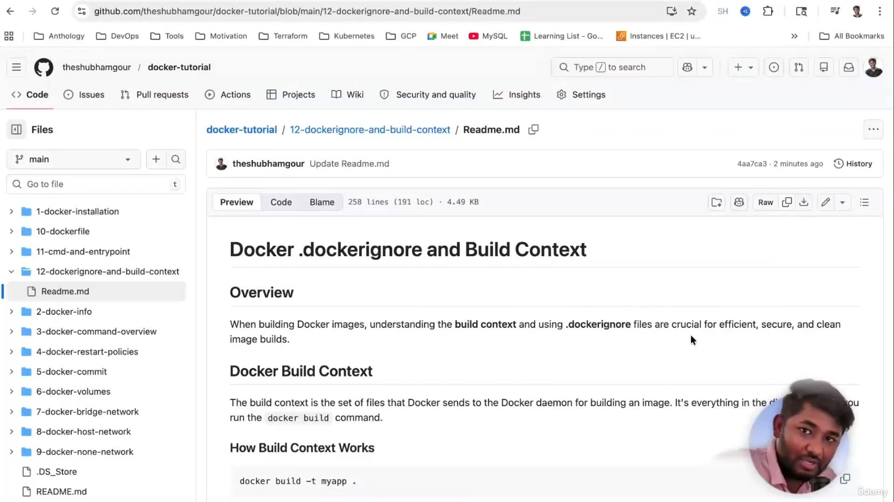

**Step 2：安装依赖**

```bash
npm install fs path
```

> 注意：`fs` 和 `path` 是 Node.js 内置模块，正常不需要 `npm install`。讲师视频里确实执行了 `npm install fs` 和 `npm install path`，会往 `package.json` 的 `dependencies` 里写入这两个包。如果你想严格复现视频效果就照做；如果只想跑通应用，可以跳过这一步。

**Step 3：写 `index.js`**

```js
import fs from 'fs';
import path from 'path';
import http from 'http';

const server = http.createServer((req, res) => {
  const filePath = path.join(process.cwd(), 'message.txt');
  const message = fs.readFileSync(filePath, 'utf8');
  res.writeHead(200, { 'Content-Type': 'text/plain; charset=utf-8' });
  res.end(message);
});

server.listen(3000, () => {
  console.log('The application is running on port number 3000');
});
```

**Step 4：写 `message.txt`**

```
hello
```

**Step 5：改 `package.json` 加 `"type": "module"`**

讲师第一次 `node index.js` 时报了 `SyntaxError: Cannot use import statement outside a module`，然后去 `package.json` 里 `license` 下面加了一行 `"type": "module"`。

```json
{
  "name": "my-node-app",
  "version": "1.0.0",
  "description": "",
  "main": "index.js",
  "type": "module",
  "scripts": {
    "test": "echo \"Error: no test specified\" && exit 1"
  },
  "keywords": [],
  "author": "",
  "license": "ISC",
  "dependencies": {
    "fs": "^0.0.1-security",
    "path": "^0.12.7"
  }
}
```

**Step 6：本地验证**

```bash
node index.js
```

浏览器打开 `http://localhost:3000`，应该看到 `hello`。

**Step 7：写 `Dockerfile`**

```dockerfile
FROM node:18

WORKDIR /app

COPY . .

RUN npm install

EXPOSE 3000

CMD ["node", "index.js"]
```

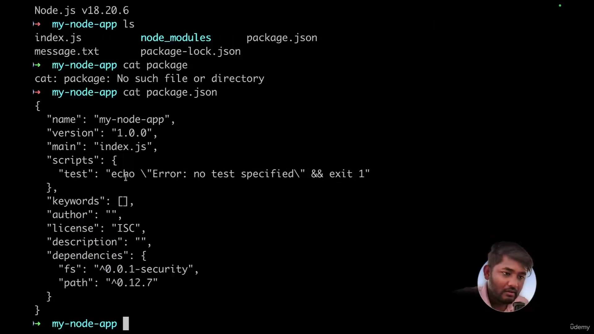

**Step 8：构建镜像（第一次，没有 .dockerignore）**

```bash
docker build -t my-node-app .
```

讲师在视频里看到 `transferring context: 63.75kB` 这一行，说明 build context 被打包发给了 daemon。

**Step 9：写 `.dockerignore`**

```gitignore
node_modules
.git
.env
*.log
```

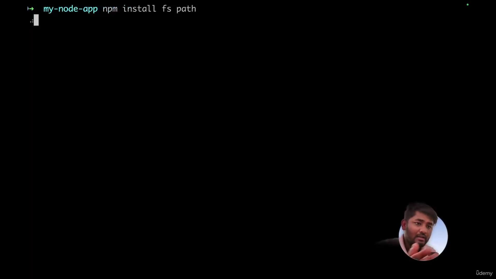

**Step 10：重新构建，对比 context 大小**

```bash
docker build -t my-node-app .
```

因为 `node_modules` 被排除，context 明显变小，构建更快。讲师在视频里说「this time it build it fast because we are not passing huge files during the build context」。

---

### 3.2 P38：Dockerfile 常用指令逐个跑

**目标**：用一个 Ubuntu 基础镜像，把 FROM / RUN / WORKDIR / COPY / ADD / EXPOSE / USER / ENV / LABEL 全部跑一遍，观察镜像体积变化。

**Step 1：准备一个 `index.html`**

```html
<!DOCTYPE html>
<html>
<head><title>Docker Demo</title></head>
<body><h1>Hello from Docker</h1></body>
</html>
```

**Step 2：写 Dockerfile（最终版）**

```dockerfile
# FROM defines the base image
FROM ubuntu:latest

# RUN executes commands in shell
RUN apt update

# Install nginx web server
RUN apt install -y nginx

# WORKDIR sets working directory
WORKDIR /app

# COPY files from source to destination
COPY index.html /app

# ADD similar to COPY but handles remote URLs
ADD https://github.com/your-username/docker-tutorial.git .

# EXPOSE port
EXPOSE 80

# Create user
RUN useradd -g sudo delta

# Change ownership
RUN chown delta:delta /app

# USER sets user
USER delta

# ENV environment variable
ENV environment=production

# LABEL metadata
LABEL maintainer="Shubham Gaur"
```

> 说明：`ADD` 那一行的 git URL 讲师视频里用的是他自己的仓库，具体地址课里没念全，你需要替换成你自己的仓库地址，并且**结尾要带 `.git`**——讲师在视频里就是因为漏了 `.git` 报错，后来补上才成功。

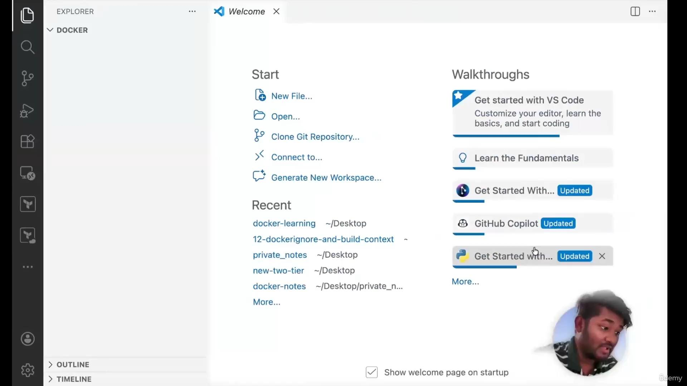

**Step 3：逐条构建，观察镜像体积**

```bash
docker build -t app .
docker images
```

讲师视频里的体积变化（供你对照）：

| 加到哪一行 | 镜像体积 |
|---|---|
| 只有 `FROM ubuntu:latest` | 101 MB |
| 加 `RUN apt update` | 167 MB |
| 加 `RUN apt install -y nginx` | 174 MB |
| 加 `WORKDIR /app` | 174 MB（不变） |
| 加 `COPY` / `ADD` | 174 MB（不变） |

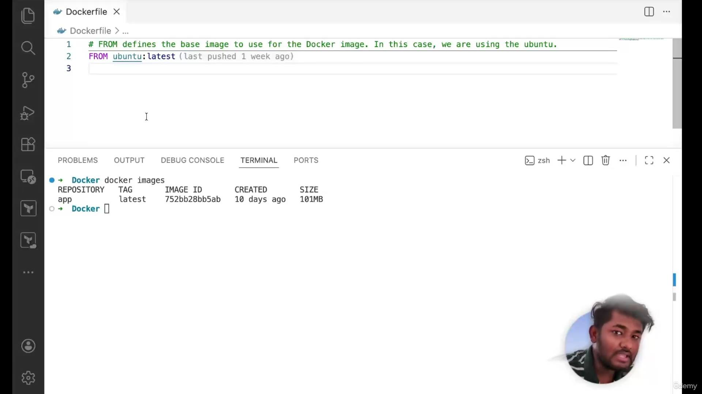

**Step 4：验证指令效果**

```bash
# 验证 nginx 版本（不用进容器）
docker run app nginx -v

# 验证 OS 版本
docker run app cat /etc/os-release

# 验证工作目录
docker run app pwd
# 输出 /app

# 验证文件复制
docker run app ls -l
# 应该看到 index.html

# 验证当前用户
docker run app whoami
# 输出 delta

# 验证环境变量
docker run app printenv
# 输出里应该有 environment=production
```

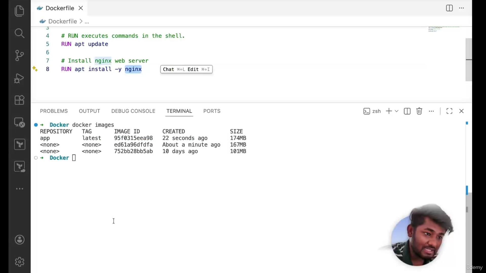

---

### 3.3 P39：DataBridge Lite 三层应用容器化

**目标**：把 Nginx 前端 + Node 后端 + MySQL 数据库三层应用容器化，用自定义 bridge 网络让三个容器互通，用 volume 持久化数据库数据。

**架构图**（讲师在视频里画的）：

```
浏览器
  │
  ▼ localhost:8080
┌─────────────┐
│  frontend   │  nginx:alpine, 容器内 80
│  (web-ui)   │
└──────┬──────┘
       │ databridge-net
┌──────▼──────┐
│   backend   │  node:18-slim, 容器内 3000
│ (api-server)│
└──────┬──────┘
       │ databridge-net
┌──────▼──────┐
│  database   │  mysql:8, 容器内 3306
│  (mysql-db) │
└──────┬──────┘
       │
  databridge-db-vol
```

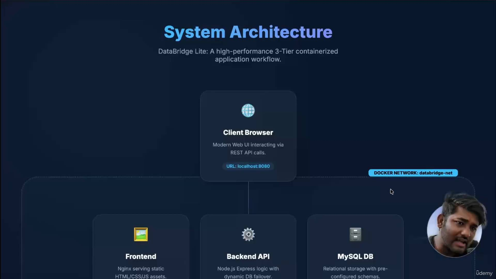

**Step 1：创建网络**

```bash
docker network create databridge-net
docker network ls
```

讲师在视频里确认：默认创建的 driver 是 `bridge`。

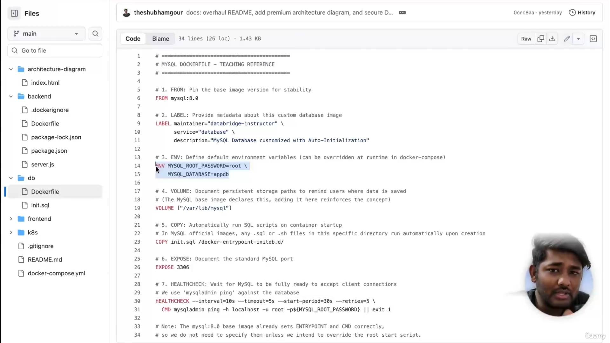

**Step 2：创建卷**

```bash
docker volume create databridge-db-vol
docker volume ls
```

**Step 3：写三个 Dockerfile**

`database/Dockerfile`：

```dockerfile
FROM mysql:8

LABEL maintainer="Shubham Gaur"

ENV MYSQL_ROOT_PASSWORD=root
ENV MYSQL_DATABASE=appdb

COPY init.sql /docker-entrypoint-initdb.d/

VOLUME /var/lib/mysql
```

`database/init.sql`：

```sql
CREATE DATABASE IF NOT EXISTS appdb;
USE appdb;

CREATE TABLE IF NOT EXISTS messages (
  id INT AUTO_INCREMENT PRIMARY KEY,
  message TEXT NOT NULL
);
```

`backend/Dockerfile`：

```dockerfile
FROM node:18-slim

WORKDIR /app

COPY package.json .

RUN npm install

COPY . .

EXPOSE 3000

CMD ["npm", "start"]
```

`frontend/Dockerfile`：

```dockerfile
FROM nginx:alpine

COPY . /usr/share/nginx/html

EXPOSE 80

CMD ["nginx", "-g", "daemon off;"]
```

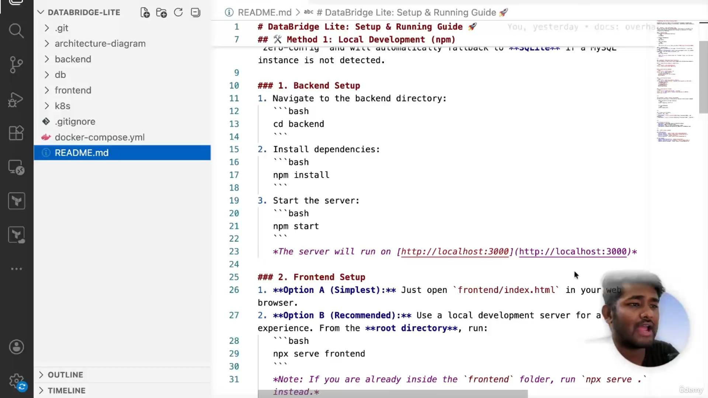

**Step 4：构建并启动 MySQL**

```bash
cd database
docker build -t databridge-db .
docker run -d \
  --name mysql-db \
  --network databridge-net \
  -v databridge-db-vol:/var/lib/mysql \
  databridge-db
docker ps
```

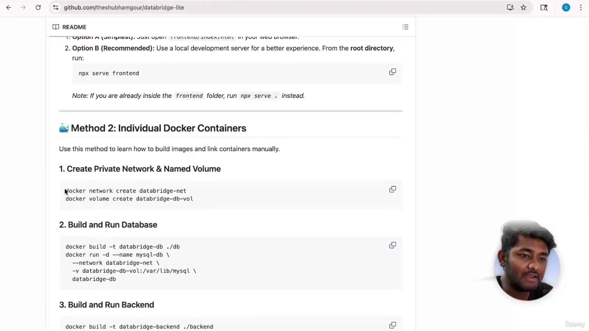

**Step 5：构建并启动后端**

```bash
cd ../backend
docker build -t databridge-backend .
docker run -d \
  --name api-server \
  --network databridge-net \
  -p 3000:3000 \
  databridge-backend
docker ps
```

**Step 6：构建并启动前端**

```bash
cd ../frontend
docker build -t databridge-frontend .
docker run -d \
  --name web-ui \
  --network databridge-net \
  -p 8080:80 \
  databridge-frontend
docker ps
```

**Step 7：验证网络连通**

```bash
docker network inspect databridge-net
```

输出里应该能看到 `mysql-db`、`api-server`、`web-ui` 三个容器都挂在同一个网络上。

**Step 8：验证数据库初始化**

```bash
docker exec -it mysql-db bash
mysql -u root -p
# 输入密码 root
show databases;
use appdb;
show tables;
select * from messages;
exit
exit
```

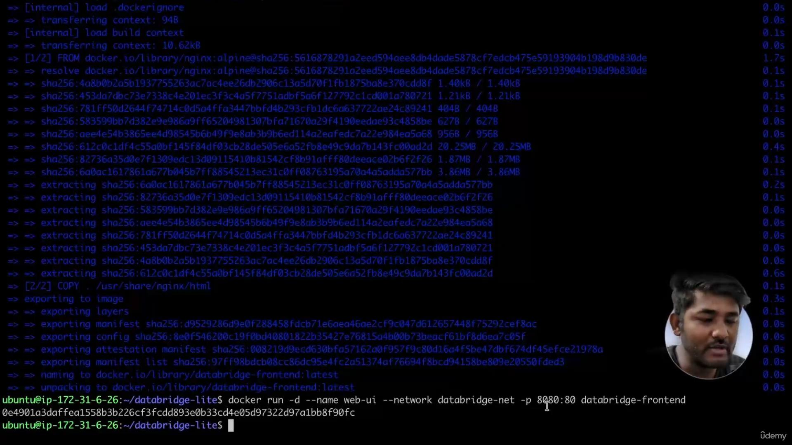

**Step 9：浏览器验证**

打开 `http://<你的服务器公网IP>:8080`，应该能看到前端页面。点「fetch all data」能拉到后端数据。

> 注意：讲师在视频里第一次点「fetch all data」一直转圈，原因是**EC2 安全组没放行 3000 端口**。他后来去 EC2 控制台 → 安全组 → 编辑入站规则 → 加 3000 端口，才通。如果你在本地跑，不需要这一步。

**Step 10：验证卷持久化**

```bash
docker stop web-ui api-server mysql-db
docker start mysql-db
# 等 10 秒让 MySQL 初始化
docker start api-server
docker start web-ui
```

讲师在视频里强调：**必须先起数据库、等它稳定，再起后端，最后起前端**。他第一次没等，导致数据丢了；第二次等了 10 秒，数据回来了。

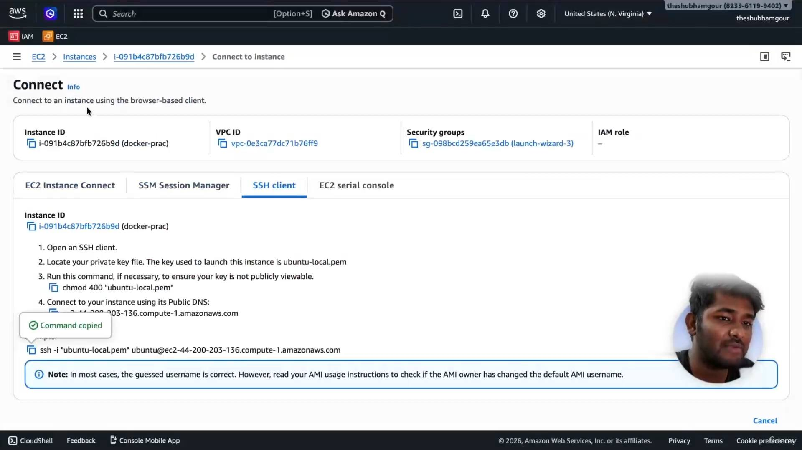

---

### 3.4 P40：YAML 基础

**目标**：为下一集的 `docker-compose.yaml` 打基础，理解 YAML 的缩进、列表、映射、注释、引号、多行字符串。

**三条黄金规则**：

1. **永远用空格，永远不要用 tab**。YAML 对 tab 零容忍。
2. **缩进即结构**。缩进表示从属关系，`key: value` 冒号后面必须有一个空格。
3. **列表用 `- ` 开头**（短横线 + 空格）。

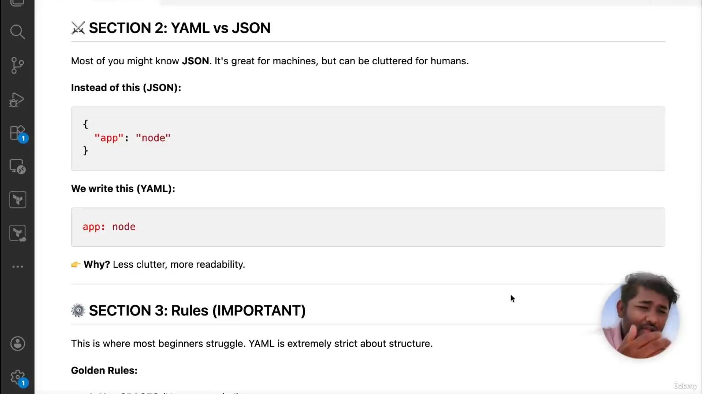

**数据类型**：YAML 自动推断类型，`3000` 是数字，`true` 是布尔，`no` 是字符串。Docker Compose 里端口映射建议加引号：`"3000:3000"`。

**列表示例**：

```yaml
ports:
  - "8080:80"
  - "3000:3000"

volumes:
  - databridge-db-vol:/var/lib/mysql
```

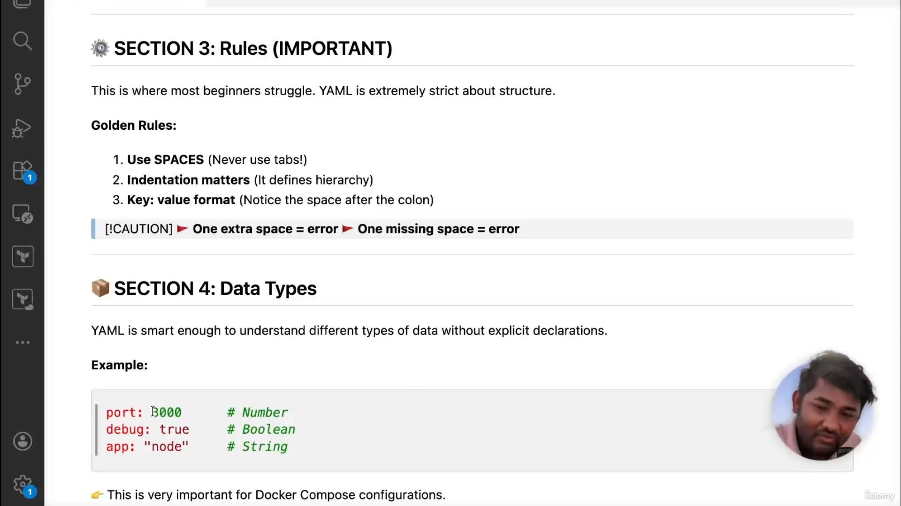

**映射（map）示例**：

```yaml
services:
  web:
    image: nginx
    ports:
      - "8080:80"
```

**嵌套示例**（讲师用「Rahul 的技能」举例）：

```yaml
person:
  name: Rahul
  skills:
    - docker
    - kubernetes
    - jenkins
```

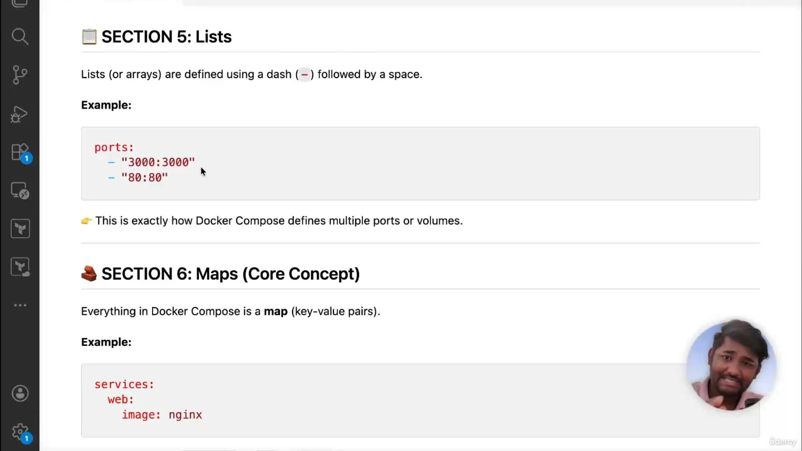

**注释**：用 `#` 开头。

```yaml
# 这是前端服务
services:
  frontend:
    image: nginx
```

**多行字符串**：用 `|` 开头。

```yaml
command: |
  echo "line 1"
  echo "line 2"
```

**环境变量两种写法**（讲师强调两种都正确，团队里选一种保持一致）：

```yaml
# map 风格
environment:
  MYSQL_ROOT_PASSWORD: root
  MYSQL_DATABASE: appdb

# list 风格
environment:
  - MYSQL_ROOT_PASSWORD=root
  - MYSQL_DATABASE=appdb
```

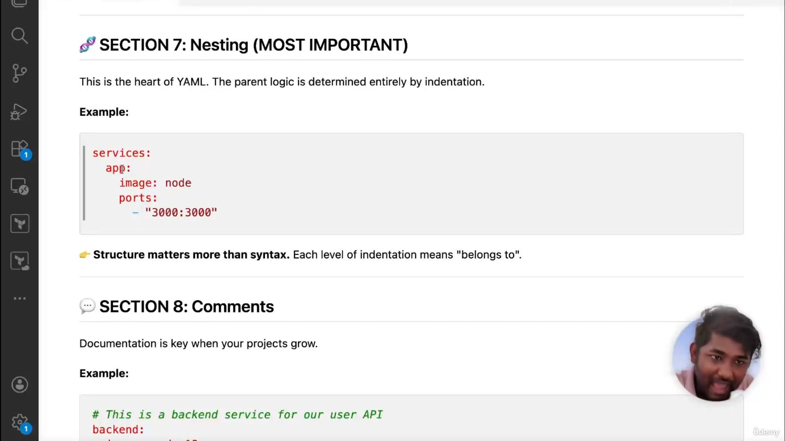

**一个真实的 docker-compose 片段**（讲师在视频末尾展示）：

```yaml
services:
  frontend:
    image: nginx
    ports:
      - "8080:80"
  backend:
    image: node
    ports:
      - "3000:3000"
```

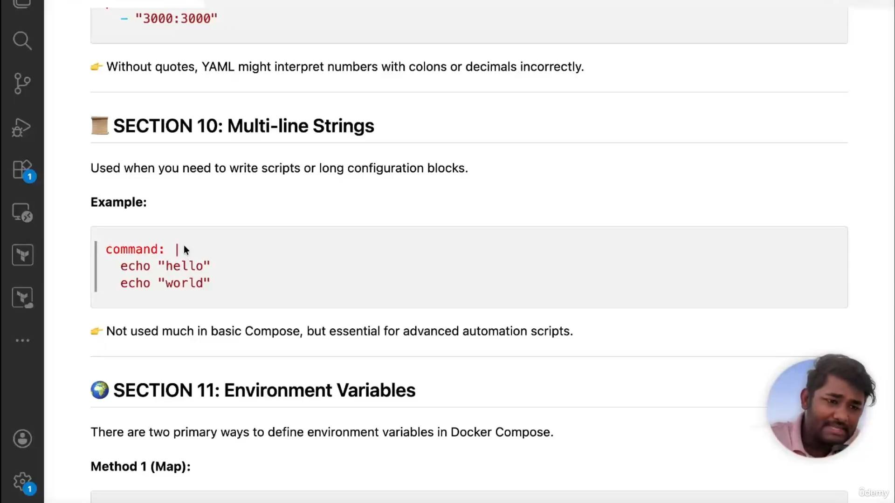

---

## 4. 完整代码

### 4.1 P37 项目结构

```
my-node-app/
├── Dockerfile
├── .dockerignore
├── index.js
├── message.txt
└── package.json
```

**`Dockerfile`**：

```dockerfile
FROM node:18

WORKDIR /app

COPY . .

RUN npm install

EXPOSE 3000

CMD ["node", "index.js"]
```

**`.dockerignore`**：

```gitignore
node_modules
.git
.env
*.log
```

**`index.js`**：

```js
import fs from 'fs';
import path from 'path';
import http from 'http';

const server = http.createServer((req, res) => {
  const filePath = path.join(process.cwd(), 'message.txt');
  const message = fs.readFileSync(filePath, 'utf8');
  res.writeHead(200, { 'Content-Type': 'text/plain; charset=utf-8' });
  res.end(message);
});

server.listen(3000, () => {
  console.log('The application is running on port number 3000');
});
```

**`message.txt`**：

```
hello
```

**`package.json`**：

```json
{
  "name": "my-node-app",
  "version": "1.0.0",
  "description": "",
  "main": "index.js",
  "type": "module",
  "scripts": {
    "test": "echo \"Error: no test specified\" && exit 1"
  },
  "keywords": [],
  "author": "",
  "license": "ISC",
  "dependencies": {
    "fs": "^0.0.1-security",
    "path": "^0.12.7"
  }
}
```

### 4.2 P38 Dockerfile 演示

**`Dockerfile`**：

```dockerfile
# FROM defines the base image
FROM ubuntu:latest

# RUN executes commands in shell
RUN apt update

# Install nginx web server
RUN apt install -y nginx

# WORKDIR sets working directory
WORKDIR /app

# COPY files from source to destination
COPY index.html /app

# ADD similar to COPY but handles remote URLs
ADD https://github.com/your-username/docker-tutorial.git .

# EXPOSE port
EXPOSE 80

# Create user
RUN useradd -g sudo delta

# Change ownership
RUN chown delta:delta /app

# USER sets user
USER delta

# ENV environment variable
ENV environment=production

# LABEL metadata
LABEL maintainer="Shubham Gaur"
```

**`index.html`**：

```html
<!DOCTYPE html>
<html>
<head><title>Docker Demo</title></head>
<body><h1>Hello from Docker</h1></body>
</html>
```

### 4.3 P39 DataBridge Lite 项目结构

```
databridge-lite/
├── database/
│   ├── Dockerfile
│   └── init.sql
├── backend/
│   ├── Dockerfile
│   ├── package.json
│   └── server.js
└── frontend/
    ├── Dockerfile
    └── index.html
```

**`database/Dockerfile`**：

```dockerfile
FROM mysql:8

LABEL maintainer="Shubham Gaur"

ENV MYSQL_ROOT_PASSWORD=root
ENV MYSQL_DATABASE=appdb

COPY init.sql /docker-entrypoint-initdb.d/

VOLUME /var/lib/mysql
```

**`database/init.sql`**：

```sql
CREATE DATABASE IF NOT EXISTS appdb;
USE appdb;

CREATE TABLE IF NOT EXISTS messages (
  id INT AUTO_INCREMENT PRIMARY KEY,
  message TEXT NOT NULL
);
```

**`backend/Dockerfile`**：

```dockerfile
FROM node:18-slim

WORKDIR /app

COPY package.json .

RUN npm install

COPY . .

EXPOSE 3000

CMD ["npm", "start"]
```

**`backend/package.json`**：

```json
{
  "name": "databridge-backend",
  "version": "1.0.0",
  "type": "module",
  "main": "server.js",
  "scripts": {
    "start": "node server.js"
  },
  "dependencies": {
    "express": "^4.19.2",
    "mysql2": "^3.11.0"
  }
}
```

**`backend/server.js`**（课里没讲具体实现，以下是能跑通的最小版本）：

```js
import express from 'express';
import mysql from 'mysql2/promise';

const app = express();
app.use(express.json());

const pool = mysql.createPool({
  host: 'mysql-db',
  user: 'root',
  password: 'root',
  database: 'appdb',
  waitForConnections: true,
  connectionLimit: 10,
});

app.get('/api/messages', async (req, res) => {
  const [rows] = await pool.query('SELECT * FROM messages');
  res.json(rows);
});

app.post('/api/messages', async (req, res) => {
  const { message } = req.body;
  await pool.query('INSERT INTO messages (message) VALUES (?)', [message]);
  res.json({ ok: true });
});

app.listen(3000, () => {
  console.log('Backend running on port 3000');
});
```

**`frontend/Dockerfile`**：

```dockerfile
FROM nginx:alpine

COPY . /usr/share/nginx/html

EXPOSE 80

CMD ["nginx", "-g", "daemon off;"]
```

**`frontend/index.html`**（课里没讲具体实现，以下是能跑通的最小版本）：

```html
<!DOCTYPE html>
<html>
<head><title>DataBridge Lite</title></head>
<body>
  <h1>DataBridge Lite</h1>
  <input id="msg" placeholder="输入消息" />
  <button onclick="send()">提交</button>
  <button onclick="fetchAll()">Fetch All Data</button>
  <pre id="out"></pre>
  <script>
    async function send() {
      const message = document.getElementById('msg').value;
      await fetch('http://localhost:3000/api/messages', {
        method: 'POST',
        headers: { 'Content-Type': 'application/json' },
        body: JSON.stringify({ message }),
      });
    }
    async function fetchAll() {
      const res = await fetch('http://localhost:3000/api/messages');
      const data = await res.json();
      document.getElementById('out').textContent = JSON.stringify(data, null, 2);
    }
  </script>
</body>
</html>
```

### 4.4 P39 完整启动命令

```bash
# 1. 创建网络
docker network create databridge-net

# 2. 创建卷
docker volume create databridge-db-vol

# 3. 构建并启动 MySQL
cd database
docker build -t databridge-db .
docker run -d \
  --name mysql-db \
  --network databridge-net \
  -v databridge-db-vol:/var/lib/mysql \
  databridge-db

# 4. 构建并启动后端
cd ../backend
docker build -t databridge-backend .
docker run -d \
  --name api-server \
  --network databridge-net \
  -p 3000:3000 \
  databridge-backend

# 5. 构建并启动前端
cd ../frontend
docker build -t databridge-frontend .
docker run -d \
  --name web-ui \
  --network databridge-net \
  -p 8080:80 \
  databridge-frontend

# 6. 验证
docker ps
docker network inspect databridge-net
```

---

## 5. 逐行解释

### 5.1 P37 Dockerfile 逐行

```dockerfile
FROM node:18
```
指定基础镜像为 Node.js 18。`node:18` 是官方镜像，自带 Node 和 npm。

```dockerfile
WORKDIR /app
```
设置容器内的工作目录为 `/app`。如果不写，默认是 `/`，后续 `COPY`、`RUN` 都会在根目录执行，容易出权限问题。**在 Node 里对应什么**：相当于你在项目根目录 `cd` 进去，之后所有相对路径都基于这个目录。

```dockerfile
COPY . .
```
把 build context（也就是你运行 `docker build` 的目录）里的所有文件复制到容器内的 `/app`。第一个 `.` 是宿主机当前目录，第二个 `.` 是容器内 `WORKDIR` 指定的目录。

```dockerfile
RUN npm install
```
在镜像构建时执行 `npm install`，根据 `package.json` 安装依赖。**注意**：这一步在构建时执行，不是在容器启动时执行。

```dockerfile
EXPOSE 3000
```
声明容器内应用监听 3000 端口。**注意**：`EXPOSE` 只是声明，不会真的把端口映射到宿主机，映射要靠 `docker run -p`。

```dockerfile
CMD ["node", "index.js"]
```
容器启动时执行的命令。用 exec 格式（JSON 数组），不用 shell 格式，这样 Node 进程能正确接收信号。

### 5.2 P37 .dockerignore 逐行

```gitignore
node_modules
```
排除 `node_modules`。因为 Dockerfile 里已经 `RUN npm install` 了，宿主机上的 `node_modules` 不需要传给 daemon，传了只会拖慢构建。

```gitignore
.git
```
排除 `.git` 目录。版本历史对构建镜像没用。

```gitignore
.env
```
排除环境变量文件。**安全原因**：`.env` 里可能有密钥，不应该进入 build context。

```gitignore
*.log
```
排除所有日志文件。日志是运行时产物，构建时不需要。

### 5.3 P38 Dockerfile 逐行

```dockerfile
FROM ubuntu:latest
```
基础镜像用 Ubuntu 最新版。讲师视频里镜像体积 101 MB。

```dockerfile
RUN apt update
```
更新 apt 包索引。加完这一行镜像从 101 MB 涨到 167 MB——因为 apt 的索引文件被写进了镜像层。

```dockerfile
RUN apt install -y nginx
```
安装 nginx。`-y` 表示自动确认。镜像涨到 174 MB。

```dockerfile
WORKDIR /app
```
设置工作目录。**注意**：`WORKDIR` 本身不增加镜像体积（讲师视频里加完还是 174 MB），但它会影响后续所有命令的路径。

```dockerfile
COPY index.html /app
```
把宿主机的 `index.html` 复制到容器内 `/app` 目录。

```dockerfile
ADD https://github.com/your-username/docker-tutorial.git .
```
`ADD` 和 `COPY` 类似，但 `ADD` 支持远程 URL 和自动解压 tar。这里从 git 仓库拉取内容到当前目录。**坑**：URL 结尾必须带 `.git`，否则会报错——讲师视频里就踩了这个坑。

```dockerfile
EXPOSE 80
```
声明容器内监听 80 端口。

```dockerfile
RUN useradd -g sudo delta
```
创建一个用户 `delta`，主组是 `sudo`。**注意**：`useradd` 是 Linux 命令，不是 Docker 指令，只是被 `RUN` 执行。

```dockerfile
RUN chown delta:delta /app
```
把 `/app` 目录的所有者从 root 改成 `delta`，这样 `delta` 用户才有写权限。

```dockerfile
USER delta
```
切换容器运行时的用户为 `delta`。之后 `docker run app whoami` 输出 `delta` 而不是 `root`。

```dockerfile
ENV environment=production
```
设置环境变量 `environment=production`。容器启动后 `printenv` 能看到。

```dockerfile
LABEL maintainer="Shubham Gaur"
```
给镜像加元数据标签。`docker inspect` 能看到。

### 5.4 P39 三个 Dockerfile 逐行

**database/Dockerfile**：

```dockerfile
FROM mysql:8
```
MySQL 8 官方镜像。

```dockerfile
LABEL maintainer="Shubham Gaur"
```
元数据标签，标识维护者。

```dockerfile
ENV MYSQL_ROOT_PASSWORD=root
ENV MYSQL_DATABASE=appdb
```
MySQL 官方镜像约定的环境变量：`MYSQL_ROOT_PASSWORD` 设置 root 密码，`MYSQL_DATABASE` 自动创建数据库。**这两个变量名是 MySQL 官方镜像定义的**，不是随便起的。

```dockerfile
COPY init.sql /docker-entrypoint-initdb.d/
```
把初始化 SQL 复制到 MySQL 镜像的初始化目录。容器第一次启动时会自动执行这个目录下的 `.sql` 文件。

```dockerfile
VOLUME /var/lib/mysql
```
声明数据卷挂载点。MySQL 的数据存在 `/var/lib/mysql`，挂载卷后数据持久化到宿主机。

**backend/Dockerfile**：

```dockerfile
FROM node:18-slim
```
`slim` 版本比完整版小很多，只包含 Node 运行时，不包含编译工具。讲师特意用 slim 来减小镜像体积。

```dockerfile
WORKDIR /app
COPY package.json .
RUN npm install
COPY . .
```
**关键顺序**：先 `COPY package.json` 再 `RUN npm install`，最后 `COPY . .`。这样只要 `package.json` 不变，`npm install` 这一层就能命中缓存，不用每次重新装依赖。

```dockerfile
EXPOSE 3000
CMD ["npm", "start"]
```
声明 3000 端口，启动时执行 `npm start`。

**frontend/Dockerfile**：

```dockerfile
FROM nginx:alpine
```
`alpine` 版本基于 Alpine Linux，体积很小。

```dockerfile
COPY . /usr/share/nginx/html
```
把静态文件复制到 nginx 的默认网站根目录。

```dockerfile
EXPOSE 80
CMD ["nginx", "-g", "daemon off;"]
```
声明 80 端口，前台运行 nginx（`daemon off` 让 nginx 不在后台运行，否则容器会立即退出）。

### 5.5 P39 启动命令逐行

```bash
docker network create databridge-net
```
创建一个自定义 bridge 网络。默认 driver 就是 `bridge`，所以不用加 `--driver`。

```bash
docker volume create databridge-db-vol
```
创建一个命名卷，用于持久化 MySQL 数据。

```bash
docker run -d \
  --name mysql-db \
  --network databridge-net \
  -v databridge-db-vol:/var/lib/mysql \
  databridge-db
```
- `-d`：后台运行
- `--name mysql-db`：容器名
- `--network databridge-net`：加入自定义网络
- `-v databridge-db-vol:/var/lib/mysql`：把命名卷挂载到 MySQL 数据目录
- `databridge-db`：镜像名

```bash
docker run -d \
  --name api-server \
  --network databridge-net \
  -p 3000:3000 \
  databridge-backend
```
- `-p 3000:3000`：宿主机 3000 映射到容器 3000

```bash
docker run -d \
  --name web-ui \
  --network databridge-net \
  -p 8080:80 \
  databridge-frontend
```
- `-p 8080:80`：宿主机 8080 映射到容器 80

### 5.6 P40 YAML 逐条

```yaml
services:
  frontend:
    image: nginx
    ports:
      - "8080:80"
```
- `services:` 是顶层 key
- `frontend:` 缩进 2 空格，是 `services` 的子 key
- `image: nginx` 缩进 4 空格，是 `frontend` 的子 key
- `ports:` 缩进 4 空格
- `- "8080:80"` 缩进 6 空格，`- ` 表示列表项

**在 JS/Node 里对应什么**：YAML 的嵌套结构等价于 JS 对象：

```js
{
  services: {
    frontend: {
      image: 'nginx',
      ports: ['8080:80']
    }
  }
}
```

---

## 6. 复现检查清单

### P37 检查项

- [ ] `npm init -y` 生成了 `package.json`
- [ ] `package.json` 里有 `"type": "module"`
- [ ] `node index.js` 本地能跑，浏览器 `localhost:3000` 显示 `hello`
- [ ] `docker build -t my-node-app .` 成功
- [ ] `docker run -p 3000:3000 my-node-app` 能访问
- [ ] 加了 `.dockerignore` 后，构建日志里 `transferring context` 明显变小

### P38 检查项

- [ ] `docker build -t app .` 成功
- [ ] `docker run app nginx -v` 输出 nginx 版本
- [ ] `docker run app cat /etc/os-release` 输出 Ubuntu
- [ ] `docker run app pwd` 输出 `/app`
- [ ] `docker run app whoami` 输出 `delta`
- [ ] `docker run app printenv` 输出里有 `environment=production`
- [ ] `docker images` 能看到镜像体积变化

### P39 检查项

- [ ] `docker network ls` 能看到 `databridge-net`
- [ ] `docker volume ls` 能看到 `databridge-db-vol`
- [ ] `docker ps` 能看到 `mysql-db`、`api-server`、`web-ui` 三个容器
- [ ] `docker network inspect databridge-net` 里三个容器都在
- [ ] `docker exec -it mysql-db bash` 能进容器
- [ ] `mysql -u root -p` 能登录，密码 `root`
- [ ] `show databases;` 能看到 `appdb`
- [ ] `use appdb; show tables;` 能看到 `messages` 表
- [ ] 浏览器 `http://localhost:8080` 能打开前端
- [ ] 点「fetch all data」能拉到数据
- [ ] 停掉所有容器再按顺序启动，数据还在（卷持久化生效）

### P40 检查项

- [ ] 能区分 YAML 的 map 和 list
- [ ] 知道 `key: value` 冒号后必须有一个空格
- [ ] 知道不能用 tab，只能用空格
- [ ] 知道 `- ` 表示列表项
- [ ] 知道 `#` 是注释
- [ ] 知道 `|` 是多行字符串
- [ ] 知道环境变量两种写法（map 和 list）

---

## 7. 课里没讲但你会撞上的

1. **`npm install fs path` 是多余的**。`fs` 和 `path` 是 Node.js 内置模块，不需要安装。讲师视频里装了，会往 `package.json` 里写两个包，但不影响运行。如果你不想复现这个「坑」，可以跳过。

2. **`ADD` 的 git URL 必须带 `.git`**。讲师视频里第一次没带，报错了，后来补上才成功。如果你用自己的仓库，记得 URL 结尾加 `.git`。

3. **EC2 安全组要放行端口**。讲师视频里第一次点「fetch all data」一直转圈，原因是 EC2 安全组没放行 3000 端口。本地跑不需要，但如果你部署到云服务器，记得去安全组加规则。

4. **MySQL 启动需要时间**。讲师视频里第一次重启容器没等，数据丢了；第二次等了 10 秒，数据回来了。**在 JS/Node 里对应什么**：相当于你 `await` 一个异步初始化，没 `await` 完就往下走，后面拿不到数据。生产环境建议用 healthcheck 而不是 `sleep 10`。

5. **`docker-compose` 是下一集的内容**。P40 只讲了 YAML 语法，没讲 `docker-compose.yaml` 怎么写。讲师明确说「下一集我们写真正的 compose 文件」。

6. **`docker system prune` 会删掉所有停止的容器、未使用的网络、悬空镜像**。讲师视频里用了这个命令清理环境，**慎用**，尤其是你本地还有其他项目的时候。

7. **`docker run app nginx -v` 这种写法**：`app` 是镜像名，`nginx -v` 是覆盖 `CMD` 的命令。**在 JS/Node 里对应什么**：相当于 `node -e "console.log(1)"` 覆盖了 `package.json` 里的 `start` 脚本。

8. **`EXPOSE` 不会真的开放端口**。很多人以为写了 `EXPOSE 3000` 就能从宿主机访问 3000，其实必须 `docker run -p 3000:3000`。`EXPOSE` 只是文档性质的声明。

9. **`COPY . .` 会把 `.dockerignore` 里没排除的所有文件都复制进去**，包括 `.git`、`node_modules`、`.env`。所以 `.dockerignore` 不是可选项，是必选项。

10. **`USER delta` 之后，容器内很多命令会没权限**。比如 `apt install` 会失败，因为 `delta` 不是 root。所以 `USER` 要放在所有需要 root 权限的 `RUN` 之后。

---

**一句话总结**：P37 教你「别把垃圾传给 daemon」，P38 教你「每条指令都是一层」，P39 教你「三个容器怎么按顺序串起来」，P40 教你「YAML 缩进就是结构」。四集连起来，就是下一集 `docker-compose up` 的全部前置知识。