# Docker 交付与镜像仓库复现（扩写版）

## 1. 这一节做什么

这四讲（P41–P44）把“会写 Dockerfile、会敲 `docker run`”推进到“能把一组服务交付出去”。最终要得到四类可复现产物：

1. **Docker Compose 编排**：把 nginx、前后端、MySQL、Python 应用、Data Bridge Light 三层应用写成 Compose 文件，用 `docker compose up -d` / `docker compose down` 启停。
2. **多阶段 Dockerfile**：用 Python、Node、Java/Maven、React、Go 五个例子，对比标准 Dockerfile 与多阶段 Dockerfile 的镜像体积。
3. **Docker Hub 公共仓库**：用 `docker save/load`、`docker tag/login/push/pull` 完成镜像分发。
4. **AWS ECR 私有仓库**：在 EC2 上安装 Docker、配置 AWS CLI、创建 ECR 私有仓库、登录、构建、打标签、推送、拉取，并验证未认证用户拉取失败。

这一节的重点不是单纯背命令，而是建立一条完整链路：**本地能构建 → Compose 能编排 → 镜像能瘦身 → 镜像能保存和加载 → 公共仓库能推送拉取 → 私有仓库能认证推送拉取**。每一步都要能回到命令行验证，也要能在浏览器、Docker Desktop、Docker Hub 页面或 AWS 控制台里看到对应结果。

前置环境：

- Docker Engine / Docker Desktop，能运行 `docker compose version`。课里演示机出现 Docker `25.0.14`，但课里没有强制版本；本地用 Docker 24+、Compose v2 即可。
- Node.js 18 只在本地调试 P41 后端时有帮助；真正运行都在容器里。
- P44 需要 AWS 账号、EC2、AWS CLI v2、访问密钥。课里没有给具体 region，本文用 `<REGION>` 占位，不要把它当成课程里的固定值。
- 本文所有命令默认在项目根目录 `docker-masterclass-lab/` 下执行。目录结构在“3. 从零复现”给出。

> 说明：逐字稿展示了 Compose 片段、Dockerfile 片段和命令，但没有完整贴出 Data Bridge Light 的 `server.js`、前端 HTML、Java `pom.xml` 等源码。第 4 节中这些“为了跑通而补齐的最小实现”会明确标注为补充代码，不冒充讲师原话。

学习时建议按“先跑通单服务，再跑多服务，再做镜像瘦身，最后做仓库分发”的顺序推进。因为 Compose 的错误大多来自 YAML 缩进、端口占用、卷不存在、服务名写错；多阶段构建的错误大多来自阶段名、复制路径、最终镜像缺少运行依赖；仓库分发的错误大多来自命名格式、登录状态、权限和 region 配置。下面每一段都补充命令解释、常见错误与排查、与前台的对照以及检查清单。

---

## 2. 讲师原话

> "有没有办法尽量减少这些操作？当然有。我们要学习 Docker Compose……"
> —— p041 [01:01]

> "Docker Compose 基本上就像一本菜谱，能帮你把这些手动操作减少到最低。"
> —— p041 [01:01]

> "使用 Docker Compose 时，你面对的是 YAML，而 YAML 对缩进和空格要求非常严格。一定要确保任何地方都不要用制表符。"
> —— p041 [05:04]

> "它还会校验你的文件究竟写错在哪里……比如会提示：services 中不允许出现 commands 这个额外属性。"
> —— p041 [17:39]

> "多阶段 Dockerfile 是构建小巧、安全且高效 Docker 镜像的非常巧妙的方式。"
> —— p042 [00:22]

> "使用多阶段构建时，你基本上会用到多个 FROM 语句，每个 FROM 语句都会开启一个新的阶段。"
> —— p042 [01:15]

> "Docker Hub 是 Docker 镜像的云存储。Docker Hub 是 Docker 镜像的在线仓库。"
> —— p043 [02:20]

> "当镜像为私有镜像时，除非我们提供相应的身份验证，否则无法拉取它。"
> —— p044 [13:07]

这些话对应的项目动作很明确：先把手动命令翻译成 Compose，再用多阶段 Dockerfile 瘦身，最后把镜像推到公共/私有 registry。下面按这个顺序复现。

---

## 3. 从零复现

### 3.1 建目录

```bash
mkdir -p docker-masterclass-lab
cd docker-masterclass-lab
mkdir -p p41-compose/python-app
mkdir -p p41-compose/data-bridge/{db,backend,frontend}
mkdir -p p42-multistage/{python-app,node-app,java-app,react-app,go-app}
mkdir -p p43-dockerhub
mkdir -p p44-ecr
```

命令解释：

- `mkdir -p docker-masterclass-lab`：创建项目根目录，`-p` 表示父目录不存在时一并创建，目录已存在时不报错。
- `cd docker-masterclass-lab`：进入项目根目录。后续所有相对路径都基于这里。
- `mkdir -p p41-compose/python-app`：为 P41 的 Flask 练习单独建目录。
- `mkdir -p p41-compose/data-bridge/{db,backend,frontend}`：用花括号展开一次创建 Data Bridge Light 的数据库、后端、前端三个子目录。
- `mkdir -p p42-multistage/{python-app,node-app,java-app,react-app,go-app}`：一次创建多阶段构建五个示例目录。
- `mkdir -p p43-dockerhub`、`mkdir -p p44-ecr`：分别存放 Docker Hub 与 ECR 的脚本或临时文件。

常见错误与排查：

- 如果提示 `Permission denied`，说明当前用户对目标目录没有写权限。不要直接 `chmod 777` 了事，建议在用户主目录下操作，或确认当前工作目录是否正确。
- 如果目录层级不对，先运行 `pwd` 看当前路径，再用 `find . -maxdepth 3 -type d` 检查目录树。
- 如果花括号没有展开，可能是使用了不支持的 shell。本文命令默认在 bash/zsh 下执行。

与前台的对照：目录创建没有浏览器页面，主要在终端或文件管理器里确认。用 `tree -L 3` 或 `find . -maxdepth 3 -type d` 应能看到后续代码块中的目录结构。

最终目录：

```text
docker-masterclass-lab/
├── p41-compose/
│   ├── compose-1.yml
│   ├── compose-2.yml
│   ├── compose-3.yml
│   ├── python-app/
│   │   ├── app.py
│   │   ├── Dockerfile
│   │   └── compose-4.yml
│   └── data-bridge/
│       ├── docker-compose.yml
│       ├── db/init.sql
│       ├── backend/{Dockerfile,package.json,server.js}
│       └── frontend/{Dockerfile,index.html}
├── p42-multistage/
│   ├── python-app/{app.py,Dockerfile,Dockerfile.multistage}
│   ├── node-app/{app.js,package.json,Dockerfile,Dockerfile.multistage}
│   ├── java-app/{pom.xml,src/main/java/com/example/Main.java,Dockerfile,Dockerfile.multistage}
│   ├── react-app/{package.json,public/index.html,src/index.js,src/App.js,Dockerfile,Dockerfile.multistage}
│   └── go-app/{main.go,go.mod,Dockerfile,Dockerfile.multistage}
├── p43-dockerhub/{push-public.sh,load-public.sh}
└── p44-ecr/{push-ecr.sh,pull-ecr.sh}
```

检查清单逐条说明：

- [ ] 根目录名为 `docker-masterclass-lab`：保证后续命令中的相对路径一致。
- [ ] P41 有 `python-app` 与 `data-bridge` 两个子目录：分别对应 Flask 单服务和三层应用。
- [ ] P42 五个示例目录都存在：Python、Node、Java、React、Go 不要混在同一目录。
- [ ] P43、P44 目录单独存在：仓库脚本和 AWS 脚本不要和业务源码混放。

---

### 3.2 P41：Compose 五个练习

P41 的主线是“把 `docker run` 的手工参数翻译成 YAML”。Compose 文件本质上是声明式配置：你写清楚服务、镜像、端口、环境变量、卷、网络依赖，Compose 负责创建网络、容器和挂载。每次执行 `up -d` 后，都应该用 `docker ps`、`docker network ls`、`docker volume ls` 验证结果。

#### 练习 1：单 nginx 服务

先按课里的思路，从 `docker run -d -p 8082:80 --name nginx-app nginx` 反推 Compose。保存 `p41-compose/compose-1.yml` 后运行：

```bash
cd p41-compose
docker compose -f compose-1.yml up -d
docker ps
curl -I http://localhost:8082
docker compose -f compose-1.yml down
```

命令解释：

- `cd p41-compose`：进入 Compose 文件所在目录，避免 `-f` 路径写错。
- `docker compose -f compose-1.yml up -d`：按指定文件启动服务。`up` 会创建或启动容器、网络；`-d` 表示后台运行。若镜像不存在会先拉取。
- `docker ps`：查看正在运行的容器，应看到 nginx 容器和端口映射 `8082->80`。
- `curl -I http://localhost:8082`：只请求响应头，用来快速确认 nginx 是否返回 HTTP 响应。正常应看到 `HTTP/1.1 200 OK` 或 nginx 欢迎页相关头。
- `docker compose -f compose-1.yml down`：停止并删除该 Compose 项目创建的容器和默认网络。默认不删除命名卷。

常见错误与排查：

- `port is already allocated`：8082 被占用。用 `lsof -i :8082` 或 `ss -lntp | grep 8082` 找到占用进程，换端口或停止占用进程。
- `no such file or directory`：`-f` 后文件名或路径不对。先 `ls` 确认当前目录有 `compose-1.yml`。
- YAML 缩进错误：Compose 对空格敏感，禁止用 Tab。建议统一两个空格缩进。
- `docker compose` 命令不存在：确认安装的是 Compose v2，运行 `docker compose version`。

与前台的对照：浏览器打开 `http://localhost:8082` 应看到 nginx 默认欢迎页；Docker Desktop 的 Containers 列表应出现 `nginx-app` 或 Compose 项目下的服务容器。执行 `down` 后，浏览器访问会失败，Docker Desktop 中对应容器消失，这是正常现象。

课里强调：Compose 会为项目创建默认网络；`down` 会删容器和网络。

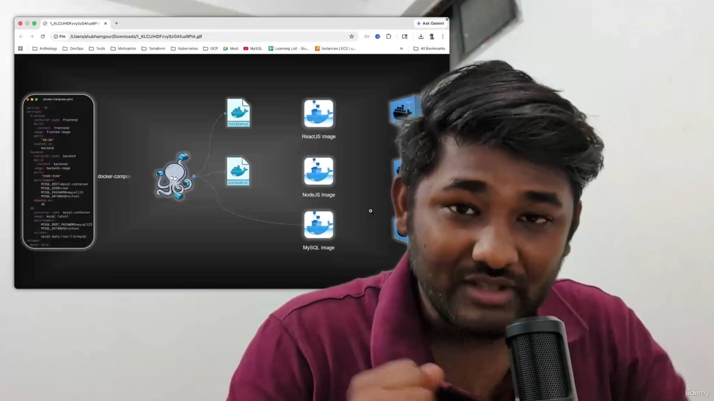

检查清单逐条说明：

- [ ] `docker compose -f compose-1.yml up -d` 无报错：说明 YAML 语法和端口映射基本正确。
- [ ] `docker ps` 能看到容器处于 `Up`：说明容器没有启动后立即退出。
- [ ] `curl -I` 返回 HTTP 状态行：说明端口映射和 nginx 进程正常。
- [ ] `down` 后容器和网络被清理：说明生命周期管理符合预期。

#### 练习 2：前后端两个服务同网络

保存 `compose-2.yml` 后：

```bash
docker compose -f compose-2.yml up -d
docker ps
docker network ls
docker compose -f compose-2.yml down
```

命令解释：

- `up -d`：同时创建前后端两个容器，并加入同一个 Compose 默认网络。
- `docker ps`：确认两个容器都处于运行状态。若后端是短生命周期命令，可能启动后退出，需要看 `docker ps -a` 和日志。
- `docker network ls`：查看 Compose 创建的网络，通常名称包含项目目录名和 `default`。
- `down`：删除两个容器和默认网络。

常见错误与排查：

- 服务名拼写错误：Compose 中服务名就是容器间 DNS 名。前端访问后端时应使用服务名，例如 `backend`，不要写 `localhost`，因为容器里的 `localhost` 指容器自己。
- `depends_on` 只保证启动顺序，不保证后端已经可以接受请求。若后端启动慢，需要健康检查或应用重试。
- 端口冲突：本练习课里没有给 backend 端口映射，通常不会冲突；如果你自行加端口，注意宿主机端口是否占用。
- 网络看不到：先确认 `up` 是否成功，再运行 `docker network inspect <网络名>` 查看容器是否加入。

与前台的对照：本练习课里没有要求浏览器访问后端，因为 backend 没有映射端口。若要验证，可临时加端口，或用 `docker compose exec frontend sh` 进入前端容器，再用服务名访问后端。Docker Desktop 的 Networks 页面应能看到两个容器在同一网络。

课里没有给 backend 端口映射，只验证两个容器在同一网络。需要看 http-echo 返回内容时，可以临时加端口，但不要把它说成课里固定配置。

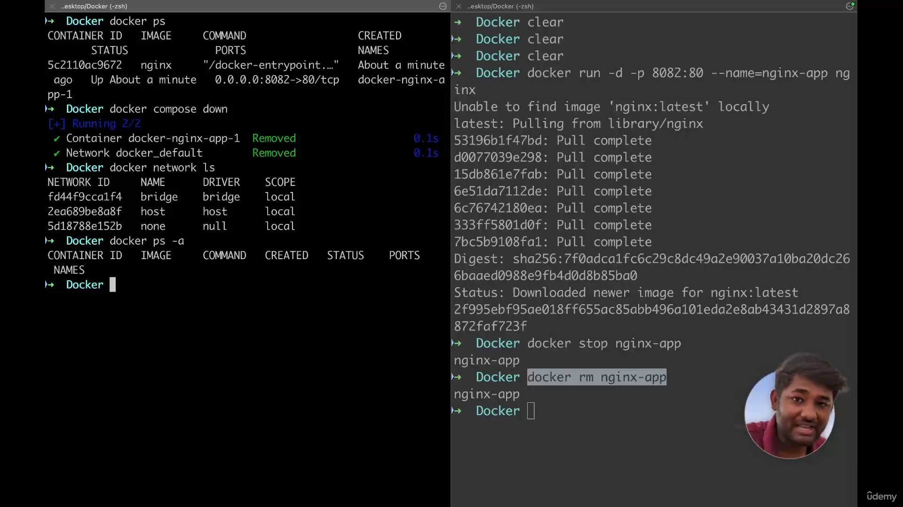

检查清单逐条说明：

- [ ] 两个服务都出现在 `docker ps`：说明容器没有立即退出。
- [ ] `docker network ls` 有对应默认网络：说明 Compose 网络已创建。
- [ ] 前端能通过服务名访问后端：说明容器 DNS 和服务名配置正确。
- [ ] `down` 后网络被删除：说明没有遗留测试网络。

#### 练习 3：MySQL volume 持久化

课里先手动创建 volume：

```bash
docker volume create mysql_data
docker volume ls
docker compose -f compose-3.yml up -d
docker ps
docker compose -f compose-3.yml down
docker volume ls
```

命令解释：

- `docker volume create mysql_data`：手动创建命名卷。因为 `compose-3.yml` 里 volume 是 `external: true`，Compose 不会替你创建它。
- `docker volume ls`：确认卷已存在，名称应为 `mysql_data`。
- `up -d`：启动 MySQL 容器，并把 `mysql_data` 挂到容器内数据目录。
- `docker ps`：确认 MySQL 容器运行。MySQL 首次初始化可能需要几秒。
- `down`：删除容器和网络，但默认保留命名卷。
- 再次 `docker volume ls`：应仍能看到 `mysql_data`，说明数据卷没有被 `down` 删除。

常见错误与排查：

- `external volume "mysql_data" not found`：忘记执行 `docker volume create mysql_data`。这是本练习最常见的错误。
- MySQL 启动后退出：用 `docker logs <容器名>` 查看，常见原因是环境变量缺失、端口占用、数据目录权限或旧数据不兼容。
- 端口 3306 被本机 MySQL 占用：改宿主机端口，例如 `3307:3306`，或停止本机 MySQL。
- `down` 后以为数据丢了：先检查卷是否还在；`down` 默认不删卷，只有 `down -v` 才会删。

与前台的对照：浏览器不能直接看 MySQL，但可以用 `docker exec -it <mysql容器> mysql -uroot -p` 登录验证数据库。Docker Desktop 的 Volumes 页面应能看到 `mysql_data`。执行 `down` 后容器消失，但卷仍在。

因为 `compose-3.yml` 里 volume 是 `external: true`，所以 **必须先执行 `docker volume create mysql_data`**，否则 `up` 会报找不到外部卷。课里正是先创建再映射。

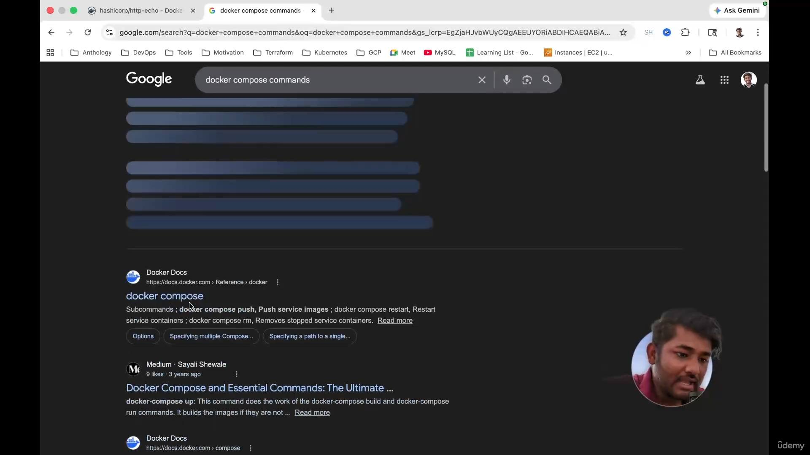

检查清单逐条说明：

- [ ] `docker volume ls` 在 `up` 前能看到 `mysql_data`：满足 external volume 前置条件。
- [ ] MySQL 容器处于 `Up`：说明初始化没有立即失败。
- [ ] 日志中没有反复重启：说明配置和卷挂载稳定。
- [ ] `down` 后卷仍存在：说明持久化数据没有被误删。

#### 练习 4：Python Flask：build + environment

```bash
cd python-app
docker compose -f compose-4.yml up -d --build
curl http://localhost:5002
docker compose -f compose-4.yml down
```

命令解释：

- `cd python-app`：进入 Flask 示例目录。
- `docker compose -f compose-4.yml up -d --build`：启动服务并强制重新构建镜像。`--build` 用于确保 Dockerfile 或源码改动被带入镜像，避免继续使用旧缓存。
- `curl http://localhost:5002`：访问 Flask 应用，应返回应用文本。
- `down`：停止并删除容器和默认网络。

常见错误与排查：

- 端口不一致：逐字稿里讲师一度说“port number 5000”，但源码和前面命令是 `5002`。如果 Compose 写 `5000:5002` 或 Flask 监听 5000，都会导致访问失败。以源码端口为准。
- Flask 只监听 `127.0.0.1`：容器内必须监听 `0.0.0.0`，否则宿主机映射端口访问不到。`app.py` 中应使用 `host="0.0.0.0"`。
- 修改代码后页面没变：加 `--build` 重新构建，或确认卷没有覆盖容器内代码。
- 构建失败：先单独运行 `docker build -t python-app .` 看完整错误，再回到 Compose。

与前台的对照：浏览器打开 `http://localhost:5002` 应看到 Flask 返回内容；Docker Desktop 中能看到 `python-app` 容器和镜像。若 `curl` 成功但浏览器失败，检查代理设置或地址是否写错。

逐字稿里讲师一度说“port number 5000”，但源码和前面命令是 `5002`。本文以 `app.py` 的 `5002` 为准，Compose 写成 `5002:5002`。这是课里口误/口述不一致的地方，复现时以能跑通的源码端口为准。

检查清单逐条说明：

- [ ] `--build` 后镜像重新生成：确认代码已进入镜像。
- [ ] `curl` 返回预期文本：确认端口映射和 Flask 监听地址正确。
- [ ] 浏览器与 `curl` 结果一致：排除代理或缓存干扰。
- [ ] `down` 后端口释放：便于下一轮重复练习。

#### 练习 5：Data Bridge Light 三层应用

```bash
cd data-bridge
docker compose up -d --build
docker ps
docker network ls
docker volume ls
```

浏览器打开 `http://localhost:8080`，输入消息并提交，再点 “Fetch all data”。然后：

```bash
docker compose down
docker compose up -d
```

再次刷新，数据还在，因为 MySQL 数据目录挂在命名卷 `data-bridge-db` 上。注意：`docker compose down` 默认不删除命名卷；课里也没有用 `-v` 删除数据卷。

命令解释：

- `cd data-bridge`：进入三层应用目录。
- `docker compose up -d --build`：构建并启动 db、backend、frontend 三个服务。
- `docker ps`：应看到三个容器，前端映射 `8080:80`。
- `docker network ls`：应看到 Data Bridge 的默认网络，三个服务在同一网络内。
- `docker volume ls`：应看到 `data-bridge-db` 命名卷。
- 浏览器提交和拉取：验证前端、后端 API、MySQL 写入读取链路。
- `down` 再 `up`：验证 MySQL 数据卷持久化。

常见错误与排查：

- 后端连不上 MySQL：检查 backend 环境变量里的 host 是否写服务名 `db`，而不是 `localhost`。
- MySQL 还没 ready：`depends_on` 只控制启动顺序，不保证数据库可连接。建议给 db 加 healthcheck，backend 增加重试。
- 前端请求 404：检查 nginx 是否把 `/api/` 代理到 `backend:3000`，以及后端路由是否以 `/api` 开头。
- 数据重启后丢失：检查 Compose 是否正确把命名卷挂到 `/var/lib/mysql`；不要误用匿名卷或临时目录。
- 端口 8080 被占用：换宿主机端口，例如 `8081:80`，同时浏览器地址也要改。

与前台的对照：浏览器打开 `http://localhost:8080` 应看到 Data Bridge Light 页面；提交消息后点 “Fetch all data” 应列出刚提交的数据。执行 `down` 再 `up` 后刷新，数据仍在，说明卷生效。Docker Desktop 中应能看到三个容器和命名卷。

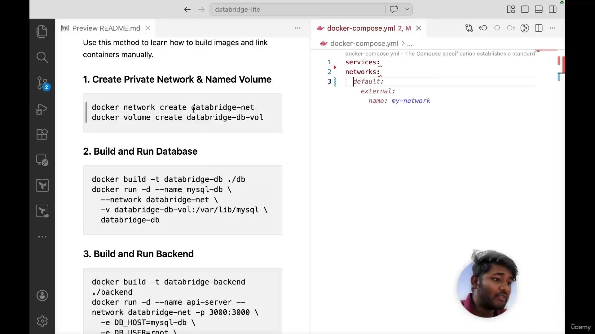

检查清单逐条说明：

- [ ] 三个容器都运行：db、backend、frontend 缺一不可。
- [ ] 浏览器能打开 8080：说明前端 nginx 正常。
- [ ] 提交消息成功：说明前端到后端再到 MySQL 的写链路正常。
- [ ] “Fetch all data” 能显示数据：说明读链路正常。
- [ ] `down` 后 `up` 数据仍在：说明命名卷挂载正确。

---

### 3.3 P42：多阶段 Dockerfile 五个例子

每个例子都先构建标准镜像，再构建多阶段镜像，最后用 `docker images` 看体积差异。多阶段的核心是多个 `FROM`，每个 `FROM` 开启一个新阶段；最终镜像只保留最后一个阶段，前一阶段只作为 builder。这样可以把编译器、依赖缓存、开发工具留在 builder 阶段，运行阶段只复制必要产物。

#### Python

```bash
cd p42-multistage/python-app
docker build -t python-app .
docker build -f Dockerfile.multistage -t python-app-2 .
docker images
docker run --rm python-app
docker run --rm python-app-2
```

命令解释：

- `docker build -t python-app .`：用当前目录的标准 Dockerfile 构建，镜像名为 `python-app`。
- `docker build -f Dockerfile.multistage -t python-app-2 .`：指定多阶段 Dockerfile 构建第二个镜像。
- `docker images`：对比两个镜像的 `SIZE` 列。
- `docker run --rm python-app`：运行标准镜像，`--rm` 表示退出后删除容器。
- `docker run --rm python-app-2`：运行多阶段镜像，验证功能一致。

常见错误与排查：

- 多阶段文件里 `COPY --from=builder` 阶段名写错：阶段名必须与 `FROM ... AS builder` 一致。
- 最终镜像缺少依赖：多阶段只复制了代码但没复制依赖。Python 示例要把安装目录或虚拟环境复制到最终阶段。
- 构建缓存导致体积没变化：用 `docker build --no-cache` 排查，确认两次构建的 Dockerfile 不同。
- 运行报模块找不到：在最终阶段运行 `python -c "import flask"` 或查看 `pip list`。

与前台的对照：Python 示例主要看终端输出和 `docker images` 体积。若应用有 Web 端口，可映射后用浏览器验证；本示例以命令行输出为主。

课里演示标准镜像约 `1.12GB`，多阶段约 `55.6MB`。你机器上的数字会因基础镜像缓存不同而变化。

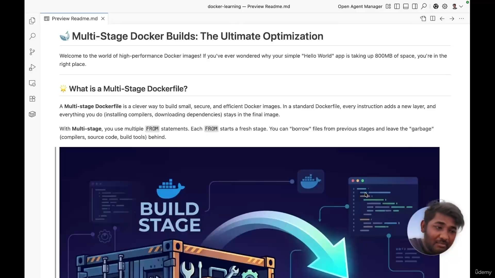

检查清单逐条说明：

- [ ] 标准镜像构建成功：先排除源码和 Dockerfile 基础错误。
- [ ] 多阶段镜像构建成功：确认阶段名和复制路径正确。
- [ ] 两个镜像都能运行：确认瘦身没有破坏功能。
- [ ] 多阶段体积明显更小：确认最终阶段没有带入 builder 工具。

#### Node

```bash
cd ../node-app
docker build -t node-app .
docker build -f Dockerfile.multistage -t node-app-2 .
docker images
docker run -d -p 3000:3000 --name node-app-run node-app-2
curl http://localhost:3000
docker rm -f node-app-run
```

命令解释：

- `docker build` 两次分别构建标准与多阶段镜像。
- `docker run -d -p 3000:3000 --name node-app-run node-app-2`：后台运行多阶段镜像，映射 3000 端口。
- `curl http://localhost:3000`：验证 Node 服务返回。
- `docker rm -f node-app-run`：强制停止并删除测试容器。

常见错误与排查：

- 多阶段镜像缺 `node_modules`：确认 `COPY --from=builder /app/node_modules ./node_modules`。
- 生产依赖和开发依赖混在一起：可在 builder 中 `npm ci`，最终阶段只复制运行所需文件。
- 端口未监听 `0.0.0.0`：容器内服务若只监听 `127.0.0.1`，宿主机访问不到。
- 镜像体积仍大：检查是否误用了 `node:18` 作为最终阶段，最终阶段建议用 `node:18-alpine`。

与前台的对照：浏览器打开 `http://localhost:3000` 应看到 Node 服务输出；Docker Desktop 中应看到 `node-app-run` 容器。

课里对比约 `1.1GB` 与 `128MB`。关键在 `COPY --from=builder /app/node_modules ./node_modules`，只把运行需要的依赖带进最终镜像。

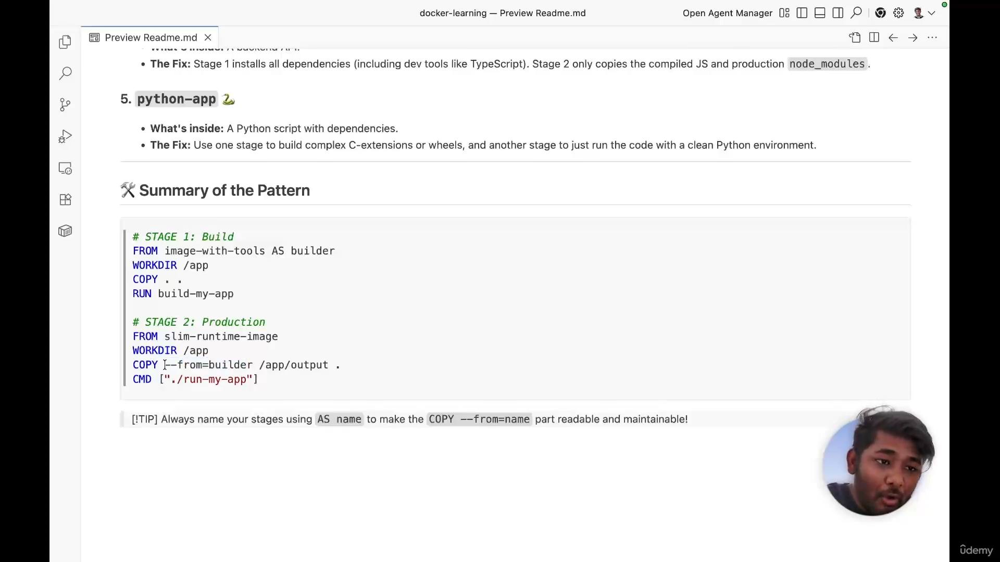

检查清单逐条说明：

- [ ] 标准镜像能启动服务：确认 Node 代码本身可运行。
- [ ] 多阶段镜像能启动服务：确认复制依赖完整。
- [ ] `curl` 返回正常：确认端口映射和监听地址正确。
- [ ] 测试容器已删除：避免占用端口和容器名。

#### Java/Maven

```bash
cd ../java-app
docker build -t java-app .
docker build -f Dockerfile.multistage -t java-app-2 .
docker images
docker run --rm java-app
docker run --rm java-app-2
```

命令解释：

- `docker build` 两次分别构建 Maven 全量镜像和多阶段 JRE 镜像。
- `docker images` 对比体积。
- `docker run --rm` 运行两个镜像，确认 jar 能执行。

常见错误与排查：

- `target/*.jar` 路径不对：检查 `pom.xml` 的 `finalName` 或构建输出目录。
- 最终镜像没有 JRE：多阶段最终阶段必须基于 JRE 镜像，不能只复制 jar 到空镜像。
- Maven 下载依赖慢或失败：检查网络、镜像源和缓存。可在 builder 阶段先复制 `pom.xml` 再下载依赖。
- 运行时找不到主类：检查 jar 的 `Main-Class` 和 `pom.xml` 插件配置。

与前台的对照：Java 示例以终端输出为主；若应用提供 HTTP 端口，再映射端口用浏览器验证。

课里对比约 `535MB` 与 `289MB`。Java 代码和 `pom.xml` 语法知道即可；关键是 builder 阶段用 Maven 编译，runtime 阶段只复制 jar。

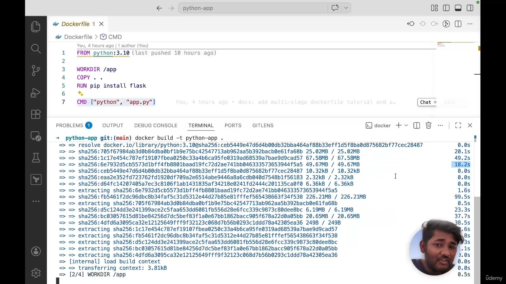

检查清单逐条说明：

- [ ] builder 阶段能成功打包：先看 Maven 日志。
- [ ] 最终阶段只复制 jar：确认没有复制整个源码和 Maven 缓存。
- [ ] 两个镜像都能运行：确认 jar 可执行。
- [ ] 体积差异合理：最终阶段通常明显更小。

#### React

```bash
cd ../react-app
docker build -t react-app .
docker build -f Dockerfile.multistage -t react-app-2 .
docker images
docker run -d -p 8081:80 --name react-app-run react-app-2
curl -I http://localhost:8081
docker rm -f react-app-run
```

命令解释：

- 标准镜像用 Node 开发服务器运行 React；多阶段镜像先 `npm run build`，再把构建产物复制到 nginx。
- `docker run -d -p 8081:80`：把 nginx 的 80 映射到宿主机 8081。
- `curl -I`：验证静态页面响应头。

常见错误与排查：

- 构建产物目录不对：Create React App 通常是 `build`，Vite 通常是 `dist`，要按项目配置复制。
- nginx 404：确认复制到了 `/usr/share/nginx/html`。
- 前端请求后端失败：浏览器端不能写容器服务名，必须通过 nginx 代理或可访问的宿主机地址。
- 标准镜像用 `npm start` 只适合开发，不要当成生产交付方式。

与前台的对照：浏览器打开 `http://localhost:8081` 应看到 React 页面；多阶段镜像由 nginx 提供静态文件，页面加载应比开发服务器更接近生产。

课里对比标准镜像约 `1.31GB`，多阶段降到约 `62.7MB`。标准 Dockerfile 用 `npm start` 跑开发服务器；多阶段用 `nginx:alpine` 服务静态文件，这是重点差异。

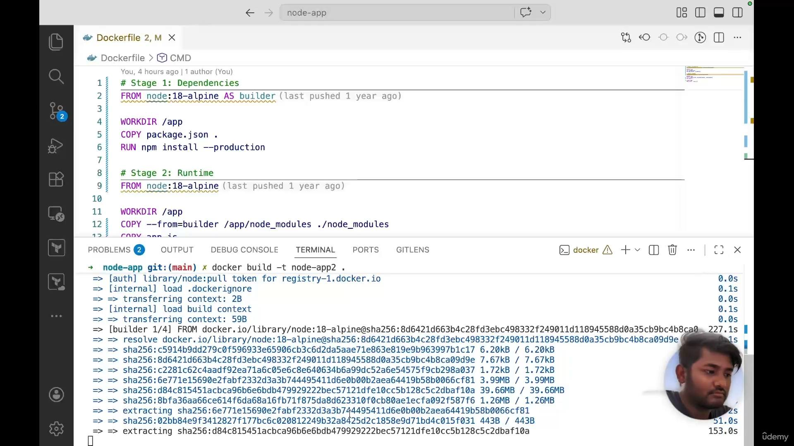

检查清单逐条说明：

- [ ] `npm run build` 成功：确认前端代码可构建。
- [ ] nginx 镜像能提供页面：浏览器或 `curl -I` 有响应。
- [ ] 构建产物目录复制正确：避免页面 404。
- [ ] 多阶段镜像体积明显下降：确认没有把 `node_modules` 和源码带进最终阶段。

#### Go

```bash
cd ../go-app
docker build -t go-app .
docker build -f Dockerfile.multistage -t go-app-2 .
docker images
docker run --rm go-app
docker run --rm go-app-2
```

命令解释：

- 标准镜像基于 Go 镜像，包含编译器和工具链。
- 多阶段镜像在 builder 中编译出静态二进制，最终阶段用 alpine 只复制二进制。
- `docker run --rm` 验证二进制可执行。

常见错误与排查：

- 最终镜像运行报 `no such file or directory`：可能是动态链接库缺失。可设置 `CGO_ENABLED=0` 构建静态二进制。
- 复制路径不对：确认 `go build -o app` 的输出路径与 `COPY --from=builder` 一致。
- 架构不一致：在 Apple Silicon 或 ARM 机器上构建，注意目标平台与运行平台一致。
- 镜像体积没有降到很小：检查最终阶段是否误用了 `golang` 镜像。

与前台的对照：Go 示例以终端输出为主；若服务监听 HTTP，可映射端口用浏览器验证。

课里对比约 `849MB` 与 `10.6MB`。Go 编译成单二进制后，runtime 用 alpine 只复制二进制。

检查清单逐条说明：

- [ ] builder 阶段编译成功：确认 Go 代码和模块正常。
- [ ] 最终阶段只复制二进制：确认没有带入 Go 工具链。
- [ ] 两个镜像都能运行：确认静态编译或库依赖正确。
- [ ] 体积差异明显：Go 多阶段通常收益很大。

---

### 3.4 P43：Docker Hub 公共仓库

先做 tar 保存/加载：

```bash
docker pull busybox
docker save -o busybox.tar busybox:latest
docker rmi busybox
docker load -i busybox.tar
docker images
```

命令解释：

- `docker pull busybox`：从 Docker Hub 拉取 busybox 镜像。
- `docker save -o busybox.tar busybox:latest`：把镜像保存为 tar 文件，适合离线传输。
- `docker rmi busybox`：删除本地 busybox 镜像，模拟离线环境。
- `docker load -i busybox.tar`：从 tar 文件恢复镜像。
- `docker images`：确认 busybox 恢复。

常见错误与排查：

- `docker save` 后文件很大：这是正常现象，镜像层会一起打包。
- `docker rmi` 失败：可能有容器仍在使用镜像。先 `docker ps -a` 找到容器并删除。
- `docker load` 后标签不对：`save` 时指定了 `busybox:latest`，加载后应保留标签。
- 权限问题：当前用户无 Docker 权限时，加 `sudo` 或加入 `docker` 组。

与前台的对照：Docker Desktop 的 Images 页面应能看到 busybox 被删除又恢复；文件管理器中应出现 `busybox.tar`。

再推公共仓库。把 `<DOCKERHUB_USER>` 换成你的用户名：

```bash
docker tag busybox:latest <DOCKERHUB_USER>/new-app:v1
docker login
docker push <DOCKERHUB_USER>/new-app:v1
docker pull <DOCKERHUB_USER>/new-app:v1
```

命令解释：

- `docker tag`：给镜像起一个符合 Docker Hub 命名格式的新标签，格式为 `用户名/仓库名:tag`。
- `docker login`：登录 Docker Hub，按提示输入用户名和密码或访问令牌。
- `docker push`：把镜像推到公共仓库。
- `docker pull`：从仓库拉取验证。

常见错误与排查：

- `denied: requested access to the resource is denied`：未登录、用户名写错、仓库名不匹配或没有推送权限。
- `invalid reference format`：标签格式错误，常见原因是用户名含非法字符或漏写仓库名。
- `docker login` 失败：检查网络、两步验证和访问令牌。启用 2FA 时通常要用 access token。
- 推送很慢：镜像层较多，耐心等待；不要重复中断。

与前台的对照：登录 Docker Hub 网页，进入你的仓库应能看到 `v1` 标签；本地 `docker pull` 成功说明公共仓库可用。

课里强调命名格式：`用户名/仓库名:tag`。`docker login` 成功后 `docker push` 才会成功。推完去 Docker Hub 页面能看到 `v1`；再 `docker tag` 成 `v2`、`docker push`，页面会出现 `v2`。

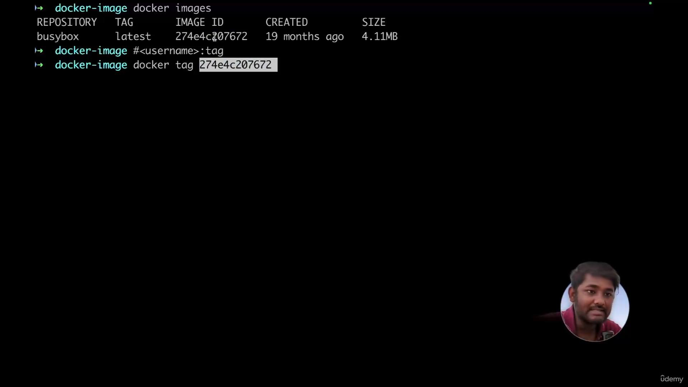

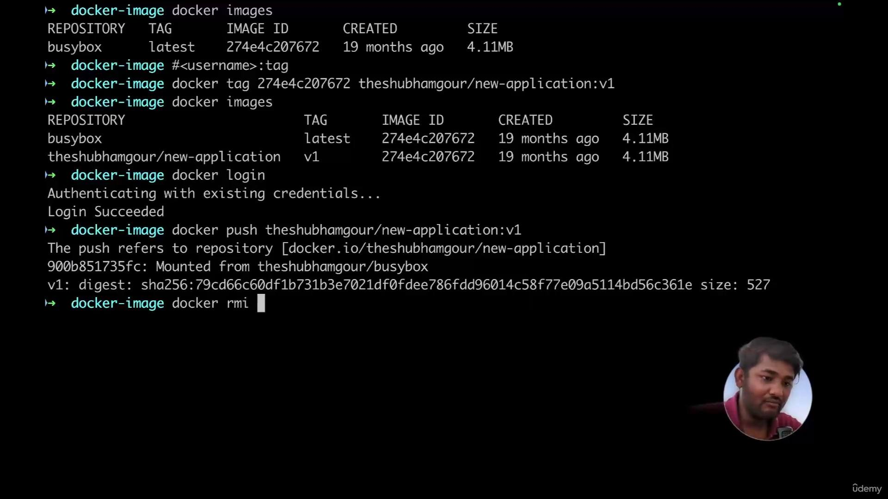

检查清单逐条说明：

- [ ] `save/load` 成功：确认离线镜像分发可用。
- [ ] `docker tag` 名称符合 `用户名/仓库名:tag`：这是推送成功的前提。
- [ ] `docker login` 成功：确认认证状态。
- [ ] Docker Hub 页面能看到标签：确认推送到了正确仓库。
- [ ] `docker pull` 成功：确认公共拉取链路正常。

---

### 3.5 P44：AWS ECR 私有仓库

课里在 EC2 上操作。核心步骤：

1. 启动 Amazon Linux 实例，SSH 登录。
2. 安装 Docker：

```bash
sudo yum install -y docker
sudo systemctl enable --now docker
sudo systemctl status docker
docker version
```

命令解释：

- `sudo yum install -y docker`：安装 Docker 包，`-y` 自动确认。
- `sudo systemctl enable --now docker`：设置开机自启并立即启动 Docker 服务。
- `sudo systemctl status docker`：查看服务状态，应为 `active (running)`。
- `docker version`：查看客户端和服务端版本。

常见错误与排查：

- `docker` 命令找不到：安装未完成或 PATH 问题，重新登录 shell。
- 权限不足：当前用户不在 `docker` 组，可 `sudo usermod -aG docker $USER` 后重新登录。
- 服务未启动：`sudo systemctl start docker`，再看日志 `journalctl -u docker`。

课里演示看到 Docker 版本 `25.0.14`，然后 `systemctl restart docker` 让服务 active。

3. 安装 AWS CLI v2。课里是去官网复制 Linux 安装命令；常见形式如下（课里没有逐字贴出完整 URL，执行时以 AWS 官网为准）：

```bash
curl "https://awscli.amazonaws.com/awscli-exe-linux-x86_64.zip" -o "awscliv2.zip"
unzip awscliv2.zip
sudo ./aws/install
aws --version
```

命令解释：

- `curl -o`：下载 AWS CLI v2 安装包。
- `unzip`：解压安装包。
- `sudo ./aws/install`：执行安装脚本。
- `aws --version`：确认 CLI 版本为 v2。

常见错误与排查：

- `unzip: command not found`：先安装 `unzip`。
- `aws` 命令找不到：安装后重新登录 shell，或检查 `/usr/local/bin/aws`。
- 下载失败：检查网络、代理和 URL 是否与官网一致。

4. 配置访问密钥：

```bash
aws configure
```

依次输入 Access Key ID、Secret Access Key、默认 region、输出格式。课里没有公开具体密钥，复现时用你自己的 IAM 用户密钥，不要提交到 Git。

5. 在 ECR 控制台创建私有仓库：namespace 写 `development`，repo 写 `core`，tag 选择 immutable，加密选 AWS KMS。创建后点 “View push commands”。

6. 登录 ECR 并推送。把 `<ACCOUNT_ID>`、`<REGION>` 换成你的值：

```bash
export AWS_REGION=<REGION>
export AWS_ACCOUNT_ID=<ACCOUNT_ID>
export ECR_REGISTRY="$AWS_ACCOUNT_ID.dkr.ecr.$AWS_REGION.amazonaws.com"
aws ecr get-login-password --region "$AWS_REGION" \
  | docker login --username AWS --password-stdin "$ECR_REGISTRY"

docker build -t development/core:latest .
docker tag development/core:latest "$ECR_REGISTRY/development/core:latest"
docker push "$ECR_REGISTRY/development/core:latest"
```

命令解释：

- `export AWS_REGION`、`AWS_ACCOUNT_ID`：设置后续命令使用的变量，避免手写错。
- `ECR_REGISTRY`：拼出 ECR 登录地址，格式为 `<账号>.dkr.ecr.<region>.amazonaws.com`。
- `aws ecr get-login-password`：获取临时登录密码。
- `docker login --password-stdin`：把密码通过标准输入传给 Docker，避免明文出现在命令历史。
- `docker build`：构建本地镜像。
- `docker tag`：给镜像打上 ECR 完整地址标签。
- `docker push`：推送到私有仓库。

常见错误与排查：

- `no basic authentication credentials`：未登录或登录过期，重新执行 `get-login-password | docker login`。
- `RepositoryNotFoundException`：ECR 仓库名或 region 写错，确认控制台中的 `development/core` 存在。
- `AccessDenied`：IAM 用户没有 ECR 权限，检查策略。
- `tag invalid`：ECR 仓库设置为 immutable 时，不能重复推送同一个 tag。换 tag 或调整设置。
- 登录地址 region 与仓库 region 不一致：变量和创建仓库时选的 region 必须一致。

7. 拉取验证：

```bash
docker rmi -f $(docker images -q)
docker pull "$ECR_REGISTRY/development/core:latest"
docker images
```

命令解释：

- `docker rmi -f $(docker images -q)`：强制删除本地所有镜像，模拟干净机器。生产环境慎用。
- `docker pull`：从 ECR 拉取镜像。
- `docker images`：确认镜像存在。

8. 未认证验证：另开一台没有执行 `docker login` 的实例，直接 `docker pull`，课里得到的错误是 “no basic authentication credential”，说明私有仓库必须认证。具体错误文案以你的 Docker 输出为准。

与前台的对照：AWS 控制台 ECR 页面应能看到 `development/core` 仓库和 `latest` 标签；本地 `docker images` 应能看到完整 ECR 地址镜像。未认证机器拉取失败，说明私有权限生效。

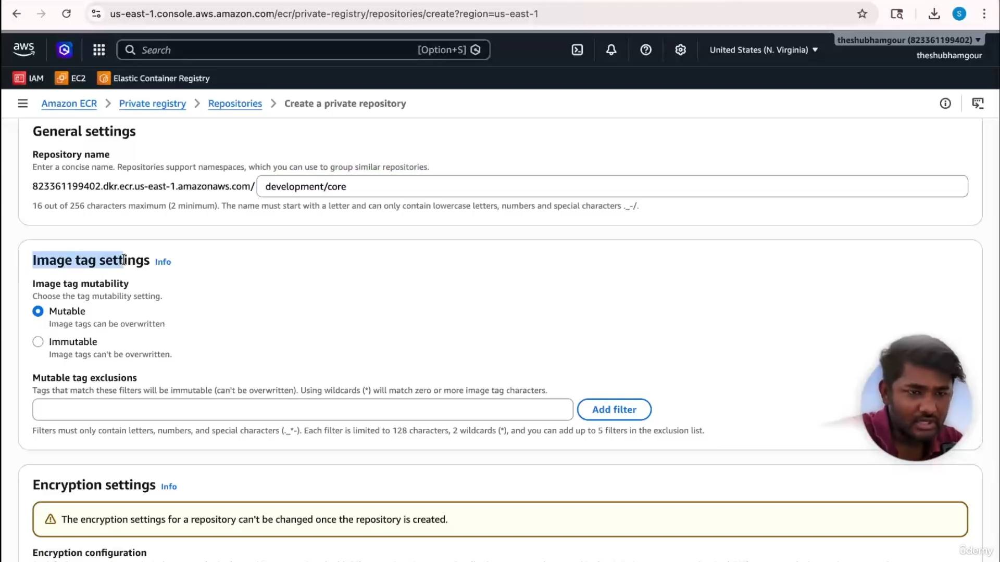

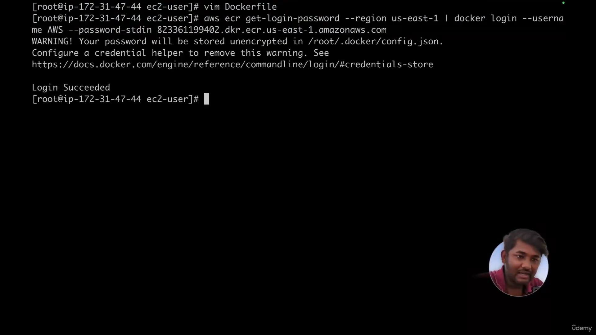

检查清单逐条说明：

- [ ] EC2 上 Docker 服务 active：容器运行时正常。
- [ ] AWS CLI v2 可用：`aws --version` 有输出。
- [ ] `aws configure` 使用自己的密钥：不要泄露密钥。
- [ ]

## 5. 逐行解释

本节按第 4 节的文件顺序，对每个文件逐段解释“为什么这么写、不这么写会怎样”。凡第 4 节标注为“补充代码”的最小实现，解释的是“为了跑通必须满足的约束”，不冒充讲师原话。

### 5.1 `p41-compose/compose-1.yml`

```yaml
services:
  nginx-app:
    image: nginx
    ports:
      - "8082:80"
```

- `services:` 是 Compose 文件的顶层键，所有容器定义都必须挂在它下面。不写 `services` 直接写服务名，Compose 会报“additional property xxx is not allowed”，因为顶层只接受 `services`、`networks`、`volumes` 等固定键。
- `nginx-app:` 是服务名，不是容器名。Compose 会用它做容器 DNS 名和默认容器名前缀。写成 `nginx app`（带空格）或 `nginx-app :`（冒号前有空格）都会解析失败。
- `image: nginx` 对应 `docker run` 里的镜像名。不写 tag 等价于 `nginx:latest`，和课里“不指定 tag 就复刻原命令”的说法一致。写成 `image: nginx:latest` 效果相同；写成 `image: nginx：latest`（中文冒号）会直接报 YAML 解析错误。
- `ports:` 下面是列表，每项用 `-` 开头。`"8082:80"` 加引号是为了避免 YAML 把 `8082:80` 解析成六十进制数（YAML 1.1 的坑），虽然多数解析器能容忍不加引号，但加引号是稳妥写法。
- 缩进全部用两个空格。课里反复强调不能用 Tab；用 Tab 会报 `found character '\t' that cannot start any token`。
- 不写 `container_name`：Compose 自动生成 `<项目名>-nginx-app-1` 这类名字。课里 `docker ps` 看到的名字带项目前缀，就是因为没写 `container_name`。硬写 `container_name: nginx-app` 也能跑，但会失去多项目并行的能力，第二次 `up` 容易撞名。

### 5.2 `p41-compose/compose-2.yml`

```yaml
services:
  frontend:
    image: nginx
    ports:
      - "8082:80"
  backend:
    image: hashicorp/http-echo
    command: ["-text=hello world"]
```

- 两个服务并列在 `services` 下，缩进层级相同。若 `backend:` 多缩进一格，会被当成 `frontend` 的子键，Compose 报 `services.frontend additional property backend is not allowed`。
- `frontend` 用 `nginx` 镜像并映射 `8082:80`，对应课里手动 `docker run -d -p 8082:80 --network new-net nginx`。
- `backend` 用 `hashicorp/http-echo`，课里手动命令还带了 `--network new-net`。Compose 里**不写** `networks`，因为 Compose 会自动创建默认网络并把所有服务加入，这正是课里“不用操心网络”的点。手动加 `networks: [new-net]` 反而要先在顶层声明 `networks: new-net: external: true`，否则报网络不存在。
- `command: ["-text=hello world"]` 是列表形式（exec form）。课里第一次写成 `commands`（多了 s），Compose 报 `services.backend additional property commands is not allowed`，改成 `command` 才通过。写成字符串 `command: -text=hello world` 也能跑，但列表形式对含空格的参数更稳。
- 不写 `depends_on`：本练习两个服务无启动依赖，课里也没加。加了也只是控制启动顺序，不保证 backend 已就绪。

### 5.3 `p41-compose/compose-3.yml`

```yaml
services:
  db:
    image: mysql:8
    environment:
      MYSQL_ROOT_PASSWORD: password
    volumes:
      - mysql_data:/var/lib/mysql
volumes:
  mysql_data:
    external: true
```

- `db:` 是服务名。课里手动命令没给容器命名，Compose 下服务名就是 `db`。
- `image: mysql:8` 对应课里 `mysql:8`。不写 `:8` 会拉 `latest`，行为和课里不一致。
- `environment:` 下用 `KEY: value` 映射形式。课里第一次写成 `MYSQL_ROOT_PASSWORD=password`（等号），Compose 报 `services.db.environment must be a mapping`，改成冒号才通过。这是本练习最典型的报错。
- `volumes:` 下 `- mysql_data:/var/lib/mysql`：左边是卷名，右边是容器内路径。写成 `- ./data:/var/lib/mysql` 会变成绑定挂载，不是课里演示的命名卷，`docker volume ls` 里看不到 `mysql_data`。
- 顶层 `volumes:` 与 `services:` 同级，不能缩进到 `db` 里面。课里第一次把 `volumes` 缩进错位，报 `image must be a mapping`，本质是层级错乱。
- `external: true` 表示“这个卷已存在，Compose 不要创建也不要删”。所以必须先 `docker volume create mysql_data`，否则 `up` 报 `external volume "mysql_data" not found`。若去掉 `external: true`，Compose 会自己创建卷，`down` 时默认仍保留，但卷名会带项目前缀（如 `p41-compose_mysql_data`），和课里手动创建的 `mysql_data` 对不上。

### 5.4 `p41-compose/python-app/Dockerfile`（补充代码）

```dockerfile
FROM python:3.11-slim
WORKDIR /app
COPY app.py .
RUN pip install flask
ENV ENV=dev
CMD ["python", "app.py"]
```

- `FROM python:3.11-slim`：课里说“轻量 python 基础镜像”，slim 变体比完整版小。用 `python:3.11` 也能跑，只是镜像更大。
- `WORKDIR /app`：后续 `COPY` 和 `CMD` 的相对路径基准。不写 `WORKDIR`，文件会落到 `/`，`CMD` 里 `python app.py` 找不到文件。
- `COPY app.py .`：把源码复制进镜像。`.` 指 `WORKDIR`。漏掉这行，容器启动时 `app.py` 不存在，直接报 `can't open file`。
- `RUN pip install flask`：装依赖。放在 `COPY` 之后会导致改一行代码就重装依赖、缓存失效；更优写法是先 `COPY requirements.txt` 再 `RUN pip install -r`，但课里是最小示例，这样写能跑通。
- `ENV ENV=dev`：给默认环境变量。课里 `app.py` 读 `ENV` 键，运行时用 `-e ENV=prod` 覆盖。不写这行且运行时不传，`os.environ["ENV"]` 会抛 `KeyError`（取决于 `app.py` 写法）。
- `CMD ["python", "app.py"]`：exec form，PID 1 是 python，能收到信号。写成 shell form `CMD python app.py` 也能跑，但信号转发差一些。

### 5.5 `p41-compose/python-app/app.py`（补充代码）

```python
import os
from flask import Flask

app = Flask(__name__)

@app.route("/")
def index():
    return f"Your environment is {os.environ.get('ENV', 'unknown')}"

if __name__ == "__main__":
    app.run(host="0.0.0.0", port=5002)
```

- `os.environ.get('ENV', 'unknown')`：读环境变量，缺省给 `unknown`，避免没传时 500。课里演示输出 `your environment is prod`，就是这里拼出来的。
- `host="0.0.0.0"`：**必须**。Flask 默认监听 `127.0.0.1`，容器内只有自己，宿主机端口映射访问不到。这是课里没明说但复现必踩的坑。
- `port=5002`：和课里源码一致。逐字稿里讲师口述“port number 5000”是口误，Compose 若写 `5000:5002` 或 Flask 改 5000 都会对不上，以源码 5002 为准。

### 5.6 `p41-compose/python-app/compose-4.yml`

```yaml
services:
  app:
    build:
      context: .
    ports:
      - "5002:5002"
    environment:
      ENV: production
```

- `build: context: .`：告诉 Compose 用当前目录的 Dockerfile 构建，替代 `image:`。课里强调“这里不用写 image，Compose 会帮我们 build”。写成 `build: .` 是简写，等价；写成 `build: ./python-app` 而当前已在 `python-app` 里，会找不到 Dockerfile。
- `ports: "5002:5002"`：宿主 5002 映射容器 5002，和 `app.py` 的 `port=5002` 对齐。写成 `5000:5002` 则浏览器要访问 5000，和课里 `curl localhost:5002` 不一致。
- `environment: ENV: production`：覆盖 Dockerfile 里的 `ENV=dev`。课里演示输出从 `prod` 变 `production`，就是改这里。写成 `ENV=production`（等号）会报 `must be a mapping`。
- 改代码后必须 `docker compose up -d --build`，否则继续用旧镜像。课里专门演示了 `--build` 让改动生效。

### 5.7 `p41-compose/data-bridge/docker-compose.yml`（补充代码）

```yaml
services:
  db:
    image: mysql:8
    environment:
      MYSQL_ROOT_PASSWORD: password
      MYSQL_DATABASE: appdb
    volumes:
      - data-bridge-db:/var/lib/mysql
      - ./db/init.sql:/docker-entrypoint-initdb.d/init.sql
  backend:
    build: ./backend
    environment:
      DB_HOST: db
      DB_USER: root
      DB_PASSWORD: password
      DB_NAME: appdb
    depends_on:
      - db
  frontend:
    build: ./frontend
    ports:
      - "8080:80"
    depends_on:
      - backend
volumes:
  data-bridge-db:
```

- `db` 服务挂两个卷：命名卷 `data-bridge-db` 存数据，绑定挂载 `init.sql` 做初始化。`/docker-entrypoint-initdb.d/` 是 MySQL 官方镜像约定的初始化目录，只在数据目录为空时执行。不挂 `init.sql`，表不会自动建，后端查询会报表不存在。
- `backend` 的 `DB_HOST: db`：**必须写服务名**。写 `localhost` 会连到 backend 容器自己，报连接拒绝。这是课里“服务名即 DNS 名”的直接体现。
- `depends_on: - db`：只保证 db 容器先启动，**不保证 MySQL 已可连接**。课里没加 healthcheck，所以 backend 首次启动可能因连不上 db 而退出或报错，需要重试或等几秒再访问。
- `frontend` 映射 `8080:80`，nginx 在容器内监听 80。前端 nginx 配置需把 `/api/` 代理到 `backend:3000`（补充代码里的约定），否则浏览器请求 404。
- 顶层 `volumes: data-bridge-db:` 不写 `external`，Compose 自动创建，名字带项目前缀。`down` 默认不删，`down -v` 才删。课里强调“down 后数据还在”，就是靠这个。
- 三个服务都不写 `networks`，Compose 默认网络让它们互通。

### 5.8 `p41-compose/data-bridge/backend/Dockerfile`、`server.js`、`frontend/Dockerfile`、`index.html`（补充代码）

- backend `Dockerfile` 用 `FROM node:18-alpine`、`WORKDIR /app`、`COPY package*.json ./`、`RUN npm install`、`COPY . .`、`CMD ["node","server.js"]`。先复制 `package.json` 再装依赖，是为了改源码时不重装依赖、利用缓存。漏掉 `COPY . .` 则 `server.js` 不在镜像里。
- `server.js` 监听 `0.0.0.0:3000`，路由以 `/api` 开头，连 MySQL 用 `process.env.DB_HOST` 等。监听 `127.0.0.1` 会导致 frontend 容器访问不到。
- frontend `Dockerfile` 用 `FROM nginx:alpine`，`COPY index.html /usr/share/nginx/html/`，再复制一份 nginx 配置把 `/api/` 反代到 `http://backend:3000`。不配反代，浏览器请求 `/api/...` 会打到 nginx 自己返回 404。
- `index.html` 里 fetch 用相对路径 `/api/messages`，不能写 `http://backend:3000`，因为浏览器在宿主机，解析不了容器服务名。

### 5.9 `p42-multistage/*/Dockerfile` 与 `Dockerfile.multistage`

五个例子的通用解释：

- 标准 `Dockerfile` 只有一个 `FROM`，把编译器/运行时/源码/依赖全塞进最终镜像，所以体积大。课里 Python 约 1.12GB、Node 约 1.1GB、Java 约 535MB、React 约 1.31GB、Go 约 849MB。
- 多阶段 `Dockerfile.multistage` 有多个 `FROM ... AS <stage>`，每个 `FROM` 开新阶段。最后一个 `FROM` 是最终镜像，前面阶段只作 builder。课里原话“each FROM statement will start a fresh stage”。
- `COPY --from=builder <src> <dst>`：从 builder 阶段复制产物。阶段名必须和 `AS builder` 一致，写错报 `invalid from flag value builder: pull access denied` 之类。
- Python 多阶段：builder 装依赖，最终阶段复制依赖目录或虚拟环境。只复制 `app.py` 不复制依赖，运行报 `ModuleNotFoundError: No module named 'flask'`。
- Node 多阶段：builder `npm ci`，最终阶段 `COPY --from=builder /app/node_modules ./node_modules`。漏这行运行报 `Cannot find module`。最终阶段用 `node:18-alpine` 而非 `node:18`，否则体积降不下来。
- Java 多阶段：builder 用 `maven` 镜像 `mvn package`，最终阶段用 `eclipse-temurin:17-jre` 只复制 jar。最终阶段若还用 maven 镜像，体积不会降。`target/*.jar` 路径要和 `pom.xml` 的 `finalName` 对上。
- React 多阶段：builder `npm run build` 产出 `build/`（CRA）或 `dist/`（Vite），最终阶段 `nginx:alpine` 复制到 `/usr/share/nginx/html`。复制错目录页面 404。标准 Dockerfile 用 `npm start` 是开发服务器，不是生产交付方式。
- Go 多阶段：builder `CGO_ENABLED=0 go build -o app`，最终阶段 `alpine` 只复制二进制。不设 `CGO_ENABLED=0` 可能因动态库缺失报 `no such file or directory`。最终阶段误用 `golang` 镜像体积降不下来。

### 5.10 `p43-dockerhub/push-public.sh`、`load-public.sh`

- `docker save -o busybox.tar busybox:latest`：`-o` 指定输出文件，必须带 tag，否则可能保存成 `<none>`。不带 `-o` 会输出到 stdout，重定向写错会得到空文件。
- `docker rmi busybox`：删本地镜像模拟离线。若有容器在用会失败，需先删容器。
- `docker load -i busybox.tar`：`-i` 指定输入。加载后 tag 保留，因为 `save` 时带了 `busybox:latest`。
- `docker tag busybox:latest <USER>/new-app:v1`：Docker Hub 要求 `<用户名>/<仓库名>:<tag>`。只写 `new-app:v1` 推送报 `invalid reference format` 或 `denied`。
- `docker login` 后再 `push`。未登录直接 push 报 `denied: requested access to the resource is denied`。启用 2FA 必须用 access token 当密码。
- `docker pull <USER>/new-app:v1`：验证公共仓库可拉。拉不到先确认 Docker Hub 页面仓库是否 public。

### 5.11 `p44-ecr/push-ecr.sh`、`pull-ecr.sh`

- `export AWS_REGION` / `AWS_ACCOUNT_ID`：变量化避免手写错。region 必须和创建 ECR 仓库时一致，不一致报 `RepositoryNotFoundException`。
- `ECR_REGISTRY="$AWS_ACCOUNT_ID.dkr.ecr.$AWS_REGION.amazonaws.com"`：ECR 登录地址固定格式。写成 `amazonaws.com.cn` 或漏 region 都登录失败。
- `aws ecr get-login-password | docker login --username AWS --password-stdin`：管道传密码，避免明文进历史。直接 `docker login -p <password>` 会警告密码暴露。
- `docker tag development/core:latest "$ECR_REGISTRY/development/core:latest"`：ECR 要求 tag 带完整 registry 地址。只 tag 成 `development/core:latest` 推送报 `invalid reference format`。
- `docker push`：仓库设 immutable 时重复推同一 tag 报 `tag invalid`，需换 tag。
- `docker rmi -f $(docker images -q)`：清空本地镜像模拟干净机器。生产慎用，会删所有镜像。
- 未认证机器 `docker pull` 报 `no basic authentication credentials`，证明私有仓库生效。

## 6. 复现检查清单

- [ ] **目录结构正确**：运行 `find . -maxdepth 3 -type d`，应看到 `p41-compose/{python-app,data-bridge/{db,backend,frontend}}`、`p42-multistage/{python-app,node-app,java-app,react-app,go-app}`、`p43-dockerhub`、`p44-ecr`。
- [ ] **Compose v2 可用**：运行 `docker compose version`，应输出 `Docker Compose version v2.x`，不是 `docker-compose` 旧版。
- [ ] **compose-1 启动成功**：`docker compose -f compose-1.yml up -d` 无报错，`docker ps` 看到容器 `Up`，端口 `8082->80`。
- [ ] **compose-1 可访问**：`curl -I http://localhost:8082` 返回 `HTTP/1.1 200 OK`。
- [ ] **compose-1 清理干净**：`down` 后 `docker ps` 无该容器，`docker network ls` 无对应项目网络。
- [ ] **compose-2 两服务同网络**：`up -d` 后 `docker ps` 两个容器 `Up`，`docker network inspect <项目>_default` 的 `Containers` 里有两个容器。
- [ ] **compose-2 命令正确**：若报 `additional property commands is not allowed`，说明写成了 `commands`，改成 `command` 后重跑应成功。
- [ ] **compose-3 外部卷前置**：`docker volume ls` 在 `up` 前能看到 `mysql_data`；没有则先 `docker volume create mysql_data`。
- [ ] **compose-3 环境变量格式**：若报 `environment must be a mapping`，确认写的是 `MYSQL_ROOT_PASSWORD: password` 而非等号。
- [ ] **compose-3 挂载生效**：`docker inspect <容器>` 的 `Mounts` 里 `Source` 为 `mysql_data`、`Destination` 为 `/var/lib/mysql`。
- [ ] **compose-3 数据持久**：进容器 `mysql -uroot -ppassword` 建库 `new_data`，`down` 再 `up` 后 `show databases;` 仍能看到 `new_data`。
- [ ] **compose-4 构建并访问**：`up -d --build` 后 `curl http://localhost:5002` 返回含 `production` 的文本。
- [ ] **compose-4 改代码生效**：改 `app.py` 文案后 `up -d --build`，再 `curl` 应看到新文案。
- [ ] **Data Bridge 三容器运行**：`docker ps` 看到 db、backend、frontend 三个容器 `Up`。
- [ ] **Data Bridge 页面可开**：浏览器 `http://localhost:8080` 显示页面。
- [ ] **Data Bridge 写链路通**：提交一条消息，页面提示成功或 `curl -X POST http://localhost:8080/api/messages -d ...` 返回 2xx。
- [ ] **Data Bridge 读链路通**：点 “Fetch all data” 或 `curl http://localhost:8080/api/messages` 能看到刚提交的数据。
- [ ] **Data Bridge 持久化**：`docker compose down` 再 `up -d`，刷新页面数据仍在；`docker volume ls` 能看到 `data-bridge-db` 相关卷。
- [ ] **Python 多阶段体积下降**：`docker images` 中 `python-app-2` 明显小于 `python-app`（课里约 55.6MB vs 1.12GB）。
- [ ] **Node 多阶段可服务**：`docker run -d -p 3000:3000 node-app-2` 后 `curl http://localhost:3000` 有响应。
- [ ] **Java 多阶段可运行**：`docker run --rm java-app-2` 输出正常，无 `ClassNotFoundException`。
- [ ] **React 多阶段可访问**：`docker run -d -p 8081:80 react-app-2` 后 `curl -I http://localhost:8081` 返回 200。
- [ ] **Go 多阶段可运行**：`docker run --rm go-app-2` 输出正常，无 `no such file or directory`。
- [ ] **save/load 可用**：`docker save` 生成 `busybox.tar`，`docker rmi busybox` 后 `docker images` 无 busybox，`docker load -i busybox.tar` 后 `docker images` 恢复 `busybox:latest`。
- [ ] **Docker Hub 推送成功**：`docker push <USER>/new-app:v1` 无 `denied`，Docker Hub 网页仓库页能看到 `v1` 标签。
- [ ] **Docker Hub 拉取成功**：`docker pull <USER>/new-app:v1` 输出 `Status: Downloaded` 或 `Image is up to date`。
- [ ] **EC2 Docker 服务 active**：`sudo systemctl status docker` 显示 `active (running)`，`docker version` 有 Client 和 Server 两段。
- [ ] **AWS CLI v2 可用**：`aws --version` 输出 `aws-cli/2.x`。
- [ ] **ECR 登录成功**：`aws ecr get-login-password | docker login ...` 输出 `Login Succeeded`。
- [ ] **ECR 推送成功**：`docker push "$ECR_REGISTRY/development/core:latest"` 无 `AccessDenied`/`RepositoryNotFound`，AWS 控制台 ECR 仓库页能看到 `latest` 标签。
- [ ] **ECR 拉取成功**：清空本地镜像后 `docker pull "$ECR_REGISTRY/development/core:latest"` 成功，`docker images` 能看到完整 ECR 地址。
- [ ] **ECR 未认证拉取失败**：另一台未 `docker login` 的机器 `docker pull` 报 `no basic authentication credentials`（文案以实际输出为准）。

## 7. 课里没讲但你会撞上的

| 现象 | 原因 | 怎么办 |
|---|---|---|
| `docker compose up` 报 `services.xxx additional property commands is not allowed` | 把 `command` 写成了 `commands`（课里演示过这个错，但没系统讲 Compose 键名规则） | 改成 `command`；用 `docker compose config` 校验语法 |
| `services.db.environment must be a mapping` | `environment` 下用了 `KEY=value` 等号形式 | 改成 `KEY: value` 映射形式，或改用列表 `- KEY=value` |
| `external volume "mysql_data" not found` | `compose-3.yml` 里 `external: true` 但没先创建卷 | 先 `docker volume create mysql_data` 再 `up`；或去掉 `external: true` 让 Compose 自建（卷名会带项目前缀） |
| `port is already allocated` | 宿主机端口被占用（8082/5002/8080/3306 都常见） | `lsof -i :<端口>` 或 `ss -lntp \| grep <端口>` 找占用进程，换端口或停进程 |
| `curl localhost:5002` 连接拒绝，但容器 `Up` | Flask 监听 `127.0.0.1` 而非 `0.0.0.0` | 改 `app.run(host="0.0.0.0", port=5002)` 后 `up -d --build` |
| 浏览器访问 5002 失败但 `curl` 成功 | 浏览器代理或地址写错（课里没讲代理场景） | 关代理或用 `127.0.0.1` 而非 `localhost` 试 |
| Data Bridge 后端日志报 `ECONNREFUSED` 连 db | `DB_HOST` 写成 `localhost`，或 MySQL 未就绪 | `DB_HOST` 改服务名 `db`；给 db 加 healthcheck 或让 backend 重试（课里没讲 healthcheck） |
| Data Bridge 页面 404 `/api/...` | nginx 未把 `/api/` 反代到 `backend:3000` | 补 nginx 配置 `location /api/ { proxy_pass http://backend:3000; }`（补充代码，课里没贴） |
| `down` 再 `up` 后数据丢失 | 卷没挂到 `/var/lib/mysql`，或误用 `down -v` | 检查 Compose `volumes` 映射；不要加 `-v` |
| 多阶段构建报 `invalid from flag value builder` | `COPY --from=builder` 的阶段名和 `AS builder` 不一致 | 统一阶段名；用 `docker build --target builder` 单独调试 builder 阶段 |
| 多阶段镜像运行报 `ModuleNotFoundError` / `Cannot find module` | 最终阶段只复制了源码没复制依赖 | Python 复制依赖目录/虚拟环境；Node 复制 `node_modules` |
| Go 多阶段运行报 `no such file or directory` | 动态链接库缺失 | builder 里 `CGO_ENABLED=0 go build -o app` |
| React 多阶段页面 404 | 构建产物目录不是 `build`（Vite 是 `dist`） | 按项目实际输出目录 `COPY --from=builder /app/<dir> /usr/share/nginx/html` |
| `docker push` 报 `denied: requested access to the resource is denied` | 未登录、用户名错、仓库名不匹配、2FA 未用 token | `docker login`；tag 用 `<用户名>/<仓库名>:<tag>`；2FA 用 access token |
| `docker push` 报 `invalid reference format` | tag 没带用户名或 ECR 完整地址 | Docker Hub 用 `<USER>/<repo>:<tag>`；ECR 用 `<ACCOUNT>.dkr.ecr.<REGION>.amazonaws.com/<repo>:<tag>` |
| ECR 报 `RepositoryNotFoundException` | region 或仓库名与创建时不一致 | 核对 `AWS_REGION` 与 ECR 控制台 region；确认 `development/core` 存在 |
| ECR 报 `AccessDenied` | IAM 用户缺 ECR 权限 | 给 IAM 用户附 `AmazonEC2ContainerRegistryFullAccess` 或最小推送策略（课里没讲具体策略） |
| ECR 重复推送报 `tag invalid` | 仓库设为 immutable | 换新 tag 推送，或把仓库改为 mutable（课里没讲怎么改） |
| `docker rmi -f $(docker images -q)` 后误删有用镜像 | 该命令删所有本地镜像（课里演示过但没警告） | 生产环境改用 `docker rmi <指定镜像>`；先 `docker images` 确认 |
| `docker load` 后镜像 tag 是 `<none>` | `docker save` 时没带 tag | `docker save -o x.tar <image>:<tag>`，加载后 tag 保留 |
| Compose 报 YAML 解析错误 `found character '\t'` | 用了 Tab 缩进 | 编辑器设“Tab 转空格”，统一两个空格 |
| `docker compose` 命令不存在 | 只装了旧版 `docker-compose` | 装 Compose v2 插件；用 `docker compose`（空格）而非 `docker-compose`（连字符） |
| EC2 上 `docker` 报权限不足 | 当前用户不在 `docker` 组 | `sudo usermod -aG docker $USER` 后重新登录（课里没讲这一步） |
| `aws configure` 后仍报认证失败 | 密钥错、region 错、或用了 root 密钥 | 用 IAM 用户密钥；`aws sts get-caller-identity` 验证身份（课里没讲这个命令） |
