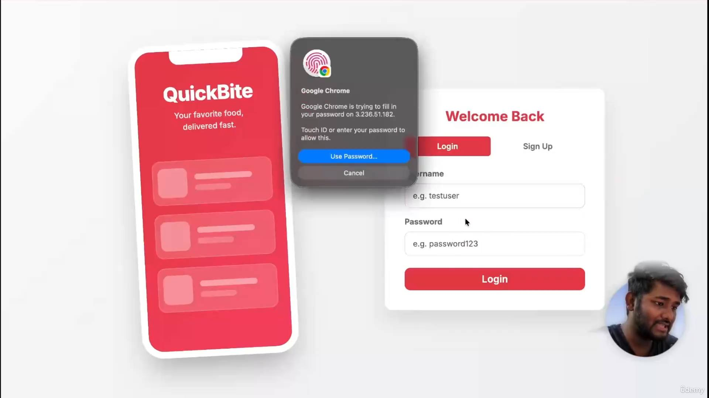
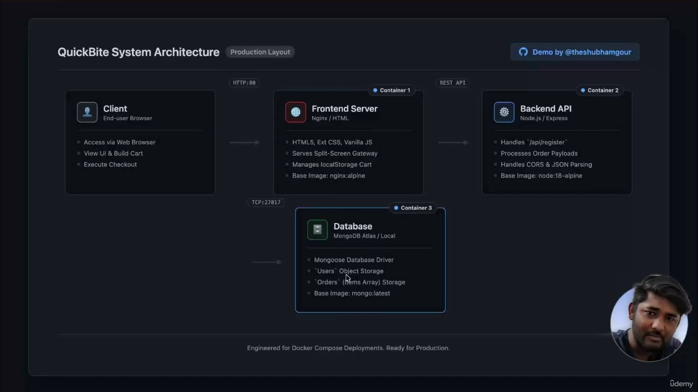
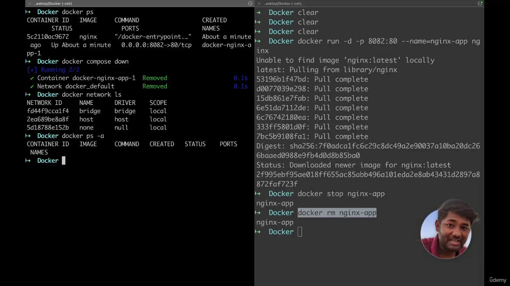
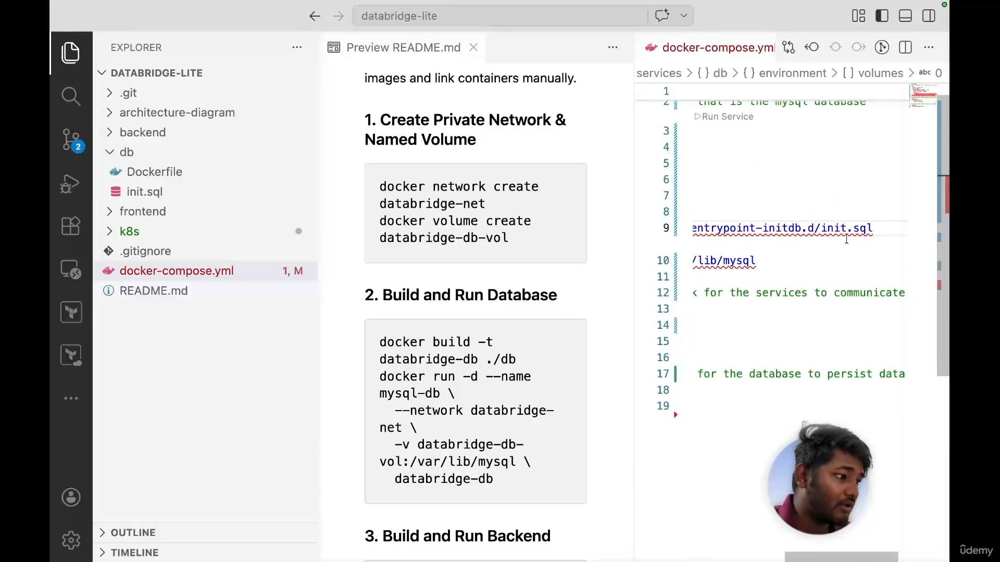
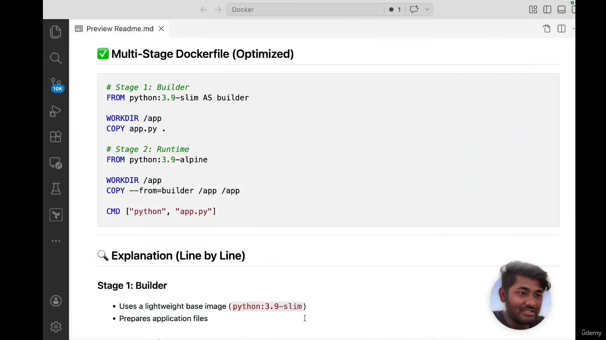
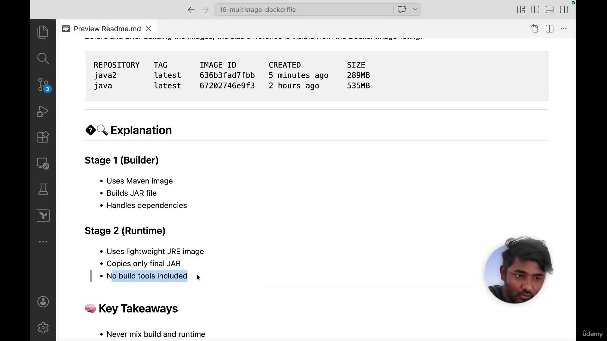
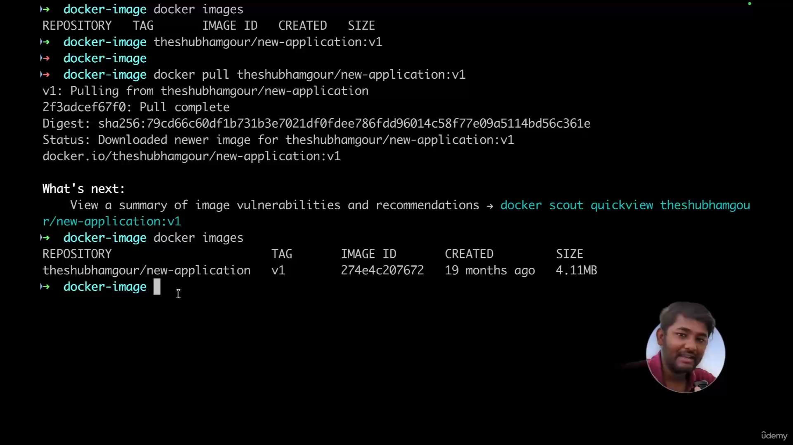
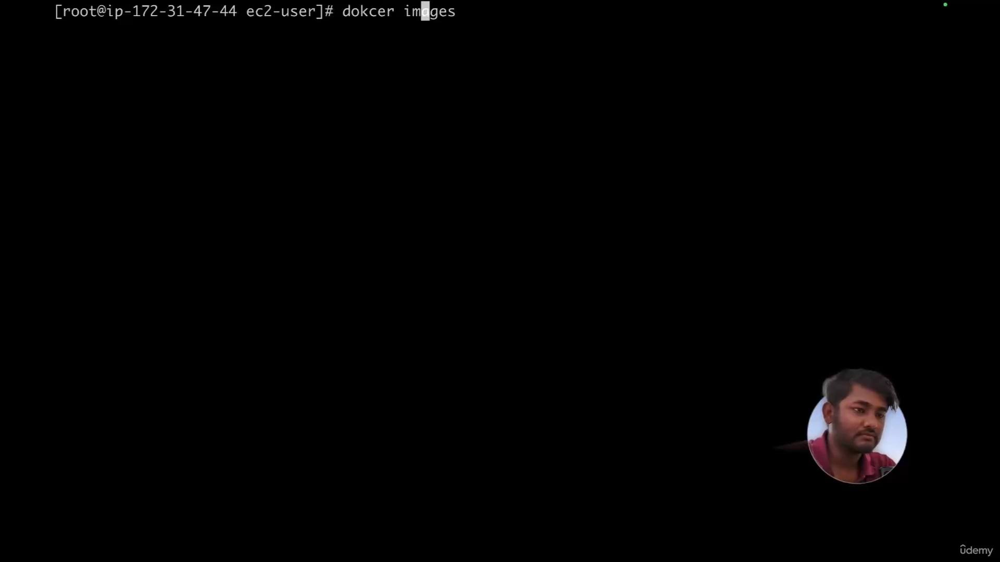
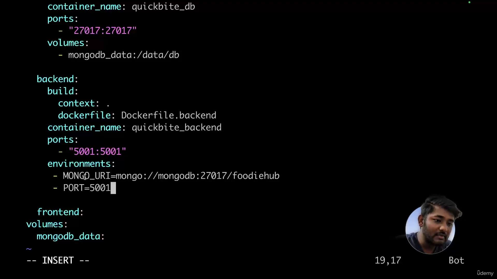

# Docker Masterclass P41–P46 复现文档：Compose、多阶段构建、镜像仓库与 QuickBite 三层应用

> 复现基准：Ubuntu EC2 / 本地 Linux 均可。课里出现的 Docker 版本有 `25.0.14`，也有 `29.4.1` 的口述，实际以你机器 `docker --version` 输出为准。  
> 重要说明：逐字稿完整讲了 Dockerfile、Compose、Docker Hub、ECR 的字段和命令，但 QuickBite 的业务源码没有在逐字稿里逐行给出。下面第 4 节给出一套**最小可运行 QuickBite 复刻代码**，接口和目录按课里架构补齐；凡是课里没讲、我为了可运行补上的地方，都会明确写“课里没讲”。

---

## 1. 这一节做什么

P41–P46 不是零散知识点，而是一条交付链：

1. **P41：用 Docker Compose 收拢 `docker run` 的一长串命令**。课里从 nginx 单服务开始，扩到 frontend + backend 双服务，再做 MySQL volume，最后用 Compose 描述 data bridge 三层应用。核心结论是：镜像、端口、环境变量、网络、volume、启动顺序都写进一个 YAML，日常只需要 `docker compose up -d` / `docker compose down`。
2. **P42：用多阶段 Dockerfile 缩小镜像**。课里用 Python、Node、Java、React、Go 五个例子对比标准 Dockerfile 和多阶段 Dockerfile。核心写法是 `FROM ... AS builder` + `COPY --from=builder ...`，把编译/安装依赖留在 builder，把运行时需要的东西留在最终阶段。
3. **P43：用 Docker Hub 分发镜像**。课里先讲 `docker save` / `docker load` 这种 U 盘式传镜像，再讲 Docker Hub 公共仓库的 `tag`、`login`、`push`、`pull`。
4. **P44：用 AWS ECR 做私有仓库**。课里在 EC2 上安装 Docker、AWS CLI，创建 ECR private registry，执行 `get-login-password` 等认证流程，然后 build、tag、push；并用一台未认证机器验证私有镜像拉取失败。
5. **P45：QuickBite 三层应用综合演练**。前端 nginx + 静态文件，后端 Node.js，数据库 MongoDB；用两个自定义 Dockerfile 和一份 `docker-compose.yml` 把三层跑起来，并用 volume 验证 `docker compose down` 再 `up` 后数据还在。
6. **P46：课程收尾**。没有新增技术操作，主要是总结。

这一节的学习目标不是背命令，而是把“手工运行容器”转换成“可重复的声明式交付”。换句话说，前面课程里你可能已经会 `docker build`、`docker run -p`、`docker network create`、`docker volume create`，但到了 P41–P46，要开始把它们写进文件，让另一台机器、另一个同学、另一个时间点的你，只靠仓库里的 YAML 和 Dockerfile 就能复现同一套服务。Compose 解决“多个容器怎么一起启动”，多阶段构建解决“镜像怎么变小”，Docker Hub 和 ECR 解决“镜像怎么分发”，QuickBite 解决“这三件事怎么落到一个三层应用上”。复现时建议严格按顺序做：先单服务 Compose，再多阶段构建，再仓库登录推送，最后 QuickBite；不要一上来直接跑三层应用，否则出问题时很难判断是 Compose 字段、Dockerfile、网络代理还是数据库连接导致的。

最终要复现出的目录结构如下。QuickBite 是主项目，`compose-demo` 和 `multistage` 是 P41/P42 的最小练习：

```text
docker-masterclass-p41-p46/
├── compose-demo/
│   └── nginx/
│       └── docker-compose.yml
├── multistage/
│   ├── python-app/
│   │   ├── app.py
│   │   ├── Dockerfile.standard
│   │   └── Dockerfile.multistage
│   └── node-app/
│       ├── app.js
│       ├── package.json
│       ├── Dockerfile.standard
│       └── Dockerfile.multistage
└── quickbite/
    ├── docker-compose.yml
    ├── Dockerfile.frontend
    ├── Dockerfile.backend
    ├── nginx.conf
    ├── frontend/
    │   ├── index.html
    │   ├── app.js
    │   └── styles.css
    └── backend/
        ├── package.json
        └── server.js
```

课里在 P45 展示的 QuickBite 页面和架构，可以用下面两张抽帧对照理解：





复现时可以把最终验收标准理解为三层：第一层，单服务 nginx 能通过 Compose 启动并在浏览器访问；第二层，多阶段镜像能成功构建，并且最终镜像比标准镜像小；第三层，QuickBite 页面能打开，`/api/health` 能返回 JSON，注册和下单写入 MongoDB，`docker compose down` 再 `up` 后数据还在。只要这三点都通过，P41–P46 的主线就复现完成。

---

## 2. 讲师原话（带「—— pNNN [MM:SS]」）

- “Docker Compose is what basically just like a recipe book that will help you to minimize all this manual thing... everything will be mentioned on that specific recipe file.”  
  —— p041 [01:01]

- “Whenever you are dealing with Docker compose, you are dealing with the YAML and YAML is very strict about indentation and spaces. Make sure you are not using tabs anywhere.”  
  —— p041 [05:04]

- “With multi-stage you basically use multiple `FROM` statement and each `FROM` statement will start a fresh stage. It will be just like borrowing the piece of code from stage A and utilizing in stage B.”  
  —— p042 [01:15]

- “The first image that we made use of was of 1.12 Gigabyte but again the second image that we created with the optimized with the multi-stage Docker file is just of 55.6 MB.”  
  —— p042 [13:25]

- “Docker Hub is a cloud storage for Docker images. Docker Hub is an online registry for Docker images. Just imagine of it as Google Drive for storing the Docker images.”  
  —— p043 [02:20]

- “It will retrieve an authentication token and it will authenticate our Docker client to the registry that we have just created.”  
  —— p044 [07:18]

- “quick byte is a 3D application that will help you to deepen your knowledge with Docker.”  
  —— p045 [00:08]

- “Frontend here we would be dealing with nginx... backend we would be dealing with Node.js and the database here we would be dealing with MongoDB.”  
  —— p045 [03:51]

这些原话对应到复现动作上，可以这样理解：Compose 是“配方文件”，所以重点不是记 `docker run` 参数，而是把 `image`、`ports`、`environment`、`volumes`、`depends_on` 写对；YAML 严格，所以每遇到 `services additional property ... is not allowed`、`must be a mapping` 这类报错，先检查缩进、Tab、字段名和列表/映射混用；多阶段构建是多个 `FROM`，每个 `FROM` 开启新阶段，最终阶段只拿 builder 里需要的产物；Docker Hub 是公共镜像仓库，ECR 是私有仓库，认证命令的本质都是让 Docker client 拿到 registry token；QuickBite 则把 nginx、Node.js、MongoDB 三层串起来。

P41 里讲师反复用右侧 `docker run`、左侧 Compose 文件的方式对照，这个抽帧能看到 Compose 文件结构：



P41 后段把 MySQL volume 也写进 Compose，关键字段是 `volumes`、`environment`、`external`：



复现时可以对照这两张图检查自己的 YAML：服务名是不是在 `services:` 下，端口是不是 `宿主机:容器`，环境变量是不是 `KEY: value`，卷是不是先声明在顶层 `volumes:` 再在服务里引用。讲师原话保留了课堂语气，实际排错时请以 Docker 报错和 `docker compose config` 输出为准。

---

## 3. 从零复现

### 3.1 安装 Docker 与 Compose 插件

课里 P45 让去 Docker 官方文档复制 Ubuntu 安装命令；P44 在 Amazon Linux 上用 `yum install docker`。本地 Ubuntu 建议用下面的完整流程。课里没有逐条念这些安装命令，这里按 Docker 官方 Ubuntu 安装方式补齐：

```bash
sudo apt-get update
sudo apt-get install -y ca-certificates curl gnupg
sudo install -m 0755 -d /etc/apt/keyrings
curl -fsSL https://download.docker.com/linux/ubuntu/gpg | sudo gpg --dearmor -o /etc/apt/keyrings/docker.gpg
sudo chmod a+r /etc/apt/keyrings/docker.gpg
echo \
  "deb [arch=$(dpkg --print-architecture) signed-by=/etc/apt/keyrings/docker.gpg] https://download.docker.com/linux/ubuntu \
  $(. /etc/os-release && echo $VERSION_CODENAME) stable" | \
  sudo tee /etc/apt/sources.list.d/docker.list > /dev/null
sudo apt-get update
sudo apt-get install -y docker-ce docker-ce-cli containerd.io docker-buildx-plugin docker-compose-plugin
sudo systemctl status docker
```

这段命令的关键点：`ca-certificates curl gnupg` 是下载和校验 GPG key 的基础工具；`/etc/apt/keyrings` 是新版 Docker 官方推荐放 key 的目录；`dpkg --print-architecture` 和 `VERSION_CODENAME` 用来生成与当前 Ubuntu 架构、代号匹配的 apt 源；`docker-compose-plugin` 提供的是 `docker compose` 子命令，而不是老的独立二进制 `docker-compose`。如果 `sudo systemctl status docker` 显示 active (running)，说明 Docker daemon 已经启动。常见错误是直接抄旧教程安装 `docker-compose` 独立版，结果出现 `docker compose` 不识别；本课程统一用插件版。

把当前用户加入 docker 组。P45 明确演示了 `permission denied while trying to connect Docker API` 的解决方式：

```bash
sudo usermod -aG docker $USER
# 退出 SSH 重新登录，或重启实例后生效
docker --version
docker compose version
```

验证：

```bash
docker run --rm hello-world
```

如果出现权限错误，不要用 `sudo` 硬顶所有命令，先重新登录让 docker 组生效。课里 P45 是重启实例后继续的。`usermod` 只是修改组成员关系，当前 shell 不会立刻拿到新组，所以必须退出 SSH 再登录，或者执行 `newgrp docker` 临时切换组。验证顺序建议是：`docker --version` 看客户端，`docker compose version` 看 Compose 插件，`docker run --rm hello-world` 看 daemon 连接和镜像拉取。三者都通过再进入下一步，否则后面 Compose 报错会混在一起。

### 3.2 先复现 P41 最小 Compose：nginx

在空目录执行：

```bash
mkdir -p docker-masterclass-p41-p46/compose-demo/nginx
cd docker-masterclass-p41-p46/compose-demo/nginx
```

把第 4 节 4.1 的 `docker-compose.yml` 保存进去，然后：

```bash
docker compose up -d
docker ps
docker network ls
```

你应该能看到容器把宿主机 `8082` 映射到容器 `80`。浏览器访问：

```text
http://localhost:8082
```

停止并清理：

```bash
docker compose down
docker network ls
```

课里强调：`docker compose down` 不只停容器，还会删掉这次 Compose 创建的默认网络。这个行为和你手工 `docker stop` + `docker rm` + `docker network rm` 不同，Compose 一次完成。`docker compose up -d` 里的 `-d` 是 detached，表示后台运行；不加 `-d` 会占住终端并持续输出日志。`docker compose ps` 可以看当前项目下的容器状态，`docker ps` 看的是所有运行中容器。`docker compose logs -f nginxapp` 可以跟踪单个服务日志。`docker compose config` 可以在启动前校验并展开 YAML，如果字段写错，它通常会比 `up` 更早给出结构化提示。

P41 里讲师故意写错字段，Docker 报过：

```text
services additional property commands is not allowed
services.environment must be a mapping
image must be a mapping
```

修复规律：
- 服务里是 `command:`，不是 `commands:`；
- `environment:` 下面用 `KEY: value` 或 `- KEY=value`，不要混成 YAML 映射和列表乱套；
- YAML 对缩进极严格，不要用 Tab。

常见排查顺序：先 `docker compose config`，看 Docker 是否能把 YAML 解析成最终配置；再 `docker compose up`，看镜像拉取和端口绑定；失败后 `docker compose ps -a` 看容器是否退出；再 `docker compose logs <服务名>` 看容器内报错。如果是 `port is already allocated`，说明宿主机端口被占用，用 `ss -ltnp | grep 8082` 或换端口。如果是 `no such image`，检查 `image:` 拼写和网络。如果是 `services.nginxapp.ports contains an invalid type`，通常是端口列表的 `- "8082:80"` 引号或缩进问题。

### 3.3 复现 P42 多阶段构建：Python 和 Node

进入 Python 示例：

```bash
cd docker-masterclass-p41-p46/multistage/python-app
docker build -f Dockerfile.standard -t python-app .
docker images
docker build -f Dockerfile.multistage -t python-app2 .
docker images
```

课里记录的大小是标准镜像约 `1.12 GB`，多阶段后约 `55.6 MB`。你本地会因基础镜像版本、缓存、平台不同而变化，**以 `docker images` 实际输出为准**。抽帧能看到讲师对比镜像大小：



Node 示例同理：

```bash
cd ../node-app
docker build -f Dockerfile.standard -t node-app .
docker build -f Dockerfile.multistage -t node-app2 .
docker images
```

课里记录 Node 从约 `1.1 GB` 降到 `128 MB`。Java 示例课里记录约 `535 MB` 降到 `289 MB`；React 课里记录从约 `1.34 GB` 降到 `62.7 MB`；Go 从 `849 MB` 降到 `10.6 MB`。这些数字来自讲师机器，复现时只要方向一致即可。Java 抽帧如下：



这里要理解“大小对比”的验证方法：先 `docker images python-app` 看标准镜像，再 `docker images python-app2` 看多阶段镜像；不要只看构建日志最后一行，因为层缓存、基础镜像标签变化都会影响大小。`docker history python-app2` 可以看最终镜像层，确认没有把编译器、缓存、测试依赖带进去。`docker run --rm python-app2` 验证运行结果。常见错误是 `COPY --from=builder` 写错路径，报 `failed to compute cache key` 或 `not found`；此时回到 builder 阶段看 `WORKDIR` 和 `COPY` 后的路径，`--from` 引用的是阶段名，不是镜像名，路径必须相对于该阶段文件系统。

### 3.4 复现 P43 Docker Hub 公共仓库

先做本地 `save` / `load`，不依赖网络：

```bash
docker pull busybox
docker save -o busybox.tar busybox
ls -lh busybox.tar
docker rmi busybox
docker load -i busybox.tar
docker images
```

然后登录 Docker Hub 并推送。先设置变量，避免命令里写死用户名：

```bash
export DOCKERHUB_USER=你的DockerHub用户名
export IMAGE=quickbite-demo
docker login
docker tag busybox ${DOCKERHUB_USER}/${IMAGE}:v1
docker push ${DOCKERHUB_USER}/${IMAGE}:v1
docker pull ${DOCKERHUB_USER}/${IMAGE}:v1
```

P43 里讲师用 `docker tag` 把本地镜像改成 `用户名/仓库名:tag`，再 `docker push`。抽帧对应推送新 tag 的段落：



`docker save` 和 `docker load` 适合离线传输，它保存的是镜像层和元数据；`docker export` / `import` 是针对容器文件系统，不是同一回事，课程这里用的是 save/load。`docker tag` 不改镜像内容，只是给同一镜像 ID 增加一个名字。`docker push` 前必须 `docker login`，并且仓库名必须是 `用户名/仓库名` 形式，否则会报 `denied: requested access to the resource is denied`。`docker pull` 验证时建议先 `docker rmi` 本地同名镜像，或者换一台机器拉取，否则可能直接命中本地缓存，看不出仓库是否真的可用。

### 3.5 复现 P44 AWS ECR 私有仓库

课里是在 AWS 控制台创建 ECR，然后点 `View push commands` 复制命令。EC2 上先安装 Docker 和 AWS CLI。Amazon Linux 课里用了：

```bash
sudo yum install -y docker
sudo systemctl restart docker
sudo systemctl status docker
docker --version
```

安装 AWS CLI 后配置访问密钥：

```bash
aws configure
```

会提示输入：
- `AWS Access Key ID`
- `AWS Secret Access Key`
- `Default region name`
- `Default output format`

验证：

```bash
aws iam list-users
```

课里创建 ECR 时：
- namespace 写 `development`
- repository 写 `core`
- tag mutability 选 `immutable`
- encryption 选 `AWS KMS`

然后设置变量并执行登录、构建、打标签、推送。下面命令是完整可执行形式，替换 `AWS_REGION` 和 `ACCOUNT_ID` 即可：

```bash
export AWS_REGION=ap-south-1
export ACCOUNT_ID=$(aws sts get-caller-identity --query Account --output text)
export ECR_URI=${ACCOUNT_ID}.dkr.ecr.${AWS_REGION}.amazonaws.com
export REPO=development/core

aws ecr get-login-password --region ${AWS_REGION} | \
  docker login --username AWS --password-stdin ${ECR_URI}

docker build -t ${REPO}:latest .
docker tag ${REPO}:latest ${ECR_URI}/${REPO}:latest
docker push ${ECR_URI}/${REPO}:latest
```

抽帧能看到 ECR 推送阶段终端里的长 URI 镜像名：



私有仓库验证：
1. 在认证过的机器上 `docker pull ${ECR_URI}/${REPO}:latest` 应成功；
2. 在另一台没有执行 `aws ecr get-login-password | docker login` 的机器上拉取，应报认证相关错误。课里原话是 “no basic authentication credential”，具体错误字段以实际输出为准。

这里最容易混淆的是 ECR 镜像名。本地 build 时可以用短名 `${REPO}:latest`，但 push 必须 tag 成完整 ECR URI：`${ACCOUNT_ID}.dkr.ecr.${AWS_REGION}.amazonaws.com/${REPO}:latest`。`aws ecr get-login-password` 输出的是 token，通过管道传给 `docker login --password-stdin`，不要复制到命令历史里明文保存。`tag mutability` 选 immutable 后，同一个 tag 再次 push 会被拒绝，这是课程演示的仓库策略，不是 Docker 故障；需要新 tag 或调整仓库设置。`aws iam list-users` 验证的是 AWS 凭证和权限，如果这一步失败，先不要继续 ECR 登录。

### 3.6 复现 P45 QuickBite 三层应用

把第 4 节 4.4 的所有文件保存到 `quickbite/`，然后：

```bash
cd docker-masterclass-p41-p46/quickbite
docker compose up -d --build
docker compose ps
docker compose logs -f backend
```

另开终端验证后端：

```bash
curl http://localhost/api/health
```

应返回类似：

```json
{"ok":true}
```

浏览器访问：

```text
http://localhost/
```

如果你在 EC2 上，安全组入站规则要放行：
- `80`：前端页面；
- `5001`：后端 API，调试用；如果 nginx 已经代理 `/api/`，公网只需要 80；
- `27017`：MongoDB 不建议对公网开放，课里 Compose 映射了 `27017:27017`，生产不要暴露。

课里 P45 的 Compose 后端环境变量配置对应抽帧：



数据持久化验证：

```bash
docker compose down
docker compose up -d
```

再次打开页面，注册用户、下单记录仍应存在。原因是 MongoDB 数据写在 `mongodb_data` volume 里，`docker compose down` 默认不删 volume。课里 P41 也专门用 MySQL 演示过这一点。如果想彻底清空数据，需要显式执行 `docker compose down -v`，这会删除 Compose 文件里声明的 named volume；生产环境不要随手加 `-v`。

---

## 4. 完整代码

### 4.1 P41 最小 Compose：`compose-demo/nginx/docker-compose.yml`

```yaml
services:
  nginxapp:
    image: nginx
    ports:
      - "8082:80"
```

启动：

```bash
docker compose up -d
docker ps
```

### 4.2 P42 Python 多阶段示例

`multistage/python-app/app.py`：

```python
print("Hello from Python app")
```

`multistage/python-app/Dockerfile.standard`：

```dockerfile
FROM python:3.9-slim
WORKDIR /app
COPY . .
RUN pip install flask
CMD ["python", "app.py"]
```

`multistage/python-app/Dockerfile.multistage`：

```dockerfile
FROM python:3.9-slim AS builder
WORKDIR /app
COPY app.py .
RUN python -m compileall app.py

FROM python:3.9-slim AS runtime
WORKDIR /app
COPY --from=builder /app/app.py /app/app.py
CMD ["python", "app.py"]
```

### 4.3 P42 Node 多阶段示例

`multistage/node-app/package.json`：

```json
{
  "name": "node-multistage-demo",
  "version": "1.0.0",
  "main": "app.js",
  "scripts": {
    "start": "node app.js"
  },
  "dependencies": {}
}
```

`multistage/node-app/app.js`：

```javascript
console.log("Hello from Node app");
```

`multistage/node-app/Dockerfile.standard`：

```dockerfile
FROM node:18
WORKDIR /app
COPY package.json .
RUN npm install
COPY app.js .
CMD ["node", "app.js"]
```

`multistage/node-app/Dockerfile.multistage`：

```dockerfile
FROM node:18 AS builder
WORKDIR /app
COPY package.json .
RUN npm install
COPY app.js .

FROM node:18-alpine AS runtime
WORKDIR /app
COPY --from=builder /app/package.json .
COPY --from=builder /app/node_modules ./node_modules
COPY --from=builder /app/app.js .
CMD ["node", "app.js"]
```

### 4.4 P45 QuickBite 三层应用完整代码

> 说明：QuickBite 的业务源码课里没有逐行给出。下面是为了复现 nginx + Node.js + MongoDB 三层架构补出的最小可运行代码，页面、接口都按课里架构补齐；凡是课里没讲的业务细节，都以“课里没讲”标注。该版本只用于复现 Docker 链路，不追求完整业务功能。

`quickbite/docker-compose.yml`：

```yaml
services:
  frontend:
    build:
      context: .
      dockerfile: Dockerfile.frontend
    ports:
      - "80:80"
    depends_on:
      - backend

  backend:
    build:
      context: .
      dockerfile: Dockerfile.backend
    environment:
      MONGODB_URI: mongodb://mongo:27017/quickbite
      PORT: "5000"
    ports:
      - "5001:5000"
    depends_on:
      - mongo

  mongo:
    image: mongo:6
    ports:
      - "27017:27017"
    volumes:
      - mongodb_data:/data/db

volumes:
  mongodb_data:
```

`quickbite/Dockerfile.frontend`：

```dockerfile
FROM nginx:alpine
COPY nginx.conf /etc/nginx/conf.d/default.conf
COPY frontend/ /usr/share/nginx/html/
EXPOSE 80
```

`quickbite/Dockerfile.backend`：

```dockerfile
FROM node:18-alpine
WORKDIR /app
COPY backend/package.json ./
RUN npm install --omit=dev
COPY backend/server.js ./
EXPOSE 5000
CMD ["npm", "start"]
```

`quickbite/nginx.conf`：

```nginx
server {
    listen 80;
    server_name _;
    root /usr/share/nginx/html;
    index index.html;

    location / {
        try_files $uri $uri/ /index.html;
    }

    location /api/ {
        proxy_pass http://backend:5000;
        proxy_set_header Host $host;
        proxy_set_header X-Real-IP $remote_addr;
    }
}
```

`quickbite/frontend/index.html`：

```html
<!doctype html>
<html lang="zh-CN">
<head>
  <meta charset="utf-8">
  <title>QuickBite Demo</title>
  <link rel="stylesheet" href="/styles.css">
</head>
<body>
  <h1>QuickBite</h1>
  <p>后端状态：<span id="health">检查中...</span></p>

  <section>
    <h2>注册</h2>
    <form id="registerForm">
      <input id="name" placeholder="姓名" required>
      <input id="email" type="email" placeholder="邮箱" required>
      <button type="submit">注册</button>
    </form>
  </section>

  <section>
    <h2>下单</h2>
    <form id="orderForm">
      <input id="item" placeholder="菜品" required>
      <input id="city" placeholder="城市">
      <button type="submit">提交订单</button>
    </form>
    <ul id="orders"></ul>
  </section>

  <script src="/app.js"></script>
</body>
</html>
```

`quickbite/frontend/app.js`：

```javascript
async function api(path, options) {
  const res = await fetch(path, options);
  if (!res.ok) {
    throw new Error(await res.text());
  }
  return res.json();
}

async function checkHealth() {
  const el = document.getElementById("health");
  try {
    const data = await api("/api/health");
    el.textContent = data.ok ? "正常" : "异常";
  } catch (e) {
    el.textContent = "后端不可用";
  }
}

async function loadOrders() {
  const list = document.getElementById("orders");
  try {
    const data = await api("/api/orders");
    list.innerHTML = "";
    (data.orders || []).forEach((order) => {
      const li = document.createElement("li");
      li.textContent = `${order.item} - ${order.city || ""} - ${order.status}`;
      list.appendChild(li);
    });
  } catch (e) {
    console.error("loadOrders failed", e);
  }
}

document.getElementById("registerForm").addEventListener("submit", async (ev) => {
  ev.preventDefault();
  const name = document.getElementById("name").value;
  const email = document.getElementById("email").value;
  await api("/api/register", {
    method: "POST",
    headers: { "Content-Type": "application/json" },
    body: JSON.stringify({ name, email })
  });
  alert("注册成功");
});

document.getElementById("orderForm").addEventListener("submit", async (ev) => {
  ev.preventDefault();
  const item = document.getElementById("item").value;
  const city = document.getElementById("city").value;
  await api("/api/orders", {
    method: "POST",
    headers: { "Content-Type": "application/json" },
    body: JSON.stringify({ item, city })
  });
  document.getElementById("item").value = "";
  await loadOrders();
});

checkHealth();
loadOrders();
```

`quickbite/frontend/styles.css`：

```css
body {
  font-family: system-ui, -apple-system, BlinkMacSystemFont, "Segoe UI", sans-serif;
  max-width: 720px;
  margin: 40px auto;
  padding: 0 16px;
  line-height: 1.6;
}

section {
  border: 1px solid #ddd;
  border-radius: 8px;
  padding: 16px;
  margin: 16px 0;
}

input,
button {
  padding: 8px;
  margin: 4px 8px 4px 0;
}

#health {
  font-weight: 700;
}
```

`quickbite/backend/package.json`：

```json
{
  "name": "quickbite-backend",
  "version": "1.0.0",
  "main": "server.js",
  "scripts": {
    "start": "node server.js"
  },
  "dependencies": {
    "express": "^4.19.2",
    "mongodb": "^6.8.0"
  }
}
```

`quickbite/backend/server.js`：

```javascript
const express = require("express");
const { MongoClient } = require("mongodb");

const app = express();
app.use(express.json());

const port = process.env.PORT || 5000;
const uri = process.env.MONGODB_URI || "mongodb://mongo:27017/quickbite";

let db;

async function connectWithRetry() {
  for (let i = 0; i < 30; i += 1) {
    try {
      const client = new MongoClient(uri);
      await client.connect();
      db = client.db("quickbite");
      console.log("MongoDB connected");
      return;
    } catch (err) {
      console.log("MongoDB not ready, retrying...", err.message);
      await new Promise((resolve) => setTimeout(resolve, 2000));
    }
  }
  throw new Error("MongoDB connection failed");
}

app.get("/api/health", (req, res) => {
  res.json({ ok: true });
});

app.post("/api/register", async (req, res) => {
  try {
    const { name, email } = req.body;
    if (!name || !email) {
      return res.status(400).json({ error: "name and email required" });
    }
    const result = await db.collection("users").insertOne({
      name,
      email,
      createdAt: new Date()
    });
    res.status(201).json({ ok: true, id: result.insertedId });
  } catch (err) {
    res.status(500).json({ error: err.message });
  }
});

app.post("/api/orders", async (req, res) => {
  try {
    const { item, city } = req.body;
    if (!item) {
      return res.status(400).json({ error: "item required" });
    }
    const result = await db.collection("orders").insertOne({
      item,
      city: city || "",
      status: "created",
      createdAt: new Date()
    });
    res.status(201).json({ ok: true, id: result.insertedId });
  } catch (err) {
    res.status(500).json({ error: err.message });
  }
});

app.get("/api/orders", async (req, res) => {
  try {
    const orders = await db
      .collection("orders")
      .find()
      .sort({ createdAt: -1 })
      .limit(20)
      .toArray();
    res.json({ orders });
  } catch (err) {
    res.status(500).json({ error: err.message });
  }
});

connectWithRetry()
  .then(() => {
    app.listen(port, () => {
      console.log(`backend listening on ${port}`);
    });
  })
  .catch((err) => {
    console.error(err);
    process.exit(1);
  });
```

---

## 5. 逐行解释

### 5.1 Compose 文件逐项解释

`services:` 是 Compose 文件的顶层服务列表，每个服务通常会对应一个容器。4.1 里的 `nginxapp` 是服务名，不是容器名，Compose 会按项目名和服务名生成实际容器名。`image: nginx` 表示直接使用 Docker Hub 上的 nginx 官方镜像；`ports: - "8082:80"` 表示宿主机 8082 映射到容器 80，左边是宿主机，右边是容器。写成 `80:8082` 就会反过来，浏览器访问 8082 会失败。`docker compose up -d` 会创建默认网络、拉镜像、创建容器并后台启动；`docker compose down` 会停止并删除本项目的容器和默认网络，但默认不删除 named volume。这个区别是 P41 和 P45 数据持久化验证的关键。

QuickBite 的 `docker-compose.yml` 中，`frontend.build.context: .` 表示构建上下文是 `quickbite/` 目录，`dockerfile: Dockerfile.frontend` 指定前端 Dockerfile；`backend.build` 同理。`depends_on` 只保证启动顺序，不保证 mongo 已经“可接受连接”，所以 `server.js` 里才写了 `connectWithRetry`。`environment` 下 `MONGODB_URI: mongodb://mongo:27017/quickbite` 使用 Compose 默认网络的服务名 `mongo` 作为主机名，这是容器间 DNS 解析，不是宿主机 localhost。`ports: - "5001:5000"` 让宿主机调试后端，容器内 Node 仍然监听 5000。`volumes: - mongodb_data:/data/db` 把命名卷挂到 MongoDB 数据目录，`volumes:` 顶层再声明 `mongodb_data:`。

常见错误与排查：如果报 `services additional property commands is not allowed`，把 `commands` 改成 `command`；如果报 `environment must be a mapping`，检查是否把 `KEY: value` 和 `- KEY=value` 混写；如果报 `image must be a mapping`，通常是缩进错了，`image` 被解析到错误层级。YAML 不允许 Tab，编辑器要设置“Tab 转空格”。启动前先跑 `docker compose config`，它会把变量展开并显示最终配置，能提前发现大部分字段错误。

### 5.2 多阶段 Dockerfile 逐行解释

`FROM python:3.9-slim AS builder` 开启第一阶段并命名为 `builder`；`WORKDIR /app` 设置工作目录；`COPY app.py .` 把本机 app.py 复制进镜像；`RUN python -m compileall app.py` 在 builder 阶段做编译检查。第二个 `FROM python:3.9-slim AS runtime` 开启全新阶段，它不会自动继承 builder 的文件；`COPY --from=builder /app/app.py /app/app.py` 从 builder 阶段复制产物到 runtime 阶段；`CMD ["python", "app.py"]` 是最终运行命令。多阶段的核心不是“一个 Dockerfile 写多个 FROM 一定变小”，而是“最终阶段只保留运行时需要的东西”。如果最终阶段又 `COPY . .` 把源码、缓存、测试文件带进去，体积仍会变大。

Node 示例中，builder 用 `node:18` 安装依赖，runtime 用 `node:18-alpine`，并通过 `COPY --from=builder /app/node_modules ./node_modules` 只拿依赖和代码。这里要注意 `COPY --from` 的源路径是 builder 阶段文件系统里的路径，不是宿主机路径；阶段名必须和 `AS builder` 一致。常见错误是 `COPY --from=builder /app/app.js .` 但 builder 里根本没复制到 `/app/app.js`，构建会报 not found。另一个常见错误是最终阶段缺少 `CMD`，容器启动后立即退出，`docker compose ps` 会显示 exited。

### 5.3 Docker Hub 与 ECR 命令逐项解释

`docker save -o busybox.tar busybox` 把本地镜像保存成 tar 文件，适合离线拷贝；`docker load -i busybox.tar` 从 tar 恢复。`docker login` 默认登录 Docker Hub，成功后凭证保存在本机 Docker 配置中。`docker tag busybox ${DOCKERHUB_USER}/${IMAGE}:v1` 给同一个镜像增加仓库名；`docker push` 推送的是 tag 指向的镜像层；`docker pull` 拉取时如果本地已有同名镜像，可能直接使用缓存，所以验证仓库可用性时最好换机器或先删本地镜像。Docker Hub 报 `denied` 时，先确认仓库名是否为 `用户名/仓库名`，再确认登录账号是否有权限。

ECR 的 `aws ecr get-login-password --region ${AWS_REGION}` 返回临时 token，通过管道交给 `docker login --username AWS --password-stdin ${ECR_URI}`。`aws sts get-caller-identity --query Account --output text` 获取账号 ID，拼出 `${ACCOUNT_ID}.dkr.ecr.${AWS_REGION}.amazonaws.com`。`docker tag ${REPO}:latest ${ECR_URI}/${REPO}:latest` 把本地短名镜像改成 ECR 完整 URI，`docker push` 才能找到仓库。常见错误是只 tag 成 `development/core:latest` 就 push，Docker 会尝试推 Docker Hub 而不是 ECR；或者 `AWS_REGION` 与 ECR 控制台区域不一致，登录成功但 push 报仓库不存在。私有仓库验证失败信息 “no basic authentication credential” 的本质是目标机器没有 ECR 登录凭证，不是镜像坏了。

### 5.4 QuickBite 前端到后端到数据库的链路

浏览器访问 `http://localhost/` 时，请求先到 frontend 容器的 nginx。nginx 的 `location /` 使用 `try_files $uri $uri/ /index.html` 返回静态页面；`location /api/` 把 `/api/...` 请求代理到 `http://backend:5000`，这里的 `backend` 是 Compose 服务名，Docker 内置 DNS 会把它解析到后端容器。`proxy_pass http://backend:5000;` 末尾没有斜杠，表示保留原始 URI，所以 `/api/health` 到后端仍然是 `/api/health`。如果写成 `proxy_pass http://backend:5000/;`，URI 可能被改写，导致 404。后端 `express.json()` 解析 JSON，`/api/health` 返回 `{"ok":true}`，`/api/register` 写 users 集合，`/api/orders` 写 orders 集合，`/api/orders` GET 读最近 20 条。MongoDB 连接串用 `mongodb://mongo:27017/quickbite`，`mongo` 同样是 Compose 服务名。前端 `app.js` 用相对路径 `/api/...` 调用，因此不需要写死后端 IP，也能在 EC2 公网 IP 访问时正常工作。

与前端的对照可以这样记：页面能打开但健康状态“后端不可用”，先看 `docker compose logs -f backend` 和 `curl http://localhost:5001/api/health`；如果直连 5001 通、通过 80 不通，问题在 nginx 代理；如果健康通但下单失败，问题在 MongoDB 连接或集合写入。`docker compose exec backend wget -qO- http://localhost:5000/api/health` 可以在后端容器内部自测。数据持久化验证时，注册和下单后执行 `docker compose down`，再 `docker compose up -d`，重新打开页面看列表是否还在；如果不在，检查 Compose 里 `mongo` 服务是否真的挂了 `mongodb_data:/data/db`，以及是否误用了 `down -v`。

---

## 6. 复现检查清单

- [ ] **检查 Docker 客户端可用**：执行 `docker --version`，能看到版本号；执行 `docker info` 不报 permission denied。若报错，执行 `sudo usermod -aG docker $USER` 后退出 SSH 重新登录。
- [ ] **检查 Compose 插件可用**：执行 `docker compose version`，能输出版本；不要用 `docker-compose` 旧命令替代课程中的 `docker compose`。
- [ ] **检查 hello-world**：执行 `docker run --rm hello-world`，能看到 “Hello from Docker!”。这条验证 daemon、网络、镜像拉取都正常。
- [ ] **检查项目目录**：执行 `tree docker-masterclass-p41-p46` 或 `find docker-masterclass-p41-p46 -maxdepth 3 -type f`，确认目录与第 1 节结构一致。
- [ ] **检查 YAML 语法**：在 `compose-demo/nginx` 执行 `docker compose config`，能展开配置且无报错；不要用 Tab 缩进。
- [ ] **检查 nginx Compose 启动**：执行 `docker compose up -d` 后 `docker compose ps` 显示 running；`docker ps` 能看到 `8082->80/tcp`；浏览器访问 `http://localhost:8082` 出现 nginx 欢迎页。
- [ ] **检查 Compose 网络清理**：执行 `docker compose down` 后 `docker network ls` 不再显示该项目默认网络；再 `docker compose up -d` 能重新创建。
- [ ] **检查 Compose 报错修复**：故意把 `command` 写成 `commands`，执行 `docker compose config` 或 `up`，确认报错信息；改回后再次通过。
- [ ] **检查 Python 标准镜像构建**：在 `multistage/python-app` 执行 `docker build -f Dockerfile.standard -t python-app .`，构建成功；`docker run --rm python-app` 输出 Hello。
- [ ] **检查 Python 多阶段构建**：执行 `docker build -f Dockerfile.multistage -t python-app2 .`，构建成功；`docker run --rm python-app2` 输出 Hello；`docker images` 对比两者大小，方向应是小。
- [ ] **检查 Node 多阶段构建**：在 `multistage/node-app` 分别构建 `node-app` 和 `node-app2`，都能 `docker run --rm` 输出 Hello。
- [ ] **检查镜像大小对比**：执行 `docker images | grep -E 'python-app|node-app'`，记录标准镜像和多阶段镜像大小；不要强求与课里数字完全一致。
- [ ] **检查 save/load**：执行 `docker save -o busybox.tar busybox` 生成文件，`docker rmi busybox` 后 `docker load -i busybox.tar` 恢复，`docker images` 能看到 busybox。
- [ ] **检查 Docker Hub 登录**：执行 `docker login` 成功；`docker tag busybox ${DOCKERHUB_USER}/${IMAGE}:v1` 后 `docker push` 成功；换目录或删本地镜像后 `docker pull` 成功。
- [ ] **检查 ECR 认证**：执行 `aws sts get-caller-identity` 能返回账号；`aws ecr get-login-password --region ${AWS_REGION} | docker login --username AWS --password-stdin ${ECR_URI}` 返回 Login Succeeded。
- [ ] **检查 ECR push**：`docker tag` 成完整 ECR URI 后 `docker push` 成功；在 ECR 控制台能看到对应 tag。
- [ ] **检查 ECR 私有性**：在未登录 ECR 的机器上 `docker pull ${ECR_URI}/${REPO}:latest`，应失败并提示认证相关错误；这证明私有仓库生效。
- [ ] **检查 QuickBite 构建启动**：在 `quickbite` 执行 `docker compose up -d --build`，`docker compose ps` 中 frontend、backend、mongo 均为 running/up。
- [ ] **检查后端日志**：执行 `docker compose logs -f backend`，应看到 `MongoDB connected` 和 `backend listening on 5000`；若一直 retrying，检查 mongo 服务。
- [ ] **检查健康接口**：执行 `curl http://localhost/api/health` 返回 `{"ok":true}`；再执行 `curl http://localhost:5001/api/health` 直连后端也应返回同样 JSON。
- [ ] **检查前端页面**：浏览器访问 `http://localhost/`，页面标题为 QuickBite，健康状态显示正常；如果显示后端不可用，先看 nginx 代理和后端日志。
- [ ] **检查注册与下单**：在页面填写姓名邮箱注册，提交订单；执行 `curl http://localhost/api/orders` 能看到订单 JSON；`docker compose logs backend` 没有 500 错误。
- [ ] **检查数据持久化**：执行 `docker compose down`，再 `docker compose up -d`，刷新页面或请求 `/api/orders`，之前订单仍在；如果不在，检查 `mongodb_data` 卷是否挂载到 `/data/db`。
- [ ] **检查端口与安全组**：本地访问 `localhost:80` 正常；EC2 上安全组放行 80；27017 不应对公网开放，调试完关闭 5001 公网入口。
- [ ] **检查清理命令**：日常停止用 `docker compose down`；要清数据才用 `docker compose down -v`；要清无用镜像用 `docker image prune`，不要在生产随意 `docker system prune -a`。

---

## 7. 课里没讲但你会撞上的（表格：现象 / 原因 / 怎么办）

| 现象 | 原因 | 怎么办 |
|---|---|---|
| `services additional property commands is not allowed` | Compose 服务字段拼错，课程里正确字段是 `command` | 把 `commands:` 改成 `command:`，执行 `docker compose config` 复查 |
| `services.environment must be a mapping` | `environment` 下把 YAML 映射和列表混写，或缩进错误 | 统一写成 `KEY: value`，或统一写成 `- KEY=value`，不要混用 Tab |
| `image must be a mapping` / `ports contains an invalid type` | YAML 缩进层级错误，字段被解析到错误父级 | 用空格缩进，服务名对齐，`image`、`ports` 放在服务下一级；用 `docker compose config` 验证 |
| `permission denied while trying to connect Docker API` | 当前用户不在 docker 组，或改组后未重新登录 | `sudo usermod -aG docker $USER`，退出 SSH 重新登录，再 `docker run --rm hello-world` |
| `port is already allocated` | 宿主机端口被其他容器或进程占用 | `ss -ltnp | grep 8082` 查占用，停掉旧容器或改 Compose 左侧宿主机端口 |
| `docker compose up` 后 backend 一直 retrying MongoDB | `depends_on` 只控制启动顺序，不等待 MongoDB 可连接 | 后端加重试连接逻辑；或先 `docker compose up m