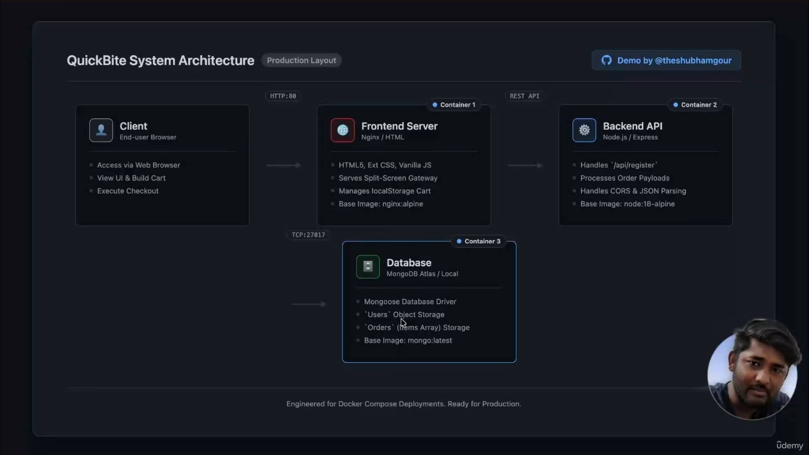
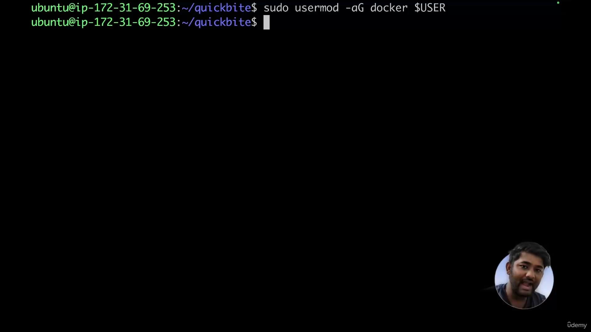
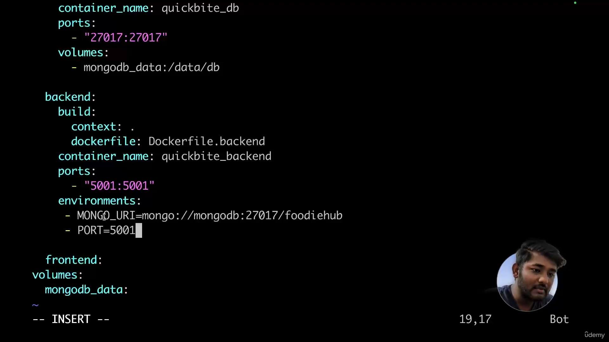
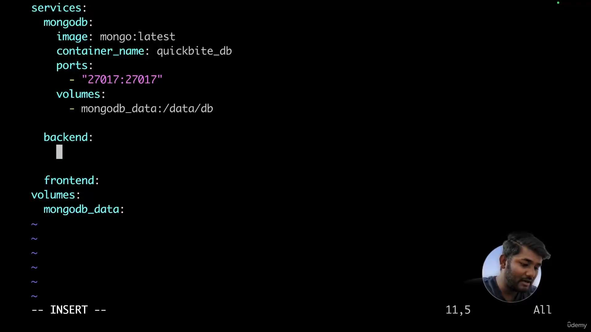
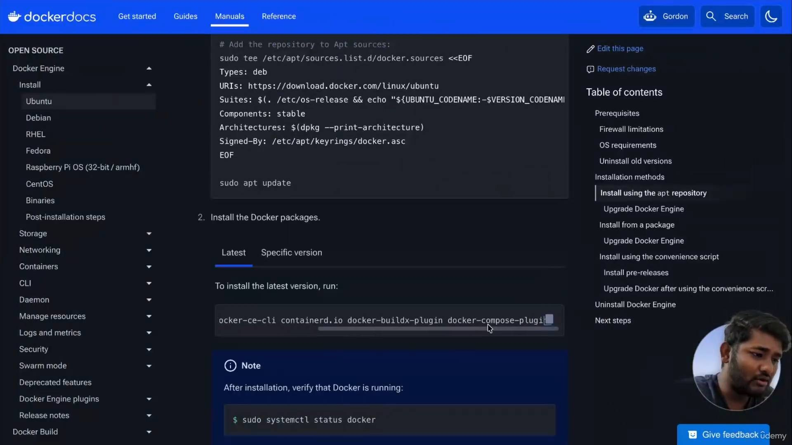
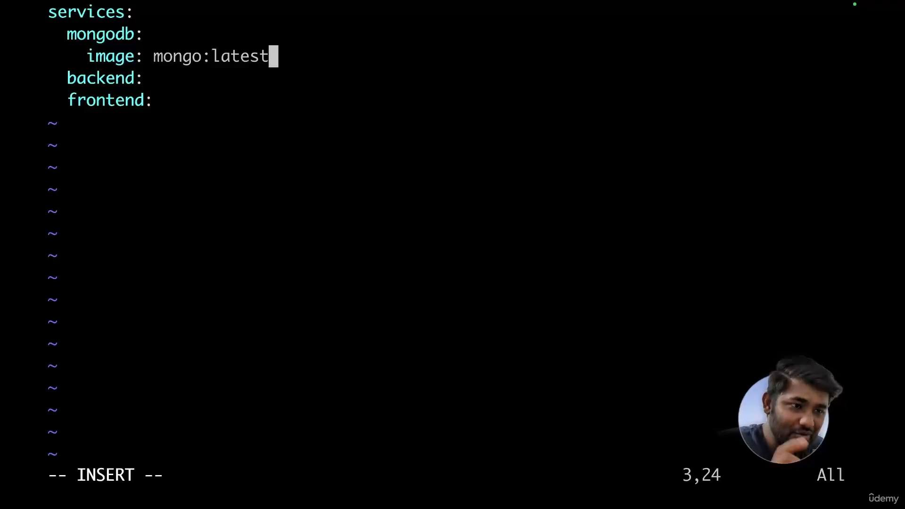

# Docker Masterclass（BV1jcRKBEEfK）P45–P46：QuickBite 三层应用从零容器化

> 覆盖 P45（[00:00]–[40:37]，全程实操）与 P46（[00:00]–[00:21]，结课）。
> 目标读者：前端转 AI 应用工程师。照着本文从头做一遍，你会在自己的一台云主机上跑出一个「注册—登录—加购物车—下单—查订单历史」的完整外卖 Demo，并且验证「容器全删了数据还在」。

---

## 1. 这一节做什么

前面几十集讲的是 Docker 的零件（镜像、容器、网络、卷、Compose）。P45 是把这些零件**装成一台机器**的收尾项目：一个叫 **QuickBite** 的三层（three-tier）外卖应用。

三层分别是：

| 层 | 技术 | 端口 | 备注 |
|---|---|---|---|
| 前端 | Nginx + HTML/CSS/原生 JavaScript（vanilla JS） | 80 | 静态文件 |
| 后端 | Node.js | 5001 | 提供 API |
| 数据库 | MongoDB | 27017 | 用官方镜像，不自己写 Dockerfile |

这一节你要亲手做的事只有四件：

1. 在新开的 Ubuntu 云主机（EC2）上装好 Docker 与 Docker Compose 插件；
2. **从零写两个 Dockerfile**（`Dockerfile.frontend` / `Dockerfile.backend`），如果用仓库里现成的，先把它们删掉；
3. **从零写一个 `docker-compose.yml`**，把三个服务、端口映射、环境变量、启动依赖、数据卷一次配好；
4. `docker compose up -d` 起来，浏览器访问公网 IP，然后 `docker compose down` 再 `up -d`，验证用户和订单数据没丢。

关键点在于：**网络和卷不需要你单独 `docker network create` / `docker volume create`**。讲师在 [23:08] 明确说了：用了 Compose，Compose 自己会建一个 driver 为 `bridge` 的默认网络，卷也写在 compose 文件里就行。



---

## 2. 讲师原话

> "这期视频会很特别，因为今天我们要动手实践一个三层 Web 应用。"
> —— p045 [00:00]

> "前端这里我们会用到 Next.js 以及 HTML、CSS 和原生 JavaScript 这类基础静态文件；接着在后端会用 Node.js，而数据库这里会用 MongoDB。"
> —— p045 [03:51]

> "前端默认运行在 80 端口，后端运行在 5001 端口。"
> —— p045 [04:04]

> "我们会使用 Docker volume。这样一旦出问题、情况对我们不利，我们已经把数据保存下来了。"
> —— p045 [05:04]

> "为了保持项目隔离，我们会使用 Docker networking，这样可以确保我们的应用与其他项目隔离开。"
> —— p045 [05:34]

> "当我执行 Docker build 时……它提示尝试连接 Docker API 时权限被拒绝。这就是我前面提到的错误。要解决这个问题，需要把当前用户加入 Docker 用户组。"
> —— p045 [16:41]

> "当你使用 Docker Compose 文件时，不必担心网络，因为 Docker Compose 文件本身会创建一个 Docker 默认网络，该默认网络使用 bridge 驱动。"
> —— p045 [23:08]

> "它依赖 MongoDB……MongoDB 就绪后，就应该运行 npm start 命令。"
> —— p045 [31:40]

> "这里提示有问题，说校验 Compose 文件时出错，并且 services.backend 的 environments 上存在额外属性问题。所以这里我们犯了一个错误，就出在 environments 上。"
> —— p045 [34:41]

> "由于我们把它挂载到了数据卷上，数据是安全的……这里你可以看到我又能登录了，说明我的数据是安全的。如果我进入订单页面，历史记录仍然还在，说明我的数据完好无损。"
> —— p045 [39:05]

> "到这里，我们关于 Docker 的旅程就结束了。"
> —— p046 [00:00]

---

## 3. 从零复现

### 3.0 最终目录结构（先看清楚再动手）

从仓库 clone 下来之后，项目根目录大致是这样（讲师在 [11:30] 边 `ls` 边念了一遍）：

```
quickbite/                      # 仓库根目录 = compose 的 build context
├── backend/                    # Node.js 后端源码
│   ├── package.json            # 后端依赖清单
│   └── package-lock.json
├── frontend/                   # 静态前端（HTML/CSS/vanilla JS）
├── nginx.conf                  # Nginx 配置，会被 COPY 到容器里
├── architecture.html           # 架构图页面（讲师演示用，不影响运行）
├── readme.md                   # 环境变量、本地运行方式都写在这
├── package.json                # 仓库根上的依赖清单（[11:30] 一并列出）
└── package-lock.json
```

你**新写**的 4 个文件全部放在仓库根目录：

```
quickbite/
├── Dockerfile.frontend         # ← 自己写
├── Dockerfile.backend          # ← 自己写
├── docker-compose.yml          # ← 自己写
└── （nginx.conf 用仓库自带的）
```

### 3.1 起一台干净的云主机

讲师 [06:04] 用的是**全新** EC2，理由是不想被之前实验残留的文件干扰：

- 名称：`quickbite-app`
- AMI：Ubuntu
- 机型：`t3.small`（他给的理由是「我要 2 核 2GB 内存」）
- Key pair：`open-to-local`（想新建就点 create new key pair）
- 其余全部默认，点 Launch instances

拿到实例后，页面上点 **Connect** 复制 SSH 命令，在本地终端粘贴，第一次连会问 fingerprint，输 `yes`。

```bash
ssh -i open-to-local.pem ubuntu@<你的公网IP>
```

进去先 `clear` 一下，界面干净点。

### 3.2 装 Docker 和 Compose 插件

讲师 [07:48] 的做法是**直接搜官方文档照抄**，而不是凭记忆敲：

1. Google 搜 `Docker install on Ubuntu`；
2. 进官方文档，往下翻到安装命令那一节；
3. 文档第一条是「卸载冲突包（uninstall conflicting packages）」——因为这是新机器，**讲师跳过了这条**；
4. 从 "使用 apt 软件源安装" 那一节整段复制，粘进终端回车。用他的话说，这段命令会一口气完成「更新系统 / 装必要的证书 / 更新软件源 / 装 Docker」；
5. 装完继续往下翻，装 **Docker Compose 插件**（plugins 那一节），提示 `Do you want to continue? [Y/n]` 时输 `y`。

> 课里是把官方文档的命令块整段粘过去的，没有逐条念。如果你要一份能直接跑的文字版，用 Docker 官方 apt 仓库安装法的标准命令块（**这一块是补充，不是讲师逐字念的内容**）：
>
> ```bash
> # 1) 基础依赖
> sudo apt-get update
> sudo apt-get install -y ca-certificates curl
>
> # 2) 加 GPG key 和软件源
> sudo install -m 0755 -d /etc/apt/keyrings
> sudo curl -fsSL https://download.docker.com/linux/ubuntu/gpg -o /etc/apt/keyrings/docker.asc
> sudo chmod a+r /etc/apt/keyrings/docker.asc
> echo "deb [arch=$(dpkg --print-architecture) signed-by=/etc/apt/keyrings/docker.asc] \
> https://download.docker.com/linux/ubuntu $(. /etc/os-release && echo $VERSION_CODENAME) stable" \
>   | sudo tee /etc/apt/sources.list.d/docker.list > /dev/null
>
> # 3) 装 Docker + Compose 插件
> sudo apt-get update
> sudo apt-get install -y docker-ce docker-ce-cli containerd.io docker-buildx-plugin docker-compose-plugin
> ```

装完验证：

```bash
docker --version
sudo systemctl status docker
```

讲师 [10:12] 报的版本号是 `29.4.1`（逐字稿原样记录，你的机器上大概率是别的数字，不必纠结）。`systemctl status docker` 里能看到服务是 up and running 就行。

### 3.3 踩一次 permission denied（这一步是故意的）

这是本节最有价值的一段。讲师 [11:06] 说他**故意不给权限**，就为了让你第一次亲手撞上这个错：

```bash
docker build -t frontend -f Dockerfile.frontend .
```

输出：

```
permission denied while trying to connect to the Docker daemon socket
```

原因：Docker 守护进程的 socket 属主是 `docker` 组，你的登录用户不在这个组里。修法（[17:05]）：

```bash
# 注意是 usermod 不是 useradd：用户已经存在，只是要改它的组
sudo usermod -aG docker $USER
```

讲师在这里现场念错了一次命令（先念成 `useradd`，又念成 `user add -ag`），最后纠正为 `usermod -aG`。**记住：`usermod` 是修改已有用户，`useradd` 是新建用户。**

改完组**必须重新登录/重启**才生效——讲师的做法是直接在 EC2 控制台点 **Reboot**，等 30 秒再重新 SSH 进去。

```bash
# 重新连上去之后，这条不再报 permission denied 就算成功
docker images
```



### 3.4 Clone 仓库，然后把现成的 Docker 文件全删掉

```bash
git clone <QuickBite 仓库地址>
cd quickbite
ls
```

讲师 [10:39] 特别强调：**仓库里本来就有 Dockerfile 和 compose 文件，先删掉**，这样你是从零写的，才知道顺序和每一步为什么这么写。

```bash
rm -f Dockerfile* docker-compose*.yml docker-compose*.yaml
ls    # 确认只剩 backend/ frontend/ nginx.conf readme.md ...
```

### 3.5 写前端 Dockerfile

```bash
vim Dockerfile.frontend
```

按 `i` 进插入模式，内容见第 4 节，写完后 `Esc` 再 `:wq` 保存退出。

写完先看一眼：

```bash
cat Dockerfile.frontend
```

讲师 [15:51] 用一句话复述了这个文件：「用最基础的 nginx 镜像 → 把整个 frontend 目录拷到 `/usr/share/nginx/html` → 把 nginx 配置拷到默认配置位置 → 暴露 80 → 用 `daemon off` 前台启动」。

### 3.6 写后端 Dockerfile

```bash
vim Dockerfile.backend
```

**顺序很关键**，讲师 [19:43] 是边写边改的：

1. 先想的是「WORKDIR → COPY backend/ → npm install」；
2. 写到一半自己打断：「before even that we need to do one more thing」——要**先把 `package*.json` 拷进去、先 `npm install`，再拷其余源码**。这样源码改动不会让依赖层缓存失效，重新构建快得多。

写完同样 `cat` 检查一遍。

### 3.7 构建镜像自测（可选但强烈建议）

先单独 build 前端，验证 Dockerfile 语法没问题：

```bash
docker build -t frontend -f Dockerfile.frontend .
```

再 build 后端：

```bash
docker build -t backend -f Dockerfile.backend .
```

> 这里讲师 [16:14] 专门解释了为什么要加 `-f`：你的文件名不叫默认的 `Dockerfile`，而叫 `Dockerfile.frontend` / `Dockerfile.backend`，所以必须用 `-f` 显式指定。

清理测试镜像（讲师 [22:29] 也是这么干的，避免 dangling 镜像占地方）：

```bash
docker rmi -f $(docker images -q)
docker images      # 应该空掉
```

### 3.8 写 docker-compose.yml

```bash
vim docker-compose.yml
```

讲师 [24:04] 的写法顺序值得学：**先写 `services:`，再逐个补 `volumes:` / 网络**，不提前把空壳写上去。

- `mongodb` 服务：用官方镜像 `mongo`（他建议写 tag，写 `latest` 也行，但写明确版本更好）；
- `backend` 服务：用 `build` + `context` + `dockerfile` 指向你自己写的 `Dockerfile.backend`；
- `frontend` 服务：同样 build，指向 `Dockerfile.frontend`；
- 环境变量去仓库 `readme.md` 里抄（讲师 [29:48] 现场翻的就是这个）：`MONGO_URI` 和 `PORT`；
- `depends_on` 串成 `frontend → backend → mongodb`。



### 3.9 起服务，然后撞第二个错

```bash
docker compose up -d
```

如果你把 `environment` 写成了复数 `environments`，会看到（讲师 [34:41] 原话引用的报错）：

```
validating docker-compose.yml: services.backend additional properties 'environments' not allowed
```

> 具体报错的措辞以你本地 Compose 版本输出为准，重点是关键词：`additional properties` + `environments`。

修法只有一个字符级改动：`environments:` → `environment:`。

```bash
vim docker-compose.yml
# 改完 Esc :wq
docker compose up -d
```

这次能看到 Compose 按依赖顺序干活：**先 mongo → 再 backend → 再 frontend**。



### 3.10 确认容器和网络

```bash
docker ps
```

三个容器都在跑，端口分别是 `27017` / `5001` / `80`。

Compose 自动生成的东西（讲师 [35:38] 念出来的名字）：一个默认网络（`<项目名>_default`，driver 是 bridge）和一个卷（`<项目名>_mongo_db_data`）。

```bash
docker network ls
docker volume ls
```

### 3.11 打开安全组，不然浏览器打不开

这一步最容易被漏掉。讲师 [36:05] 说：即使容器在跑，你也访问不了，因为云主机的安全组没放行端口。

EC2 控制台 → 实例 → **Security** → 点安全组 → **Edit inbound rules** → 加两条：

| 类型 | 端口 | 来源 |
|---|---|---|
| 自定义 TCP | `80` | `0.0.0.0/0` |
| 自定义 TCP | `5001` | `0.0.0.0/0` |

Save rules，然后浏览器访问：

```
http://<你的公网IP>
```

（80 是 HTTP 默认端口，不写 `:80` 效果一样。）

### 3.12 走一遍业务流程

讲师 [36:55] 现场演示的完整路径，照着点一遍确认功能正常：

1. Sign up：用户名 `harsh`，密码随便，城市下拉选 `Kanpur`；
2. 提示 account created successfully；
3. 用同一个账号登录，首页出现 `discover the best food and drinks in Kanpur`（城市跟着注册时选的走）；
4. 加菜：Indian 里点 butter chicken、Chineses 里点 Gobi Manchurian、sweets 里点 Gulab Jamun；
5. 购物车总价显示 70 rupees（讲师这一单的数字），点 checkout，下单成功；
6. 进 order history，订单在列表里。


### 3.13 验证数据持久化（这一节的「点睛」）

```bash
docker compose down      # 停掉并删除所有容器
docker ps                # 空的
docker compose up -d     # 重新起
```

回到浏览器刷新，用 `harsh` + 原密码再登录：

- 能登进去 → 用户数据还在；
- order history 里订单还在 → 订单数据也还在。

原因就是第 3.8 步挂的那个卷：`mongo_db_data:/data/db`。MongoDB 的数据目录被映射到了宿主机上的命名卷，容器删了卷还在。



---

## 4. 完整代码

以下四个文件全部放在**仓库根目录**（和 `backend/`、`frontend/` 同级）。

### 4.1 `Dockerfile.frontend`

```dockerfile
# 前端：Nginx 托管静态文件
# 用 alpine 版本来压小镜像体积（讲师 [13:27] 反复强调 lightweight）
FROM nginx:alpine

# 把整个 frontend 目录的内容拷进 Nginx 的默认站点目录
COPY frontend /usr/share/nginx/html

# 用项目自带的 nginx 配置覆盖默认配置（里面负责把 /api 转发到 backend:5001）
COPY nginx.conf /etc/nginx/conf.d/default.conf

# 前端对外暴露 80
EXPOSE 80

# 前台启动 Nginx，容器才不会立刻退出
CMD ["nginx", "-g", "daemon off;"]
```

### 4.2 `Dockerfile.backend`

```dockerfile
# 后端：Node.js 18 + alpine
FROM node:18-alpine

# 容器内的工作目录
WORKDIR /usr/src/app

# 先只拷依赖清单：源码变了这一层还能命中缓存
COPY backend/package*.json ./

# 安装依赖
RUN npm install

# 再拷后端源码（./ 指的是 WORKDIR）
COPY backend ./

# 后端跑在 5001
EXPOSE 5001

# 启动命令
CMD ["npm", "start"]
```

### 4.3 `docker-compose.yml`

```yaml
services:
  # ---------- 数据库层 ----------
  mongodb:
    image: mongo:latest          # 用官方镜像，不自己写 Dockerfile
    container_name: quickbite_db
    ports:
      - "27017:27017"            # 左宿主机 : 右容器（讲师 [26:20] 特别讲了左右顺序）
    volumes:
      - mongo_db_data:/data/db   # 命名卷挂到 MongoDB 的数据目录

  # ---------- 后端层 ----------
  backend:
    build:
      context: .                 # build context = 仓库根目录
      dockerfile: Dockerfile.backend
    container_name: quickbite_backend
    ports:
      - "5001:5001"
    environment:
      - MONGO_URI=mongodb://mongodb:27017/quickbite
      - PORT=5001
    depends_on:
      - mongodb                  # 先起数据库
    command: npm start

  # ---------- 前端层 ----------
  frontend:
    build:
      context: .
      dockerfile: Dockerfile.frontend
    container_name: quickbite_frontend
    ports:
      - "80:80"
    depends_on:
      - backend                  # 先起后端

# 顶层声明命名卷，Compose 会自动创建 <项目名>_mongo_db_data
volumes:
  mongo_db_data:
```

> ⚠️ **关于 `MONGO_URI` 里的库名**：逐字稿 [30:43] 这一段被语音识别糊成了 "MongoDB://...:27017/4D FWDIE HUB hub"，听不出确切库名。请以仓库 `readme.md` 里写的为准，并且要和后端代码里读的那个库名一致。上面的 `quickbite` 是占位写法，**跑不通就回来改这一行**。
>
> 容器名 `quickbite_*` 同理：讲师口述是 "QuickByte 数据库 / QuickByte 后端 / QuickByte 前端"，`quickbyte` 还是 `quickbite` 不影响运行，**但你自己前后必须一致**，因为后面的 `depends_on` 用的是**服务名**（`mongodb` / `backend` / `frontend`），不是容器名。

### 4.4 `nginx.conf`（**课里没展示内容，这是补充件**）

讲师只说了「仓库里有一个 nginx 配置文件，要被拷到 `/etc/nginx/conf.d/default.conf`」（[14:24]–[14:46]），**逐字稿里没有出现这个文件的具体内容**。仓库里自带那份直接用就行。如果它缺失或者你要重写，一份能跑的最小版本如下（**这是我补的，不是讲师写的**）：

```nginx
server {
    listen 80;
    server_name _;

    # 静态文件：就是 Dockerfile 里 COPY 进去的那批
    root /usr/share/nginx/html;
    index index.html;

    # 前端页面
    location / {
        try_files $uri $uri/ /index.html;
    }

    # 关键：把 /api 开头的请求转给 compose 里的 backend 服务
    # 「backend」是 compose 的服务名，Compose 默认网络里会把它解析成容器 IP
    location /api/ {
        proxy_pass http://backend:5001/;
        proxy_set_header Host $host;
        proxy_set_header X-Real-IP $remote_addr;
    }
}
```

---

## 5. 逐行解释

### 5.1 `Dockerfile.frontend`

| 行 | 含义 | 常见坑 |
|---|---|---|
| `FROM nginx:alpine` | 基础镜像。讲师 [13:27] 说用 `nginx:latest` 也行，但镜像会「很重」，alpine 版小得多，部署更快 | alpine 用的是 `musl` libc，编译型依赖可能要额外装包；纯静态站无所谓 |
| `COPY frontend /usr/share/nginx/html` | 把宿主机 `frontend/` 目录的**内容**拷到容器里的站点根目录 | 结尾不加 `/` 时，Docker 拷的是目录**内容**而不是目录本身。写成 `.../html/frontend` 就多套一层，页面会 404 |
| `COPY nginx.conf /etc/nginx/conf.d/default.conf` | 用你自己的配置**覆盖**镜像自带的 default.conf | 文件名必须是 `default.conf`，因为 `nginx.conf` 主配置里 `include /etc/nginx/conf.d/*.conf`，起别的名字也会被加载，但默认那份还在会抢 80 端口 |
| `EXPOSE 80` | 声明式标记，**不真的开放端口** | 真正开放端口靠 `docker-compose.yml` 里的 `ports:`。很多人以为写了 EXPOSE 就能访问，结果浏览器打不开 |
| `CMD ["nginx", "-g", "daemon off;"]` | 前台运行 Nginx | 不加 `daemon off` Nginx 会自己 daemonize，主进程退出 → 容器立刻变成 Exited。**这是最常见的「容器起不来」原因** |

### 5.2 `Dockerfile.backend`

| 行 | 含义 |
|---|---|
| `FROM node:18-alpine` | Node 18 + alpine，同样是体积考虑 |
| `WORKDIR /usr/src/app` | 相当于 `mkdir -p` + `cd`，后续 `COPY ./`、`RUN` 都在这目录下执行 |
| `COPY backend/package*.json ./` | `*` 通配，一次把 `package.json` 和 `package-lock.json` 都拷进来。**讲师 [20:41] 特意补了 `backend/` 前缀**——因为 build context 是仓库根，路径要相对于根写 |
| `RUN npm install` | 在**构建期**装依赖，依赖被固化进镜像层 |
| `COPY backend ./` | 拷源码。放在 `npm install` **之后**是刻意的：只改 JS 不改依赖时，`npm install` 那层能命中缓存，重建从几十秒变几秒 |
| `EXPOSE 5001` | 对齐架构图上的端口 |
| `CMD ["npm", "start"]` | 用 **exec 形式**（JSON 数组），进程能收到 `SIGTERM`，`docker compose down` 才停得干脆 |

> `CMD ["npm", "start"]` 在 compose 里又被 `command: npm start` 写了一遍。两者等价，compose 的 `command` 会覆盖 Dockerfile 的 `CMD`。讲师是两边都写了，不冲突。
>
> **JS/Node 对照**：`WORKDIR` 类似你在 Node 里 `process.chdir()`；`COPY` + `RUN npm install` 的分层策略，相当于把 `node_modules` 单独缓存起来——和你在 CI 里把 `node_modules` 加进 cache key 是一个思路。

### 5.3 `docker-compose.yml` 的关键字段

- `services:` — Compose 的顶层键（新版规范不再需要 `version:`，讲师也没写）。下面每个键就是一个服务，服务名会被注册进 Compose 默认网络做 DNS。
- `image:` vs `build:` — **两种 build context**。讲师 [25:22] 的原话：MongoDB 这里 build context「不是一个 Dockerfile，而是镜像本身」，所以用 `image: mongo:latest`；前后端是自己的代码，所以用 `build: { context, dockerfile }`。
- `context: .` — 构建上下文是仓库根目录。**必须是根目录**，因为 Dockerfile 里 `COPY backend/...`、`COPY frontend ...`、`COPY nginx.conf ...` 的路径都是相对根的。
- `dockerfile: Dockerfile.backend` — 回答「两个 Dockerfile 摆在一起，Compose 怎么知道挑哪个」。讲师 [27:57] 就是这么解释这个字段的。用了它，就不需要在命令行敲 `-f`。
- `container_name:` — 给容器起固定名。不写的话 Compose 会生成 `<项目名>-<服务名>-1` 这种名字。
- `ports: - "27017:27017"` — 讲师 [26:20] 强调：**冒号左边是宿主机端口，右边是容器端口**。写反了就连不上。
- `volumes: - mongo_db_data:/data/db` — 左边是卷名（必须在文件末尾的顶层 `volumes:` 里声明过），右边是容器内路径。`/data/db` 是 MongoDB 的默认数据目录，**这个路径不能随便改**，改了就等于没存。
- `environment:` — **单数**，列表形式，每项 `KEY=VALUE`。讲师 [34:41] 就是在这里踩了复数 `environments` 的坑。
- `depends_on: - mongodb` — 只保证**启动顺序**（先起 mongodb，再起 backend，最后起 frontend）。
- `command: npm start` — 覆盖镜像的默认启动命令。
- 顶层 `volumes: mongo_db_data:` — 声明命名卷。Compose 实际创建的名字是 `<项目名>_mongo_db_data`，讲师 [35:38] 念的正是这个带前缀的名字。



---

## 6. 复现检查清单

按顺序打勾，哪一步不过就停在那里排查，别往下走。

**环境**
- [ ] `docker --version` 有输出
- [ ] `sudo systemctl status docker` 是 active (running)
- [ ] `docker compose version` 有输出（说明 Compose 插件装上了）
- [ ] `docker images` 不报 `permission denied`（报了就 `sudo usermod -aG docker $USER` + 重启机器 + 重新 SSH）

**代码**
- [ ] `ls` 能看到 `backend/`、`frontend/`、`nginx.conf`
- [ ] 仓库自带的 Dockerfile / compose 文件已删除
- [ ] `Dockerfile.frontend` 存在，`cat` 出来 5 条指令齐全，最后一条是 `daemon off;`
- [ ] `Dockerfile.backend` 存在，`COPY package*.json` 在 `COPY backend ./` **之前**
- [ ] `docker build -t frontend -f Dockerfile.frontend .` 成功
- [ ] `docker build -t backend -f Dockerfile.backend .` 成功
- [ ] `docker-compose.yml` 里写的是 `environment:`（**不是 `environments:`**）
- [ ] yaml 缩进全是空格，没有 Tab

**运行**
- [ ] `docker compose up -d` 没有 `additional properties` 报错
- [ ] `docker ps` 里三个容器都是 `Up`，没有 `Restarting`
- [ ] `docker volume ls` 里有 `<项目名>_mongo_db_data`
- [ ] `docker logs <backend 容器名>` 里能看到服务在 5001 上监听（**课里没演示看日志，但这是最快的排错手段**）

**访问**
- [ ] 安全组已放行 80 和 5001，来源 `0.0.0.0/0`
- [ ] 浏览器 `http://<公网IP>` 能打开首页
- [ ] 能注册新用户（城市下拉选一个）
- [ ] 能用新用户登录，首页文案里的城市和注册时选的一致
- [ ] 能加购物车 → checkout → order history 里能看到订单

**持久化**
- [ ] `docker compose down` 后 `docker ps` 为空
- [ ] `docker compose up -d` 后能登录原账号
- [ ] order history 里历史订单还在

---

## 7. 课里没讲但你会撞上的

这一节全是**逐字稿之外**的内容，明确标出来，别把它当成讲师说的。

**1）`depends_on` 不等于「等它 ready」**
`depends_on` 只保证容器**启动顺序**，不保证 MongoDB 已经能接受连接。Mongo 冷启动要几秒，后端 `npm start` 可能抢在它前面连库然后崩掉。讲师演示时一次就过了，实际环境不一定。对策：后端代码里做连接重试（Node 里就是 `mongoose.connect()` 外面套个 `while` + `setTimeout`，或者写个 `wait-for-it` 脚本）。**JS 对照**：`depends_on` 像 `Promise.all([a, b])` 的顺序保证，而不是 `await db.connect()` 完成后再 `listen()`——后者才是有序的。

**2）`down` 不删卷，`down -v` 才删**
这正是第 3.13 节能验证成功的原因。反过来说，哪天你想「彻底重来」，一句 `docker compose down` 是不会清数据的，得 `docker compose down -v`。很多人以为删了容器数据就没了，然后在原地怀疑人生。

**3）`nginx.conf` 的具体内容课里没讲**
讲师只说了「这个文件负责默认配置，要拷到 `/etc/nginx/conf.d/default.conf`」，正文（第 4.4 节）是我补的最小可用版。**如果前端页面能打开但登录/下单报 404，十有八九是 `proxy_pass` 那段不对**——要么路径前缀对不上（`/api/` 的尾斜杠、`proxy_pass` 的尾斜杠），要么后端实际监听的不是 5001。

**4）`COPY backend ./` 会把 `node_modules` 一起拷进去**
仓库里如果有 `node_modules` 目录，它会被原样塞进镜像，体积暴涨，还可能把宿主机的 native 二进制带进 alpine 容器导致运行时报错。标准做法是加一个 `.dockerignore`（**课里没提**）：

```
node_modules
.git
*.log
```

**5）`npm install` 换 `npm ci` 更快更稳**
`npm install` 会去解析并可能改写 lock 文件；`npm ci` 严格按 `package-lock.json` 装，适合 CI/构建镜像。课里用的是 `npm install`，能用，知道一下更好。

**6）MongoDB 没有密码，27017 别对外开**
第 3.11 节里讲师只放行了 80 和 5001——这是对的。**千万别顺手把 27017 也加到 `0.0.0.0/0`**，那等于把你的数据库裸奔在公网上。上面 compose 里写了 `"27017:27017"` 是为了本地调试方便，生产环境应该删掉这行（容器之间走 Compose 内部网络，本来就不需要宿主机端口）。

**7）`docker compose` 和 `docker-compose` 是两个东西**
讲师用的是 `docker compose`（空格，v2 插件版）。如果你照着老教程敲成 `docker-compose`（横杠，v1 python 版），可能会遇到 `version is unsupported` 之类的错。以 `docker compose version` 的输出为准。

**8）公共 IP 每次重启实例都会变**
第 3.13 节里讲师重启过 EC2 修权限，重启后公网 IP 可能变（除非你配了 Elastic IP）。浏览器打不开先确认 IP 还是不是原来那个。

**9）国内拉镜像慢**
`FROM node:18-alpine`、`FROM nginx:alpine`、`image: mongo:latest` 三个都要从 Docker Hub 拉，国内网络可能超时。配置镜像加速器是常规操作（**课里没讲**）。

**10）后端端口 5001 为什么还要对外开**
架构上浏览器只应该打 80，由 Nginx 反代到 5001。讲师 [36:29] 把 5001 也放行了，方便直接调 API 调试。真实项目里 5001 不该暴露到公网。

**11）Java 相关语法**
本节全程 Node.js + Nginx + YAML，没有 Java 代码，可以跳过。

---

**最后**：P46 只有 21 秒，是结课寄语——「我们到此为止把 Docker 从基础到进阶都覆盖完了，你现在有信心容器化任何应用了」。这门课的终点不是「知道 Docker 有哪些命令」，而是「拿到一个三层应用，能自己写两个 Dockerfile + 一个 compose 文件把它跑起来，并且知道数据放哪儿才不会丢」。你现在应该具备了这个能力。

