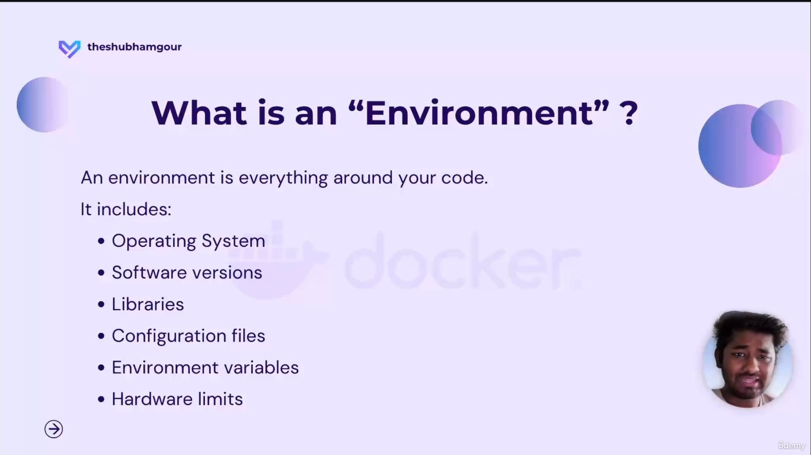
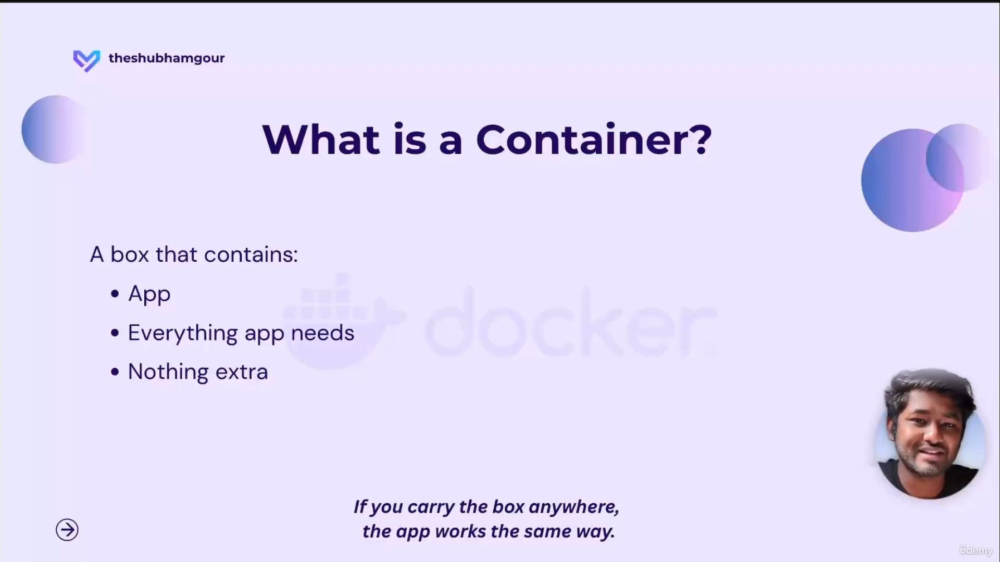
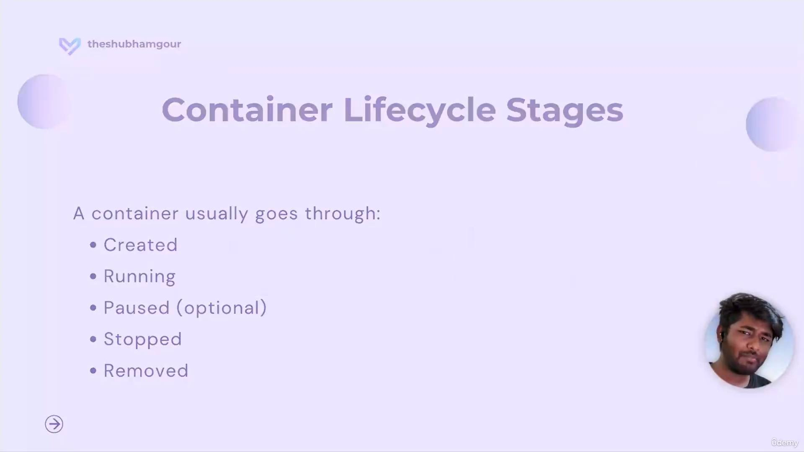
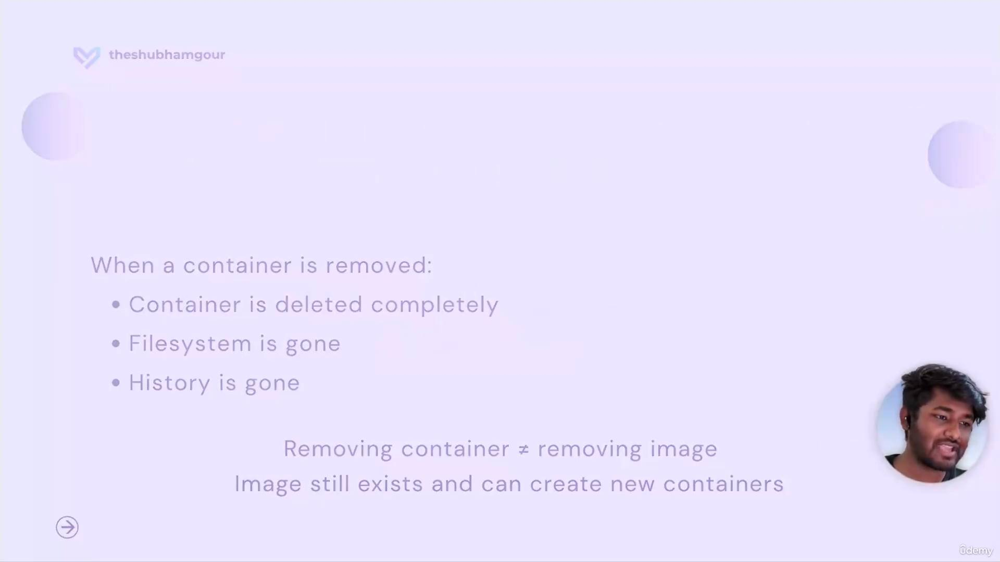
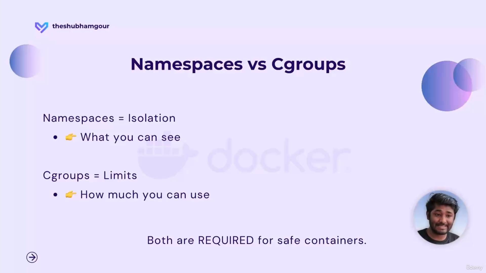

# Docker Masterclass P5–P8 复现文档：从环境问题到容器隔离

> 先说明一个关键事实：P5–P8 的逐字稿是概念课，讲师没有在视频里实际敲出一个可运行项目，也没有给出 Docker 命令的终端输出。P6 只提到“后面会创建一个基础 Python 应用”，但没有在 P5–P8 展开。  
> 因此本文档把“可复现项目”拆成两层：  
> 1. **讲师原话覆盖的概念**：环境差异、容器、生命周期、namespace/cgroup 隔离；  
> 2. **为让读者真正跑起来而补全的最小实验**：一个 Python HTTP 服务 + Dockerfile。所有补全处都会标“课里没讲/复现补全”，不冒充讲师原话。  
> 实验固定使用 `python:3.12-slim` 作为基础镜像；Docker 本身课程未给版本号，所以不锁 Docker 版本，只要求本机 Docker 可用。项目无第三方 pip 依赖。

---

## 1. 这一节做什么

这一节的目标不是做一个业务系统，而是把 P5–P8 的四个概念串成一条能亲手验证的链路：

1. **P5：环境不一致为什么会产生“在我机器上能跑”**。讲师把环境拆成操作系统、软件版本、库、配置、环境变量、硬件限制等因素。复现实验里，我们用同一个镜像启动两个容器，只改 `APP_ENV` 和 `APP_PORT`，观察同一个应用在不同“环境变量”下返回不同结果，从而把“环境差异”变成可控变量。
2. **P6：容器是什么**。讲师把容器比作一个盒子，盒子里是应用、依赖和运行时，不包含完整操作系统。复现实验用 Dockerfile 把 `app.py` 和 Python 运行时打成一个镜像。
3. **P7：容器生命周期**。讲师讲创建、运行、暂停、停止、删除五个阶段，并把 `docker run/start/stop/rm` 与生命周期对应。复现实验会实际执行 `run → stop → start → rm`，让你看到“停止不是删除，删除后镜像还在”。
4. **P8：隔离**。讲师讲 Linux 的 namespace 负责“你能看到什么”，cgroup 负责“你能用多少”。复现实验只演示最直观的“两个容器各自有端口、各自有环境变量、互不串数据”；CPU/内存限制命令课里没讲，因此不在主流程里伪造。

最终你会得到一个目录 `docker-p5-p8-demo/`，里面有 `app.py`、`Dockerfile`、`.dockerignore`。构建镜像后，用两条 `docker run` 分别启动 Dev 和 QA 两个容器，用 `curl` 看到不同环境变量输出，再执行停止、启动、删除。


---

## 2. 讲师原话（带「—— pNNN [MM:SS]」）

下面不是按视频顺序流水账，而是按“环境问题 → 容器 → 生命周期 → 隔离”四个实现主题摘录。

**关于环境问题的根因：**

> "同样的代码、同样的功能，还是在同一天，为什么结果却不同？"
> —— p005 [00:00]

讲师用这句话开场：同一份代码、同一个功能、同一天，却在 Dev、QA、Prod 表现不同。复现实验里，我们不让代码变，只让 `APP_ENV` 变，正是为了把“环境”单独拎出来观察。

> "大多数问题并不是代码造成的，大多数缺陷都是环境问题和环境不一致导致的。"
> —— p005 [02:19]

这句话是 P5 的核心：很多问题不是代码错，而是环境不匹配。对应到项目里，`app.py` 本身不变，变的是容器启动时传入的 `-e APP_ENV=...` 和 `-e APP_PORT=...`。

> "现代开发……到处都是一样的环境。所以它不是相似，也不是接近，而是完全一致。"
> —— p005 [09:11]

讲师强调现代做法不是“相似环境”，而是“完全一样的环境”。Docker 镜像就是这个“完全一样”的打包单位；我们构建一次 `docker-p5-p8-demo:1.0`，之后 Dev/QA 都从同一个镜像启动。



**关于容器是什么：**

> "容器没什么神秘的，它就像一个盒子，盒子里只装你的应用和依赖，别的什么都没有。"
> —— p006 [00:50]

复现实验的 Dockerfile 就是把 `app.py`、Python 运行时、默认环境变量放进这个“盒子”，不安装完整操作系统。

> "所以容器并不等于虚拟机，它本质上是一个进程，只不过带有边界。"
> —— p006 [04:35]

这句话直接决定 P7/P8 的理解方式：容器不是虚拟机，而是被边界限制的进程。`app.py` 里的 `serve_forever()` 就是容器的主进程；主进程在，容器就在。



**关于生命周期：**

> "容器先被创建，然后被执行，接着被暂停，随后被停止，最后被删除。"
> —— p007 [02:40]

讲师把生命周期分成创建、运行、暂停、停止、删除。本文主流程实际执行 `docker run`、`docker stop`、`docker start`、`docker rm`；`paused` 状态讲师讲了，但暂停命令课里没讲，所以放到第 7 节提醒。

> "运行 docker run 命令时会发生什么？容器会被创建并启动。"
> —— p007 [06:30]

`docker run` 不是“只创建”，而是“创建并启动”。复现实验第一条 `docker run -d ...` 就对应这个动作。



**关于隔离：**

> "容器之所以能够隔离，是因为 Linux 为它们设定了边界，而这些边界由命名空间和控制组定义。"
> —— p008 [00:49]  
> 注：逐字稿把 cgroups 记成 “sea groups”，按上下文是 cgroups。

> "控制组决定容器可以使用多少资源。这些资源可以是 CPU、磁盘和内存。"
> —— p008 [03:36]

> "命名空间帮助我们实现隔离……控制组帮助我们限制……你能使用的资源量。"
> —— p008 [05:03]

这三句说明：Docker 不是凭魔法隔离，它使用 Linux 的 namespace 和 cgroup。复现实验只演示“可见性”的一半：两个容器各自监听不同端口、各自有环境变量；资源上限不在主流程伪造。


---

## 3. 从零复现

### 3.1 前置检查

课程没有讲 Docker 安装，也没有给 Docker 版本号。你只需要本机能执行 Docker 命令。先检查：

```bash
docker --version
```

能输出版本信息即可。具体版本号以你机器实际输出为准。以下命令在 macOS/Linux/WSL2 的 bash 中可直接使用；Windows PowerShell 中把 `curl` 写成 `curl.exe`，Docker 命令不变。

### 3.2 目录结构

新建目录并进入：

```bash
mkdir docker-p5-p8-demo
cd docker-p5-p8-demo
```

最终目录结构如下：

```text
docker-p5-p8-demo/
├── app.py
├── Dockerfile
└── .dockerignore
```

三个文件的完整内容在第四节，先创建空文件也可以：

```bash
touch app.py Dockerfile .dockerignore
```

然后把第四节代码原样保存进去。

### 3.3 构建镜像

> `docker build` 和 Dockerfile 语法在 P5–P8 没有实际演示，这里是复现补全。P6 只讲了“打包应用和依赖”的概念。

在 `docker-p5-p8-demo/` 目录下执行：

```bash
docker build -t docker-p5-p8-demo:1.0 .
```

预期：构建成功，本机出现镜像标签 `docker-p5-p8-demo:1.0`。构建日志的具体字段名以你机器实际输出为准。如果拉取 `python:3.12-slim` 失败，先检查网络或镜像加速；课程没讲镜像加速配置。

### 3.4 启动 Dev 容器

> `docker run` 是讲师明确提到的命令，但 `-d`、`-p`、`-e` 参数课里没讲，属于复现补全。

```bash
docker run -d \
  --name env-demo-dev \
  -p 8000:8000 \
  -e APP_ENV=dev \
  -e APP_PORT=8000 \
  docker-p5-p8-demo:1.0
```

验证：

```bash
curl http://localhost:8000
```

本实验代码会返回：

```text
ok env=dev port=8000
```

这说明：镜像里的应用是同一份，但容器启动时注入了 `APP_ENV=dev`、`APP_PORT=8000`。

### 3.5 启动 QA 容器

用同一个镜像，换环境变量和端口：

```bash
docker run -d \
  --name env-demo-qa \
  -p 8001:8001 \
  -e APP_ENV=qa \
  -e APP_PORT=8001 \
  docker-p5-p8-demo:1.0
```

验证：

```bash
curl http://localhost:8001
```

本实验代码会返回：

```text
ok env=qa port=8001
```

此时两个容器来自同一个镜像，但返回不同环境标识。你可以在浏览器同时打开 `http://localhost:8000` 和 `http://localhost:8001`，观察 Dev/QA 的差异被环境变量显式化。

### 3.6 生命周期：停止、启动、删除

先停止 Dev：

```bash
docker stop env-demo-dev
```

再次请求：

```bash
curl http://localhost:8000
```

预期：请求失败。具体错误信息以你机器实际输出为准。此时容器没有运行，但并没有被删除。

重新启动：

```bash
docker start env-demo-dev
```

再次请求：

```bash
curl http://localhost:8000
```

预期恢复为：

```text
ok env=dev port=8000
```

删除 QA 和 Dev：

```bash
docker stop env-demo-qa
docker rm env-demo-qa

docker stop env-demo-dev
docker rm env-demo-dev
```

预期：容器被删除。镜像 `docker-p5-p8-demo:1.0` 仍在，因此你还可以用同一个镜像重新 `docker run` 新容器。讲师在 p007 [06:00] 附近用“把盒子扔进垃圾桶，但 image 还在”说明这件事；逐字稿在删除命令处转写成 “Docker Rn”，按上下文是删除容器，实际以 Docker 命令为准。



### 3.7 清理

如果还残留容器，按名字停止并删除：

```bash
docker stop env-demo-dev env-demo-qa
docker rm env-demo-dev env-demo-qa
```

若提示某个容器不存在，说明它已被删除，可忽略。

---

## 4. 完整代码

以下三个文件均放在 `docker-p5-p8-demo/` 根目录，可直接保存运行。

### 4.1 `app.py`

```python
import os
from http.server import BaseHTTPRequestHandler, HTTPServer


APP_PORT = int(os.environ.get("APP_PORT", "8000"))
APP_ENV = os.environ.get("APP_ENV", "dev")


class Handler(BaseHTTPRequestHandler):
    def do_GET(self):
        body = f"ok env={APP_ENV} port={APP_PORT}\n".encode("utf-8")
        self.send_response(200)
        self.send_header("Content-Type", "text/plain; charset=utf-8")
        self.send_header("Content-Length", str(len(body)))
        self.end_headers()
        self.wfile.write(body)

    def log_message(self, fmt, *args):
        print("%s - %s" % (self.address_string(), fmt % args), flush=True)


if __name__ == "__main__":
    server = HTTPServer(("0.0.0.0", APP_PORT), Handler)
    print(f"listening on 0.0.0.0:{APP_PORT}, APP_ENV={APP_ENV}", flush=True)
    server.serve_forever()
```

### 4.2 `Dockerfile`

```dockerfile
FROM python:3.12-slim

WORKDIR /app

COPY app.py /app/app.py

ENV APP_PORT=8000
ENV APP_ENV=dev

EXPOSE 8000

CMD ["python", "/app/app.py"]
```

### 4.3 `.dockerignore`

```text
__pycache__/
*.pyc
.git/
.gitignore
```

---

## 5. 逐行解释

### 5.1 `app.py` 逐行解释

- `import os`：读取环境变量。  
- `from http.server import BaseHTTPRequestHandler, HTTPServer`：使用 Python 标准库起一个最小 HTTP 服务。没有 pip 依赖，所以不需要 `requirements.txt`。  
- `APP_PORT = int(os.environ.get("APP_PORT", "8000"))`：从环境变量 `APP_PORT` 取端口，没有就用 `8000`。这对应 P5 的“环境变量是环境的一部分”。在 JS/Node 里对应 `Number(process.env.APP_PORT || 8000)`。  
- `APP_ENV = os.environ.get("APP_ENV", "dev")`：从环境变量 `APP_ENV` 取环境名，没有就用 `dev`。在 Node 里对应 `process.env.APP_ENV || "dev"`。  
- `class Handler(BaseHTTPRequestHandler):`：定义请求处理器。  
- `def do_GET(self):`：处理 GET 请求。  
- `body = f"ok env={APP_ENV} port={APP_PORT}\n".encode("utf-8")`：生成返回体，里面带上当前环境变量值。  
- `self.send_response(200)`：返回 HTTP 200。  
- `self.send_header("Content-Type", "text/plain; charset=utf-8")`：声明文本响应。  
- `self.send_header("Content-Length", str(len(body)))`：声明响应长度。  
- `self.end_headers()`：结束响应头。  
- `self.wfile.write(body)`：写响应体。  
- `def log_message(self, fmt, *args):`：自定义日志输出。  
- `print(..., flush=True)`：立即刷新日志。`docker logs` 命令课里没讲，但这是让日志能及时看到的小补全。  
- `if __name__ == "__main__":`：直接运行 `app.py` 时启动服务。  
- `server = HTTPServer(("0.0.0.0", APP_PORT), Handler)`：监听 `0.0.0.0` 的 `APP_PORT`。`0.0.0.0` 表示容器内所有网卡；如果只写 `127.0.0.1`，从宿主机映射端口可能访问不到。这是复现补全。  
- `server.serve_forever()`：主进程持续运行。P7 说“容器会随着主进程存活而存活”，这里的主进程就是 Python；`serve_forever()` 不退出，容器就保持 running。停止容器时，Docker 会让主进程结束。在 Node 里，这相当于一个不会退出的 `http.createServer(...).listen(...)`。  
- `print(f"listening on ...")`：启动时打印一行，便于确认端口和环境变量。

### 5.2 `Dockerfile` 逐行解释

- `FROM python:3.12-slim`：基础镜像包含 Python 3.12 运行时。课程没有指定项目版本；P5 只是把 Python 3.10 与 3.12 当作版本差异例子。这里固定 `3.12-slim` 是为了实验可重复。  
- `WORKDIR /app`：设置容器内工作目录。  
- `COPY app.py /app/app.py`：把宿主机当前目录的 `app.py` 复制到镜像里的 `/app/app.py`。  
- `ENV APP_PORT=8000`：设置镜像默认环境变量 `APP_PORT`。运行时可被 `-e APP_PORT=8001` 覆盖。  
- `ENV APP_ENV=dev`：设置默认环境 `APP_ENV`。运行时可被 `-e APP_ENV=qa` 覆盖。  
- `EXPOSE 8000`：声明镜像打算使用 8000 端口。注意：`EXPOSE` 不是端口发布，真正对外映射靠 `docker run -p`；这一点课里没讲。  
- `CMD ["python", "/app/app.py"]`：容器启动时执行的主进程。P7 的“容器生命周期跟随主进程”在这里落地：这个 Python 进程退出，容器就进入停止状态。

### 5.3 命令逐行解释

- `docker build -t docker-p5-p8-demo:1.0 .`：把当前目录按 Dockerfile 构建成镜像。课里没讲 `docker build`，这是复现补全。  
- `docker run -d`：创建并启动容器，`-d` 表示后台运行。P7 明确说 `docker run` 会“创建并启动”，但没讲 `-d`。  
- `--name env-demo-dev`：给容器起名，后续 `stop/start/rm` 用名字操作。课里没讲 `--name`。  
- `-p 8000:8000`：把宿主机 8000 映射到容器 8000。课里没讲端口映射。  
- `-e APP_ENV=dev`：注入环境变量，覆盖 Dockerfile 里的 `ENV APP_ENV=dev`。对应 P5 的环境变量主题。  
- `-e APP_PORT=8000`：注入端口变量。第二个容器改成 `8001`，所以同一镜像可以跑不同端口。  
- `docker stop env-demo-dev`：停止运行中的容器，对应 P7 的 stopped 阶段。  
- `docker start env-demo-dev`：启动已停止容器，对应 P7 的 started 阶段。  
- `docker rm env-demo-dev`：删除容器，对应 P7 的 removed 阶段。注意先 `stop` 再 `rm`；容器还在运行时 Docker 可能拒绝删除，具体提示以实际输出为准。  
- `curl http://localhost:8000`：从宿主机访问容器。返回 `ok env=dev port=8000` 是本实验代码的确定输出。

### 5.4 与 JS/Node 的对应

- 环境变量：Python `os.environ.get("APP_ENV")` ↔ Node `process.env.APP_ENV`。  
- HTTP 服务：Python `HTTPServer` ↔ Node `http.createServer`。  
- 主进程：Python `serve_forever()` ↔ Node `server.listen(...)` 后事件循环保持进程存活。  
- 停止容器：Docker 停止主进程，Node 中通常会收到信号；你可以在 Node 里监听 `SIGTERM` 做清理。课里没讲信号处理。  
- 隔离：namespace 管“看得到什么”，cgroup 管“用多少 CPU/内存/磁盘”。Node 没有直接创建 namespace/cgroup 的 API，这是操作系统层能力；在 Node 里不要假设 `os.totalmem()` 一定等于容器内存上限，课里没讲这个细节。  
- 锁/事务/并发：P5–P8 没有讲锁和事务。本实验的 Python `HTTPServer` 是单线程处理，不是高并发服务器；Node 对应单线程事件循环。这里只补一句，避免把容器当成并发解决方案。



---

## 6. 复现检查清单

按顺序勾选，全部通过说明你已把 P5–P8 的概念跑通：

- [ ] 当前目录是 `docker-p5-p8-demo/`，里面存在 `app.py`、`Dockerfile`、`.dockerignore`。  
- [ ] `docker --version` 能正常输出。  
- [ ] `docker build -t docker-p5-p8-demo:1.0 .` 构建成功。  
- [ ] `docker run -d --name env-demo-dev -p 8000:8000 -e APP_ENV=dev -e APP_PORT=8000 docker-p5-p8-demo:1.0` 启动成功。  
- [ ] `curl http://localhost:8000` 返回 `ok env=dev port=8000`。  
- [ ] `docker run -d --name env-demo-qa -p 8001:8001 -e APP_ENV=qa -e APP_PORT=8001 docker-p5-p8-demo:1.0` 启动成功。  
- [ ] `curl http://localhost:8001` 返回 `ok env=qa port=8001`。  
- [ ] `docker stop env-demo-dev` 后，`curl http://localhost:8000` 失败；具体错误以实际为准。  
- [ ] `docker start env-demo-dev` 后，`curl http://localhost:8000` 恢复为 `ok env=dev port=8000`。  
- [ ] `docker stop env-demo-qa && docker rm env-demo-qa` 后，QA 容器被删除。  
- [ ] `docker stop env-demo-dev && docker rm env-demo-dev` 后，Dev 容器被删除。  
- [ ] 容器删除后，镜像 `docker-p5-p8-demo:1.0` 仍可用于重新 `docker run` 新容器；这说明“删除容器”和“删除镜像”不是一回事。  
- [ ] 你能用自己的话解释：为什么同一镜像、不同 `-e` 会返回不同 `env=`，这对应 P5 的“环境变量差异”。  
- [ ] 你能用自己的话解释：为什么 `docker stop` 后容器还在，`docker rm` 后容器才消失，这对应 P7 的 stopped 与 removed。  
- [ ] 你能用自己的话解释：namespace 管“看到什么”，cgroup 管“用多少”，Docker 使用 Linux 的这两个能力，对应 P8。

如果某一步失败，优先检查：端口是否被占用、容器名是否重复、Docker Desktop 是否启动、镜像是否拉取成功。课里没讲这些排错细节，属于实际开发常见问题。

---

## 7. 课里没讲但你会撞上的

以下内容不是 P5–P8 讲师讲过的，不能算课程原话；但读者照着复现时大概率会遇到，先列出来避免卡住。

1. **Docker 安装与 WSL2**：P5–P8 没讲安装。Windows 通常需要 Docker Desktop + WSL2；macOS 用 Docker Desktop；Linux 用 Docker Engine。装完先确认 `docker --version` 可用。  
2. **`docker build` 和 Dockerfile 语法**：P6 只讲“打包应用和依赖”的概念，没有演示 Dockerfile。本文的 `FROM/WORKDIR/COPY/ENV/EXPOSE/CMD` 是复现补全。  
3. **`-d`、`-p`、`-e` 参数**：讲师提到 `docker run`，但没有讲后台运行、端口映射、环境变量注入。本文用它们完成实验。  
4. **`docker ps`、`docker logs`、`docker exec`、`docker inspect`**：这些是调试容器最常用的命令，但 P5–P8 没讲。你如果看容器是否在跑，会用到 `docker ps`；看日志会用到 `docker logs`。这些命令的输出字段名请以你机器实际输出为准，本课没有给字段说明。  
5. **`docker pause/unpause`**：P7 讲了 paused 状态，但没有讲暂停命令。实际 Docker 有暂停/恢复命令，但课里没教，所以本文主流程没有用它。  
6. **端口占用**：8000/8001 可能被你本机其他程序占用。实际报错信息以你机器为准；换一个宿主机端口即可，例如 `-p 18000:8000`，但容器内 `APP_PORT` 仍要对应。  
7. **镜像拉取失败/代理**：`python:3.12-slim` 需要从镜像仓库拉取。课程没讲镜像加速、代理、离线导入。公司网络下可能需要配置镜像仓库。  
8. **Linux 权限**：Linux 上普通用户可能没有 Docker 权限，常见做法是加 `docker` 组或用 `sudo`。课程没讲权限配置，本文命令默认你的 Docker 已可用。  
9. **cgroups v2、WSL2、Docker Desktop 的资源限制**：P8 讲了 cgroup 能限制 CPU/内存/磁盘，但没讲具体命令，也没讲 cgroups v1/v2 差异。你如果要做资源限制实验，需要另查 `docker run --memory/--cpus` 等参数；这些不是本课内容。  
10. **生产安全**：本文为了最小可运行，容器默认以 root 运行，也没有健康检查、多阶段构建、非 root 用户、数据卷、日志采集。这些课里没讲。真实项目至少要考虑：不要把密钥写进 `ENV`、使用非 root 用户、加健康检查、把数据放卷。  
11. **`EXPOSE` 不是发布端口**：本文 `EXPOSE 8000` 只是声明；真正对外是 `-p 8000:8000`。课里没讲这个区别，但新手很容易把 `EXPOSE` 当成端口映射。  
12. **删除容器 vs 删除镜像**：`docker rm` 删容器，镜像还在；删镜像的命令课里没讲。本文检查清单专门验证“删容器后还能用同一镜像重建”，对应 P7 的“image 还在，可以重建容器”。  
13. **Node/JS 的并发与信号**：P5–P8 没有讲锁、事务、并发。若你把 `app.py` 换成 Node 服务，`docker stop` 时 Node 进程会收到停止信号；需要监听 `SIGTERM` 做清理，课里没讲。本文 Python 服务是单线程阻塞模型，不是生产级并发服务器。  
14. **Kubernetes 等云原生工具**：P8 提到 Docker、Kubernetes 能规模化，但 P5–P8 没有展开 Kubernetes。本文只做单机 Docker 复现。

到这里，你已经用同一个镜像、两组环境变量、四个生命周期动作，把 P5–P8 的“环境一致性 → 容器 → 生命周期 → 隔离边界”跑了一遍。后续如果继续学 Docker 命令，建议先把本文的 `stop/start/rm` 与 `docker ps/logs` 结合，观察容器状态变化；这些观察命令课里没讲，但会让生命周期概念更稳。