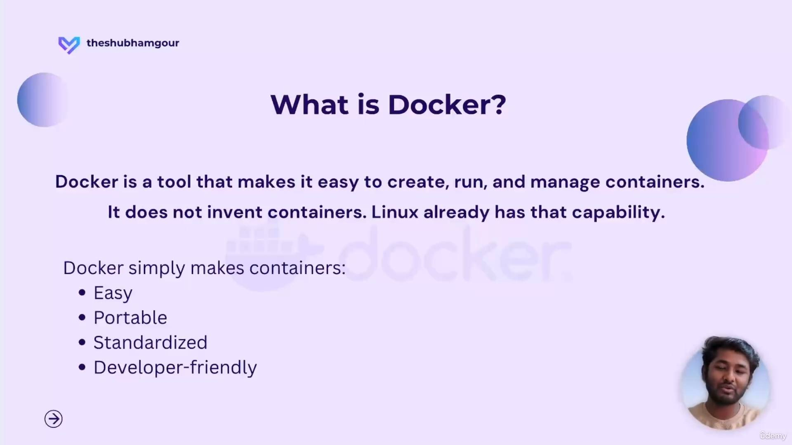
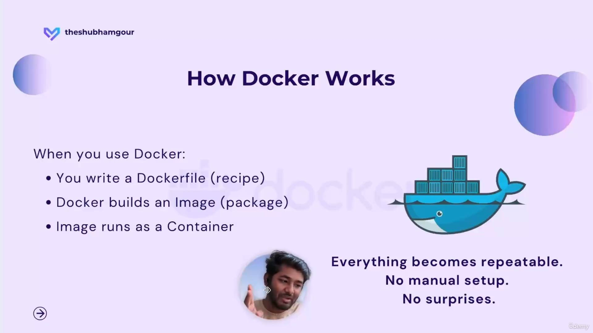
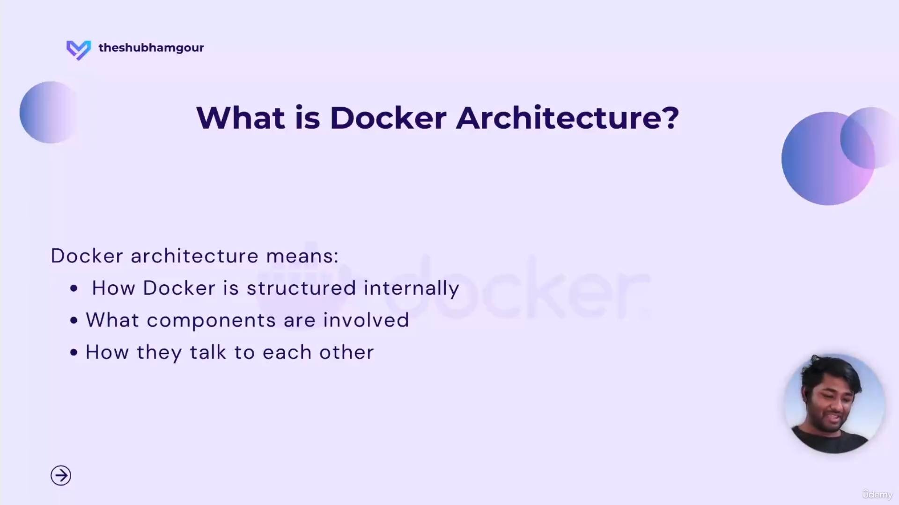
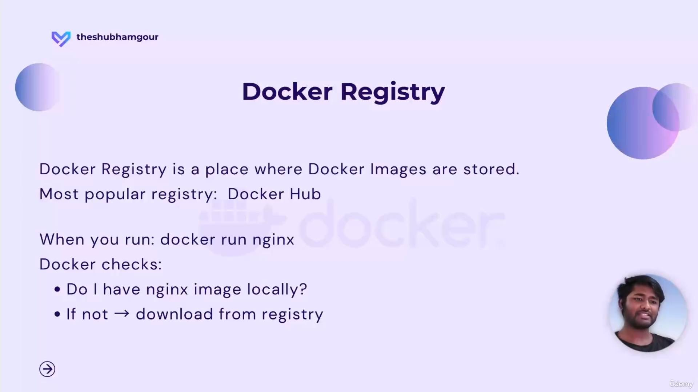
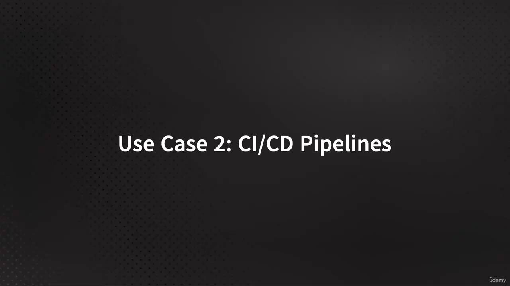
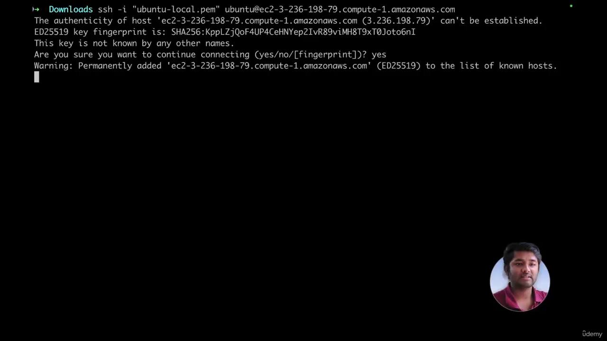
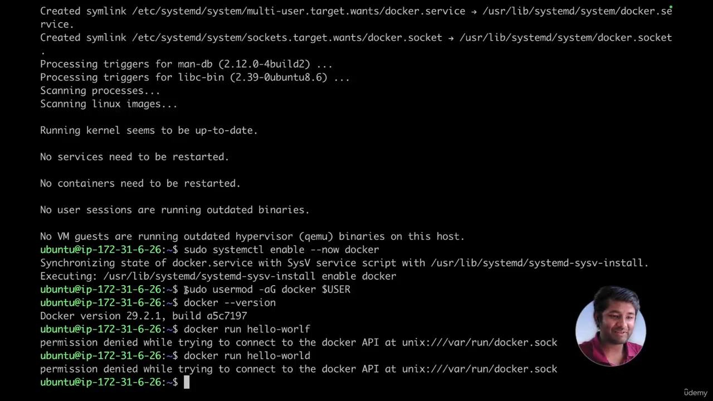
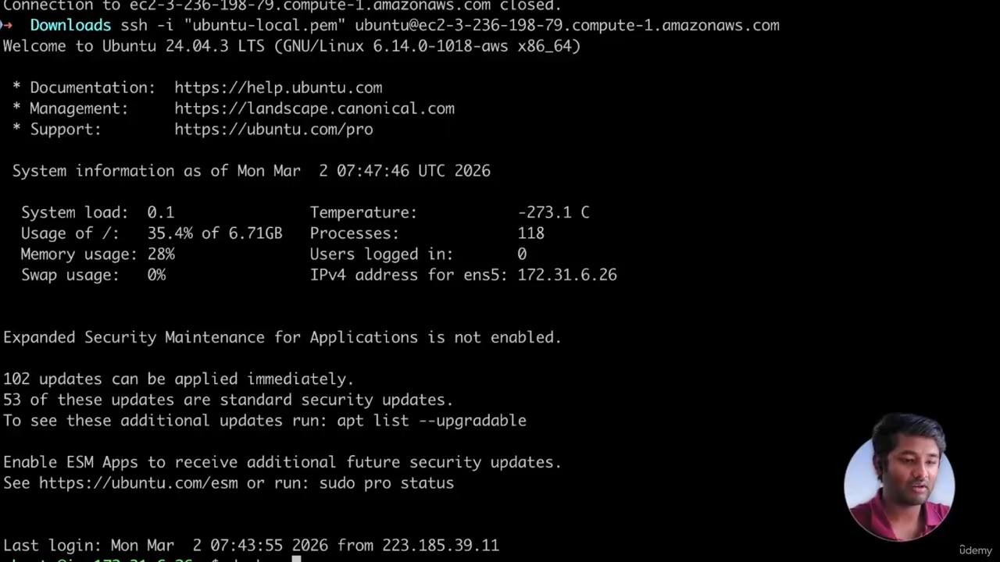

# Docker Masterclass P009–P012：从「为什么是 Docker」到装好并跑通 `hello-world`

> 覆盖课程 P009–P012。P009–P011 是概念地基（Docker 是什么、内部架构、在 DevOps/云里的位置），P012 是动手安装（AWS EC2 Ubuntu + Mac/Windows）。本文按「先讲清装的是什么 → 再一步步装 → 最后验证」的顺序重组，读者照着第 3、4 节能从零把 Docker 环境跑起来。

---

## 1. 这一节做什么

这一节解决四件事，按先后依赖排列：

1. **搞清楚 Docker 到底是什么**（P009）。它不是一个"凭空发明容器"的工具——Linux 本身早就有容器能力（namespaces、cgroups），Docker 的价值是**把创建、运行、管理容器的过程变得简单、可移植、标准化、对开发者友好**。讲师用"集装箱标准化"来类比：货物还是那些货物，是箱子统一了尺寸，才让全球航运跑得起来。
2. **搞清楚运行 `docker run nginx` 时背后发生了什么**（P010）。答案藏在 Docker 的三组件架构里：Client（下命令的地方）→ Daemon（真正干活的守护进程）→ Registry（存镜像的仓库）。这条链路解释了一个新手最常见的疑惑：为什么我本地没有 nginx 镜像，它却知道去哪里拉。
3. **搞清楚 Docker 在工程里被用在哪些地方**（P011）。七个用例：环境一致性、CI/CD、微服务、云部署、应用打包分发、新人环境标准化、多版本测试。这一段回答了"我为什么非学它不可"。
4. **把 Docker 装到机器上并跑通**（P012）。这是本节唯一有实操的部分：在 AWS EC2 的 Ubuntu 实例上装 Docker Engine、把当前用户加进 `docker` 组、重启、用 `docker run hello-world` 验证；顺带讲了 Mac/Windows 上装 Docker Desktop 的流程。

**学完你应该达到的状态**：本机（或一台 Ubuntu 机器）上 `docker --version`、`docker info`、`docker run hello-world` 三条命令全部正常输出，且不需要在 `docker` 前面加 `sudo`。

**这一节不做什么**：不写 Dockerfile、不构建自定义镜像、不讲数据卷和网络、不讲 Docker Compose。P012 的讲师也明确说了"这一集只聚焦安装，容器细节放到后面"。所以本文的"完整代码"是安装脚本和验证脚本，而不是一个应用。

---

## 2. 讲师原话（带出处）

关于 Docker 的定位，P009 里讲师给了一个非常值得记住的"标准答法"：

> "不要回复说 Docker 是容器化工具，而要回复：Docker 是一个让创建、运行和管理容器变得容易的工具。它并没有发明容器，Linux 已经具备这种能力。"
> —— p009 [00:19]

也就是说，面试或跟人解释时，"容器化工具"这个说法不够准确，准确的说法是"让容器的创建、运行、管理变简单的工具"。紧接着他用集装箱类比：

> "航运业完成标准化之后，我们有了统一尺寸的标准箱……而这正是 Docker 实际做的事情。"
> —— p009 [01:08]



讲 Docker 的三个核心概念时，他把"配方 → 成品 → 运行中的实例"这条链讲得很清楚：

> "你编写 Dockerfile。这就是我之前说的配方。Docker 构建镜像，也就是包，而镜像作为容器运行……从一个镜像可以创建多个容器。"
> —— p009 [03:51]



关于架构，P010 用"点外卖"打比方：你 App 下单（Client）→ 餐厅后厨做菜（Daemon）→ 食材仓库（Registry）。三个角色的定义他原话是：

> "Docker 客户端是指挥官……Docker 守护进程才是真正的大脑，是实际执行工作的工人……Docker 仓库是存放镜像的仓库。"
> —— p010 [01:31]



关于镜像从哪来，他给出了本节最实用的一条判断逻辑：

> "Docker 守护进程会检查本地系统中是否存在该镜像。如果不存在，它就会到 Docker Hub 获取该镜像。"
> —— p010 [03:56]



关于 Docker 在工程里的位置，P011 给了一句总结性的话：

> "Docker 充当打包系统、交付箱和部署单元。因此它处在 DevOps 的中间位置。"
> —— p011 [02:35]



到了 P012 的安装环节，他先交代了命令的来源，这点很重要——**安装命令不是他现编的，是官方文档 + 配套 GitHub 仓库的 MD 文件**：

> "我们运行的任何命令，如果你想了解它实际做了什么，所有内容都记录在这个仓库中……它来自 Docker Hub 的官方文档。"
> —— p012 [00:26]



关于把用户加进 docker 组之后的"坑"，讲师踩了一遍并给了正确解法：

> "如果我运行 docker run hello world，它提示权限被拒绝……只要做了任何配置更改，Linux 系统都需要重启。所以让我们重启机器。"
> —— p012 [05:40]



最后验证成功时，他把整个链路复述了一遍：

> "它尝试在本地查找 hello world 最新镜像，但没有找到，于是尝试连接制品库并搜索该镜像；找到后拉取该镜像，然后执行该镜像。"
> —— p012 [07:00]



> 需要如实说明的边界：**P012 的逐字稿是讲师边操作边口述，并没有把每条命令的完整文本念出来**。下面第 3、4 节的命令，是按"讲师口述的步骤 + 他明确说了来源是 Docker 官方 Ubuntu 安装文档"这两点恢复出来的标准命令。步骤顺序、组件清单（CLI、containerd.io、buildx、compose 插件）、`usermod -aG docker`、重启验证，都与逐字稿一一对应；只是具体字符串是我按官方文档补全的，读者照抄可以跑通，但要知道"逐字稿本身没有逐字给出这些字符串"。

---

## 3. 从零复现

### 3.1 先决定装在哪

讲师在 P012 开头给了两个选项：

- **方案 A（课程采用）**：AWS EC2 起一台 Ubuntu 实例，SSH 上去装。好处是不污染本机、可以随时 stop/start 继续练。
- **方案 B**：Mac / Windows 直接装 Docker Desktop（P012 后半段演示）。

下面两条都写。方案 A 是主线，因为课程里所有终端演示都是在 Ubuntu 上做的。

### 3.2 方案 A：在 AWS EC2 Ubuntu 上安装

**Step 1 — 起实例**

登录 AWS 控制台 → EC2 → Launch instance：

| 配置项 | 课程里的选择 | 说明 |
|---|---|---|
| Name | `docker-practice`（讲师口述为 "stalker pack"，名字随意） | 只是个标签 |
| AMI | Ubuntu | 讲师只说选 Ubuntu，没讲具体版本；AWS 现在默认给 Ubuntu 24.04 LTS，命令里的 `VERSION_CODENAME` 会自动适配 |
| Instance type | 课里口述为 `p3.micro` | AWS 实际没有 p3.micro 这个规格，p3 系列最小是 GPU 机型 p3.2xlarge；按免费层理解应为 **t3.micro**（或 t2.micro），本文按 t3.micro 走 |
| Key pair | 选已有的 `ubuntu-local`，没有就新建并下载 `.pem` | 后面 SSH 要用 |
| Security group | 保持默认，先不开额外端口 | 讲师原话是"需要的时候再临时开" |

点 Launch instance，等状态变成 running。

**Step 2 — SSH 登录**

讲师演示的是 SSH Client 方式（不是浏览器里的 EC2 Instance Connect）。在实例页点 Connect → SSH client，复制它给出的命令，形如：

```bash
chmod 400 ~/Downloads/ubuntu-local.pem
ssh -i ~/Downloads/ubuntu-local.pem ubuntu@<你的实例公网IP>
```

> EC2 重启后公网 IP 会变，每次都要回控制台确认新 IP。这是课程里没提但一定会撞上的问题（见第 7 节）。

**Step 3 — 执行安装脚本**

登录进去以后，把第 4 节的 `install-docker-ubuntu.sh` 传上去或直接贴进终端执行。它做的事和讲师在 P012 里一条条敲的顺序完全一致：

1. 移除 Ubuntu 自带的冲突包（`docker.io`、`docker-engine`、`containerd`、`runc`）
2. `apt update`，装 `ca-certificates`、`curl`、`gnupg`
3. 建 `/etc/apt/keyrings` 目录
4. 下载 Docker 官方 GPG key
5. 把 Docker 的 apt 源写进 `/etc/apt/sources.list.d/docker.list`
6. `apt install docker-ce docker-ce-cli containerd.io docker-buildx-plugin docker-compose-plugin`
7. `systemctl enable --now docker`
8. `usermod -aG docker $USER`

**Step 4 — 重启实例**

这是讲师在 P012 [05:40] 反复强调的一步：加完组之后当前 shell 的组信息不会立刻刷新，`docker run` 仍然会 permission denied。讲师的做法是**在 AWS 控制台重启实例**，重新 SSH。

> 其实不必重启整台机器，`newgrp docker` 或重新登录一次即可。但课程用了重启，我们按课程来；`newgrp docker` 作为备选写在第 7 节。

**Step 5 — 验证**

重新 SSH 后执行：

```bash
docker --version
docker info
docker run hello-world
```

三条都过，安装就算完成。`hello-world` 的输出会明确告诉你"本地没有 → 去 Docker Hub 拉 → 拉到了 → 跑起来了"，正好对应 P010 讲的架构链路。

### 3.3 方案 B：Mac / Windows 安装 Docker Desktop

讲师在 P012 [06:06] 起讲了这条路径，比 Linux 简单得多：

1. 浏览器搜 `docker install mac` 或 `docker install windows`，点进 Docker 官网第一条。
2. **Mac**：按芯片选 Apple Silicon 还是 Intel，下载 `.dmg`，双击，拖进 Applications，打开，一路允许权限。
3. **Windows**：下载 `.exe`，双击，一路 Next；Windows 版依赖 WSL2（课里没展开，见第 7 节）。
4. **装完必须手动启动 Docker Desktop**——这是 Mac/Windows 和 Linux 最大的区别。Linux 上装完 daemon 就是后台服务；Mac/Windows 上 daemon 跑在 Docker Desktop 这个图形应用里，**应用没开，`docker` 命令会直接报 "无法连接到 Docker 守护进程"**。
5. 启动后开终端跑 `docker run hello-world`，输出和 Ubuntu 上一模一样。

P012 [08:25] 讲师原话：Mac/Windows 上"这里唯一不同的是，之前我们用的是 EC2 实例，而这里用的是 Docker Desktop"——流程和输出完全一致，只是 daemon 的宿主不同。

### 3.4 收尾：停掉实例

课程练完，讲师在 P012 [07:29] 的操作是 **Stop instance，不是 Terminate**。Stop 只是关机，下次 Start 还能接着用；Terminate 会销毁实例和磁盘。练习环境请务必用 Stop。

---

## 4. 完整代码

以下三个脚本可原样保存执行。路径按 `scripts/` 目录组织，实际放哪都行。

### 4.1 `scripts/install-docker-ubuntu.sh`

```bash
#!/usr/bin/env bash
# 在 Ubuntu 22.04 / 24.04 上安装 Docker Engine（官方 apt 源方式）
# 课程 P012 讲师逐条执行的命令，收拢成一个脚本
set -euo pipefail

echo "==> [1/8] 移除 Ubuntu 自带的冲突包（如果存在）"
sudo apt-get remove -y docker docker-engine docker.io containerd runc || true

echo "==> [2/8] 更新 apt 索引并安装基础依赖"
sudo apt-get update -y
sudo apt-get install -y ca-certificates curl gnupg

echo "==> [3/8] 创建存放 keyring 的目录"
sudo install -m 0755 -d /etc/apt/keyrings

echo "==> [4/8] 下载 Docker 官方 GPG key"
sudo curl -fsSL https://download.docker.com/linux/ubuntu/gpg \
  -o /etc/apt/keyrings/docker.asc
sudo chmod a+r /etc/apt/keyrings/docker.asc

echo "==> [5/8] 把 Docker 的 apt 源写入 sources.list.d"
echo \
  "deb [arch=$(dpkg --print-architecture) signed-by=/etc/apt/keyrings/docker.asc] https://download.docker.com/linux/ubuntu \
  $(. /etc/os-release && echo "${VERSION_CODENAME}") stable" | \
  sudo tee /etc/apt/sources.list.d/docker.list > /dev/null

echo "==> [6/8] 更新索引并安装 Docker 全套组件"
sudo apt-get update -y
sudo apt-get install -y \
  docker-ce \
  docker-ce-cli \
  containerd.io \
  docker-buildx-plugin \
  docker-compose-plugin

echo "==> [7/8] 启用并立刻启动 docker 服务"
sudo systemctl enable --now docker

echo "==> [8/8] 把当前用户加入 docker 组（免 sudo 用 docker）"
sudo usermod -aG docker "${USER}"

echo ""
echo "安装完成。接下来请："
echo "  1) 重启实例（或在当前 shell 执行: newgrp docker）"
echo "  2) 运行: docker run hello-world"
```

执行方式：

```bash
chmod +x scripts/install-docker-ubuntu.sh
./scripts/install-docker-ubuntu.sh
```

### 4.2 `scripts/verify-docker.sh`

```bash
#!/usr/bin/env bash
# 验证 Docker 安装是否成功，对应课程 P012 结尾的三连验证
set -uo pipefail

fail=0

echo "==> 1. docker --version"
if docker --version; then
  echo "    OK"
else
  echo "    FAIL：docker 命令不可用"
  fail=1
fi

echo ""
echo "==> 2. 当前用户是否在 docker 组里"
if id -nG "${USER}" | tr ' ' '\n' | grep -qx docker; then
  echo "    OK：${USER} 在 docker 组"
else
  echo "    FAIL：${USER} 不在 docker 组，请确认 usermod 执行后已重启/newgrp"
  fail=1
fi

echo ""
echo "==> 3. docker info（会检查 daemon 是否可达）"
if docker info >/dev/null 2>&1; then
  echo "    OK：daemon 可达"
else
  echo "    FAIL：无法连接 Docker daemon"
  echo "    Linux：systemctl status docker"
  echo "    Mac/Win：确认 Docker Desktop 已启动"
  fail=1
fi

echo ""
echo "==> 4. docker run hello-world"
if docker run --rm hello-world; then
  echo "    OK：hello-world 跑通"
else
  echo "    FAIL：hello-world 没跑通"
  fail=1
fi

echo ""
if [ "${fail}" -eq 0 ]; then
  echo "全部通过，Docker 环境已就绪。"
else
  echo "有检查项失败，按上面的提示逐项排查。"
  exit 1
fi
```

### 4.3 `scripts/run-hello-world.sh`（可选，单独跑一遍加深理解）

```bash
#!/usr/bin/env bash
# 完整走一遍 P010 讲的架构链路：
# Client 发命令 -> Daemon 查本地 -> 没有就去 Registry 拉 -> 跑成容器
set -euo pipefail

echo "STEP 1: 先清掉本地的 hello-world 镜像，模拟'本地没有'"
docker rmi hello-world:latest 2>/dev/null || echo "  本地本来就没有，跳过"

echo ""
echo "STEP 2: 确认本地镜像列表（此时应该是空或只剩别的）"
docker images

echo ""
echo "STEP 3: docker run hello-world（观察 Client → Daemon → Registry 的完整链路）"
docker run hello-world

echo ""
echo "STEP 4: 再看一次本地镜像列表，hello-world:latest 已经落地"
docker images
```

---

## 5. 逐行解释

只解释 4.1 的安装脚本，验证脚本照着读就能懂。

**`set -euo pipefail`**
`-e`：任一命令返回非 0 立刻退出，避免安装到一半继续往下滚；`-u`：引用未定义变量报错；`-o pipefail`：管道中任一环节失败就算失败。**对应前端**：类似 `Promise` 链里一有 reject 就中断，而不是像 `forEach` 那样默默把错误吞掉。

**`apt-get remove -y docker docker-engine docker.io containerd runc || true`**
Ubuntu 官方源里也有一份 `docker.io`，版本旧、包名与 Docker 官方 ce 版冲突。先移除它们再装官方版，否则会出现"装完了但 CLI 和 daemon 版本对不上"的怪现象。`|| true` 是因为**这些包本身可能就不存在**，移除失败不该中断脚本。`apt` 是 Ubuntu 的包管理器，**类比 Node 就是 `npm`**，`remove` 相当于 `npm uninstall`。

**`apt-get install -y ca-certificates curl gnupg`**
后续要 `curl` 下载 GPG key、要 `gpg` 验签、要 CA 证书走 HTTPS，这三样必须先有。

**`install -m 0755 -d /etc/apt/keyrings`**
`install` 是 coreutils 里的命令，`-d` 表示"建目录"，`-m 0755` 表示权限。等价于 `mkdir -p` + `chmod`。`/etc/apt/keyrings` 是 apt 存放第三方仓库公钥的标准目录。

**`curl -fsSL .../gpg -o /etc/apt/keyrings/docker.asc`**
`-f` 让 4xx/5xx 返回非 0（默认 curl 拿到 404 也算成功，很坑），`-s` 静默、`-S` 出错时仍打印错误、`-L` 跟随重定向、`-o` 写到文件。这就是 P012 [03:32] 讲师说的"从 Docker 自身下载官方 GPG 密钥"。GPG key 的作用是让 apt 在装包时验证"这个包确实是 Docker 官方签的"，**类比 npm 的 `npm config set registry` + 锁文件签名验证**，防止中间人篡改。

**`echo "deb [arch=... signed-by=...] https://... $(. /etc/os-release && echo "${VERSION_CODENAME}") stable" | sudo tee /etc/apt/sources.list.d/docker.list`**
- `arch=$(dpkg --print-architecture)`：自动填 `amd64` 或 `arm64`，Mac 上装 Linux ARM 镜像也一样适配。
- `signed-by=`：告诉 apt 用刚下载的 `docker.asc` 验签。
- `. /etc/os-release && echo "${VERSION_CODENAME}"`：读出系统的 ubuntu 代号（22.04 是 `jammy`，24.04 是 `noble`），保证源地址和系统版本匹配。**不用手写代号，跨版本也不会出错**。
- `tee`：因为重定向 `>` 没法加 `sudo`，用 `| sudo tee` 等价于"用 root 权限写文件"。**类比 Node 里的 `fs.writeFile` 但以管理员身份执行**。

**`apt-get install -y docker-ce docker-ce-cli containerd.io docker-buildx-plugin docker-compose-plugin`**
讲师在 P012 [04:12] 特意点了这个"不是只装一个 Docker"：`docker-ce` 是 daemon、`docker-ce-cli` 是命令行、`containerd.io` 是容器运行时（真正干活的那层）、`docker-buildx-plugin` 是增强构建后端、`docker-compose-plugin` 让 `docker compose` 子命令可用。**五个包各司其职**。

**`systemctl enable --now docker`**
`systemctl` 是 Ubuntu 的 systemd 服务管理器。`enable` 让 docker 开机自启，`--now` 表示"现在就启动，不只设置开机项"。**类比 Node：`enable` 等于 `pm2 startup`，`--now` 等于 `pm2 start`**。

**`usermod -aG docker "${USER}"`**
`usermod` 改用户属性；`-a` **必须加**，表示"追加"，漏了 `-a` 会把用户从其他组踢出去；`-G docker` 指定目标组。加进 docker 组的用户执行 `docker` 命令时等同于 root 权限，因为 docker daemon 本身以 root 跑。

**`newgrp docker` / 重启**
`/etc/group` 的改动不会影响已经登录的会话。新开一个 shell 或重启就能拿到新组信息。课程选了重启（P012 [05:40]），但 `newgrp docker` 更省事。

---

## 6. 复现检查清单

按顺序打勾，任一失败先看对应提示：

- [ ] `docker --version` 有输出，且版本形如 `Docker version 2x.x.x`（不是 `command not found`）。
- [ ] `id -nG $USER` 的输出里能看到 `docker` 这个词。
- [ ] `docker info` 输出末尾能看到 `Server:` 段；如果报 `Cannot connect to the Docker daemon`：Linux 查 `systemctl status docker`，Mac/Windows 查 Docker Desktop 是否运行。
- [ ] `docker run hello-world` 能看到大段 `Hello from Docker!`，且文字里包含 "这条消息表明你的安装似乎工作正常"。
- [ ] `docker images` 能看到 `hello-world:latest`（说明镜像确实从 registry 落到本地了）。
- [ ] 执行 `docker run hello-world` 时**前面没有加 `sudo`**，否则第 4.1 节的第 8 步没生效。
- [ ] Mac/Windows 用户：**不启动 Docker Desktop 也能跑通**这一条不成立，请确认桌面端处于 Running 状态。
- [ ] EC2 用户：练习结束后用 **Stop instance**，不要 Terminate。

---

## 7. 课里没讲但你会撞上的

这一节只讲课程没覆盖、但照着做一定会遇到的问题。

**① 国内网络拉镜像会卡住甚至超时。** 课程演示的 `docker run hello-world` 直连 Docker Hub，没有网络问题。国内网络下通常会卡在 `Pulling from library/hello-world` 很久然后报 `TLS handshake timeout` 或 `context deadline exceeded`。解法是配置 registry mirror（在 `/etc/docker/daemon.json` 里加 `"registry-mirrors": [...]`，然后 `systemctl restart docker`）。具体镜像地址各云厂商文档里都有，课里没讲，需要自己按需配置。

**② EC2 停一次、公网 IP 就变一份。** 讲师 P012 收尾时只是 Stop 实例，没说这件事。下次 Start 之后 SSH 命令里的 IP 是旧的，必须回控制台重新看。要固定 IP 得分配 Elastic IP（有配额和费用），练习环境一般不值当。

**③ `usermod -aG docker` 之后的权限不止是"方便"。** 加进 docker 组的用户运行容器时可以挂载宿主机任意路径、以 root 运行容器内进程，本质上是 **root 等价权限**。课程只说了"这样不用 sudo"，没提安全含义。公司生产机上加组要慎重，别给不该给的人加。

**④ 漏掉 `-a` 的 `usermod -G docker $USER` 会把用户从其他组里踢出去。** 这是 `usermod` 出了名的坑，脚本里已经写了 `-aG`，手动敲命令时千万别省 `-a`。

**⑤ Mac 上架构和镜像架构不匹配。** Apple Silicon 是 arm64，某些老镜像只有 amd64 版，`docker run` 会报 `no matching manifest`。解法是 `docker run --platform linux/amd64 ...`（性能会打折），或者换 multi-arch 镜像。课程录的时候讲师只提了"按芯片选安装包"，没讲运行期的架构问题。

**⑥ Windows 的 Docker Desktop 依赖 WSL2 和虚拟化。** 课里说"下 exe 一路 Next"，但实际前提是 BIOS 里开了虚拟化、Windows 装了 WSL2、并且用户加入 `docker-users` 组（企业环境常见）。不满足条件时安装器会直接拦下来，报错文案很生硬。

**⑦ Mac/Windows 上 Docker Desktop 是**图形应用**，不是后台服务。** Linux 上装完 `systemctl enable --now` 之后 daemon 永远在跑；Mac/Windows 上关掉 Docker Desktop 就等于关掉 daemon，`docker` 命令立刻报 "无法连接到 Docker 守护进程"。这是从 Linux 迁移过来的人最常犯的错。

**⑧ 磁盘会被悄无声息吃掉。** 每拉一次镜像、每跑一次容器都会占盘，`docker system prune -a` 能清干净，但课里完全没提。EC2 免费层默认 8G 盘，练久了 `No space left on device` 会突然出现。

**⑨ 时间不同步会导致 TLS 失败。** EC2 实例偶尔因为重启后时间没同步，`docker pull` 报证书过期。`timedatectl` 看一下时间对不对，`sudo systemctl restart systemd-timesyncd` 能救回来。属于低频但真会遇到的问题。

**⑩ `docker run` 不加 `--rm` 的容器会一直躺在 `docker ps -a` 里。** 课程里为了观察"从拉到跑"的链路，用的是标准 `docker run`，所以 `hello-world` 退出的容器会留一条记录。验证完记得 `docker rm $(docker ps -aq)`，或者下次直接 `docker run --rm hello-world`（4.2 节的脚本已经加了 `--rm`）。

**⑪ 关于"锁 / 事务 / 并发"的类比（P009–P012 未涉及）。** 这四集讲的是 Docker 是什么和怎么装，还没进入容器运行期的隔离、数据卷、多容器编排，所以不涉及锁和事务问题。等到后面讲 volumes 和 compose 时，会有"多个容器同时写同一个挂载目录"的问题，那时可以类比 Node 里两个 `fs.writeFile` 同时写同一个文件——不保证顺序、可能互相覆盖。现在只需知道这一节没有这块内容，别提前焦虑。

**⑫ 一段可以忽略但要提前知道的说明。** 课程里提到的 "p3.micro" 是讲师口述失误——AWS 没有这个实例类型，p3 是 GPU 系列（最小 p3.2xlarge，按时计费且不便宜）。照 t3.micro 或 t2 micro 走即可，两者都是免费层覆盖的类型。如果你在 AWS 控制台下拉列表找不到 `p3.micro`，不是你操作错了，是这个类型本来就不存在。

**完成 P012 后，你就站在了后续所有容器化内容（Dockerfile、镜像构建、数据卷、网络、Compose、K8s）的起跑线上。** 按第 6 节清单自查一遍，确认 `docker run hello-world` 能不加 `sudo` 跑通，就可以往下走了。