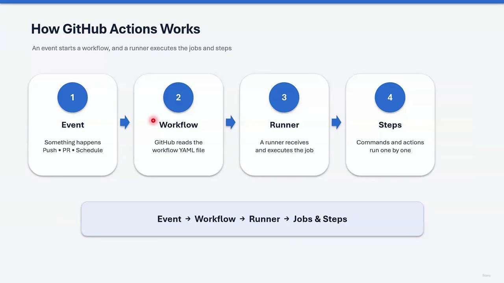
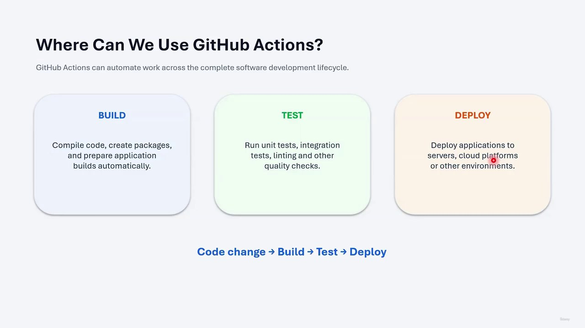
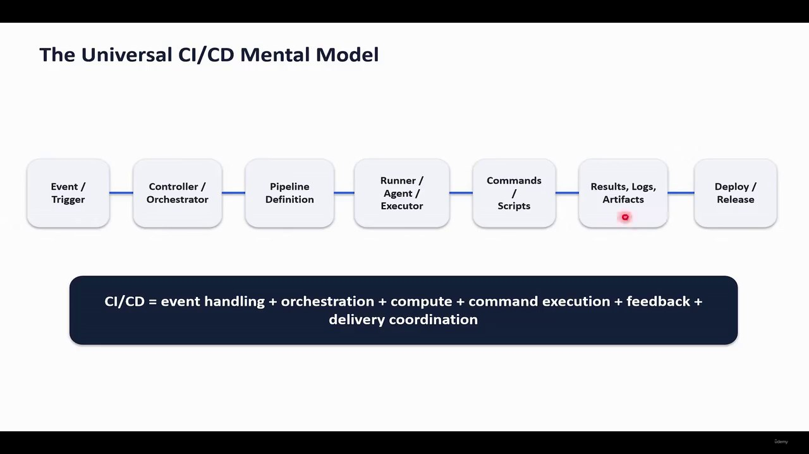
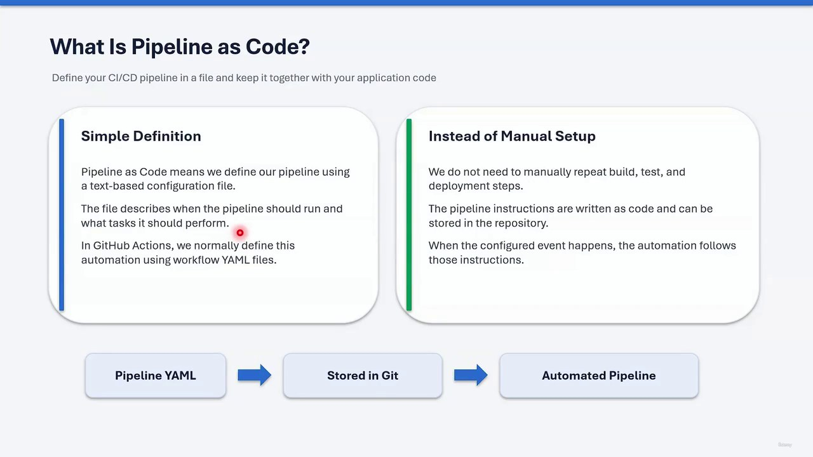
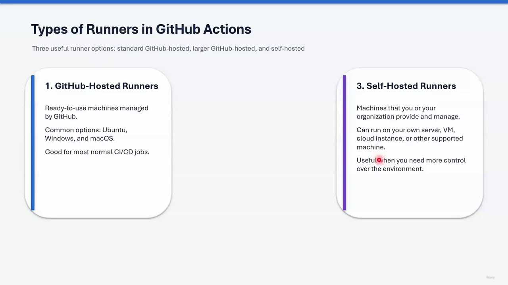
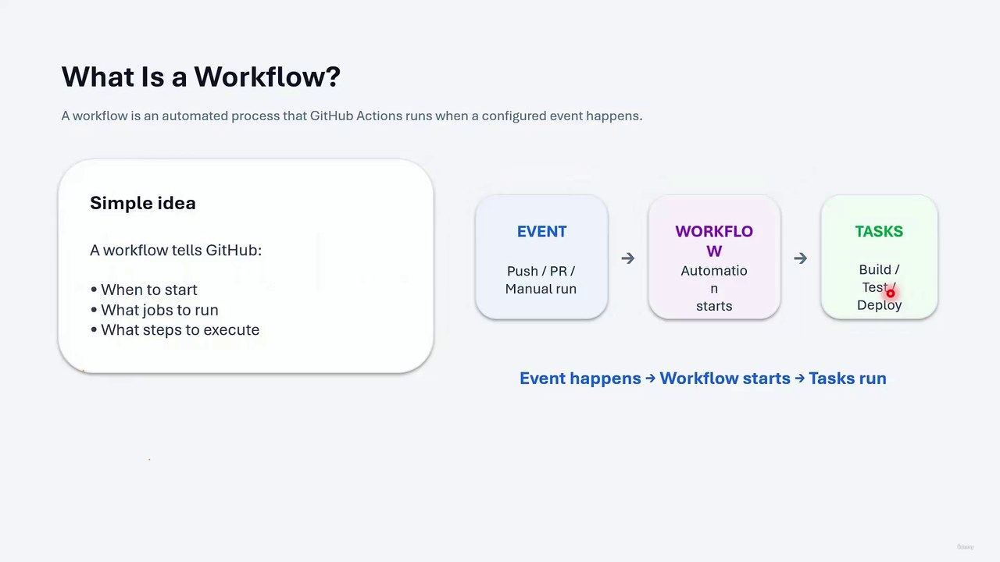
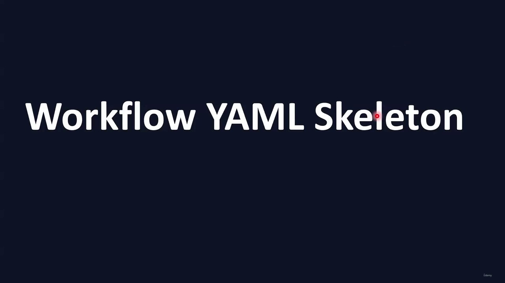

# GitHub Actions Complete（P1–P10）课程复现文档

## 1. 这一节做什么

这 10 节课是 GitHub Actions 的入门概念篇，目标不是直接做一个业务项目，而是让你先建立一条完整的认知链路：**CI/CD 是什么 → GitHub Actions 在 CI/CD 里扮演什么角色 → 它由哪些部件组成 → 这些部件在一个最小 workflow 里怎么落地**。

课程本身没有给出完整项目代码，也没有给依赖版本和启动命令；逐字稿主要是讲师口述概念，P010 才出现一个 YAML 骨架的文字描述。因此本文档会严格区分两件事：

- 讲师讲过的概念、流程、字段名，原样整理；
- 为了让读者能“照着复现”，补充一个最小可运行的 `.github/workflows/ci.yaml`，并明确标注哪些内容是课里没讲、属于通用操作或示意代码。

读完后你应该能自己创建一个仓库，写一个最小 workflow，推送到 GitHub，并在 Actions 页面看到它跑起来。它不会构建真实应用，但能验证你对 event、workflow、job、runner、step 这条链路的理解是否正确。

## 2. 讲师原话（带「—— pNNN [MM:SS]」）

讲师先定义 CI/CD。CI 是 continuous integration，核心是开发者频繁把代码推到共享仓库后，系统自动构建和测试并反馈结果：

> "只要开发者推送变更，持续集成就能自动构建应用、测试应用并共享反馈。"
> —— p002 [00:46]

CD 有两个容易混的概念：continuous deployment 不需要人工批准就部署到目标环境；continuous delivery 会把变更准备好，但最终部署通常需要人工批准：

> "持续部署在将变更应用到目标环境时不需要任何人工批准；而持续交付则需要人工批准……"
> —— p002 [01:40]

然后讲师解释 GitHub Actions 是什么：它是 GitHub 内部的自动化平台，用来自动化开发生命周期中原本手动做的任务：

> "GitHub Actions 是 GitHub 中提供的一个自动化平台或功能。"
> —— p003 [00:15]

他把 GitHub Actions 的完整流程拆成四部分：event、workflow、runner、step。event 是仓库里发生的事情，例如 push、pull request、schedule；workflow 是定义自动化步骤的 YAML 文件；runner 是实际执行 job 的机器；step 是 job 里要跑的命令或 action：

> "首先是事件……接下来是工作流……然后是运行器……再然后是步骤。"
> —— p003 [00:57]



关于使用场景，讲师强调 GitHub Actions 不只是 build、test、deploy，还可以做代码质量检查、创建 release、构建 artifact、发布包、发 Slack/Teams 通知，也可以连接 AWS、Azure、Google Cloud、Docker、Kubernetes 等：

> "GitHub Actions 不仅用于构建、测试和部署，还可以自动化许多其他任务。"
> —— p004 [00:37]



在讲通用 CI/CD 流程时，讲师说不同工具名字、功能、语法不同，但底层流程很像：event 发生 → 系统收到事件并启动 workflow 自动化 → controller 检查 pipeline 定义并决定跑什么 → runner/agent 执行命令和脚本 → 收集结果、日志、artifact → 需要时进入部署/发布阶段：

> "事件发生后，持续集成/持续部署系统会接收该事件并启动工作流自动化。随后，所需的作业和命令会在运行器上执行。"
> —— p005 [00:48]



他特别强调 controller 只负责协调和管理执行流程，实际命令由 runner 执行：

> "控制器只负责协调和管理整个执行流程。因此，实际命令由运行器执行，而不是由控制器执行。"
> —— p005 [01:52]

Pipeline as code 的定义是：用文本配置文件定义 CI/CD pipeline。GitHub Actions 里就是 YAML workflow 文件：

> "流水线即代码是指，我们使用基于文本的配置文件来定义持续集成/持续部署流水线。"
> —— p006 [00:08]



好处有三点：版本控制、可重复、团队容易 review：

> "首先，流水线会纳入版本控制……其次，具备可重复性……最后，流水线会更便于团队评审。"
> —— p006 [01:17]

Runner 是执行 GitHub Actions job 的机器：

> "运行器是执行我们 GitHub Actions 作业的机器。"
> —— p007 [00:19]

Runner 分两类：GitHub-hosted runner 由 GitHub 提供并管理，可选 Ubuntu、Windows、macOS；self-hosted runner 由我们自己提供和管理机器，控制更强，但要自己维护和安全：

> "GitHub 会为我们提供并管理运行器……使用自托管运行器时，机器由我们自己提供并管理。"
> —— p008 [00:27]



Workflow 是 GitHub Actions 里的一个自动化流程。它在仓库的 `.github/workflows` 目录下，以 YAML 文件形式存在；一个仓库可以有多个 workflow 文件：

> "在 GitHub 中，我们把工作流创建为 GitHub 仓库内的 YAML 文件……也就是放在 .github/workflows 目录下。"
> —— p009 [00:27]



最后 P010 讲 YAML 骨架。讲师带着看了一个简单 workflow：`name` 是 workflow 名称；`on` 告诉 GitHub 什么时候启动，这里是 `push`；`jobs` 下定义要做的活，这里有一个 job 叫 `build`；`runs-on` 指定 runner，这里是 `ubuntu-latest`；`steps` 是实际任务，这一步用 `run` 执行 `echo`，内容是 build application：

> "首先，这里是 name 字段；接着是 on 字段；然后是 jobs 字段；runs-on 告诉 GitHub 我们要使用哪个运行器；最后，在作业内部是 steps 字段。"
> —— p010 [00:27]



## 3. 从零复现

这一节按纯讲解课的推导方式走：需求 → 约束 → 估算 → 方案 → 取舍。需要先说明：**课程没有给出真实项目、依赖版本、启动命令和容量数据**，下面凡涉及具体操作细节的地方，都会标注“课里没讲，以下为通用补充”。

### 3.1 需求

我们想要的最小能力是：开发者把代码 push 到 GitHub 后，GitHub Actions 自动执行一个任务，并把成功/失败结果反馈在仓库页面。对应讲师 p002 的 CI 例子和 p003 的 push→workflow→runner→step 流程。

这个需求不是“部署一个 AI 应用”，而是“先验证自动化链路”。所以第一个 workflow 只需要一个 job、一个 step，跑一条 `echo` 命令即可。P010 讲师给出的骨架正是这个粒度。

### 3.2 约束

课里明确提到的约束有：

1. workflow 必须放在 `.github/workflows` 目录下，GitHub 会去这个目录找 workflow 文件（p009）。
2. workflow 文件是 YAML，扩展名 `.yaml`（p006、p009）。
3. 需要指定 runner，例如 `ubuntu-latest`（p010）。
4. 如果使用 GitHub-hosted runner，机器由 GitHub 管理，我们不用自己装 runner 包（p008）。
5. 如果使用 self-hosted runner，机器由我们自己提供和管理，控制更强，但要自己维护和安全（p008）。

课里没讲但实际会遇到的约束：仓库需要启用 Actions、YAML 不能用 Tab 缩进、`on: push` 默认会触发所有分支、`ubuntu-latest` 的具体镜像版本会随时间变化。这些放到第 7 节展开。

### 3.3 估算

课程没有给出任何容量估算、并发估算、费用估算或构建时长数据。所以这里不能编造算式。唯一能写清楚的是“最小 workflow 的执行规模”：

- job 数量：1 个（`build`）。
- step 数量：1 个（`run: echo`）。
- runner 类型：1 台 GitHub 托管 runner，标签 `ubuntu-latest`。
- 预计耗时：课里没讲；实际取决于 GitHub 分配 runner 的时间和 `echo` 执行时间，通常远小于真实构建。

如果要做真实项目，需要补的估算维度是：并发 job 数、单 job 时长、缓存大小、artifact 存储、私有仓库计费。**这些课里都没讲**，本文档不给具体数值，避免把官方文档里的数字硬安到讲师头上。

### 3.4 方案

按讲师的概念链路，方案可以落成下面这条路径：

1. 在 GitHub 上创建一个仓库（课里没讲创建仓库的具体点击步骤，这是通用操作）。
2. 在仓库根目录创建 `.github/workflows/ci.yaml`。
3. 写入 P010 描述的骨架：`name`、`on: push`、`jobs.build.runs-on: ubuntu-latest`、`steps.run: echo ...`。
4. 提交并 push 到默认分支。
5. 打开仓库的 Actions 页面，查看这次 push 触发的 workflow run。
6. 点进 run，查看 job 和 step 的日志，确认 `echo` 输出。

这个方案对应讲师 p003 的“event 发生 → GitHub 检测 workflow → runner 执行 step”流程，也对应 p005 的“controller 决定跑什么，runner 实际执行”分工。

### 3.5 取舍

**托管 runner vs 自托管 runner**：课里 p008 给了明确取舍。托管 runner 简单，不用自己创建服务器、安装 runner 包、维护机器，适合多数普通 CI/CD 工作流；自托管 runner 控制更强，可以装自己的工具、按需求配置机器、连接自己的网络，但维护和安全责任在自己。最小复现选托管 runner，因为目标只是验证 workflow 能跑。

**pipeline as code 的取舍**：p006 讲了三个好处：版本控制、可重复、团队可 review。代价是课里没讲，但实际会带来 YAML 语法、权限、密钥管理等问题。本文档第 7 节会列。

**先 echo 还是先真实构建**：P010 的骨架就是 `echo`，所以最小复现先 `echo`。真实构建需要 checkout 代码、装依赖、跑测试，这些**课里没讲**，不要在这一篇里假装讲过。

## 4. 完整代码

课里没有给出完整 YAML 文件，只给了骨架的口述。下面这份 `ci.yaml` 是根据 P010 的字段描述整理的**示意 workflow**，可以直接保存到仓库里运行。它不是讲师逐字给出的完整文件，但字段名和结构都来自 P010：`name`、`on`、`push`、`jobs`、`build`、`runs-on`、`ubuntu-latest`、`steps`、`run`、`echo`。

### 4.1 目录结构

```text
your-repo/
└── .github/
    └── workflows/
        └── ci.yaml
```

### 4.2 完整文件：`.github/workflows/ci.yaml`

```yaml
name: CI workflow

on: push

jobs:
  build:
    runs-on: ubuntu-latest
    steps:
      - run: echo "Build application"
```

### 4.3 设计决策表

| 决策点 | 选择 | 依据 | 不这样会怎样 |
|---|---|---|---|
| workflow 放哪 | `.github/workflows/ci.yaml` | p009：GitHub 去 `.github/workflows` 找 workflow 文件 | 放在仓库根目录或其他目录，GitHub 不会识别为 workflow |
| 触发事件 | `on: push` | p010：骨架用 push 触发 | 不写 `on` 或写错事件，push 后不会自动运行 |
| runner 类型 | GitHub-hosted runner，标签 `ubuntu-latest` | p008、p010 | 写一个不存在的标签，job 会找不到 runner 而无法执行 |
| job 数量 | 1 个 `build` job | p010 骨架 | 多 job 会增加复杂度，但课程没有讲 job 依赖和并行 |
| step 内容 | 单条 `run: echo` | p010：step 用 run 执行 echo | 一上来就写真实构建，会引入课程没讲的依赖安装和缓存问题 |
| 是否自托管 | 否，先用托管 runner | p008 取舍 | 自托管需要自己维护机器和安全，不适合最小复现 |

### 4.4 组件职责表

| 组件 | 职责 | 在本文件里的体现 | 依据 |
|---|---|---|---|
| event | 触发 workflow 的事件 | `on: push` | p003、p009、p010 |
| workflow | 一个自动化流程，YAML 文件 | 整个 `ci.yaml` | p003、p009 |
| job | 一组 step，在 runner 上运行 | `jobs.build` | p003、p009、p010 |
| runner | 执行 job 的机器 | `runs-on: ubuntu-latest` | p007、p008、p010 |
| step | job 里的具体命令或 action | `steps: - run: echo ...` | p003、p009、p010 |

### 4.5 容量估算表

课程没有给出容量估算，以下只列“应关注维度”，不填编造数值：

| 维度 | 课程是否给出 | 说明 |
|---|---|---|
| 并发 job 数 | 课里没讲 | 取决于 GitHub 账户计划和仓库设置，需查官方文档 |
| 单 job 执行时长 | 课里没讲 | 本示意 workflow 只跑 echo，实际耗时以运行日志为准 |
| 缓存大小 | 课里没讲 | 课程未涉及依赖缓存 |
| artifact 存储 | 课里没讲 | 课程未涉及 artifact 上传 |
| 私有仓库计费 | 课里没讲 | 课程未涉及计费规则 |

## 5. 逐行解释

### 5.1 YAML 逐行

**`name: CI workflow`**  
这是 workflow 的显示名称。P010 说“here we have a name. This simply name off our workflow. So here we named our workflow as a CA workflow.” 课里原文是“CA workflow”，本文档按上下文写成 `CI workflow`。这个字段不影响触发和执行逻辑，但不写的话 Actions 页面会显示文件路径，可读性差。

**`on: push`**  
告诉 GitHub 什么时候启动这个 workflow。P010 说“this tell GitHub when this workflow should start here we have push”。`push` 是事件名。不写 `on` 或事件名写错，push 后 workflow 不会自动跑。课里没讲 `on` 还可以接 `pull_request`、`schedule` 等，但 p003 和 p005 提过 event 可以是 push、pull request、schedule，所以这些概念有出处，只是没有展开语法。

**`jobs:`**  
job 的集合。P010 说“inside these jobs we define the work we want to do”。一个 workflow 可以有一个或多个 job；本示意只有一个，降低复杂度。

**`build:`**  
job 的标识名。P010 说“here we created one job called build”。这个名字会显示在 Actions 页面里。它不需要和任何语言或框架对应，只是一个名字。

**`runs-on: ubuntu-latest`**  
指定 runner 标签。P010 说“Ronson tells GitHub which runner we want to use to execute this job. And here, we are using Ubuntu Latest.” 课里发音像“Ronson”，实际字段是 `runs-on`。`ubuntu-latest` 是 GitHub 托管 runner 的常用标签，p008 也提到托管 runner 可以跑 Ubuntu、Windows、macOS。不写 `runs-on`，GitHub 不知道把 job 派给哪台机器，job 无法开始。

**`steps:`**  
job 里的步骤列表。P010 说“inside our job, we have our steps. Here, steps are actually tasks we want to perform.” 每个 step 可以跑 shell 命令，也可以使用 reusable action；本示意只跑 shell 命令，对应 p009 说的“we can run our shell, bash, PowerShell or we can use reusable actions”。

**`- run: echo "Build application"`**  
这是一个 step。`run` 表示执行 shell 命令；`echo` 是命令本身。P010 说“our step simply runs echo command and the execution is build application.” 这里的输出内容就是 `Build application`。不写 `run` 而写别的键，就不是 shell 命令；写成不存在的命令，step 会失败。课里没有讲 `run` 的退出码如何影响 job 状态，但实际执行时命令非零退出会让 step 失败，这是通用行为，不是讲师原话。

### 5.2 决策逐条解释

**为什么 workflow 必须放在 `.github/workflows`？**  
P009 明确说 GitHub 有特定目录结构 `.github` 和 `workflows`，GitHub 会去这个目录找 workflow 文件。不放在这里，文件只是普通 YAML，不会被当成 workflow。课里没有讲目录名大小写是否敏感、是否支持子目录，这些以实际平台行为为准。

**为什么先用 `on: push`？**  
因为 P010 的骨架就是 push，而且 p003 举的例子也是开发者 push 代码后触发。用 push 最容易验证：你提交并推送一次，就能在 Actions 页面看到一次运行。课里没有讲 push 到哪些分支会触发；实际默认是所有分支，这会在第 7 节说明。

**为什么先用托管 runner？**  
P008 的取舍是：托管 runner 由 GitHub 提供和管理，不用自己创建服务器、安装 runner 包、维护机器；自托管 runner 控制更强，但要自己维护和安全。最小复现的目标是“跑通链路”，不是“控制环境”，所以选托管 runner。

**为什么只放一个 `echo` step？**  
P010 的示例就是 `echo`。真实构建会引入 checkout、依赖安装、测试命令、缓存、密钥等课程没有讲的内容。先放 `echo` 可以验证 event→workflow→job→runner→step 这条链路，失败时也容易定位是 YAML 结构问题还是命令问题。

**为什么不写 `actions/checkout`？**  
课里没有讲过 `actions/checkout` 这个 action 名，也没有讲过如何拉取源码。P005 只提到“source code is checked out or cloned into the respected workspace”，但没有给具体 action 名。所以本文档不写，避免把课里没讲的工具名安到讲师头上。

## 6. 复现检查清单

- [ ] 仓库根目录下有 `.github/workflows/` 目录。
- [ ] workflow 文件名为 `ci.yaml`，扩展名是 `.yaml`。
- [ ] YAML 使用空格缩进，没有 Tab。
- [ ] `name` 字段存在，名称可读。
- [ ] `on: push` 存在，事件名拼写正确。
- [ ] `jobs` 下至少有一个 job，例如 `build`。
- [ ] job 下有 `runs-on: ubuntu-latest`。
- [ ] job 下有 `steps`，至少一个 `- run: ...`。
- [ ] 文件已提交并推送到 GitHub 默认分支。
- [ ] 仓库 Actions 页面已启用（课里没讲启用步骤，需在仓库 Settings 里确认）。
- [ ] push 后在 Actions 页面能看到新的 workflow run。
- [ ] 点进 run 能看到 `build` job 和 `echo` step 的日志。
- [ ] 日志里能看到 `Build application` 输出。
- [ ] 如果失败，先检查 YAML 缩进和字段拼写，再检查事件是否匹配。
- [ ] 如果 Actions 页面没有运行记录，检查 workflow 文件是否在默认分支、Actions 是否被禁用。

## 7. 课里没讲但你会撞上的

这一节列实际动手时会遇到、但逐字稿没有展开的问题。标明“课里没讲”的，不要当成讲师原话。

1. **仓库 Actions 可能默认关闭**  
   课里没讲如何在仓库 Settings 里启用 Actions。实际第一次使用时，如果组织或仓库策略禁用了 Actions，push 后不会出现运行记录。需要到仓库的 Actions 设置里确认允许运行。

2. **YAML 不能用 Tab 缩进**  
   课里只说是 YAML 文件，没有讲语法细节。YAML 对缩进敏感，Tab 会导致解析失败。用两个空格或四个空格统一缩进。

3. **`on: push` 默认触发所有分支**  
   课里没讲分支过滤。实际 push 到任何分支都可能触发 workflow，可能产生多余运行。如果只想在特定分支跑，需要加分支过滤，但课程没有讲这个语法。

4. **`ubuntu-latest` 的具体版本会变化**  
   课里只用了 `ubuntu-latest` 这个标签，没有讲它对应哪个 Ubuntu 版本。实际平台会随 GitHub 更新镜像而变化。如果步骤依赖特定系统版本，需要查官方文档，不要假设它永远是某个版本。

5. **workflow 文件在非默认分支时可能不显示**  
   课里没讲这一点。如果只在 feature 分支添加 workflow 文件，Actions 页面可能不会按预期显示；通常需要合并到默认分支或按平台规则触发。实际以仓库行为为准。

6. **私有仓库运行 Actions 可能涉及计费**  
   课里没讲计费和额度。公开仓库和私有仓库的免费额度、计费方式不同，实际使用前需要查 GitHub 官方文档。

7. **step 失败会让 job 失败**  
   课里没讲退出码机制。`run` 的命令如果以非零状态退出，step 会标记失败，job 也会失败。`echo` 一般不会失败，所以最小示例很安全；换成真实测试命令后要关注退出码。

8. **日志查看位置**  
   课里没讲 Actions 页面怎么点。实际路径是仓库顶部 Actions 标签 → 选择 workflow → 选择某次 run → 点 job → 展开 step 查看日志。不同界面版本可能略有差异。

9. **并发与取消**  
   课里没讲并发控制。连续 push 可能产生多个同时运行的 workflow；是否需要取消旧运行、限制并发，课程没有涉及。实际项目要按团队需求配置。

10. **自托管 runner 的安全责任**  
    P008 提到自托管 runner 要自己维护和安全，但没有展开。实际自托管 runner 如果接入公共仓库，需要严格控制谁能触发 workflow，避免不受信任的代码在自有机器上执行。这是课里没讲但必须考虑的风险。

11. **密钥与配置**  
    P005 提到 runner 可以把 secrets 和 configurations 提供给 job，但没有讲 GitHub 里怎么创建 secret、怎么在 YAML 里引用。实际项目会用到，但本课程 P1–P10 没有展开。

12. **真实构建还需要 checkout、装依赖、缓存**  
    课里没有给这些步骤。P005 只说源码会被 checkout/clone 到 workspace，但没有给具体 action 名和命令。所以本文档不写 `actions/checkout`、`setup-node`、`npm ci` 等，避免编造。等后续课程讲到时再补。