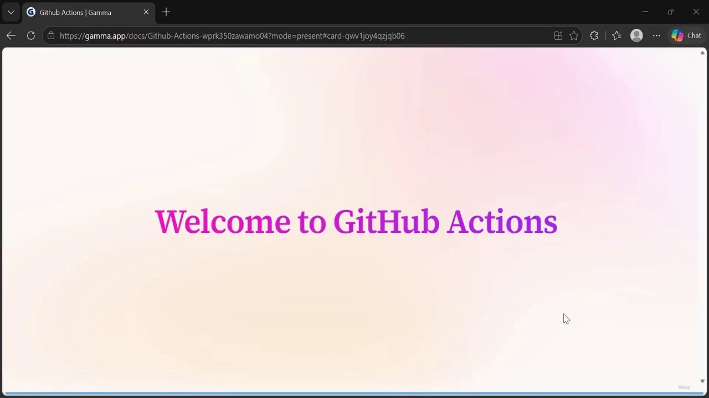
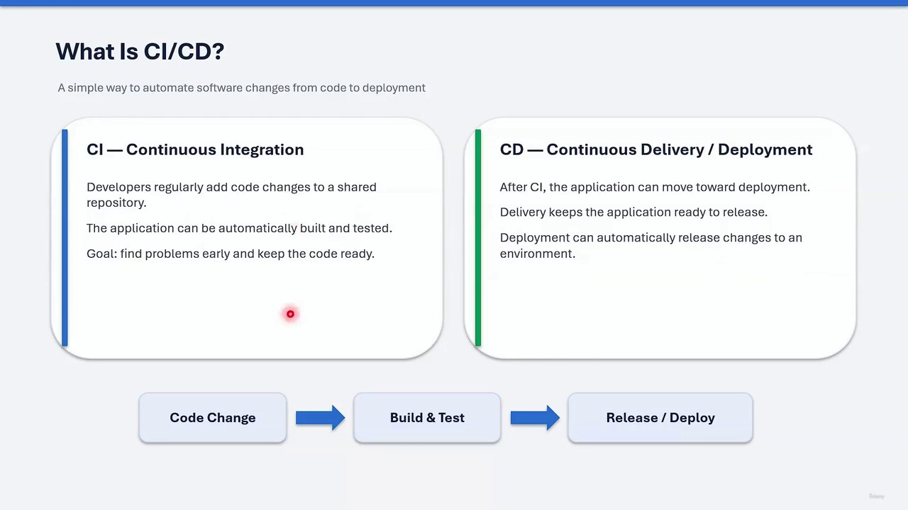
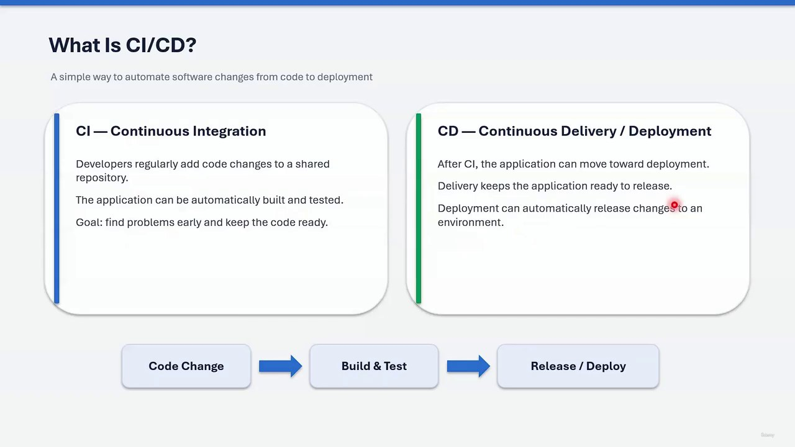
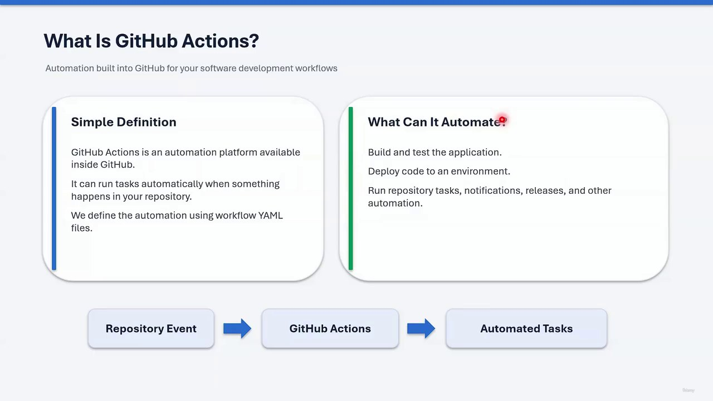
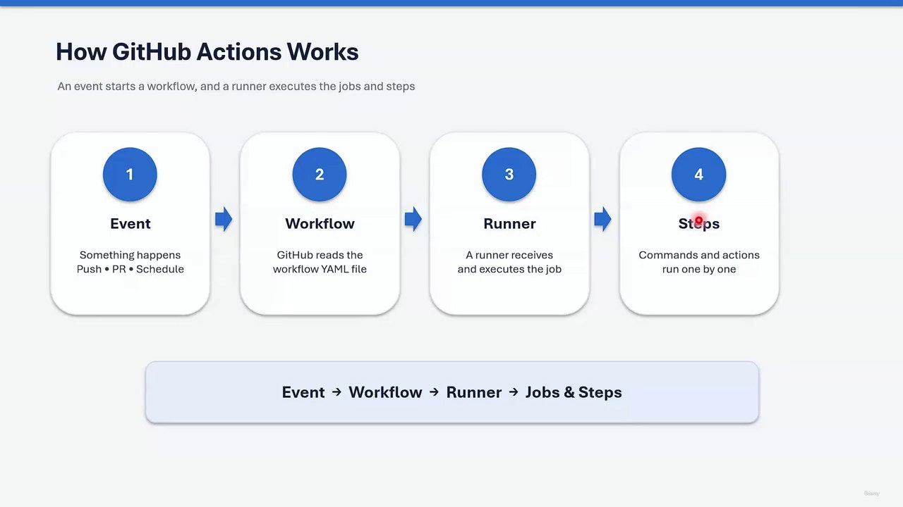
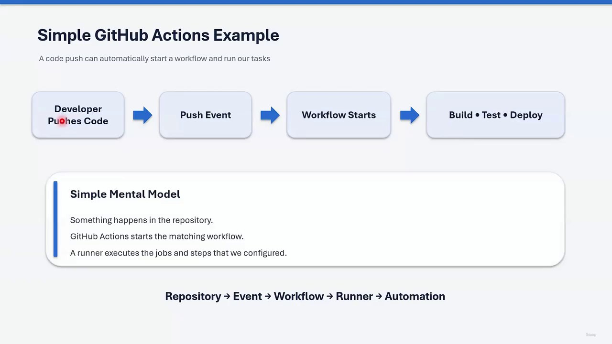
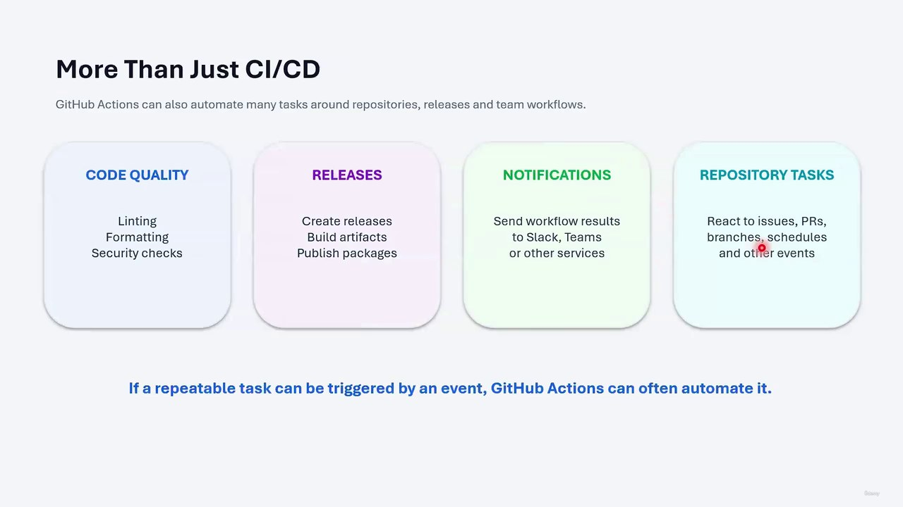
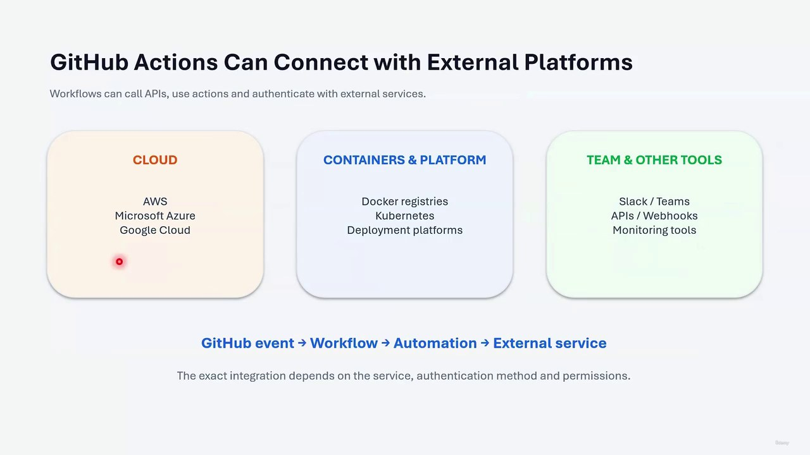

# GitHub Actions Complete（P1–P4）复现文档

> **适用对象**：前端转 AI 应用工程师，不要求后端经验。
>
> **本节边界（先说清楚）**：P1–P4 是**概念篇**。逐字稿里讲师**没有写过一行 YAML**，没有打开过仓库，也没有跑过一次 workflow。所以本文的处理方式是：
> - **【课里讲】** = 逐字稿里确实出现过的说法，带 `—— pNNN [MM:SS]` 出处；
> - **【补齐】** = 讲师没讲、但你要“照着文档把项目跑起来”必须有的东西（具体字段、文件、命令）。
>
> 这样既不会把课程没说的内容安到讲师头上，也能让你今天就把第一个 workflow 跑起来。

---

## 1. 这一节做什么

这四讲的终点，是让你能把三个问题回答清楚：

1. **CI / CD 到底在自动化什么**。讲师给的定义很朴素：CI 是“每次有人推代码，机器自动帮你 build + test 并给反馈”；CD 分两支——deployment 是**不需要人工审批**就推到目标环境，delivery 是**把东西准备好、等人工点一下**才推。—— p002 [00:00]、p002 [01:26]、p002 [01:55]
2. **GitHub Actions 由哪四个部件组成**。讲师给的是 `event → workflow → runner → step` 这条链：仓库里发生了某件事（event），GitHub 去查有没有为这个事件配 workflow（一个 YAML 文件），有的话把 job 派给一台机器（runner）去执行，机器上按顺序跑一条条 step（命令或 action）。—— p003 [00:57]、p003 [01:25]、p003 [01:54]、p003 [02:23]
3. **它能用在哪**。最常见是 build / test / deploy；除此之外还有代码质量检查、创建 release、构建 artifact、发布包、给 Slack / Teams 发通知，以及对接 AWS / Azure / GCP、Docker / Kubernetes、API Webhooks 等。—— p004 [00:00]、p004 [00:58]、p004 [01:26]

**本文要交付的可运行产物**：一个零依赖的 Node 小项目 + 一个 `.github/workflows/ci.yml`。你把它推到 GitHub，**Actions 页面会出现一次真实运行**；再故意改错一个断言，**能看到一次红色失败**。这就是讲师反复强调的“别只看视频，自己动手、故意犯点错”。—— p001 [00:29]


**你需要准备的东西**：Node.js 20（`node -v` 能出结果即可）、Git、一个 GitHub 账号。不需要 Docker、不需要云账号、不需要买任何东西。

---

## 2. 讲师原话

下面按“概念顺序”重排，不按 P 顺序念稿。

### 2.1 这门课的讲法：为什么 → 怎么运作 → 实际操作

> "我会尽量说明这个概念：为什么需要它、它如何工作，然后进行实际演示。我们会从基础开始，逐步过渡到实践概念，也建议你跟着我一起练习。不要只看视频，要自己尝试这些工作流，犯一些错误，并理解某些做法为什么有效或失败。"
> —— p001 [00:29]

这段话决定了本文的写法：每一个概念后面，都必须跟一个你能亲手跑出来的东西。所以第 3 节是“照着敲”，不是“读懂就行”。



### 2.2 CI：把“手动 build + 手动 test”变成自动

> "持续集成和持续部署基本上是一种自动化从代码变更到代码部署流程的方式。"
> —— p002 [00:00]

> "多个开发者共同开发同一个应用。他们会定期修改代码，并把代码变更推送到共享仓库。这里，每当有新代码加入时，我们都要确保代码能正常工作。这意味着我们需要手动构建应用并测试应用。因此，与其每次都手动构建和测试应用，我们可以把这个任务自动化。"
> —— p002 [00:27]

> "每当开发者推送变更，持续集成就能自动构建应用、测试应用并反馈结果。"
> —— p002 [00:56]

注意“share the feedback”这四个字——CI 的价值不只是跑测试，而是**让所有人看到结果**。这就是为什么第 6 节要你去 Actions 页面看那一次运行的日志，而不是只看本地终端。



### 2.3 CD：deployment 与 delivery 的唯一区别是“要不要人点一下”

> "持续部署是一个过程：它从持续集成中收集变更，并在无需人工批准的情况下，自动把代码变更应用到目标环境。"
> —— p002 [01:26]

> "持续交付是一个过程：它从持续集成中收集变更，并让这些变更保持就绪，可部署到目标环境。但最终部署通常需要人工批准，才能把变更应用到目标环境。"
> —— p002 [01:55]

> "持续部署与持续交付的基本区别在于：持续部署在把变更应用到目标环境时不需要任何人工批准，而持续交付需要人工批准。"
> —— p002 [01:55]

**一句话记忆**：deployment = 自动上线；delivery = 自动备好、人工上线。本文第 3 节做出的是 CI 部分（build + test）；至于“审批后再部署”在 GitHub 上怎么配，**课里没讲**，第 7 节只做提示，不展开。



### 2.4 GitHub Actions 是什么

> "GitHub Actions 是 GitHub 内部提供的自动化平台或功能。因此，GitHub Actions 能帮助我们自动化开发生命周期中手动执行的任务。"
> —— p003 [00:00]

> "设想一位开发者把一些代码推送到 GitHub。推送之后，我们可能希望构建应用、测试应用；如果一切正常，可能还希望部署应用。"
> —— p003 [00:29]

关键点：它是**内置于 GitHub 的**。你不需要另外注册一个 CI 服务、不需要另外配一套 webhook、不需要把仓库镜像出去。这也是它对个人项目最友好的地方。



### 2.5 四个部件：event / workflow / runner / step

**event（事件）**

> "事件简单来说就是 GitHub 仓库中发生的事情。例如，有人推送代码、有人创建拉取请求，或者我们希望按计划运行工作流。"
> —— p003 [00:57]

**workflow（工作流）**

> "工作流是一个 YAML 文件，我们在其中定义自动化步骤。因此，它告诉 GitHub：当事件发生时，我们希望做什么。"
> —— p003 [01:25]

**runner（执行机）**

> "这里我们需要一些机器来实际执行工作。这些机器称为运行器。因此，GitHub 会把作业发送给运行器，运行器在其中执行我们的命令和操作。"
> —— p003 [01:54]

这里讲师第一次提到 **job** 这个词——job 是“派给 runner 的一整块工作”，而下一步讲的 step 是 job 内部的更小单位。

**step（步骤）**

> "步骤实际上是我们要在作业中运行的命令或操作。……例如，借助这些步骤，一个步骤可以下载源代码，另一个步骤可以运行测试，你也可以在作业中添加自定义步骤。"
> —— p003 [02:23]

“one step can download our source code” 这句非常关键：**runner 是一台干净的机器，上面默认没有你的代码**，所以第一步必须先把仓库拉下来。本文第 4 节 `ci.yml` 的第一条 step 就是干这件事的。




### 2.6 把四件事串成一条流程

> "我是一名开发者，对应用做了一些修改。修改准备好后，我就可以把代码推送到 GitHub。这样，推送就成为这里的事件。如果我们把工作流配置为在推送时运行，GitHub 会检测到这个事件，并运行我们的工作流。……现在，运行器可以执行我们在工作流中配置的任务。例如，我们可以构建应用、运行测试，如有需要，还可以部署应用。"
> —— p003 [02:53]、p003 [03:22]



### 2.7 还能用来干什么

> "最常见的用例是自动化构建、测试和部署流程。"
> —— p004 [00:00]

> "GitHub Actions 不只能用于构建、测试和部署，我们还可以自动化许多其他任务。例如，我们可以运行代码质量检查、创建发布版本、构建应用或构建制品、发布软件包。每当自动化流程或自动化工作流成功或失败时，我们还可以向 Slack 或 Microsoft Teams 发送通知。"
> —— p004 [00:58]

> "我们可以将工作流连接到 AWS、Azure 和 Google Cloud 等云平台。我们还可以对接 Docker、Kubernetes、Slack、Microsoft Teams，或者使用 API Webhook。"
> —— p004 [01:26]





---

## 3. 从零复现

目标：从空目录开始，25 分钟内让 Actions 页面出现一次你自己的绿色运行。

### 步骤 0：确认本地环境

```bash
node -v      # 期望 v20.x
npm -v       # 期望 10.x 左右，版本不强求
git --version
```

> 【课里没讲】具体版本号。本文用 Node 20 是因为它自带 `node --test`，可以不装任何测试框架就把测试跑起来。你用 Node 18.13+ 也能跑通，再低就不保证。

### 步骤 1：在 GitHub 上建一个空仓库

浏览器操作，不涉及命令：

1. 右上角 `+` → **New repository**
2. Repository name：`gha-demo`
3. 选 **Public**（省心，Actions 免额度争议）
4. **不要**勾 “Add a README file”、**不要**勾 .gitignore、**不要**选 license —— 要一个完全空的仓库，否则第 3 步 push 会冲突。

建好后把页面上的 HTTPS 地址记下来，形如 `https://github.com/<你的用户名>/gha-demo.git`。

### 步骤 2：本地建项目骨架

```bash
mkdir gha-demo
cd gha-demo
git init
```

最终目录结构如下（先建空文件也行，第 4 节给完整内容）：

```
gha-demo/
├─ .github/
│  └─ workflows/
│     └─ ci.yml
├─ src/
│  ├─ index.js
│  └─ sum.js
├─ test/
│  └─ sum.test.js
├─ .gitignore
└─ package.json
```

建目录的命令（Windows PowerShell / macOS / Linux 通用）：

```bash
mkdir -p .github/workflows
mkdir -p src
mkdir -p test
```

### 步骤 3：把第 4 节的 5 个文件原样写入

`package.json`、`.gitignore`、`src/sum.js`、`src/index.js`、`test/sum.test.js`、`.github/workflows/ci.yml` —— 逐个复制，一个字符都别改。**尤其是 `.github` 前面那个点**，很多人建成了 `github/`，workflow 永远不会被识别。

### 步骤 4：先在本地跑通（这一步不能跳）

```bash
npm install
npm start
npm test
```

期望输出：

- `npm start` 打印 `1 + 2 = 3`
- `npm test` 打印类似 `# pass 2`、`# fail 0` 的汇总，最后退出码 0

再确认一下生成的 `package-lock.json` 存在：

```bash
ls        # macOS / Linux
dir       # Windows
```

> **为什么必须先本地跑**：runner 上跑的就是这几条命令。本地不绿，云端一定红，而云端排错比本地慢十倍。讲师说“make some mistakes and understand why something is working or failing”——犯错要在本地犯，不要在 CI 上第一次犯错。

### 步骤 5：写 workflow

把第 4 节的 `ci.yml` 写到 `.github/workflows/ci.yml`。

写完自检三件事（这是最常见的三个坑）：

1. 文件后缀是 `.yml` 或 `.yaml`，不是 `.txt`；
2. 缩进**全部是空格**，一个 Tab 都不能有；
3. 分支名写的是 `main`，跟你仓库实际默认分支一致（步骤 7 会告诉你哪里看）。

### 步骤 6：提交并 push

```bash
git add .
git commit -m "chore: add demo app and first CI workflow"
git branch -M main
git remote add origin https://github.com/<你的用户名>/gha-demo.git
git push -u origin main
```

> `git branch -M main` 是为了保证本地分支叫 `main`，和 `ci.yml` 里写的 `branches: [ main ]` 对上。如果你本地已经是 `main` 也不会报错。查当前分支名：

```bash
git branch --show-current
```

### 步骤 7：去 GitHub 看结果

1. 打开 `https://github.com/<你的用户名>/gha-demo`
2. 点顶部 **Actions** 标签
3. 左侧应出现一个叫 **CI** 的 workflow（这就是 `ci.yml` 里 `name: CI` 的值）
4. 点进去，看到一条以你 commit message 命名的运行记录
5. 点这条记录 → 点左侧 job **build-and-test** → 展开每一条 step 看输出

你会看到 step 列表从上到下依次是：`Checkout source code`、`Set up Node.js`、`Install dependencies`、`Run tests`。**这就是讲师说的 event → workflow → runner → step 四级结构在真实界面上的样子。** —— p003 [02:23]

> 第一次运行可能要等十几秒到几十秒才出现，刷新一下 Actions 页面即可。如果 5 分钟后还是空的，直接跳到第 7 节第 2 条。

### 步骤 8：故意让它失败（讲师明确要求的一步）

打开 `test/sum.test.js`，把第一个断言里的 `3` 改成 `4`：

```js
assert.strictEqual(sum(1, 2), 4);
```

本地先看一次：

```bash
npm test        # 期望：失败，退出码非 0，终端里有一段红色的失败信息
```

然后提交推送：

```bash
git add .
git commit -m "test: intentionally break assertion"
git push
```

回到 Actions 页面，等这次运行结束：图标是一个红色的叉。点进去，`Run tests` 这条 step 会被标红并自动展开，里面能看到断言失败的详细信息；job 整体也被标记为失败。

现在改回 `3`，再 push 一次，看它变绿。**这一红一绿，你就真正理解了“CI 把反馈分享给所有人”这句话的含义。**

### 步骤 9：触发一次 pull_request 事件

这一步让你看到“event 不止 push 一种”。—— p003 [00:57]

```bash
git checkout -b feature/tweak
# 随便改点东西，比如把 src/index.js 里的 '1 + 2 =' 改成 'sum(1, 2) ='
git add .
git commit -m "feat: tweak log format"
git push -u origin feature/tweak
```

push 完终端会打印一个 URL，形如 `https://github.com/<用户名>/gha-demo/pull/new/feature/tweak`，浏览器打开它，点 **Create pull request**。

创建 PR 之后，Actions 页面会**再多出一次运行**——这次是 `pull_request` 事件触发的。同一条 workflow、同样的 step，但触发它的“事件”变了。你在 PR 页面下方还能直接看到这次检查的结果（绿勾 / 红叉）。

到这里，P1–P4 讲的四个部件，你全都亲手碰过一次了。

---

## 4. 完整代码

> **诚实标注**：`.github/workflows/ci.yml` 里的具体键名（`on`、`jobs`、`runs-on`、`steps`、`uses`、`with`、`run`）**课里没讲**——P1–P4 逐字稿只说了“workflow 是一个 YAML 文件”、"steps 是命令或动作"、"一个 step 可以下载源码"、"一个 step 可以跑测试"。下面这份是按讲师说的这套结构 + GitHub 官方语法写出的最小可运行版本。`src/index.js` 和测试文件同样属于【补齐】。
>
> 另外 `actions/checkout@v4` 对应讲师说的“download our source code”那一步；`actions/setup-node@v4` 是【补齐】，讲师没提过这个名字。

### `.github/workflows/ci.yml`

```yaml
name: CI

on:
  push:
    branches: [ main ]
  pull_request:
    branches: [ main ]

jobs:
  build-and-test:
    runs-on: ubuntu-latest

    steps:
      - name: Checkout source code
        uses: actions/checkout@v4

      - name: Set up Node.js
        uses: actions/setup-node@v4
        with:
          node-version: '20'

      - name: Install dependencies
        run: npm install

      - name: Run tests
        run: npm test
```

### `package.json`

```json
{
  "name": "gha-demo",
  "version": "1.0.0",
  "private": true,
  "description": "Minimal Node project for reproducing GitHub Actions P1-P4 concepts",
  "scripts": {
    "start": "node src/index.js",
    "test": "node --test test"
  }
}
```

### `.gitignore`

```gitignore
node_modules/
npm-debug.log*
.DS_Store
```

### `src/sum.js`

```js
function sum(a, b) {
  return a + b;
}

module.exports = { sum };
```

### `src/index.js`

```js
const { sum } = require('./sum');

console.log('1 + 2 =', sum(1, 2));
```

### `test/sum.test.js`

```js
const test = require('node:test');
const assert = require('node:assert');

const { sum } = require('../src/sum');

test('sum 计算两个正数', () => {
  assert.strictEqual(sum(1, 2), 3);
});

test('sum 计算正负相加', () => {
  assert.strictEqual(sum(-1, 1), 0);
});
```

---

## 5. 逐行解释

### 5.1 `ci.yml`

| 行 | 含义 | 对应讲师的点 |
|---|---|---|
| `name: CI` | workflow 的显示名，Actions 页面左侧列表里看到的就是它 | “a workflow is a YAML file where we defined our automation steps” —— p003 [01:25] |
| `on:` | 声明**什么事件**触发这个 workflow | event —— p003 [00:57] |
| `push: branches: [ main ]` | 只有推到 `main` 才算数；推到 `feature/xxx` 不触发 | 讲师只说了“someone pushes the code”，分支过滤是【补齐】 |
| `pull_request: branches: [ main ]` | 有 PR 指向 `main` 时触发 | 讲师提到了“someone create the pull request” —— p003 [00:57] |
| `jobs:` | 一个 workflow 下可以有多个 job；本文只有一个 | job —— p003 [01:54] |
| `build-and-test:` | job 的 id，你自己起的名字，会出现在页面 URL 和日志里 | 【补齐】 |
| `runs-on: ubuntu-latest` | 指定 runner 的系统 | “we need some machines to actually execute our work. That machines are called runners” —— p003 [01:54] |
| `steps:` | 顺序执行的步骤列表，任何一步失败，后面的步骤不再执行，job 判为失败 | “steps are actually commands or actions we want to run inside the job” —— p003 [02:23] |
| `- name: Checkout source code` | step 的显示名，纯展示用，影响你读日志的体验 | 【补齐】 |
| `uses: actions/checkout@v4` | 用现成的 action，把当前 commit 的代码拉到 runner 上 | 这就是讲师说的“one step can download our source code” —— p003 [02:23] |
| `uses: actions/setup-node@v4` | 装 Node 运行环境 | 【补齐】，课里没讲 |
| `with: node-version: '20'` | 给 action 传参数；引号别省，`20` 不加引号在某些 YAML 解析里会被当成数字 | 【补齐】 |
| `run: npm install` | 直接在 runner 的 shell 里执行命令 | “steps are actually commands” —— p003 [02:23] |
| `run: npm test` | 跑测试，失败则整个 job 失败 | “another step can run the test” —— p003 [02:23] |

**为什么第二条 step 是 setup-node**：`ubuntu-latest` 这台机器上不一定有你想要的 Node 版本。这一步就是“把工具装上”，装完之后后面的 `npm` 才能用。

**为什么用 `npm install` 而不是 `npm ci`**：`npm ci` 要求仓库里有 `package-lock.json`，否则直接报错退出。本文的步骤 4 让你在本地跑过 `npm install`，理论上 lock 文件是有的、可以用 `npm ci`；但如果你漏了一步、或者 .gitignore 把 lock 忽略了，云端就会红。为了“照着文档一定能绿”，这里用兼容性最好的 `npm install`。真实项目建议改成 `npm ci`，更可复现。

### 5.2 `package.json` 的 `scripts`

- `"start": "node src/index.js"` —— 本地验证用，跟你前端项目里的 `npm run dev` 是同一个位置的东西。
- `"test": "node --test test"` —— Node 内置测试运行器，把 `test/` 目录整个交给它，它会自己找 `*.test.js`。**注意这里不写 `test/*.test.js` 这种通配符**，因为 Windows 的 cmd 不会展开 `*`，会把它当字面量传给 Node 然后报“找不到文件”。传目录是跨平台安全的写法。

这就是“前端思维”和“后端/CI 思维”的第一处差异：CI 机器上是 Linux，但你的同事可能有 Windows 本地环境，脚本要两边都能跑。

### 5.3 `src/sum.js` / `src/index.js`

用 CommonJS（`module.exports` / `require`）而不是 ESM（`export` / `import`），原因只有一个：CommonJS 不需要在 `package.json` 里加 `"type": "module"`，也不需要改文件后缀，是最少配置就能跑通的形式。**这属于语法选择，知道即可，不影响你理解 CI。**

### 5.4 `test/sum.test.js`

- `require('node:test')` —— Node 18+ 内置的测试 API，返回一个 `test` 函数。
- `require('node:assert')` —— 断言库，`strictEqual` 是全等比较。
- 每个 `test('名字', () => {...})` 是一个独立用例。任何一个用例抛异常，整个 `npm test` 就以非 0 退出码结束 —— 这就是 CI 判断“红色/绿色”的依据。

**类比 JS**：`assert.strictEqual(a, b)` 跟你写 `if (a !== b) throw new Error()` 是一回事，只是错误信息更清楚、输出更规整。

### 5.5 关于“并发”，这里补一句你必须知道的

你连着 push 两次，会**产生两次独立的运行**，它们互不影响、并行跑在各自的 runner 上。课程 P1–P4 **没有讲**这件事。在 JS/Node 里类比：就像你连续调了两次 `fetch()` 没有 `await`，两个请求同时在飞，谁先回来不一定。所以排查“为什么我的 CI 是红的”时，先确认你看的是**最新那次**运行的日志，别对着上一次的失败日志改代码。

（如果你希望“新的一次自动取消旧的”，那需要额外配置，本文不展开，以 GitHub 官方文档为准。）

---

## 6. 复现检查清单

逐条打勾，全绿说明你已经把 P1–P4 的概念落地了。

**本地环境**

- [ ] `node -v` 输出 v20.x 或 v18.13+
- [ ] `git --version` 有输出
- [ ] `npm start` 打印 `1 + 2 = 3`
- [ ] `npm test` 通过，2 个用例全绿

**目录与文件**

- [ ] 目录名是 `.github`（带点），不是 `github`
- [ ] 路径是 `.github/workflows/ci.yml`，两层目录都对
- [ ] `ci.yml` 缩进全是空格，无 Tab
- [ ] `ci.yml` 里的 `branches: [ main ]` 与 `git branch --show-current` 输出一致
- [ ] `git status` 显示 `node_modules/` 已被忽略（不在待提交列表里）

**GitHub 侧**

- [ ] 仓库里能看到 `.github/workflows/ci.yml` 这个文件
- [ ] Actions 标签页左侧出现了名为 **CI** 的 workflow
- [ ] 至少有一次运行是绿色
- [ ] 点开运行，左侧 job 名叫 **build-and-test**
- [ ] 展开后能看到 4 条 step：Checkout source code / Set up Node.js / Install dependencies / Run tests

**制造失败与恢复**

- [ ] 把断言改成 `4` 后，本地 `npm test` 失败
- [ ] push 后 Actions 出现红色运行，`Run tests` 这条 step 被标红
- [ ] 改回 `3` 后重新 push，运行恢复绿色

**事件验证**

- [ ] 新建分支并开 PR 后，Actions 页面多出一次运行
- [ ] 这次运行的触发来源是 pull_request（PR 页面能看到检查结果）

**概念自检（能不看文档答出来）**

- [ ] 能说出 event / workflow / runner / step 各自的职责
- [ ] 能说出 runner 上为什么第一步必须拉代码
- [ ] 能说出 continuous deployment 和 continuous delivery 的唯一区别
- [ ] 能说出 CI 的产出为什么是“反馈”而不只是“测试结果”

---

## 7. 课里没讲但你会撞上

以下全部是 P1–P4 逐字稿**没有涉及**的内容，属于你照着本文操作时大概率会遇到的现实问题。这里只给方向和判断依据，细节请以 GitHub 官方文档为准。

**1. 分支名不匹配 → workflow 静默不触发**
这是新手第一大坑。`ci.yml` 里写了 `branches: [ main ]`，但你仓库默认分支是 `master`，push 上去 Actions 页面**一片空白、没有任何报错**。排查方法：仓库首页左上角会显示当前分支名，对着改。改完记得 `git commit` + `push`，只改本地文件不推是没用的。

**2. push 完 Actions 页面是空的**
按顺序排查：① 等 30 秒刷新；② Actions 标签点进去，看左侧有没有 CI（没有 = 文件路径或语法错）；③ 顶部可能有一条黄色横幅提示 workflow 有语法错误，点开看具体行号；④ 确认 `.github/workflows/` 这两层目录名没写错。

**3. YAML 缩进用 Tab → 解析失败**
YAML 只认空格。VS Code 右下角可以看当前文件的缩进方式，改成 “Spaces: 2”。这条规则没有例外。

**4. `npm ci` 报错退出**
`npm ci` 强制要求 `package-lock.json`。本文用 `npm install` 就是为了绕开它。如果你的真实项目要用 `npm ci`，务必确认 lock 文件已提交、且 `.gitignore` 没有把它排掉。

**5. 免费额度与计费**
公开仓库的 Actions 通常不消耗额度；私有仓库有月度分钟数限制，超了会停。**具体数字以你账号 Settings → Billing 页面显示的为准**，不同账号类型、不同时间点都可能变，本文不写死。个人练习用 Public 仓库最省心。

**6. 同分支连续 push 会产生并行运行，旧的不自动取消**
第 5.5 节已经提过。真实项目里如果 CI 跑得慢，会出现“三条运行同时在跑、烧额度、结果还互相覆盖”的情况。GitHub 提供了取消旧运行的能力（配置项以官方文档为准），P1–P4 没讲。

**7. Secrets：绝不要把 token 写进 YAML**
后面课程大概率会讲部署，一旦要连云平台就需要密钥。原则只有一条：**密钥放仓库的 Secrets 里，YAML 里只引用变量名，不写值**。把 token 明文提交进 git 历史，清起来非常麻烦。这条 P1–P4 完全没提，但你必须提前知道。

**8. 从 fork 来的 PR，workflow 版本取自目标仓库的主分支**
意思是：别人 fork 你的仓库、改了 `ci.yml` 再提 PR，跑的**不是你 PR 里那份 `ci.yml`**，而是主分支那份。这是安全设计（防止别人用 PR 偷你的 secrets）。你自己在自己仓库开分支提 PR 不受影响，所以本文步骤 9 是能正常触发的。

**9. actions 的版本号会过期**
`actions/checkout@v4`、`actions/setup-node@v4` 里的 `v4` 是主版本标签。GitHub 偶尔会弃用老版本（比如 v3 → v4 时有过弃用提醒），届时运行日志里会出现 deprecation 警告，把数字改大即可。看到黄底警告不用慌，那不是失败。

**10. 本地能跑 ≠ 云端能跑，但反过来一定成立**
云端能跑，本地一定跑得通（因为就是同样的命令）。所以调试顺序永远是：**先在本地把 4 条 step 的命令手动敲一遍**，全绿了再 push。这是本文步骤 4 存在的全部理由，也是最省钱、最省时间的 CI 调试法。

---

## 附：本文与课程的对照表

| 课程内容 | 出处 | 本文落点 |
|---|---|---|
| 课程方法论：为什么 / 怎么运作 / 实际操作 | p001 [00:29] | 第 1 节、第 3 节 |
| CI 定义与“自动 build + test + 反馈” | p002 [00:00]、p002 [00:27]、p002 [00:56] | 第 2.2 节、第 3 节步骤 4/8 |
| continuous deployment vs delivery | p002 [01:26]、p002 [01:55] | 第 2.3 节（部署部分本文未实现，课程也未演示） |
| GitHub Actions 定义 | p003 [00:00]、p003 [00:29] | 第 2.4 节 |
| event | p003 [00:57] | 第 5.1 节 `on:`、步骤 9 |
| workflow（YAML） | p003 [01:25] | 第 4 节 `ci.yml` |
| runner | p003 [01:54] | 第 5.1 节 `runs-on` |
| step（含“拉源码”“跑测试”） | p003 [02:23] | 第 4 节 steps 四条、第 5.1 节表格 |
| 完整链路 push → 运行 → build/test/deploy | p003 [02:53]、p003 [03:22] | 第 3 节全流程 |
| build / test / deploy 常用场景 | p004 [00:00] | 第 3 节（deploy 部分超出本节范围） |
| 代码质量检查、release、artifact、发布包 | p004 [00:58] | 第 2.7 节（本节未实现） |
| 通知 Slack/Teams、对接 AWS/Azure/GCP、Docker/K8s/Webhook | p004 [01:26] | 第 2.7 节、第 7 节第 7 条 |