# GitHub Actions 完整课程 · P11–P20 复现文档

> 覆盖内容：默认分支约定、第一个 GitHub 托管 Runner 工作流、SSH 连接配置、事件（event）概念、push 事件与分支过滤、pull_request 事件与三种活动类型、用 Ruleset 阻止未通过检查的 PR 合并、workflow_dispatch 手动触发。
>
> 读者定位：前端转 AI 应用工程师。文中涉及 Git/CI 概念时会补一句「在 JS/Node 里对应什么」。

---

## 1. 这一节做什么

这十节课（P11–P20）是一条完整的「从零把 GitHub Actions 跑起来」的主线，最终你会得到：

1. 一个 GitHub 账号 + 至少一个仓库，默认分支统一用 `main`；
2. 一个能自动触发的第一个工作流（`.github/workflows/first-workflow.yaml`），跑在 GitHub 托管的 Ubuntu Runner 上；
3. 本地 Windows 机器与 GitHub 之间的 SSH 免密连接（后续所有 push 都走 SSH）；
4. 一个由 `push` 事件触发、并带 `branches: [main]` 过滤的工作流；
5. 一个由 `pull_request` 事件触发的工作流，并亲手验证 `opened` / `synchronize` / `reopened` 三种活动类型；
6. 一个 GitHub **Ruleset**，让「检查没通过就不许合并」真正生效；
7. 一个 `workflow_dispatch` 手动触发的工作流。

产出物就是仓库里的几个 YAML 文件 + 一份 GitHub 仓库设置。全部可以照着敲。

---

## 2. 讲师原话（带出处）

关于默认分支，讲师在进入实操前专门澄清：

> "在本课程中，我们将使用 main 分支作为实践示例。在 GitHub 中，创建新仓库时，main 通常被用作默认分支。"
> —— p011 [00:00]

> "在实际组织中，分支结构可能不同、可能各有差异……我不想让不同的分支策略把示例搞复杂。所以我们会保持简单，使用 main 分支作为默认分支。"
> —— p011 [00:26]

关于第一个工作流的文件位置，讲师强调得很死：

> "GitHub 支持以 YAML 语言编写流水线即代码，因此我们必须在 .github 和 workflows 目录下创建 YAML 文件。"
> —— p012 [02:21]

> "它必须是唯一的，不应像其他格式那样被随意更改。因此，工作流文件应创建在 .github 和 workflows 目录下。"
> —— p012 [02:51]

关于 Runner 标签怎么选：

> "如果是公共仓库，你可以使用所有这些工作流标签，比如 Ubuntu Slam、Ubuntu Latest……如果是私有仓库，你可以到这里根据列表来选择。"
> —— p012 [04:44]

关于 SSH 的动机：

> "通常，在使用 GitHub 仓库时，我们需要一种安全的方式向 GitHub 进行身份验证。这里，我们不必反复输入凭据，而是可以使用一个叫做 SSH 的功能。"
> —— p013 [00:00]

关于事件的定义：

> "事件是 GitHub 中发生的某件事。例如，开发者可能推送一些代码，或者有人可能创建拉取请求。当这类事情发生时，GitHub 可以利用该事件来触发工作流。"
> —— p014 [00:00]

关于 push 事件的流程：

> "首先我们修改代码，然后把更改推送到 GitHub 仓库，GitHub 检测到该事件，最后我们的工作流自动启动。所以只需记住这个流程：修改代码、推送到 GitHub、工作流启动。"
> —— p015 [01:27]

关于 `branches` 过滤：

> "我们并不关心每个分支。我们希望这个工作流只在推送到 main 分支时触发……如果我把更改推送到其他分支，比如功能分支或开发分支，这个过滤条件就不会匹配，因此这个工作流不会启动。"
> —— p015 [02:24]

关于 pull_request 的三种默认活动类型：

> "如果你只是使用拉取请求而不指定这些类型，GitHub 会自动将其用作默认值，比如打开、同步和重新打开的拉取请求活动。"
> —— p017 [03:20]

关于 `branches` 在 pull_request 下的含义（这是最容易搞错的一点）：

> "这里需要注意一点，main 是拉取请求的目标分支，而不是源分支。"
> —— p017 [04:15]

关于为什么要用 Ruleset 卡合并：

> "现实世界的需求是：如果工作流检查失败，我们不希望拉取请求合并到 main 分支……实际上有两个东西协同工作：一个是拉取请求事件，另一个是 GitHub 规则集。"
> —— p019 [00:28]

关于 workflow_dispatch：

> "workflow dispatch 是一种手动触发器。这意味着工作流不会等待推送或拉取请求之类的事件，而是我们可以到 GitHub 上，在需要时手动启动工作流。"
> —— p020 [00:29]

---

## 3. 从零复现

下面按「先能跑，再加功能」的顺序走。每一步都给出你要敲的命令和要保存的文件。

### 3.0 前置条件

- 一个 GitHub 账号（讲师在 p012 [00:27] 明确要求先注册）。
- 本地 Windows 机器，PowerShell **以管理员身份**运行（讲师在 p013 [00:28] 强调："你需要以管理员身份运行这个 PowerShell。"）。
- 本地已安装 Git（讲师在 p016 里直接用了 `git status` / `git init` / `git clone`，说明 Git 已就绪）。

### 3.1 创建第一个仓库并跑通第一个工作流（对应 P12）

1. 打开 GitHub，右上角 `+` → New repository。
2. Repository name 填 `first-run`，Visibility 选 Public（讲师 p012 [00:56] 用的是 public）。
3. 不勾 README、不勾 .gitignore、不加 license，直接 Create repository。
4. 在仓库页面点 **Add file → Create new file**，文件名输入框里直接敲完整路径：

   ```
   .github/workflows/first-workflow.yaml
   ```

   注意：GitHub 的文件名输入框支持用 `/` 自动建目录，所以一次输入就能把 `.github/workflows/` 两层目录建出来。
5. 把第 4 节的 `first-workflow.yaml` 内容粘进去。
6. 页面下方 Commit message 填 `create first workflow yaml file`，选 **Commit directly to the main branch**，点 Commit changes。
7. 点仓库顶部的 **Actions** 标签页，左侧应出现 `First Workflow`，点进去能看到一次 run，点 run → 点 job `first-job` → 展开 `Print hello` 和 `Check GitHub hosted runner information` 两个 step 看日志。

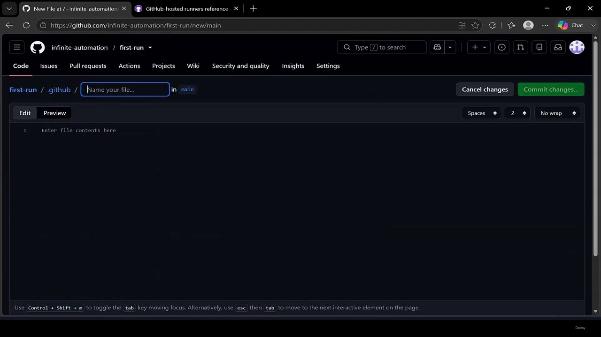

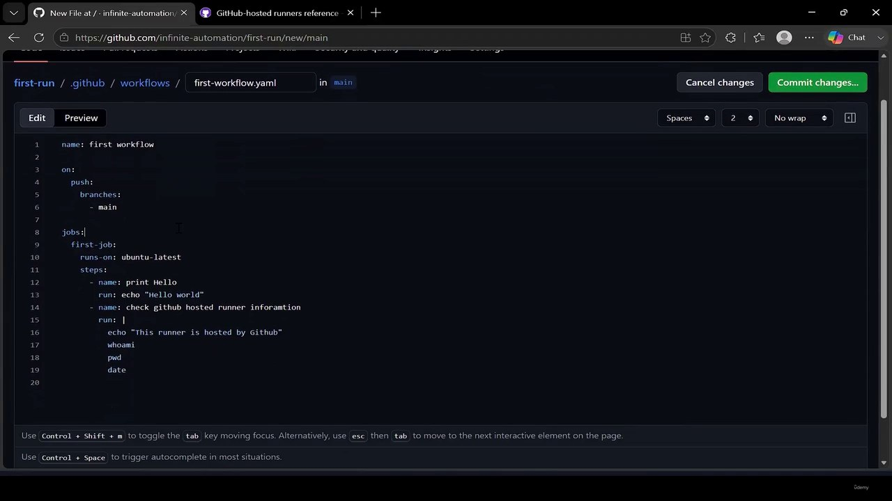

### 3.2 配置 SSH 连接（对应 P13）

在**管理员** PowerShell 里依次执行（把邮箱换成你自己的）：

```powershell
# 1. 确认 OpenSSH 客户端存在
ssh -V

# 2. 生成 ed25519 密钥（一路回车，passphrase 可留空）
ssh-keygen -t ed25519 -C "your_email@example.com"

# 3. 确认 ssh-agent 服务在跑
Get-Service ssh-agent

# 4. 如果没跑，设为自动并启动（需要管理员权限）
Set-Service -Name ssh-agent -StartupType Automatic
Start-Service ssh-agent

# 5. 把私钥加入 agent
ssh-add $env:USERPROFILE\.ssh\id_ed25519

# 6. 列出已加载的 key，确认算法是 ED25519
ssh-add -l

# 7. 把公钥复制到剪贴板
Get-Content $env:USERPROFILE\.ssh\id_ed25519.pub | Set-Clipboard
```

然后去 GitHub：右上角头像 → **Settings** → 左侧 **SSH and GPG keys** → **New SSH key**：

- Title：`GitHub SSH-keys`
- Key type：**Authentication Key**
- Key：粘贴剪贴板内容
- 点 **Add SSH key**

讲师特别说明这是**账号级**配置，不是仓库级："我们需要在账户级别而不是仓库级别配置 GitHub SSH。"（p013 [03:21]）。

接着验证并配置 git 身份：

```powershell
# 验证 SSH 是否通
ssh -T git@github.com
# 期望看到：Hi <你的用户名>! You've successfully authenticated...

# 配置全局用户名和邮箱
git config --global user.name "你的GitHub用户名"
git config --global user.email "your_email@example.com"

# 确认配置
git config --list
```

最后建一个测试仓库（讲师命名为 `ssh-github`），用 SSH URL clone 下来验证：

```powershell
mkdir ssh-test
cd ssh-test
git init
git clone git@github.com:<你的用户名>/ssh-github.git
ls
cd ssh-github
git status
```

`git status` 应显示 `On branch main` 和 `No commits yet`。

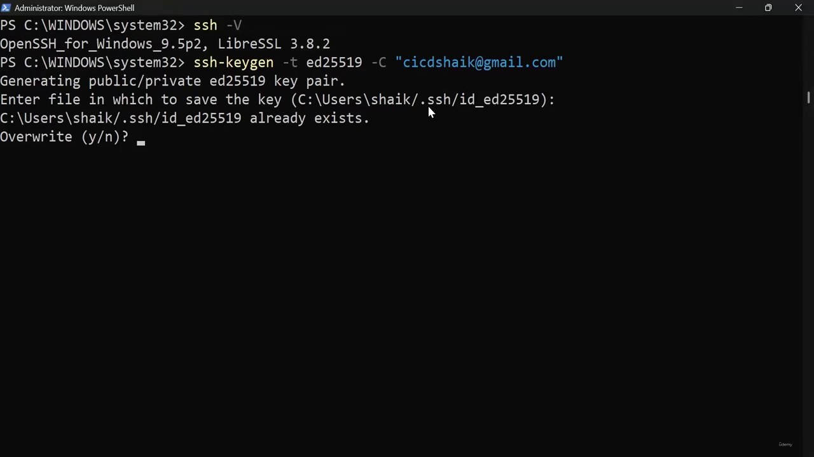

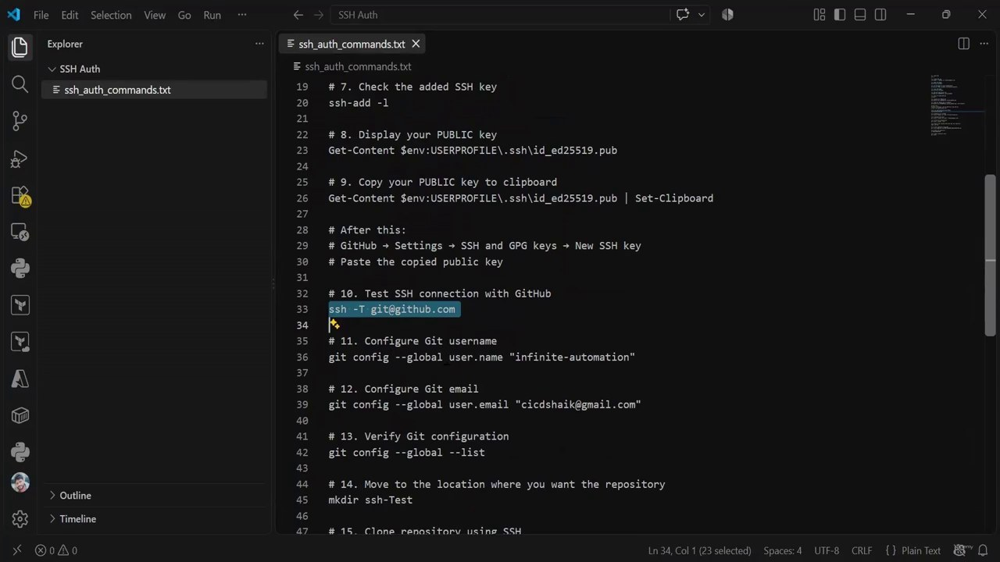

### 3.3 push 事件 + 分支过滤（对应 P15、P16）

1. 新建仓库 `push-event`（Public，空仓库）。
2. 用 SSH clone 到本地：

   ```powershell
   git clone git@github.com:<你的用户名>/push-event.git
   cd push-event
   ```

3. 在仓库根目录建目录 `.github/workflows/`，在里面建文件 `simple-push.yaml`，内容用第 4 节的 `simple-push.yaml`。
4. 提交并推送：

   ```powershell
   git add .
   git commit -m "added the workflow file"
   git push
   ```

5. 去 GitHub → Actions，应看到 `Push Event` 工作流被触发，job `push-event` 里 `Run greetings` 这一步打印出 `Hello Welcome to the push event session`。
6. **验证分支过滤**：把 `simple-push.yaml` 里的 `branches: [main]` 保留，然后新建一个分支推一次：

   ```powershell
   git checkout -b feature
   # 随便改一行 echo 内容
   git add .
   git commit -m "test on feature branch"
   git push -u origin feature
   ```

   回到 Actions 页面，这次 push **不应该**产生新的 run —— 因为 `branches: [main]` 把非 main 分支过滤掉了。这正是讲师在 p016 [12:04] 讲的「catch」。

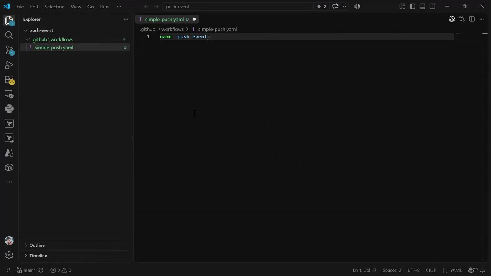

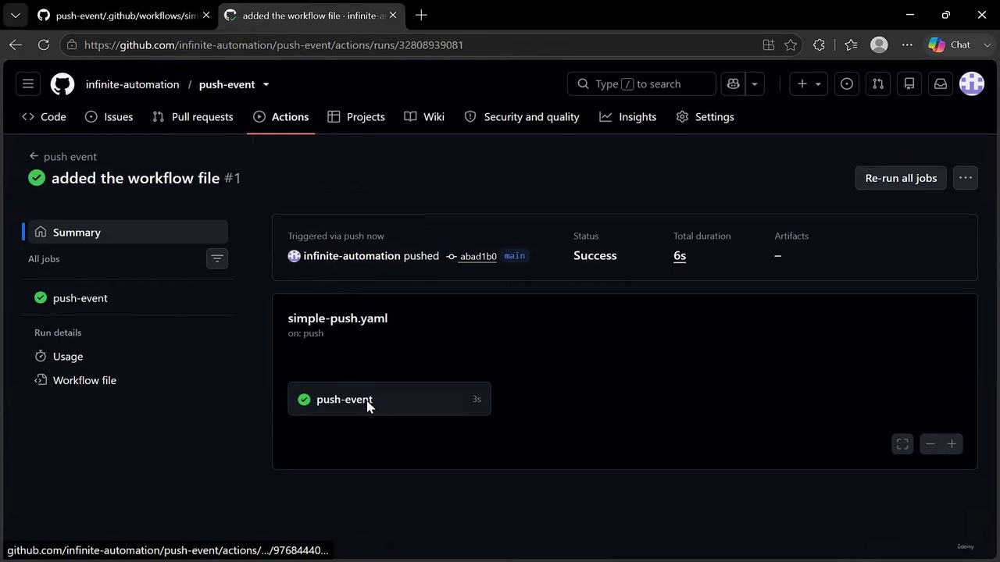

### 3.4 pull_request 事件与三种活动类型（对应 P17、P18）

1. 新建仓库 `pull-request`（Public，空仓库），SSH clone 到本地。
2. 建 `.github/workflows/pull-request.yaml`，内容用第 4 节的 `pull-request.yaml`（先只写 `run tests` 一个 step）。
3. 提交并推到 main：

   ```powershell
   git add .
   git commit -m "added pull request yml file"
   git push
   ```

4. 从 main 切出 feature 分支，加一个 step（讲师加的是 `run linter`），提交并推：

   ```powershell
   git checkout -b feature
   # 编辑 pull-request.yaml，追加 run linter 步骤
   git add .
   git commit -m "created the feature branch"
   git push -u origin feature
   ```

5. 在 GitHub 上点 **Compare & pull request**，标题填 `pull request demo`，点 **Create pull request**。
6. 观察 Actions：`Pull Request Demo` 工作流被触发，job `test` 里 `Run tests` 和 `Run linter` 都执行了 —— 这是 **opened** 活动。
7. **验证 synchronize**：在 feature 分支上再追加一个 `run build` 步骤，commit 并 push。回到 PR 页面，Actions 里会**再出现一次** run，三个 step 全跑 —— 这就是 `synchronize`。
8. **验证 reopened**：在 PR 页面点 **Close pull request**，再点 **Reopen pull request**，Actions 里会**第三次**触发同一个工作流。

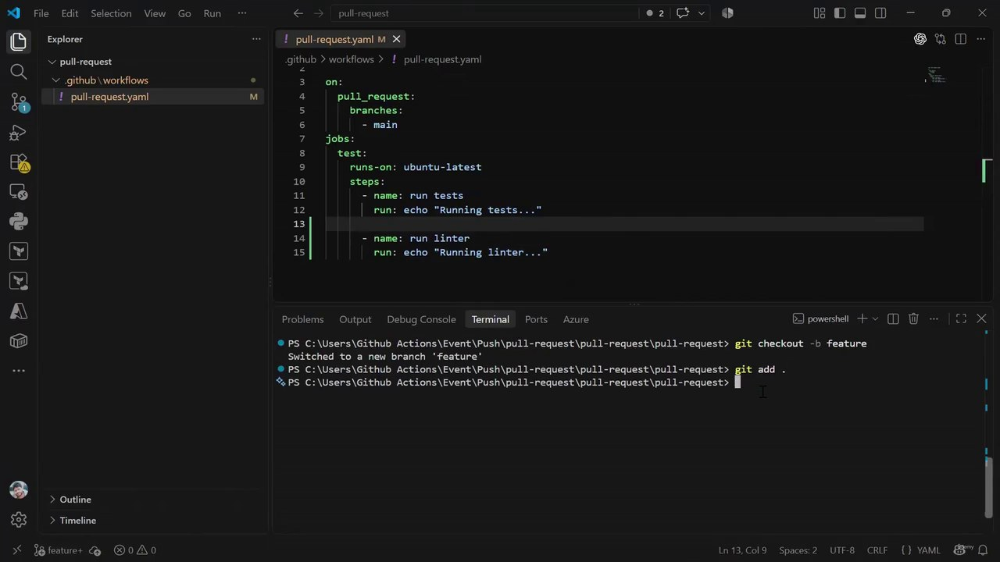

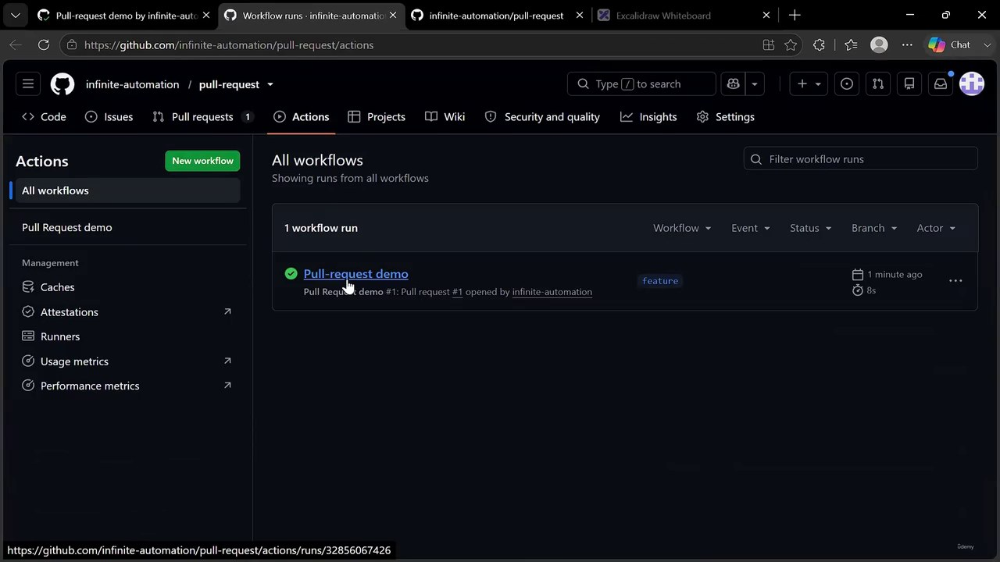

### 3.5 用 Ruleset 阻止未通过检查的 PR 合并（对应 P19）

这一步是纯 GitHub 网页操作，没有代码。

1. 先**故意让工作流失败**：在 feature 分支上把 `run linter` 那一步的 `echo` 删掉，只留 `run: running the linter`（这样 shell 会找不到命令而失败）。commit + push。
2. 回到 PR 页面，会看到检查变红，但 **Merge pull request 按钮仍然可点** —— 讲师在 p019 [04:45] 特意演示了这一点："即使这个工作流失败了，我们仍然可以合并你的更改。"
3. 去仓库 **Settings → Rules → Rulesets → New branch ruleset**：
   - Ruleset Name：`block PR`
   - Enforcement status：**Active**
   - Target branches：Add target → Include by pattern → 填 `main`
   - 往下滚到 **Require status checks to pass**，勾上
   - 点 **Add checks**，输入 `test`（这是 job 名），选中 GitHub Actions 给出的 `test` 项
   - 点 **Create**
4. 刷新 PR 页面，此时 Merge 按钮变成灰色，提示 "由于合并要求未通过，合并已被阻止。"，并且能看到 `Required` 标记。
5. **修复工作流**：把 `echo` 加回去，commit + push。等新的 run 变绿后，Merge 按钮恢复，点 **Merge pull request → Confirm merge**。

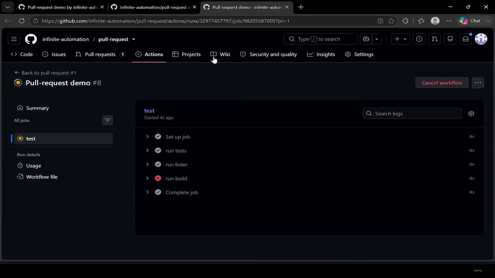

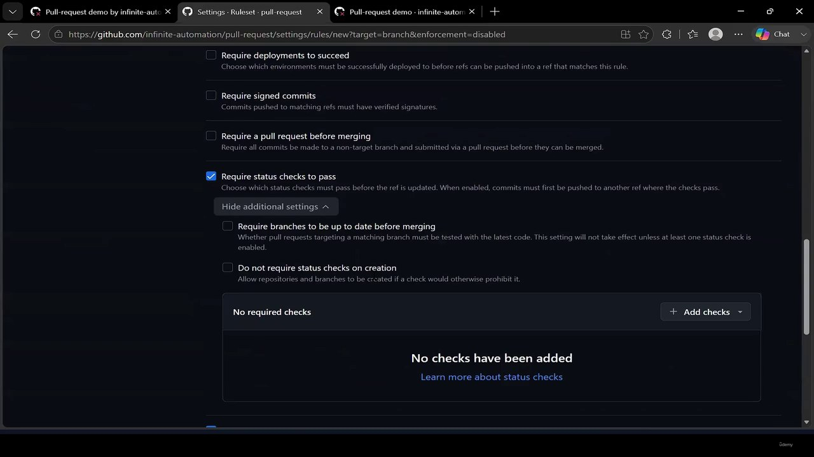

### 3.6 workflow_dispatch 手动触发（对应 P20）

1. 在任意仓库里新建 `.github/workflows/manual.yaml`，内容用第 4 节的 `manual.yaml`。
2. 推到 main。
3. 去 Actions → 左侧选 `Manual Workflow` → 右侧出现 **Run workflow** 下拉按钮 → 选分支 `main` → 点绿色 **Run workflow**。
4. 刷新页面，能看到一次由 `workflow_dispatch` 触发的 run。

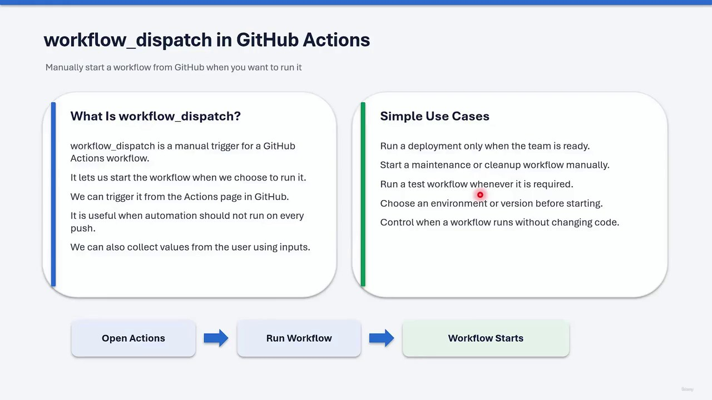

---

## 4. 完整代码

以下 5 个文件都是完整可保存的。目录结构统一为：

```
<repo-root>/
└── .github/
    └── workflows/
        ├── first-workflow.yaml
        ├── simple-push.yaml
        ├── pull-request.yaml
        └── manual.yaml
```

### 4.1 `.github/workflows/first-workflow.yaml`

```yaml
name: First Workflow

on:
  push:
    branches:
      - main

jobs:
  first-job:
    runs-on: ubuntu-latest
    steps:
      - name: Print hello
        run: echo "Hello World"

      - name: Check GitHub hosted runner information
        run: |
          echo "This runner is hosted by GitHub"
          whoami
          pwd
          date
```

### 4.2 `.github/workflows/simple-push.yaml`

```yaml
name: Push Event

on:
  push:
    branches:
      - main

jobs:
  push-event:
    runs-on: ubuntu-latest
    steps:
      - name: Run greetings
        run: echo "Hello Welcome to the push event session"
```

### 4.3 `.github/workflows/pull-request.yaml`

```yaml
name: Pull Request Demo

on:
  pull_request:
    branches:
      - main

jobs:
  test:
    runs-on: ubuntu-latest
    steps:
      - name: Run tests
        run: echo "running the test"

      - name: Run linter
        run: echo "running the linter"

      - name: Run build
        run: echo "running the build"
```

> 说明：`Run linter` 和 `Run build` 是讲师在 P18 演示 `synchronize` 时分两次追加进去的。最终形态就是上面这三步。P19 里「故意失败」的做法是把 `Run linter` 的 `run:` 改成 `run: running the linter`（去掉 `echo`），修复时再改回来。

### 4.4 `.github/workflows/manual.yaml`

```yaml
name: Manual Workflow

on:
  workflow_dispatch:

jobs:
  manual-job:
    runs-on: ubuntu-latest
    steps:
      - name: Print manual trigger message
        run: echo "This workflow was triggered manually"
```

> 说明：讲师在 P20 只讲了 `on: workflow_dispatch` 这一段的写法，没有给出完整的 job 部分。上面的 `manual-job` 是为了让文件能直接跑而补的最小 job，**job 名和 step 内容是示意，不是讲师原话**。

### 4.5 本地 SSH 配置命令汇总（PowerShell，管理员）

```powershell
ssh -V
ssh-keygen -t ed25519 -C "your_email@example.com"
Get-Service ssh-agent
Set-Service -Name ssh-agent -StartupType Automatic
Start-Service ssh-agent
ssh-add $env:USERPROFILE\.ssh\id_ed25519
ssh-add -l
Get-Content $env:USERPROFILE\.ssh\id_ed25519.pub | Set-Clipboard
ssh -T git@github.com
git config --global user.name "你的GitHub用户名"
git config --global user.email "your_email@example.com"
git config --list
```

---

## 5. 逐行解释

### 5.1 `first-workflow.yaml`

- `name: First Workflow` —— 工作流在 Actions 页面显示的名字。讲师在 p012 [03:21] 说第一个组件就是 `name`。
- `on:` —— 触发条件块。讲师原话："触发事件将设为 push 事件。"（p012 [03:21]）。
- `push:` —— 事件类型是 push。
- `branches: - main` —— 只在推送到 main 时触发。注意这是**列表**写法，YAML 里 `- main` 是数组元素。
- `jobs:` —— 所有 job 的容器。讲师说 "这里可以有多个作业，但我们只指定了一个作业。"（p012 [06:06]）。
- `first-job:` —— job 的 ID。这个 ID 后面在 Ruleset 里会被引用（P19 里填的 `test` 就是 job ID）。
- `runs-on: ubuntu-latest` —— 指定 GitHub 托管 Runner 的标签。讲师在 p012 [04:14] 解释："如果使用的是 GitHub 托管的运行器，你只需要指定 runs-on。"
- `steps:` —— 步骤列表，按顺序执行。
- `- name: Print hello` —— 步骤显示名。
- `run: echo "Hello World"` —— 实际执行的 shell 命令。讲师说 "既然你想为此运行一些命令行脚本，我们需要指定 echo。"（p012 [05:40]）。
- `run: |` —— 多行 shell 的写法。`|` 表示保留换行，下面每一行都会在同一个 shell 里顺序执行。
- `whoami` / `pwd` / `date` —— 三个 Linux 命令。讲师在 p012 [07:32] 说这三个用来验证「谁在跑、在哪个目录、什么时间」。实际输出里 `pwd` 会打印类似 `/home/runner/work/first-run/first-run` 的路径（讲师在 p012 [12:43] 念过这个路径）。

> **JS/Node 对照**：`runs-on` 相当于你 `package.json` 里指定 Node 版本；`steps` 相当于 `scripts` 里按顺序执行的命令；`run:` 就是 `npm run xxx` 里那串 shell。

### 5.2 `simple-push.yaml`

- 结构和 5.1 几乎一样，唯一区别是 job ID 叫 `push-event`，step 只有一步。
- `branches: - main` 是 P16 后半段才加上的。讲师在 p016 [12:33] 说："我们只需要在 push 下面再添加一些关键字，也就是 branches 部分。然后需要指定分支名。"
- **不加 `branches` 会怎样**：任何分支的 push 都会触发。讲师在 p016 [12:04] 明确警告过这个 catch。

### 5.3 `pull-request.yaml`

- `on: pull_request:` —— 事件类型换成 PR。
- `branches: - main` —— **这里是 target branch，不是 source branch**。讲师在 p017 [04:15] 专门强调："main 是拉取请求的目标分支，而不是源分支。" 也就是说，从 `feature` 往 `main` 提 PR 会触发；从 `main` 往 `feature` 提 PR 不会。
- 没写 `types:` —— 讲师在 p017 [03:20] 说默认就是 `opened`、`synchronize`、`reopened` 三种，不用显式写。
- `jobs: test:` —— job ID 是 `test`。这个 ID 在 P19 的 Ruleset 里被填进 "Add checks" 输入框。
- 三个 step 分别对应 `run tests` / `run linter` / `run build`。讲师在 p017 [04:44] 说真实项目里这些 `echo` 会换成 "Maven 构建命令或 npm test"。

> **JS/Node 对照**：真实项目里 `run: echo "运行测试"` 会写成 `run: npm test`，`run: echo "运行代码检查工具"` 会写成 `run: npm run lint`，`run: echo "running the build"` 会写成 `run: npm run build`。这就是前端 CI 的标准三件套。

### 5.4 `manual.yaml`

- `on: workflow_dispatch:` —— 唯一的触发方式就是手动。讲师在 p020 [01:25] 说："本质上，我们是在告诉 GitHub：我希望这个工作流支持手动执行。"
- 没有 `push` / `pull_request`，所以推代码不会触发它。
- 后面的 job 部分是补的最小实现（见 4.4 的说明）。

### 5.5 SSH 命令逐条

- `ssh -V` —— 确认 OpenSSH 客户端版本。讲师在 p013 [00:57] 输出的是 `OpenSSH for Windows 9.5p2`。
- `ssh-keygen -t ed25519 -C "邮箱"` —— 生成 ed25519 算法密钥对。讲师在 p013 [00:57] 说 "使用一种名为 ed25519 的算法"（口误，实际是 ed25519）。
- `Get-Service ssh-agent` —— 查 agent 服务状态。
- `Set-Service -Name ssh-agent -StartupType Automatic` —— 设为开机自启。讲师在 p013 [02:25] 说 "你可以使用这个命令来配置它。"。
- `ssh-add <私钥路径>` —— 把私钥加载进 agent，这样后续 git 操作不用每次输密码。
- `ssh-add -l` —— 列出已加载的 key，应显示 `ED25519`。
- `Get-Content ... | Set-Clipboard` —— 把公钥内容复制到剪贴板。讲师在 p013 [02:54] 说 "如果你想将公钥复制到剪贴板，只需输入这个命令。"。
- `ssh -T git@github.com` —— 测试认证。成功时输出 `Hi <用户名>! You've successfully authenticated...`，讲师在 p013 [05:17] 念过这句。
- `git config --global user.name/email` —— 设置提交身份。讲师在 p013 [05:47] 说 "你可以利用这个命令。"。

### 5.6 Ruleset 的每个选项为什么这么选

- **Target branches → Include by pattern → `main`**：只保护 main 分支。讲师在 p019 [06:11] 说 "我们的目标分支是 main，所以我会把 main 这个模式包含进去。"
- **Require status checks to pass**：这是核心开关。讲师在 p019 [06:40] 说 "这一项要求状态检查通过，所以我需要点击这一项。"
- **Add checks → 输入 `test`**：`test` 是 `pull-request.yaml` 里的 job ID。讲师在 p019 [07:08] 说 "我们的作业名称是 test。所以我们应该在这里添加对应的作业。"
- **不勾 "要求分支在合并前更新到最新"**：讲师在 p019 [06:40] 说 "我不要求在创建时执行状态检查。这不是强制要求。" —— 他的需求只是「检查不过就不许合并」，不需要额外的分支同步要求。

> **JS/Node 对照**：Ruleset 相当于你在 GitHub 上给 main 分支装了一个「pre-commit hook 的服务端版本」。本地 husky 只能拦你自己的 commit，Ruleset 拦的是所有人的 merge。

---

## 6. 复现检查清单

按顺序打勾，任何一项不过就回到对应小节：

- [ ] GitHub 账号已注册，能正常登录。
- [ ] `first-run` 仓库已创建，`.github/workflows/first-workflow.yaml` 已提交到 main。
- [ ] Actions 页面能看到 `First Workflow` 的 run，job `first-job` 里两个 step 都是绿色。
- [ ] `Print hello` 的日志里有 `Hello World`。
- [ ] `Check GitHub hosted runner information` 的日志里有 `This runner is hosted by GitHub`、一个用户名、一个 `/home/runner/work/...` 路径、一个 UTC 时间。
- [ ] PowerShell 里 `ssh -V` 有输出（版本号不必和讲师一致）。
- [ ] `ssh-keygen -t ed25519` 执行成功，`~/.ssh/id_ed25519` 和 `id_ed25519.pub` 都存在。
- [ ] `ssh-add -l` 显示 `ED25519`。
- [ ] GitHub Settings → SSH and GPG keys 里能看到 `GitHub SSH-keys`，类型是 Authentication Key。
- [ ] `ssh -T git@github.com` 返回 `Hi <用户名>! You've successfully authenticated`。
- [ ] `git config --list` 里能看到你设的 `user.name` 和 `user.email`。
- [ ] 用 SSH URL clone 一个空仓库成功，`git status` 显示 `On branch main`。
- [ ] `push-event` 仓库的 `simple-push.yaml` 推到 main 后，Actions 里 `Push Event` 被触发，日志有 `Hello Welcome to the push event session`。
- [ ] 往 `feature` 分支 push 时，**没有**新的 run 产生（验证 `branches: [main]` 生效）。
- [ ] `pull-request` 仓库的 `pull-request.yaml` 已推到 main。
- [ ] 从 `feature` 往 `main` 提 PR 后，`Pull Request Demo` 被触发，`Run tests` 和 `Run linter` 都执行（验证 opened）。
- [ ] 在 feature 分支追加 `Run build` 并 push 后，PR 页面出现**第二次** run，三个 step 全跑（验证 synchronize）。
- [ ] Close 再 Reopen PR 后，出现**第三次** run（验证 reopened）。
- [ ] 故意删掉 `echo` 后，检查变红，但 Merge 按钮**仍可点**（这是 Ruleset 生效前的状态）。
- [ ] 创建 `block PR` Ruleset，target 为 `main`，勾选 Require status checks to pass，Add checks 填 `test`。
- [ ] 刷新 PR 页面，Merge 按钮变灰，提示 "由于合并要求未通过，合并已被阻止。"。
- [ ] 把 `echo` 加回去并 push，等 run 变绿后 Merge 按钮恢复，能成功 merge。
- [ ] `manual.yaml` 推到 main 后，Actions 左侧出现 `Manual Workflow`，右侧有 **Run workflow** 按钮，点击后能产生一次 run。

---

## 7. 课里没讲但你会撞上的

这一节是「讲师没提、但你照着做一定会遇到」的坑。每条都标了「课里没讲」，不是讲师原话。

1. **`ubuntu-latest` 具体是哪个版本会变**。讲师在 p012 [11:19] 演示时日志里显示的是 `24.0.4 LTS`，但 GitHub 会定期把 `ubuntu-latest` 指向新版本。**课里没讲**版本锁定策略。如果你需要可复现的构建，把 `ubuntu-latest` 换成具体版本标签（如 `ubuntu-24.04`），具体可用标签以 GitHub 官方文档为准。

2. **`ssh-keygen` 的 passphrase 留空 vs 设置密码**。讲师在 p013 [01:26] 直接按回车留空。**课里没讲**留空的安全代价。留空意味着私钥文件泄露即等于账号泄露；设置 passphrase 后每次 `ssh-add` 需要输入，但更安全。CI 场景下通常用 deploy key 或 token，不用个人 SSH key —— **课里没讲**这一点。

3. **`git push` 首次推新分支要 `-u`**。讲师在 p018 [06:09] 用了 `git push -u origin feature`，但没解释 `-u` 的作用。`-u` 是 `--set-upstream`，把本地分支和远程分支关联起来，之后直接 `git push` 就行。**课里没讲**这个参数的含义。

4. **PR 的 `branches` 过滤是 target 不是 source**。讲师在 p017 [04:15] 强调过，但**课里没讲**如果写错会怎样：如果你以为它是 source 而写了 `feature`，那么从 feature 往 main 提 PR 时工作流**不会**触发，你会以为配置没生效。

5. **Ruleset 的 "Add checks" 输入框需要工作流至少跑过一次才会出现 `test` 选项**。**课里没讲**这个前置条件。如果你在 PR 还没触发过任何 run 的时候去建 Ruleset，输入 `test` 可能搜不到。正确顺序是：先提一次 PR 让 `test` job 跑一次，再去建 Ruleset。

6. **Ruleset 和 Branch protection rule 是两套东西**。讲师全程用的是 **Ruleset**（Settings → Rules → Rulesets）。GitHub 上还有一套老的 **Branch protection rules**（Settings → Branches）。**课里没讲**两者的区别和迁移关系。照着本文档做就用 Ruleset，别去 Branches 页面找。

7. **`workflow_dispatch` 的工作流必须先在默认分支上存在**，Run workflow 按钮才会出现。**课里没讲**这个限制。如果你把 `manual.yaml` 只推到 feature 分支，Actions 页面左侧不会出现 `Manual Workflow`。

8. **`echo` 删掉后为什么是 exit code 127**。讲师在 p019 [03:50] 说 "它退出时返回代码 127，并且找不到该命令。"。**课里没讲** 127 的含义：shell 的 127 专指 "找不到命令"。你写 `run: running the linter` 时，shell 把 `running` 当成命令名去找，找不到就返回 127。**JS/Node 对照**：相当于你在终端敲了一个不存在的 npm script 名。

9. **job ID 和 step name 是两回事**。Ruleset 里填的是 **job ID**（`test`），不是 step 的 `name`（`Run tests`）。**课里没讲**这个区分。如果你在 Add checks 里填 `Run tests`，搜不到。

10. **Actions 日志里的字段名以实际输出为准**。讲师在 p012 [10:51] 提到日志里有 commit、version、worker ID、Azure region（West US）等信息，但**课里没讲**这些字段的准确拼写。你在日志里看到的字段名（如 `Runner version`、`Runner image` 等）请以实际输出为准，本文档不凭印象填。

11. **SSH clone 的 URL 格式**。讲师在 p013 [06:46] 说 "这是 SSH URL，复制这个 URL 并粘贴到这里。"，但**课里没讲** SSH URL 和 HTTPS URL 的区别：SSH 是 `git@github.com:user/repo.git`，HTTPS 是 `https://github.com/user/repo.git`。仓库页面绿色 Code 按钮里可以切换。

12. **`pull_request` 事件在 fork 来的 PR 上权限受限**。**课里没讲** fork 场景。如果你以后接开源项目的 PR，来自 fork 的 PR 默认拿不到 secrets，工作流行为会和本仓库内的 PR 不同。本课程全程在同一个仓库内操作，不涉及这个坑。

---

**文档结束。** 按第 3 节顺序走一遍，第 6 节全部打勾，你就完整复现了 P11–P20 的全部内容。