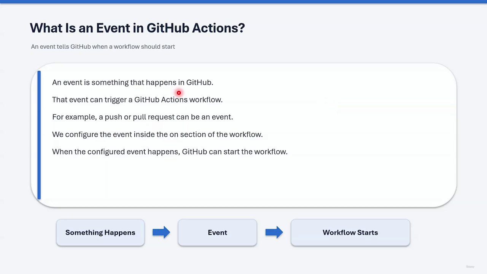
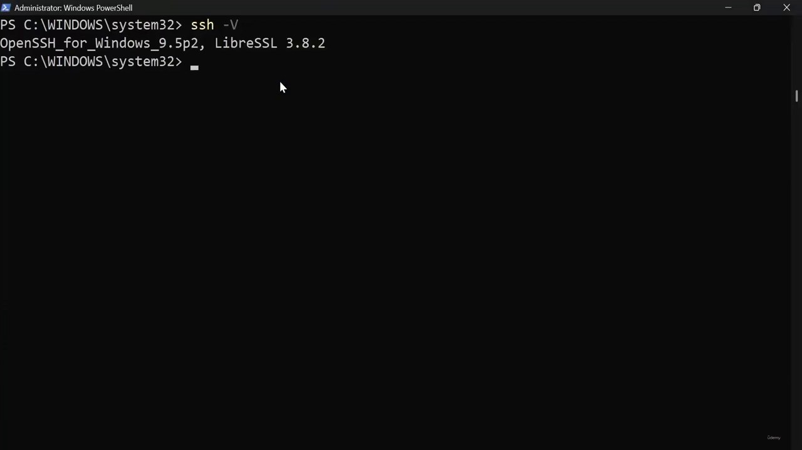
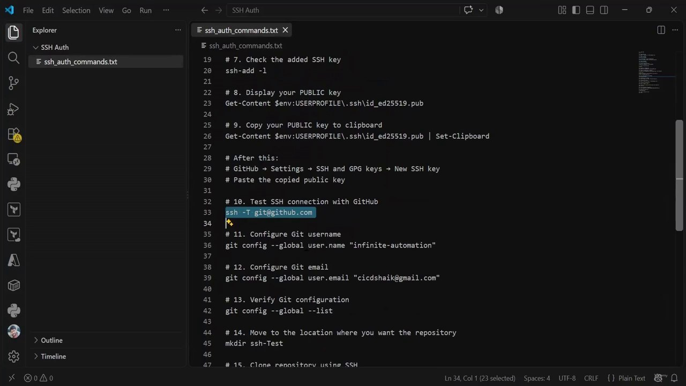
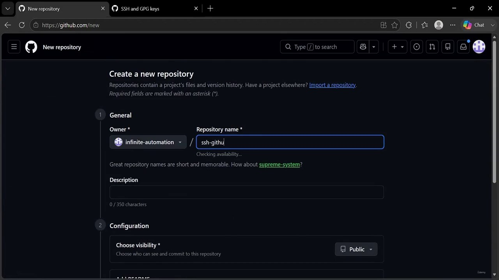
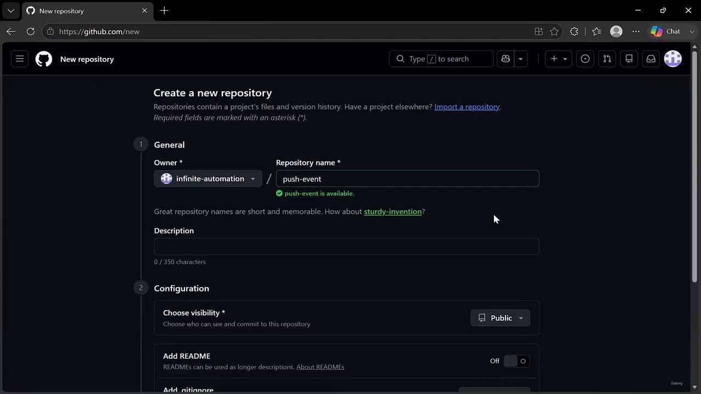
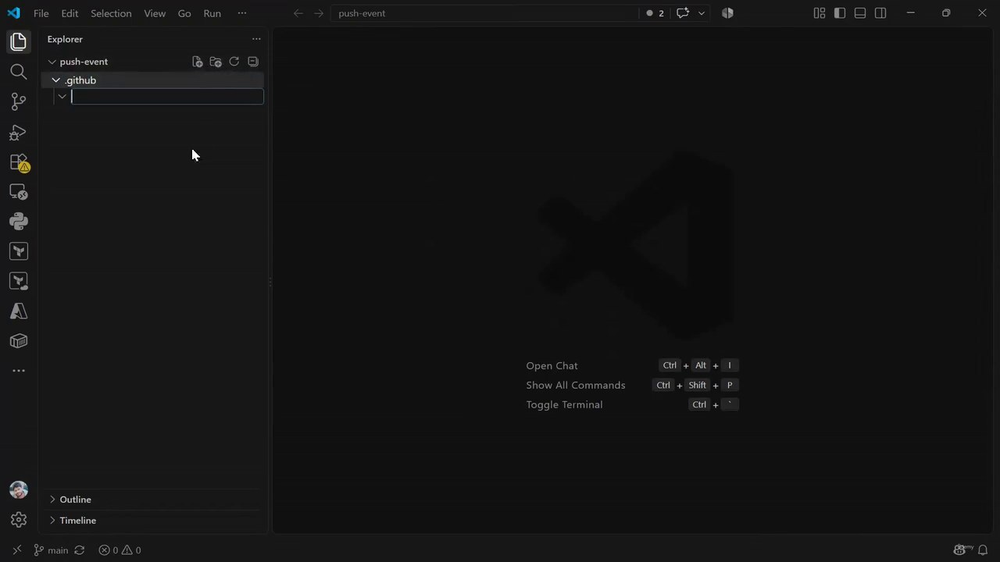
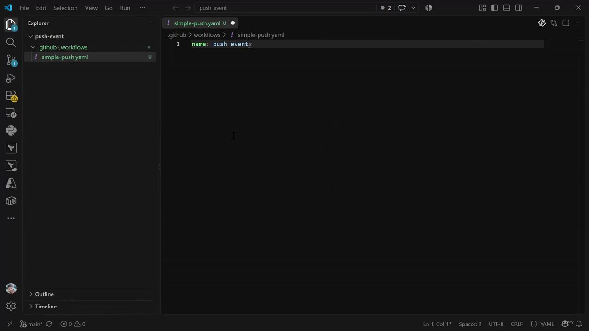
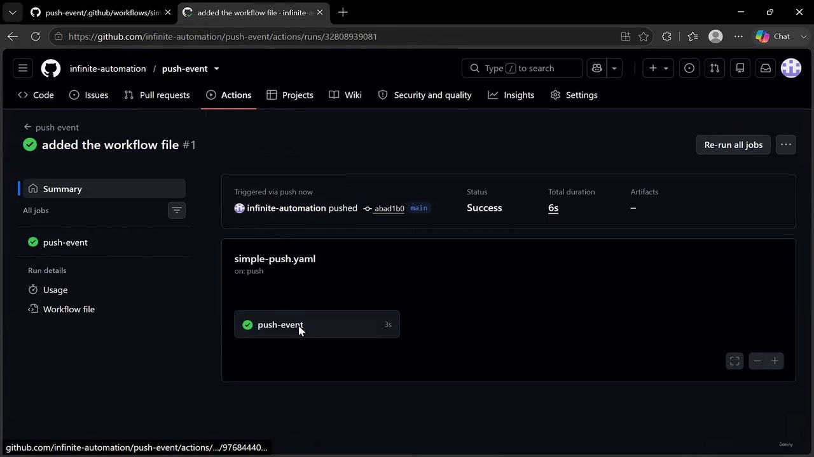
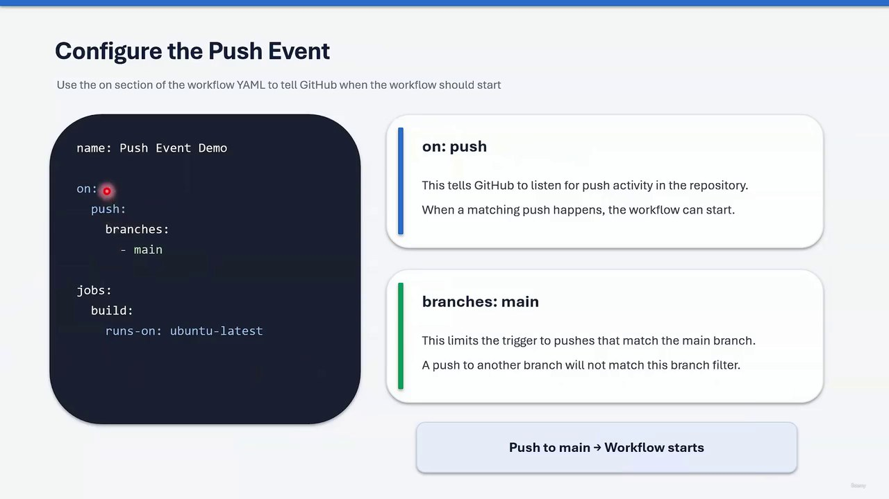

# GitHub Actions 实战（P13–P16）：Windows 用 SSH 免密连 GitHub + 写第一个 `push` 触发的 workflow

> 这节课是一条完整的**动手链**：先在 Windows 上把 SSH key 配好（P013），再理解 event 是什么（P014）、`push` 事件怎么过滤分支（P015），最后真的建一个仓库、写一个 YAML、push 上去、在 Actions 页面看到日志（P016）。
> 本文按「最终要做出来的东西」重组，不按 P 序号复述。
>
> 说明：讲师全程用英文讲课，文中「讲师原话」是中文还原，关键术语保留英文原词。

---

## 1. 这一节做什么

做完这四段，你的机器上会多出两样东西：一张能免密推代码的 SSH key，和一个「一 push 到 `main` 就自动跑」的 workflow 文件。

**最终产物（目录结构）**

```
C:\Users\<你的用户名>\
├── .ssh\
│   ├── id_ed25519          # 私钥，永远不要提交、不要外发
│   └── id_ed25519.pub      # 公钥，贴到 GitHub 上去
└── ssh-test\               # P013 里练手用的目录
    └── <仓库名>\

D:\anywhere\push-event\     # P016 的实验仓库（本地克隆）
└── .github\
    └── workflows\
        └── simple-host.yaml   # 本节唯一的核心文件
```

**你需要提前准备的东西**

| 项 | 要求 | 说明 |
|---|---|---|
| 操作系统 | Windows 10/11 | 讲师全程在 Windows + PowerShell 上操作 |
| PowerShell | **以管理员身份运行** | 讲师明确要求，因为要管 `ssh-agent` 服务 |
| OpenSSH 客户端 | 讲师机器上是 `OpenSSH_for_Windows_9.5p2` | 版本号以你 `ssh -V` 的实际输出为准 |
| Git for Windows | 版本课里没讲 | 需要能用 `git` 命令 |
| 编辑器 | VS Code | 讲师用它打开文件夹写 YAML，版本课里没讲 |
| GitHub 账号 | 一个 | 讲师用的用户名是 `infiniteautomation`，你换成自己的 |

**不需要**：Node.js、Docker、任何 npm 包。**本课没有用到任何环境变量**（讲师是直接把邮箱、用户名敲进命令里的）。

**跑通之后你会得到的行为**：本地改一行字 → `git add . && git commit -m ... && git push` → 打开 GitHub 仓库的 **Actions** 页面，几秒后出现一条新的 run，点进去能看到 step 名 `run greetings` 以及它打印的那句话。

---

## 2. 讲师原话（定位每一段的意图）

**关于为什么要用 SSH（P013 开头）**

> 「平时我们和 GitHub 仓库打交道，需要一个安全的方式向 GitHub 认证。这里与其一遍遍输入凭据，我们可以用一个叫 SSH 的功能。我们会先用 PowerShell 在 Windows 上创建 SSH key，然后测试 Windows 本地机器与 GitHub 之间的连接，最后用 SSH 克隆一个仓库。」
> —— p013 [00:00]

> 「一个提醒：如果你想执行这个操作，你需要以管理员身份运行 PowerShell。」
> —— p013 [00:32]

**关于「配在哪一层」（P013 中段，这段最容易做错）**

> 「我们需要在**账号级别**配置 GitHub SSH，而不是仓库级别。为此要点头像右边的图标 → Settings → 找到 SSH and GPG keys。」
> —— p013 [03:21]

> 「用这个命令我们可以确认 SSH key 是否已经配置好了……你能看到 `You've successfully authenticated`。」
> —— p013 [05:17]

**关于 event 的定义（P014）**

> 「简单来说，一个 event 就是在 GitHub 上发生的某件事。比如某个开发者 push 了一些代码，或者有人创建了一个 pull request。当这类事情发生时，GitHub 就可以用这个 event 去触发 workflow。」
> —— p014 [00:06]



> 「我们在 workflow 的 YAML 文件里的 `on` 段定义想用哪个 event。一旦配置好的 event 发生，GitHub 就会自动启动我们的 workflow。」
> —— p014 [00:24]

讲师在这一页列出的四个常见事件是：`push`、`pull request`、`workflow dispatch`（手动触发）、`schedule`（按计划触发）。P014 只做了名词介绍，**没有写任何一个事件的 YAML 代码**——真正动手的是 P015 和 P016 的 `push`。

**关于 push 事件的语义（P015）**

> 「我在本地改代码，改完之后 commit。如果我想把这些改动从本地发到 GitHub 远程仓库，我就用 `git push`。这就是一个叫 push 的 event。」
> —— p015 [00:29]

> 「记住这个流程：代码改动 → push 到 GitHub → GitHub 检测到事件 → workflow 启动。」
> —— p015 [01:27]

> 「我们并不是对每个分支都感兴趣，我们希望这个 workflow 在 push 命中 `main` 分支时才触发。如果我把改动 push 到 feature 分支或者 developer 分支，这个过滤条件不匹配，workflow 就不会启动。」
> —— p015 [02:24]

**关于 P016 的动手顺序**

> 「我们先创建仓库，然后把仓库克隆到本地 Windows 机器上，然后创建我们自己的 sample YAML 文件，再把改动从本地推到远程，最后看 workflow 是怎么被触发的。」
> —— p016 [00:00]

> 「我们需要在 `.github` 和 `workflows` 这样的目录结构里创建这个 YAML 文件。」
> —— p016 [03:14]

> 「我们只是跑了一个 `echo`：hello welcome to the push event session，然后它就被打印在这里。我们写进 step 段的内容，就真的被打印进日志了，说明命令确实执行了。」
> —— p016 [08:26]

---

## 3. 从零复现（照顺序敲）

> ⚠️ **一个诚实的提醒**：逐字稿是语音转写的，P013 里有几条命令讲师**只说了用途、没有念出命令原文**（比如「检查 SSH」「复制公钥到剪贴板」）。下面凡是这种情况我都标了「⚠️ 原文未念出」，给出的是 PowerShell 下的标准等价写法，执行效果一致。命令输出里的字段名也请以你终端实际打印为准。

### 第 0 步：以管理员身份打开 PowerShell，检查 OpenSSH

开始菜单搜 PowerShell → 右键 → **以管理员身份运行**。

```powershell
ssh -V
```

讲师在这一步的结论是「OpenSSH for Windows 9.5p2」。⚠️ **原文未念出**具体敲的是 `ssh -V` 还是 `Get-WindowsCapability`，`ssh -V` 是等价的检查方式。



### 第 1 步：生成 ed25519 密钥

讲师原话是「用 ed25519 这个算法、带上邮箱来创建 SSH key」（逐字稿把它转写成了 “ed2559”，实际就是 `ed25519`）。

```powershell
ssh-keygen -t ed25519 -C "your_email@example.com"
```

接下来三个交互提示：

1. **保存路径** → 讲师直接用默认的 `.ssh` 目录，**直接回车**。
2. 如果提示是否覆盖（`Overwrite (y/n)?`）→ 因为讲师之前已经生成过，他输入了 `y`。
3. **passphrase**（是否给私钥再加一层密码）→ 讲师**直接回车**，两次。

成功后输出里会出现「你的 identification 已保存在某个位置」这类提示。

### 第 2 步：确认并启动 ssh-agent，把私钥加进去

```powershell
Get-Service ssh-agent
```

如果状态不是 `Running`，讲师给了两条命令来配置并启动：

```powershell
Set-Service -Name ssh-agent -StartupType Automatic
Start-Service ssh-agent
```

然后把私钥加入 agent：

```powershell
ssh-add "$env:USERPROFILE\.ssh\id_ed25519"
```

讲师在这一步看到输出里「identification 已被添加，带上了那个邮箱」。再列出已加载的 key 确认：

```powershell
ssh-add -l
```

这一步的输出会显示算法是 `ED25519`。

### 第 3 步：取出公钥（准备贴到 GitHub）

查看公钥内容：

```powershell
Get-Content "$env:USERPROFILE\.ssh\id_ed25519.pub"
```

⚠️ **「复制到剪贴板」那条命令，讲师只说「你输入这个命令它就会复制到剪贴板」，原文未念出。** PowerShell 等价写法：

```powershell
Get-Content "$env:USERPROFILE\.ssh\id_ed25519.pub" | Set-Clipboard
```

复制到的这一整行，形如 `ssh-ed25519 AAAA...... your_email@example.com`。

### 第 4 步：把公钥贴到 GitHub 的**账号级**设置

这一步的位置很重要，讲师特意强调是**账号级不是仓库级**：

1. GitHub 右上角头像（讲师说「仓库右边的图标」）→ **Settings**
2. 左侧找 **SSH and GPG keys**
3. 点 **New SSH key**
4. **Title** 填 `GitHub SSH-keys`（名字随意）
5. **Key** 粘贴刚才复制的整行公钥
6. **Key type** 选 **Authentication Key**（讲师原话：“因为我们这个 demo 是用来做认证的”）
7. 点 **Add SSH key**

### 第 5 步：验证连通性 + 配置 git 身份

```powershell
ssh -T git@github.com
```

讲师在这里看到的输出包含「你已经成功认证（successfully authenticated）」以及自己的 GitHub 用户名 `infiniteautomation`。**首次连接会问你是否信任主机指纹（yes/no），课里没讲，输入 `yes` 即可，见第 7 节。**



接着配置全局用户名和邮箱（把值换成你自己的）：

```powershell
git config --global user.name "infiniteautomation"
git config --global user.email "your_email@example.com"
git config --list
```

最后一条用来确认这两项写进去了。

### 第 6 步（P013 收尾练习）：建仓库、用 SSH 克隆下来

在 GitHub 上新建一个仓库（讲师念的仓库名听起来像 “SSH-in-GitHub”，逐字稿转写成了 “SSH, iPhone, GitHub”，名字随你），可见性选 **Public**，点 **Create repository**。建完页面上会给出 HTTPS 和 SSH 两种地址，**这次用 SSH 那条**。



回到 PowerShell：

```powershell
mkdir ssh-test
cd ssh-test
git init
git clone git@github.com:<你的用户名>/<你的仓库名>.git
ls
cd <你的仓库名>
git status
```

讲师这里的 `git status` 输出是「在 main 分支上、还没有任何 commit」，因为这个仓库是空的。P013 到此结束——**能 clone 下来就说明 SSH 通了**。

### 第 7 步（P016）：创建实验仓库 `push-event` 并克隆到本地

1. GitHub → **Repositories** → **New**
2. Repository name：`push-event`
3. 可见性选 Public；不勾 README、不勾 .gitignore、不加 license
4. **Create repository**



然后在这个空仓库页面上复制 SSH 地址，在 PowerShell 里：

```powershell
git status                     # 讲师先确认当前目录还不是 git 仓库
git init
git clone git@github.com:<你的用户名>/push-event.git
cd push-event
ls
```

### 第 8 步：在 VS Code 里建目录和 YAML

用 VS Code 打开 `push-event` 文件夹，然后手工创建**两级目录 + 一个文件**：

```
.github/
└── workflows/
    └── simple-host.yaml
```



> 文件名备注：逐字稿里讲师先说 `simple-host.yaml`（[03:43]），后面又说 “simple push.yaml”（[07:32]）。两处不一致，**文件名本身不影响功能**，只要路径在 `.github/workflows/` 下、扩展名是 `.yaml` 就行。本文统一用 `simple-host.yaml`。

### 第 9 步：写第一个版本（不带分支过滤）

先按讲师最初的顺序写：workflow 名字 → `on` → `jobs` → `runs-on` → `steps`。



（完整内容见第 4 节的第一份代码。）

### 第 10 步：提交并推送，去 Actions 看结果

```powershell
git add .
git commit -m "added the workflow file"
git push
```

推完之后讲师做了三件事，你也可以照着核对：

1. 刷新 GitHub 仓库页面 → 能看到 `.github` 目录和里面的 YAML 文件；
2. 点顶部 **Actions** 标签页 → 出现一条名为 `push event` 的 run，备注是刚才的 commit message；
3. 点进这条 run → 点作业 `push-event` → 展开步骤，能看到 `run greetings` 这一步，日志里有那句 echo 的输出。



### 第 11 步：做一次「哑提交」验证自动触发

讲师说得很直白：现在随便改点东西，让 GitHub 知道「有人往这个分支 push 了」。

把 YAML 里 echo 的字符串后面追加一段 `pushing the code`，**注意缩进别动**（讲师专门检查了 indentation），保存后：

```powershell
git add .
git commit -m "adding the dummy commit"
git push
```

回到 Actions，会出现第二条 run，日志里打印的是改后的完整句子。

### 第 12 步：加 `branches` 过滤，只在 main 上跑

在 `on.push` 下面加一层 `branches`，列出 `main`：



```powershell
git add .
git commit -m "added the branch condition"
git push
```

因为这次提交本身就在 `main` 上，所以 workflow 依然会跑一条新的 run——这反过来验证了「过滤条件匹配时确实会触发」。

---

## 4. 完整代码

### 4.1 `.github/workflows/simple-host.yaml`（最终版，可直接保存运行）

```yaml
# 文件路径：<仓库根>/.github/workflows/simple-host.yaml
# 作用：任何一次 push 到 main 分支，就在 GitHub 托管的 Ubuntu 上跑一句 echo

name: push event

on:
  push:
    branches:
      - main

jobs:
  push-event:
    runs-on: ubuntu-latest
    steps:
      - name: run greetings
        run: echo "hello welcome to the push event session. pushing the code"
```

> 名字说明：`name: push event` 是**workflow 的显示名**，`jobs` 下的 `push-event` 是**job 的标识**，`runs-on` 后面是 runner，`steps[].name` 是这一步在日志里的标题。这几处字符串都是自由命名，讲师用的就是这几个词。

### 4.2 第一个版本（第 9 步用，不带分支过滤）

和上面完全一样，只把 `on` 段换成一行：

```yaml
name: push event

on: push

jobs:
  push-event:
    runs-on: ubuntu-latest
    steps:
      - name: run greetings
        run: echo "hello welcome to the push event session"
```

> `on: push` 和 `on:` 换行再写 `push:` 是等价的两种写法；讲师口头说的是「在 on 段里加上 push」。加上 `branches` 之后就必须用换行缩进的写法了。

### 4.3 `setup-ssh.ps1`（可选：把 P013 的手工步骤固化成脚本）

> 这是我为了让你能重跑而整理的**等价脚本**，讲师是逐条手敲的，没有写脚本。用它之前请确认：以**管理员身份**运行。

```powershell
# 文件路径：任意目录，例如 C:\scripts\setup-ssh.ps1
# 用法（管理员 PowerShell）：
#   cd C:\scripts
#   .\setup-ssh.ps1 -Email "your_email@example.com"

param(
    [Parameter(Mandatory = $true)]
    [string]$Email
)

Write-Host "== 1) 检查 OpenSSH 客户端 ==" -ForegroundColor Cyan
ssh -V

Write-Host "== 2) 生成 ed25519 密钥（交互式：路径直接回车，passphrase 直接回车两次）==" -ForegroundColor Cyan
ssh-keygen -t ed25519 -C $Email

Write-Host "== 3) 查看 ssh-agent 服务状态 ==" -ForegroundColor Cyan
Get-Service ssh-agent

# 若上一步显示 Stopped，取消下面两行的注释后重新运行脚本
# Set-Service -Name ssh-agent -StartupType Automatic
# Start-Service ssh-agent

Write-Host "== 4) 把私钥加入 agent ==" -ForegroundColor Cyan
ssh-add "$env:USERPROFILE\.ssh\id_ed25519"

Write-Host "== 5) 列出已加载的密钥（应显示 ED25519）==" -ForegroundColor Cyan
ssh-add -l

Write-Host "== 6) 公钥内容（整行复制到 GitHub）==" -ForegroundColor Cyan
Get-Content "$env:USERPROFILE\.ssh\id_ed25519.pub"

Write-Host "== 7) 顺便复制到剪贴板 ==" -ForegroundColor Cyan
Get-Content "$env:USERPROFILE\.ssh\id_ed25519.pub" | Set-Clipboard

Write-Host "== 8) 验证与 GitHub 的连通性（首次输入 yes）==" -ForegroundColor Cyan
ssh -T git@github.com
```

### 4.4 P013 + P016 全部命令速查（复制粘贴用）

```powershell
# ---------- P013：SSH ----------
ssh -V
ssh-keygen -t ed25519 -C "your_email@example.com"
Get-Service ssh-agent
Set-Service -Name ssh-agent -StartupType Automatic   # 服务不是 Running 时才需要
Start-Service ssh-agent                              # 同上
ssh-add "$env:USERPROFILE\.ssh\id_ed25519"
ssh-add -l
Get-Content "$env:USERPROFILE\.ssh\id_ed25519.pub" | Set-Clipboard
ssh -T git@github.com
git config --global user.name "your-github-username"
git config --global user.email "your_email@example.com"
git config --list
mkdir ssh-test
cd ssh-test
git init
git clone git@github.com:<用户名>/<仓库名>.git

# ---------- P016：push 事件 ----------
git status
git init
git clone git@github.com:<用户名>/push-event.git
cd push-event
# ... 在 VS Code 里创建 .github/workflows/simple-host.yaml ...
git add .
git commit -m "added the workflow file"
git push
# ... 改一行 echo 字符串 ...
git add .
git commit -m "adding the dummy commit"
git push
# ... 加上 branches: - main ...
git add .
git commit -m "added the branch condition"
git push
```

---

## 5. 逐行解释

### 5.1 YAML 逐行

```yaml
name: push event
```
workflow 的显示名，就是你打开 Actions 页面后左边/列表里看到的那一栏文字。讲师在 Actions 里指着列表说「push event 就是我们的 workflow 名」，就是这个字段。

```yaml
on:
  push:
    branches:
      - main
```
这是**整个文件里最关键的三层嵌套**。`on` 决定「什么时候跑」；`push:` 表示监听 push 事件；`branches:` 下面列出的分支名是白名单——只有往 `main` 推才匹配。讲师原话：「如果我把改动 push 到 feature 分支或者 developer 分支，这个过滤条件不匹配，workflow 就不会启动。」注意缩进层级：`push` 比 `on` 缩进两格，`branches` 比 `push` 再缩两格，`- main` 再缩两格。YAML 用空格不用 Tab。

```yaml
jobs:
```
所有作业的容器，必填。`jobs` 下面每一个键就是**一个 job 的 ID**。

```yaml
  push-event:
```
job ID。它在 Actions 页面里会显示成作业名，讲师点进去看日志时看到的就是这个词。ID 里带连字符是允许的。

```yaml
    runs-on: ubuntu-latest
```
指定用哪种 GitHub 托管的 runner。讲师原话：「这个 workflow 我们准备用 `ubuntu-latest` 作为 GitHub 托管的 runner。」也就是说，你本地是 Windows，但这句 echo 是在一台 Ubuntu 机器上跑的。**前端类比**：有点像 `Dockerfile` 里写 `FROM node:latest`——你指定的不是自己的电脑，而是 CI 那边的环境。

```yaml
    steps:
```
一个 job 里的步骤列表，按顺序执行。

```yaml
      - name: run greetings
```
这一步在日志里显示的标题。讲师给第一步起名 `run greetings`。

```yaml
        run: echo "hello welcome to the push event session. pushing the code"
```
`run` 表示「在 runner 上执行一条 shell 命令」。讲师说的是「如果你要跑一些自定义命令，就用 run，比如 echo」。双引号是可选的（内容里没有 YAML 特殊字符时去掉也一样），加引号纯粹是为了可读性。**前端类比**：`run:` 之于 workflow，约等于 `package.json` 里 `scripts` 的某一条命令之于你的项目。

### 5.2 SSH 相关命令逐条

- `ssh -V`：打印 OpenSSH 客户端版本，用来确认「本机有 ssh 这个能力」。⚠️ 原文未念出，见第 3 节说明。
- `ssh-keygen -t ed25519 -C "邮箱"`：`-t` 指定算法（讲师明确说用 `ed25519`），`-C` 是给 key 加一个注释，通常写邮箱，方便你在 GitHub 上认出来是哪台机器。它会生成**一对**文件：私钥 `id_ed25519` + 公钥 `id_ed25519.pub`。
- `Get-Service ssh-agent`：查 Windows 的 ssh-agent 服务状态。这个服务的职责是把解密后的私钥暂存在内存里，避免你每次 push 都重新输入 passphrase。
- `Set-Service -Name ssh-agent -StartupType Automatic` / `Start-Service ssh-agent`：服务没跑时，先设为开机自启，再立即启动。
- `ssh-add "$env:USERPROFILE\.ssh\id_ed25519"`：把**私钥**交给 agent 托管。注意是私钥，不是 `.pub`。`$env:USERPROFILE` 是 PowerShell 里指向 `C:\Users\<你>` 的变量。
- `ssh-add -l`：列出 agent 里已加载的 key，`-l` 是 list。讲师在这里确认算法是 `ED25519`。
- `ssh -T git@github.com`：`-T` 表示不做伪终端分配，只做一次认证测试。成功时 GitHub 会回一句「已成功认证」并带上你的用户名。**这是判断「key 是否真的配到账号上」的唯一可靠方式**，比看设置页有没有那行文字靠谱。
- `git config --global user.name / user.email`：这是**提交者身份**，和 SSH 认证是两件事——SSH 决定「你有没有权限推」，`user.name`/`user.email` 决定「这条 commit 上写谁的名字」。讲师先把这两件事连着做了，别混淆。
- `git clone git@github.com:...`：注意地址是 `git@` 开头的，不是 `https://` 开头。用 `git@` 就会走 SSH；用 `https://` 就会走账号密码/token，那样 P013 的配置就白做了。

### 5.3 git 命令逐条

- `git init`：讲师在 P016 里先 `git status` 确认「当前不是 git 仓库」，再 `git init`，然后才 `git clone`。严格说 `git clone` 不需要先 `git init`（clone 会自己初始化），讲师这么做只是他当时的操作习惯，不影响结果。
- `git add .`：把当前目录下所有改动加入暂存区。
- `git commit -m "..."`：生成一次提交。讲师用了三种 message：`added the workflow file`、`adding the dummy commit`、`added the branch condition`——建议你也这么写，因为 Actions 列表里显示的正是 commit message，写清楚了一眼就能对上号。
- `git push`：把本地提交推到远端。**这一步就是 P015 讲的那个 event**：GitHub 收到 push → 检查仓库里的 workflow → 匹配 `on.push.branches` → 命中就开跑。

### 5.4 事件模型的完整链路

P014 给的定义是「event 是 GitHub 上发生的某件事」，对应到代码里就是 `on` 段。本节课实际只落地了 `push` 一种。把四段串起来看：

```
本地改动  →  git commit  →  git push  →  GitHub 收到 push 事件
        →  读 .github/workflows/*.yaml
        →  on.push 匹配？ branches 命中 main？
        →  命中：分配一台 ubuntu-latest，依次执行 steps
        →  在 Actions 页面留下一条 run 和完整日志
```

---

## 6. 复现检查清单

按顺序打勾，任何一项没过就别往下走：

**SSH 部分（P013）**

- [ ] PowerShell 是**以管理员身份**打开的（窗口标题里带「管理员」）
- [ ] `ssh -V` 有输出，说明 OpenSSH 客户端在（版本以实际输出为准）
- [ ] `C:\Users\<你>\.ssh\id_ed25519` 和 `id_ed25519.pub` **两个文件都存在**
- [ ] `Get-Service ssh-agent` 状态是 `Running`（不是就先 `Set-Service` + `Start-Service`）
- [ ] `ssh-add` 之后有「已添加 identity」的提示
- [ ] `ssh-add -l` 能看到一条 `ED25519` 记录
- [ ] GitHub → Settings → SSH and GPG keys 里能看到标题为 `GitHub SSH-keys`、类型为 Authentication Key 的那条
- [ ] `ssh -T git@github.com` 返回「成功认证」+ 你的用户名（**不是** `Permission denied`）
- [ ] `git config --list` 里能看到你自己的 `user.name` 和 `user.email`
- [ ] 用 SSH 地址 `git clone` 成功，`ls` 能看到仓库目录

**push 事件部分（P016）**

- [ ] GitHub 上存在仓库 `push-event`
- [ ] 本地 `push-event` 目录里存在 `.github/workflows/simple-host.yaml`（**路径层级一个都不能少**）
- [ ] YAML 用空格缩进，没有 Tab
- [ ] `git push` 之后，GitHub 网页上能看到 `.github/workflows/simple-host.yaml`
- [ ] Actions 标签页出现一条 run，名字是 `push event`
- [ ] 点进去能看到作业 `push-event`，展开后能看到步骤 `run greetings`
- [ ] 该步骤的日志里出现了 `hello welcome to the push event session`
- [ ] 改字符串后第二次 push，Actions 里多出第二条 run，日志内容是新字符串
- [ ] 加上 `branches: - main` 再 push，Actions 依然触发一次（因为在 main 上）

---

## 7. 课里没讲但你会撞上

**1）首次 `ssh -T` 或 `git clone` 会问你是否信任主机指纹。**
会出现 `Are you sure you want to continue connecting (yes/no/[fingerprint])?` 这类提示，需要手输 `yes`。课里没讲这一步，讲师机器上已经信任过了所以没出现。

**2）`ssh-add` 报「无法连接 openSSH 认证代理」。**
说明 `ssh-agent` 服务没起，或者你**没有用管理员 PowerShell**。讲师在 P013 开头强调「需要以管理员身份运行」就是为这个，但他没演示失败的样子。

**3）Windows 上可能根本没装 OpenSSH 客户端。**
`ssh -V` 报「无法将 ssh 项识别为 cmdlet」。课里没讲怎么装（设置 → 可选功能 → 添加 OpenSSH 客户端）。

**4）`Permission denied (publickey)` 是最常见的失败。**
原因通常是：公钥贴到了**某个仓库**的 Deploy key 而不是账号的 SSH keys（讲师特意强调「账号级别不是仓库级别」）；或者 `ssh-add` 加错了文件（加了 `.pub`）；或者 `git clone` 时抄的是 `https://` 地址。

**5）默认分支名可能是 `main` 也可能是 `master`。**
`branches: - main` 里的字符串必须和仓库实际的默认分支名**逐字一致**。课里没讲怎么改默认分支名（仓库 Settings → Branches）。

**6）YAML 缩进错了，Actions 直接给你一条红叉。**
这种失败**不会**出现在 `git push` 的输出里——push 永远成功，失败发生在 Actions 页面。所以流程应该是「push 完立刻去 Actions 看一眼」，而不是看终端。讲师在改代码时专门说「let's check the indentation」，就是这个原因。

**7）YAML 解析器把裸 `on` 当成布尔值 `true` 的小坑。**
某些编辑器/校验插件会提示 `on` 这个键「不合法」，但 GitHub 自己能正确识别。课里没讲，看到黄色波浪线不用慌。

**8）`branches` 过滤器加上之后，往别的分支 push 就真的不触发了——包括你以为会触发的情况。**
讲师在 [12:04] 明确说过这个「catch」：不加过滤时，任何分支 push 都会跑。加上之后如果推的是 `feature`、`developer`、`hotfix` 等分支，Actions 页面会安静得像什么都没发生。这不是坏了。

**9）workflow 文件不在默认分支上时，Actions 列表里可能看不到它。**
课里没讲。P016 里讲师每次都直接推到 `main`，所以没遇到。

**10）`run` 步骤是在 Ubuntu 上跑的，不是你的 Windows。**
所以别在 `run` 里写 PowerShell 语法（`Get-ChildItem` 之类）。课里没讲 runner 上预装了哪些工具。

**11）私有仓库的 Actions 有免费额度限制，课里没讲。**
本节用的都是 public 仓库，不受影响。

**12）没有用的东西：环境变量、secrets、缓存、矩阵构建。**
本课（P13–P16）**完全没有涉及**这些，讲师连 `env:` 都没提过。别在这一步提前引入。

**13）P014 讲的另外三个事件（`pull_request`、`workflow_dispatch`、`schedule`）课里没给代码。**
讲师只念了名字和用途，没有演示 YAML 写法。如果你要接着做，请另行查官方文档，别把它们的写法算成「这节课教的」。

---

### 一句话总结这条链路

**SSH 解决「我能不能推」，`on.push.branches` 解决「推到哪才跑」，`runs-on` + `steps` 解决「跑什么、在哪跑」。** 三件事都验证通过，GitHub Actions 的门就算进了。