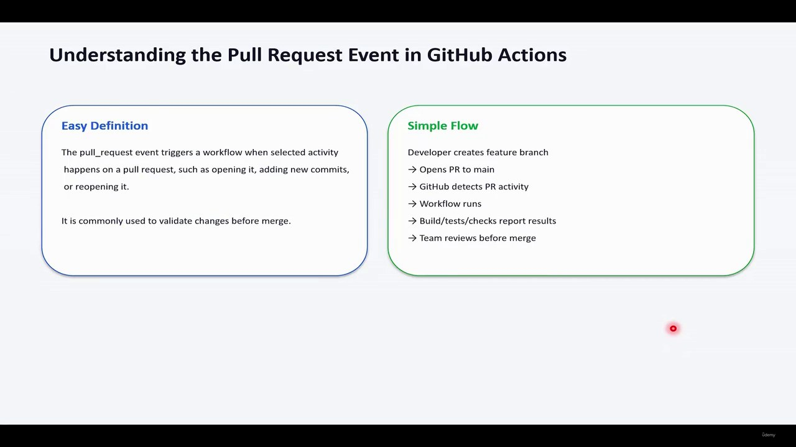
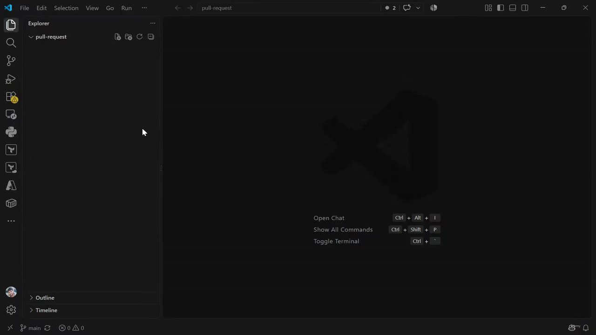
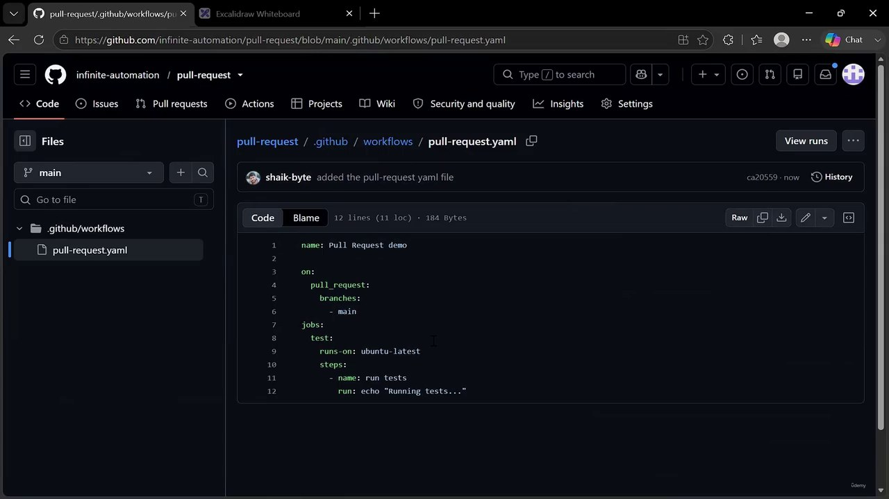
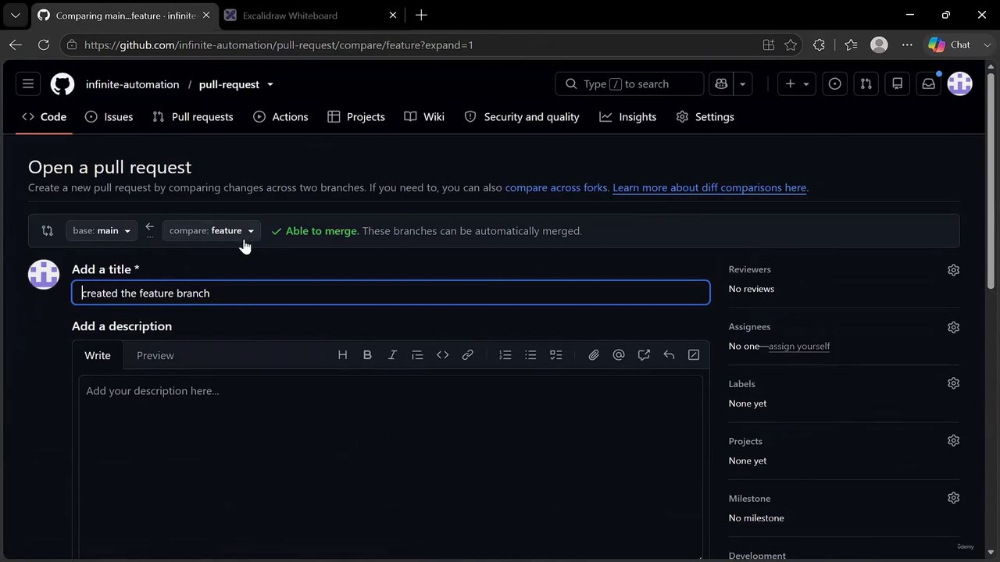
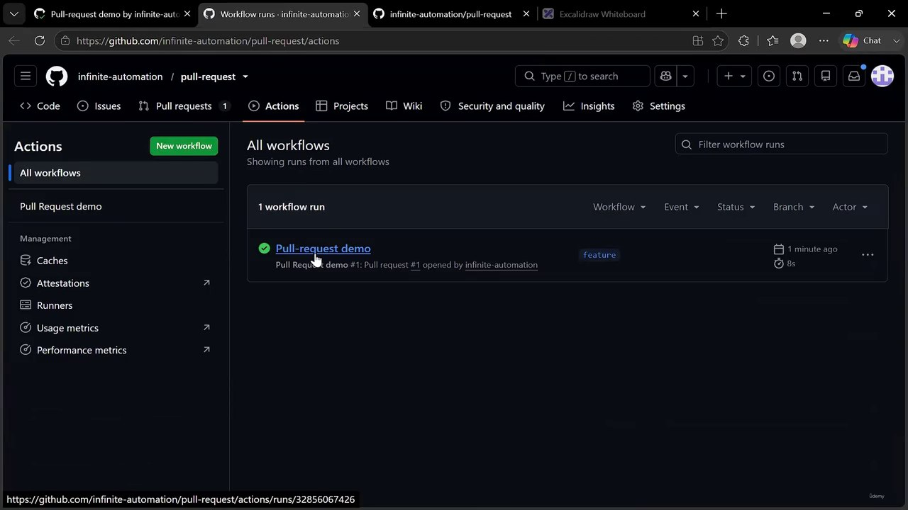
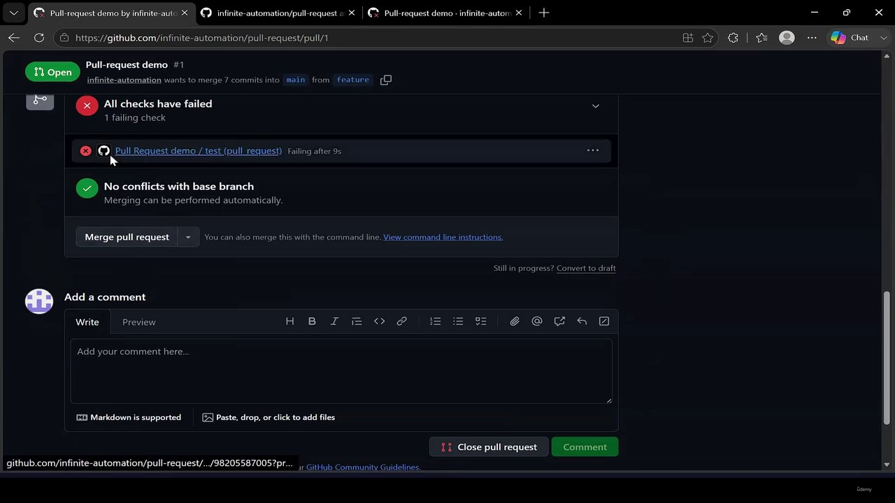
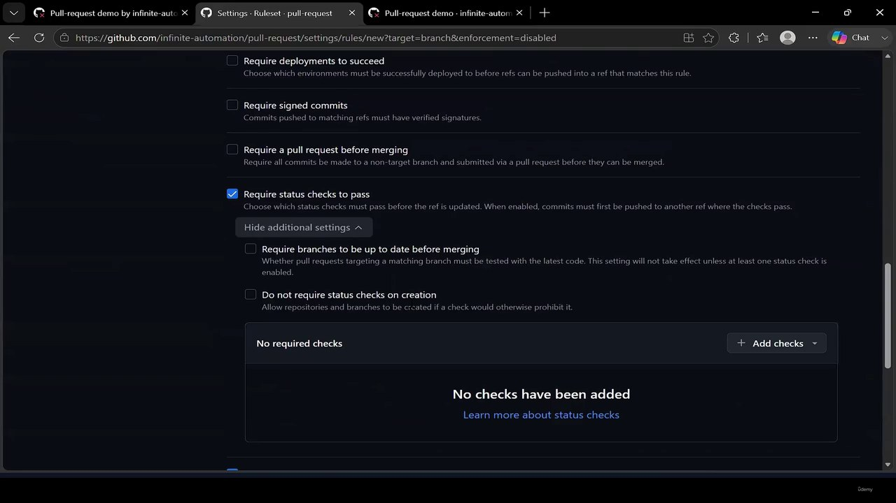
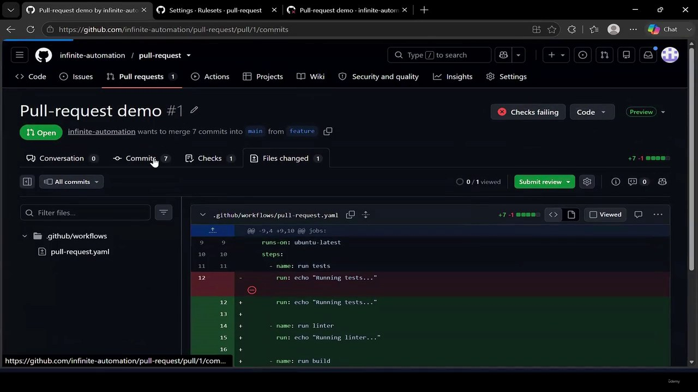
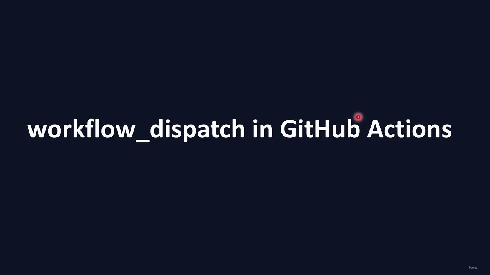
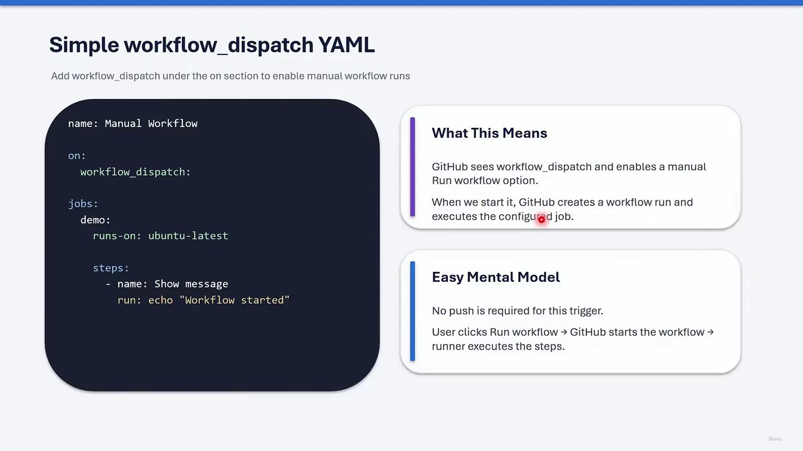

## 1. 这一节做什么

这一节要做出一个可以真实跑起来的 GitHub Actions 小项目，覆盖 P17–P20 的四个连续能力：

1. **Pull Request 事件触发工作流**：开发者从 `feature` 分支向 `main` 分支提 PR 时，GitHub 自动运行 `.github/workflows/pull-request.yaml`。
2. **验证 PR 的三种生命周期活动**：新建 PR 会触发 `opened`；向已打开 PR 的源分支继续 push 会触发 `synchronize`；关闭后重新打开 PR 会触发 `reopened`。逐字稿里讲师口头说成 “synchronized”，GitHub 实际活动名以界面和官方字段为准。
3. **用 Ruleset 阻止失败 PR 合并**：当 `test` job 失败时，不允许合并到 `main`；只有 `test` job 通过，Merge 按钮才可用。讲师把这叫 “block pull requests until workflow passes”。
4. **用 `workflow_dispatch` 手动触发工作流**：不等待 push / pull request，而是在 GitHub Actions 页面点 “Run workflow”。

读完并照着做，你会得到一个仓库，目录结构如下：

```text
你的仓库/
└── .github/
    └── workflows/
        ├── pull-request.yaml
        └── manual-deploy.yaml
```

这一节不依赖 npm、Maven、Python 包。P17–P19 的验证命令都用 `echo` 模拟；P20 也只需要 GitHub Actions 自带的 runner。讲师在 P17 提到，真实项目里可以把 `echo` 换成 Maven build、`npm test`、Python 测试命令等，但课里没有展开真实构建脚本。需要特别说明的是，本文里的“前台”指 GitHub 网页界面；也就是说，同一个动作既可能通过本地 Git 命令完成，也可能需要在 GitHub 页面上查看结果、创建 PR、配置 Ruleset 或手动触发工作流。理解“本地命令”和“GitHub 页面操作”的对应关系，排错时会轻松很多。



---

## 2. 讲师原话（带「—— pNNN [MM:SS]」）

下面只摘与“怎么复现”直接相关的原话，并附中文解释。

> "在合并代码之前，维米希望构建应用、运行一些测试、检查代码质量或执行安全检查。因此，拉取请求事件在这里更有用。"
> —— p017 [00:28]

中文：在代码合并前，团队通常要构建应用、跑测试、检查代码质量或做安全检查，这正是 Pull Request 事件有用的地方。

> "所以，如果你只使用拉取请求而不指定这些类型，GitHub 会自动将它们作为默认值，例如拉取请求活动中的 open、synchronized 和 reopened。"
> —— p017 [03:20]

中文：如果你只写 `pull_request`，不显式指定 activity types，GitHub 默认会处理打开、同步、重新打开这类 PR 活动。逐字稿口述的 “synchronized” 对应 GitHub 界面里的同步更新活动；复现时我们不需要在 YAML 里手写 types。

> "首先要处理 `.github` 目录。在其中需要创建 `workflows` 目录；然后在 `workflows` 目录中创建名为 `pull-request.yaml` 的文件。"
> —— p018 [00:56] 到 [01:26]

中文：在仓库根目录创建 `.github`，里面创建 `workflows`，再创建 `pull-request.yaml`。这是整个演示的核心工作流文件。

> "这里要注意的是，在 `on` 部分中，`pull_request` 指定了 `branches: main`。这里的 `main` 是目标分支，也就是你把功能分支等的源代码合并进去的分支。因此这里要非常小心。"
> —— p018 [02:54]

中文：`pull_request.branches.main` 里的 `main` 是 PR 的目标分支 / 基础分支，不是你的 `feature` 源分支。这里很容易写反。



> "为此，需要进入设置，点击规则集。然后在这里点击“新建分支规则集”。"
> —— p019 [05:44]

中文：要阻止失败 PR 合并，需要去仓库 Settings 里的 Rulesets，新建 branch ruleset。

> "需要勾选“要求状态检查通过”。然后到这里需要添加检查。添加检查的意思是，需要在这里添加作业。我们的作业是，点击这一项后可以看到，作业名称是 `test`。"
> —— p019 [07:08] 到 [07:37]

中文：在 ruleset 里勾选 “Require status checks to pass”，然后把 job 名 `test` 加进去。也就是说，PR 的 `test` job 不通过，就不能合并。

> "简单来说，Workflow Dispatch 是手动触发器。这意味着工作流不会等待推送或拉取请求之类的事件，而是可以在需要时进入 GitHub 手动启动工作流。"
> —— p020 [00:29]

中文：`workflow_dispatch` 是手动触发器。工作流不等待 push 或 PR，而是由人到 GitHub 页面手动点运行。

> "在 `on` 部分中，我添加了 Workflow Dispatch。基本上，我们是在告诉 GitHub，我希望这个工作流支持手动执行。"
> —— p020 [01:25]

中文：在 `on:` 下面加 `workflow_dispatch:`，就是告诉 GitHub 这个工作流支持手动执行。

---

## 3. 从零复现

下面按“先建立能跑的 PR 工作流，再制造失败并加规则，最后加手动触发”的顺序做。你可以严格按步骤走，也可以直接使用第 4 节的完整文件。每一步里会补充命令本身的作用、常见错误，以及它在 GitHub 页面上对应什么操作。

### 3.1 准备仓库与目录

1. 在 GitHub 新建一个仓库，默认分支使用 `main`。P18 里讲师创建的仓库名叫 `pull request`，仓库初始是空的。
2. 把它 clone 到本地：

```bash
git clone <你的仓库地址>
cd <你的仓库目录>
```

`git clone <你的仓库地址>` 的作用是把远程 GitHub 仓库复制到本地，创建本地工作目录，并默认把远程地址记录为 `origin`。常见错误包括：仓库地址写错、没有访问权限、网络连接失败、私有仓库没有登录凭据。排查时先确认浏览器能打开该仓库，再检查命令行是否弹出登录或提示 `Permission denied`。`cd <你的仓库目录>` 是进入刚 clone 下来的目录；如果提示 `No such file or directory`，说明目录名写错，或者 `clone` 根本没有成功。对应到 GitHub 页面，这一步相当于在网页上新建仓库后，再从仓库页面复制 clone 地址。

3. 创建目录：

```bash
mkdir -p .github/workflows
```

`mkdir -p` 会递归创建目录，并且如果目录已经存在也不会报错。这里要创建的是 `.github/workflows`，注意 `.github` 前面有一个点，它是隐藏目录，不是 `github`。常见错误是写成 `github/workflows` 或 `workflows`，导致工作流文件不在 GitHub 识别的位置。排查时可以用 `ls -la` 查看当前目录，确认 `.github` 是否存在。

4. 创建文件：

```bash
touch .github/workflows/pull-request.yaml
```

`touch` 用来创建一个空文件；如果文件已存在，它通常只更新时间戳。常见错误包括：父目录不存在、路径拼写错误、Windows PowerShell 没有 `touch` 命令。若在 Windows 上遇到 `touch` 不可用，可以用编辑器直接新建文件，或使用 PowerShell 的 `New-Item`。对应到 GitHub 网页，可以在仓库里选择 **Add file > Create new file**，文件名输入 `.github/workflows/pull-request.yaml`，网页会自动按斜杠创建目录。

> 如果你 clone 下来的是一个完全空的仓库，可能还没有本地 `main` 分支。可以先提交第一次，再执行 `git branch -M main` 和 `git push -u origin main`。这一点逐字稿没有展开，但空仓库复现时经常会遇到。

### 3.2 先放入初始版 PR 工作流

P18 一开始只写了 `run tests` 一个步骤。为了严格复现视频节奏，先把下面这个“初始完整文件”保存到 `.github/workflows/pull-request.yaml`：

```yaml
name: Pull Request Demo

on:
  pull_request:
    branches:
      - main

jobs:
  test:
    runs-on: ubuntu-latest
    steps:
      - name: Run tests
        run: echo "running the test"
```

提交并推送到 `main`：

```bash
git add .
git commit -m "add pull request workflow"
git push -u origin main
```

`git add .` 把当前目录下新增和修改的文件加入暂存区；这里的“.”表示当前目录。常见错误是执行目录不对，导致没有暂存到 `.github/workflows/pull-request.yaml`。排查时用 `git status` 看文件是否出现在 staged 区域。`git commit -m "..."` 把暂存区内容生成一次提交；常见错误包括没有配置 `user.name` / `user.email`、没有暂存内容导致 `nothing to commit`。`git push -u origin main` 把本地 `main` 推到远程，并用 `-u` 建立上游跟踪关系；常见错误是本地还没有 `main` 分支，出现 `src refspec main does not match any`。对应到 GitHub 页面，这一步相当于在网页上创建或编辑文件后点击 **Commit changes**。

注意：要先把工作流文件放到 `main`，再开 feature 分支。P18 也是先把工作流推到远程，然后才 `git checkout -b feature`。这样做能减少“PR 触发了但没有工作流文件”或“分支起点不一致”的排查干扰。

### 3.3 创建 feature 分支并追加 linter 步骤

```bash
git checkout -b feature
```

`git checkout -b feature` 表示从当前提交创建并切换到 `feature` 分支。常见错误是本地已经存在同名分支，提示 `a branch named 'feature' already exists`；这时可以改用 `git checkout feature` 切换已有分支，或换一个分支名。对应到 GitHub 页面，可以从分支下拉框选择 **New branch**，从 `main` 创建 `feature`。

在 `steps` 末尾追加 linter。追加后文件应变成第 4 节的“最终完整文件”中的前三步版本；你也可以直接把最终完整文件粘贴进去，先包含 `Run tests` 和 `Run linter` 两步。

提交并推送 feature 分支：

```bash
git add .
git commit -m "created the feature branch"
git push -u origin feature
```

`git push -u origin feature` 第一次把本地 `feature` 推到远程，并设置上游分支。之后在这个分支上就可以直接执行 `git push`。常见错误是没有提交就 push、远程分支名冲突、没有权限。排查时先 `git status`，再 `git log --oneline` 看是否已有提交。

### 3.4 在 GitHub 上创建 Pull Request

1. 打开 GitHub 仓库页面。
2. 选择 `feature` 分支，点击 Compare / Pull request。
3. `base` 选 `main`，`compare` 选 `feature`。
4. 标题可以写 `pull request demo`。
5. 点击 Create pull request。

创建后进入 Actions 页面，应看到 `Pull Request Demo` 工作流被触发。点进去应看到 job `test`，以及 `Run tests`、`Run linter` 等步骤。常见错误是把 base 和 compare 写反，或者 PR 目标分支不是 `main`，但 YAML 里写的是 `branches: main`，这样工作流不会按预期触发。排查时看 PR 页面标题下方的 `base: main <- compare: feature` 是否正确。



### 3.5 演示 synchronize：PR 打开后继续 push

不要关闭 PR。继续在本地 `feature` 分支给工作流追加 `Run build`：

```yaml
      - name: Run build
        run: echo "running the build"
```

提交并 push：

```bash
git add .
git commit -m "checking the synchronize activity"
git push
```

因为 PR 已经打开，这次 push 会触发同步更新活动，Actions 里会出现一次新的工作流运行，并执行 `Run tests`、`Run linter`、`Run build` 三个步骤。这里的 `git push` 能直接使用，是因为前面执行过 `git push -u origin feature`，已经设置了上游分支。如果提示没有上游分支，可以改用 `git push origin feature`。对应到 GitHub 页面，你会在 PR 的 Commits 区域看到新提交，在 Checks 区域看到新的运行记录。



### 3.6 演示 reopened：关闭再重新打开 PR

在 PR 页面点击 Close pull request。PR 变红后，再点击 Reopen pull request。重新打开后，GitHub 会再次触发 `Pull Request Demo` 工作流。P18 的演示顺序是：先 opened，再 synchronize，最后 reopened。常见错误是 PR 关闭后源分支被删除，或者页面没有刷新，导致看不到 Reopen 按钮或新的运行记录。排查时确认 PR 仍是同一个、分支仍存在，并到 Actions 页面按时间查看最新运行。



### 3.7 故意让 `Run build` 失败

把最终文件里的这一行：

```yaml
        run: echo "running the build"
```

临时改成：

```yaml
        run: running the build
```

这样 shell 会把 `running` 当作命令去执行，找不到命令，工作流失败。提交并 push：

```bash
git add .
git commit -m "intentionally fail the build step"
git push
```

进入 Actions 查看失败运行。P19 里讲师说明失败原因是移除了 `echo`，导致退出码 127，并提示 command not found。你应看到类似“命令找不到”的失败信息；具体输出字段名以实际日志为准。常见错误是 YAML 缩进改坏，导致工作流文件本身解析失败；这时日志会显示 YAML 语法错误，而不是 `command not found`。排查时先看失败步骤是不是 `Run build`，再看日志里是否出现 `running: command not found` 或退出码 127。



此时如果还没有配置 ruleset，PR 页面虽然显示失败，但仍然可能允许你点 Merge。P19 正是用这个现象说明：**光有 PR 工作流不够，必须再加 ruleset 才能阻止合并。**

### 3.8 配置 Ruleset 阻止失败 PR 合并

在 GitHub 仓库页面：

1. 进入 **Settings**。
2. 找到 **Rulesets**（P19 口述为 rule set）。
3. 点击 **New branch ruleset**。
4. Ruleset name 填 `block PR`。
5. Enforcement 选择 Active / 激活。
6. Target branches 包含 `main`。P19 里讲师在 pattern 里写 `main`。
7. 找到并勾选 **Require status checks to pass**。
8. 在状态检查里添加 `test`。P19 里讲师说 job 名是 `test`，所以添加 `test`。
9. 创建 ruleset。

常见错误包括：Ruleset 没有激活、目标分支没有匹配到 `main`、状态检查名称写成了不存在的名字、只勾选但没真正添加 `test`。排查时回到 PR 页面刷新，看失败的 check 是否标为 required；如果 Merge 仍可点击，优先检查 Ruleset 的 Enforcement 和 target branches。对应到 GitHub 页面，这一步没有本地命令，完全是仓库设置里的“前台”操作。





配置后回到 PR 页面刷新。失败的 workflow 会显示为 required；Merge pull request 按钮会被阻止，页面提示 merge 被失败的合并要求阻塞。此时不能合并。

### 3.9 修复失败并合并

把失败行改回：

```yaml
        run: echo "running the build"
```

提交并 push：

```bash
git add .
git commit -m "fix the build step"
git push
```

等待新的 workflow 运行成功。成功后 PR 页面应重新出现可用的绿色 Merge 按钮。点击 Confirm merge，把 `feature` 合并到 `main`。常见错误是刚 push 完就刷新 PR 页面，新的 check 还没跑完；此时 Merge 仍可能被阻止。排查时先到 Actions 看最新运行是否完成，再看 PR 页面 Checks 是否全部通过。

### 3.10 增加手动触发工作流

P20 只演示了在 `on:` 下增加 `workflow_dispatch`。为了让手动运行有可见结果，我们另建一个最小工作流 `.github/workflows/manual-deploy.yaml`。课里没有展开这个文件的 job 细节，下面的 job 结构沿用前面同样的最小写法。

```bash
touch .github/workflows/manual-deploy.yaml
```

保存第 4 节的手动工作流完整文件，提交并推送到 `main`：

```bash
git add .
git commit -m "add manual workflow dispatch"
git push
```

然后在 GitHub 仓库进入 **Actions**，左侧选择 `Manual Deploy Demo`，右侧会出现 **Run workflow** 按钮。点击后选择分支并运行，即可看到手动触发的运行记录。常见错误是文件还没在默认分支上、Actions 页面没有刷新到对应工作流、或者 `on:` 下面把 `workflow_dispatch:` 缩进写错。排查时先确认文件已推送到 `main`，再打开 Actions 页面刷新左侧列表。





### 3.11 本地命令逐条解释与常见错误汇总

为了满足“每条命令的完整解释”，这里把本节出现的核心命令集中说明一遍。实际复现时不必背表格，按步骤执行即可。

| 命令 | 作用 | 常见错误 | 排查方式 |
|---|---|---|---|
| `git clone <你的仓库地址>` | 把远程仓库复制到本地，并创建 `origin` 远程记录 | 地址错误、无权限、网络失败 | 浏览器确认仓库可访问；检查 HTTPS/SSH 地址；重新登录凭据 |
| `cd <你的仓库目录>` | 进入本地仓库目录 | 目录名写错、clone 未成功 | `pwd` 看当前位置，`ls` 看目录内容 |
| `mkdir -p .github/workflows` | 递归创建 `.github/workflows` 目录，已存在也不报错 | 写成 `github` 或 `workflow`；权限不足 | `ls -la` 查看隐藏目录；确认路径在仓库根目录 |
| `touch .github/workflows/pull-request.yaml` | 创建空的工作流文件 | 父目录不存在；Windows 无 `touch` | 先确认目录存在；用编辑器或 `New-Item` 创建 |
| `git add .` | 把当前目录改动加入暂存区 | 执行目录不对，文件没被暂存 | `git status` 查看 staged 文件 |
| `git commit -m "..."` | 生成一次提交 | 没配用户名邮箱；没有暂存内容 | 配置 `user.name`、`user.email`；先 `git add` |
| `git push -u origin main` | 推送 `main` 并设置上游跟踪 | 本地没有 `main`；远程权限不足 | 先提交；必要时 `git branch -M main`；检查远程地址 |
| `git checkout -b feature` | 创建并切换到 `feature` 分支 | 分支已存在；未提交改动导致切换冲突 | `git branch` 查看分支；先提交或 stash |
| `git push -u origin feature` | 推送 `feature` 并设置上游 | 没有提交；远程分支冲突 | `git status`、`git log --oneline` 检查 |
| `git push` | 推送当前分支已有上游的提交 | 没设置上游；远程有新提交 | 改用 `git push origin feature`；必要时先 pull |
| `touch .github/workflows/manual-deploy.yaml` | 创建手动工作流文件 | 路径错误、目录不存在 | 确认仍在仓库根目录，`.github/workflows` 已存在 |
| `git branch -M main` | 把当前分支重命名为 `main` | 只在需要修正默认分支时使用 | `git branch` 确认当前分支名；再 push |

这些命令本身不改变课程事实，只是为了让你在复现时知道“为什么敲、敲错了会怎样、去哪儿看”。本地命令与 GitHub 页面操作的对应关系，见后面的“与 GitHub 页面操作的对照”。

---

## 4. 完整代码

### 4.1 初始版：`.github/workflows/pull-request.yaml`

用于复现 P18 最开始只有 `Run tests` 的状态。

```yaml
name: Pull Request Demo

on:
  pull_request:
    branches:
      - main

jobs:
  test:
    runs-on: ubuntu-latest
    steps:
      - name: Run tests
        run: echo "running the test"
```

### 4.2 最终版：`.github/workflows/pull-request.yaml`

这是 P18–P19 演示完成后的完整文件，包含 tests、linter、build 三个步骤。直接保存这个文件也能复现 PR 触发、失败阻止合并、修复后合并。

```yaml
name: Pull Request Demo

on:
  pull_request:
    branches:
      - main

jobs:
  test:
    runs-on: ubuntu-latest
    steps:
      - name: Run tests
        run: echo "running the test"

      - name: Run linter
        run: echo "running the linter"

      - name: Run build
        run: echo "running the build"
```

> 想复现 P19 的失败效果，只改这一行：把 `run: echo "运行构建"` 改成 `run: running the build`。其余文件内容不变。

### 4.3 手动触发：`.github/workflows/manual-deploy.yaml`

P20 只讲了 `workflow_dispatch` 是手动触发器，以及要在 `on:` 下加它；课里没有逐行展示完整 job。下面是一个能直接保存运行的最小完整文件。

```yaml
name: Manual Deploy Demo

on:
  workflow_dispatch:

jobs:
  deploy:
    runs-on: ubuntu-latest
    steps:
      - name: Show manual trigger
        run: echo "manual workflow_dispatch is running"
```

---

## 5. 逐行解释

### 5.1 `pull-request.yaml`

```yaml
name: Pull Request Demo
```

工作流显示名称。GitHub Actions 页面左侧和 PR 检查区域会显示这个名字。P18 讲师把工作流命名为 pull request demo。

```yaml
on:
  pull_request:
    branches:
      - main
```

`on` 是触发器配置。`pull_request` 表示由 Pull Request 活动触发。`branches: main` 表示目标分支是 `main`。这里最容易错：它筛的是 PR 的 base / target 分支，不是 `feature` 源分支。P18 特别提醒 “main is a source” 时，实际是在强调合并目标分支，复现时请以 GitHub PR 页面的 base 分支为准。常见错误是把 `branches: main` 理解成“从 main 推出去的分支”，于是 PR 从 `feature` 提到别的目标分支时发现工作流不跑。排查时直接看 PR 页面的 base 是不是 `main`。

讲师在 P17 说，不写 activity types 时，默认会处理 opened、synchronized、reopened 这类活动。所以本文件没有写 `types`。你不需要为了复现再额外声明。

```yaml
jobs:
  test:
```

`jobs` 下定义一个或多个 job。`test` 是 job 的 id / 名称。P19 配置 ruleset 时，要求添加的检查就是 `test`。如果你把 job 改名为 `build`，ruleset 里的 required check 也要同步改，否则规则对不上。常见错误是 YAML 里改了 job 名，但 Ruleset 里还写着 `test`，结果 PR 一直等一个永远不会出现的检查。排查时同时搜索工作流文件和 Ruleset 设置里的名称。

```yaml
    runs-on: ubuntu-latest
```

指定 runner。P17 说使用 Ubuntu runner；这里写 GitHub 托管的 `ubuntu-latest`。课里没有要求你本地安装 Ubuntu。常见错误是把 `runs-on` 写成 `run-on` 或放进 `steps` 里，导致 YAML 结构错误。排查时看该行是否与 `jobs.test` 同级缩进。

```yaml
    steps:
      - name: Run tests
        run: echo "running the test"
```

`steps` 是 job 内的步骤列表。`name` 是步骤显示名，`run` 是在 runner shell 里执行的命令。`echo` 只是模拟测试；真实项目里 P17 提到可以换成 Maven build、`npm test`、Python 测试等。注意：真实 npm 项目还需要 checkout 代码和安装 Node，这些课里没讲，见第 7 节。常见错误是 `name` 和 `run` 的缩进不一致，导致工作流解析失败。

```yaml
      - name: Run linter
        run: echo "running the linter"
```

P18 在 feature 分支中追加的 linter 步骤。它仍然只是 echo，用来证明 PR 更新后新的步骤会被执行。

```yaml
      - name: Run build
        run: echo "running the build"
```

P18 后段追加的 build 步骤。P19 故意去掉 `echo` 后，`run` 变成 `running the build`，shell 找不到 `running` 命令，所以失败并出现退出码 127。这也是为什么失败演示不需要真实构建工具。常见错误是复现失败后忘记改回 `echo`，导致后续 PR 一直被 Ruleset 阻止。

### 5.2 `manual-deploy.yaml`

```yaml
name: Manual Deploy Demo
```

手动工作流的显示名。

```yaml
on:
  workflow_dispatch:
```

这是 P20 的核心：`workflow_dispatch` 让工作流支持手动执行。它不会因为 push 或 PR 自动跑；你需要在 Actions 页面点 Run workflow。常见错误是把 `workflow_dispatch:` 写成 `workflow_dispatch` 或缩进到错误层级；排查时确认它直接在 `on:` 下面。

```yaml
jobs:
  deploy:
    runs-on: ubuntu-latest
    steps:
      - name: Show manual trigger
        run: echo "manual workflow_dispatch is running"
```

这是一个最小 job，用来让手动触发后有日志可看。课里没有讲 deploy 的具体内容；这里不部署任何真实服务，只打印一行文本。真实部署命令、密钥、环境变量都不在 P17–P20 的讲解范围内。

### 5.3 失败命令与退出码说明

`run: echo "running the build"` 里的 `echo` 是 shell 内置命令，作用是把后面的字符串打印到日志里，正常退出码是 0。改成 `run: running the build` 后，shell 会把第一个词 `running` 当成可执行命令，把 `the`、`build` 当成参数；系统找不到 `running` 这个命令，因此返回 127。你在日志里看到 `command not found`、`not found` 或退出码 127，都属于同一条失败链路。排查时先确认失败的是 `Run build` 步骤；如果失败发生在更早的 YAML 解析阶段，应优先检查缩进和冒号，而不是命令本身。

---

## 6. 复现检查清单

- [ ] GitHub 仓库默认分支是 `main`；如果你的仓库默认分支是 `master`，要么改分支名，要么把 YAML 和 ruleset 里的 `main` 同步改掉。
- [ ] 本地已创建 `.github/workflows/pull-request.yaml`。
- [ ] 初始版工作流已提交并推送到 `main`。
- [ ] 已从 `main` 创建 `feature` 分支：`git checkout -b feature`。
- [ ] `feature` 分支中已追加 `Run linter`，并 push 到远程。
- [ ] 已在 GitHub 创建 PR：base 为 `main`，compare 为 `feature`。
- [ ] PR 创建后 Actions 中出现 `Pull Request Demo` 运行记录。
- [ ] 点进运行记录能看到 job `test`。
- [ ] PR 打开状态下继续 push，Actions 出现新的同步运行。
- [ ] 关闭 PR 再 Reopen，Actions 再次触发。
- [ ] 把 `run: echo "运行构建"` 改成 `run: running the build` 后，job `test` 失败，日志出现 command not found / 退出码 127 一类信息。
- [ ] 未配置 ruleset 时，失败 PR 仍可能允许合并；配置 ruleset 后，失败时 Merge 被阻止。
- [ ] Ruleset 名称可为 `block PR`，目标分支包含 `main`，勾选 Require status checks to pass，并添加 `test`。
- [ ] 修复 `Run build` 后 push，workflow 成功，Merge 按钮恢复可用。
- [ ] 已创建 `.github/workflows/manual-deploy.yaml`，`on:` 下有 `workflow_dispatch:`。
- [ ] 在 Actions 左侧选择 `Manual Deploy Demo`，能看到 Run workflow 按钮，并能成功手动运行一次。

### 6.1 检查清单逐条说明

1. **默认分支是 `main`**：YAML 里的 `branches: main` 和 Ruleset 的目标分支都依赖 `main`。如果仓库默认分支是 `master`，要么把分支改名为 `main`，要么把所有配置同步改成 `master`，否则 PR 触发或合并阻止会对不上。
2. **已创建 `.github/workflows/pull-request.yaml`**：路径必须是仓库根目录下的 `.github/workflows`，文件名可以按课程使用 `pull-request.yaml`。路径错一层，GitHub 就不会把它识别为工作流。
3. **初始版已提交并推到 `main`**：先让 `main` 上存在工作流文件，再从 `feature` 提 PR，复现顺序最稳定。若只放在本地没 push，GitHub 页面看不到文件，也不会按预期运行。
4. **已从 `main` 创建 `feature`**：`git checkout -b feature` 的起点应是包含工作流文件的 `main`。如果从旧提交或其他分支创建，PR 的差异和工作流文件状态可能不同。
5. **`feature` 中追加 `Run linter` 并 push**：这一步用于观察 PR 更新后的新步骤是否被执行。push 后应能在 Actions 看到新运行，而不是只停留在本地提交。
6. **PR 的 base 为 `main`，compare 为 `feature`**：base 是合并目标，compare 是来源分支。写反会导致 PR 方向错误，也会影响 `pull_request.branches` 的匹配。
7. **PR 创建后出现 `Pull Request Demo` 运行记录**：这说明 `on.pull_request` 已生效。若没有运行记录，先检查 PR 目标分支、工作流文件位置和 Actions 是否被仓库设置限制。
8. **运行记录中有 job `test`**：job 名必须与 Ruleset 里的 required check 对应。点进运行记录能看到 `test`，才能确认后续 Ruleset 添加的是正确名称。
9. **PR 打开状态下继续 push 会出现新的同步运行**：这是 `synchronize` 活动的效果。若没有新运行，检查是否 push 到了 PR 的 compare 分支，以及 PR 是否仍处于打开状态。
10. **关闭再 Reopen 会再次触发**：这是 `reopened` 活动的效果。若 Reopen 后没有运行，刷新 Actions 页面并按最新时间排序查看。
11. **改坏 `Run build` 后 job `test` 失败**：日志应出现 command not found 或退出码 127。若出现 YAML 语法错误，说明是缩进或格式问题，不是课程演示的失败命令。
12. **未配置 Ruleset 时失败 PR 仍可能可合并**：这说明仅有工作流失败并不会自动阻止合并；必须靠 Ruleset 的 required status checks 才能把失败检查变成合并门槛。
13. **Ruleset 目标包含 `main`，并添加 `test`**：Enforcement 要激活，目标分支要匹配，状态检查要从实际运行中选择或填写正确名称。三者缺一，Merge 阻止可能不生效。
14. **修复后 workflow 成功，Merge 恢复**：把 `run: running the build` 改回 `run: echo "运行构建"`，push 后等待新运行成功，PR 页面的 Merge 按钮才会恢复。
15. **手动工作流有 `workflow_dispatch:`**：它必须位于 `on:` 下面，格式和缩进正确。保存后要提交并推送到默认分支，Actions 页面才更容易看到 Run workflow。
16. **能手动运行一次 `Manual Deploy Demo`**：在 Actions 左侧选择该工作流，右侧点击 Run workflow，选择分支并运行。运行成功后应看到打印的 echo 日志。

---

## 7. 课里没讲但你会撞上的

1. **空仓库第一次 push 可能没有 `main` 分支**  
   P18 说仓库是空的并已 clone 到本地，但没有演示空仓库初始化细节。你可能会遇到 `src refspec main does not match any`。处理方式是先提交，再 `git branch -M main`，然后 `git push -u origin main`。排查时用 `git branch` 看当前分支名，用 `git log --oneline` 确认是否已有提交。

2. **`workflow_dispatch` 按钮不是文件一 push 就必然出现**  
   P20 只讲了在 `on:` 下加 `workflow_dispatch`。实际使用中，如果这个工作流文件还不在默认分支，或者 Actions 页面没刷新到对应分支，Run workflow 可能看不到。先把文件合并/推送到 `main`，再进 Actions 选择对应工作流。排查时刷新页面、确认左侧工作流名称、确认 `on:` 缩进。

3. **Required check 的名称可能因界面显示方式不同而不同**  
   P19 里讲师直接输入 `test` 并添加。实际 Rulesets 的检查列表可能显示 job id、job name 或工作流上下文。最稳妥的做法是：先让 PR 工作流成功跑一次，再回 ruleset 里从列表中选择实际出现的 `test` 检查；不要凭记忆手填一个不存在的名字。

4. **改了 job 名，ruleset 不会自动跟着改**  
   如果你把 `test:` 改成 `build:`，但 ruleset 还要求 `test`，PR 会一直等一个不会出现的检查。复现时保持 job 名为 `test` 最省事。排查时同时搜索 YAML 里的 `test:` 和 Ruleset 里的 required check 名称。

5. **真实项目不能只写 `echo`**  
   P17 提到可以把 echo 换成 Maven build、`npm test`、Python 测试等，但没有展开。前端项目如果真要跑 `npm test` / `npm run build`，通常还需要先拉代码、装 Node、装依赖。课里没有讲 `actions/checkout`、`actions/setup-node` 这类步骤，所以本复现只用 echo 验证事件和规则链路。不要误以为 echo 通过就代表真实项目测试通过。

6. **失败演示不要误当成最终代码**  
   `run: running the build` 是 P19 故意制造的失败写法。复现完失败效果后要改回 `run: echo "运行构建"`，否则 PR 会一直被 ruleset 阻止。排查时看 `Run build` 的 `run:` 行是否还有 `echo`。

7. **Ruleset 只对目标分支生效**  
   你配置的是 `main`，所以只有合并到 `main` 的 PR 会被阻止。如果团队还有 `develop`、`release` 等分支，需要另外配置目标分支或调整 pattern；P19 没有展开多分支规则。排查时看 Ruleset 的 target branches 是否匹配当前 PR 的 base。

8. **PR 的 base 分支写错，工作流不会按预期触发**  
   P18 强调 `branches: main` 是 PR 的目标分支。如果你的 PR 是 `feature -> develop`，但 YAML 里写的是 `main`，工作流不会因为这次 PR 触发。复现时保持 `base = main`。排查时先看 PR 页面 base 标签，再看 YAML 的 `pull_request.branches`。

---

## 8. 与 GitHub 页面操作的对照

这里的“前台”指 GitHub 网页界面。下面把本地命令、文件操作和网页操作放在一起对照，方便你在“命令行做完了但页面看不到”时定位问题。

| 本地命令 / 文件操作 | GitHub 页面操作 | 对照说明与排查点 |
|---|---|---|
| 在 GitHub 网页新建仓库 | 页面 **New repository** | 默认分支通常选 `main`；空仓库可能还没有本地 `main` |
| `git clone <地址>` | 仓库页面复制 clone 地址 | clone 成功后本地出现仓库目录，`origin` 指向远程 |
| `cd <目录>` | 无直接对应页面操作 | 只是进入本地目录；页面不会变化 |
| `mkdir -p .github/workflows` | **Add file > Create new file** 时输入带 `/` 的路径 | 网页会自动创建目录；本地要确认是 `.github` 不是 `github` |
| `touch .github/workflows/pull-request.yaml` | **Create new file** 新建工作流文件 | 网页保存时会生成 commit；本地还需 add / commit / push |
| `git add .` + `git commit` | 网页编辑后 **Commit changes** | 两者都会产生提交；本地未 push 时远程页面看不到 |
| `git push -u origin main` | 网页上已有对应提交 | push 后刷新仓库页面能看到文件；看不到就检查分支和远程地址 |
| `git checkout -b feature` | 分支下拉框 **New branch** | 本地切换分支后，编辑器文件会变化；网页分支选择也要切到 `feature` |
| `git push -u origin feature` | 分支下拉框能看到 `feature` | 远程没有分支时，PR 页面无法选择 compare 分支 |
| 在网页创建 PR，base 选 `main`，compare 选 `feature` | **Pull requests > New pull request** | 页面上的 base / compare 要与本地分支关系一致 |
| 向 `feature` 继续 `git push` | PR 的 **Commits** 区域出现新提交 | 这会触发 `synchronize`，Actions 出现新运行 |
| PR 页面 Close / Reopen | PR 页面按钮 | 这会触发 `reopened`，Actions 再次运行 |
| 修改 YAML 并 push 制造失败 | 网页编辑文件也可提交 | 失败结果在 **Actions** 和 PR **Checks** 中看 |
| 无本地命令，进入 **Settings > Rulesets** | 新建 branch ruleset | 必须 Active、目标分支匹配 `main`、添加 `test` 检查 |
| 修复 YAML 并 push | 网页编辑后提交 | 等新 check 成功，Merge 按钮才恢复 |
| 保存 `manual-deploy.yaml` 并 push | **Actions > 左侧工作流 > Run workflow** | 文件要在默认分支；页面刷新后选择对应工作流手动运行 |

把这张表和第 6 节检查清单配合使用，基本可以判断问题出在“本地没推上去”“分支选错”“工作流文件路径不对”“Ruleset 名称不匹配”还是“手动触发文件还没到默认分支”。这些补充只用于复现和排查，不改变 P17–P20 的课程事实与演示结论。