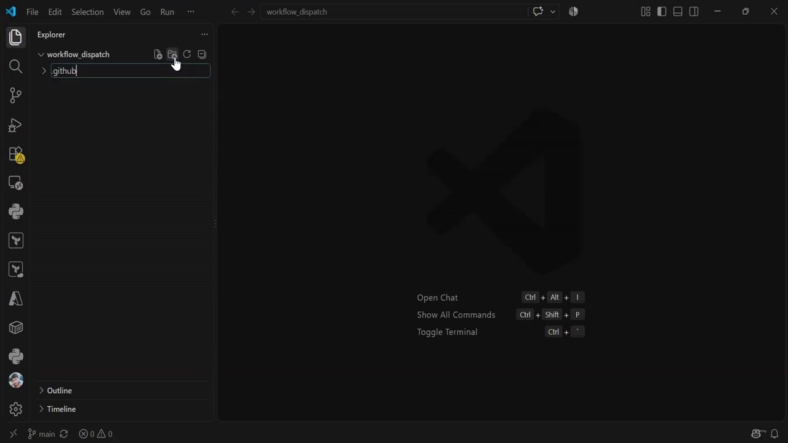
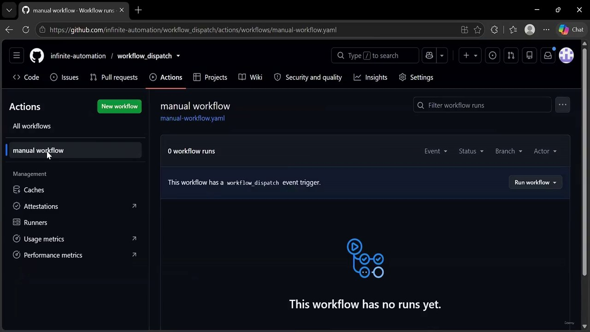
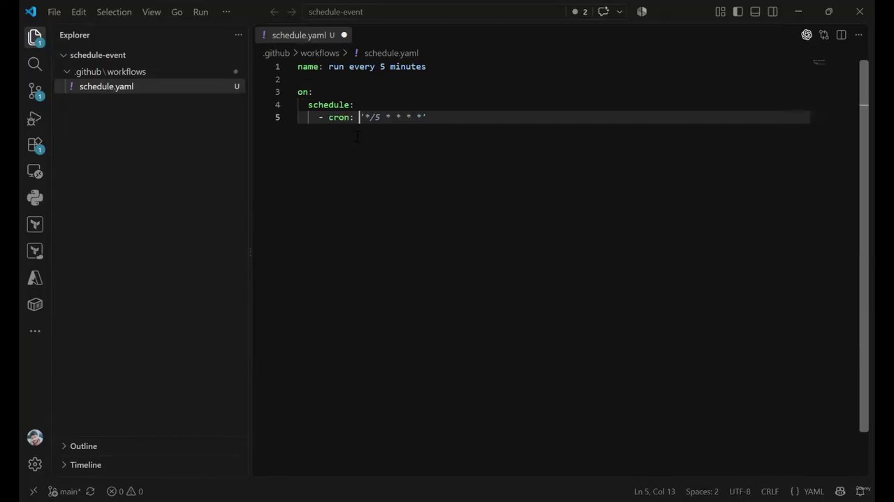
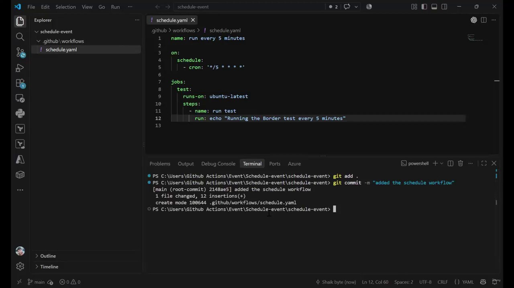
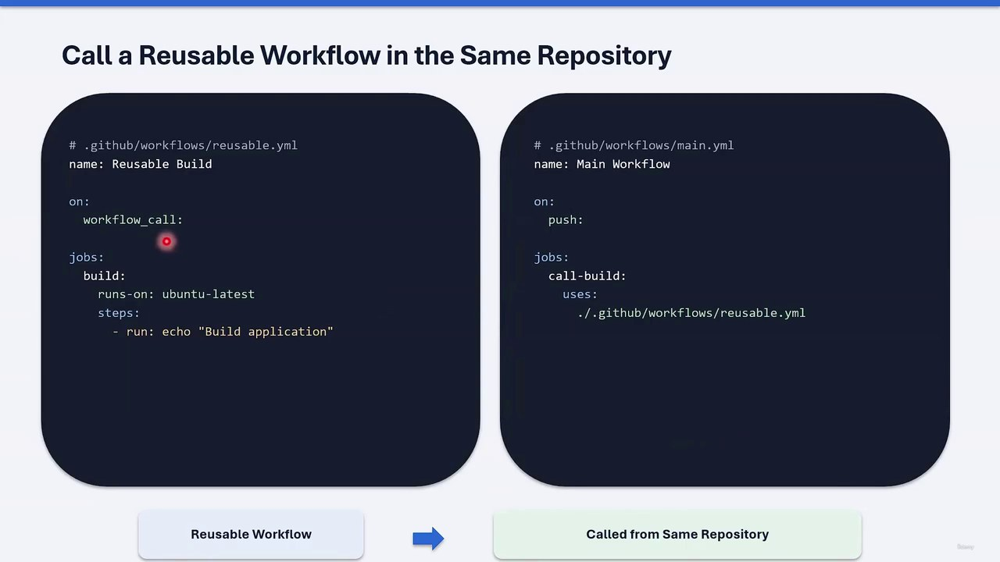
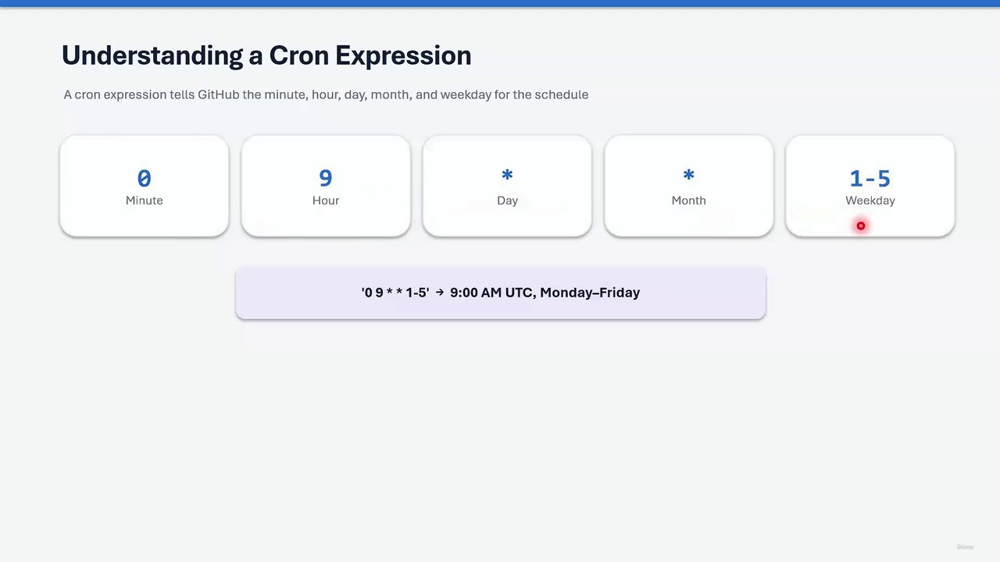
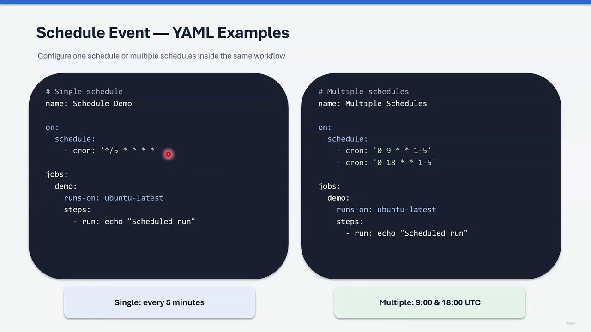

# GitHub Actions Complete（P21–P24）复现文档：手动触发、定时触发与可复用工作流

## 1. 这一节做什么

P21–P24 覆盖 GitHub Actions 的三个常用能力：`workflow_dispatch` 手动触发、`schedule` 定时触发、`workflow_call` 可复用工作流。最终目标不是只看懂概念，而是做出一个能推送到 GitHub、能在 Actions 页面看到运行结果、能按 cron 定时执行、能被另一个工作流调用的最小项目。

本复现把 P21、P23、P24 的示例放在同一个本地仓库里，方便你一次跑通。课里 P21 和 P23 是分别建空仓库演示的；你当然也可以拆成多个仓库，只要 workflow 文件仍然放在 `.github/workflows/` 下即可。

最终目录结构如下：

```text
github-actions-labs/
└── .github/
    └── workflows/
        ├── manual-workflow.yaml      # P21：手动触发
        ├── schedule.yaml             # P23：每 5 分钟定时触发
        ├── reusable-build.yaml       # P24：可复用工作流
        └── main.yaml                 # P24：调用可复用工作流
```

依赖和环境很简单：

| 项目 | 值 |
|---|---|
| 本地工具 | Git、VS Code、浏览器 |
| GitHub 仓库 | 空仓库，默认分支用 `main` |
| Runner | `ubuntu-latest`，课里称为 GitHub hosted runner |
| Node/npm 依赖 | 无 |
| Python/Java 依赖 | 无 |
| 环境变量 | 无，课里没有配置 `env` |
| Secrets | 无，课里没有配置 secrets |
| 启动方式 | `git push` 后到 GitHub Actions 页面触发/等待/查看 |

在 JS/Node 视角里可以这样类比：`workflow_dispatch` 像一个手动点击的按钮；`schedule` 像服务端的 `setInterval`/cron job；`workflow_call` 像把公共函数抽成 module，再在别的文件里 `import` 调用。

更具体地说，这里的“前台”不是指必须写一个网页，而是指你在 GitHub 网页界面上看到的可视操作入口：Actions 标签页、左侧 workflow 列表、右侧 `Run workflow` 按钮、每次 run 的 job/step 展开面板和日志输出。YAML 文件描述的是后台执行规则，GitHub Actions 页面负责把规则运行情况可视化。`name`、job ID、step 的 `name` 和 `run` 输出会分别出现在页面的不同位置；排查时不能只看本地文件，还要对照 Actions 页面里是否出现对应 workflow、对应 job、对应 step 和对应日志。

---

## 2. 讲师原话（带「—— pNNN [MM:SS]」）

> "通过添加 workflow dispatch，我们是在告诉 GitHub：要手动启动这个工作流。"
> —— p021 [01:24]

> "schedule 事件让我们可以按时间自动运行工作流。"
> —— p022 [00:29]

> "这里的 cron 表达式有五个字段。"
> —— p022 [02:24]

> "按照我们的需求，我们希望每五分钟运行一次这个工作流。"
> —— p023 [02:23]

> "发起调用的工作流是调用方工作流，而被再次使用的工作流是可复用工作流。"
> —— p024 [00:57]

---

## 3. 从零复现

### 3.1 创建并克隆空仓库

先在 GitHub 上创建一个空仓库，例如 `github-actions-labs`。不要勾选自动生成 README、`.gitignore` 或 license，保持空仓库即可。然后本地执行：

```bash
git clone https://github.com/你的用户名/github-actions-labs.git
cd github-actions-labs
git branch -M main
mkdir -p .github/workflows
code .
```

如果 clone 空仓库时 Git 提示 “warning: You appear to have cloned an empty repository”，这是正常的，因为仓库还没有第一个 commit。



上面这几条命令逐条解释如下：

1. `git clone https://github.com/你的用户名/github-actions-labs.git`  
   作用是把 GitHub 上的远程仓库复制到本地当前目录，生成一个与仓库同名的文件夹，例如 `github-actions-labs/`，里面包含 `.git/` 版本控制信息。因为这里创建的是空仓库，所以 clone 下来没有业务文件，Git 会给出空仓库 warning。常见错误是仓库地址写错、用户名写错、仓库名写错，或者网络/认证失败。排查时先在浏览器打开该仓库 URL，确认仓库存在并且当前账号有访问权限。

2. `cd github-actions-labs`  
   作用是进入刚刚克隆下来的项目目录。后续的 `mkdir`、`code .`、`git add` 都应该在这个目录下执行。常见错误是忘记 `cd`，导致文件建到上一级目录，最后 `git status` 看不到 `.github/workflows`，或者 push 上去后 Actions 页面没有 workflow。排查时执行 `pwd` 看当前路径，确认路径最后是 `github-actions-labs`。

3. `git branch -M main`  
   作用是把当前分支重命名并强制指定为 `main`。`-M` 是强制重命名，适合把默认分支统一成 `main`。空仓库、旧仓库或本地默认分支叫 `master` 时，常用这一步统一分支名。常见错误是远程仓库默认分支不是 `main`，或者本地当前分支状态不符合预期。排查时执行 `git branch --show-current` 或 `git status`，确认当前分支名。后续 push 和 Actions 页面选择分支都要与这个分支名一致。

4. `mkdir -p .github/workflows`  
   作用是创建 `.github/workflows` 目录。`-p` 表示如果父目录不存在就一起创建，如果目录已经存在也不要报错。GitHub Actions 只识别 `.github/workflows/` 下的 YAML 文件，所以这个目录层级不能省略。常见错误是只创建 `.github/` 而漏掉 `workflows`，或者把 YAML 文件放到仓库根目录。排查时在 VS Code 文件树里展开 `.github/workflows/`，确认四个 YAML 文件都在里面。

5. `code .`  
   作用是用 VS Code 打开当前目录。前提是本地已安装 VS Code，并且 `code` 命令已经加入 PATH。常见错误是终端提示 `code: command not found`，这通常不是项目本身的问题，而是 VS Code 命令行工具没有安装或没有配置 PATH。排查时可以先用系统文件管理器打开当前目录，或者在 VS Code 里手动打开该文件夹。

### 3.2 创建四个 workflow 文件

在 VS Code 中按第 4 节的「完整代码」创建下面四个文件：

```text
.github/workflows/manual-workflow.yaml
.github/workflows/schedule.yaml
.github/workflows/reusable-build.yaml
.github.io? 不对，是 .github/workflows/main.yaml
```

正确路径是：

```text
.github/workflows/main.yaml
```

不要放到仓库根目录，也不要放到 `.github/` 下但漏掉 `workflows` 目录。GitHub Actions 只识别 `.github/workflows/` 下的 YAML 文件。

创建文件时要特别注意扩展名和路径。常见错误有三类：第一，文件建在根目录，例如 `manual-workflow.yaml` 和仓库根目录同级，这样 GitHub 不会把它当作 workflow；第二，目录名拼错，例如 `.github/workflow/` 少了 `s`，或者 `.github/workflows` 大小写不一致；第三，文件扩展名被系统隐藏，实际变成了 `manual-workflow.yaml.txt`。排查时可以在 VS Code 中查看完整文件名，或者在终端执行 `find .github -maxdepth 2 -type f`，确认文件确实在 `.github/workflows/` 下。

从“前台对照”角度看，这一步相当于在前端项目里把路由文件、组件文件放到约定目录。前端框架通常也只扫描约定目录下的文件，例如 pages/router/components；放错目录不会自动生效。GitHub Actions 同理，只有 `.github/workflows/` 下的 YAML 会被识别成 workflow。你在 Actions 页面左侧看不到某个 workflow 时，第一步不是怀疑 GitHub，而是先检查文件路径和分支。

### 3.3 提交并推送 P21 手动触发 workflow

先只提交手动触发文件：

```bash
git add .github/workflows/manual-workflow.yaml
git commit -m "added the workflow dispatch yaml configuration"
git push -u origin main
```

推送后打开 GitHub 仓库页面，刷新，应能看到 `.github/workflows/manual-workflow.yaml` 已进入 `main` 分支。然后进入仓库顶部的 **Actions** 标签页。左侧应出现 `Manual Workflow`。点进去，右侧有 `Run workflow` 下拉按钮，选择 `main` 分支，再点击 `Run workflow`。



运行开始后，打开这次 run，展开 job `demo`，再展开 step `Show message`，输出应为：

```text
workflow started manually
```

这几条命令的完整解释如下：

1. `git add .github/workflows/manual-workflow.yaml`  
   作用是把指定文件加入暂存区，也就是告诉 Git：“下一次 commit 要包含这个文件”。这里只添加 P21 的文件，是为了按课程节奏先单独验证手动触发。常见错误是路径写错、文件名拼错、当前目录不在仓库根目录，导致 `fatal: pathspec ... did not match any files`。排查时先执行 `git status`，看文件是否出现在未跟踪列表或已修改列表中；也可以执行 `ls .github/workflows` 确认文件名。

2. `git commit -m "added the workflow dispatch yaml configuration"`  
   作用是把暂存区内容生成一个本地 commit，`-m` 后面是提交说明。常见错误是第一次使用 Git 时没有配置用户名和邮箱，Git 会提示需要配置 `user.name` 和 `user.email`。这不是 GitHub Actions 的问题，而是本地 Git 身份配置问题。另一个常见错误是忘记先 `git add`，直接 commit 会提示没有可提交内容。

3. `git push -u origin main`  
   作用是把本地 `main` 分支推送到远程 `origin`，并用 `-u` 把本地 `main` 的上游设置为 `origin/main`。设置上游后，后续就可以简写 `git push`。常见错误包括远程默认分支不是 `main`、远程仓库已有其他提交导致非快进、认证失败、仓库地址错误。因为本复现要求空仓库，正常情况下第一次 push 不会遇到历史冲突；如果遇到，先检查是不是创建仓库时自动生成了 README 或 license。

4. 在 GitHub Actions 页面点击 `Run workflow`  
   这一步不是终端命令，而是“前台按钮”。它对应 YAML 里的 `on: workflow_dispatch`。也就是说，YAML 中的 `workflow_dispatch` 是后台声明，Actions 页面上的 `Run workflow` 是前台入口。没有声明 `workflow_dispatch` 时，即使文件在仓库里，也不会出现这个手动运行按钮。常见错误是 YAML 已推送但分支不是默认分支、文件路径不对、YAML 解析失败，导致左侧不出现 `Manual Workflow`。排查时先看 Actions 页面是否显示 workflow，再看文件是否在 `main` 分支，最后检查 YAML 缩进和语法。

### 3.4 提交并推送 P23 定时 workflow

继续提交定时触发文件：

```bash
git add .github/workflows/schedule.yaml
git commit -m "added the schedule workflow"
git push origin main
```

推送后进入 **Actions**，左侧应出现 `Run every five minutes`。刚推上去时可能显示 0 runs，因为 cron 还没有匹配到时间。课里也说明它“has to match the timing”，需要等 GitHub Actions 调度器拾取。



等它自动触发后，打开 run，进入 job `test`，展开 step `Run tests`，输出应为：

```text
running the router test every five minutes
```

课里 P23 的验收点就是：不需要 push 新代码，也不需要手动点按钮，workflow 会按 cron 自动运行。注意 P23 里没有给出调度延迟的精确上限，实际验收时不要用“必须整 5 分钟 00 秒触发”的标准要求它。



这几条命令和操作的解释如下：

1. `git add .github/workflows/schedule.yaml`  
   作用是把定时 workflow 文件放入暂存区。这里只添加 `schedule.yaml`，是为了让 P23 的变更独立清晰。常见错误仍是路径错误或文件名错误。如果 `git status` 里看不到该文件，说明文件可能不在 `.github/workflows/`，或者已经被之前的 commit 包含但你没有修改。

2. `git commit -m "added the schedule workflow"`  
   作用是生成本地提交。常见错误是提交说明写错没有影响运行，但路径若在前一步已错，这里提交的就不是预期文件。提交后可以用 `git show --stat HEAD` 查看这次 commit 到底包含哪些文件。

3. `git push origin main`  
   作用是把本地 `main` 推到远程 `main`。这里没有 `-u`，因为 3.3 已经设置过上游；但写完整 `git push origin main` 仍然明确、安全。常见错误是当前分支不是 `main`，或者远程已有新提交。排查时用 `git status` 和 `git branch --show-current` 确认分支，用 `git log --oneline -3` 看最近提交。

4. 等待 cron 自动触发  
   这是定时触发与手动触发最大的区别。手动触发需要点按钮，定时触发需要等时间窗口匹配。cron 表达式 `*/5 * * * *` 表示每 5 分钟触发一次。常见错误是写成 6 段式带秒的 cron，GitHub Actions 这里课里使用的是 5 位 cron；也可能是时区理解错误。排查时先确认 `on.schedule.cron` 是否是 5 个位置，再确认 workflow 文件在默认分支上，最后耐心等待并刷新 Actions 页面。

从“前台对照”角度看，`schedule` 不是浏览器里的 `setInterval`，而是 GitHub 服务端调度器按 cron 触发。前端 `setInterval` 在页面关闭后就停止；这里的定时 workflow 运行在 GitHub 侧，本地是否开机不影响它。Actions 页面的 run 列表就是定时任务的后台执行记录，类似前端项目里查看定时任务执行日志的管理后台。

### 3.5 提交并推送 P24 可复用 workflow

再提交 `reusable-build.yaml` 和 `main.yaml`：

```bash
git add .github/workflows/reusable-build.yaml .github/workflows/main.yaml
git commit -m "added reusable workflow demo"
git push origin main
```

`main.yaml` 里使用 `on: push`，所以这次 push 会启动主工作流；主工作流再通过 job 级 `uses` 调用 `reusable-build.yaml`。打开 **Actions**，进入 `Main Workflow` 的最新 run，应能看到主工作流调用了 reusable workflow 里的 `build` job。展开 build step，输出应为：

```text
build job from reusable workflow
```

P24 是理论讲解为主，课里没有展示完整运行截图和具体 job 显示名；你验收时以“主工作流触发 → 调用 reusable workflow → build job 执行”这条链路为准，页面上的具体显示层级以实际 GitHub Actions 页面为准。



这几条命令和操作的解释如下：

1. `git add .github/workflows/reusable-build.yaml .github/workflows/main.yaml`  
   作用是一次把两个文件放入暂存区。`git add` 后面可以跟多个路径。这里两个文件必须同时存在，因为 `main.yaml` 会调用 `reusable-build.yaml`。常见错误是只提交了 caller，没有提交 reusable，导致主工作流报找不到可复用 workflow；或者路径大小写、文件名拼写不一致。排查时执行 `git status --short`，确认两个文件都显示为已暂存。

2. `git commit -m "added reusable workflow demo"`  
   作用是生成本地提交。常见错误是当前仓库有未暂存修改，导致这次 commit 不包含你以为的文件。提交后可以用 `git show --stat HEAD` 确认这次提交包含 `reusable-build.yaml` 和 `main.yaml`。

3. `git push origin main`  
   作用是把主工作流和可复用工作流推到远程。由于 `main.yaml` 使用 `on: push`，这次 push 本身就是触发条件，所以 push 后应到 Actions 页面查看 `Main Workflow`。常见错误是推送到别的分支，而 `main.yaml` 在别的分支上，或者 Actions 页面还没有刷新。排查时先看远程仓库对应分支是否存在两个文件，再进 Actions 看是否出现 `Main Workflow`。

4. 查看 reusable workflow 的调用链  
   前台表现是 `Main Workflow` 的 run 里包含对 reusable workflow 的调用，最终执行 `Build` step。后台配置是 `main.yaml` 的 `call-build` job 使用 `uses: ./.github/workflows/reusable-build.yaml`，而 `reusable-build.yaml` 本身使用 `on: workflow_call`。常见错误是 caller job 里又写了 `runs-on` 或 `steps`。调用 reusable workflow 的 job 是特殊 job，只写 `uses`；真正的 `runs-on` 和 `steps` 写在被调用的 reusable workflow 内部。

### 3.6 用前端视角理解这三个触发方式

把 GitHub Actions 类比成前端/Node 项目，可以帮助记忆，但要注意它们不是一一等价：

| GitHub Actions 能力 | 前端/Node 类比 | 关键差别 |
|---|---|---|
| `workflow_dispatch` | 页面上的一个按钮，点击后触发事件处理函数 | 按钮在 GitHub Actions 页面，不在你的业务页面；是否出现按钮取决于 workflow 文件和默认分支等条件 |
| `schedule` + `cron` | 服务端 cron job 或 `setInterval` | 运行在 GitHub hosted runner，本地关电脑不影响；不是浏览器定时器，也不是秒级精确 |
| `workflow_call` | 把公共函数抽成 module/component 后被 `import` 调用 | caller workflow 通过 job 级 `uses` 调用 reusable workflow；被调用方需要声明 `on: workflow_call` |
| Actions run 页面 | 管理后台/日志面板 | 可以看到 job、step、日志输出；YAML 里的 `name` 和 step `name` 会影响显示文案 |
| `run: echo ...` | 服务端执行命令并打印日志 | 运行在 runner 上，不是在浏览器控制台；本课没有 checkout 和真实构建 |

例如，前端里一个按钮可能写成 `onClick={handleClick}`，对应到这里就是 Actions 页面的 `Run workflow` 按钮触发 `workflow_dispatch`。前端里 `setInterval(() => runTest(), 5 * 60 * 1000)` 对应到这里是 `cron: '*/5 * * * *'`，但执行环境从浏览器换成了 GitHub 的 runner。前端里 `import { build } from './build'` 对应到这里是 caller workflow 通过 `uses` 使用 reusable workflow，但 reusable workflow 仍然是一个完整的 workflow，不是普通 JS 函数。

---

## 4. 完整代码

### 4.1 `.github/workflows/manual-workflow.yaml`

```yaml
name: Manual Workflow

on:
  workflow_dispatch:

jobs:
  demo:
    runs-on: ubuntu-latest
    steps:
      - name: Show message
        run: echo "workflow started manually"
```

### 4.2 `.github/workflows/schedule.yaml`

```yaml
name: Run every five minutes

on:
  schedule:
    - cron: '*/5 * * * *'

jobs:
  test:
    runs-on: ubuntu-latest
    steps:
      - name: Run tests
        run: echo "running the router test every five minutes"
```

### 4.3 `.github/workflows/reusable-build.yaml`

```yaml
name: Reusable Workflow

on:
  workflow_call:

jobs:
  build:
    runs-on: ubuntu-latest
    steps:
      - name: Build
        run: echo "build job from reusable workflow"
```

### 4.4 `.github/workflows/main.yaml`

```yaml
name: Main Workflow

on:
  push:

jobs:
  call-build:
    uses: ./.github/workflows/reusable-build.yaml
```

---

## 5. 逐行解释

### 5.1 `manual-workflow.yaml`

```yaml
name: Manual Workflow
```

这是 workflow 在 GitHub Actions 页面左侧显示的名称。课里 P21 说 “let's name our workflow as a manual workflow”，所以这里用 `Manual Workflow`。

```yaml
on:
  workflow_dispatch:
```

`on` 定义触发方式。`workflow_dispatch` 表示这个 workflow 可以被手动触发。讲师原话是：“by adding this workflow dispatch, we are telling GitHub, we want to start this workflow manually.” 也就是说，不需要每次 push 新代码，只要 YAML 已经在 GitHub 上，就可以在 Actions 页面点击运行。

常见错误与排查：如果 Actions 页面没有出现 `Run workflow` 按钮，先确认文件是否在默认分支 `main` 上，再确认 `workflow_dispatch:` 是否写在 `on:` 下面并且缩进正确。还要确认 workflow 文件位于 `.github/workflows/`，扩展名是 `.yaml` 或 `.yml`，并且没有 YAML 语法错误。YAML 中不能用 Tab 缩进，`on:`、`workflow_dispatch:`、`jobs:` 的层级错一格都可能导致解析失败。

```yaml
jobs:
  demo:
```

`jobs` 下可以放一个或多个 job。`demo` 是 job 的 ID，不是页面上的中文名。P21 里讲师说 “The job name would be demo”。

```yaml
    runs-on: ubuntu-latest
```

指定 job 运行在 GitHub 托管的 Ubuntu runner 上。课里称为 “Gistub hosted runner”，实际写法是 `ubuntu-latest`。

常见错误与排查：`runs-on` 拼错、缩进错误、值写成不存在的 runner 名称，都会导致 workflow 无法正常运行。本课只需要 `ubuntu-latest`，不涉及自托管 runner，也不需要额外安装系统软件。

```yaml
    steps:
      - name: Show message
        run: echo "workflow started manually"
```

`steps` 是 job 内要执行的步骤列表。`name` 是步骤显示名，`run` 是 shell 命令。这里用 `echo` 输出一句话，用来证明 workflow 确实执行了。课里 P21 的 step 名是 `show message`，执行的是 `echo workflow started manually`。

前台对照：`name` 会显示在 Actions run 页面的 step 标题上，`run` 的结果会显示在该 step 的日志里。排查时先看 job `demo` 是否出现，再看 step `Show message` 是否执行，最后看日志是否有 `workflow started manually`。如果 workflow 出现了但 job 失败，通常是 YAML 解析、runner 或命令执行问题；如果 step 日志是空的，先检查 `run` 是否写在该 step 下。

### 5.2 `schedule.yaml`

```yaml
name: Run every five minutes
```

workflow 显示名。P23 里讲师把它命名为 “run every five minutes”。

```yaml
on:
  schedule:
    - cron: '*/5 * * * *'
```

`schedule` 表示按时间自动触发。`cron` 是定时表达式。P22 明确说 cron 有五个位置：第一个是分钟，第二个是小时，第三个是日，第四个是月，第五个是星期几。`*/5 * * * *` 表示每 5 分钟执行一次。

在 JS/Node 里，这类似 `setInterval(fn, 5 * 60 * 1000)`，但执行位置是 GitHub 的服务器，不是你本地进程，所以本地关电脑不影响它。

常见错误与排查：第一，cron 写成 6 位带秒的格式，GitHub Actions 这里课里使用的是 5 位；第二，时区没有按 UTC 理解，P22 提到 GitHub cron 支持 UTC；第三，schedule 刚推上去不会立刻运行，需要等时间匹配；第四，YAML 里 cron 表达式建议保留引号，避免特殊字符导致解析问题。若 Actions 页面显示 0 runs，先不要认为配置失败，等待并刷新页面，同时检查 workflow 是否在默认分支上。

```yaml
jobs:
  test:
    runs-on: ubuntu-latest
    steps:
      - name: Run tests
        run: echo "running the router test every five minutes"
```

job 名为 `test`，运行在 GitHub hosted runner 上。step 名为 `Run tests`，用 `echo` 输出一句话。P23 的验收就是看到这个输出，说明定时任务确实被 GitHub 拾取并运行了。

前台对照：`Run every five minutes` 是左侧 workflow 名称，`test` 是 job ID，`Run tests` 是 step 显示名，日志里应出现 `running the router test every five minutes`。常见排查顺序是：Actions 左侧是否有 `Run every five minutes`，点进去是否已有 run，run 里是否有 `test` job，job 里 `Run tests` 是否成功，日志是否匹配。如果左侧没有 workflow，看文件和分支；如果有 workflow 但 0 runs，看 cron 时间和默认分支；如果有 run 但 job 失败，看 YAML 和 runner 配置。

### 5.3 `reusable-build.yaml`

```yaml
name: Reusable Workflow
```

可复用 workflow 的显示名。

```yaml
on:
  workflow_call:
```

`workflow_call` 表示这个 workflow 可以被其他 workflow 调用。P24 说：“Under on, we added a workflow call. So this means the workflow can called from another workflow.” 注意它不是 `workflow_dispatch`，所以它本身不是靠手动按钮启动，而是靠 caller workflow 调用。

在 JS/Node 里，这很像把公共构建逻辑抽成一个 module，其他文件通过 `import` 使用它。

常见错误与排查：如果 caller 调用时报错，先检查被调用 workflow 是否声明了 `on: workflow_call`。如果被调用文件写成了 `workflow_dispatch`，它就不能作为 reusable workflow 被 `uses` 调用。还要检查 caller 的 `uses` 路径是否准确指向该文件，以及两个文件是否在同一个仓库的 `.github/workflows/` 下。

```yaml
jobs:
  build:
    runs-on: ubuntu-latest
    steps:
      - name: Build
        run: echo "build job from reusable workflow"
```

被调用后执行 `build` job。P24 说 reusable workflow 里有一个 simple build job，这里用 `echo` 做最小可运行示例。课里没有给 build 的具体命令，所以本复现不引入 npm、Maven、Gradle 等依赖。

前台对照：在 caller 的 run 页面里，通常会看到 reusable workflow 的调用关系以及 `build` job/step 的执行结果。由于 P24 课里没有展示完整运行截图和具体显示层级，验收时以链路是否跑通为准：主工作流是否触发、是否调用 reusable workflow、`Build` step 是否输出 `build job from reusable workflow`。

### 5.4 `main.yaml`

```yaml
name: Main Workflow
```

caller workflow 的显示名。

```yaml
on:
  push:
```

P24 说 “First, we push the code. So the main workflow starts”。因此这里用 `push` 作为触发方式。你每次 push 到仓库，主工作流都会启动。

常见错误与排查：如果 push 后没有看到 `Main Workflow`，先确认这次 push 是否真的包含 `main.yaml`，以及分支是否是 workflow 所在分支。还要检查 Actions 是否被仓库设置禁用，以及 YAML 是否有语法错误。

```yaml
jobs:
  call-build:
    uses: ./.github/workflows/reusable-build.yaml
```

关键是 job 级 `uses`。P24 说：“we used uses and give the path of our reusable workflow.” 这里 `./.github/workflows/reusable-build.yaml` 就是同仓库内 reusable workflow 的路径。

注意：这个 job 不能再写 `runs-on` 或 `steps`。调用 reusable workflow 的 job 是特殊 job，只写 `uses`。这是 P24 没有展开、但实际很容易写错的地方。

常见错误与排查：第一，把 `uses` 写成 step 级而不是 job 级；第二，在 `call-build` 里又写 `runs-on` 或 `steps`；第三，路径少了 `./` 或写错文件名；第四，被调用文件没有 `on: workflow_call`。排查时把 caller job 和被调用 workflow 对照看：caller 只负责 `uses`，被调用方负责 `runs-on` 和 `steps`。

---

## 6. 复现检查清单

- [ ] 仓库是空的，默认分支为 `main`。
- [ ] 本地存在 `.github/workflows/manual-workflow.yaml`。
- [ ] 本地存在 `.github/workflows/schedule.yaml`。
- [ ] 本地存在 `.github/workflows/reusable-build.yaml`。
- [ ] 本地存在 `.github/workflows/main.yaml`。
- [ ] `git push` 后 GitHub 仓库中能看到这些文件。
- [ ] Actions 页面左侧出现 `Manual Workflow`。
- [ ] 点击 `Run workflow`，选择 `main` 分支后能启动。
- [ ] `demo` job 的 `Show message` step 输出 `workflow started manually`。
- [ ] Actions 页面左侧出现 `Run every five minutes`。
- [ ] 等待 cron 触发后，`test` job 的 `Run tests` step 输出 `running the router test every five minutes`。
- [ ] push 后 `Main Workflow` 自动启动。
- [ ] `Main Workflow` 调用了 reusable workflow。
- [ ] build step 输出 `build job from reusable workflow`。
- [ ] 没有 YAML 语法错误导致 workflow 不出现。

如果手动 workflow 不出现，先检查文件是否在默认分支 `main` 上；课里没有展开默认分支限制，但实际操作中 `workflow_dispatch` 按钮通常要求在默认分支上存在 workflow 文件。如果 schedule 不立刻运行，先等一段时间再刷新，不要用本地 cron 的秒级精度要求 GitHub 托管调度。





下面对检查清单逐条说明，方便出错时定位：

1. **仓库是空的，默认分支为 `main`**：空仓库可以减少 README、license、`.gitignore` 等初始提交带来的干扰，保证第一次 push 就是 workflow 文件。默认分支为 `main` 是为了和后续命令、页面选择分支保持一致。排查时到 GitHub 仓库 Settings → General 看默认分支，或在本地执行 `git branch --show-current` 看当前分支。

2. **本地存在 `.github/workflows/manual-workflow.yaml`**：这是 P21 手动触发的入口文件。要确认路径、文件名、扩展名完全正确。排查时执行 `ls .github/workflows/manual-workflow.yaml`，如果提示 No such file，说明路径或文件名不对。

3. **本地存在 `.github/workflows/schedule.yaml`**：这是 P23 定时触发的入口文件。除了路径正确，还要确认 `on.schedule.cron` 是 `*/5 * * * *`，并且是 5 位 cron。

4. **本地存在 `.github/workflows/reusable-build.yaml`**：这是 P24 的被调用 workflow，必须声明 `on: workflow_call`。如果这个文件缺失或没有 `workflow_call`，caller 会失败。

5. **本地存在 `.github/workflows/main.yaml`**：这是 P24 的 caller workflow，使用 `on: push` 和 job 级 `uses`。要确认 `uses` 路径是 `./.github/workflows/reusable-build.yaml`。

6. **`git push` 后 GitHub 仓库中能看到这些文件**：本地文件存在不代表远程存在。排查时打开 GitHub 仓库页面，切到 `main` 分支，进入 `.github/workflows/`，确认四个文件都在。如果远程没有，检查 `git status`、`git log`、`git push` 输出。

7. **Actions 页面左侧出现 `Manual Workflow`**：这说明 GitHub 识别到了 workflow 文件，并读取了 `name: Manual Workflow`。如果没出现，优先检查文件路径、YAML 语法、是否在默认分支。

8. **点击 `Run workflow`，选择 `main` 分支后能启动**：这验证 `workflow_dispatch` 生效。若按钮不出现，检查 `on: workflow_dispatch:` 是否拼写正确、缩进正确，以及 workflow 文件是否在默认分支。

9. **`demo` job 的 `Show message` step 输出 `workflow started manually`**：这验证 job 和 step 真正在 runner 上执行。若 job 出现但 step 失败，看日志里的 YAML 解析或 shell 错误；若没有日志，检查 step 缩进。

10. **Actions 页面左侧出现 `Run every five minutes`**：这说明 schedule workflow 被识别。没出现时，仍先检查文件路径、YAML 语法和分支。

11. **等待 cron 触发后，`test` job 的 `Run tests` step 输出 `running the router test every five minutes`**：这验证定时触发链路。刚 push 后 0 runs 是正常的，需要等时间匹配；不要用“必须整 5 分钟 00 秒”的标准判断失败。

12. **push 后 `Main Workflow` 自动启动**：因为 `main.yaml` 使用 `on: push`，所以这次 push 应触发。若没有触发，检查 push 是否包含 `main.yaml`，以及分支和 Actions 设置。

13. **`Main Workflow` 调用了 reusable workflow**：这验证 caller workflow 的 job 级 `uses` 生效。若报错，检查 `call-build` job 是否只写 `uses`，以及路径是否正确。

14. **build step 输出 `build job from reusable workflow`**：这是 P24 最小可运行链路的结果。若 build job 没出现，看 reusable workflow 是否声明 `workflow_call`，以及 caller 是否成功调用。

15. **没有 YAML 语法错误导致 workflow 不出现**：YAML 对缩进敏感，不能用 Tab；`on:`、`jobs:`、`steps:`、`- name:`、`run:` 的层级要正确。排查时可以在 Actions 页面看是否有解析失败提示，或者用编辑器 YAML 插件检查缩进。

---

## 7. 课里没讲但你会撞上的

1. **时区问题**：P22 明确说 GitHub cron 支持 UTC 时区。如果你在中国本地时间上午 9 点想触发，cron 不能直接写本地 9 点。课里没有展开换算方法；实际排程前要先把本地时间换成 UTC。  
2. **schedule 不是秒级精确**：P23 只是演示每 5 分钟运行，课里没有承诺“第 5 分钟 00 秒一定触发”。GitHub Actions 的定时任务可能排队、延迟。验收时看 run 是否出现，不要用本地 cron 的精度要求它。  
3. **`workflow_dispatch` 按钮位置**：P21 演示了 Actions 页面右侧的 `Run workflow`，但没有讲默认分支限制。实际中 workflow 文件通常要在默认分支上，按钮才稳定出现。  
4. **YAML 缩进必须用空格**：课里是直接写 YAML，没有专门讲语法。YAML 对缩进敏感，不能用 Tab。`jobs:`、`steps:`、`- name:` 的层级错一格，workflow 就可能不出现或解析失败。  
5. **reusable workflow 的本地路径写法**：P24 只说了 “uses + path”，没有给完整本地路径。同仓库调用要写成 `uses: ./.github/workflows/reusable-build.yaml`，并且 `uses` 是 job 级字段。  
6. **调用 reusable workflow 的 job 不能同时写 `steps`**：这是常见报错。`call-build` 这个 job 只写 `uses`；真正的 `runs-on` 和 `steps` 写在 `reusable-build.yaml` 的 `build` job 里。  
7. **并发问题**：P24 没有讲 concurrency 控制。多个 caller 或多个 push 可能让 reusable workflow 并发运行；在 JS/Node 里相当于同一个 async 函数被多个请求同时调用，你需要自己保证幂等，或后续再学 `concurrency` 字段。  
8. **没有 checkout 也能跑**：本复现只做 `echo`，所以不需要 `actions/checkout`。课里也没有让 checkout。等你以后要跑真实构建、读取仓库文件时，才需要把代码拉取到 runner 上；这一步 P21–P24 没有讲。  
9. **P24 没有完整实跑画面**：P24 主要是理论说明 caller workflow 和 reusable workflow 的关系，课里没有展示完整的 Actions 运行截图。上面的 `main.yaml` 和 `reusable-build.yaml` 是按讲师描述的“push → main workflow → 调用 reusable → 执行 build job”补成的最小可运行版本。