# 1. 这一节做什么

这一节覆盖 P21–P30，目标不是“知道 GitHub Actions 有哪些事件”，而是把五类常见触发/复用/过滤场景真正跑起来：

1. **手动触发**：用 `workflow_dispatch` 在 Actions 页面点按钮运行工作流，不依赖 push。
2. **定时触发**：用 `schedule` + cron 表达式，让工作流按 UTC 时间自动运行。
3. **可复用工作流**：用 `workflow_call` 把 build/test/deploy 这类重复 job 抽成一个工作流，再从别的 workflow 调用它；先做同仓库调用，再做跨仓库调用。
4. **工作流串联**：用 `workflow_run` 让 CD 工作流监听 CI 工作流，CI 完成后自动触发 CD。
5. **路径过滤**：用 `paths` 让 push 只在 `src/**` 变化时触发，改根目录 README 不触发。

最终会得到 5 组可独立复现的实验仓库。每组仓库都只需要 `.github/workflows/` 下的 YAML 文件；运行时使用 GitHub 托管的 `ubuntu-latest`，课里没有固定具体 Ubuntu 版本号，也没有引入 npm、Maven、Python 等依赖。**环境变量：无**，课程示例没有使用 `env`、`secrets` 或第三方 Action。本地依赖只有 Git 和一个 GitHub 账号；VS Code 只是编辑器，不是运行依赖。

验证方式统一是：本地改文件 → `git add` / `git commit` / `git push` → 打开 GitHub 仓库的 **Actions** 页面看运行记录和 job 日志。下面所有路径、文件名、YAML 都可以直接照抄；唯一需要替换的是跨仓库调用里的 GitHub 账号/仓库名，以及你自己仓库的 clone 地址。

# 2. 讲师原话（带「—— pNNN [MM:SS]」）

- “by adding this workflow dispatch, we are telling GitHub, we want to start this workflow manually. Here, we don't need to push a new code every time to start this workflow.”  
  —— p021 [01:24]

- “schedule event allows us to run our workflow automatically based on time. So we don't need to push code or manually start the workflow every time.”  
  —— p022 [00:29]

- “the main point here to keep in mind that GitHub Chrome supports UTC time zone.”  
  —— p022 [03:21]  
  （字幕把 cron 记成了 “Chrome”，这里按课程上下文理解为 cron 使用 UTC。）

- “the workflow which is calling is the caller workflow and the workflow we are using again is the reusable workflow.”  
  —— p024 [00:57]

- “we provide the GitHub account or organization name. Next, we provide the repository name. Then we provide the path to the reusable workflow file... and after that we provide the branch or tag.”  
  —— p026 [06:17]

- “workflow run allows one workflow to react based on another workflow.”  
  —— p027 [00:28]

- “A path filter is not an event. It cannot start a workflow by itself. We still need an event, such as push event or pull request event.”  
  —— p030 [00:00]

- “the event tells GitHub when to check and the path filter tells GitHub which file changed, changes should match.”  
  —— p030 [10:10]

# 3. 从零复现

## 3.0 通用准备

每一个实验都建议单独建一个空 GitHub 仓库，避免不同 workflow 互相干扰。课里也是分别创建空仓库再 clone 到本地。

通用命令模板：

```bash
git clone https://github.com/<你的账号>/<仓库名>.git
cd <仓库名>
mkdir -p .github/workflows
code .
```

如果你不用 VS Code，可以跳过 `code .`，直接用任意编辑器创建文件。目录结构统一为：

```text
<仓库名>/
└── .github/
    └── workflows/
        └── <workflow 文件名>.yaml
```

推送模板：

```bash
git add .
git commit -m "add workflow"
git push origin main
```

> 课里默认分支是 `main`。如果你的仓库默认分支是 `master`，请把后面 YAML 里的 `branches: [main]` 和跨仓库 `@main` 改成 `master`，否则不会按预期触发。

---

## 3.1 P21：手动触发 `workflow_dispatch`

1. 在 GitHub 新建空仓库，例如 `workflow-dispatch-demo`，clone 到本地。
2. 创建目录和文件：

```bash
mkdir -p .github/workflows
```

3. 创建 `.github/workflows/manual-workflow.yaml`，内容用第 4 节的文件。
4. 提交并推送：

```bash
git add .
git commit -m "added the workflow dispatch yaml configuration"
git push origin main
```

5. 打开 GitHub 仓库 → **Actions** → 左侧选择 **Manual Workflow** → 右侧 **Run workflow** → 选择 `main` 分支 → 点击 **Run workflow**。
6. 进入这次运行，展开 `demo` job 的 `Show Message` 步骤，日志应输出：

```text
Workflow started manually
```

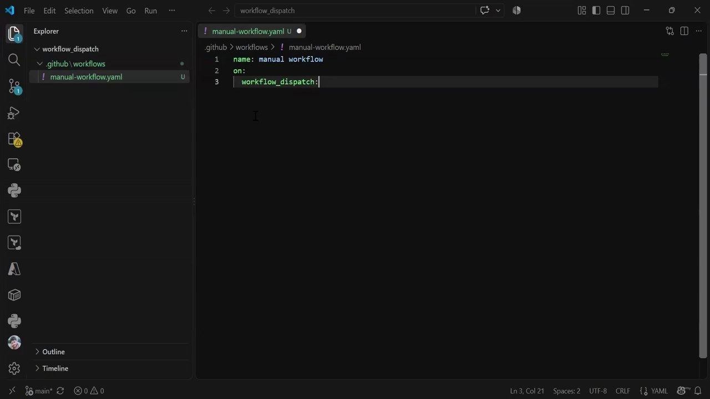

关键点：`workflow_dispatch` 不是等 push，而是让 GitHub 在 Actions 页面给你一个手动运行按钮。课里口播把文件名说成 “manual workflow.yaml”，本文统一保存为 `manual-workflow.yaml`；文件名不影响触发，关键是必须放在 `.github/workflows/` 下，并且先推到默认分支，Actions 页面才会出现这个 workflow。

---

## 3.2 P22–P23：定时触发 `schedule` + cron

P22 是理论，P23 是实操。我们直接做 P23 的可运行版本。

1. 新建空仓库，例如 `schedule-event-demo`，clone 到本地。
2. 创建 `.github/workflows/schedule.yaml`，内容用第 4 节的文件。
3. 提交并推送：

```bash
git add .
git commit -m "added the schedule workflow"
git push origin main
```

4. 打开 **Actions** → 左侧选择 **Run Every Five Minutes**。刚推上去时可能显示 0 次运行，因为 GitHub 要等到 cron 匹配的时间点才触发。
5. 等待几分钟，刷新 Actions 页面，应出现一次运行记录。进入运行 → `test` job → `Run tests` 步骤，日志应输出类似：

```text
Running the test every five minutes
```

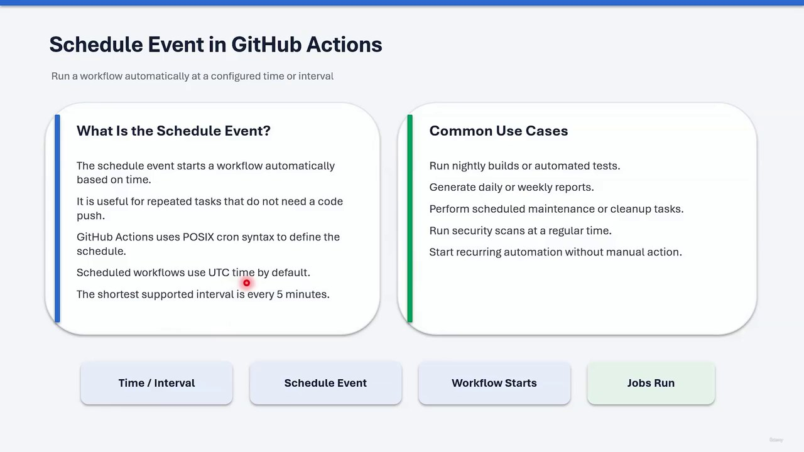

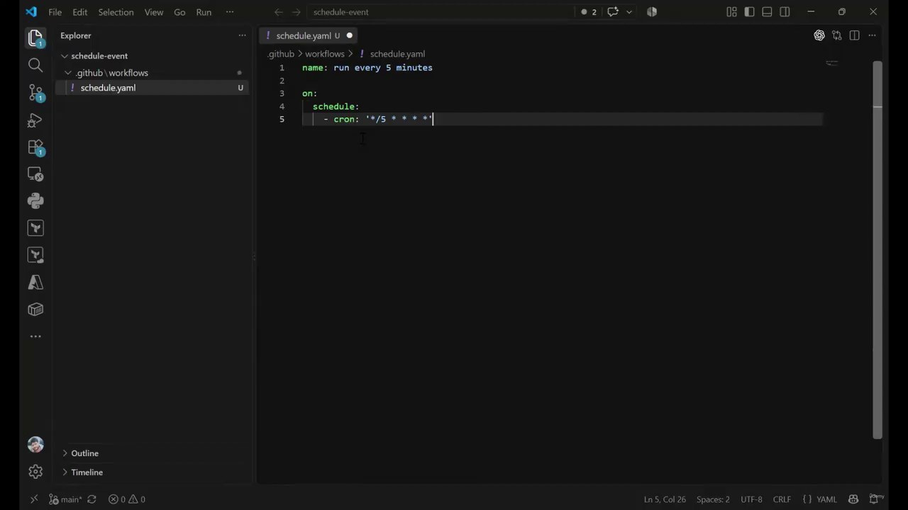

P22 讲的 cron 是 5 段：

```text
分钟 小时 日 月 星期几
```

课里的例子 `0 9 * * 1-5` 表示 **UTC 时间周一到周五 9:00**。P23 用的 `*/5 * * * *` 表示每 5 分钟。GitHub 的 cron 使用 UTC，所以如果你在中国时区，看到运行时间会和本地时间差 8 小时。课里也明确说 GitHub cron 支持 UTC，转换时区要自己算。

> P23 里讲师 echo 的原文转写为 “running the broader test every five minutes”，字幕/听感可能有偏差；本文用可读的 `Running the test every five minutes`，不影响验证定时触发。

---

## 3.3 P24–P25：同仓库调用 reusable workflow

P24 讲概念：caller workflow 调用 reusable workflow。P25 做同仓库实操。

1. 新建空仓库，例如 `workflow-call-demo`，clone 到本地。
2. 创建两个文件：
   - `.github/workflows/reusable.yaml`
   - `.github/workflows/main.yaml`

3. 内容用第 4 节的文件。提交并推送：

```bash
git add .
git commit -m "add reusable workflow and main workflow"
git push origin main
```

4. 打开 **Actions** → 左侧应出现 **Main Workflow**。进入运行记录。
5. 你会看到 job `call-build` 调用了 reusable workflow，里面执行 `build` job，展开 `Build application` 步骤，日志应输出：

```text
Building application
```

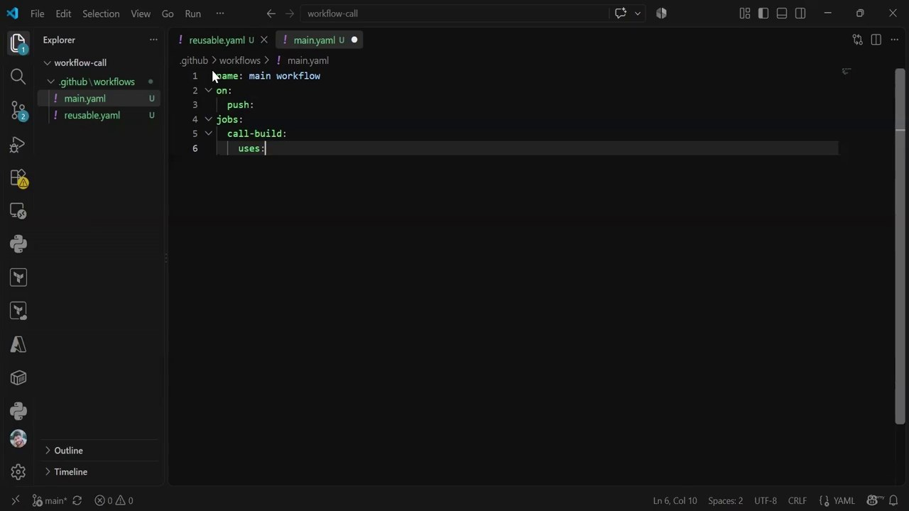

关键点：`reusable.yaml` 里的 `on: workflow_call` 表示“这个 workflow 可以被别人调用”；`main.yaml` 的 job 里用：

```yaml
uses: ./.github/workflows/reusable.yaml
```

这是 job 级别的调用。调用 reusable workflow 的 job **不要再写 `runs-on` 和 `steps`**，因为真正的 job 定义在 reusable workflow 里面。

---

## 3.4 P26：跨仓库调用 reusable workflow

这个实验需要两个仓库：

- 仓库 A：`reusable-workflow`，存放 reusable workflow。
- 仓库 B：`main-workflow`，存放 caller workflow。

1. 新建仓库 A `reusable-workflow`，clone 到本地。
2. 创建 `.github/workflows/reusable.yml`，内容用第 4 节。
3. 提交并推送仓库 A：

```bash
git add .
git commit -m "add reusable workflow"
git push origin main
```

4. 新建仓库 B `main-workflow`，clone 到本地。
5. 创建 `.github/workflows/main.yml`，把里面的 `infinite-automation` 和 `reusable-workflow` 换成你自己的 GitHub 账号/组织名和仓库名。
6. 提交并推送仓库 B：

```bash
git add .
git commit -m "add main workflow calling reusable workflow"
git push origin main
```

7. 打开仓库 B 的 **Actions** → **Main Workflow**。进入运行记录，应看到 job `call-reusable-workflow`，它调用仓库 A 的 reusable workflow，里面执行 `reusable-job`，展开 `Greeting from reusable workflow`，日志应输出：

```text
Hello from reusable workflow
```

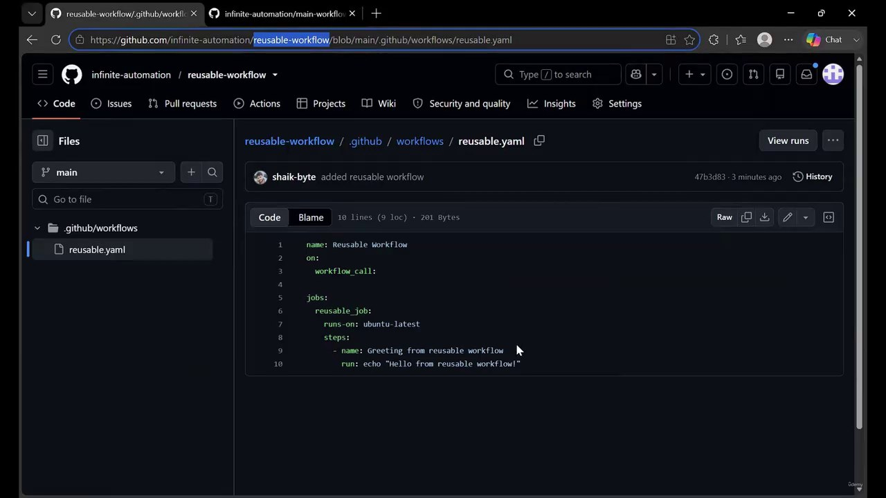

跨仓库 `uses` 的结构是：

```text
<owner>/<repo>/.github/workflows/<file>@<branch-or-tag>
```

课里用的是账号 `infinite-automation`、仓库 `reusable-workflow`、文件 `.github/workflows/reusable.yml`、分支 `main`。你复现时必须换成自己的。课里口播/字幕在 `.yml` 和 `.yaml` 之间有摇摆，**以你实际创建的文件名为准**，`uses` 路径必须和真实文件名完全一致。

---

## 3.5 P27–P28：用 `workflow_run` 串 CI 和 CD

1. 新建空仓库，例如 `workflow-run-demo`，clone 到本地。
2. 创建两个文件：
   - `.github/workflows/ci-workflow.yaml`
   - `.github/workflows/cd-workflow.yaml`

3. 内容用第 4 节的文件。提交并推送：

```bash
git add .
git commit -m "added the workflow configuration per workflow run event"
git push origin main
```

4. 打开 **Actions**。应先看到 **CI Workflow** 被 push 触发，`build` job 执行 `Building application`。
5. CI 完成后，应自动出现 **CD Workflow** 的运行记录，`deploy` job 执行 `Deploying application`。CD 不是被 push 直接触发的，而是被 `workflow_run` 触发的。

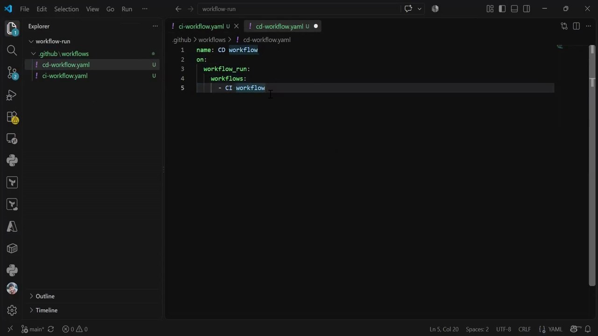

关键点：`workflow_run.workflows` 里写的名字必须和 CI workflow 的 `name` 完全一致：

```yaml
name: CI Workflow
```

CD 里写：

```yaml
on:
  workflow_run:
    workflows:
      - CI Workflow
    types:
      - completed
```

课里讲的是 CI 完成后触发 CD。注意 `completed` 表示 CI 运行结束，具体成功/失败判断课里没有展开；如果你只想在成功时部署，需要自己加条件，见第 7 节。

---

## 3.6 P29–P30：path filters 路径过滤

1. 新建空仓库，例如 `path-filter-demo`，clone 到本地。
2. 创建：
   - `.github/workflows/pathfilter.yaml`
   - `src/dummy.txt`
   - 根目录 `README.md`

3. YAML 和文件内容用第 4 节。先提交并推送 `src/dummy.txt` 和 workflow：

```bash
git add .
git commit -m "add path filter workflow and src dummy file"
git push origin main
```

4. 打开 **Actions**，应看到 **Path Filters** 运行了一次，因为 push 改了 `src/dummy.txt`，匹配 `src/**`。
5. 再创建/修改根目录 `README.md`，提交并推送：

```bash
git add README.md
git commit -m "add readme outside src"
git push origin main
```

6. 刷新 Actions，**不应出现新的 Path Filters 运行**。原因是 push 虽然到了 `main`，但改动文件不匹配 `src/**`。
7. 再修改 `src/dummy.txt`，追加一行文本，提交并推送：

```bash
git add src/dummy.txt
git commit -m "update src dummy file"
git push origin main
```

8. 刷新 Actions，应再次出现 **Path Filters** 运行。

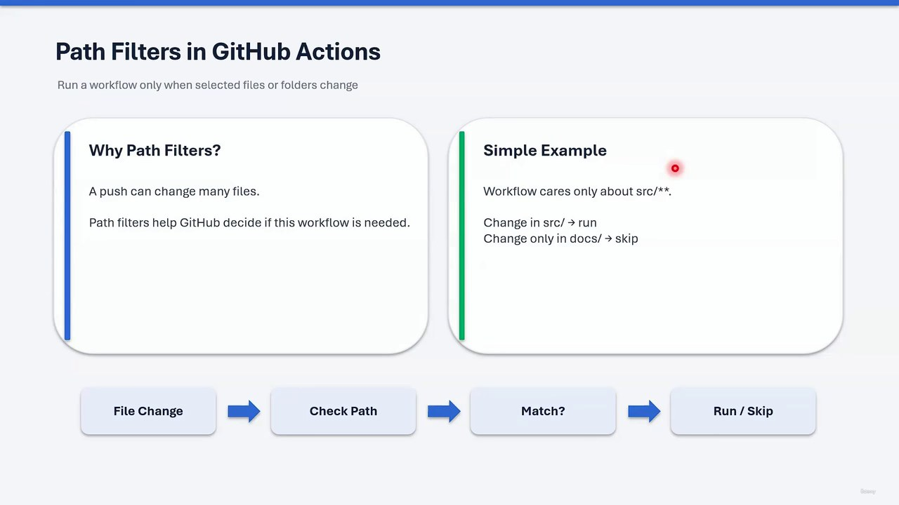

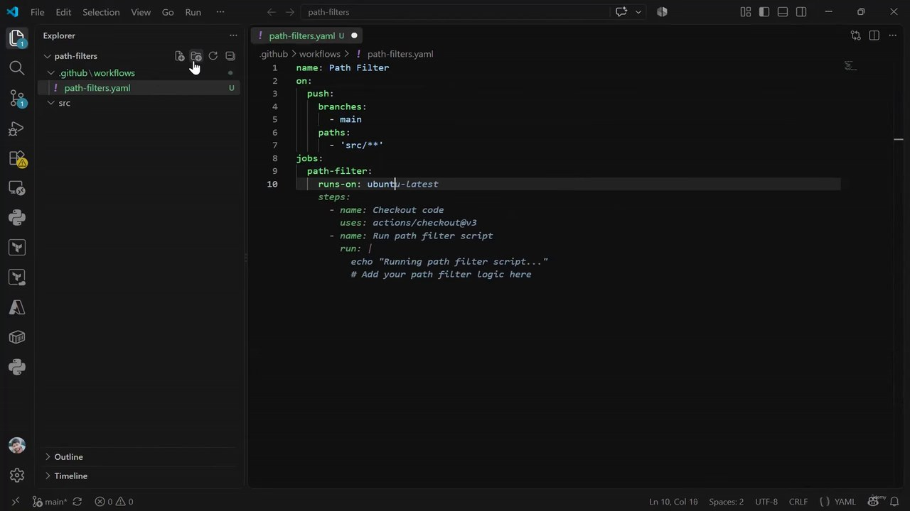

关键点：path filter 不是事件，不能单独写。仍然要先有 `on.push`，再在 push 下面写 `paths`。课里的原话是：event 决定“什么时候检查”，path filter 决定“哪些文件变化才算匹配”。

# 4. 完整代码

下面每个文件都是完整文件，直接保存到对应路径即可。所有 YAML 使用 2 空格缩进，不要用 Tab。

## 4.1 P21 手动触发

文件路径：`.github/workflows/manual-workflow.yaml`

```yaml
name: Manual Workflow

on:
  workflow_dispatch:

jobs:
  demo:
    runs-on: ubuntu-latest
    steps:
      - name: Show Message
        run: echo "Workflow started manually"
```

## 4.2 P23 定时触发

文件路径：`.github/workflows/schedule.yaml`

```yaml
name: Run Every Five Minutes

on:
  schedule:
    - cron: "*/5 * * * *"

jobs:
  test:
    runs-on: ubuntu-latest
    steps:
      - name: Run tests
        run: echo "Running the test every five minutes"
```

## 4.3 P25 同仓库 reusable workflow

文件路径：`.github/workflows/reusable.yaml`

```yaml
name: Reusable Build

on:
  workflow_call:

jobs:
  build:
    runs-on: ubuntu-latest
    steps:
      - name: Build application
        run: echo "Building application"
```

文件路径：`.github/workflows/main.yaml`

```yaml
name: Main Workflow

on:
  push:

jobs:
  call-build:
    uses: ./.github/workflows/reusable.yaml
```

## 4.4 P26 跨仓库 reusable workflow

仓库 A 文件路径：`.github/workflows/reusable.yml`

```yaml
name: Reusable Workflow

on:
  workflow_call:

jobs:
  reusable-job:
    runs-on: ubuntu-latest
    steps:
      - name: Greeting from reusable workflow
        run: echo "Hello from reusable workflow"
```

仓库 B 文件路径：`.github/workflows/main.yml`

```yaml
name: Main Workflow

on:
  push:
    branches:
      - main

jobs:
  call-reusable-workflow:
    uses: infinite-automation/reusable-workflow/.github/workflows/reusable.yml@main
```

> 复现时把 `infinite-automation` 换成你的 GitHub 账号/组织名，把 `reusable-workflow` 换成你仓库 A 的名字。其余路径结构保持不变。课里演示时账号是 `infinite-automation`，仓库名对应 `reusable-workflow`。

## 4.5 P28 workflow_run 串 CI/CD

文件路径：`.github/workflows/ci-workflow.yaml`

```yaml
name: CI Workflow

on:
  push:

jobs:
  build:
    runs-on: ubuntu-latest
    steps:
      - name: Build application
        run: echo "Building application"
```

文件路径：`.github/workflows/cd-workflow.yaml`

```yaml
name: CD Workflow

on:
  workflow_run:
    workflows:
      - CI Workflow
    types:
      - completed

jobs:
  deploy:
    runs-on: ubuntu-latest
    steps:
      - name: Deploy application
        run: echo "Deploying application"
```

## 4.6 P30 path filters

文件路径：`.github/workflows/pathfilter.yaml`

```yaml
name: Path Filters

on:
  push:
    branches:
      - main
    paths:
      - 'src/**'

jobs:
  path-filter:
    runs-on: ubuntu-latest
    steps:
      - name: Greetings from path filters
        run: echo "The job runs only when files in the src directory are modified or changed."
```

文件路径：`src/dummy.txt`

```text
Welcome to path filters demo
```

文件路径：`README.md`

```text
This is README file
```

第二次修改 `src/dummy.txt` 时，可以改成：

```text
Welcome to path filters demo
Testing the workflow run for path filter
```

# 5. 逐行解释

## 5.1 `workflow_dispatch`

```yaml
on:
  workflow_dispatch:
```

`on` 是 GitHub Actions 的触发事件入口。`workflow_dispatch` 表示这个 workflow 允许被手动触发。只要这个文件已经在默认分支上，GitHub 的 Actions 页面就会出现 **Run workflow** 按钮。课里强调，不需要每次 push 新代码才能运行，适合手动回归、临时构建、演示等场景。

```yaml
jobs:
  demo:
    runs-on: ubuntu-latest
```

`jobs` 下是任务。`demo` 是 job id，Actions 页面会显示成 job 名称。`runs-on: ubuntu-latest` 表示使用 GitHub 托管的 Ubuntu runner。课里没有固定 Ubuntu 的具体版本号，`ubuntu-latest` 由 GitHub 动态提供。

```yaml
steps:
  - name: Show Message
    run: echo "Workflow started manually"
```

`steps` 是 job 内的步骤。`name` 是显示名称，`run` 表示执行 shell 命令。这里只是 echo 一行文本，用来验证 workflow 确实跑起来了。课里在 Actions 日志里看到这句输出，就说明手动触发成功。

## 5.2 `schedule` 与 cron

```yaml
on:
  schedule:
    - cron: "*/5 * * * *"
```

`schedule` 表示按时间自动触发。它下面用列表形式写 cron，每行一个 `- cron`。课里 P22 说可以写一个，也可以写多个 schedule；多个就写多个 `- cron` 条目。

cron 五个字段依次是：

```text
分钟 小时 日 月 星期几
```

`*/5 * * * *` 的意思是：分钟字段用 `*/5`，即 0、5、10、15……每 5 分钟；后面四个字段都是 `*`，表示每天、每月、每周任意时间。于是整个表达式表示“每 5 分钟运行一次”。

P22 里的 `0 9 * * 1-5` 表示：第 0 分钟、第 9 小时、任意日、任意月、星期 1 到 5，即 UTC 周一到周五 9:00。课里特别提醒 GitHub cron 使用 UTC；如果你在 UTC+8，本地 17:00 才对应 UTC 9:00。

```yaml
jobs:
  test:
    runs-on: ubuntu-latest
    steps:
      - name: Run tests
        run: echo "Running the test every five minutes"
```

这里的 job id 是 `test`，步骤名是 `Run tests`。echo 的内容只是演示，真正要看的是 Actions 页面是否在 cron 时间点自动出现运行记录。课里也说明，刚 push 上去时看不到运行是正常的，要等 GitHub 的调度器匹配 cron 时间。

## 5.3 `workflow_call` 同仓库调用

reusable workflow：

```yaml
on:
  workflow_call:
```

`workflow_call` 表示这个 workflow 不是被 push、schedule 等事件直接触发，而是“可以被其他 workflow 调用”。课里说，这种 workflow 不会自己启动，必须有一个 caller workflow 来调它。

```yaml
jobs:
  build:
    runs-on: ubuntu-latest
    steps:
      - name: Build application
        run: echo "Building application"
```

reusable workflow 内部仍然是一个完整 workflow，有自己的 job、runner 和 steps。这里把 build 逻辑放在里面，调用方不需要重复写。

caller workflow：

```yaml
on:
  push:
```

caller 仍然由 push 触发。也就是说，push 先启动 `main.yaml`，然后 `main.yaml` 再去调用 `reusable.yaml`。

```yaml
jobs:
  call-build:
    uses: ./.github/workflows/reusable.yaml
```

`uses` 是调用 reusable workflow 的关键字。`./` 表示当前仓库根目录，后面是 reusable workflow 的相对路径。课里强调，调用 reusable workflow 的 job 不要再写 `runs-on` 和 `steps`；它只负责“调用”，真正的 job 在 reusable workflow 里定义。

## 5.4 跨仓库 `uses`

```yaml
uses: infinite-automation/reusable-workflow/.github/workflows/reusable.yml@main
```

跨仓库调用的格式是：

```text
<owner>/<repo>/.github/workflows/<file>@<branch-or-tag>
```

课里 P26 逐段解释：先给 GitHub 账号或组织名，再给仓库名，再给 reusable workflow 文件路径，最后给分支或 tag。这里的 `@main` 表示使用 `main` 分支上的 reusable workflow 文件。

注意两点：

1. `reusable.yml` 必须真实存在于仓库 A 的 `.github/workflows/` 下。
2. `uses` 里的文件名必须和真实文件名一致。课里口播有时说 `.yml`，有时说 `.yaml`，但 GitHub 不会自动帮你猜；写错文件名就会找不到 workflow。

## 5.5 `workflow_run` 串 CI/CD

CI workflow：

```yaml
name: CI Workflow
on:
  push:
```

CI 仍然由 push 触发。`name: CI Workflow` 很重要，因为后面的 CD 要靠这个名字来监听它。

CD workflow：

```yaml
on:
  workflow_run:
    workflows:
      - CI Workflow
    types:
      - completed
```

`workflow_run` 表示“监听另一个 workflow 的运行”。`workflows` 下写被监听的 workflow 名称，这里必须和 CI 的 `name` 完全一致。`types: completed` 表示 CI 运行完成时触发 CD。

课里的流程是：push → CI 启动 → CI 完成 → `workflow_run` 检测到 CI 完成 → CD 启动。CD 不是 push 直接触发的，所以你在 Actions 页面会先看到 CI，再看到 CD。

```yaml
jobs:
  deploy:
    runs-on: ubuntu-latest
    steps:
      - name: Deploy application
        run: echo "Deploying application"
```

CD 里的 deploy job 只是 echo 演示。真实部署会在这里写部署命令，但课里没有展开真实部署，所以本文也不编造部署脚本。

## 5.6 path filters

```yaml
on:
  push:
    branches:
      - main
    paths:
      - 'src/**'
```

`push` 仍然是事件。`branches` 限制只监听 `main` 分支。`paths` 是路径过滤器，写在 push 下面。

`src/**` 里的 `**` 表示 `src` 目录下任意层级的内容。课里解释：如果改的是
课里解释：如果改的是 `src/` 目录下的文件，GitHub 会认为路径匹配，workflow 启动；如果改的是根目录的 `README.md`，路径不匹配，workflow 直接跳过，Actions 页面不会出现新的运行记录。

这里有两个条件叠在同一个事件下面：`branches: [main]` 和 `paths: ['src/**']`。课里 P30 的两轮实操就是用来验证这个“与”关系：第一次改 `src/dummy.txt`，分支对、路径也对 → 运行；第二次只加根目录 `README.md`，分支对、路径不对 → 不运行；第三次再改 `src/dummy.txt`，两个条件都满足 → 又运行。判断顺序可以理解成：先看有没有 push 到 `main`，再看这次 push 里被改动的文件列表有没有命中 `src/**`，两条都成立才创建运行。

```yaml
jobs:
  path-filter:
    runs-on: ubuntu-latest
    steps:
      - name: Greetings from path filters
        run: echo "The job runs only when files in the src directory are modified or changed."
```

job id 是 `path-filter`，Actions 页面里会显示成这个 job 名。`runs-on: ubuntu-latest` 还是 GitHub 托管 runner。`steps` 里只有一个 echo 步骤，用来在日志里留下可核对的一行文本。步骤名 `Greetings from path filters` 和 echo 的内容都没有业务含义，换成你自己的构建命令即可；课里之所以用 echo，是为了让你一眼在日志里看到“这次确实跑进来了”。

关于 `'src/**'` 外面那对单引号：课里的截图写法上是带引号的，本文代码也保留引号。YAML 里 `*` 在行首或特定位置有特殊含义（锚点/别名），虽然 `src/**` 不是行首，加上引号可以彻底避免解析歧义，属于“加上不会错”的写法。这一点课里没有专门展开，如果你去掉引号后发现 YAML 解析报错，把引号加回来即可。

另外要注意，课里 P30 的 `paths` 只写了一条 `src/**`。如果你的项目里同时有 `src`、`tests`、`docs` 等多个需要触发构建的目录，就要写多条 `- 'src/**'`、`- 'tests/**'`。课里没有演示多路径写法，但条目结构是一样的，只是列表多几行。

# 6. 复现检查清单

下面按实验分组列出可以逐条打勾的检查项。每一项都对应一个“如果没做到就会静默失败”的点——GitHub Actions 的失败往往是“不触发”而不是“报红”，所以检查项要覆盖“文件位置对不对、名字对不对、分支对不对、日志有没有出现预期文本”。

## 6.0 通用前置检查（每个实验都先过一遍）

- [ ] 已经在 GitHub 网页上创建了**空仓库**（不要勾选自动生成 README、.gitignore、LICENSE），否则第一次 `git push` 会被远端已有提交挡住。
- [ ] 本地目录里存在 `.github/workflows/`，注意 `.github` 前面有**点**，且 `workflows` 是**复数**。写成 `workflow` 或缺点，GitHub 完全不认。
- [ ] YAML 文件扩展名是 `.yml` 或 `.yaml`，二者都行，但**跨仓库 `uses` 里写的名字必须和真实文件名逐字一致**。
- [ ] 缩进只用空格，不用 Tab。YAML 对 Tab 缩进直接报错。
- [ ] 本地 `git status` 显示 workflow 文件已进入暂存区，`git log -1` 能看到这次提交，`git push` 后网页上对应路径能看到文件。
- [ ] 仓库默认分支名确认过：是 `main` 还是 `master`。所有 `branches:` 和 `@分支` 都要跟它一致。
- [ ] 打开仓库 **Actions** 标签页，左侧列表里能看到你的 workflow 名称（就是 YAML 里 `name:` 的值）。
- [ ] 如果 Actions 页面提示需要启用 workflows，按页面提示点一次启用按钮（新建仓库首次使用 Actions 时偶尔会遇到）。

## 6.1 P21 `workflow_dispatch` 检查清单

- [ ] `.github/workflows/manual-workflow.yaml` 已推送，网页上能看到文件内容。
- [ ] Actions 左侧出现 **Manual Workflow**。
- [ ] 进入该 workflow 后，右上角有 **Run workflow** 按钮（没有这个按钮 = `on:` 下面没写 `workflow_dispatch`，或者文件不在默认分支）。
- [ ] 下拉里能选到 `main` 分支。
- [ ] 点击后几秒内出现一条新的运行记录，状态从 queued 走到 success。
- [ ] 展开 `demo` → `Show Message`，日志里有 `Workflow started manually`。
- [ ] 额外确认：**没有**任何 push 动作也触发了运行——这说明确实是手动触发生效，而不是 push 顺带跑了一次。

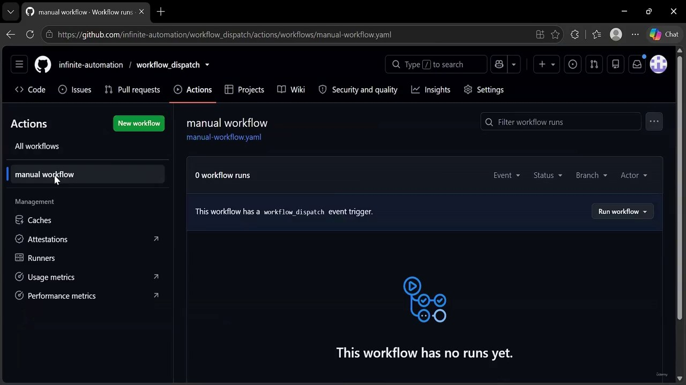

## 6.2 P23 `schedule` 检查清单

- [ ] `.github/workflows/schedule.yaml` 已推送。
- [ ] Actions 左侧出现 **Run Every Five Minutes**。
- [ ] 刚推完时该 workflow 显示 0 次运行——这是**正常现象**，不是配置错误。课里也明确说要等 cron 时间点。
- [ ] 等待至少 5–10 分钟后刷新 Actions 页面，出现新的运行记录。
- [ ] 进入运行 → `test` job → `Run tests`，日志里有 `Running the test every five minutes`。
- [ ] 连续观察两次以上运行，确认间隔大约 5 分钟（GitHub 调度有排队延迟，实际时间点可能比整 5 分晚几十秒到几分钟）。
- [ ] 心里换算过时区：cron 是 UTC。如果你在 UTC+8，`*/5` 不受影响，但换成 `0 9 * * 1-5` 这类固定时刻就要减 8 小时。
- [ ] 确认 workflow 文件在**默认分支**上（课里没讲这条限制，但定时任务只在默认分支的 workflow 上生效，见第 7 节）。

## 6.3 P25 同仓库 reusable workflow 检查清单

- [ ] `.github/workflows/reusable.yaml` 和 `.github/workflows/main.yaml` 两个文件都在。
- [ ] `reusable.yaml` 的 `on:` 下面是 `workflow_call:`，不是 `push`、不是 `workflow_dispatch`。
- [ ] `main.yaml` 的 job 里是 `uses: ./.github/workflows/reusable.yaml`，路径以 `./` 开头。
- [ ] `main.yaml` 那个 job **没有**写 `runs-on` 和 `steps`（写了会报错，因为 job 级 `uses` 不允许混写这两项）。
- [ ] push 之后 Actions 里只出现 **Main Workflow** 一条被触发的运行；`Reusable Build` 不会自己出现在运行列表里被独立触发。
- [ ] 进入运行记录，能看到 `call-build` 这个 job，展开后里面有 `build` job 的内容。
- [ ] `Build application` 步骤日志里有 `Building application`。

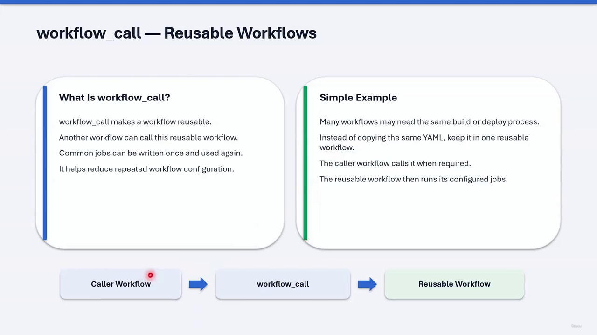

## 6.4 P26 跨仓库 reusable workflow 检查清单

- [ ] 仓库 A（reusable）里 `.github/workflows/reusable.yml` 存在且已推送。
- [ ] 仓库 A 的 `on:` 是 `workflow_call:`。
- [ ] 仓库 B（caller）里 `.github/workflows/main.yml` 存在且已推送。
- [ ] 仓库 B 的 `uses` 一行是 `<你的账号>/<仓库A名>/.github/workflows/reusable.yml@main` 这种四段结构，段与段之间用 `/`，分支前用 `@`。
- [ ] 账号名、仓库名、文件路径、文件名、分支名**五处**逐一核对过，没有一处是照抄课里的 `infinite-automation`。
- [ ] push 仓库 B 后，仓库 B 的 Actions 里出现 **Main Workflow** 的运行。
- [ ] 展开后能看到 `call-reusable-workflow` job 和其中的 `reusable-job`、`Greeting from reusable workflow` 步骤。
- [ ] 日志里有 `Hello from reusable workflow`。
- [ ] 对照确认：仓库 A 的 Actions 页面**不会**因为这次调用多出一条自己的运行记录（它是被调用，不是被独立触发）——这条课里没有明确讲，以你实际页面为准。

## 6.5 P28 `workflow_run` 检查清单

- [ ] `.github/workflows/ci-workflow.yaml` 和 `.github/workflows/cd-workflow.yaml` 都在。
- [ ] CI 的 `name:` 是 `CI Workflow`，CD 的 `workflow_run.workflows` 列表里写的也是 `CI Workflow`，**逐字一致**（大小写、空格都算）。
- [ ] CD 的 `types:` 是 `completed`。
- [ ] 一次 `git push` 之后，Actions 页面**先**出现 CI 运行，**再**出现 CD 运行，两者有先后顺序。
- [ ] CI 的 `build` 步骤日志里有 `Building application`。
- [ ] CD 的 `deploy` 步骤日志里有 `Deploying application`。
- [ ] 确认 CD 运行时的事件类型是 `workflow_run`，不是 `push`——这是本实验的核心验证点。课里也强调过：push 只触发 CI，CD 是被 `workflow_run` 拉起来的。

## 6.6 P30 path filters 检查清单

- [ ] `.github/workflows/pathfilter.yaml` 中的 `paths` 下有 `- 'src/**'`。
- [ ] `src/dummy.txt` 存在且已推送。
- [ ] 第一次 push（改动包含 `src/dummy.txt`）：Actions 出现一次 **Path Filters** 运行，日志里有 `The job runs only when files in the src directory are modified or changed.`。
- [ ] 第二次 push（只改根目录 `README.md`，不动 `src/`）：Actions **没有**出现新的 Path Filters 运行。这一条是实验成败的关键，如果这里出现了运行，说明 `paths` 写错了位置（比如写在了 `jobs` 下面）。
- [ ] 第三次 push（再次改 `src/dummy.txt`）：Actions **重新**出现运行。
- [ ] 三次结束后，把 Actions 运行列表截图或记下来：有 → 无 → 有，这个节奏就是过滤器在工作的证据。

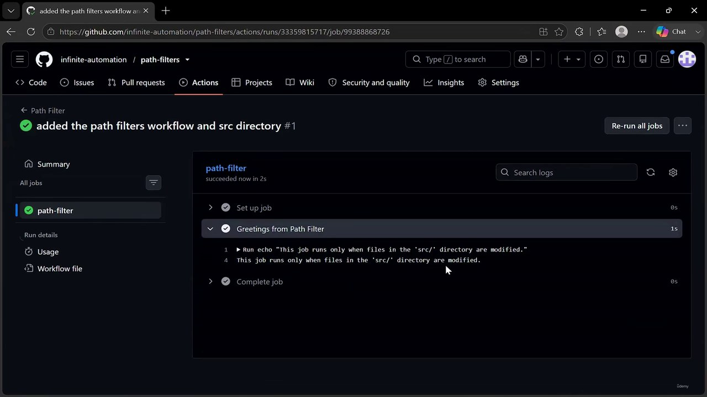

## 6.7 五个实验的触发方式对照

| 实验 | 谁触发 | 触发条件写在 | 关键验证点 |
| --- | --- | --- | --- |
| P21 手动 | 人在 Actions 页面点按钮 | `on.workflow_dispatch` | 没 push 也能跑 |
| P23 定时 | GitHub 调度器 | `on.schedule.cron` | 等几分钟后自动出现运行 |
| P25 同仓库复用 | 仓库内的 caller workflow | `on.workflow_call` + `uses: ./...` | reusable 文件自己不会跑 |
| P26 跨仓库复用 | 另一个仓库的 caller workflow | `on.workflow_call` + `uses: owner/repo/...@main` | 跨仓库日志能串起来 |
| P28 串联 | 另一个 workflow 的完成事件 | `on.workflow_run` | 先 CI 后 CD，CD 非 push 触发 |
| P30 过滤 | push + 路径匹配 | `on.push.paths` | 改 README 不触发、改 src 触发 |

## 6.8 不生效时的排查顺序

不要一开始就改 YAML。按这个顺序查，能省很多时间：

1. **文件在不在、在不在对的位置**：网页上点进 `.github/workflows/`，肉眼确认文件名。
2. **默认分支对不对**：仓库设置里看默认分支名，和 YAML 里的 `branches` / `@main` 比对。
3. **YAML 有没有语法错误**：提交后 Actions 左侧如果连 workflow 名字都没出现，多半是解析失败或文件不在默认分支。
4. **事件关键字拼写**：`workflow_dispatch`、`workflow_call`、`workflow_run`、`schedule` 四个词拼错任何一个，都会静默不触发。
5. **名字是否逐字一致**：`workflow_run.workflows` 里的名字对 CI 的 `name`；跨仓库 `uses` 的文件名对真实文件名。
6. **是不是被过滤条件挡住**：`branches` 和 `paths` 是“与”关系，任一条不满足就不跑。

# 7. 课里没讲但你会撞上的

这一节集中列课程没有覆盖、但你真正动手时大概率会遇到的坑。凡是课里没讲的内容，这里都会标明“课里没讲”，并给出你认为最稳妥的处理方式；涉及具体字段名而课程里没出现过的，会注明“字段名以实际文档/输出为准”，不做臆测。

## 7.1 默认分支不是 `main`

课里所有演示都默认 `main`。但 GitHub 新建仓库的默认分支名取决于你的账号设置，老账号可能是 `master`。症状：`workflow_run` 的 CD 永远不触发；跨仓库 `uses ...@main` 报找不到 workflow；`paths` 那个实验里 `branches: [main]` 永远不匹配。

处理：先在仓库首页确认默认分支名，然后把 YAML 里的 `main` 全部换掉。这件事**课里没讲**，但它是跨仓库调用失败最常见的原因。

## 7.2 刚 push 完 Actions 页面没动静

课里 P23 已经提示过定时任务要等，但另外几种情况也会让你以为“坏了”：

- 页面没刷新。Actions 列表不是实时推送的，手动刷新一次。
- 首次推 workflow 文件时，GitHub 需要几秒到几十秒处理，列表里才出现新 workflow。
- 你推的分支不是默认分支，且 workflow 只在特定分支触发。课里没讲这种分支过滤的细节，遇到时先看 YAML 的 `branches`。

## 7.3 cron 的几个隐性限制（课里没讲）

- **不会立刻运行**：配好 `schedule` 后不会马上跑一次，必须等到下一个匹配的时间点。
- **有最小间隔**：GitHub 对高频 cron 有限制，官方口径是最短 5 分钟一次。你写 `*/1` 不会真的每分钟跑，实际会被拉长。课里 P23 恰好选了 5 分钟，正好在边界上。
- **高峰会延迟**：整点、整 5 分这类“大家都写的时间”容易排队，实际开始时间可能晚几分钟。所以不要用 cron 做“必须精确到秒”的事。
- **只认默认分支**：定时任务读取的是默认分支上的 workflow 文件。你在 feature 分支改 cron，不会生效。
- **仓库长期无活动可能被暂停**：GitHub 对长期没有提交的仓库的定时任务有停用策略。如果你的定时 workflow 某天突然不跑了，先去 Actions 页面看有没有“重新启用”的提示。具体规则以 GitHub 当时的页面提示为准。

## 7.4 `workflow_run` 的 `completed` 不等于“成功”

课里 P27 只说“CI 完成后触发 CD”，P28 演示里 CI 也确实成功了。但 `types: completed` 的字面含义是“运行结束”，**失败结束也算结束**。也就是说，CI 挂了，CD 照样会被拉起来。

课里没讲怎么区分成功失败。如果你需要“只有 CI 成功才部署”，得在 CD 的 job 上加条件判断。GitHub 的 `workflow_run` 事件上下文里带有被监听运行的结果信息，但**具体字段名课里没出现过，请以实际文档和你在日志里看到的结构为准**，不要直接照抄网上片段。示意写法（课里没有，仅说明思路）：

```yaml
# 课里没讲，仅为思路示意；字段名请以实际文档/运行上下文为准
jobs:
  deploy:
    if: <判断被监听的 CI 运行是否成功>
    runs-on: ubuntu-latest
    steps:
      - name: Deploy application
        run: echo "Deploying application"
```

在 JS/Node 里类比：这相当于 `promise.then(onFulfilled, onRejected)` 和 `promise.finally()` 的区别——`completed` 更接近 `finally`，成功失败都会走；要区分就得自己读结果。

## 7.5 `workflow_run` 不能无限串联

课里只串了 CI → CD 两层。GitHub 对“workflow 触发 workflow”的链式深度有限制（课里没讲），链条太长后面的会被忽略。做多级流水线（build → test → deploy → notify）时，更稳的做法是集中到一个 workflow 里用 job 之间的依赖关系串，而不是每一级都开一个新 workflow 互相监听。job 之间怎么加依赖，课里同样没讲，属于超出本节范围的内容。

## 7.6 reusable workflow 的调用位置限制

课里 P25 用的是 **job 级** `uses`：

```yaml
jobs:
  call-build:
    uses: ./.github/workflows/reusable.yaml
```

容易踩的坑是把它写成 **step 级** `uses`：

```yaml
steps:
  - uses: ./.github/workflows/reusable.yaml   # 错误用法，课里没讲但不能这样写
```

step 级的 `uses` 只能引用 **action**（带 `action.yml` 的目录或市场里的 action），不能引用 reusable workflow。reusable workflow 必须挂在 job 上。这个区别课里没有明说，但你照着写错一次就会撞上。

## 7.7 reusable workflow 的参数传递（课里没讲）

课里两个 reusable workflow 都是零参数的：reusable 里写死 `echo`，caller 直接 `uses` 就完事。真实项目里 build 往往需要知道“构建哪个分支”“用什么环境”。

`workflow_call` 是支持声明输入参数和密钥的，caller 通过 `with:` 和 `secrets:` 传进去。**这部分内容 P21–P30 完全没有涉及**，input 的声明字段名、必填/默认值写法、secret 的传递语法，都以 GitHub 官方文档为准，本文不代为编造。你只要记住一点：本节所有 YAML 都是“无参版本”，加参数属于下一层知识。

## 7.8 跨仓库调用的权限与可见性（课里没讲）

课里演示时两个仓库都在同一个账号下、都是公开可访问的状态。以下情形课里没讲，但你会遇到：

- 仓库 A 是私有仓库时，仓库 B 调用它需要额外授权，且受账号套餐约束。
- 仓库 A 被删除、改名、或 `main` 分支被删，仓库 B 的 `uses` 立即失效。
- 仓库 A 的 reusable workflow 文件路径变了但仓库 B 没跟着改，报“找不到 workflow”。

排查思路：先在浏览器里直接打开仓库 B 里 `uses` 那一行拼出来的 URL（把 `owner/repo/.github/workflows/file@branch` 还原成网页路径），能打开再谈触发。

## 7.9 `paths` 与 `paths-ignore`、多条件组合

课里只讲了 `paths` 的“包含”用法。实际项目里常见相反需求：“除了文档以外都触发”。GitHub 提供了忽略型写法，**课里没讲**，字段名请以官方文档为准。另外要记住课里已经验证过的那条：`branches` 和 `paths` 同时存在时是**与**关系，两个都满足才跑。很多人配完发现不触发，就是因为只改了 `src` 却推到了非 `main` 分支。

一个常见的逻辑混淆：`paths: ['src/**']` 匹配的是**这次 push 中被改动的文件列表**，不是“仓库里存在 `src` 目录”。所以你在别的分支上改了 `src`，只要推的不是 `main`，一样不触发。

## 7.10 YAML 本身的坑

- **Tab 缩进**：从网页复制代码时最容易带进 Tab。编辑器里打开“显示空白字符”能一眼看出来。
- **`on` 被某些编辑器高亮成布尔值**：YAML 1.1 里 `on` 可能被解析成 `true`，但 GitHub 的解析器按字面处理，不用改。只是编辑器可能给你奇怪的颜色。
- **冒号后必须有空格**：`name:Manual Workflow` 是错的，必须 `name: Manual Workflow`。
- **列表项的横杠后面要有空格**：`-cron: ...` 是错的，必须 `- cron: ...`。
- **文件名大小写**：Linux runner 区分大小写，跨仓库 `uses` 里写 `Reusable.yml` 但文件是 `reusable.yml`，会找不到。

## 7.11 给前端背景的类比速查

| GitHub Actions 概念 | 前端/Node 里的近似物 | 差异点 |
| --- | --- | --- |
| `workflow_dispatch` | 导出一个函数，手动调用 | 触发入口在 GitHub 网页，不在代码里 |
| `schedule` + cron | `setInterval` / `node-cron` | 时区固定 UTC，不会立刻执行一次 |
| `workflow_call` + `uses` | 抽公共模块再 `import` | 调用方不能传任意参数（本节未涉及参数） |
| `workflow_run` | 事件监听 / `.then()` | `completed` 类似 `finally`，失败也会走 |
| `paths` 过滤 | `chokidar` 的 `ignored` 配置 | 与分支条件是“与”关系 |
| job 级 `runs-on` | 指定运行容器/机器 | 由 GitHub 托管，本地不装任何东西 |

这些类比只是帮你建立直觉，**不是等价替换**：GitHub Actions 的触发、排队、权限都在服务端，本地 `node` 跑得通不代表 workflow 里跑得通。

## 7.12 本节没有覆盖的内容（避免误以为学完了）

P21–P30 只覆盖了触发、复用、串联、过滤这四个主题。以下内容课里**没有讲**，不在本文范围内，遇到时不要以为是本节漏写：

- `jobs.<id>.needs` 的 job 依赖编排
- `strategy.matrix` 矩阵构建
- `env` / `secrets` / `vars` 的注入
- 缓存（依赖缓存、构建产物缓存）
- 上传/下载构建产物
- 权限（`permissions`）与 `GITHUB_TOKEN`
- 自托管 runner
- 环境（Environments）与审批
- 真实构建、测试、部署脚本

如果你把本节六个 YAML 全部跑通、六组日志都看到预期文本，那“触发机制”这一层就算过关了。下一步的构建/部署能力是另一条线，需要单独学。