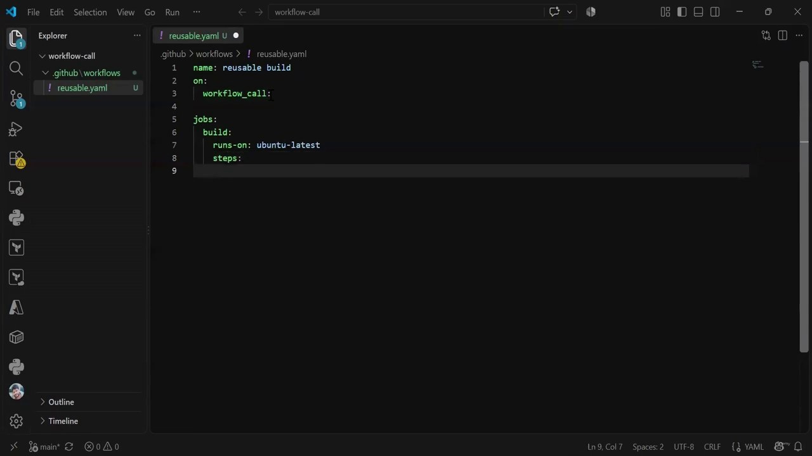
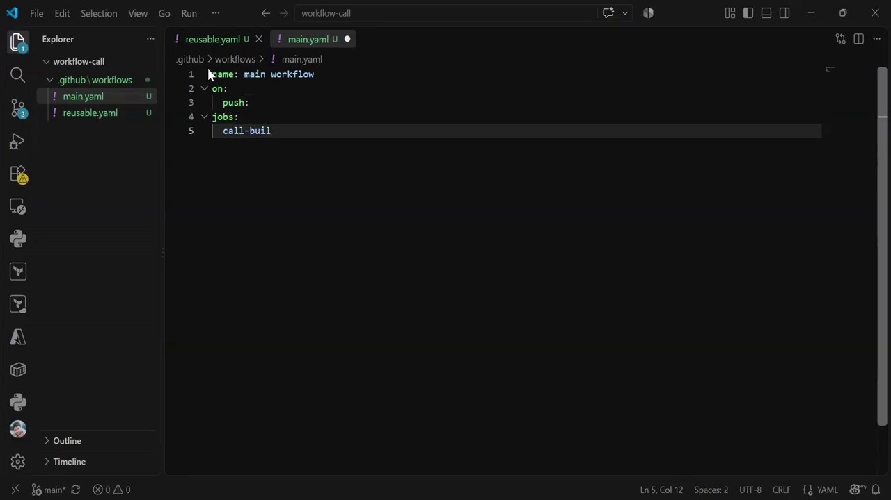
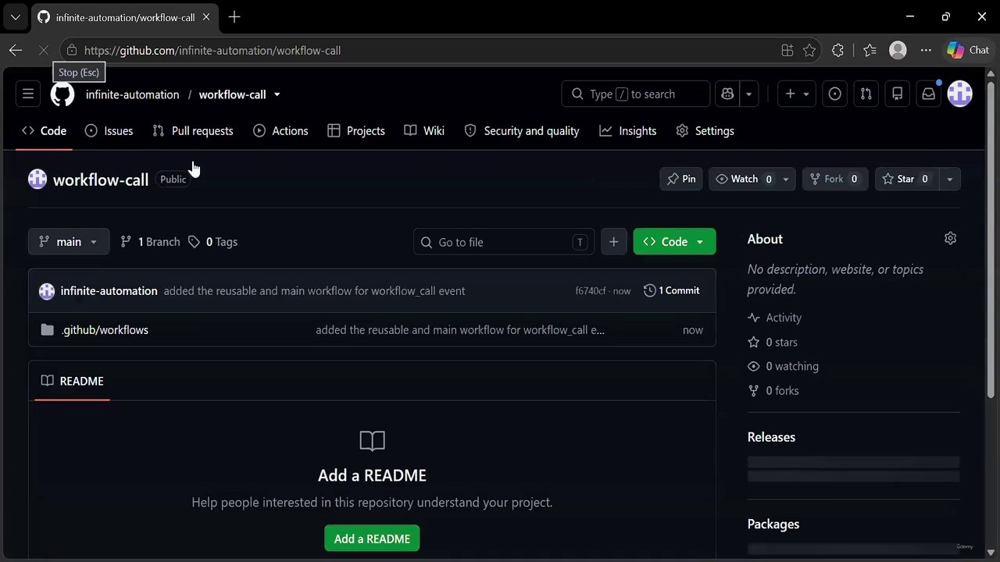
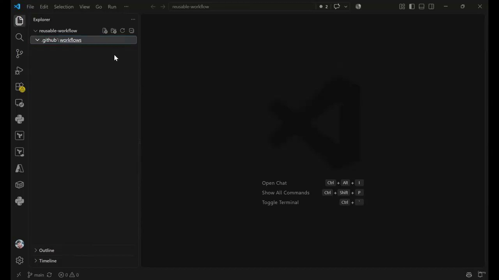
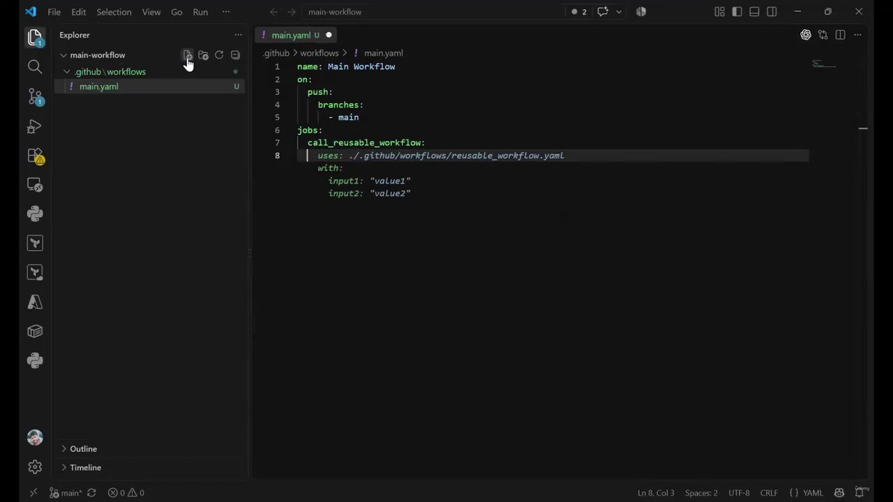
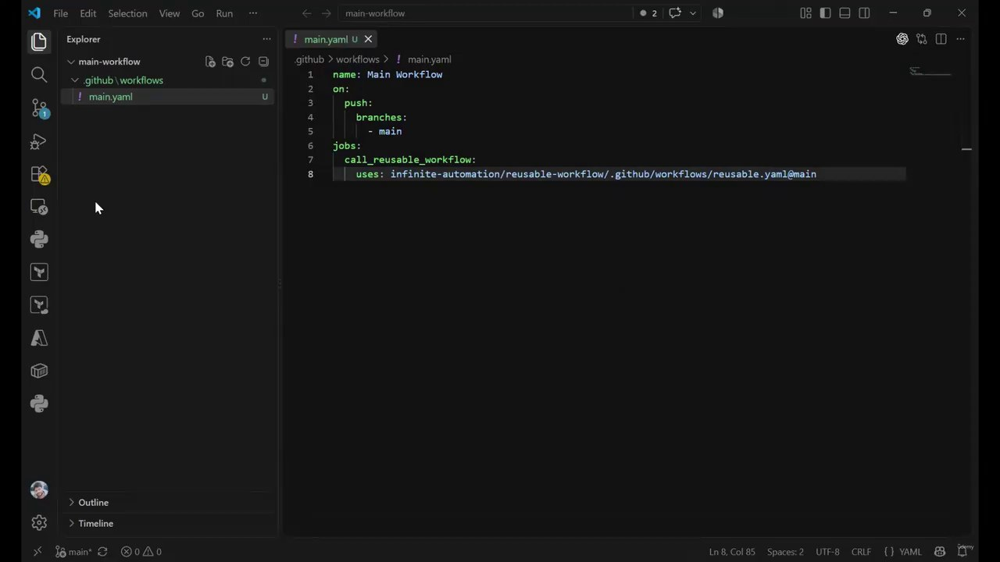
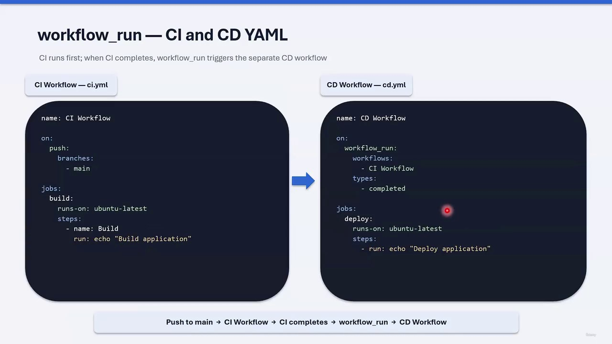
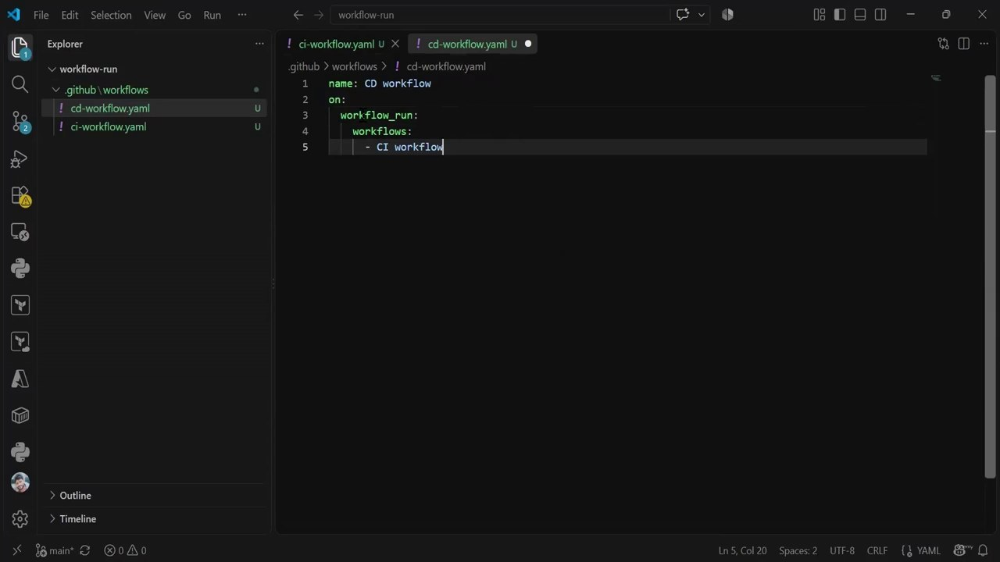
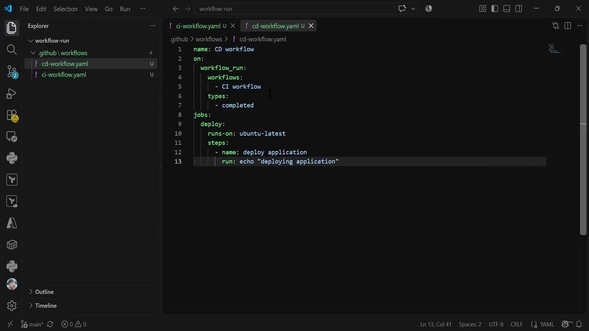

# GitHub Actions Complete（P25–P28）复现文档：可复用工作流与 `workflow_run` 串起 CI/CD

## 1. 这一节做什么

本节要做出三类可运行的最小项目：

1. **同一个仓库内复用 workflow**：一个 `reusable.yaml` 通过 `workflow_call` 暴露“可被调用”的构建作业；另一个 `main.yaml` 在 `push` 后通过 `uses` 调用它。
2. **跨仓库复用 workflow**：把可复用 workflow 放在仓库 A，把调用方 workflow 放在仓库 B；仓库 B 通过 `owner/repo/.github/workflows/file.yml@branch` 调用仓库 A。
3. **用 `workflow_run` 串 CI 与 CD**：`push` 只触发 CI workflow；CI 完成后，GitHub 根据 `workflow_run` 自动触发另一个 CD workflow，不需要手动点运行。

本文按 P25–P28 的顺序复现，不引入额外的 npm、pip、Maven 项目，也不要求在本地安装 Node、Java、Python 运行时。三类示例都只使用 GitHub 托管的 `ubuntu-latest` runner，并通过 `echo` 输出文字来观察触发关系。复现时应先关注“哪个 workflow 被触发”“哪个 job 被调用”“日志里有没有对应输出”，不要一开始就把 `echo` 替换成复杂构建命令。

最终你会得到这些文件和触发关系：

| 复现块 | 仓库 | 文件 | 触发方式 |
|---|---|---|---|
| 同仓库复用 | `workflow-call` | `.github/workflows/reusable.yaml` | 被 `main.yaml` 调用 |
| 同仓库复用 | `workflow-call` | `.github/workflows/main.yaml` | `push` |
| 跨仓库复用 | `reusable-workflow` | `.github/workflows/reusable.yml` | 被另一个仓库调用 |
| 跨仓库复用 | `main-workflow` | `.github/workflows/main.yml` | `push`，并 `uses` 远程 workflow |
| CI/CD 串联 | `workflow-run` | `.github/workflows/ci-workflow.yaml` | `push` |
| CI/CD 串联 | `workflow-run` | `.github/workflows/cd-workflow.yaml` | `workflow_run`，监听 CI 完成 |

本节没有 npm、pip、Maven 依赖，也没有 Node、Java、Python 版本要求；所有步骤都只执行 `echo`。因此没有 lockfile、依赖安装、环境变量或密钥。真正的“启动命令”是 `git push`，运行发生在 GitHub Actions 的 `ubuntu-latest` 托管 runner 上。



先记住两个关键词的区别：

- `workflow_call`：让一个 workflow **可以被别的 workflow 调用**。它像 Node 里“导出一个函数”。
- `workflow_run`：让一个 workflow **监听另一个 workflow 的完成事件**。它像“等某个任务完成后触发回调”。不是函数调用，也不是 WebSocket。

这一节没有锁、事务、数据库并发控制。若用前端/Node 的直觉理解：`workflow_call` 是把 build 逻辑抽成模块再 import；`workflow_run` 是监听 CI 任务完成事件后再跑 CD。两者不要混淆：前者是“被调用”，后者是“监听完成事件”。

---

## 2. 讲师原话（带出处）

> "这里，我们先创建一个可复用工作流。然后，再创建另一个工作流，并在另一个工作流中调用这个可复用工作流。"
> —— p025 [00:00]

> "通过添加 workflow_call，我们表示这个工作流可以被另一个工作流调用。"
> —— p025 [01:16]

> "这里我们应该添加名为 uses 的关键字。"
> —— p025 [03:07]

> "首先，在 uses 关键字处，我们提供 GitHub 账户或组织名称。接下来，提供仓库名称。然后，提供可复用工作流文件的路径。"
> —— p026 [06:17]

这里逐字稿的 “user's keyword” 是语音识别结果，实际写的是 `uses`。

> "workflow_run 允许一个工作流根据另一个工作流作出响应。"
> —— p027 [00:28]

> "这里我们添加名为 workflow_run 的事件，意思是如果这个 CI 工作流已成功运行，那么这个 CD 工作流就会运行。"
> —— p028 [04:17]

> "push 事件只触发了 CI 工作流……这个 CD 工作流应监视 CI 工作流。如果 CI 工作流完成，它就应该运行。"
> —— p028 [07:10]

上面这些引用保留了课堂原话和出处，用来对照“可复用 workflow”和“workflow 完成事件”两个概念。复现时不要只看文件内容，还要结合 Actions 页面中的 workflow 名称、job 名称和日志输出一起核对。

---

## 3. 从零复现

### 3.1 同仓库复用：`workflow-call`

先创建一个空的 GitHub 仓库，名字用 `workflow-call`。在本地克隆：

```bash
git clone https://github.com/YOUR_GITHUB_ACCOUNT/workflow-call.git
cd workflow-call
mkdir -p .github/workflows
code .
```

如果你使用 SSH，把第一行换成：

```bash
git clone git@github.com:YOUR_GITHUB_ACCOUNT/workflow-call.git
```

目录结构必须是：

```text
workflow-call/
└── .github/
    └── workflows/
        ├── reusable.yaml
        └── main.yaml
```

先创建 `.github/workflows/reusable.yaml`，内容见第 4 节。它的关键是：

```yaml
on:
  workflow_call:
```

这表示该 workflow 不会因为 `push` 自己启动，只能被其他 workflow 调用。

再创建 `.github/workflows/main.yaml`。它的关键不是 `runs-on`，而是 job 级别的：

```yaml
uses: ./.github/workflows/reusable.yaml
```

同仓库调用必须写 `./` 开头，路径必须指向 `.github/workflows/` 下的真实文件。

提交并推送：

```bash
git add .github/workflows/reusable.yaml .github/workflows/main.yaml
git commit -m "add reusable workflow and caller workflow"
git branch -M main
git push -u origin main
```

如果你的仓库默认分支已经是 `main`，`git branch -M main` 不会造成问题。若默认分支是别的名字，请把后续 GitHub Actions 页面中的分支名按实际替换。

**命令逐条解释：**

- `git clone https://github.com/YOUR_GITHUB_ACCOUNT/workflow-call.git`：把远端空仓库克隆到本地。这里必须把 `YOUR_GITHUB_ACCOUNT` 换成真实 GitHub 账号或组织名；如果仓库是刚创建的空仓库，克隆后本地通常只有 `.git` 和默认分支信息。
- `cd workflow-call`：进入克隆下来的仓库目录。后续所有 `git add`、`git commit`、`git push` 都必须在这个仓库根目录内执行。
- `mkdir -p .github/workflows`：创建 GitHub Actions 约定目录。`-p` 的作用是父目录不存在时一起创建，并且目录已存在时不会因为重复创建而报错。
- `code .`：用 VS Code 打开当前目录。若你的命令行没有安装 `code` 命令，可以手动用编辑器打开这个目录，不影响复现。
- `git add .github/workflows/reusable.yaml .github/workflows/main.yaml`：把两个 workflow 文件加入暂存区。这里只添加目标文件，避免把无关文件一起提交。
- `git commit -m "add reusable workflow and caller workflow"`：创建一次提交。提交信息本身不参与 Actions 逻辑，但建议写清楚本次变更。
- `git branch -M main`：把当前分支强制重命名为 `main`。如果当前已经在 `main`，该命令通常不会破坏已有提交；如果默认分支不是 `main`，需要结合实际仓库设置判断。
- `git push -u origin main`：把本地 `main` 推送到远端 `origin`，并用 `-u` 建立本地分支和远端分支的跟踪关系。推送成功后，GitHub 才会收到 workflow 文件并可能触发 Actions。

**常见错误与排查：**

- 克隆地址写错：如果 `YOUR_GITHUB_ACCOUNT` 没替换，`git clone` 会失败。先确认仓库页面上的 HTTPS 或 SSH 地址。
- 不在仓库根目录执行：如果 `mkdir -p .github/workflows` 在错误目录执行，文件不会出现在仓库里。用 `pwd` 和 `ls -la` 确认当前目录。
- 文件名或扩展名写错：同仓库示例使用 `reusable.yaml` 和 `main.yaml`，调用路径必须与真实文件名完全一致。
- `uses` 少了 `./`：同仓库调用写成 `.github/workflows/reusable.yaml` 可能不会被当作本地路径识别；应写成 `./.github/workflows/reusable.yaml`。
- 调用 job 里多写了 `runs-on` 或 `steps`：job 级别使用 `uses` 调用可复用 workflow 时，不应再把该 job 当成普通执行 job 来写步骤。出现这类混写时，先检查 `call-build` 下是否只有 `uses`。
- Actions 页面没有出现运行：先检查文件是否已推送到默认分支、仓库 Actions 是否启用、推送是否真的成功。不要只看本地编辑器，要打开 GitHub 仓库页面确认文件存在。

**与前台的对照：**

可以把 `reusable.yaml` 理解成一个被导出的模块，把 `workflow_call` 理解成模块的导出声明；把 `main.yaml` 理解成调用方模块，把 job 级别的 `uses` 理解成 `import` 后调用。调用方不需要重复写 `runs-on` 和 `steps`，就像前端调用一个函数时不需要把函数体再抄一遍。

推送后打开 GitHub 仓库的 **Actions** 标签。你会看到 `main workflow` 被 `push` 触发，调用到可复用 workflow 里的 `build` 作业，并执行 `build application` 步骤。课里的现象是：“our build job has been called and build job has been completed”。





### 3.2 跨仓库复用：仓库 A 放 reusable，仓库 B 放 caller

创建两个空 GitHub 仓库：

- `reusable-workflow`：存放可复用 workflow。
- `main-workflow`：存放调用方 workflow。

本地克隆：

```bash
git clone https://github.com/YOUR_GITHUB_ACCOUNT/reusable-workflow.git
git clone https://github.com/YOUR_GITHUB_ACCOUNT/main-workflow.git
```

目录结构如下：

```text
reusable-workflow/
└── .github/
    └── workflows/
        └── reusable.yml

main-workflow/
└── .github/
    └── workflows/
        └── main.yml
```

注意：P26 逐字稿里 `reusable.yml` 和 `reusable.yaml` 都出现过，这是口述/识别差异。文件名本身不是语法重点，**关键是调用方 `uses` 里的路径必须和被调用仓库里的真实文件名完全一致**。本文统一用 `reusable.yml`。

在 `reusable-workflow` 仓库创建 `.github/workflows/reusable.yml`，内容见第 4 节。它同样要有：

```yaml
on:
  workflow_call:
```

然后先提交并推送仓库 A：

```bash
cd reusable-workflow
git add .github/workflows/reusable.yml
git commit -m "add reusable workflow"
git branch -M main
git push -u origin main
```

必须在调用方运行前，确保仓库 A 的 `main` 分支上已经存在这个文件。否则仓库 B 引用 `@main` 时会找不到。

再进入仓库 B：

```bash
cd ../main-workflow
mkdir -p .github/workflows
code .
```

创建 `.github/workflows/main.yml`，内容见第 4 节。跨仓库调用的核心格式是：

```yaml
uses: YOUR_GITHUB_ACCOUNT/reusable-workflow/.github/workflows/reusable.yml@main
```

它由四段组成：

1. `YOUR_GITHUB_ACCOUNT`：GitHub 账号或组织名。
2. `reusable-workflow`：仓库名。
3. `.github/workflows/reusable.yml`：可复用 workflow 文件路径。
4. `@main`：分支或 tag。

逐字稿里讲师口述的账号是 “infinite automation”，仓库是 “reusable workflow”。GitHub 的账号/组织名和仓库名不能带空格，所以不能原样写空格。复现时请把 `YOUR_GITHUB_ACCOUNT` 换成你自己的账号；如果你确实要调用讲师那组仓库，必须以 GitHub 上真实存在的 owner/repo 标识为准。

提交并推送仓库 B：

```bash
git add .github/workflows/main.yml
git commit -m "added main.yaml workflow"
git branch -M main
git push -u origin main
```

**命令逐条解释：**

- 两个 `git clone`：分别把仓库 A 和仓库 B 克隆到本地。必须先确认两个仓库都创建成功，且你有推送权限。
- `cd reusable-workflow`：进入仓库 A。仓库 A 负责存放“被调用”的 workflow。
- `git add .github/workflows/reusable.yml`：只把可复用 workflow 文件加入暂存区。若文件名实际是 `reusable.yaml`，这里的路径和后续 `uses` 都要同步改成 `.yaml`。
- `git commit -m "add reusable workflow"`：提交仓库 A 的可复用 workflow。
- `git branch -M main` 和 `git push -u origin main`：把仓库 A 的 `main` 分支推送到远端。只有推送成功后，仓库 B 通过 `@main` 才能引用到该文件。
- `cd ../main-workflow`：从仓库 A 目录切到同级仓库 B 目录。若目录层级不同，用 `cd` 到实际路径。
- `mkdir -p .github/workflows` 和 `code .`：在仓库 B 中创建 Actions 目录并打开编辑器。
- `git add .github/workflows/main.yml`：把调用方 workflow 加入暂存区。调用方文件里应包含完整的跨仓库 `uses` 路径。
- `git commit -m "added main.yaml workflow"`：提交仓库 B 的调用方 workflow。提交信息中的 “main.yaml” 是课里口述/提交信息的一部分，实际文件名以你创建的 `main.yml` 为准。
- `git branch -M main` 和 `git push -u origin main`：把仓库 B 的调用方 workflow 推送到远端,推送后触发仓库 B 的 `push`。

**常见错误与排查：**

- 仓库 A 还没推送就运行仓库 B：仓库 B 的 `uses` 指向 `@main`，但远端 `main` 上还没有 `reusable.yml`，调用会失败。先打开仓库 A 的 GitHub 页面确认文件已经存在于对应分支。
- `YOUR_GITHUB_ACCOUNT` 没替换，或账号/组织名写错：跨仓库 `uses` 的第一段必须真实存在。注意 GitHub 账号/组织名和仓库名不能带空格，也不能把口述里的空格原样写进去。
- 仓库名写错：例如 `reusable-workflow` 写成 `reusable_workflow`，会找不到目标仓库。
- 文件路径写错：`.github/workflows/reusable.yml` 必须和被调用仓库内的真实路径完全一致。`reusable.yml` 与 `reusable.yaml` 不能混用。
- `@main` 分支不存在或不包含该文件：跨仓库 `uses` 的 `@main` 指向真实分支或 tag。若默认分支不是 `main`，要改成实际分支名。
- 私有仓库权限问题：如果仓库 A 是私有仓库，仓库 B 不一定能直接调用。需要在 GitHub 仓库设置中处理访问权限，具体页面以 GitHub 当前界面为准。
- YAML 缩进错误：`uses` 应写在 job 下，不要误写到 `steps` 里；缩进使用空格，不要使用 Tab。

**与前台的对照：**

跨仓库复用更像前端项目从外部 npm 包导入模块：仓库 A 像包提供方，仓库 B 像使用方；`uses` 像声明依赖和入口，`@main` 像引用某个版本或分支。仓库 B 自己的 `push` 只负责触发调用方 workflow，真正的执行逻辑来自仓库 A 中可复用的 workflow。

推送后，仓库 B 的 `push` 触发 `main workflow`。这个 workflow 没有自己写 `runs-on` 和业务步骤，而是调用仓库 A 的 `reusable workflow`，最终执行 `reusable-job` 里的 `greeting from reusable workflow` 步骤，日志输出 `hello from reusable workflow`。







### 3.3 用 `workflow_run` 串联 CI 与 CD：`workflow-run`

创建一个空仓库 `workflow-run`，克隆后创建两个文件：

```text
workflow-run/
└── .github/
    └── workflows/
        ├── ci-workflow.yaml
        └── cd-workflow.yaml
```

`ci-workflow.yaml` 使用 `push` 触发，执行构建步骤。  
`cd-workflow.yaml` 不使用 `push`，而是使用：

```yaml
on:
  workflow_run:
    workflows:
      - CI workflow
    types:
      - completed
```

这里的 `CI workflow` 必须和 `ci-workflow.yaml` 里的 `name: CI workflow` 完全一致。`workflows` 匹配的是 **workflow 的显示名称**，不是文件名。文件名是 `ci-workflow.yaml`，显示名称是 `CI workflow`。

提交并推送：

```bash
git add .github/workflows/ci-workflow.yaml .github/workflows/cd-workflow.yaml
git commit -m "added the workflow configuration per workflow run event"
git branch -M main
git push -u origin main
```

**命令逐条解释：**

- `git add .github/workflows/ci-workflow.yaml .github/workflows/cd-workflow.yaml`：把 CI 和 CD 两个 workflow 文件一起加入暂存区。两个文件应同时提交，避免 CI 已完成但 CD 文件还没出现在默认分支。
- `git commit -m "added the workflow configuration per workflow run event"`：提交本次 workflow 配置。提交信息不参与匹配逻辑，但有助于在 Actions 页面区分运行记录。
- `git branch -M main`：把当前分支设置为 `main`。`workflow_run` 对被监听 workflow 的分支位置有要求，复现时先把文件放到默认分支可以减少变量。
- `git push -u origin main`：推送到远端并建立跟踪关系。推送后，第一次 `push` 应先触发 `CI workflow`，而不是直接触发 `CD workflow`。

**常见错误与排查：**

- `workflows` 名称不匹配：CD 里写 `CI workflow`，但 CI 文件里 `name` 是别的值，CD 不会按预期触发。匹配的是 `name`，不是文件名，大小写和空格也要一致。
- CD 里还保留 `push`：如果 `cd-workflow.yaml` 同时写了 `push` 和 `workflow_run`，CD 可能被 `push` 直接触发，看起来像“串联成功”，实际不是 `workflow_run` 生效。先检查 CD 的 `on` 下是否只有 `workflow_run`。
- 两个文件不在默认分支：如果 CD workflow 不在默认分支，可能不会按预期被 `workflow_run` 识别。复现时把两个文件都提交到默认分支。
- Actions 页面只看到 CI、没看到 CD：先等 CI 完成，再刷新 Actions 页面；然后检查 CD 文件的 `name` 与 CI 的 `name` 是否匹配。
- 把 `completed` 误解为“只有成功才触发”：`completed` 只表示被监听 workflow 已结束，不等于只限成功。生产环境若要求“只有成功才部署”，需要自己加成功判断。
- 仓库 Actions 未启用或文件未推送成功：先确认 GitHub 仓库页面上文件存在，再检查 Actions 标签是否可用。

**与前台的对照：**

`workflow_run` 更像前端事件监听：`push` 触发 CI，相当于用户操作触发一个任务；CI 完成时产生完成事件，CD 通过 `workflow_run` 监听这个事件并执行回调。它不是 CD 直接调用 CI 的函数，也不是 WebSocket；CD 只是订阅“CI workflow 完成”这一事件。

预期现象：

1. `push` 先触发 `CI workflow`；
2. `CI workflow` 的 `build` 作业执行 `build application`；
3. CI 完成后，`CD workflow` 自动被触发；
4. `CD workflow` 的 `deploy` 作业执行 `deploy application`；
5. 整个过程中没有手动运行 CD workflow，CD 也不是被 `push` 直接触发的。

课里的验证结果是：“first our CI workflow has been triggered... build job has succeeded... the second workflow which you see in CD workflow has been triggered... deploy job has been successfully completed”。







---

## 4. 完整代码

以下代码块保留原文内容。复现时请特别注意占位符 `YOUR_GITHUB_ACCOUNT` 的替换，以及同仓库路径和跨仓库路径的差异。

### 4.1 同仓库复用：`workflow-call`

文件：`.github/workflows/reusable.yaml`

```yaml
# 文件：.github/workflows/reusable.yaml
name: reusable build

on:
  workflow_call:

jobs:
  build:
    runs-on: ubuntu-latest
    steps:
      - name: build application
        run: echo "building application"
```

文件：`.github/workflows/main.yaml`

```yaml
# 文件：.github/workflows/main.yaml
name: main workflow

on:
  push:

jobs:
  call-build:
    uses: ./.github/workflows/reusable.yaml
```

### 4.2 跨仓库复用：仓库 A 的 reusable

文件：`.github/workflows/reusable.yml`（放在 `reusable-workflow` 仓库）

```yaml
# 文件：.github/workflows/reusable.yml
name: reusable workflow

on:
  workflow_call:

jobs:
  reusable-job:
    runs-on: ubuntu-latest
    steps:
      - name: greeting from reusable workflow
        run: echo "hello from reusable workflow"
```

### 4.3 跨仓库复用：仓库 B 的 caller

文件：`.github/workflows/main.yml`（放在 `main-workflow` 仓库）

```yaml
# 文件：.github/workflows/main.yml
name: main workflow

on:
  push:
    branches:
      - main

jobs:
  call-reusable-workflow:
    uses: YOUR_GITHUB_ACCOUNT/reusable-workflow/.github/workflows/reusable.yml@main
```

把 `YOUR_GITHUB_ACCOUNT` 替换成你自己的 GitHub 账号或组织名。替换后这个文件就是完整可运行的。不要保留尖括号，不要把 `YOUR_GITHUB_ACCOUNT` 写成带空格的字符串。

### 4.4 `workflow_run`：CI workflow

文件：`.github/workflows/ci-workflow.yaml`

```yaml
# 文件：.github/workflows/ci-workflow.yaml
name: CI workflow

on:
  push:

jobs:
  build:
    runs-on: ubuntu-latest
    steps:
      - name: build application
        run: echo "building application"
```

### 4.5 `workflow_run`：CD workflow

文件：`.github/workflows/cd-workflow.yaml`

```yaml
# 文件：.github/workflows/cd-workflow.yaml
name: CD workflow

on:
  workflow_run:
    workflows:
      - CI workflow
    types:
      - completed

jobs:
  deploy:
    runs-on: ubuntu-latest
    steps:
      - name: deploy application
        run: echo "deploying application"
```

---

## 5. 逐行解释

### 5.1 `reusable.yaml` 里的 `workflow_call`

```yaml
on:
  workflow_call:
```

这是“可复用 workflow”的入口。没有它，其他 workflow 不能用 `uses` 调用它。它不会因为仓库有 `push` 就自动运行。课里原话是：“by adding this workflow_call, we are saying that this workflow can be called from another workflow”。

`on` 下面写 `workflow_call:`，表示可被调用；如果误写成 `workflow_dispatch:`，那只是手动触发，不会自动变成可复用 workflow。若缩进错误，GitHub 也可能无法正确识别触发方式。

```yaml
jobs:
  build:
    runs-on: ubuntu-latest
```

`build` 是作业 ID。`runs-on: ubuntu-latest` 指定 GitHub 托管的 Ubuntu runner。逐字稿里 ASR 成 “Github Oswet Render”，实际就是 GitHub hosted runner。

`build` 这个 ID 是当前 workflow 内部的 job 名称，不是跨 workflow 的匹配名称。真正被 CD 监听的是 workflow 的 `name`，不是单个 job 的 ID。

```yaml
    steps:
      - name: build application
        run: echo "building application"
```

`name` 是步骤显示名，`run` 是 shell 命令。课里只要求执行“building application”，这里用 `echo` 让日志里能看到输出。真实项目可以把 `echo` 换成 `npm ci && npm run build` 等命令，但那就需要额外安装 Node 和 checkout 代码，课里没有展开。

这里最常见的错误是 `steps` 不是列表、`name` 和 `run` 缩进层级不一致，或者把 `run` 写成多行时没有使用正确的 YAML 块语法。复现阶段保持原文缩进即可。

### 5.2 `main.yaml` 里的本地 `uses`

```yaml
jobs:
  call-build:
    uses: ./.github/workflows/reusable.yaml
```

这是一个“调用作业”。它没有 `runs-on`，也没有 `steps`。在 GitHub Actions 里，job 级别的 `uses` 专门用于调用可复用 workflow。`./` 表示当前仓库根目录，所以路径是 `./.github/workflows/reusable.yaml`。

如果你在 `uses` 的 job 里又写 `runs-on` 或 `steps`，YAML 语义会冲突；课里没有讲错误排查，但这是复现时最常见的格式错误之一。

另一个常见错误是把 `uses` 写到 `steps:` 下面。步骤级别的 `uses` 是用于 action 的，不是用于调用可复用 workflow 的；同仓库调用可复用 workflow 时，`uses` 应位于 job 下。

### 5.3 跨仓库 `uses` 的四段结构

```yaml
uses: YOUR_GITHUB_ACCOUNT/reusable-workflow/.github/workflows/reusable.yml@main
```

可以拆成：

```text
owner / repo / .github/workflows/file.yml @ ref
```

- `owner`：账号或组织；
- `repo`：仓库名；
- `.github/workflows/file.yml`：文件路径；
- `@main`：分支或 tag。

逐字稿里讲师先给账号名，再给仓库名，再给文件路径，最后用 `@` 指定分支。课里用的是 `main` 分支。

注意：调用方仓库 B 的 `push` 触发的是 `main workflow`；`main workflow` 里的 `call-reusable-workflow` 作业再去调用仓库 A。仓库 A 的 workflow 必须已经存在于 `main` 分支，且文件路径完全匹配。

常见错误包括：`owner` 或 `repo` 拼错、账号名中带空格、文件名 `reusable.yml` 与 `reusable.yaml` 混用、`@main` 写成不存在的分支、仓库 A 的文件尚未推送。排查时先打开仓库 A 的 GitHub 页面，确认文件路径和分支，再回到仓库 B 对照 `uses` 字符串。

### 5.4 `workflow_run` 的匹配规则

```yaml
on:
  workflow_run:
    workflows:
      - CI workflow
    types:
      - completed
```

`workflows` 里写的是被监听 workflow 的 `name`。因为 `ci-workflow.yaml` 第一行是：

```yaml
name: CI workflow
```

所以这里必须写 `CI workflow`。写成文件名 `ci-workflow.yaml` 不会按你的预期匹配。

`types: completed` 表示监听“完成”事件。课里的现象是 CI 成功完成后 CD 被触发。注意：`completed` 是完成状态，不等于“只限成功”；这一点课里没有展开，实际用于生产部署时建议自己补成功判断（见第 7 节）。

常见错误是 CI workflow 的 `name` 被修改后，CD 里的 `workflows` 没有同步修改；或者大小写、空格不一致。Actions 页面会显示 workflow 的 `name`，可直接用它来核对。

### 5.5 为什么 CD 不是被 `push` 触发

`cd-workflow.yaml` 里只有：

```yaml
on:
  workflow_run:
```

没有 `push`。所以第一次 `git push` 只会触发 CI。CD 是在 CI 完成事件发生后才被 GitHub 触发。课里特别强调：“The push event triggered only the CI workflow... this CD workflow should watch the CI workflow. And if the CI workflow completed, it should run.”

如果你在 CD 里加了 `push`，那么 CD 可能被 `push` 直接触发，表面上也会运行，但那就不能证明 `workflow_run` 串联成功。复现时应先确认 CD 的触发条件只有 `workflow_run`。

---

## 6. 复现检查清单

下面保留原清单，并逐条补充说明。排查时建议按“文件位置 → 触发条件 → 名称匹配 → 分支 → Actions 页面”的顺序检查，不要一上来就改业务代码。

- [ ] 仓库默认分支是 `main`，或你已经把文档里的 `main` 替换成实际分支。  
  说明：文档中的 `git push origin main`、`branches: [main]`、`@main` 都假设默认分支叫 `main`。如果实际默认分支是 `master` 或其他名称，就要同步替换，否则会出现“文件存在但引用找不到”的错觉。

- [ ] 所有 workflow 文件都在 `.github/workflows/` 下，不是仓库根目录。  
  说明：GitHub Actions 只识别约定目录下的 workflow 文件。放到根目录或少一层 `.github`，Actions 页面通常不会出现对应的 workflow。

- [ ] YAML 使用空格缩进，没有 Tab。  
  说明：YAML 对缩进敏感。编辑器可能把 Tab 显示成空格，但解析时仍会报错。出现“Invalid workflow file”时先检查缩进字符。

- [ ] 同仓库复用中，`reusable.yaml` 有 `on: workflow_call:`。  
  说明：`workflow_call` 是可被调用的入口。没有它，调用方即使写了 `uses` 也无法按预期调用。

- [ ] 同仓库调用中，`main.yaml` 的 `uses` 是 `./.github/workflows/reusable.yaml`，有 `./`。  
  说明：同仓库路径以当前仓库根目录为基准，`./` 表示仓库根目录；少写 `./` 或路径层级不对，都可能找不到文件。

- [ ] 同仓库调用 job 没有写 `runs-on` 和 `steps`。  
  说明：job 级别使用 `uses` 调用可复用 workflow 时，该 job 不应再写普通执行步骤。若混写，容易出现格式错误或行为不符合预期。

- [ ] 跨仓库复用时，仓库 A 的 `reusable.yml` 已推送到 `main`。  
  说明：仓库 B 的 `uses` 指向 `@main`，只有仓库 A 的远端 `main` 上真实存在该文件，调用才可能成功。本地有文件不等于远端有文件。

- [ ] 跨仓库复用时，仓库 B 的 `uses` 已把 `YOUR_GITHUB_ACCOUNT` 替换成真实账号或组织。  
  说明：`YOUR_GITHUB_ACCOUNT` 只是占位符。保留占位符或写成带空格的名称，都会导致目标仓库无法解析。

- [ ] 跨仓库复用时，`@main` 后面的分支真实存在，文件名与实际文件一致。  
  说明：`@main` 表示引用分支或 tag；文件名 `reusable.yml` 与 `reusable.yaml` 不能混用。排查时直接对照仓库 A 的文件列表。

- [ ] `cd-workflow.yaml` 的 `workflows` 值与 `ci-workflow.yaml` 的 `name` 完全一致，包括大小写和空格。  
  说明：`workflow_run` 匹配的是 workflow 显示名称，不是文件名。`CI workflow` 与 `ci workflow` 在匹配上不应视为相同。

- [ ] Actions 页面中，P25 能看到 `main workflow` 触发并完成 `build` 作业。  
  说明：这说明同仓库 `uses` 已成功调用 `reusable.yaml`。若只看到调用方失败，先检查路径和 `workflow_call`。

- [ ] P26 能看到 `main workflow` 调用远程 `reusable workflow`，日志出现 `hello from reusable workflow`。  
  说明：这说明跨仓库 `uses` 路径、账号、仓库名、文件名和分支均已对上。若没有日志，先检查仓库 A 是否已推送。

- [ ] P28 先看到 `CI workflow`，CI 完成后自动看到 `CD workflow`，日志分别出现 `building application` 和 `deploying application`。  
  说明：这说明 `push` 触发 CI、`workflow_run` 监听 CI 完成、CD 再执行部署步骤的链路成立。若 CD 没有自动出现，优先检查名称匹配和默认分支。

- [ ] 没有手动点击 CD workflow 的 “Run workflow”；CD 应由 `workflow_run` 自动触发。  
  说明：手动触发会掩盖 `workflow_run` 是否生效。复现时应只执行 `git push`，然后观察 Actions 页面是否自动出现 CD 运行。

- [ ] 如果 workflow 没有出现，先检查文件是否在默认分支、Actions 是否启用、仓库是否为空仓库首次推送。  
  说明：文件未推送、Actions 被禁用、默认分支不对、首次推送未完成，都会导致页面看不到预期 workflow。先排除这些基础问题，再检查 YAML 语法和名称匹配。

---

## 7. 课里没讲但你会撞上的

1. **`workflow_run` 的 `completed` 不等于“只成功”**  
   课里看到的是 CI 成功后 CD 运行，但 `types: completed` 本身只表示被监听 workflow 已结束。生产环境如果“只有成功才部署”，需要自己加成功判断。课里没有写这个判断，具体表达式请以 GitHub 官方文档和实际运行结果为准。排查时可以先打开 CI 运行记录，确认其结论状态，再决定 CD 是否应继续部署。

2. **`workflow_run` 对被监听 workflow 的分支有限制**  
   如果 CD workflow 文件只存在于 feature 分支、不在默认分支，可能不会按预期触发。课里直接在 `main` 上提交推送，所以没有暴露这个问题。复现时先把两个文件都放到默认分支。若你在分支上测试失败，先回到默认分支验证最小链路。

3. **跨仓库调用私有仓库需要额外权限**  
   课里使用的是公开可访问的仓库场景。如果 `reusable-workflow` 是私有仓库，仓库 B 不一定能直接调用。需要在 GitHub 仓库设置里处理访问权限。课里没有讲具体设置页。排查时先确认仓库可见性，再检查调用方是否有权限读取目标仓库。

4. **`workflow_run` 匹配的是 `name`，不是文件名**  
   这是最容易复现失败的点。`ci-workflow.yaml` 的 `name: CI workflow` 和 CD 里的 `workflows: [CI workflow]` 必须一致。你如果把 CI 改名，CD 也要同步改。排查时不要拿文件名去对，而要看 Actions 页面上显示的 workflow 名称。

5. **真实构建需要 checkout 和运行时安装**  
   本课所有步骤只是 `echo`，所以不需要 `actions/checkout`，也不需要 Node/Python/Java 版本。真实项目要跑 `npm test`、`npm run build`，就必须先把代码 checkout 到 runner，再安装 Node 和依赖。课里没有讲这些 action 的版本，本文也不虚构版本号；需要时按官方 marketplace 当前版本填写。排查真实项目时，先确认代码是否被拉到 runner，再确认运行时和依赖是否安装成功。

6. **多个 `push` 可能并发触发多个 CI/CD**  
   课里没有加并发控制。前端项目如果连续 push，可能出现两个 CI 同时跑、两个 CD 同时部署。需要自己加排队或取消旧运行的策略。课里没有讲这部分配置。排查时可以在 Actions 页面观察是否有多条运行记录重叠。

7. **可复用 workflow 目前没有输入参数和密钥**  
   本课的 `workflow_call` 是空配置，不接收 `inputs` 或 `secrets`。如果真实构建需要传环境名、API 地址、部署 token，就要在 `workflow_call` 下声明参数并在调用方传值。课里没有讲参数传递。排查参数问题时，先确认调用方传参名称和被调用方声明名称是否一致。

8. **默认分支不是 `main` 时，所有 `@main` 都要改**  
   文档统一按 `main` 写。若你的仓库默认分支是 `master` 或其他名字，跨仓库 `uses` 的 `@main`、`branches: [main]`、`git push origin main` 都要替换成实际分支，否则会出现“文件明明存在但 Actions 找不到”的错觉。

9. **GitHub 账号/组织名不能带空格**  
   逐字稿里的 “infinite automation” 不能原样写进 `uses`。GitHub 的 owner/repo 标识必须使用真实存在的写法。本文用 `YOUR_GITHUB_ACCOUNT` 占位，是为了避免把口述名称误当成可运行路径；替换成你自己的账号后即可复现。

10. **同仓库 `uses` 和跨仓库 `uses` 的路径形态不同**  
    同仓库是 `./.github/workflows/reusable.yaml`；跨仓库是 `owner/repo/.github/workflows/reusable.yml@main`。少写 `./`、少写 `@branch`、把文件名写错，都会让 job 直接失败。课里演示的是成功路径，没有逐个演示这些报错。排查时先判断是“本地复用”还是“远程复用”，再套对应格式。

---

## 8. 整体对照小结：用前端/Node 心智模型理解本节

可以把本节的三个复现块对应成三组前端概念：

- **同仓库复用**：像把公共函数抽到 `utils` 文件，再在入口文件里 `import`。`reusable.yaml` 里的 `workflow_call` 像 `export`，`main.yaml` 里的 job 级别 `uses: ./.github/workflows/reusable.yaml` 像 `import` 并调用。
- **跨仓库复用**：像从外部 npm 包导入函数。仓库 A 是包提供方，仓库 B 是使用方；`owner/repo/.github/workflows/file.yml@main` 像包名、入口路径和版本/分支的组合。使用方必须先能访问包，包提供方也必须先发布对应版本。
- **`workflow_run` 串联 CI/CD**：像事件监听，不是函数调用。`push` 触发 CI，CI 完成产生事件，CD 通过 `workflow_run` 监听 `completed` 事件后执行。CD 不直接 `import` CI，也不会因为“写了两个文件”就自动串起来，关键是 `workflows` 名称匹配和触发条件设置。

只要把这三个模型分开，复现时就不容易把 `workflow_call`、job 级别 `uses`、`workflow_run` 混在一起。出现问题时，先判断当前属于哪一类触发关系，再按对应检查清单逐条排查。