# GitHub Actions（P29–P32）：路径过滤器与路径忽略实战

## 1. 这一节做什么

这一节解决一个很实际的问题：**不是每次 push 都值得跑 workflow**。

GitHub Actions 提供两个路径级开关：

- `paths`（路径过滤器）：只有指定目录/文件发生变化时，workflow 才启动。
- `paths-ignore`（路径忽略）：指定目录/文件发生变化时，workflow 跳过不跑。

P29 和 P31 是概念讲解，P30 和 P32 是两个完整实战。学完之后你手里会有两个可直接 push 到 GitHub 的 workflow 配置，能亲自验证「改 `src/` 触发、改 `readme.md` 不触发」以及「改 `docs/` 不触发、改根目录文件触发」。

> 如果你熟悉前端工具链，`paths` 很像 Vite 的 `server.watch.include`，`paths-ignore` 很像 `server.watch.ignored`。区别是：Vite 控制的是本地 dev server 的监听范围，GitHub Actions 控制的是云端 workflow 是否启动。

这一节的学习重点不只是“把 YAML 抄进去”，而是理解三层关系：第一层是事件，比如 `push`；第二层是分支和路径条件，比如 `branches: main` 与 `paths: 'src/**'`；第三层是 GitHub Actions 前台页面上的实际结果，比如 run 有没有出现、job 有没有执行、step 日志里有没有 echo 输出。只要把这三层对上，路径过滤器和路径忽略就不再是神秘配置，而是可以稳定验证的行为。

---

## 2. 讲师原话

P29 讲 `paths` 的判定逻辑：

> "路径过滤器能帮助 GitHub 判断工作流何时才真正需要运行。"
> —— p029 [00:56]

> "如果这个 src 目录内有任何改动，工作流就可以运行；但如果改动只发生在 src 目录之外，工作流就会被跳过。"
> —— p029 [01:24]

> "推送发生时，GitHub 会检查路径。如果路径匹配，工作流就会运行。"
> —— p029 [01:54]

P30 特别强调 path filter 不是事件：

> "路径过滤器不是事件，它本身无法启动工作流。我们仍然需要一个事件，例如推送事件或拉取请求事件。"
> —— p030 [00:00]

P30 讲触发条件时，把分支和路径的关系说得很清楚：

> "第一次推送应发生在这里，推送应发生在 main 分支上，并且变更内容应当匹配我们的 src 路径。在这些条件下，GitHub 会启动工作流。"
> —— p030 [02:16]

P30 演示「改了 `readme.md` 但没触发」时解释原因：

> "原因很简单。推送确实发生了，分支也匹配了，但发生变更的文件并不匹配我们的 src 路径。"
> —— p030 [07:23]

P30 最后总结事件与过滤器的分工：

> "事件告诉 GitHub 何时检查，路径过滤器告诉 GitHub 哪些文件发生了变更，而这些变更应当匹配。"
> —— p030 [09:41]

P31 讲 `paths-ignore` 的判定规则：

> "如果所有发生变更的文件都来自被忽略的路径，工作流就不会运行。如果有任何其他文件发生变更，GitHub 就会运行工作流。"
> —— p031 [00:28]

> "全部被忽略就意味着跳过工作流；否则就运行工作流。"
> —— p031 [01:54]

P32 解释「第一次 push 为什么 workflow 还是跑了」：

> "工作流第一次运行时，是因为我们在那次特定的推送中也把 workflow.yml 文件本身包含进去了。"
> —— p032 [06:53]

> "这个 YAML 文件不属于我们忽略的路径，因此工作流才运行了。"
> —— p032 [09:16]

这些原话可以归纳成一条检查顺序：先看事件是否发生，再看分支是否匹配，再看路径条件是否满足，最后看 Actions 前台有没有新的 run。排查时不要一上来就怀疑 YAML 写错，而应该按这个顺序逐层确认。比如改 `readme.md` 没触发，并不一定是 workflow 坏了，很可能只是路径不匹配；第一次 push `paths-ignore` 却触发了，也不一定是忽略失效，而是 workflow 文件本身不在忽略范围内。

---

## 3. 从零复现

这一节分两个实验。**建议建两个独立 GitHub 仓库**，避免两个 workflow 互相干扰。

在开始逐个实验之前，先把这一节会反复出现的命令按作用分成四类，便于理解每条命令到底改变了什么：

1. 仓库准备类：`git clone`、`cd`，作用是把远程仓库拉到本地并进入目录。
2. 身份与目录准备类：`git config`、`mkdir -p`，作用是保证提交身份可用、目录结构正确。
3. 提交类：`git add`、`git commit`，作用是把工作区变更放入暂存区并形成本地提交。
4. 远程推送类：`git branch -M main`、`git remote add`、`git push`，作用是整理分支名、绑定远程仓库并推送。

下面的完整解释会穿插在两个实验里。两个实验命令高度相似，但目标和预期结果不同：实验一看“匹配 `src/**` 才运行”，实验二看“全部命中忽略列表才跳过”。

### 3.1 实验一：路径过滤器（对应 P30）

#### 3.1.1 准备

1. 在 GitHub 上新建一个空仓库，比如叫 `path-filters-demo`。创建时**不要**勾选 README、`.gitignore`、license，保持空仓库。
2. 克隆到本地：

```bash
git clone https://github.com/<你的用户名>/path-filters-demo.git
cd path-filters-demo
```

3. 确认 Git 已配置用户名和邮箱（如果之前没配过）：

```bash
git config --global user.name "你的名字"
git config --global user.email "你的邮箱"
```

课里没有讲 Git 安装和账号配置，这部分按你本地已有环境来。Git 2.x 即可，课里没有指定具体版本。

**命令完整解释与前台对照：**

- `git clone https://github.com/<你的用户名>/path-filters-demo.git`：把远程空仓库复制到本地，生成一个同名目录。执行成功后，本地目录里会出现 `.git` 元数据目录。此时打开 GitHub 前台仓库页面，应该能看到仓库是空的，或者只有 GitHub 给出的初始化提示。
- `cd path-filters-demo`：进入刚克隆下来的仓库目录。后续所有 `git add`、`git commit`、`git push` 都必须在这个目录内执行；如果终端仍在上一级目录，Git 会提示 “not a git repository”。
- `git config --global user.name "你的名字"`：设置全局提交用户名。它影响的是提交记录里的作者信息，不会直接改变 GitHub 前台文件内容。
- `git config --global user.email "你的邮箱"`：设置全局提交邮箱。建议与 GitHub 账号邮箱一致或使用 GitHub 提供的 noreply 邮箱。前台提交记录里会显示这个作者信息。

常见错误与排查：如果 `git clone` 提示认证失败，先确认仓库地址、用户名和访问权限；如果提示目录已存在，不要重复 clone，直接 `cd` 进入已有目录，或者换一个目录名。如果 `git commit` 提示 “Please tell me who you are”，说明用户名或邮箱没配好，回到 `git config` 两条命令检查。前台对照时，`git config` 本身不会在 GitHub 页面产生任何变化，它只是为后续提交做准备。

#### 3.1.2 创建目录和文件

在仓库根目录创建以下结构：

```text
path-filters-demo/
├── .github/
│   └── workflows/
│       └── pathfilter.yaml
├── src/
│   └── dummy.txt
└── readme.md
```

先建目录：

```bash
mkdir -p .github/workflows src
```

创建 `.github/workflows/pathfilter.yaml`，内容见第 4 节。讲师在 P30 里口述的目录名是 “workflow directory”，实际 GitHub 要求的目录名是 **`workflows`（复数）**，这里按 GitHub 的要求写。

创建 `src/dummy.txt`，写入：

```text
Welcome to path filters demo.
```

创建根目录 `readme.md`，写入：

```text
please readme
```

截图里讲师正在 VS Code 中编辑这个 workflow 文件：

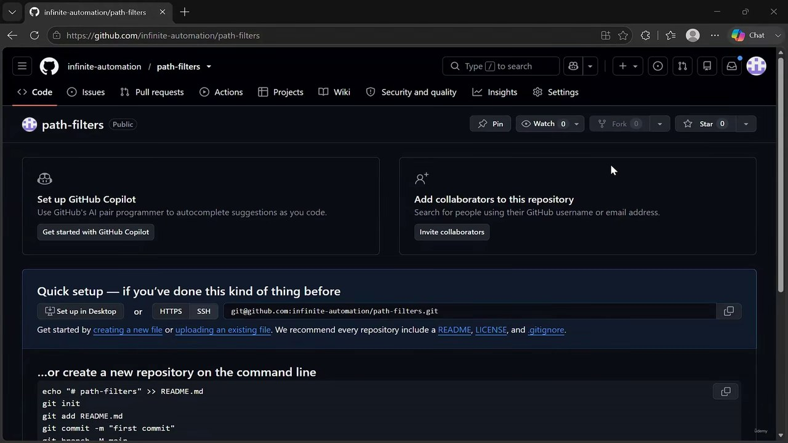

P30 的 YAML 关键配置在 `on.push` 下同时限定 `branches` 和 `paths`：

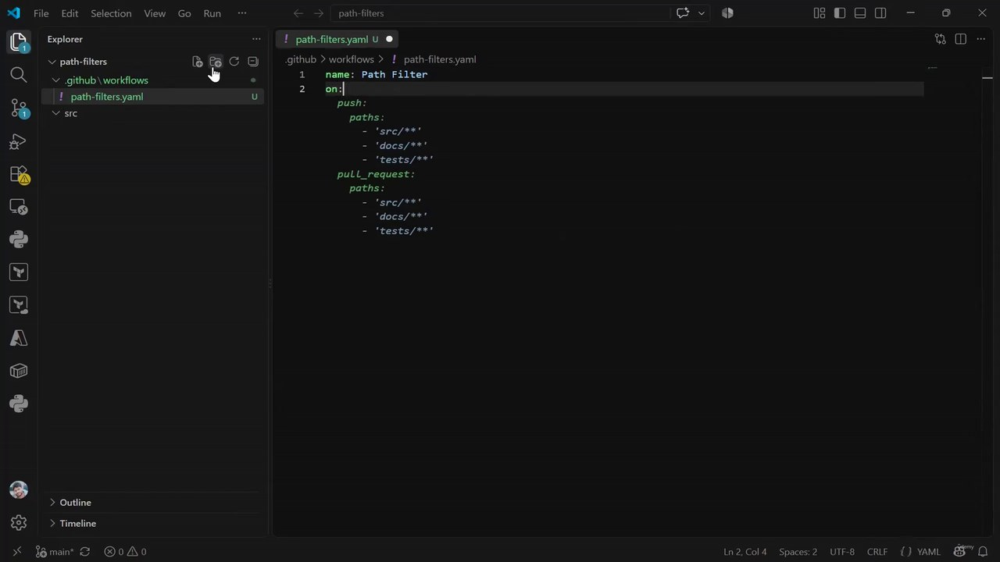

P29 的 PPT 也展示过同一段 YAML 的写法，`src/**` 里的 `**` 表示 src 目录下的一切：

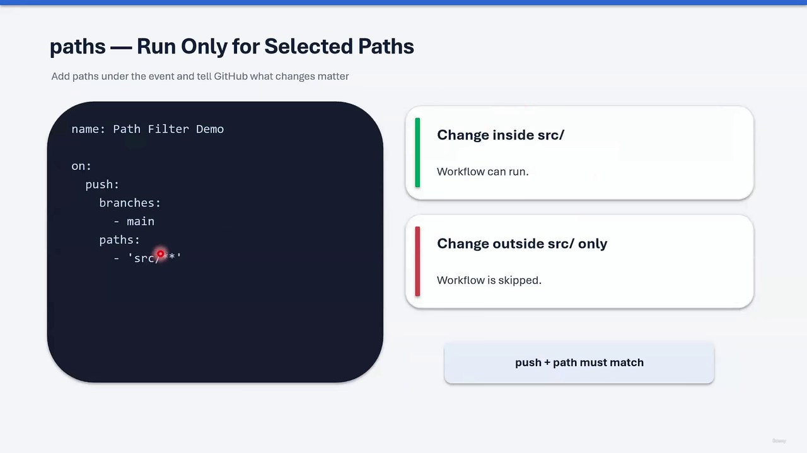

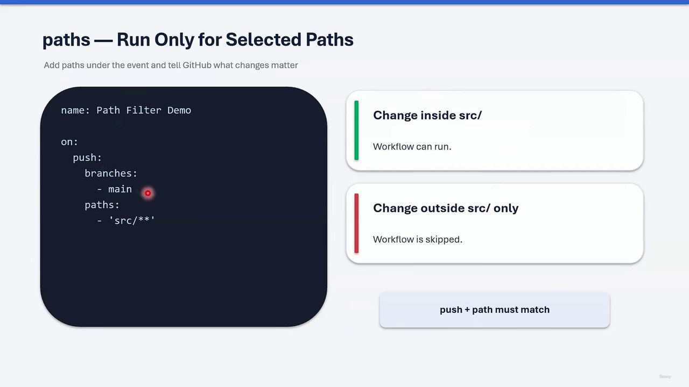

**命令完整解释与前台对照：**

- `mkdir -p .github/workflows src`：一次性创建 `.github/workflows` 和 `src` 两个目录，`-p` 表示父目录不存在时自动创建，并且目录已存在时不报错。前台对照：这一步只在本地创建目录，GitHub 页面不会变化，因为空目录不会被 Git 跟踪。
- 创建 `pathfilter.yaml`：这是 workflow 定义文件，必须放在 `.github/workflows/` 下。文件放在别处，GitHub Actions 不会把它当作 workflow。
- 创建 `src/dummy.txt`：这是实验一中用来触发路径过滤的业务文件。它的路径 `src/dummy.txt` 会匹配 `src/**`。
- 创建根目录 `readme.md`：这是实验一中用来验证“不触发”的文件。它不在 `src/**` 下，所以改它不应启动 workflow。

常见错误与排查：最常见的错误是目录名写成 `.github/workflow/` 或文件直接放在仓库根目录。排查时在本地执行 `find .github -maxdepth 3 -type f`，确认 `pathfilter.yaml` 的完整路径是 `.github/workflows/pathfilter.yaml`。另一个常见错误是 YAML 缩进错位，导致 `paths` 没有挂在 `push` 下；前台表现可能是 workflow 不按预期触发，或者 GitHub 直接提示 workflow 文件无效。此时先看 Actions 页面是否有红色报错，再回到 YAML 检查缩进和引号。

#### 3.1.3 提交并推送

```bash
git add .
git commit -m "add path filter workflow"
git branch -M main
git remote add origin https://github.com/<你的用户名>/path-filters-demo.git
git push -u origin main
```

> 如果你 clone 下来时默认分支已经是 `main`，`git branch -M main` 可以跳过；如果默认是 `master`，这条命令把它改名为 `main`，和 workflow 里的 `branches: main` 对齐。

**命令完整解释与前台对照：**

- `git add .`：把当前目录下所有新增和修改的文件加入暂存区。它不会提交，只是准备提交。前台对照：此时 GitHub 页面仍然没有变化。
- `git commit -m "add path filter workflow"`：生成一次本地提交，提交信息是引号里的内容。前台对照：还没有 push，所以远程仓库页面不会出现这次提交。
- `git branch -M main`：把当前分支强制重命名为 `main`。`-M` 是强制移动/重命名。前台对照：远程仓库默认分支名要与 workflow 的 `branches: main` 对齐；如果远程默认分支是 `master`，而 workflow 只监听 `main`，推送后可能看不到预期触发。
- `git remote add origin https://github.com/<你的用户名>/path-filters-demo.git`：给本地仓库添加名为 `origin` 的远程地址。前台对照：这一步不会改变远程仓库内容，只是告诉本地 Git 往哪里推送。
- `git push -u origin main`：把本地 `main` 分支推送到远程 `origin`，并用 `-u` 建立本地 `main` 与远程 `origin/main` 的跟踪关系。前台对照：push 完成后，GitHub 仓库页面会出现提交记录；如果路径条件满足，Actions 页面会出现新的 workflow run。

常见错误与排查：如果 `git remote add origin` 提示 “remote origin already exists”，说明远程名已存在，可以用 `git remote -v` 查看当前地址；如果地址写错，用 `git remote set-url origin <正确地址>` 修正，不要反复添加。如果 `git push` 提示分支不存在或权限不足，先检查远程仓库地址和登录凭据。如果 Actions 页面没有新 run，按顺序检查：push 是否真的成功、分支是否为 `main`、变更文件是否在 `src/` 下、workflow 文件是否在 `.github/workflows/` 下。

#### 3.1.4 验证第一次：应该触发

推送完成后，打开 GitHub 仓库页面，点 **Actions** 标签页。你应该看到一条新的 workflow run，名字是 `Path Filters`，job 名是 `path-filter`，step 名是 `Greeting from path filters`。点进去能看到 echo 的输出。

P30 里讲师在 Actions 页面确认 job 和 step 都执行了：

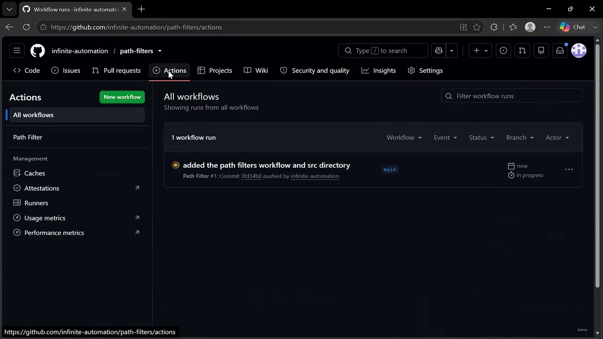

**前台对照说明：** 在 GitHub 前台，Actions 页面通常按 run 列表展示。点进某一条 run 后，左侧或页面上方能看到 job 名 `path-filter`，再点开 job 能看到 step `Greeting from path filters`。step 日志里应出现 echo 的文本。如果只看到 workflow 名称但没有 job，或者 job 一直处于 queued，先刷新页面并等待几秒；如果 run 出现但失败，优先看 step 日志里的具体报错。

#### 3.1.5 验证第二次：改根目录 readme.md，应该不触发

在本地修改根目录的 `readme.md`，随便加一行，然后提交推送：

```bash
git add readme.md
git commit -m "update readme outside src"
git push
```

再打开 Actions 页面。**这次不会出现新的 workflow run。** 原因就是 P30 讲师说的：push 发生了、分支也匹配了，但变更文件不在 `src/` 下。

P30 里讲师在 Actions 页面确认没有新 run：

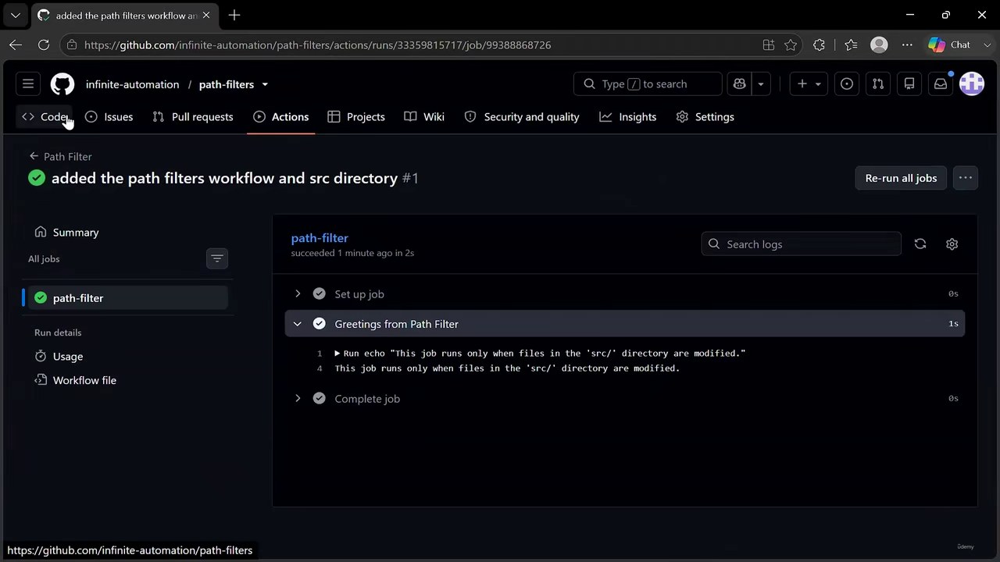

**命令完整解释与前台对照：**

- `git add readme.md`：只把 `readme.md` 这一个文件加入暂存区。这里故意不 `git add .`，是为了让本次提交只包含根目录文件，便于验证路径过滤。
- `git commit -m "update readme outside src"`：生成本地提交。
- `git push`：因为前面用了 `-u` 建立跟踪关系，这里可以省略 `origin main`。前台对照：push 成功后，仓库提交记录会更新，但 Actions 页面不应出现新的 `Path Filters` run。

常见错误与排查：如果这次仍然出现了新的 run，先确认提交里到底改了哪些文件。可以在本地执行 `git show --stat HEAD`，看本次提交是否只包含 `readme.md`。如果同时误改了 `src/dummy.txt`，那么只要有 `src/**` 下的变更，workflow 就会运行。另一个可能是上一次 push 的 run 还没刷新出来，注意区分 run 的提交信息和时间，不要把旧 run 当成新 run。

#### 3.1.6 验证第三次：改 src/dummy.txt，应该再次触发

修改 `src/dummy.txt`，加一行 `testing the workflow run for path filter.`，提交推送：

```bash
git add src/dummy.txt
git commit -m "update src file to trigger workflow"
git push
```

Actions 页面应再次出现新的 run。

**命令完整解释与前台对照：**

- `git add src/dummy.txt`：只暂存 `src/dummy.txt`，确保本次提交的变更路径明确落在 `src/**` 内。
- `git commit -m "update src file to trigger workflow"`：生成提交，提交信息直接说明这次是为了触发 workflow。
- `git push`：推送到远程。前台对照：Actions 页面应出现新的 run，run 对应的提交信息应是 `update src file to trigger workflow`，job 和 step 应与第一次验证一致。

常见错误与排查：如果改了 `src/dummy.txt` 却没有触发，先看 `git show --stat HEAD` 确认本次提交确实包含该文件；再看 workflow 里的 `paths` 是否写成 `src/**`，而不是写成了别的目录；最后看分支是否是 `main`。如果 YAML 里 `paths` 和 `branches` 缩进不正确，也可能导致条件不生效，需回到 `.github/workflows/pathfilter.yaml` 检查层级。

---

### 3.2 实验二：路径忽略（对应 P32）

#### 3.2.1 准备

再建一个空 GitHub 仓库，比如叫 `paths-ignore-demo`（讲师口述为 “path signal”，结合文件名和语境，实际就是 paths-ignore）。克隆到本地：

```bash
git clone https://github.com/<你的用户名>/paths-ignore-demo.git
cd paths-ignore-demo
```

**命令完整解释与前台对照：** `git clone` 和 `cd` 的作用与实验一相同，只是仓库名换成了 `paths-ignore-demo`。前台对照：克隆完成后 GitHub 远程仓库页面仍为空仓库状态；本地进入目录后，后续才创建文件和 workflow。

常见错误与排查：如果仓库名拼错，`git clone` 会提示仓库不存在或认证失败。建议直接在 GitHub 仓库页面复制 clone 地址，避免手写用户名和仓库名出错。

#### 3.2.2 创建目录和文件

目标结构：

```text
paths-ignore-demo/
├── .github/
│   └── workflows/
│       └── paths-ignore.yaml
├── docs/
│   └── document.txt
├── readme.md
└── test-paths-ignore.txt
```

建目录：

```bash
mkdir -p .github/workflows docs
```

创建 `docs/document.txt`，写入：

```text
This is dummy document.
```

创建根目录 `readme.md`，写入：

```text
please readme
```

创建 `.github/workflows/paths-ignore.yaml`，内容见第 4 节。讲师在 P32 里口述的 workflow 名是 “path signal demo”，实际写 `paths-ignore demo` 更贴合语义；下面代码按可用写法给出。

P32 讲师创建 `paths-ignore.yaml` 的编辑画面：

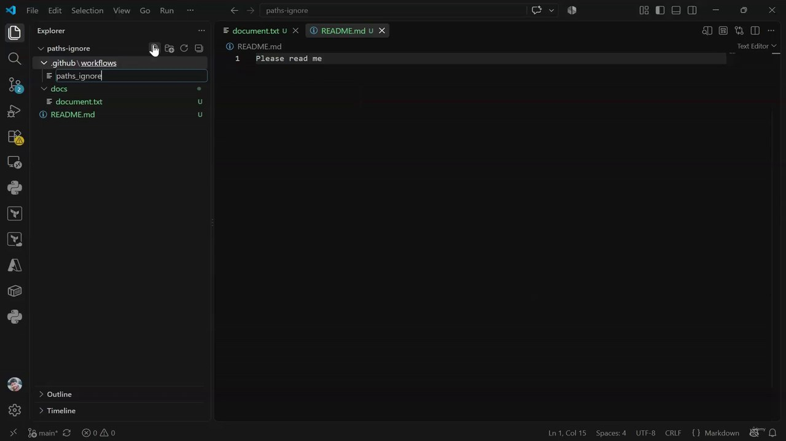

P32 配置 `paths-ignore` 的关键位置，`docs/**` 和 `**.md` 分别表示 docs 下所有文件和任意位置的 .md 文件：

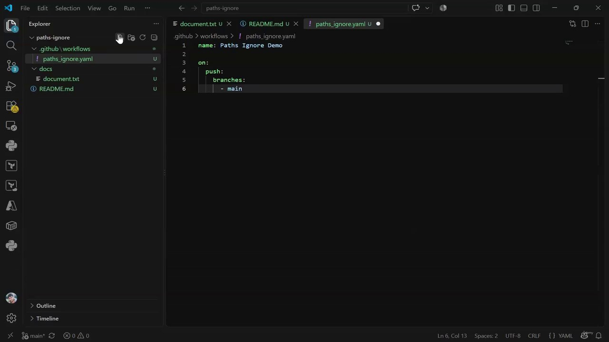

P31 的 PPT 也解释过 `paths-ignore` 的判定流程：

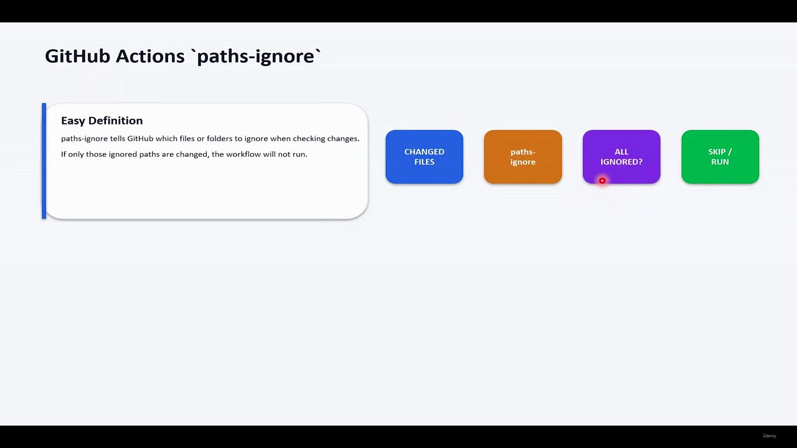

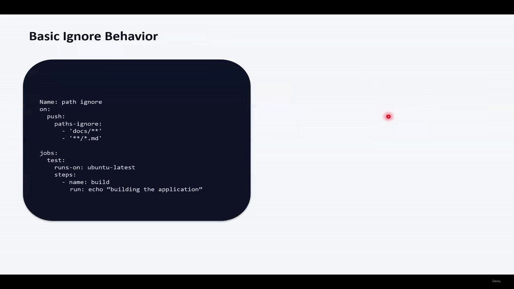

**命令完整解释与前台对照：**

- `mkdir -p .github/workflows docs`：同时创建 workflow 目录和 `docs` 目录。`docs` 目录用于验证“只改被忽略路径时不触发”。
- `docs/document.txt`：这是实验二中用来验证“忽略后不触发”的文件，路径匹配 `docs/**`。
- 根目录 `readme.md`：它匹配 `**.md`，所以修改它也应被忽略。注意实验二里 `readme.md` 的作用和实验一不同：实验一里它用来验证“不匹配 `src/**` 不触发”，实验二里它用来验证 `.md` 忽略规则。
- `.github/workflows/paths-ignore.yaml`：workflow 文件本身不在 `docs/**`，也不在 `**.md` 内，所以第一次提交它时会触发 workflow。这正是 P32 讲师解释的现象。

常见错误与排查：如果 `docs/document.txt` 路径写成了根目录的 `document.txt`，它就不会匹配 `docs/**`，验证结果会不符合预期。检查时可以用 `git status --short` 看文件路径。另一个常见错误是把 `paths-ignore` 写成 `path-ignore` 或 `paths_ignore`，GitHub 不会识别。YAML 键名必须精确。

#### 3.2.3 提交并推送

```bash
git add .
git commit -m "paths ignore workflows"
git branch -M main
git remote add origin https://github.com/<你的用户名>/paths-ignore-demo.git
git push -u origin main
```

**命令完整解释与前台对照：** 这些命令与实验一相同。`git add .` 会把 workflow 文件、`docs/document.txt`、`readme.md` 等一起提交；`git branch -M main` 保证分支名与 `branches: main` 对齐；`git remote add origin` 绑定远程仓库；`git push -u origin main` 完成首次推送。前台对照：第一次 push 后，Actions 页面会出现新的 run，因为提交里包含 `paths-ignore.yaml` 本身，而它不属于被忽略路径。

常见错误与排查：如果 `git remote add origin` 报已存在，用 `git remote -v` 查看，不要重复添加。如果第一次 push 后 Actions 页面没有 run，先确认 workflow 文件路径和 YAML 是否有效，再确认分支名是否匹配。不要把“第一次应该跑”误判为配置错误。

#### 3.2.4 验证第一次：workflow 会跑，别意外

第一次 push 之后，Actions 页面**会出现一条新的 workflow run**。这不是配置写错了。P32 讲师专门解释了原因：这次 push 里包含了 `paths-ignore.yaml` 文件本身，而这个 YAML 文件不在 `docs/**` 也不在 `**.md` 的忽略范围里，所以 GitHub 认为「有未被忽略的文件变更」，workflow 正常运行。

**前台对照说明：** 在 Actions 页面看到 run 时，点进去核对本次提交包含的文件。如果提交里同时有 `paths-ignore.yaml` 和 `docs/document.txt`，不要只看 `docs`，要看“本次变更文件集合”里是否存在至少一个未被忽略的文件。只要有一个未被忽略，`paths-ignore` 逻辑就会让 workflow 运行。

#### 3.2.5 验证第二次：改 docs/document.txt，应该不触发

修改 `docs/document.txt`，加一行 `testing the workflow run for paths ignore.`，提交推送：

```bash
git add docs/document.txt
git commit -m "testing workflow run for paths ignore"
git push
```

打开 Actions 页面。**这次不会出现新的 workflow run。** 因为这次 push 里所有变更文件都在 `docs/**` 的忽略范围内，符合 P31 讲师总结的「all ignored means skip the workflow」。

P32 里讲师确认改 docs 后 workflow 没有启动：

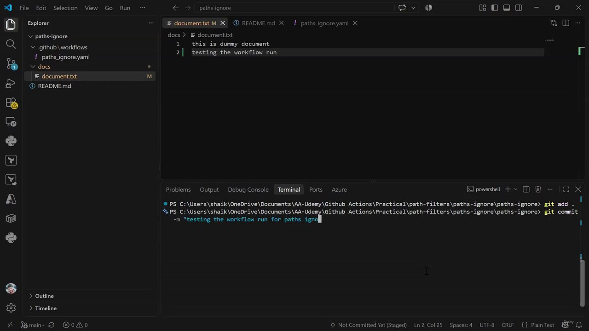

**命令完整解释与前台对照：**

- `git add docs/document.txt`：只暂存 `docs/document.txt`，保证本次提交只包含被忽略路径下的文件。
- `git commit -m "testing workflow run for paths ignore"`：生成提交。
- `git push`：推送。前台对照：提交记录会出现，但 Actions 页面不应出现新的 workflow run。

常见错误与排查：如果这次触发了，先执行 `git show --stat HEAD` 确认本次提交是否只改了 `docs/document.txt`。如果同时改了根目录文件，哪怕只改了一个未被忽略的文件，也会触发。另一个排查点是忽略规则是否写成 `'docs/**'`，而不是 `'docs/*'` 或其他不匹配写法。

#### 3.2.6 验证第三次：改根目录文件，应该触发

在根目录新建 `test-paths-ignore.txt`，写入：

```text
testing the paths ignore out of the scope
```

提交推送：

```bash
git add test-paths-ignore.txt
git commit -m "testing the out-of-scope file"
git push
```

Actions 页面应出现新的 workflow run，job 名 `build`，step 名 `Build`。

P32 里讲师确认根目录新文件触发了 workflow：

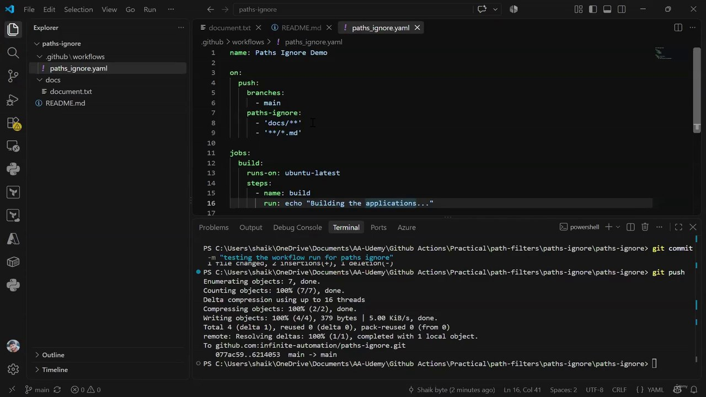

**命令完整解释与前台对照：**

- `git add test-paths-ignore.txt`：只暂存根目录新文件。
- `git commit -m "testing the out-of-scope file"`：生成提交，提交信息说明这是“范围外”的文件。
- `git push`：推送。前台对照：Actions 页面应出现新的 run，job 名 `build`，step 名 `Build`，step 日志里应出现 `Building the application`。

常见错误与排查：如果根目录文件没有触发，检查文件名是否确实位于根目录，而不是误放进了 `docs/`；再检查 `paths-ignore` 是否意外写成了 `paths`，或者忽略列表里是否多写了一个能匹配该文件的规则。前台排查时，点开 run 看提交信息是否为 `testing the out-of-scope file`，避免把旧 run 误认为新 run。

---

## 4. 完整代码

### 4.1 实验一：`.github/workflows/pathfilter.yaml`

```yaml
name: Path Filters

on:
  push:
    branches:
      - main
    paths:
      - 'src/**'

jobs:
  path-filter:
    runs-on: ubuntu-latest
    steps:
      - name: Greeting from path filters
        run: echo "This workflow runs only when files in the src directory are modified or changed."
```

### 4.2 实验二：`.github/workflows/paths-ignore.yaml`

```yaml
name: paths-ignore demo

on:
  push:
    branches:
      - main
    paths-ignore:
      - 'docs/**'
      - '**.md'

jobs:
  build:
    runs-on: ubuntu-latest
    steps:
      - name: Build
        run: echo "Building the application"
```

### 4.3 辅助文件内容

实验一 `src/dummy.txt`：

```text
Welcome to path filters demo.
```

实验一 `readme.md`：

```text
please readme
```

实验二 `docs/document.txt`：

```text
This is dummy document.
```

实验二 `readme.md`：

```text
please readme
```

实验二 `test-paths-ignore.txt`：

```text
testing the paths ignore out of the scope
```

---

## 5. 逐行解释

### 5.1 `pathfilter.yaml`

| 行 | 内容 | 含义 |
|---|---|---|
| `name: Path Filters` | workflow 的显示名称 | 出现在 GitHub Actions 列表里，方便识别 |
| `on:` | 事件声明 | 课里强调：**path filter 不是事件**，它必须挂在 `push` 或 `pull_request` 这类事件下面 |
| `push:` | 选择 push 事件 | 推送到远程仓库时触发检查 |
| `branches: - main` | 只对 main 分支生效 | 和 `paths` 是 AND 关系：分支要匹配，路径也要匹配 |
| `paths: - 'src/**'` | 路径过滤器 | `**` 表示 src 目录下的所有文件和子目录；`src` 目录本身的变化不在 `src/**` 的匹配范围内，课里没有展开讨论这个边界 |
| `jobs:` | 任务列表 | 下面定义具体做什么 |
| `path-filter:` | job 的 ID | 出现在 Actions 页面的 job 列表里 |
| `runs-on: ubuntu-latest` | 运行环境 | 讲师说的 “GitHub-hosted runner”，由 GitHub 提供，不需要自己维护机器 |
| `steps:` | 步骤列表 | 一个 job 里可以有多个 step |
| `- name: Greeting from path filters` | step 的显示名 | 出现在 Actions 页面的步骤列表里 |
| `run: echo "..."` | 执行的 shell 命令 | 在 Ubuntu runner 上执行，输出会显示在日志里 |

### 5.2 `paths-ignore.yaml`

| 行 | 内容 | 含义 |
|---|---|---|
| `name: paths-ignore demo` | workflow 名称 | 讲师口述为 “path signal demo”，按语义写 `paths-ignore demo` |
| `on.push.branches: - main` | 只对 main 分支的 push 生效 | 分支条件仍然需要，path filter 不能替代事件 |
| `paths-ignore:` | 忽略路径列表 | 这里列出「变了也不触发」的路径 |
| `- 'docs/**'` | 忽略 docs 下所有文件 | 对应 P32 的 `docs/document.txt` |
| `- '**.md'` | 忽略任意位置的 .md 文件 | 对应 `readme.md`；讲师在 P32 里解释为 “the .md files anywhere in the repository” |
| `jobs.build` | job ID | 名字叫 build，但实际只跑一条 echo |
| `runs-on: ubuntu-latest` | 运行环境 | 同上 |
| `steps.- name: Build` | step 名 | 出现在日志里 |
| `run: echo "Building the application"` | 执行的命令 | 仅用于验证 workflow 是否启动 |

### 5.3 两个实验的判定逻辑对比

**`paths` 是「白名单」逻辑：**

- 变更文件里**至少有一个**匹配 `paths` 里的模式 → workflow 运行。
- 变更文件**全都不匹配** → workflow 跳过。

**`paths-ignore` 是「黑名单」逻辑：**

- 变更文件**全部**落在 `paths-ignore` 里 → workflow 跳过。
- 变更文件里**至少有一个**不在 `paths-ignore` 里 → workflow 运行。

P31 讲师用一句话总结过：`all ignored means skip the workflow. Otherwise, run the workflow.`（—— p031 [01:54]）

> 在 JS/Node 里，这有点像 npm scripts 的条件执行：你可以用 `if` 判断当前变更文件列表，全部命中忽略规则就 `return`，否则继续跑构建。区别是 GitHub Actions 在平台侧做这个判断，你不需要自己写脚本。

### 5.4 每条命令与 Actions 前台的对照速查

| 本地动作 | 本地结果 | GitHub 前台应看到什么 |
|---|---|---|
| `git clone` | 本地出现仓库目录 | 远程仓库页面暂不变化 |
| `git config` | 提交作者信息就绪 | 前台暂不变化，提交后才显示作者 |
| `mkdir -p` 与创建文件 | 本地目录和文件出现 | 前台暂不变化，未提交的文件不会显示 |
| `git add .` | 文件进入暂存区 | 前台暂不变化 |
| `git commit` | 生成本地提交 | 前台暂不变化，未 push 不显示 |
| `git branch -M main` | 本地分支名改为 main | 前台默认分支在首次 push 后才体现 |
| `git remote add origin` | 本地绑定远程地址 | 前台暂不变化 |
| `git push -u origin main` | 本地提交推到远程 | 仓库提交记录更新；满足条件时 Actions 出现 run |
| 改 `readme.md` 后 push（实验一） | 提交只含根目录文件 | Actions 不出现新的 `Path Filters` run |
| 改 `src/dummy.txt` 后 push（实验一） | 提交含 `src/**` 文件 | Actions 出现新的 `Path Filters` run |
| 首次 push（实验二） | 提交含 workflow YAML 本身 | Actions 出现新的 `paths-ignore demo` run |
| 改 `docs/document.txt` 后 push（实验二） | 提交全部命中忽略列表 | Actions 不出现新的 run |
| 新增根目录 `test-paths-ignore.txt` 后 push（实验二） | 提交含未忽略文件 | Actions 出现新的 run，job 为 `build` |

### 5.5 常见错误与排查总表

1. **目录名错误**：`.github/workflow/`、`.github/workflows.yaml` 都不对。正确路径是 `.github/workflows/<文件名>.yaml`。排查方式：在仓库根目录执行 `find .github -type f`，确认文件位置。
2. **YAML 缩进错误**：`branches` 和 `paths` 必须位于 `push:` 下面。排查方式：对照第 4 节完整代码，注意 `jobs:` 与 `on:` 同级。
3. **通配符没加引号**：`'src/**'`、`'docs/**'`、`'**.md'` 建议加引号。排查方式：看 Actions 是否提示 workflow 文件解析失败。
4. **`paths` 与 `paths-ignore` 同时写在同一个 `push` 下**：GitHub 不接受这种写法。排查方式：二选一，或者拆成两个 workflow 文件。
5. **分支不匹配**：workflow 写 `branches: main`，但实际推送到 `master`。排查方式：看 Actions run 对应的分支，或者执行 `git branch --show-current`。
6. **文件没有真正提交**：改了文件但忘记 `git add`，或者 `git commit` 后发现工作区还有未提交内容。排查方式：`git status`、`git show --stat HEAD`。
7. **把旧 run 当成新 run**：Actions 页面有缓存或未刷新。排查方式：核对 run 对应的提交信息和提交时间。
8. **第一次 push `paths-ignore` 却跑了**：这是预期行为，因为 workflow YAML 文件本身不在忽略范围。排查方式：看本次提交是否包含 YAML 文件。
9. **只改 `docs/` 却触发了**：检查同一次提交里是否还包含根目录文件或其他未忽略文件。`paths-ignore` 看的是“本次变更文件集合”，不是只看某个目录。
10. **改 `src/` 却没触发**：检查提交是否只包含 `src/` 下文件、分支是否为 `main`、`paths` 是否写成 `'src/**'`，以及 workflow 文件是否被 GitHub 识别。

---

## 6. 复现检查清单

- [ ] GitHub 仓库是**空仓库**创建，没有自动生成 README。
- [ ] 目录名是 `.github/workflows/`，不是 `.github/workflow/`，也不是 `.github/workflow.yml`。
- [ ] workflow 文件扩展名是 `.yaml` 或 `.yml`，放在 `workflows/` 目录下。
- [ ] 实验一 `pathfilter.yaml` 里 `branches` 和 `paths` 都写在 `push` 下面，缩进层级正确。
- [ ] 实验一第一次 push 后 Actions 页面出现 `Path Filters` 的 run，step 输出包含 echo 的文本。
- [ ] 实验一改根目录 `readme.md` 后，Actions 页面**没有**新的 run。
- [ ] 实验一改 `src/dummy.txt` 后，Actions 页面**出现**新的 run。
- [ ] 实验二第一次 push 后 workflow **会跑**，原因是 workflow YAML 文件本身不被忽略。
- [ ] 实验二改 `docs/document.txt` 后，Actions 页面**没有**新的 run。
- [ ] 实验二新增根目录 `test-paths-ignore.txt` 后，Actions 页面**出现**新的 run。
- [ ] 两个实验分别放在两个独立仓库里，避免 workflow 互相干扰。

**检查清单逐条说明：**

- 第一条“空仓库创建”：如果创建仓库时勾选了 README，第一次 clone 下来就已经有提交，后续“第一次 push”的预期会被打乱。排查方式是看远程仓库初始是否有文件。
- 第二条“目录名正确”：GitHub 只识别 `.github/workflows/`，目录名少一个 `s` 或把 YAML 放到根目录都不会生效。排查方式是在本地确认文件完整路径。
- 第三条“扩展名和位置正确”：`.yaml` 与 `.yml` 都可用，但必须位于 `workflows/` 下。排查方式是看 Actions 页面是否出现该 workflow 名称。
- 第四条“缩进层级正确”：`branches` 和 `paths` 必须属于 `push` 的映射。排查方式是与第 4 节代码逐行对照，特别注意空格。
- 第五条“实验一第一次触发”：这次提交包含 `src/dummy.txt` 和 workflow 文件，`src/**` 匹配成功，所以应出现 run。若没有，先查分支和路径。
- 第六条“改 readme 不触发”：用来验证白名单逻辑。若触发，说明提交里可能混入了 `src/` 文件，或者 `paths` 写得过宽。
- 第七条“改 src 再次触发”：用来验证 `src/**` 的持续有效性。若没有触发，检查文件路径、分支和 YAML。
- 第八条“实验二第一次会跑”：这是 P32 的关键现象。若没跑，先检查 workflow 文件是否有效，而不是先怀疑忽略规则。
- 第九条“改 docs 不触发”：用来验证黑名单逻辑中的“全部忽略才跳过”。若触发，检查本次提交是否还包含其他文件。
- 第十条“根目录新文件触发”：用来验证“只要有一个未忽略文件就运行”。若没有触发，检查文件是否真的在根目录、是否被其他忽略规则命中。
- 第十一条“两个实验分开仓库”：如果放在同一个仓库，两个 workflow 会同时监听 push，Actions 页面会出现多个 run，排查时容易混淆。

---

## 7. 课里没讲但你会撞上的

1. **`paths` 和 `paths-ignore` 不能在同一个事件下同时使用。**
   课里是两个实验分开演示的。如果你图省事把两者写在同一个 `push:` 下面，GitHub 会报错。需要二选一，或者拆成两个 workflow 文件。

2. **YAML 里以 `*` 开头的字符串必须加引号。**
   `'src/**'`、`'docs/**'`、`'**.md'` 如果不加引号，YAML 解析器可能把 `*` 当成别名符号，导致 workflow 文件解析失败。课里讲师写的时候是带引号的，但口述里听不出来。

3. **`paths` 多个值之间是 OR，`branches` 和 `paths` 之间是 AND。**
   课里 P30 说「push 要发生、分支要是 main、变更要匹配 src」，这三个条件是同时满足才触发。如果你写多个 `paths` 条目，任意一个匹配就会触发。

4. **`on` 这个词在 YAML 1.1 里会被解析成布尔值 `true`。**
   GitHub 自己的解析器能正确处理，但如果你用其他 YAML 工具做本地校验，可能会看到奇怪的报错。这不是课里讲的内容，但本地校验时容易撞上。

5. **第一次 push 包含 workflow 文件本身时，行为可能和你预期不一样。**
   - 实验一：workflow 文件不在 `src/**` 里，所以第一次 push **不会**触发。这和 P30 的演示一致——P30 第一次触发是因为同时改了 `src/dummy.txt`。
   - 实验二：workflow 文件不在 `docs/**` 也不在 `**.md` 里，所以第一次 push **会**触发。P32 讲师专门解释过这一点。

6. **`src/**` 不匹配 `src` 目录本身的增删。**
   课里没有讨论「只创建空目录」或「删除 src 目录」这种边界。实际项目中如果关心目录级变化，需要额外配置，课里没讲。

7. **`paths-ignore` 里的 `**.md` 和 `**/*.md` 在 GitHub 的 glob 实现里都能用，但语义细节不同。**
   课里只用了 `**.md`，讲师解释为「任意位置的 .md 文件」。如果你换成 `**/*.md`，通常也能覆盖子目录，但根目录的 `readme.md` 是否匹配取决于具体实现。建议先按课里的写法验证通过，再考虑调整。

8. **workflow 文件本身建议单独提交一次。**
   这样你可以清楚看到「新增 workflow 文件」这一次 push 是否触发，以及后续业务文件变更是否按预期触发/跳过。课里 P32 的第一次运行就是这个原因，理解这一点能帮你少排查半小时。

9. **Actions 页面有延迟。**
   push 之后 workflow 不一定立刻出现，刷新一下页面，或者等几秒。课里 P30 也是刷新后才看到结果。

10. **认证与远程地址错误会伪装成“路径过滤器不生效”。**
    如果 push 本身失败，Actions 当然不会有新 run。排查时先看本地 `git push` 是否成功，再看 GitHub 仓库页面是否出现新提交，最后才看 Actions 页面。不要跳过前两步直接怀疑 YAML。

11. **文件路径大小写要与仓库实际路径一致。**
    本地如果写成 `Src/dummy.txt`，而 workflow 里写的是 `src/**`，在大小写敏感的环境里就可能不匹配。建议统一使用小写目录名，并在 `git status` 中核对路径。

12. **修改 workflow 文件本身也会产生一次提交。**
    如果你调完 YAML 后直接 push，这次提交会包含 workflow 文件。实验二里这会触发 run，实验一里则要结合 `src/**` 判断。排查时始终看“本次提交到底包含哪些文件”，而不是只看你主观想改的那个文件。