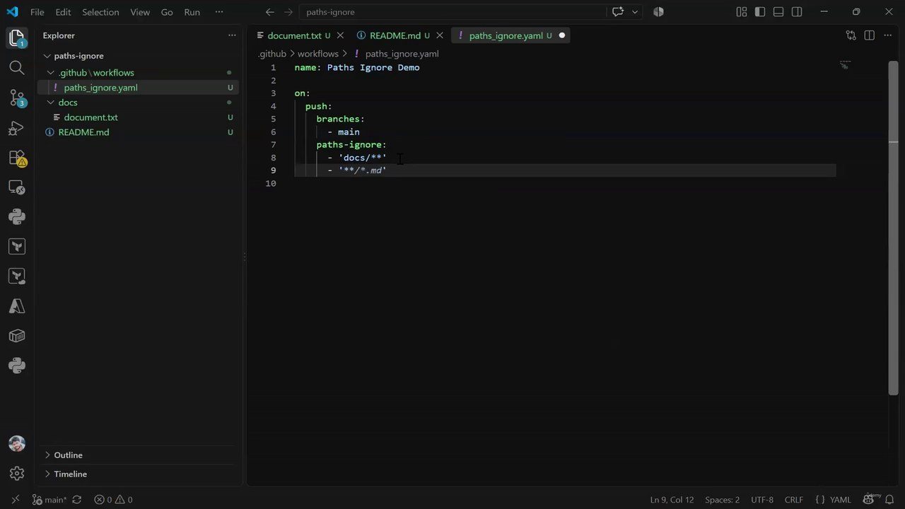
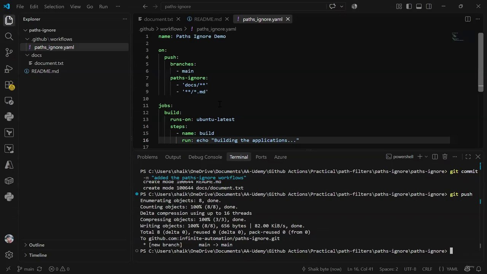
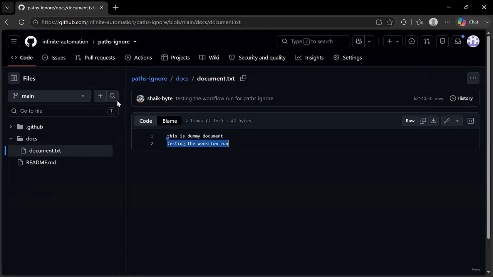
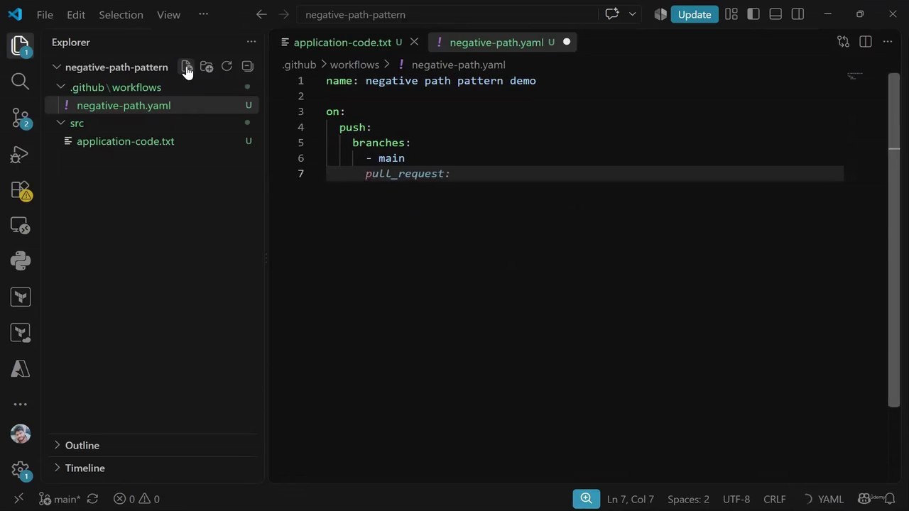
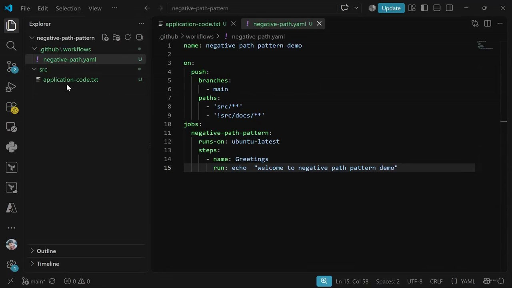
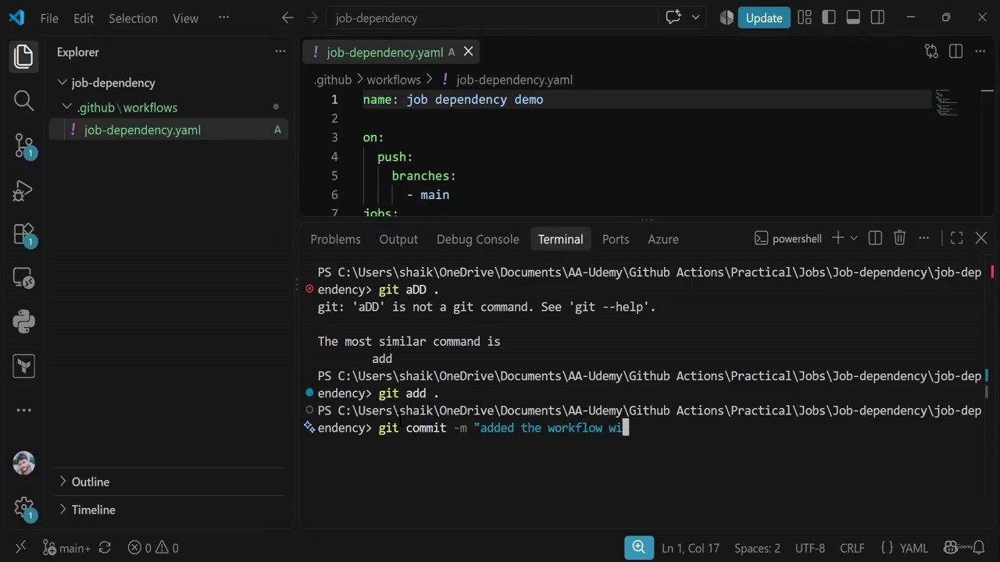
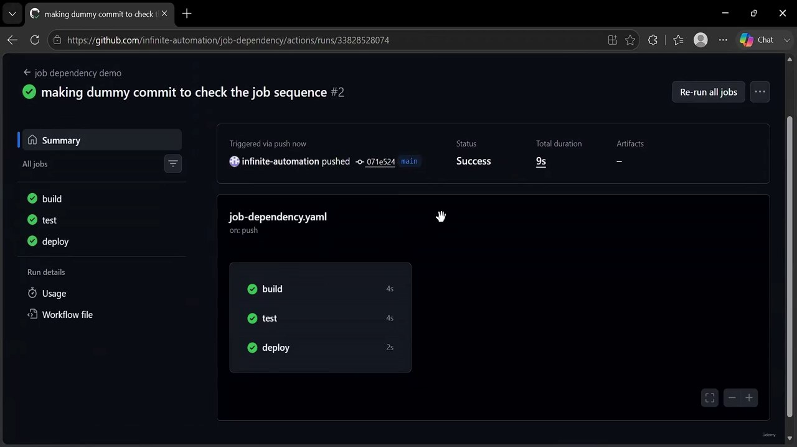
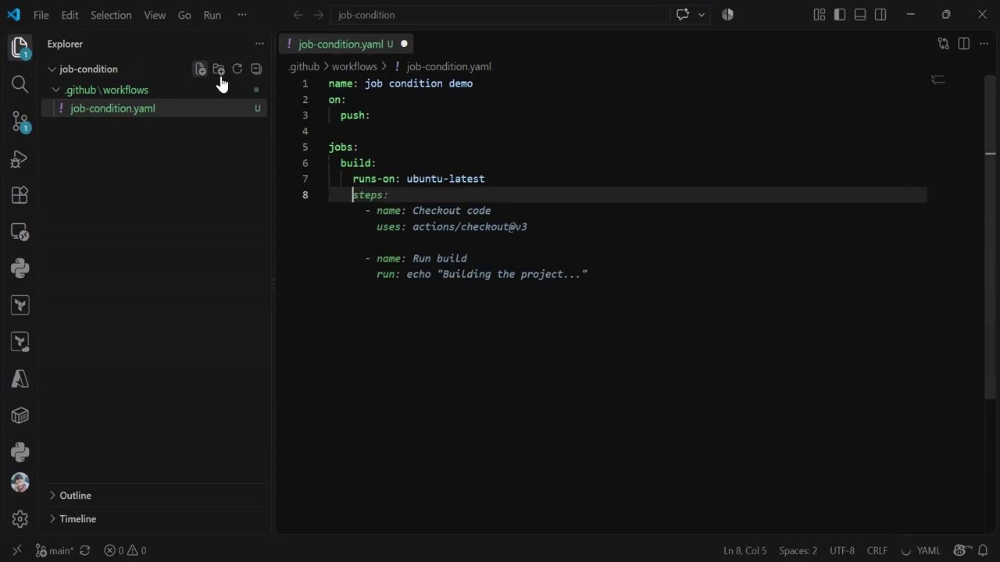
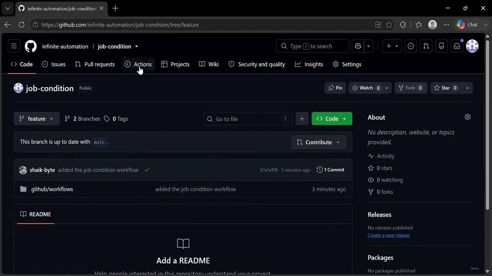

# GitHub Actions Complete（P31–P40）复现文档：路径过滤、作业依赖与条件执行

## 1. 这一节做什么

这一节覆盖 P31–P40，实际是四个可以独立复现的 GitHub Actions 实验。每个实验都建议单独建一个空 GitHub 仓库，避免不同工作流的路径过滤互相干扰。四个实验之间不是同一个项目的连续迭代，而是分别验证一类 GitHub Actions 行为：`paths-ignore` 如何跳过工作流、负向路径模式如何先包含再排除、`needs` 如何建立 job 依赖、`if` 如何按分支条件控制 job 是否执行。分开建库的好处是，每次 push 的改动范围更清楚，Actions 页面里也不会把不同实验的运行记录混在一起。

你会做出四个结果：

1. **`paths-ignore` 实验**：只改 `docs/**` 或 Markdown 文件时，工作流不触发；改根目录其他文件时触发。关键点是：第一次推送包含工作流 YAML 本身，所以第一次通常仍会运行。观察时不要只看“有没有 push”，而要看这次 push 改动的文件集合是否全部落在忽略列表里。
2. **负向路径模式实验**：先写 `paths: - 'src/**'` 包含 `src` 下所有内容，再写 `- '!src/docs/**'` 排除 `src/docs`。改 `src/application-code.txt` 会触发，改 `src/docs/application-docs.txt` 不触发。负向模式的关键是顺序和“先包含、后排除”，不能只写一个孤立的排除规则。
3. **作业依赖实验**：默认 `build`、`test`、`deploy` 三个 job 独立并行；给 `test` 加 `needs: build`，给 `deploy` 加 `needs: [build, test]` 后，执行顺序变成 `build → test → deploy`。观察点是 Actions 页面里的 job 依赖图和每个 job 的开始时间。
4. **作业条件实验**：给 `deploy` 加 `if: github.ref == 'refs/heads/main'`，在 `main` 分支推送时三个 job 都跑；在 `feature` 分支推送时 `build`、`test` 跑，`deploy` 被跳过。再给 `test` 加同样条件后，`feature` 分支只跑 `build`。这里要区分“工作流没有触发”和“工作流触发了但 job 被跳过”，两者在 Actions 页面上的表现不同。

前置环境：

- GitHub 账号；
- 本地安装 Git；
- 本地安装 VS Code（课里使用 VS Code 编辑 YAML）；
- 不需要 Node/npm，也不需要额外依赖。课里没有锁定 runner 镜像版本，统一使用 GitHub 托管的 `ubuntu-latest`；
- 每个仓库的默认分支需要是 `main`。课里多次使用 `branches: main`，如果本地默认分支是 `master`，路径和分支条件都会对不上。检查时可以用 `git branch --show-current` 看当前分支，用 GitHub 仓库 Settings → Branches 看远端默认分支。

四个仓库建议命名如下。课里仓库名转写不统一（例如 `path signal`、`job dependency`），下面用更明确的 demo 名；你实际建库时可以换成自己的名字，但下文命令要同步替换。

```text
paths-ignore-demo
negative-path-demo
job-dependency-demo
job-condition-demo
```

最终每个仓库的目录结构如下。

`paths-ignore-demo`：

```text
paths-ignore-demo/
├── .github/
│   └── workflows/
│       └── paths-ignore.yaml
├── docs/
│   └── document.txt
├── readme.md
└── test-paths-ignore.txt
```

`negative-path-demo`：

```text
negative-path-demo/
├── .github/
│   └── workflows/
│       └── negative-path.yaml
└── src/
    ├── application-code.txt
    └── docs/
        └── application-docs.txt
```

`job-dependency-demo`：

```text
job-dependency-demo/
└── .github/
    └── workflows/
        └── job-dependency.yaml
```

`job-condition-demo`：

```text
job-condition-demo/
└── .github/
    └── workflows/
        └── job-condition.yaml
```

## 2. 讲师原话（带「—— pNNN [MM:SS]」）

> "当我们不希望某些文件变更触发工作流时，就会使用 paths-ignore。"
> —— p031 [00:28]

讲师先定义 `paths-ignore` 的用途：不是“只监听某些路径”，而是“某些路径变了不要触发”。这两个方向很容易混：`paths` 更像白名单，只让命中的改动触发；`paths-ignore` 更像黑名单，命中的改动被忽略，但只要还有别的改动，工作流仍可能运行。

> "如果所有变更文件都来自被忽略的路径，工作流就不会运行；只要有其他文件发生变更，GitHub 就会运行工作流。"
> —— p031 [00:28]

判断规则是“全部命中忽略才跳过；只要有一个改动不在忽略范围里，就跑”。所以验证 `paths-ignore` 时，不要一次改多个文件，否则很难判断是哪一个文件导致触发或不触发。

> "这里，我们的工作流在 push 事件下使用 paths-ignore。我们忽略 doc 文件夹，也使用 .md 模式忽略 Markdown 文件。"
> —— p031 [00:55]

课里的示例同时忽略 `docs` 目录和 `.md` 文件。这样改文档目录或 Markdown 文件时，工作流可以被跳过；改代码或根目录其他文件时，工作流继续运行。

> "第一次运行工作流，是因为我们还把 workflow.yml 文件本身也加进了这次特定的 push。"
> —— p032 [06:24]

第一次推送时，工作流 YAML 文件本身也在这次 push 的改动里，而它不在 `paths-ignore` 中，所以第一次会运行。这是复现时最容易误判“过滤失效”的地方。排查时先看这次 commit 改了哪些文件，再看这些文件是否全部命中忽略规则。

> "负向路径模式只能排除已经包含的路径。也就是说，先包含路径，再用感叹号排除该路径。"
> —— p033 [01:27]

负向路径不是“单独排除”，而是“先 include，再用 `!` 从已 include 的范围里排除”。如果只写 `!src/docs/**`，它没有可排除的父集合，行为就不是你想要的效果。

> "这里第一个路径是包含，第二个路径是排除。要排除，我们使用负向路径模式，也就是感叹号。"
> —— p034 [03:48]

实践里先写 `'src/**'`，再写 `'!src/docs/**'`。注意 `!` 在 YAML 里必须加引号，否则容易被 YAML 解析器当成标签语法。课里口述的“explanation mark”就是感叹号 `!`。

> "由于没有使用 needs，这些任务相互独立，可以分别启动。"
> —— p036 [00:29]

默认 job 之间没有依赖，GitHub 会独立调度它们。没有 `needs` 时，不要期待它们按 YAML 书写顺序执行；YAML 里的先后顺序不等于运行顺序。

> "这里，test 任务需要 build，deploy 任务需要 test。因此每个任务都会等待前一个任务。"
> —— p036 [00:58]

加 `needs` 后，下游 job 等上游 job 完成。这里要特别注意：上游失败时，下游通常不会继续执行；这正好可以避免前置失败后仍然部署。

> "现在工作流已经启动。如你所见，首先触发 build 任务；它成功后，test 任务被触发；test 任务触发后，deploy 任务就会执行。"
> —— p037 [10:56]

这是加完 `needs` 后的实际观察顺序。观察 Actions 页面时，可以点开 run 的 job 图，看 job 之间的连线，也可以看每个 job 的开始时间和日志。

> "这里，如果我们想添加多任务依赖，就需要把这些任务放进一个列表中。"
> —— p038 [00:56]

多依赖写成列表，例如 `needs: [build, test]`。单依赖可以写 `needs: build`，多依赖写成 YAML 列表更清楚。

> "这里有一个 deploy 任务，它只应在主分支上运行。因此，我们在这里检查 github.ref 是否等于 refs/heads/main。"
> —— p039 [00:28]

条件判断用 `if`，比较 `github.ref` 和 `refs/heads/main`。课里口述“github.reference”指的是 `github.ref`，实际 YAML 里写的是 `github.ref`。

> "如你所见，在这个功能分支上只运行了 build 任务，而 test 和 deploy 任务都被跳过了。"
> —— p040 [12:35]

最终版给 `test` 和 `deploy` 都加了 main 分支条件，所以在 `feature` 分支上只有 `build` 运行。看到 job 显示 skipped 时，说明工作流已经触发，只是 job 级条件没有通过。

## 3. 从零复现

### 3.0 通用准备：建空仓库、克隆、推送

先在 GitHub 上建四个空仓库。建库时不要勾选初始化 README、`.gitignore` 或 license，避免和本地首次推送冲突。空仓库的好处是本地可以完全按本文目录创建文件，不会出现远端已有文件、推送被拒绝后又需要 merge 的额外问题。

以第一个仓库为例：

```bash
git clone https://github.com/<你的用户名>/paths-ignore-demo.git
cd paths-ignore-demo
git branch -M main
```

命令逐条解释：

- `git clone ...`：把远端空仓库克隆到本地。空仓库克隆下来通常只有一个 `.git` 目录，工作区可能是空的。
- `cd paths-ignore-demo`：进入仓库目录。后续所有 `git add`、`git commit`、`git push` 都在这个目录里执行。
- `git branch -M main`：把当前分支强制重命名为 `main`。`-M` 是移动/重命名分支并覆盖同名分支的意思。这里的目的不是覆盖远端，而是保证本地分支名与工作流里的 `branches: main` 对齐。

`git branch -M main` 是为了保证默认分支叫 `main`。课里没有展开讲空仓库默认分支差异，但实际复现时如果本地是 `master`，而工作流写 `branches: main`，就会完全不触发。排查这类问题时，先看 Actions 页面有没有 run；如果完全没有 run，再看 `on.push.branches` 是否匹配当前推送分支。

之后每次修改的统一提交命令是：

```bash
git add .
git commit -m "你的提交说明"
git push
```

这三条命令分别是：把当前目录改动加入暂存区、生成一次本地提交、把提交推送到远端。`git commit -m` 后面的说明建议写清楚本次实验目的，例如“只改 docs 验证不触发”，这样在 Actions 列表和 `git log` 里容易区分。`git add .` 会把当前目录下所有改动加入暂存区；如果你只想提交某个文件，也可以写 `git add docs/document.txt`。

首次推送如果远端还没有 `main`，可以用：

```bash
git push -u origin main
```

`-u` 会把本地 `main` 和远端 `origin/main` 建立跟踪关系，后续直接 `git push` 即可。下面四个实验都按“创建文件 → 提交推送 → 打开 GitHub 仓库的 Actions 标签观察”的节奏做。

通用排查顺序可以记成三层：第一层看工作流有没有被触发，也就是 Actions 里有没有新的 run；第二层看 job 有没有被调度，也就是 job 是运行、跳过还是失败；第三层看 step 日志，也就是具体命令输出是否正确。路径过滤主要影响第一层，`if` 和 `needs` 主要影响第二层，`run` 命令影响第三层。

### 3.1 实验 A：`paths-ignore` 只忽略 `docs` 和 Markdown

进入 `paths-ignore-demo` 仓库，创建目录和演示文件：

```bash
mkdir -p .github/workflows docs
printf 'please readme\n' > readme.md
printf 'dummy document\n' > docs/document.txt
printf 'testing the paths ignore out of the scope\n' > test-paths-ignore.txt
```

命令解释：`mkdir -p` 会递归创建目录，并且目录已存在时不报错；`printf` 把指定文本写入文件，`\n` 表示换行。这里提前创建 `readme.md`、`docs/document.txt` 和 `test-paths-ignore.txt`，是为了后续分别验证 Markdown 文件、`docs` 目录文件和根目录普通文件对路径过滤的影响。

创建 `.github/workflows/paths-ignore.yaml`，内容用第 4 节的完整代码。

下图是讲师在 VS Code 里编辑 `paths-ignore` 工作流 YAML 的界面：



第一次提交并推送：

```bash
git add .
git commit -m "paths ignore workflows"
git push
```

预期：Actions 里会出现一次工作流运行。原因不是过滤失效，而是这次 push 包含了 `.github/workflows/paths-ignore.yaml`，该文件不在 `docs/**` 或 `**.md` 的忽略范围内，所以按规则应当运行。验证时可以点开这次 run，看触发它的 commit 是否包含工作流 YAML 文件。

下图是第一次推送后 Actions 中出现运行记录：



接着只修改 `docs/document.txt`：

```bash
printf 'testing the workflow run\n' >> docs/document.txt
git add .
git commit -m "testing the workflow run for paths ignore"
git push
```

预期：Actions 不新增运行，因为这次唯一改动是 `docs/document.txt`，命中 `'docs/**'`。这里用 `>>` 追加内容，而不是创建新文件，目的是保证本次 commit 只改 `docs/document.txt` 一个文件。如果同时改了其他文件，就可能因为“有文件不在忽略范围内”而触发工作流。

下图是只改 `docs` 后 Actions 没有新运行的验证画面：



最后在根目录新增一个不在忽略范围内的文件：

```bash
printf 'testing the paths ignore out of the scope\n' > test-paths-ignore.txt
git add .
git commit -m "testing the out-of-scope"
git push
```

预期：Actions 触发，`build` job 运行，并输出 `building the application`。因为 `test-paths-ignore.txt` 不在 `docs/**`，也不是 `.md`。如果此时仍然没有运行，先检查文件是否真的提交并推送成功，再看 YAML 里的 `branches` 是否只匹配了 `main`，以及当前推送分支是否是 `main`。

### 3.2 实验 B：负向路径模式先包含再排除

进入 `negative-path-demo` 仓库，创建文件：

```bash
mkdir -p .github/workflows src
printf 'application code\n' > src/application-code.txt
```

创建 `.github/workflows/negative-path.yaml`，内容用第 4 节完整代码。核心是：

```yaml
paths:
  - 'src/**'
  - '!src/docs/**'
```

下图是讲师编辑负向路径 YAML 中 `paths` 部分的画面：



提交推送：

```bash
git add .
git commit -m "added the path pattern workflow"
git push
```

预期：`src/application-code.txt` 在 `'src/**'` 内，且不命中 `'!src/docs/**'`，所以工作流触发。Actions 里的 job 名为 `negative-path-pattern-job`，step 名为 `greetings`，输出 `Welcome to negative path pattern demo`。验证时点开 step 日志，看是否出现这句欢迎语；如果 job 没有出现，先看工作流是否触发，而不是直接怀疑 `run` 命令。

下图是提交推送后终端执行 `git commit` / `git push` 的画面：



然后创建被排除的子目录文件：

```bash
mkdir -p src/docs
printf 'application docs\n' > src/docs/application-docs.txt
git add .
git commit -m "added the docs directory"
git push
```

预期：Actions 不新增运行，因为唯一改动是 `src/docs/application-docs.txt`，命中 `'!src/docs/**'`，从已包含的 `src/**` 中被排除。如果这时 Actions 仍然运行，检查本次 commit 是否还包含其他文件，例如你可能同时修改了工作流 YAML；工作流 YAML 不在 `src/**` 里，可能导致这次 push 仍然触发。

### 3.3 实验 C：`needs` 让 job 串行，多依赖用列表

进入 `job-dependency-demo` 仓库，创建 `.github/workflows/job-dependency.yaml`。

先使用第 4 节的“阶段 1：没有 needs”版本。它有三个 job：`build`、`test`、`deploy`，彼此没有 `needs`。提交推送：

```bash
git add .
git commit -m "job dependency without needs"
git push
```

预期：Actions 里三个 job 独立开始。课里观察到 `test`、`deploy`、`build` 几乎同时开始，说明默认没有依赖。验证时不要只看 job 名称顺序，而要看 job 图和时间戳；没有 `needs` 时，某个 job 先完成不代表它被其他 job 依赖。

下图是讲师编辑 `job-dependency.yaml` 中 jobs 部分的画面：



下图是没有 `needs` 时多个 job 独立运行的 Actions 画面：



然后把手里的 `job-dependency.yaml` 替换成第 4 节“阶段 2：带 needs 和 multi-job dependency”的完整版本。这里同时体现两件事：

- `test` 的 `needs: build`：单依赖；
- `deploy` 的 `needs: [build, test]`：多依赖。

提交推送：

```bash
git add .
git commit -m "added the needs keyword for dependency"
git push
```

预期：`build` 先运行；`build` 成功后 `test` 运行；`test` 成功后 `deploy` 运行。因为 `test` 已经依赖 `build`，而 `deploy` 又依赖 `build` 和 `test`，所以实际观察到的顺序是 `build → test → deploy`。如果 `build` 失败，`test` 和 `deploy` 通常会因为依赖未满足而跳过；这时应优先修 `build`，而不是去改 `deploy`。

### 3.4 实验 D：`if` 控制 job 是否执行

进入 `job-condition-demo` 仓库，创建 `.github/workflows/job-condition.yaml`。

先按“中间状态”做：`build`、`test` 没有条件，`deploy` 加：

```yaml
if: github.ref == 'refs/heads/main'
```

也就是第 4 节完整代码中，先删掉 `test` 的 `if` 行。提交推送到 `main`：

```bash
git add .
git commit -m "added the job condition workflow"
git push
```

预期：因为当前是 `main` 分支，`github.ref` 等于 `refs/heads/main`，三个 job 都运行。验证时点开 run 页面，看分支标识是否为 `main`，并确认 `deploy` 没有被标记为 skipped。

下图是讲师编辑 `job-condition.yaml` 中 `if` 条件的画面：



然后创建 `feature` 分支并推送。课里是在 feature 分支上做了一次提交：

```bash
git checkout -b feature
printf 'feature branch test\n' > feature-test.txt
git add .
git commit -m "created the feature branch"
git push -u origin feature
```

预期：`feature` 分支的 push 触发了工作流，`build` 和 `test` 运行，`deploy` 被跳过，因为 `deploy` 的 `if` 只允许 `refs/heads/main`。如果 `deploy` 仍然运行，检查这次 run 的分支是不是 `feature`，以及 `if` 是否写成了别的分支名。

下图是 feature 分支上 `deploy` 被跳过的 Actions 画面：



最后给 `test` 也加上同一行条件：

```yaml
if: github.ref == 'refs/heads/main'
```

提交并推送到 `feature` 分支：

```bash
git add .
git commit -m "added the test job condition for main branch"
git push
```

预期：`feature` 分支上只有 `build` 运行，`test` 和 `deploy` 都被跳过。这就是 P40 最终观察到的结果。注意这次修改的是工作流 YAML，所以要提交并推送到 `feature` 分支后，才会在 `feature` 分支的新 run 上看到最终效果。

## 4. 完整代码

### 4.1 实验 A：`paths-ignore-demo`

文件：`.github/workflows/paths-ignore.yaml`

```yaml
name: paths-ignore-demo

on:
  push:
    branches:
      - main
    paths-ignore:
      - 'docs/**'
      - '**.md'

jobs:
  build:
    runs-on: ubuntu-latest
    steps:
      - name: build
        run: echo "building the application"
```

文件：`readme.md`

```markdown
please readme
```

文件：`docs/document.txt`

```text
dummy document
```

文件：`test-paths-ignore.txt`

```text
testing the paths ignore out of the scope
```

### 4.2 实验 B：`negative-path-demo`

文件：`.github/workflows/negative-path.yaml`

```yaml
name: negative-path-pattern-demo

on:
  push:
    branches:
      - main
    paths:
      - 'src/**'
      - '!src/docs/**'

jobs:
  negative-path-pattern-job:
    runs-on: ubuntu-latest
    steps:
      - name: greetings
        run: echo "Welcome to negative path pattern demo"
```

文件：`src/application-code.txt`

```text
application code
```

文件：`src/docs/application-docs.txt`

```text
application docs
```

### 4.3 实验 C：`job-dependency-demo`

阶段 1：没有 `needs`，三个 job 独立。

文件：`.github/workflows/job-dependency.yaml`

```yaml
name: job-dependency-demo

on:
  push:
    branches:
      - main

jobs:
  build:
    runs-on: ubuntu-latest
    steps:
      - name: build
        run: echo "building the product"

  test:
    runs-on: ubuntu-latest
    steps:
      - name: test
        run: echo "running test"

  deploy:
    runs-on: ubuntu-latest
    steps:
      - name: deploy
        run: echo "deploying the project"
```

阶段 2：带 `needs`，`test` 依赖 `build`，`deploy` 依赖 `build` 和 `test`。

文件：`.github/workflows/job-dependency.yaml`（覆盖阶段 1 的同名文件）

```yaml
name: job-dependency-demo

on:
  push:
    branches:
      - main

jobs:
  build:
    runs-on: ubuntu-latest
    steps:
      - name: build
        run: echo "building the product"

  test:
    needs: build
    runs-on: ubuntu-latest
    steps:
      - name: test
        run: echo "running test"

  deploy:
    needs:
      - build
      - test
    runs-on: ubuntu-latest
    steps:
      - name: deploy
        run: echo "deploying the project"
```

### 4.4 实验 D：`job-condition-demo`

文件：`.github/workflows/job-condition.yaml`

```yaml
name: jobConditionDemo

on:
  push:

jobs:
  build:
    runs-on: ubuntu-latest
    steps:
      - name: build
        run: echo "building the application"

  test:
    if: github.ref == 'refs/heads/main'
    runs-on: ubuntu-latest
    steps:
      - name: test
        run: echo "run the test"

  deploy:
    if: github.ref == 'refs/heads/main'
    runs-on: ubuntu-latest
    steps:
      - name: deploy
        run: echo "deploying the application"
```

如果你要复现“中间状态”，只保留 `deploy` 的 `if` 行，把 `test` 的 `if` 行删掉即可；上面的版本是最终状态。

### 4.5 feature 分支演示文件

文件：`feature-test.txt`

```text
feature branch test
```

这个文件不是工作流逻辑的一部分，只是为了让 `feature` 分支有一次可提交的改动。课里是在 feature 分支上做了一次普通提交。

## 5. 逐行解释

### 5.1 `paths-ignore.yaml`

`name: paths-ignore-demo` 是工作流显示名，只影响 Actions 页面显示，不影响触发逻辑。

`on:` 下面写 `push:`，表示监听推送事件。`branches: - main` 表示只有推送到 `main` 才考虑触发。这里有两个层次：先看分支，再看路径。推到 `feature` 分支不会触发这个工作流。排查时可以先把 `branches` 看成第一道门，把 `paths` 或 `paths-ignore` 看成第二道门。

`paths-ignore:` 是忽略列表：

- `'docs/**'` 表示 `docs` 目录及其下所有文件；
- `'**.md'` 表示 Markdown 模式。课里用这个模式忽略 `.md` 文件。

判断逻辑是：GitHub 先找出这次 push 改了哪些文件，再和忽略列表比对。如果所有改动都命中忽略列表，工作流跳过；只要有一个改动不在忽略列表里，工作流运行。这就是 P31 反复强调的“all ignored means skip，otherwise run”。如果发现只改了 Markdown 却仍然触发，先检查同一次 commit 是否还包含其他文件，再看 `.md` 模式是否符合你的路径结构。

`jobs.build` 里的 `build` 是 job ID。`runs-on: ubuntu-latest` 表示使用 GitHub 托管的 Ubuntu runner。`steps` 里只有一个 step，`run: echo "构建应用程序"` 会在 runner 的 shell 里执行。课里没有使用 `uses`，所以不需要 checkout 代码，也不需要额外 action。

对前端/Node 读者说一句：这段 YAML 不是 Node 代码，而是 GitHub 的声明式调度配置。你可以把它类比成 CI 入口里的 `if (changedFiles.every(f => isIgnored(f))) return;`，但这是类比，课里没有写这段 JS。实际执行顺序是 GitHub 先根据事件和过滤规则决定是否创建工作流 run，再调度 job，最后在 runner 中执行 step。

### 5.2 `negative-path.yaml`

`paths:` 下面有两个模式：

```yaml
- 'src/**'
- '!src/docs/**'
```

第一行是正向包含：`src` 下所有文件和子目录都算命中。第二行是负向排除：从已经包含的范围里排除 `src/docs/**`。负向模式前面的 `!` 必须加引号，否则 YAML 可能把 `!` 当成标签语法，导致文件解析失败。课里在口述时说的是“explanation mark”，实际就是感叹号。

`jobs.negative-path-pattern-job` 是 job ID。ID 里可以有连字符。`steps` 里的 `name: greetings` 是步骤显示名，`run` 输出欢迎语。

这个实验的验证点是：`src/application-code.txt` 不命中排除，触发；`src/docs/application-docs.txt` 命中排除，不触发。排查时看 commit 的文件列表，不要只看本地文件是否存在；只有被提交并推送的改动才会参与路径过滤。

### 5.3 `job-dependency.yaml`

阶段 1 没有 `needs`。三个 job 都只有 `runs-on` 和 `steps`，彼此没有依赖。GitHub 默认会独立调度它们，所以课里看到它们几乎同时开始。YAML 里先写 `build`、再写 `test`、最后写 `deploy`，不等于运行顺序一定是这样；没有依赖时，调度器可以并行安排。

阶段 2 给 `test` 加了：

```yaml
needs: build
```

这表示 `test` 要等 `build` 成功完成后再开始。给 `deploy` 加了：

```yaml
needs:
  - build
  - test
```

这是列表形式，表示 `deploy` 要等 `build` 和 `test` 都成功完成。课里 P36 还讲过：如果某个依赖 job 失败，下游 job 通常会被跳过，避免在前置失败时继续部署。排查依赖问题时，先看 `needs` 里写的 job ID 是否和上面定义的 job ID 完全一致，大小写和连字符都要对上。

对 JS/Node 读者说一句：`needs` 有点像 `await build(); await test(); await deploy();`，多依赖像 `await Promise.all([build, test]); await deploy();`。但 GitHub 的 job 是跑在不同 runner 进程里的，不是同一个 Node 进程里的 Promise，这个类比只帮助理解顺序。

### 5.4 `job-condition.yaml`

`on: push:` 没有写 `branches`，所以任何分支的 push 都会触发这个工作流。这是为什么 `feature` 分支推送后还能看到 `build` 和 `test` 运行。

`if: github.ref == 'refs/heads/main'` 是 job 级条件。GitHub 在调度这个 job 之前求值：如果当前 ref 是 `refs/heads/main`，job 运行；否则跳过。课里 P39 还提到可以用 `&&` 连接多个条件，例如同时要求分支是 main 且事件是 push。P40 实践里只用了单条件。

字符串 `'refs/heads/main'` 建议加引号，避免 YAML 解析歧义。`github.ref` 在 push 事件下通常是 `refs/heads/分支名`；课里只演示了 push，没有展开 pull_request 事件下 `github.ref` 的差异。如果发现 `feature` 分支上 `deploy` 仍然运行，先检查 `if` 右侧是不是写成了 `refs/heads/main`，以及 run 页面显示的分支是不是 `main`。

对 JS/Node 读者说一句：这相当于在每个 job 入口写 `if (process.env.GITHUB_REF !== 'refs/heads/main') return;`，但实际是 GitHub 调度器在 job 开始前判断，不是 runner 里的 JS 代码。

## 6. 复现检查清单

| 检查点 | 你要做的动作 | 预期结果 |
|---|---|---|
| 仓库默认分支 | 用 `git branch --show-current` 看本地分支，用 GitHub Settings → Branches 看远端默认分支；确认都是 `main` | 工作流里的 `branches: main` 能匹配 |
| 目录名 | 执行 `ls .github/workflows`，确认 YAML 放在 `.github/workflows/` 下 | 放在 `.github/workflow/` 不会生效 |
| YAML 缩进 | 在 VS Code 里显示空格和 Tab，确认全部用 2 个空格缩进 | Actions 能正常解析，不出现 YAML 语法错误 |
| `paths-ignore` 第一次推送 | 第一次提交包含 `paths-ignore.yaml` 并推送，查看这次 run 的 commit 文件列表 | 会运行一次，因为 YAML 文件本身不在忽略范围 |
| `paths-ignore` 只改 docs | 修改 `docs/document.txt` 后推送，等几秒刷新 Actions | 不新增运行 |
| `paths-ignore` 根目录新文件 | 新增 `test-paths-ignore.txt` 后推送，点开 run 查看 `build` 日志 | 触发运行，`build` 输出 `building the application` |
| 负向路径包含 | 修改 `src/application-code.txt` 后推送，点开 `negative-path-pattern-job` 的 `greetings` step | 触发，`greetings` 输出欢迎语 |
| 负向路径排除 | 新增 `src/docs/application-docs.txt` 后推送，查看 Actions 是否新增 run | 不触发 |
| 无 `needs` | 阶段 1 推送，查看 job 图和时间戳 | `build`、`test`、`deploy` 独立开始 |
| 有 `needs` | 阶段 2 推送，查看 job 图连线和 step 日志顺序 | `build` 完成后 `test`，`test` 完成后 `deploy` |
| 多依赖 | 检查 `deploy` 的 `needs` 是列表 `[build, test]`，查看 `deploy` 是否等待两个上游 job | `deploy` 等 `build` 和 `test` 都完成 |
| main 分支条件 | 在 `main` 推送最终版 `job-condition.yaml`，查看 run 页面分支名和 job 状态 | 三个 job 都运行 |
| feature 分支条件 | 在 `feature` 推送最终版，查看 job 状态是否显示 skipped | 只有 `build` 运行，`test`、`deploy` 跳过 |
| Actions 页面 | 每次推送后打开仓库的 Actions 标签，点进 run 看 job 名称、step 日志和触发 commit | 能看到 run 名称、job 名称和 step 输出 |
| 提交信息 | 每次用不同 `git commit -m`，用 `git log --oneline` 对照 Actions 列表 | 便于在 Actions 列表区分实验 |
| 触发失败排查 | 如果没有新 run，先看 `on.push.branches` 和路径过滤；如果有 run 但 job 跳过，先看 `if` 和 `needs` | 能定位是工作流未触发、job 被跳过还是 step 执行失败 |

## 7. 课里没讲但你会撞上的（表格：现象 / 原因 / 怎么办）

| 现象 | 原因 | 怎么办 |
|---|---|---|
| 工作流 YAML 直接报解析错误，Actions 里看不到正常 run | 负向路径写成 `- !src/docs/**`，`!` 被 YAML 当成标签语法 | 写成 `- '!src/docs/**'`，给带 `!` 的字符串加引号 |
| 路径过滤行为不符合预期，或者工作流不触发 | 同一事件下同时写了 `paths` 和 `paths-ignore`；GitHub 对同一事件不支持同时用这两个过滤方式 | 二选一：要么用 `paths` 做包含/排除，要么用 `paths-ignore` 做忽略 |
| 本地推送成功，但 Actions 完全不触发 | 远端或本地默认分支是 `master`，而工作流写的是 `branches: main` | 执行 `git branch -M main`，再 `git push -u origin main`，并确认 GitHub 远端默认分支也是 `main` |
| 只改根目录 Markdown，`paths-ignore` 没有跳过 | `'**.md'` 的匹配范围与目录结构不完全符合预期，或同一次 commit 还改了别的文件 | 先确认 commit 改动文件列表；必要时改成 `'**/*.md'` 和 `'*.md'` 两条一起观察行为 |
| `if` 条件看起来写对了，但 job 判断不符合预期 | `if` 里的字符串没有加引号，或被 YAML 拆成不符合预期的表达式 | 写成 `if: github.ref == 'refs/heads/main'`，不要漏掉 `refs/heads/main` 的引号 |
| Actions 提示找不到工作流 | YAML 放错目录，例如 `.github/workflow/` 少了一个 `s` | 放到 `.github/workflows/` 下，文件名用 `.yaml` 或 `.yml` 都可以 |
| YAML 解析报缩进错误 | 混用了 Tab 和空格，或者 `jobs`、`steps` 层级缩进不一致 | 在 VS Code 里统一用 2 个空格缩进，打开显示空白字符检查 Tab |
| 加了 `needs` 但下游 job 没有按预期等待 | `needs` 里写的 job ID 和实际 job ID 不一致，或列表格式写错 | 逐字对照 job ID；单依赖写 `needs: build`，多依赖写 `needs: [build, test]` 或 YAML 列表 |
| feature 分支上 `deploy` 仍然运行 | `if` 条件分支名写错，或当前 run 实际不是 `feature` 分支 | 看 run 页面分支标识；确认条件右侧是 `refs/heads/main`，而不是别的分支名 |
| 上游 job 失败后下游也异常 | `needs` 依赖的上游失败后，下游通常会被跳过 | 先修上游 job；不要只看下游日志，点开上游失败步骤定位根因 |