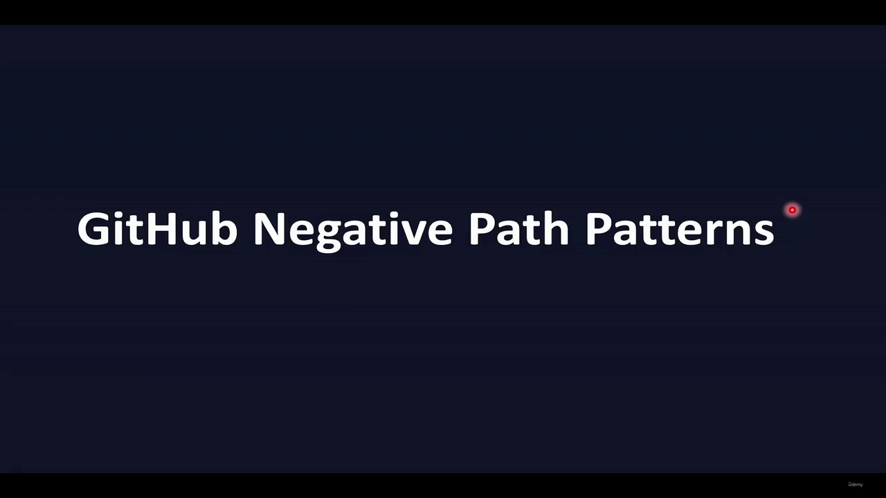
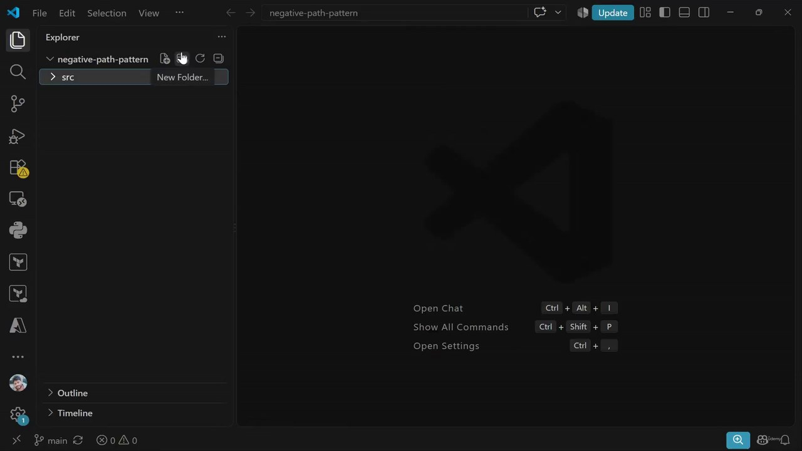
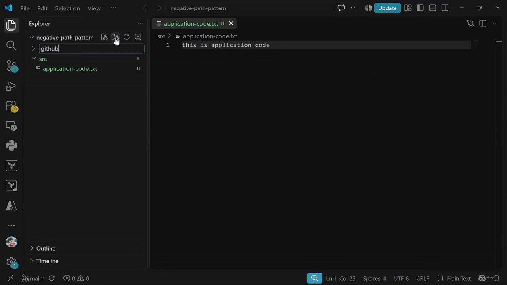
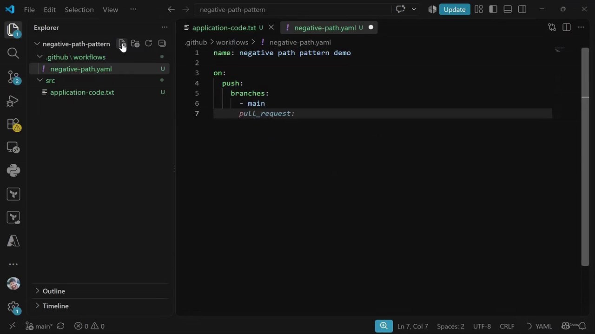
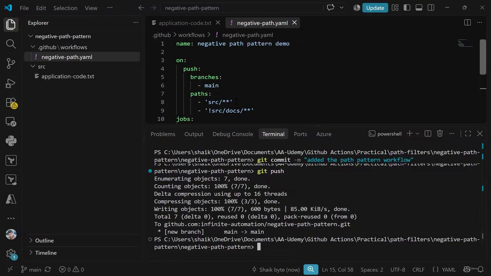
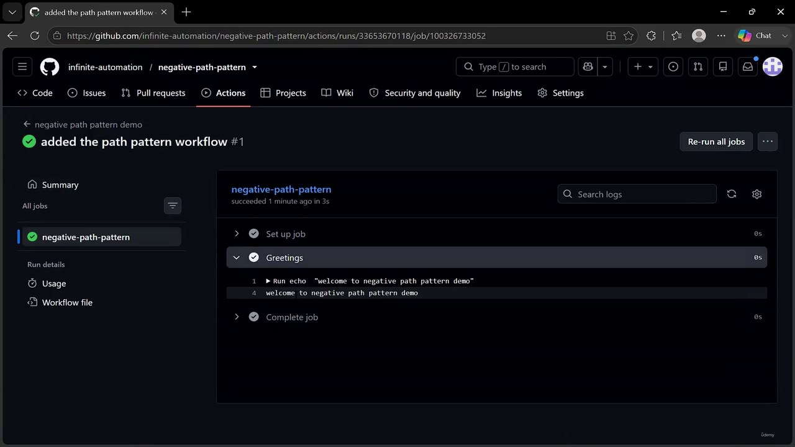
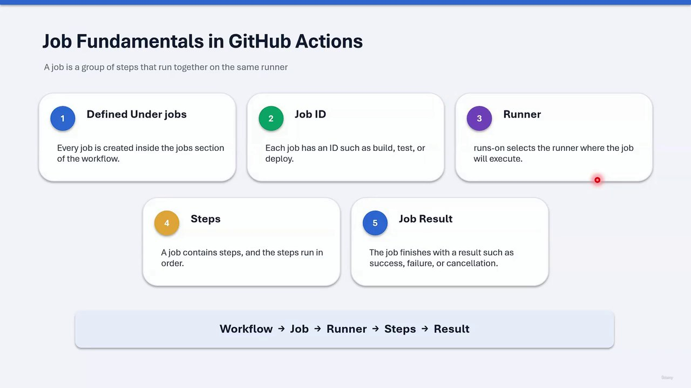
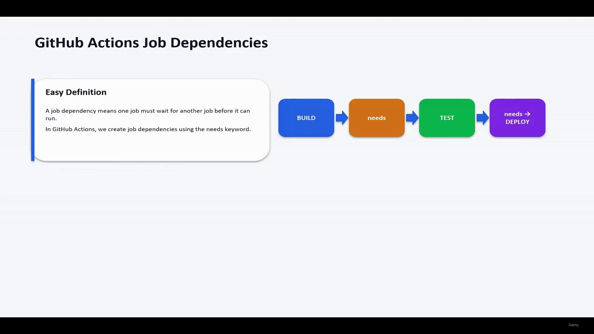

# GitHub Actions 负向路径过滤与 Job 依赖复现（P33–P36）

## 0. 先给结论：最终要跑出什么

这一节最终要得到一个可推送到 GitHub 的最小仓库：

```text
negative-path-demo/
├── .github/
│   └── workflows/
│       └── negative-path.yaml
└── src/
    ├── application-code.txt
    └── docs/
        └── application-docs.txt
```

核心行为只有两条：

1. 你修改 `src/` 下的普通文件并 push 到 `main`，GitHub Actions 会触发 workflow。
2. 你只修改 `src/docs/` 下的文件并 push 到 `main`，workflow **不会**触发。

课程 P33 讲负向路径模式的概念，P34 做完整实操；P35 讲 workflow 里的 job 是什么；P36 讲 job 之间的依赖 `needs`。P35、P36 在逐字稿里是概念讲解，没有给出新的完整 workflow 文件，所以本文的可复现主体是 P33–P34 的 `negative-path.yaml`，P35–P36 用于解释你已经跑起来的这个 job 结构。

### 环境与依赖

| 项目 | 要求 |
|---|---|
| 平台 | GitHub.com 仓库 + GitHub Actions |
| Runner | workflow 里使用 `ubuntu-latest`，由 GitHub 托管 |
| 本地工具 | Git、VS Code 或任意文本编辑器 |
| Node/npm/pip/Java 依赖 | 不需要，本 demo 没有安装依赖 |
| 环境变量 | 无 |
| Secrets | 无 |
| 分支 | 课程使用 `main`；如果你的仓库默认分支是 `master`，需要同步改 YAML |

---

## 1. 这一节做什么

这一节不是为了讲一大堆 YAML 语法，而是解决一个很实际的问题：**同一个仓库里，应用代码变了要跑 CI，但文档目录变了不要跑 CI。**

课程里的仓库同时放应用代码和文档代码。我们希望：

- 改 `src/application-code.txt`：触发 workflow。
- 改 `src/docs/application-docs.txt`：不触发 workflow。

GitHub Actions 的 `paths` 过滤器可以做路径包含，但要做“排除某个子目录”，需要 **negative path pattern**，也就是在路径前加感叹号 `!`。逐字稿里讲师把 exclamation mark 说成了 “explanation mark”，本文按正确术语写“感叹号”，但引用保留原词。



关键规则是：**负向路径只排除已经被包含的路径**。所以不能只写 `!src/docs/**`，必须先写 `src/**` 把 `src` 包含进来，再写 `!src/docs/**` 把 `src/docs` 排除掉。讲师在 P33 里反复强调了这个顺序。

P35 补充的是 job 的基本结构：一个 workflow 里有 job，job 里有 steps，job 需要 `runs-on` 指定 runner。P36 补充的是 job 依赖：用 `needs` 让一个 job 等另一个 job 完成。P36 没有给完整文件，所以本文不会把“课里没给的 YAML”伪装成讲师原稿；本文会明确说明哪些是课程内容、哪些是补充理解。

---

## 2. 讲师原话

下面引用逐字稿中的关键原话，并给出中文解释。

> “These negative path patterns can be defined by using an explanation mark before the path.”
>
> —— p033 [00:58]

中文意思：负向路径模式通过在路径前加感叹号来定义。逐字稿里的 “explanation mark” 是语音识别问题，实际是 exclamation mark，也就是 `!`。

> “a negative path pattern only exclude a path that was already included.”
>
> —— p033 [01:27]

中文意思：负向路径只排除已经被包含的路径。这就是为什么 `paths` 里要先写 `src/**`，再写 `!src/docs/**`。

> “if something happened at the SRC docs directory, the workflow cannot be start because we have added this SRC docs directory at the negative path pattern.”
>
> —— p034 [04:17]

中文意思：如果变化发生在 `src/docs` 目录，workflow 不会启动，因为 `src/docs` 已经被负向路径排除。

> “Every job is created under the job section in the workflow.”
>
> —— p035 [00:29]

中文意思：每个 job 都创建在 workflow 的 `jobs` 下面。job 需要一个 ID，需要 `runs-on` 指定 runner，里面放 steps。

> “In GitHub Actions, we create this dependency using the Needs keyword.”
>
> —— p036 [00:16]

中文意思：在 GitHub Actions 里，用 `needs` 关键字创建 job 依赖。没有 `needs` 时，job 之间是独立的；加上 `needs` 后，后面的 job 要等前面的 job 完成。

> “if the test job fails, the deployed job will normally skipped.”
>
> —— p036 [01:28]

中文意思：如果被依赖的 test job 失败，deploy job 默认会被跳过。课程用这个说明依赖可以避免在前置 job 失败时继续部署。

---

## 3. 从零复现

### 3.1 创建 GitHub 空仓库并克隆

课程里讲师说他已经创建了一个空的 GitHub 仓库，并克隆到本地。你可以照着做：

1. 在 GitHub 上新建一个空仓库，不要勾选自动生成 README、`.gitignore` 或 license。
2. 在本地执行：

```bash
git clone https://github.com/<your-user>/<your-repo>.git
cd <your-repo>
```

如果你不想先建远程仓库，也可以在本地初始化，稍后再绑定远程地址：

```bash
mkdir negative-path-demo
cd negative-path-demo
git init
git branch -M main
git remote add origin https://github.com/<your-user>/<your-repo>.git
```

下面假设你的默认分支是 `main`。如果你的仓库默认分支是 `master`，把后面 YAML 里的 `main` 改成 `master`。

### 3.2 创建 `src` 和应用代码文件

讲师先在根目录创建 `src`，然后在里面放一个随机的应用代码文件 `application-code.txt`。文件名和内容不是重点，重点是路径必须能匹配 workflow 里的 `src/**`。



在仓库根目录执行：

```bash
mkdir -p src
cat > src/application-code.txt <<'EOF'
application code
EOF
```

你也可以在 VS Code 里手动创建：

```text
src/application-code.txt
```

文件内容可以是任意文本。课程里说“in real time, we may have the code files or other automation files under this SIC directory”，也就是说真实项目里这里可能放源码或自动化脚本；本 demo 只放一个 txt 文件来观察路径过滤。

### 3.3 创建 `.github/workflows` 目录

workflow 文件必须放在仓库根目录的 `.github/workflows` 下。讲师在 P34 里明确创建了根级 `.github`，再在里面创建 `workflows`。



执行：

```bash
mkdir -p .github/workflows
```

注意：`.github` 在仓库根目录，不是 `src/.github`。路径写错，GitHub 不会识别 workflow。

### 3.4 创建 `negative-path.yaml`

讲师把 workflow 文件命名为 `negative path dot YAML`。本文使用 `negative-path.yaml`，放在 `.github/workflows/` 下。



创建文件：

```bash
cat > .github/workflows/negative-path.yaml <<'EOF'
name: negative path pattern demo

on:
  push:
    branches:
      - main
    paths:
      - 'src/**'
      - '!src/docs/**'

jobs:
  negative-path-pattern-job:
    runs-on: ubuntu-latest
    steps:
      - name: greetings
        run: echo "Welcome to negative path pattern demo"
EOF
```

这里先不要急着改 `branches`。如果你的默认分支不是 `main`，现在就改。

### 3.5 第一次提交并推送

讲师的操作顺序是：`git add`、`git commit -m "添加了路径模式工作流"`、`git push`。

执行：

```bash
git add .
git commit -m "added the path pattern workflow"
git push -u origin main
```

如果你前面已经用 `git clone` 克隆了空仓库，第一次推送可能需要 `-u origin main`；课程里只说了 `git push`，但第一次推送通常要建立 upstream。课里没讲 `-u` 的细节，这里按 Git 实际需要补上。

### 3.6 到 GitHub Actions 页面确认第一次触发

推送完成后，打开 GitHub 仓库页面，点击 Actions 标签。因为这次提交包含 `src/application-code.txt`，它匹配 `src/**`，所以 workflow 应该被触发。



你应该能看到：

- workflow 名称：`negative path pattern demo`
- job：`negative-path-pattern-job`
- step：`greetings`
- 日志里输出：`Welcome to negative path pattern demo`

如果你看不到运行记录，先检查：

1. 仓库的 Actions 是否启用。
2. 分支是不是 `main`。
3. workflow 文件是否在 `.github/workflows/` 下。
4. YAML 缩进是否正确，是否用了 Tab。
5. 这次提交是否真的包含 `src/application-code.txt`。

### 3.7 创建 `src/docs` 和文档文件

确认第一次触发成功后，再模拟“只改文档”的场景。讲师在 `src` 下创建 `docs` 子目录，然后在里面放 `application-docs.txt`。



执行：

```bash
mkdir -p src/docs
cat > src/docs/application-docs.txt <<'EOF'
application docs
EOF
```

此时目录结构是：

```text
src/
├── application-code.txt
└── docs/
    └── application-docs.txt
```

### 3.8 提交并推送 docs 文件

讲师说要用 `git add .` 和 `git commit -m "添加了 docs 目录"`，然后 `git push`。逐字稿里 `git commit ifnm` 是口误或字幕识别问题，实际就是 `git commit -m`。

执行：

```bash
git add .
git commit -m "added the docs directory"
git push
```

### 3.9 确认 docs-only 推送不触发 workflow

回到 GitHub 的 Actions 页面，刷新。按课程预期，这次不会出现新的 workflow 运行。

原因是：这次提交只改了 `src/docs/application-docs.txt`。

- `src/**` 先把它包含进来；
- `!src/docs/**` 又把它排除掉；
- 最终没有匹配到可触发 workflow 的路径。

所以 Actions 页面没有新运行，不是 workflow 坏了，而是负向路径过滤生效了。讲师在 P34 结尾总结：`src` 目录里的变化可以运行 workflow，但 `src` 的子目录 `docs` 里的变化不能启动 workflow。

---

## 4. 完整代码

下面文件可以直接保存运行。除了这两个数据文件的内容是示例文本之外，路径和文件名必须与 workflow 的 `paths` 匹配。

### 4.1 `.github/workflows/negative-path.yaml`

```yaml
name: negative path pattern demo

on:
  push:
    branches:
      - main
    paths:
      - 'src/**'
      - '!src/docs/**'

jobs:
  negative-path-pattern-job:
    runs-on: ubuntu-latest
    steps:
      - name: greetings
        run: echo "Welcome to negative path pattern demo"
```

### 4.2 `src/application-code.txt`

```text
application code
```

### 4.3 `src/docs/application-docs.txt`

```text
application docs
```

这两个 txt 文件的内容不是课程规定死的。讲师在 P34 里说“I just have added some random text over here”，所以你可以换成任意文本；关键是文件路径要分别落在 `src/` 和 `src/docs/` 下。

### 4.4 P36 的 job 依赖：课里只讲概念，没有给完整文件

P36 没有给出可复制的完整 YAML 文件，只讲了 `needs` 的概念。本文不把它伪装成讲师原稿。你需要记住的是：

```yaml
test:
  needs: build
  runs-on: ubuntu-latest

deploy:
  needs: test
  runs-on: ubuntu-latest
```

上面只是概念片段，不是本文要求保存的完整文件。课程里没有提供 P36 的完整 workflow 文件，所以本文的可复现主体仍然是 `negative-path.yaml`。如果你要自己练习 `needs`，必须另建一个完整 workflow，并确保 job ID 与 `needs` 的值一致。

---

## 5. 逐行解释

### 5.1 `negative-path.yaml` 逐行说明

```yaml
name: negative path pattern demo
```

workflow 的显示名称。它出现在 GitHub Actions 页面里。课程里讲师把 workflow 命名为 `negative path pattern demo`。

```yaml
on:
```

定义触发事件。GitHub Actions 的 workflow 由事件触发，这里使用 `push`。

```yaml
  push:
```

只在 push 时触发。课程 P34 的场景就是本地提交后 `git push` 到远程仓库。

```yaml
    branches:
      - main
```

只监听 `main` 分支。课程里讲师明确说 `branches` 是 `main`。如果你的仓库默认分支是 `master`，这里不改就不会触发。这是实际复现时最容易撞上的问题之一。

```yaml
    paths:
```

路径过滤器。它决定哪些文件变化可以触发 workflow。

```yaml
      - 'src/**'
```

正向包含路径。`src/**` 表示 `src` 目录下所有文件和子目录。注意这里用单引号包起来，避免 YAML 把特殊字符解释成语法。课里没有特别讲引号，但实际保存 YAML 时建议加上。

```yaml
      - '!src/docs/**'
```

负向排除路径。`!` 表示排除，`src/docs/**` 表示 `src/docs` 下的所有文件。它必须放在 `src/**` 后面。因为负向路径只排除“已经被包含”的路径；如果只写这一行，没有正向包含，最终没有可匹配路径，workflow 也不会按预期触发。

```yaml
jobs:
```

job 的容器。P35 讲的核心就是：workflow 里有 job，job 里有 steps。

```yaml
  negative-path-pattern-job:
```

job ID。课程里讲师把它叫作 negative path pattern job。ID 用于在 workflow 里标识 job。后面如果使用 `needs`，引用的也是这个 ID，不是显示名称。

```yaml
    runs-on: ubuntu-latest
```

指定 job 运行在 GitHub 托管的 Ubuntu runner 上。P35 里讲师说 job 需要机器来运行，`runs-on` 就是做这件事。课程没有讲 self-hosted runner 的配置，本 demo 也不需要用。

```yaml
    steps:
```

job 里的步骤列表。P35 说 steps 是真正要做的工作，例如 build、test。本 demo 只做一件事：打印欢迎语。

```yaml
      - name: greetings
```

步骤名称。它显示在 Actions 日志里。讲师在 P34 里把 step 命名为 `greetings`。

```yaml
        run: echo "Welcome to negative path pattern demo"
```

在该 step 里执行 shell 命令。runner 是 Ubuntu，所以这里是 Bash 环境下的 `echo`。日志应输出：

```text
Welcome to negative path pattern demo
```

### 5.2 为什么第一次 push 会触发

第一次提交包含：

```text
.github/workflows/negative-path.yaml
src/application-code.txt
```

其中 `src/application-code.txt` 匹配 `src/**`，而且不在 `src/docs/` 下，所以不会被 `!src/docs/**` 排除。因此 workflow 触发。

### 5.3 为什么只改 docs 不触发

第二次提交只包含：

```text
src/docs/application-docs.txt
```

它先匹配 `src/**`，然后被 `!src/docs/**` 排除。最终没有文件命中可触发路径，所以没有新的 workflow 运行。这不是失败，而是预期结果。

### 5.4 P35：job 在 workflow 里的位置



P35 的结构可以对应到我们这份文件：

```text
workflow: negative path pattern demo
└── job: negative-path-pattern-job
    ├── runs-on: ubuntu-latest
    └── steps:
        └── greetings: echo "Welcome to negative path pattern demo"
```

讲师的原话是：每个 job 都创建在 workflow 的 `jobs` 下面；job 需要 ID；job 需要 `runs-on` 指定机器；机器准备好后运行 steps；所有 steps 结束后得到 job 结果，可能是 success、failure 或 cancellation。本 demo 的 job 只有一个 step，所以结果很直观。

这里注意一个容易混淆的点：`negative-path-pattern-job` 是 job ID，不是 workflow 名称。workflow 名称是 `negative path pattern demo`。在 GitHub Actions 页面里两者都会出现，但作用不同。

### 5.5 P36：`needs` 的依赖关系



P36 讲了两种状态：

1. 没有 `needs`：`build`、`test`、`deploy` 是独立 job，GitHub 不会等 `build` 完成再启动 `test`。
2. 有 `needs`：`test` 写 `needs: build`，`deploy` 写 `needs: test`，于是形成 `build -> test -> deploy` 的顺序。

讲师还讲了多依赖：`deploy` 可以同时依赖 `unitest` 和 `security scan`，只有两个 job 都成功完成后，`deploy` 才继续。并且如果 `test` 失败，`deploy` 默认会被跳过，避免在前置检查失败时继续部署。

用前端/Node 的直觉理解：没有 `needs` 有点像多个 npm script 被并行触发；有 `needs` 有点像 `npm run build && npm run test && npm run deploy` 的串行顺序。但要注意，`needs` 是 GitHub Actions 的 job 调度依赖，不是 shell 里的 `&&`。课里没有讲 `if: always()`、失败重试、并发组这些进阶写法，所以本文不展开。

本 demo 的 `negative-path.yaml` 只有一个 job，因此不需要 `needs`。P36 是理解用，不是要求你在这个文件里加 `needs`。

---

## 6. 复现检查清单

按下面顺序检查，可以直接定位问题。

- [ ] 已创建 GitHub 仓库，本地已克隆或已 `git init` 并绑定远程。
- [ ] 当前分支是 `main`，或者 YAML 里的 `branches` 已改成你的默认分支。
- [ ] 存在 `src/application-code.txt`。
- [ ] 存在 `.github/workflows/negative-path.yaml`。
- [ ] YAML 文件在仓库根目录的 `.github/workflows/` 下，不是 `src/.github/workflows/`。
- [ ] `paths` 第一项是 `'src/**'`。
- [ ] `paths` 第二项是 `'!src/docs/**'`，并且顺序在 `src/**` 后面。
- [ ] `!src/docs/**` 建议加了单引号，避免本地 YAML 校验器报错。
- [ ] `runs-on: ubuntu-latest` 拼写正确。
- [ ] `steps` 下的 `run` 缩进正确，没有用 Tab。
- [ ] 第一次 push 后，Actions 页面出现 `negative path pattern demo` 的运行记录。
- [ ] 点进 job，能看到 `greetings` step。
- [ ] 日志里输出 `Welcome to negative path pattern demo`。
- [ ] 创建 `src/docs/application-docs.txt` 后，只提交并推送这个 docs 文件。
- [ ] 刷新 Actions 页面，没有出现新的运行记录。
- [ ] 如果 docs 推送仍触发，检查这次提交是否还改了 `src/` 下其他文件。只要一次提交里有一个文件命中 `src/**` 且不在 `src/docs/` 下，workflow 仍可能触发。
- [ ] 如果第一次 push 没触发，先检查 Actions 是否启用、分支名是否正确、workflow 文件路径是否正确。

---

## 7. 课里没讲但你会撞上的

1. **默认分支可能不是 `main`。**  
   课程用的是 `main`，但 GitHub 新仓库有时是 `main`，老仓库可能是 `master`。YAML 里写 `main`，你 push 到 `master`，就不会触发。要么改分支，要么改 YAML。

2. **第一次 `git push` 可能需要 `-u`。**  
   课程只说了 `git push`，但新分支第一次推送通常要 `git push -u origin main`。这不是 GitHub Actions 的问题，是 Git upstream 的问题。

3. **`!` 在 YAML 里建议加引号。**  
   课程口述和截图里重点是 `!src/docs/**` 这个模式，但实际保存 YAML 时建议写成 `'!src/docs/**'`。不加引号时，某些 YAML 解析器可能把 `!` 当成标签语法。课里没有专门讲这个引号细节。

4. **只改 workflow 文件本身，不会命中 `src/**`。**  
   如果你只修改 `.github/workflows/negative-path.yaml` 并 push，这次提交没有 `src/` 下的文件变化，按当前 `paths` 过滤，workflow 不会因为这次修改而触发。这是路径过滤的正常行为，不是 workflow 失效。

5. **一次提交同时改 `src/` 和 `src/docs/` 时，仍可能触发。**  
   课程只演示了 docs-only 提交。实际工作中，如果一次提交既改了 `src/application-code.txt`，又改了 `src/docs/application-docs.txt`，那么 `src/application-code.txt` 仍命中 `src/**`，workflow 会触发。负向路径排除的是被排除路径本身，不是“只要出现 docs 文件就全部不跑”。

6. **路径大小写敏感。**  
   Ubuntu runner 和 Git 仓库里路径是大小写敏感的。课程里口述有 `SRC`，实际文件建议统一用 `src`。`src/**` 不会匹配 `SRC/**`。

7. **Actions 页面可能有几秒延迟。**  
   push 完立刻刷新可能还没出现运行记录。等几秒再刷新，或者点 Actions 标签重新加载。

8. **job 没有 `needs` 时是独立调度的。**  
   P36 讲得很清楚：没有 `needs`，`build`、`test`、`deploy` 不会自动按顺序等待。很多人以为写在 YAML 里上面的 job 一定先跑，这是不对的。需要顺序就写 `needs`，并且 `needs` 的值必须是 job ID。

9. **`needs` 的失败行为默认是跳过下游 job。**  
   课程说 test 失败时 deploy 通常会被跳过。实际中如果你用 `if: always()` 之类的条件，行为会改变，但课里没讲这些写法，本文不展开。

10. **这个 demo 没有安装依赖，也没有 `actions/checkout`。**  
    本 workflow 只执行 `echo`，不需要拉代码。真实项目如果要 build/test，通常要先拉代码、装依赖，但那已经超出 P33–P36 的逐字稿范围，课里没有给这部分完整文件。