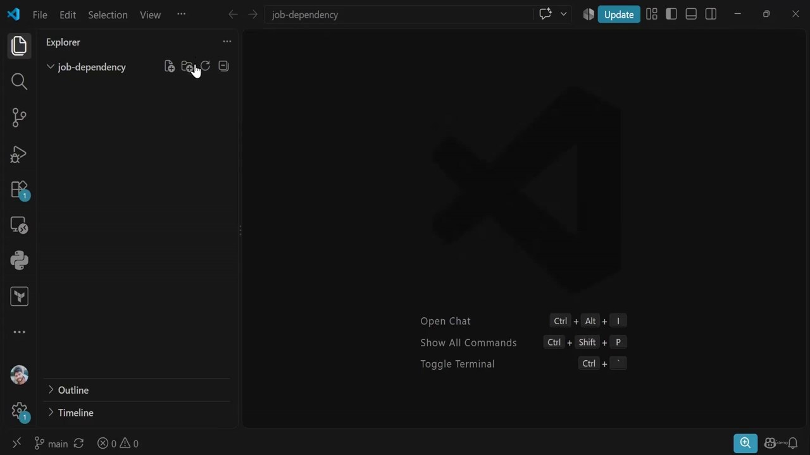
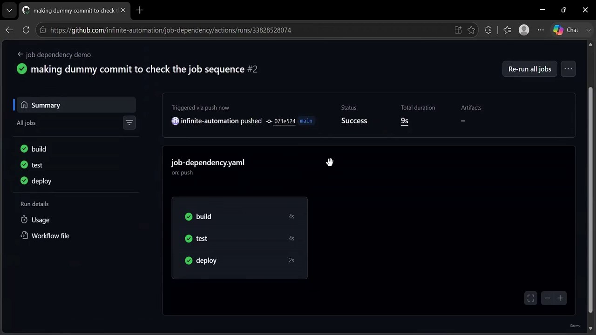
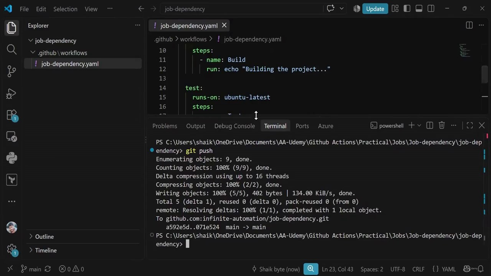
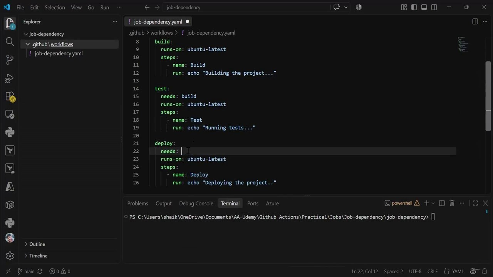
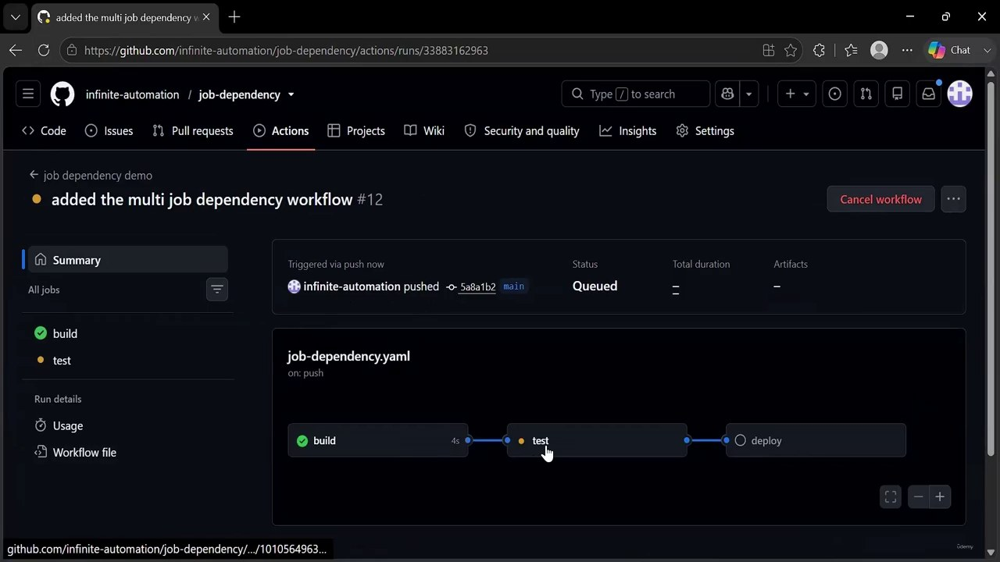
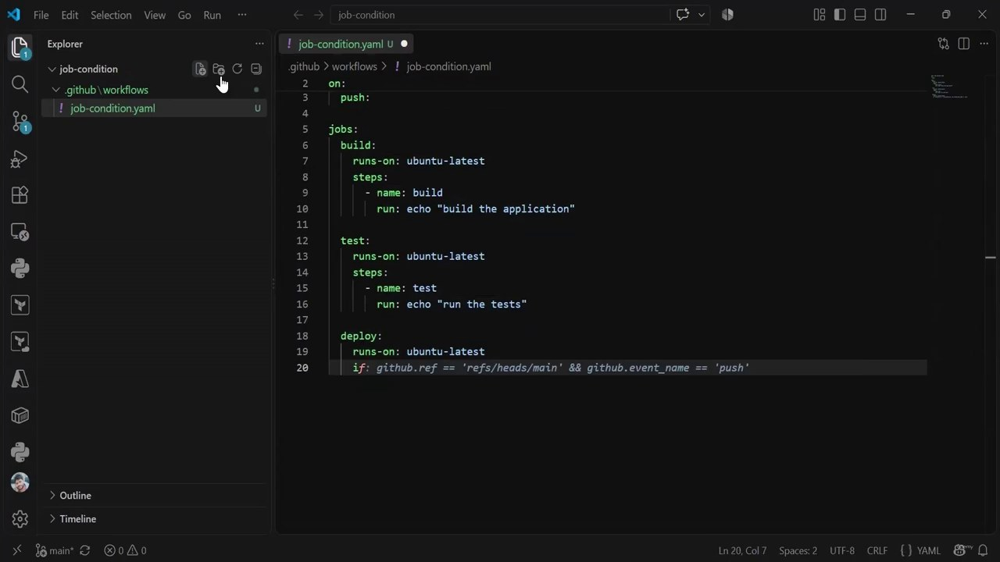
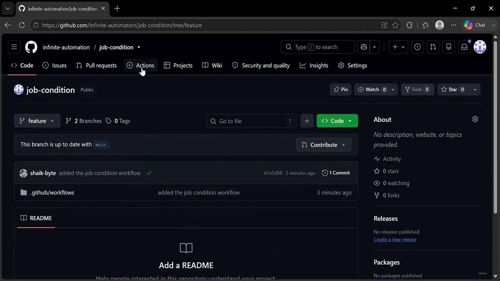

# GitHub Actions 作业依赖与作业条件：P37–P40 复现文档

## 1. 这一节做什么

本节把 GitHub Actions 里最常用、也最容易写错的三件事落到一个能实际跑起来的仓库里：

1. **单作业依赖**：`build → test → deploy` 按顺序执行，用 `needs` 控制。
2. **多作业依赖**：`deploy` 同时等待 `build` 和 `test`，`needs` 写成列表。
3. **作业条件**：用 `if` 判断当前分支是不是 `main`，不是就让 GitHub 跳过这个 job。

课里的实现路线是：

- P37 在空仓库里创建 `.github/workflows/jobdependency.yaml`，先写 `build`、`test`、`deploy` 三个 job，不加 `needs`，push 后观察它们默认并行；然后再加 `needs`，观察串行链。
- P38 继续改同一个文件，把 `deploy` 的 `needs` 改成同时依赖 `build` 和 `test`。
- P39 是概念页，讲 `if` 条件、`github.ref == 'refs/heads/main'`、多个条件用 `&&` 连接，以及 GitHub 先检查依赖和条件再决定是否运行。
- P40 新建另一个空仓库，写 `.github/workflows/jobcondition.yaml`，先只给 `deploy` 加主分支条件；再建 `feature` 分支验证 `deploy` 被跳过；最后也给 `test` 加条件，验证 `feature` 分支上只剩 `build` 会跑。

这一节**不需要 Node、npm、Java、数据库或任何后端服务**。你需要的只有：

- 一个 GitHub 账号；
- 两个空 GitHub 仓库：`job-dependency` 和 `job-condition`；
- 本地安装 Git；
- 本地安装 VS Code，或任意能编辑文本的编辑器；
- 能 `git push` 到 GitHub 的网络环境。

课里用的 runner 是 `ubuntu-latest`，job 里只执行 `echo`，所以没有额外依赖版本需要锁定。GitHub 托管的 `ubuntu-latest` 镜像会随 GitHub 更新，但本节的 `echo` 命令不受影响。环境变量也不需要配置，课里没有出现任何 `env` 配置。

> 前端读者可以这样类比：不加 `needs` 的 job 像 `Promise.all([build(), test(), deploy()])`，默认一起跑；加 `needs: build` 像先 `await build()` 再跑下一个；多依赖像 `await Promise.all([build(), test()])` 之后才跑 `deploy`。`if` 条件则像 JS 里的 `if (branch === 'main') { deploy() }`。本节没有锁、事务、并发写入数据库这类后端问题。

---

## 2. 讲师原话

下面只摘关键原话，保留英文原文，并标注逐字稿位置。

> "在 GitHub Actions 中，这一概念通过 Needs 关键字实现。"
> —— p037 [00:28]

> "所以在这里，构建先运行。构建完成后，测试作业开始；测试作业完成后，部署作业开始。"
> —— p037 [10:56]

> "例如，假设我们有一个构建作业、一个测试作业和一个部署作业。部署作业可能同时依赖构建作业和测试作业。"
> —— p038 [00:00]

> "通过多作业依赖，作业可以等待多个作业。"
> —— p038 [04:21]

> "要创建条件，我们主要使用 if 关键字。"
> —— p039 [00:00]

> "如果条件为真，作业就会运行；如果条件为假，GitHub 会跳过该作业。"
> —— p039 [00:00]

> "我们在名为 deploy 的特定作业的作业级别添加了条件。"
> —— p040 [09:11] 附近

> "这个功能分支上只有构建作业运行了，测试作业和部署作业都被跳过了。"
> —— p040 [12:35]

下面开始按“能照着做”的顺序重组实现步骤，不按页码流水账。



---

## 3. 从零复现

### 3.1 准备第一个仓库 `job-dependency`

在 GitHub 上新建一个空仓库，名字用：

```text
job-dependency
```

不要勾选自动创建 README、`.gitignore` 或 license，保持空仓库。然后本地克隆：

```bash
git clone <你的 job-dependency 仓库地址> job-dependency
cd job-dependency
```

确认当前分支是 `main`：

```bash
git branch
```

如果显示的是 `master`，而你的 GitHub 仓库默认分支是 `main`，需要先改成 `main`。这一步逐字稿没有展开，但实际会撞上，见第 7 节。

```bash
git branch -M main
```

创建目录：

```bash
mkdir -p .github/workflows
```

目录结构应当是：

```text
job-dependency/
└── .github/
    └── workflows/
        └── jobdependency.yaml
```

> 注意：逐字稿口播里出现过类似 `jobdependency.aml` 的读音/转写，实际 GitHub Actions 只识别 `.yml` 或 `.yaml`。本文统一用 `.yaml`，不要真的创建 `.aml`。

### 3.2 先写“没有 needs”的版本

在 `.github/workflows/jobdependency.yaml` 中保存第 4 节里的“阶段 1：没有 needs”完整代码。这个版本有三个独立 job：`build`、`test`、`deploy`，每个 job 都只有一条 `echo`。

提交并推送：

```bash
git add .
git commit -m "add initial job dependency workflow without needs"
git push
```

> 逐字稿 P37 在第一次 push 时主要提到 `git add` 和 `git push`，没有逐字念出 commit message。Git 必须先 commit 才能 push，所以这里补上标准 commit 步骤，提交信息可以换成你自己的。

推送后打开 GitHub 仓库页面：

1. 点 `Actions` 标签；
2. 点左侧或列表里的 `job dependency demo`；
3. 点进最新一次 workflow run；
4. 观察 `build`、`test`、`deploy` 三个 job。

此时三个 job **没有依赖关系**，默认会各自启动。逐字稿的描述是它们会并行/独立运行，而不是等前一个完成。因为每个 job 只执行一条 `echo`，所以完成得很快。



### 3.3 加单作业依赖：`test` 等 `build`，`deploy` 等 `test`

把同一个文件改成第 4 节里的“阶段 2：单作业依赖”。关键改动只有两处：

```yaml
test:
  needs: build
```

```yaml
deploy:
  needs: test
```

提交并推送：

```bash
git add .
git commit -m "added the needs keyword for dependency"
git push
```

再次进入 `Actions`，点最新 run。正确顺序应当是：

```text
build 先运行
build 成功后，test 才开始
test 成功后，deploy 才开始
```

逐字稿 P37 的原话是：`build` 先触发，完成后 `test` 触发，再完成后 `deploy` 执行。这就是 `needs` 的作用：让一个 job 等另一个 job。



### 3.4 改成多作业依赖：`deploy` 同时等 `build` 和 `test`

把 `deploy` 的 `needs` 从单个 `test` 改成列表。可以写成块列表：

```yaml
deploy:
  needs:
    - build
    - test
```

也可以写成行内列表：

```yaml
deploy:
  needs: [build, test]
```

两种写法语义一样。逐字稿 P38 明确说“we need to add the jobs in a list”，所以这里用列表最直观。完整文件见第 4 节“阶段 3：多作业依赖”。

提交并推送：

```bash
git add .
git commit -m "add multi job dependency for deploy"
git push
```

进入 `Actions` 点最新 run。此时 `build` 和 `test` 可以按它们自己的依赖关系运行，`deploy` 必须等 `build` 和 `test` **都完成**后才运行。逐字稿 P38 的表述是：`deploy` 只有在 `build` 和 `test` 两个 job 都完成后才触发。





### 3.5 准备第二个仓库 `job-condition`

P40 是新仓库，不沿用前面的 `job-dependency`。在 GitHub 上再建一个空仓库：

```text
job-condition
```

克隆到本地：

```bash
git clone <你的 job-condition 仓库地址> job-condition
cd job-condition
mkdir -p .github/workflows
```

目标文件是：

```text
job-condition/
└── .github/
    └── workflows/
        └── jobcondition.yaml
```

### 3.6 先只给 `deploy` 加主分支条件

保存第 4 节里的“阶段 4：只给 deploy 加 if”完整代码。核心条件是：

```yaml
deploy:
  if: github.ref == 'refs/heads/main'
  runs-on: ubuntu-latest
```

提交并推送：

```bash
git add .
git commit -m "added the job condition workflow"
git push
```

进入 `Actions`，看到 `jobConditionDemo` 这次 run。因为当前是 `main` 分支，`build`、`test`、`deploy` 三个 job 都会运行。逐字稿 P40 在 06:17 附近确认了三个 job 都跑过。



### 3.7 建 `feature` 分支，验证 `deploy` 被跳过

在本地从 `main` 创建并切换到 `feature`：

```bash
git checkout -b feature
```

确认当前分支：

```bash
git branch
```

逐字稿里口播类似 `git checkout-befeature`，实际命令就是 `git checkout -b feature`。此时 HEAD 应指向 `feature`。

提交一次并首次推送该分支：

```bash
git add .
git commit -m "created the feature branch"
git push -u origin feature
```

> 第一次推送新分支需要 `-u origin feature`，逐字稿 P40 在 08:42 附近也用了这个命令。后面再 push 可以直接 `git push`。

回到 GitHub：

1. 打开 `Actions`；
2. 点最新一次来自 `feature` 分支的 workflow run；
3. 观察 job 状态。

预期结果：

- `build` 运行；
- `test` 运行；
- `deploy` 被跳过，因为 `deploy` 的 `if` 只允许 `main`。

逐字稿 P40 在 09:40 左右解释：`deploy` job 上加了 job-level 条件，只有 `main` 分支才执行；推到 `feature` 分支时，`build` 和 `test` 执行，`deploy` 不执行。



### 3.8 再给 `test` 加主分支条件

把 `test` 也加上同样的条件：

```yaml
test:
  if: github.ref == 'refs/heads/main'
  runs-on: ubuntu-latest
```

完整文件见第 4 节“阶段 5：test 和 deploy 都加 if”。

提交并推送当前 `feature` 分支：

```bash
git add .
git commit -m "added the test job condition for main branch"
git push
```

再看 `Actions` 中 `feature` 分支的最新 run。预期结果变成：

- `build` 运行；
- `test` 被跳过；
- `deploy` 被跳过。

逐字稿 P40 最后一段确认：`feature` 分支上只有 `build` job 运行，`test` 和 `deploy` 被跳过。原因是 `test` 和 `deploy` 都只允许在 `main` 上运行。

---

## 4. 完整代码

以下文件都是完整文件，不是省略片段。路径必须放在 `.github/workflows/` 下。

### 4.1 阶段 1：没有 `needs` 的 `jobdependency.yaml`

路径：

```text
.github/workflows/jobdependency.yaml
```

```yaml
name: job dependency demo

on:
  push:
    branches:
      - main

jobs:
  build:
    runs-on: ubuntu-latest
    steps:
      - name: build
        run: echo "building the product"

  test:
    runs-on: ubuntu-latest
    steps:
      - name: test
        run: echo "running test"

  deploy:
    runs-on: ubuntu-latest
    steps:
      - name: deploy
        run: echo "deploying the project"
```

这个版本用于观察“默认不依赖、独立运行”。

### 4.2 阶段 2：单作业依赖的 `jobdependency.yaml`

路径不变：

```text
.github/workflows/jobdependency.yaml
```

```yaml
name: job dependency demo

on:
  push:
    branches:
      - main

jobs:
  build:
    runs-on: ubuntu-latest
    steps:
      - name: build
        run: echo "building the product"

  test:
    needs: build
    runs-on: ubuntu-latest
    steps:
      - name: test
        run: echo "running test"

  deploy:
    needs: test
    runs-on: ubuntu-latest
    steps:
      - name: deploy
        run: echo "deploying the project"
```

执行链：`build → test → deploy`。

### 4.3 阶段 3：多作业依赖的 `jobdependency.yaml`

路径不变：

```text
.github/workflows/jobdependency.yaml
```

```yaml
name: job dependency demo

on:
  push:
    branches:
      - main

jobs:
  build:
    runs-on: ubuntu-latest
    steps:
      - name: build
        run: echo "building the product"

  test:
    needs: build
    runs-on: ubuntu-latest
    steps:
      - name: test
        run: echo "running test"

  deploy:
    needs:
      - build
      - test
    runs-on: ubuntu-latest
    steps:
      - name: deploy
        run: echo "deploying the project"
```

`deploy` 等待 `build` 和 `test` 都完成。

### 4.4 阶段 4：只给 `deploy` 加 `if` 的 `jobcondition.yaml`

路径：

```text
.github/workflows/jobcondition.yaml
```

```yaml
name: jobConditionDemo

on:
  push:

jobs:
  build:
    runs-on: ubuntu-latest
    steps:
      - name: build
        run: echo "building the application"

  test:
    runs-on: ubuntu-latest
    steps:
      - name: test
        run: echo "run the test"

  deploy:
    if: github.ref == 'refs/heads/main'
    runs-on: ubuntu-latest
    steps:
      - name: deploy
        run: echo "deploying the application"
```

`on: push` 没有限制分支，所以 `main` 和 `feature` 的 push 都会触发 workflow；但 `deploy` 会被 `if` 过滤。

### 4.5 阶段 5：`test` 和 `deploy` 都加 `if`

路径不变：

```text
.github/workflows/jobcondition.yaml
```

```yaml
name: jobConditionDemo

on:
  push:

jobs:
  build:
    runs-on: ubuntu-latest
    steps:
      - name: build
        run: echo "building the application"

  test:
    if: github.ref == 'refs/heads/main'
    runs-on: ubuntu-latest
    steps:
      - name: test
        run: echo "run the test"

  deploy:
    if: github.ref == 'refs/heads/main'
    runs-on: ubuntu-latest
    steps:
      - name: deploy
        run: echo "deploying the application"
```

在 `feature` 分支上，只有 `build` 会执行，`test` 和 `deploy` 被跳过。

---

## 5. 逐行解释

### 5.1 workflow 名称与触发条件

```yaml
name: job dependency demo
```

这是 workflow 的显示名称。它只影响 GitHub Actions 页面里怎么显示，不参与 job 依赖判断。

```yaml
on:
  push:
    branches:
      - main
```

表示只有 push 到 `main` 分支才触发。P37 和 P38 都用了这个限制，所以如果你推到 `feature`，这个 workflow 不会启动。P40 的 `jobcondition.yaml` 不一样，它写的是：

```yaml
on:
  push:
```

没有 `branches` 限制，因此任何分支 push 都会触发 workflow，然后再由 job 内的 `if` 决定哪些 job 运行。

### 5.2 `jobs:` 下面才是 job

```yaml
jobs:
  build:
    runs-on: ubuntu-latest
```

`jobs` 是工作流里的作业集合。`build` 是 job ID，也是后面 `needs` 要引用的名字。`runs-on: ubuntu-latest` 指定使用 GitHub 托管的 Ubuntu runner。逐字稿 P37/P38 一直用的是 `ubuntu-latest`，没有换过 runner。

注意：`needs` 引用的是 **job ID**，不是 `name:`，也不是 step 名称。比如 `needs: build` 指的是 `jobs.build`。

### 5.3 一个最简单的 step

```yaml
steps:
  - name: build
    run: echo "building the product"
```

`steps` 是 job 内的步骤列表。`name` 是步骤显示名，`run` 是 shell 命令。这里只执行 `echo`，所以不需要安装依赖、不需要 checkout 代码、不需要缓存。课里没有引入 `actions/checkout` 或任何第三方 action。

### 5.4 `needs`：单依赖

```yaml
test:
  needs: build
```

意思是：`test` job 必须等 `build` job 成功完成后再开始。P37 通过这个写法把默认并行的 job 改成 `build → test`。

```yaml
deploy:
  needs: test
```

再让 `deploy` 等 `test`。最终形成：

```text
build → test → deploy
```

在 JS/Node 里近似为：

```js
await build();
await test();
await deploy();
```

但实际 GitHub Actions 是在不同 runner/job 里调度，不是同一个 Node 进程里的 Promise。

### 5.5 多依赖

```yaml
deploy:
  needs:
    - build
    - test
```

这是列表形式。含义是 `deploy` 要等 `build` 和 `test` 都完成。P38 的重点就是这里：`deploy` 可以依赖多个 job，并且所有列出的依赖都要完成。

在 JS/Node 里近似为：

```js
await Promise.all([build(), test()]);
await deploy();
```

若 `build` 和 `test` 本身没有依赖关系，它们可以并行；`deploy` 等两者都结束。

### 5.6 `if`：job 条件

```yaml
deploy:
  if: github.ref == 'refs/heads/main'
```

`if` 写在 job 层级，表示 GitHub 在运行这个 job 前会先判断表达式。逐字稿 P39 的说法是：条件为 true 就运行，为 false 就跳过。

`github.ref` 是 GitHub 提供的上下文变量，push 到 `main` 时它的值对应 `refs/heads/main`。课程里用的是：

```yaml
github.ref == 'refs/heads/main'
```

注意 `refs/heads/main` 是完整引用名。不要只写 `main`，也不要写成 `heads/main` 之外的形式。

PPT 里还给了多个条件用 `&&` 的例子，表示两个条件都为 true 才运行。逐字稿 P39 的解释是：`&&` 表示两个条件都必须为 true；任意一个为 false，job 就被跳过。P39 只是概念说明，没有把它落地成新文件；P40 实际落地的是主分支条件。

如果要在 YAML 里写多个条件，形式类似：

```yaml
if: github.ref == 'refs/heads/main' && github.event_name == 'push'
```

逐字稿 P39 的 PPT 用了双 `&` 连接条件。这个 `&&` 和 JS 里的逻辑与含义一致。

### 5.7 为什么 `feature` 分支上 `deploy` 被跳过

P40 的 `jobcondition.yaml` 使用：

```yaml
on:
  push:
```

所以 feature 分支 push 会触发 workflow。`build` 没有 `if`，所以运行；`deploy` 有：

```yaml
if: github.ref == 'refs/heads/main'
```

在 `feature` 分支上 `github.ref` 不是 `refs/heads/main`，表达式为 false，于是 `deploy` 被跳过。逐字稿 P40 在 09:40 左右明确说了：条件加在 job 层级，只对 `deploy` 生效；因为推送的是 feature 分支，所以 build 和 test 执行，deploy 不执行。

之后把同样的 `if` 加到 `test`，feature 分支上就只剩 `build` 运行，`test` 和 `deploy` 都被跳过。

---

## 6. 复现检查清单

按下面顺序逐项检查，基本可以避免“文件写了但 Actions 不跑”的问题。

- [ ] 两个仓库都建好了：`job-dependency`、`job-condition`。
- [ ] 仓库默认分支是 `main`；如果默认是 `master`，已改成 `main` 或调整了 workflow 的 `branches`。
- [ ] 目录严格是 `.github/workflows/`，不是 `github/workflows/`，也不是 `.github/workflow/`。
- [ ] 文件名以 `.yaml` 或 `.yml` 结尾；不要使用逐字稿口播里可能出现的 `.aml`。
- [ ] YAML 使用空格缩进，没有 Tab。两空格缩进最稳。
- [ ] `jobs:` 下面的 job ID 是 `build`、`test`、`deploy`。
- [ ] `needs: build` 引用的名字和 job ID 完全一致，大小写一致。
- [ ] P37/P38 的 workflow 有 `on.push.branches: [main]`，所以只推 `main` 才会触发。
- [ ] P40 的 workflow 使用 `on: push`，没有 branches 限制，feature 分支也会触发。
- [ ] P40 中 `if: github.ref == 'refs/heads/main'` 写在 job 层级，不是 step 层级。
- [ ] `feature` 分支首次推送用了 `git push -u origin feature`。
- [ ] 在 GitHub 的 `Actions` 页面看 job 状态：成功、失败、跳过（skipped）要以实际页面显示为准。
- [ ] 没有往本节代码里加课里没讲的 action、缓存、artifact 或 matrix。
- [ ] 如果 workflow 没出现，先检查是不是推错分支，或 `.github/workflows` 路径拼错。

---

## 7. 课里没讲但你会撞上的

1. **默认分支可能不是 `main`**  
   逐字稿一直假设仓库默认分支是 `main`。GitHub 新建仓库有时默认是 `main`，也可能你的账号/组织默认是 `master`。如果 workflow 写的是 `branches: main`，而实际分支叫 `master`，push 后不会触发。解决方式：把本地分支改成 `main`，或在 GitHub 仓库设置里把默认分支改成 `main`，或把 YAML 的 `branches` 改成你实际的分支名。

2. **`.aml` 不是 GitHub Actions 的标准后缀**  
   逐字稿是口播转写，出现过类似 `jobdependency.aml` 的写法。实际请用 `.yaml` 或 `.yml`。如果文件后缀不对，GitHub 不会把它识别成 workflow。

3. **YAML 缩进错误非常常见**  
   `jobs:`、job ID、`runs-on:`、`steps:` 的层级错一格，GitHub 可能直接报 workflow 语法错误，或者 job 不按预期出现。建议用 VS Code 的 YAML 插件看缩进线，但课里没有指定插件，安装与否不影响复现。

4. **`needs` 必须引用 job ID**  
   比如 `needs: build` 指的是 `jobs.build`。不要写成 `needs: Build Job` 或 step 的 `name`。课里 job ID 和 step name 恰好都叫 `build`、`test`、`deploy`，容易看混；写 `needs` 时只认 job ID。

5. **`on.push.branches` 会限制触发分支**  
   P37/P38 的 workflow 只监听 `main`。你在 `feature` 分支上 push，这两个 workflow 不会启动，不是 GitHub 坏了。P40 因为没有 branches 限制，所以 feature 分支能触发，再通过 `if` 跳过 job。

6. **job 被跳过不等于 workflow 失败**  
   P40 里 `deploy` 被 `if` 跳过，GitHub 页面会显示 skipped，而不是失败。逐字稿用的是“skip / skipped”这个说法。不要看到 skipped 就以为 YAML 写错了。

7. **`if` 条件和 `needs` 混用时，跳过的依赖可能影响下游**  
   这一节 P40 没有给 `jobcondition.yaml` 加 `needs`，所以不涉及“上游被跳过、下游怎么办”的问题。课里没讲 `always()`、`success()`、`failure()` 这些状态函数；本节不要自行混用。你如果以后把 `needs` 和 `if` 放在同一个 workflow 里，需要额外查 GitHub Actions 的 job 状态规则。

8. **本地没有 GitHub Actions runner**  
   课里全程用 `git push` 触发 GitHub 托管 runner，没有讲本地运行工具。复现时以 push 后在 GitHub `Actions` 页面看到的结果为准。不要在本地直接执行 YAML 就期待它变成一次 workflow run。

9. **`ubuntu-latest` 是托管标签，不是固定版本号**  
   课里没有讲 runner 镜像版本锁定。本节只跑 `echo`，所以镜像更新不影响结果。若以后要在 workflow 里装系统包、跑浏览器或编译，`ubuntu-latest` 的具体版本变化可能带来差异，那已经超出本节范围。

10. **提交信息可以自定义**  
    逐字稿里出现过 `added the needs keyword for dependency`、`added the test job condition for main branch` 等 commit message。它们只是提交说明，不影响 Actions 行为；你写成中文也可以，只要 commit 成功并 push 成功。