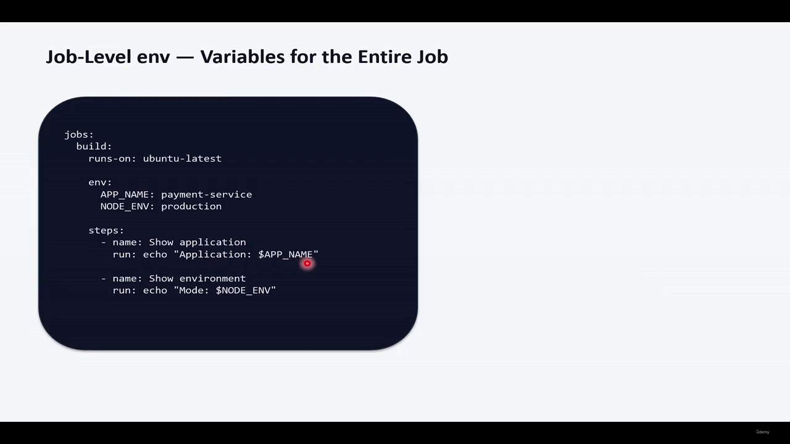
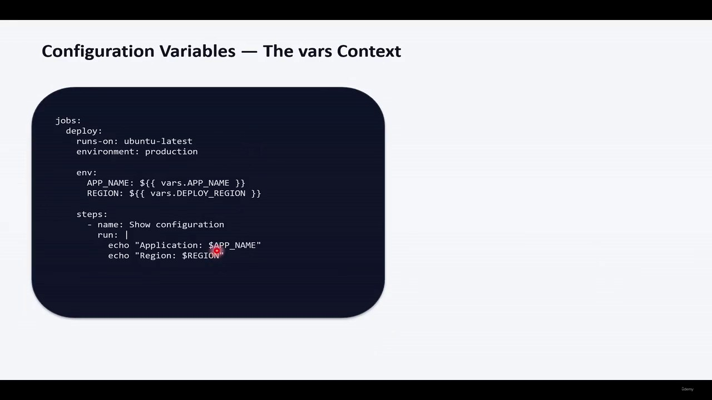
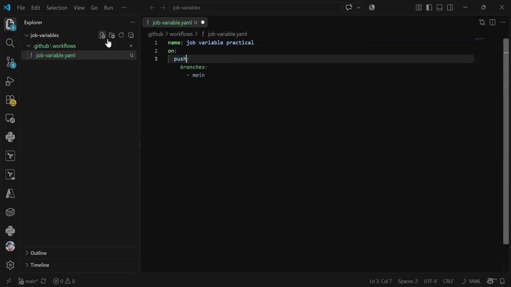
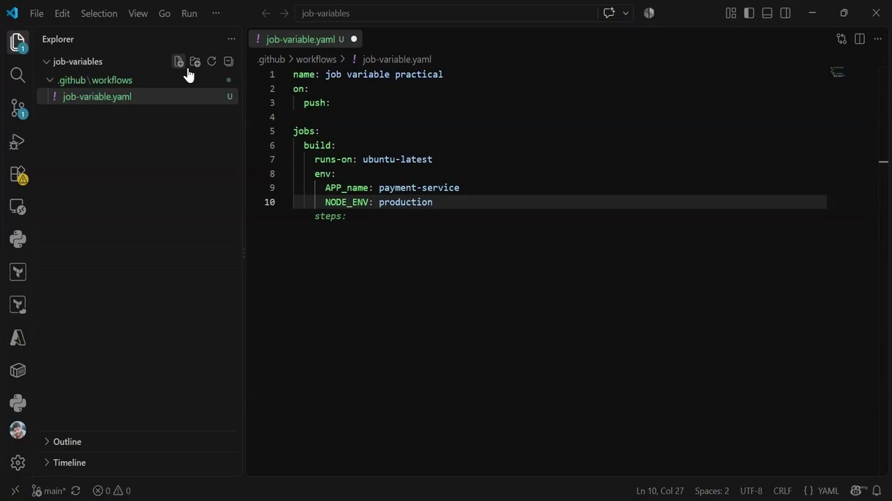
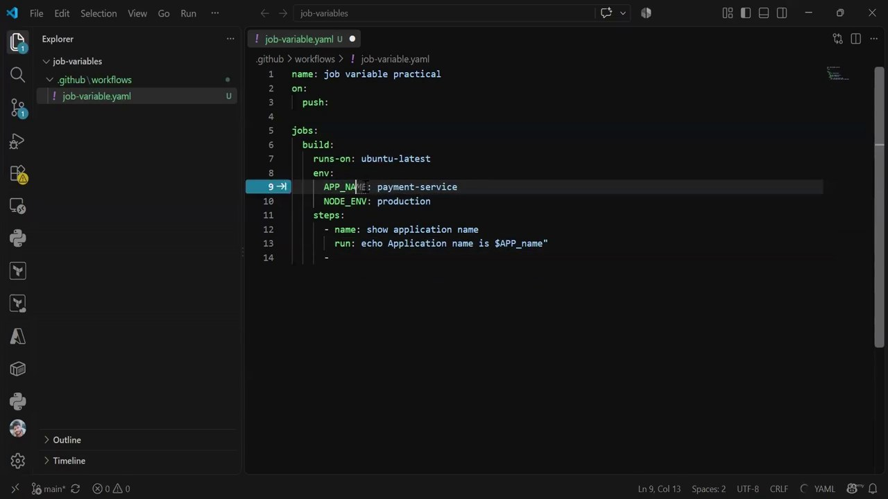
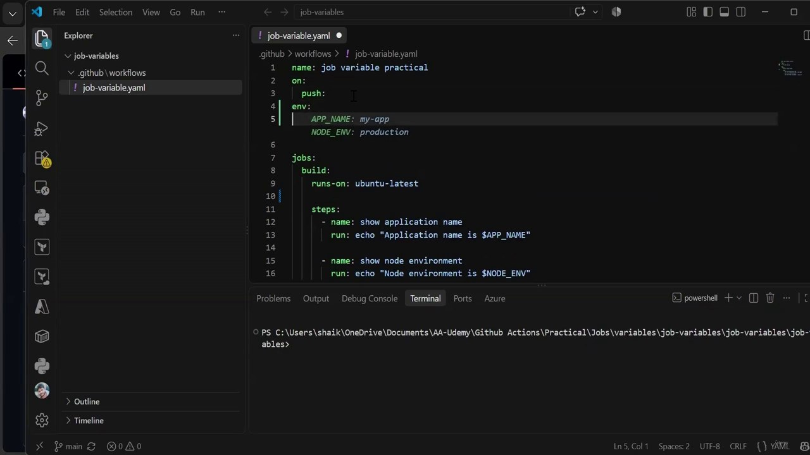
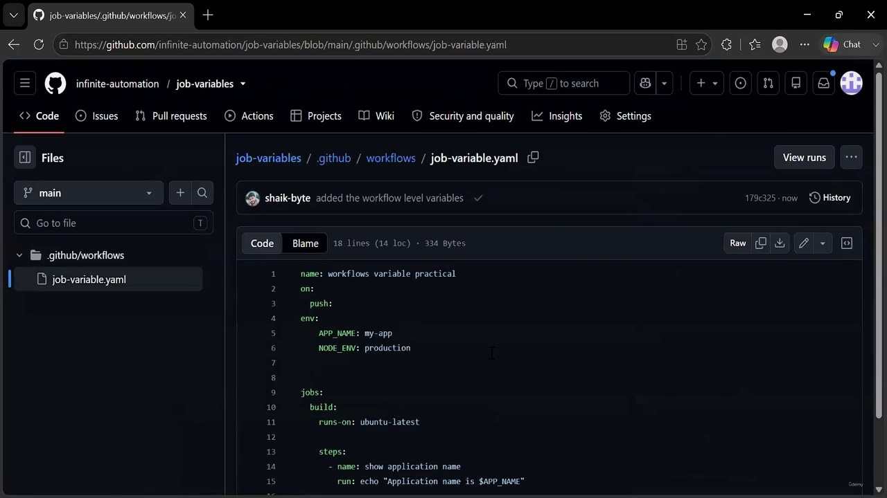
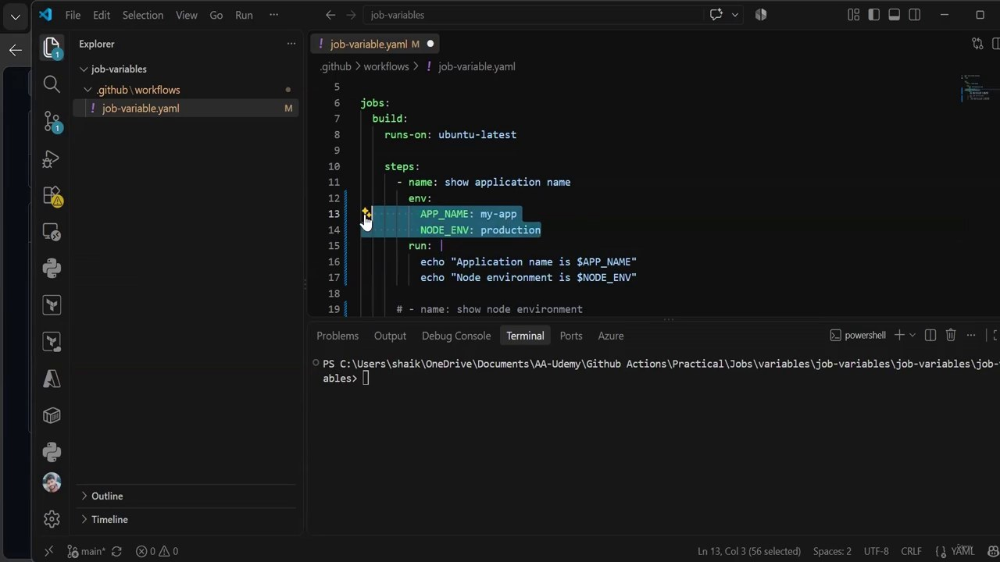
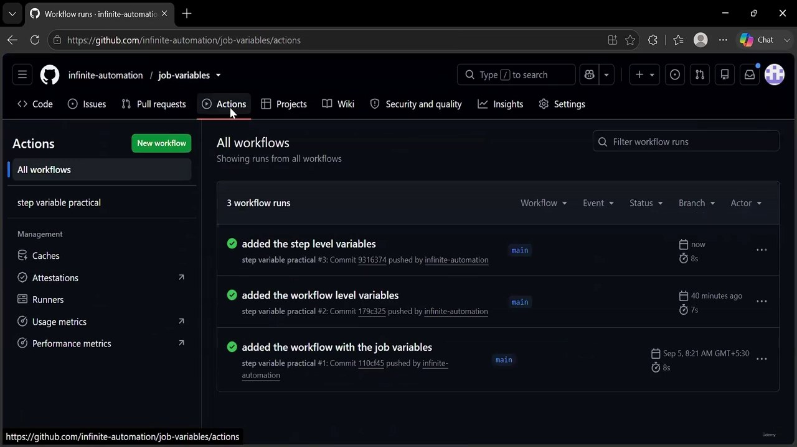
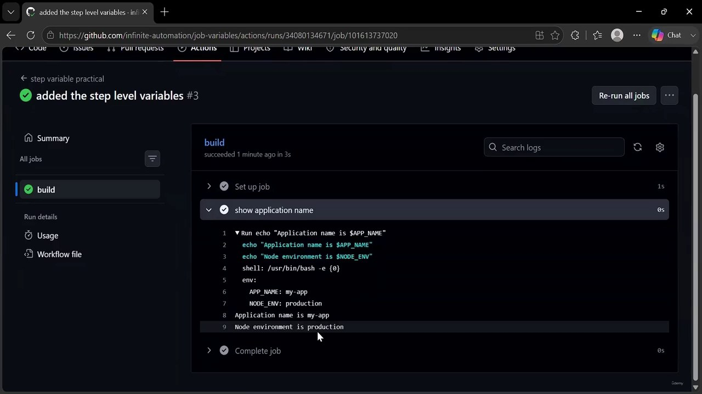

## 1. 这一节做什么

这四节围绕同一件事：**在 GitHub Actions 里用变量消除重复值，并把变量放在 workflow、job、step 三个层级，观察作用域和覆盖关系**。

你会做出四个可以直接推送的 workflow 文件：

1. `job-variable.yml`：变量定义在 job 级，job 内所有 step 都能读取。
2. `workflow-variable.yml`：变量定义在 workflow 级，整个 workflow 的 job、step 都能读取。
3. `step-variable.yml`：变量定义在 step 级，只有当前 step 能读取。
4. `step-variable-activity.yml`：验证「第一个 step 的 step 级变量，第二个 step 读不到」。

课程里虽然变量名叫 `node_env`，但**没有安装 Node.js，也没有 `package.json`**，它只是一个普通字符串变量。读者不需要后端环境，只需要 Git、GitHub 账号和一个编辑器。



---

## 2. 讲师原话（带「—— pNNN [MM:SS]」）

> “At the job level, we normally use ENV to define environment variable. Once we define them for the job level, all the steps in that job can use them.”
>
> —— p041 [00:28]

> “We can define ENV at workflow level, job level or individual step level. A job level where value can overwrite the workflow level value. and this step level value can override it again only for that particular step.”
>
> —— p041 [01:23]

> “Next, we have a configurations variables which we access using the VARs context. These variables can be configured in GitHub instead of directly writing them into the ML file.”
>
> —— p041 [01:50]

> “at job level, we normally use ENV keyword to define the variables and we will use this env across the job inside this step.”
>
> —— p042 [00:29]

> “We are calling the app name as a variable from the job level. So this job level variables can be used across this step inside the job.”
>
> —— p042 [04:17]

> “Because these variables are going to define at workflow level they are available to use inside the workflow jobs.”
>
> —— p043 [00:29]

> “because of these variables are going to be defined at each step level, they are available to use at particular step level only.”
>
> —— p044 [00:28]

> “the second step is not going to get the values from the first step. So finally, the step level variables are available only into the particular step.”
>
> —— p044 [05:34]



---

## 3. 从零复现

### 3.1 准备 GitHub 仓库和本地目录

先在 GitHub 上创建一个空仓库，名字可以叫 `job-variables`。不建议勾选自动生成 README，这样本地 clone 下来就是空目录，和课程一致。

```bash
git clone https://github.com/<你的账号>/job-variables.git
cd job-variables
mkdir -p .github/workflows
code .
```

命令逐条解释：

- `git clone https://github.com/<你的账号>/job-variables.git`：把 GitHub 上的远程仓库复制到本地。`<你的账号>` 要替换成你自己的 GitHub 用户名，`job-variables` 要和你实际创建的仓库名一致。常见错误是仓库地址写错、仓库名不一致、私有仓库没有权限，或者网络无法访问 GitHub。如果仓库是空的，Git 可能提示 `You appear to have cloned an empty repository.`，这是正常现象。
- `cd job-variables`：进入刚 clone 下来的仓库目录。后面所有文件创建、`git add`、`git commit`、`git push` 都应该在这个目录里执行。常见错误是没有先 `cd` 进去，导致 `.github/workflows` 创建到了仓库外面。
- `mkdir -p .github/workflows`：创建 GitHub Actions 默认读取 workflow 的目录。`-p` 的作用是目录不存在就创建，父目录不存在也一起创建；如果目录已经存在，也不会报错。常见错误是把路径写成 `.github/workflow`，少了 `s`，GitHub Actions 不会识别。
- `code .`：用 VS Code 打开当前目录。这个命令不是必须的，你用自己的编辑器打开也可以。如果终端提示 `code: command not found`，说明 VS Code 的 `code` 命令没有安装到 PATH，可以直接用编辑器菜单打开目录，不影响后续操作。

目录结构最终如下：

```text
job-variables/
└── .github/
    └── workflows/
        ├── job-variable.yml
        ├── workflow-variable.yml
        ├── step-variable.yml
        └── step-variable-activity.yml
```

如果你 clone 的是空仓库，Git 可能提示 `You appear to have cloned an empty repository.`，这是正常的。后面第一次 commit 之后就会有 `main` 或 `master` 分支。下面命令默认你的默认分支是 `main`；如果你的仓库是 `master`，把 `git push origin main` 换成 `git push origin master`。

与 GitHub 前台页面的对照：本地 clone 下来的是仓库工作区；GitHub 网页上的 `Code` 标签页展示的是远程仓库内容；后面 push 成功后，网页上的文件列表应该能看到 `.github/workflows/` 目录和四个 YAML 文件。如果网页上看不到文件，先在本地确认文件路径是否真的在仓库目录下。

### 3.2 先做 job 级变量

把第 4.1 节的完整内容保存为：

```text
.github/workflows/job-variable.yml
```

然后提交并推送：

```bash
git add .github/workflows/job-variable.yml
git commit -m "add job level variables"
git push origin main
```

命令逐条解释：

- `git add .github/workflows/job-variable.yml`：只把 `job-variable.yml` 这个文件加入暂存区。常见错误是路径写错，例如文件名少了 `.yml`、目录不是 `.github/workflows`，或者当前终端不在仓库根目录。可以用 `git status` 看文件是否真的被暂存。
- `git commit -m "add job level variables"`：把暂存区内容提交到本地 Git 历史。`-m` 后面是提交说明。常见错误是没有先 `git add`，此时会提示没有可提交内容；如果本机没配置 Git 用户名和邮箱，需要先配置 `user.name` 和 `user.email`。
- `git push origin main`：把本地 `main` 分支推送到远程仓库 `origin`。常见错误是默认分支不是 `main`，这时要改成 `git push origin master` 或你的实际分支名；如果远程仓库有 README 而本地没有，可能会提示需要先拉取或合并；如果没有 GitHub 认证，需要按提示登录或配置凭据。

推送后打开 GitHub 仓库：

1. 点顶部 `Actions`。
2. 左侧选择 `job variable practical`。
3. 点最新一次运行。
4. 点 `build` job。
5. 展开 `show application name` 和 `show node environment` 两个 step。

你应该看到两个 step 分别输出了 `payment service` 和 `production`。

这一步的 GitHub 前台对照是：`Actions` 页面左侧的 workflow 名称来自 YAML 里的 `name: job variable practical`；运行记录里的 `build` 来自 `jobs.build`；展开后的 step 名称来自每个 `- name:`。如果左侧没有出现这个 workflow，优先检查文件是否在 `.github/workflows/` 下、YAML 是否有语法错误、仓库是否禁用了 Actions。

常见错误与排查：

- `Actions` 页面没有新 workflow：检查文件名后缀是否为 `.yml` 或 `.yaml`，路径是否为 `.github/workflows/`，是否真的 push 到了默认分支。
- workflow 出现了但运行失败：点开失败 step，看是 YAML 语法错误还是 shell 输出问题。常见 YAML 错误包括缩进不一致、用了 Tab、冒号后缺少空格。
- 日志里没有 `payment service`：检查 `app_name` 是否写在 job 的 `env:` 下，检查 shell 中是否写成 `$app_name`，不要误写成 `${{ app_name }}`。
- 分支不是 `main`：`git push origin main` 会失败，需要确认远程默认分支名称并替换命令。







### 3.3 再做 workflow 级变量

把第 4.2 节的完整内容保存为：

```text
.github/workflows/workflow-variable.yml
```

提交并推送：

```bash
git add .github/workflows/workflow-variable.yml
git commit -m "add workflow level variables"
git push origin main
```

命令逐条解释：

- `git add .github/workflows/workflow-variable.yml`：把 workflow 级变量示例文件加入暂存区。这里指定的是新文件路径，常见错误是文件名拼错，或者把文件保存到了仓库根目录而不是 `.github/workflows/`。
- `git commit -m "add workflow level variables"`：创建一条本地提交，提交说明用于区分这次新增的是 workflow 级变量示例。常见错误是上一次提交后没有修改文件却再次提交，此时 Git 会提示没有变更。
- `git push origin main`：把本次提交推到远程。若你的默认分支是 `master`，要改用 `git push origin master`。如果 push 被拒绝，先看提示是分支保护、远程有新提交，还是认证问题。

进入 `Actions`，选择 `workflow variable practical`，打开 `build` job，展开两个 step。你应该看到：

```text
Application name is MyApp
Node environment is production
```

这里的关键变化是：`env:` 不再写在 job 下面，而是写在 workflow 顶层，和 `jobs:` 同级。这样整个 workflow 里的 job 和 step 都可以读取。

与 GitHub 前台页面的对照：页面上不会单独显示一个“workflow 级 env”面板，变量最终仍是通过 step 日志体现。你看到 `Application name is MyApp`，就说明 step 读取到了顶层 `env`。如果输出为空，优先检查 `env:` 是否被误缩进到了 `jobs:` 或 `build:` 下面。

常见错误与排查：

- 把 `env:` 写到了 `jobs:` 下面：这会导致 YAML 层级错误或变量不属于 workflow 级。正确写法是 `env:` 顶格，和 `jobs:` 同级。
- `app_name` 和 `node_env` 缩进不一致：YAML 对缩进敏感，同一级 key 要对齐。
- 日志输出 `Application name is` 后面为空：检查变量名是否拼成 `app-name`、`appName` 等；本文统一用 `app_name`。
- 一次 push 触发了多个 workflow：这是正常的，因为多个文件都写了 `on: push`，需要在 Actions 左侧按名称选择。





### 3.4 再做 step 级变量

把第 4.3 节的完整内容保存为：

```text
.github/workflows/step-variable.yml
```

提交并推送：

```bash
git add .github/workflows/step-variable.yml
git commit -m "add step level variables"
git push origin main
```

命令逐条解释：

- `git add .github/workflows/step-variable.yml`：把 step 级变量示例加入暂存区。常见错误是还停留在上一个文件，或者文件名大小写不一致；GitHub Actions 对路径敏感，建议完全按本文路径保存。
- `git commit -m "add step level variables"`：提交本次新增文件。提交说明只是辅助识别，不影响 workflow 运行。
- `git push origin main`：推送到远程默认分支。如果推送成功但 Actions 没反应，检查仓库的 Actions 是否启用，以及 workflow 是否在默认分支上。

进入 `Actions`，选择 `step variable practical`，打开 `build` job，展开 `show application name`。你应该看到这个 step 内部输出了：

```text
Application name is myapp
Node environment is production
```

注意：`app_name` 和 `node_env` 是写在 `show application name` 这个 step 的 `env:` 下面的，不是写在 job 下面。

与 GitHub 前台页面的对照：在 Actions 运行详情里，你要展开具体 step 才能看到输出。step 级变量不会在 job 概览里单独展示，它只在这个 step 的 shell 环境中生效。前端类比可以理解为：变量声明在某个代码块内部，只有这个代码块内部的语句能访问；这里的“代码块”就是当前 step。

常见错误与排查：

- `env:` 缩进到了 `steps:` 下面但没有挂到某个 step：这会导致变量不属于任何 step。正确位置是 `- name:` 下面的 `env:`。
- 把 `env:` 写在 job 下面：那就变成 job 级变量，不是本节的 step 级变量。
- `run:` 里用了 `${{ env.app_name }}`：本文实操用的是 shell 变量 `$app_name`，两者不是同一种写法。课程这里演示的是 `env:` 注入 shell 后由 Bash 读取。
- 输出为空：先检查变量名拼写，再检查 `env:` 是否和 `run:` 属于同一个 step。





### 3.5 验证「第二个 step 读不到第一个 step 的变量」

把第 4.4 节的完整内容保存为：

```text
.github/workflows/step-variable-activity.yml
```

提交并推送：

```bash
git add .github/workflows/step-variable-activity.yml
git commit -m "verify step level scope"
git push origin main
```

命令逐条解释：

- `git add .github/workflows/step-variable-activity.yml`：把验证 step 作用域的示例文件加入暂存区。这个文件包含两个 step，用来对比第一个 step 有 `env`、第二个 step 没有 `env` 的差异。
- `git commit -m "verify step level scope"`：提交这次实验文件。提交说明写清楚目的，方便以后回看。
- `git push origin main`：推送到远程并触发 Actions。如果分支名不是 `main`，按实际分支修改。

进入 `Actions`，选择 `step variable activity`，打开 `build` job。重点看第二个 step：`show node environment`。

这个 step 没有定义自己的 `env:`，却尝试读取 `$app_name` 和 `$node_env`。运行日志里值的位置会是空的，也就是类似：

```text
Application name is
Node environment is
```

课程里讲师展示的就是这个结果：**第二个 step 拿不到第一个 step 的 step 级变量**。step 级变量的作用域只在这个 step 内部。

与 GitHub 前台页面的对照：第一个 step `show application name` 的日志能看到 `myapp` 和 `production`；第二个 step `show node environment` 的日志里，两个值的位置为空。注意不要只看 job 是否绿色成功，一定要展开第二个 step 看具体输出。

前端对照：这很像在 JavaScript 的某个 `{}` 块里用 `const` 声明变量，块外的另一个代码块不能直接访问它。第一个 step 和第二个 step 是两个独立的执行块，前一个 step 的 step 级 `env` 不会自动传给后一个 step。这个类比不是讲师原话，只用于帮助理解作用域。

常见错误与排查：

- 第二个 step 也输出了值：检查是不是在 job 或 workflow 顶层也定义了同名变量，或者不小心把 `env:` 写到了 job 级。
- 第二个 step 输出为空但 job 显示成功：这是预期现象。Bash 默认把未定义变量展开为空字符串，不一定导致失败。
- 想确认变量是否真的未定义：可以临时在 shell 里加 `env | grep app_name` 之类的排查命令，但这不属于课程原始演示，只是调试思路。
- 变量名拼写不一致：例如第一个 step 写 `app_name`，第二个 step 读 `$app-name`，行为会不同。

> 说明：变量未定义时，Bash 通常会把 `$app_name` 展开成空字符串，所以这个 step 往往仍然显示为成功，只是输出缺少值。课程里展示的是「没拿到值」，并没有讲退出码或失败机制；实际页面以你的运行日志为准。



---

## 4. 完整代码

下面四个文件都是完整文件，可以直接保存到对应路径运行。为了和课程口述的 `app name`、`node ENV` 对应，同时保证 shell 能正确读取，本文统一使用下划线命名：`app_name`、`node_env`。

### 4.1 `.github/workflows/job-variable.yml`

```yaml
name: job variable practical

on:
  push:

jobs:
  build:
    runs-on: ubuntu-latest

    env:
      app_name: "payment service"
      node_env: production

    steps:
      - name: show application name
        run: echo "Application name is $app_name"

      - name: show node environment
        run: echo "Node environment is $node_env"
```

### 4.2 `.github/workflows/workflow-variable.yml`

```yaml
name: workflow variable practical

on:
  push:

env:
  app_name: MyApp
  node_env: production

jobs:
  build:
    runs-on: ubuntu-latest

    steps:
      - name: show application name
        run: echo "Application name is $app_name"

      - name: show node environment
        run: echo "Node environment is $node_env"
```

### 4.3 `.github/workflows/step-variable.yml`

```yaml
name: step variable practical

on:
  push:

jobs:
  build:
    runs-on: ubuntu-latest

    steps:
      - name: show application name
        env:
          app_name: myapp
          node_env: production
        run: |
          echo "Application name is $app_name"
          echo "Node environment is $node_env"
```

### 4.4 `.github/workflows/step-variable-activity.yml`

```yaml
name: step variable activity

on:
  push:

jobs:
  build:
    runs-on: ubuntu-latest

    steps:
      - name: show application name
        env:
          app_name: myapp
          node_env: production
        run: |
          echo "Application name is $app_name"
          echo "Node environment is $node_env"

      - name: show node environment
        run: |
          echo "Application name is $app_name"
          echo "Node environment is $node_env"
```

---

## 5. 逐行解释

### 5.1 `job-variable.yml` 逐行解释

```yaml
name: job variable practical
```

workflow 的显示名称。GitHub Actions 页面左侧和运行记录里会显示这个名字，方便你在多个 workflow 之间区分。

```yaml
on:
  push:
```

触发条件。每次向仓库 push 代码时触发这个 workflow。课程里讲师的提交动作就是 `git push`，所以 push 之后 Actions 会自动跑。

```yaml
jobs:
  build:
```

定义一个 job，名字叫 `build`。一个 workflow 可以有很多 job，这里只做一个。

```yaml
    runs-on: ubuntu-latest
```

指定 job 运行在 GitHub 托管的 Ubuntu runner 上。课程里讲师说的是 GitHub hosted runner，对应这里。

```yaml
    env:
      app_name: "payment service"
      node_env: production
```

这是 **job 级环境变量**。`env:` 和 `runs-on:` 同级，都在 `build` job 下面。  
课程里讲师口述「under the runs-on」，意思是放在 job 配置里；实际 YAML 中不要缩进到 `runs-on` 里面，否则层级不对。  
`app_name` 的值是 `payment service`，`node_env` 的值是 `production`。因为 `payment service` 中间有空格，用双引号包起来更稳妥。

```yaml
    steps:
      - name: show application name
        run: echo "Application name is $app_name"
```

第一个 step。`run` 里执行 shell 命令。`$app_name` 是 shell 变量写法，不是 GitHub 表达式的 `${{ }}`。这个 step 能读取 job 级 `env`。

```yaml
      - name: show node environment
        run: echo "Node environment is $node_env"
```

第二个 step。它同样能读取 job 级 `env`。这就是讲师说的：变量定义在 job 级，这个 job 里所有 step 都能用。

用前端熟悉的说法类比：job 级变量像函数作用域里的常量，函数内部的语句都能访问。这个类比不是讲师原话，是为了帮助你理解。

常见错误与排查：如果 `env:` 被误缩进到 `runs-on:` 下面，YAML 结构会变成错误层级；如果 `app_name` 和 `node_env` 没对齐，YAML 解析可能失败；如果日志输出为空，检查 shell 变量名是否和 `env` 的 key 完全一致。

### 5.2 `workflow-variable.yml` 逐行解释

```yaml
name: workflow variable practical
```

workflow 名称改成 `workflow variable practical`，和 job 级示例区分开。

```yaml
on:
  push:
```

仍然是 push 触发。

```yaml
env:
  app_name: MyApp
  node_env: production
```

关键变化：`env:` 写在顶层，和 `jobs:` 同级。它不属于某个 job，而是属于整个 workflow。  
课程里讲师说 workflow 级变量对 workflow 里的 job 和 step 都可用。这里 `app_name` 的值是 `MyApp`，`node_env` 是 `production`。

```yaml
jobs:
  build:
    runs-on: ubuntu-latest
```

job 本身没有 `env:`。它读取的是顶层 `env`。

```yaml
    steps:
      - name: show application name
        run: echo "Application name is $app_name"
```

step 没有定义自己的 `env`，但可以读取 workflow 级 `app_name`。

```yaml
      - name: show node environment
        run: echo "Node environment is $node_env"
```

同理，读取 workflow 级 `node_env`。

这里的作用域类比：workflow 级变量像模块级常量，整个文件里的函数都能访问。job 级变量像函数内常量；step 级变量像块级常量。这个类比不是讲师原话，但对应关系很接近。

常见错误与排查：如果 `env:` 写到了 `jobs:` 下面，它就不再是 workflow 级变量；如果 `env:` 和 `jobs:` 没有顶格对齐，YAML 可能解析失败；如果输出是空，检查变量名是否和 `env` 的 key 一致。

### 5.3 `step-variable.yml` 逐行解释

```yaml
name: step variable practical
```

workflow 名称。

```yaml
on:
  push:
```

push 触发。

```yaml
jobs:
  build:
    runs-on: ubuntu-latest
```

job 叫 `build`，跑在 Ubuntu runner 上。这里 job 下面没有 `env:`。

```yaml
    steps:
      - name: show application name
        env:
          app_name: myapp
          node_env: production
```

`env:` 缩进在 `show application name` 这个 step 下面。它只属于这个 step，不属于整个 job，也不属于其他 step。  
课程里 `app_name` 是 `myapp`，`node_env` 是 `production`。

```yaml
        run: |
          echo "Application name is $app_name"
          echo "Node environment is $node_env"
```

`run: |` 表示后面是多行 shell 脚本。两行 `echo` 都在同一个 step 里，所以都能读取这个 step 的 `env`。  
在 JS/Node 里可以类比成：这两个 `echo` 在同一个块级作用域里，能访问这个块里声明的变量。

常见错误与排查：`env:` 必须挂在具体 step 下；`run: |` 后面的命令要统一缩进；如果 `env:` 和 `run:` 不属于同一个 step，变量就不会注入到这个 shell 中。

### 5.4 `step-variable-activity.yml` 逐行解释

```yaml
name: step variable activity
```

这个文件专门用来做课程里的「跨 step 访问」实验。

```yaml
on:
  push:
```

push 触发。

```yaml
jobs:
  build:
    runs-on: ubuntu-latest
```

一个 `build` job。

```yaml
    steps:
      - name: show application name
        env:
          app_name: myapp
          node_env: production
```

第一个 step 定义了自己的 `env`。注意：这个 `env` 只属于第一个 step。

```yaml
        run: |
          echo "Application name is $app_name"
          echo "Node environment is $node_env"
```

第一个 step 正常读取自己的变量。

```yaml
      - name: show node environment
        run: |
          echo "Application name is $app_name"
          echo "Node environment is $node_env"
```

第二个 step 没有 `env:`，却试图读取 `$app_name` 和 `$node_env`。  
课程里的结论是：**读不到**。因为 step 级变量只在定义它的那个 step 内有效，同一个 job 的另一个 step 不能继承。  
这就是讲师在 p044 [05:34] 说的：第二个 step 不会从第一个 step 拿到值。

常见错误与排查：如果第二个 step 读到了值，说明同名变量可能定义在更高的 job 或 workflow 层级；如果第二个 step 没有报错但输出为空，这是 Bash 对未定义变量的常见表现，不代表变量跨 step 可用。

---

## 6. 复现检查清单

按下面顺序检查，基本可以定位问题。每一项后面的“说明”是逐条解释，帮助你判断为什么要检查、检查失败时先看哪里。

- [ ] GitHub 上已经创建空仓库 `job-variables`，本地已经 clone。
  - 说明：这一步确认远程仓库和本地工作区已经建立关联。如果没 clone 成功，后面的文件路径、`git add`、`git push` 都无从谈起。先在 GitHub 网页确认仓库存在，再在本地执行 `git remote -v` 看是否指向正确地址。

- [ ] 本地存在目录 `.github/workflows`。
  - 说明：GitHub Actions 只会读取仓库中 `.github/workflows/` 下的 YAML 文件。目录名少一个点、少 `s`、层级多一层，都可能导致 workflow 不出现。

- [ ] `job-variable.yml` 已保存，并且路径是 `.github/workflows/job-variable.yml`。
  - 说明：文件名和路径要同时正确。只把文件放在仓库根目录，GitHub Actions 不会自动识别。

- [ ] `job-variable.yml` 推送后，Actions 里出现 `job variable practical`。
  - 说明：Actions 左侧显示的是 YAML 中的 `name:`。如果没出现，优先检查文件是否 push 到默认分支、YAML 是否有语法错误、Actions 是否启用。

- [ ] `job variable practical` 的 `build` job 是绿色成功。
  - 说明：`build` 来自 `jobs.build`。绿色成功说明 YAML 能被解析、runner 能启动、shell 命令退出码为 0；但它不保证变量值一定符合预期，所以还要看日志。

- [ ] 展开 `show application name`，日志里有 `Application name is payment service`。
  - 说明：这验证 job 级 `app_name` 被第一个 step 读取。若输出为空，检查 `env:` 是否在 job 下、变量名是否为 `app_name`。

- [ ] 展开 `show node environment`，日志里有 `Node environment is production`。
  - 说明：这验证同一个 job 内第二个 step 也能读取 job 级变量。若只第一个 step 有值，检查 `env:` 是否被误放到了第一个 step 内部。

- [ ] `workflow-variable.yml` 推送后，Actions 里出现 `workflow variable practical`。
  - 说明：这说明第二个 workflow 文件被识别。若没有，检查文件名、路径、YAML 语法和 push 分支。

- [ ] `workflow variable practical` 的日志里有 `Application name is MyApp` 和 `Node environment is production`。
  - 说明：这验证顶层 `env` 被 step 读取。若没有值，检查 `env:` 是否和 `jobs:` 同级。

- [ ] `workflow-variable.yml` 里 `env:` 在顶层，和 `jobs:` 同级，不在 job 里面。
  - 说明：这是 workflow 级变量和 job 级变量的核心区别。缩进错了，作用域就变了。

- [ ] `step-variable.yml` 推送后，Actions 里出现 `step variable practical`。
  - 说明：确认第三个 workflow 被识别。一次 push 可能触发多条运行记录，要在左侧按名称选择。

- [ ] `step variable practical` 的 `show application name` 日志里有 `Application name is myapp` 和 `Node environment is production`。
  - 说明：这验证 step 级变量在定义它的 step 内可见。若没有值，检查 `env:` 是否挂在该 step 下。

- [ ] `step-variable.yml` 里 `env:` 在 step 下面，不在 job 下面。
  - 说明：如果 `env:` 写在 job 下，它就不再是 step 级变量，而是 job 级变量；虽然输出可能仍然有值，但作用域实验就不准确了。

- [ ] `step-variable-activity.yml` 推送后，Actions 里出现 `step variable activity`。
  - 说明：确认验证作用的 workflow 被识别。这个 workflow 的重点不是“运行成功”，而是第二个 step 的输出为空。

- [ ] `step variable activity` 的第二个 step `show node environment` 没有拿到值，日志中值的位置为空。
  - 说明：这验证 step 级变量不能跨 step 继承。若第二个 step 有值，检查是否有同名 job 级或 workflow 级变量。

- [ ] 第二个 step 即使没拿到值，也可能显示为成功；不要只看绿色图标，要点开日志看输出。
  - 说明：Bash 默认把未定义变量展开为空字符串，命令本身仍可能以退出码 0 结束。绿色只表示命令没失败，不表示变量存在。

- [ ] YAML 缩进没有用 Tab，全部用空格。
  - 说明：YAML 不允许用 Tab 缩进。编辑器可能显示不明显，但 GitHub Actions 解析时会报错。建议统一用两个空格或四个空格。

- [ ] 变量名使用 `app_name`、`node_env`，没有写成 `app-name` 这种带连字符的形式。
  - 说明：shell 读取 `$app_name` 时，下划线命名更稳妥。`$app-name` 会被 shell 理解成 `$app` 后面接 `-name`，不是名为 `app-name` 的变量。

- [ ] 如果默认分支不是 `main`，推送命令已经改成 `git push origin master` 或你的实际分支名。
  - 说明：`git push origin main` 只适用于默认分支叫 `main` 的仓库。分支名不对会 push 失败，或者推到了另一个分支，Actions 可能不在你预期的页面上出现。

---

## 7. 课里没讲但你会撞上的

### 7.1 `vars` context 只讲了概念，没有给完整 YAML 示例

P041 里讲师提到配置变量可以通过 `vars` context 读取，并且可以在 GitHub 里配置，而不是直接写进 YAML。但 P041–P044 的实操部分**没有演示 `vars` 的完整写法**，也没有带你点 GitHub 设置页。

所以本文的四个文件只复现了 `env` 的 workflow / job / step 三层作用域。`vars` 部分你如果要用，需要自己在 GitHub 仓库设置里配置变量，并查阅官方文档。课里没讲具体字段和页面路径，本文不把它写成课程演示内容。

### 7.2 `app-name` 和 `$app-name` 不是一回事

课程口述说的是 `app name`，但 YAML 的 key 和 shell 变量名最好用下划线：`app_name`。  
如果你写成：

```yaml
env:
  app-name: myapp
run: echo "$app-name"
```

shell 会把 `$app-name` 理解成「变量 `$app` 后面接字符串 `-name`」，而不是一个叫 `app-name` 的变量。  
本文统一用 `app_name` / `node_env`，就是为了让 `$app_name`、`$node_env` 正常展开。

常见错误与排查：如果日志里只输出了 `-name` 或输出异常，检查 shell 变量名是否包含连字符。YAML key 可以写连字符，但 Bash 变量名通常使用字母、数字和下划线，且不应以数字开头。

### 7.3 变量没定义时，step 不一定会失败

在 `step-variable-activity.yml` 的第二个 step 里，`$app_name` 没有定义。Bash 默认会把它展开成空字符串，所以日志里看到的是：

```text
Application name is
Node environment is
```

这个 step 往往仍然是成功状态。课程里讲师展示的是「没拿到值」，没有讲失败机制。  
如果你希望变量缺失时直接失败，需要自己在 shell 里加判断，比如使用 `${app_name:?app_name is required}` 之类的写法。这个写法课里没讲，属于额外加固。

### 7.4 `env:` 的层级很容易写错

job 级写法：

```yaml
jobs:
  build:
    runs-on: ubuntu-latest
    env:
      app_name: "payment service"
```

workflow 级写法：

```yaml
env:
  app_name: MyApp

jobs:
  build:
    runs-on: ubuntu-latest
```

step 级写法：

```yaml
    steps:
      - name: show application name
        env:
          app_name: myapp
```

三种写法缩进不同。讲师口述「under the runs-on」时，不要真的把 `env:` 缩进到 `runs-on:` 下面；`runs-on` 只是一个值，不是容器。实际 YAML 里 `env:` 和 `runs-on:` 是同级。

前端对照：workflow 级像模块级常量，job 级像函数内常量，step 级像块级常量。层级越高，能访问它的范围越大；层级越低，作用域越窄。这个对照只是帮助理解，不是课程原话。

### 7.5 四个 workflow 都监听 push，会同时触发

本文为了完整展示，把四个文件都放在 `.github/workflows/` 下。它们都写了 `on: push`，所以一次 push 可能会同时出现四条运行记录。  
你验证时按 workflow 名称选择：

- `job variable practical`
- `workflow variable practical`
- `step variable practical`
- `step variable activity`

如果你只想看一个，可以一次只提交一个文件，或者先把其他文件改名 / 移出 workflows 目录。课程里是逐节替换同一个 workflow 来演示的。

常见错误与排查：看到 Actions 页面同时出现多条记录时，不要以为运行重复了；先看每条记录的 workflow 名称，再进入对应实验。若只想验证某一个层级，可以一次只 push 一个 YAML 文件。

### 7.6 `node_env` 不是 Node.js 运行时

变量名叫 `node_env`，只是课程用来演示的字符串值 `production`。  
这四个 workflow 没有 `npm install`、没有 `node` 命令、没有 `package.json`。你不需要装 Node.js 也能跑。对前端读者来说，这里不要把它误解成 Node 环境配置。

### 7.7 GitHub Actions 的 `$app_name` 和 `${{ env.app_name }}` 是两种写法

课程实操里用的是 shell 里的 `$app_name`，因为变量通过 `env:` 注入到了 shell 环境。  
在 YAML 表达式里，GitHub Actions 还有 `${{ env.app_name }}` 这种写法；`vars` context 则是另一套写法。课程没有系统对比这些写法，本文也不把没演示的语法混进来。你只要先记住：**本文代码里的 `$app_name` 是给 Bash 读的，不是 GitHub 表达式**。

### 7.8 常见前台页面排查顺序

如果你在 GitHub Actions 页面看不到预期结果，可以按这个顺序排查：先看仓库 `Code` 页面里文件是否存在；再看 `Actions` 页面左侧是否有对应 workflow 名称；然后点进运行记录看 `build` job 是否启动；最后展开具体 step 看日志。这个顺序能把“文件没推上去”“workflow 没识别”“job 没跑”“变量没读到”四类问题分开。

### 7.9 命令失败时的通用定位

`git add` 失败，先看路径和当前目录；`git commit` 失败，先看是否有暂存内容、是否配置了 Git 身份；`git push` 失败，先看分支名、远程地址和认证；Actions 失败，先看 YAML 缩进和 step 日志。本文所有命令都不依赖 Node.js，因此不需要先执行 `npm install`。