## 1. 这一节做什么

这一节覆盖 P41–P50，目标不是背概念，而是在一个 GitHub 仓库里做出 7 个可直接触发的工作流，分别验证：

| 能力 | 工作流文件 | 你要看到的结果 |
|---|---|---|
| job 级变量 | `.github/workflows/job-variable.yml` | 同一个 job 的多个 step 都能读到 `APP_NAME`、`NODE_ENV` |
| workflow 级变量 | `.github/workflows/workflow-variable.yml` | 变量定义在 workflow 顶层，job 内多个 step 都能用 |
| step 级变量 | `.github/workflows/step-variable.yml` | 变量只在当前 step 有效；第二个 step 读不到第一个 step 的变量 |
| 仓库配置变量 `vars` | `.github/workflows/configuration-variable.yml` | 值不在 YAML 里硬编码，而是在 GitHub UI 配置 |
| Secret | `.github/workflows/secrets.yaml` | 工作流能读到 secret，但日志里被星号掩码 |
| job 超时 | `.github/workflows/jobTimeout.yml` | `timeout-minutes: 2` 到时后，`sleep 160` 的 job 被取消 |
| 失败处理 | `.github/workflows/failure-demo.yml` | 默认失败会跳过后续 step；`continue-on-error` 可改变行为（此文件为示意，P50 没有实操代码） |

这一节没有 Node/npm 依赖，也不需要本地启动服务。真正运行发生在 GitHub 托管的 `ubuntu-latest` runner 上；本地只负责写 YAML、`git push`，然后到 GitHub Actions 页面看日志。

P41 先讲变量的作用域：变量用来存值并复用，避免在 workflow 里反复写同一个值。讲师明确说 job 级用 `ENV` 定义后，该 job 内所有 step 都能用；workflow、job、step 三层中，job 会覆盖 workflow，step 会再覆盖 job，但只对该 step 生效。配置变量则通过 `vars` 上下文读取，值放在 GitHub 仓库设置里，而不是写进 YAML。

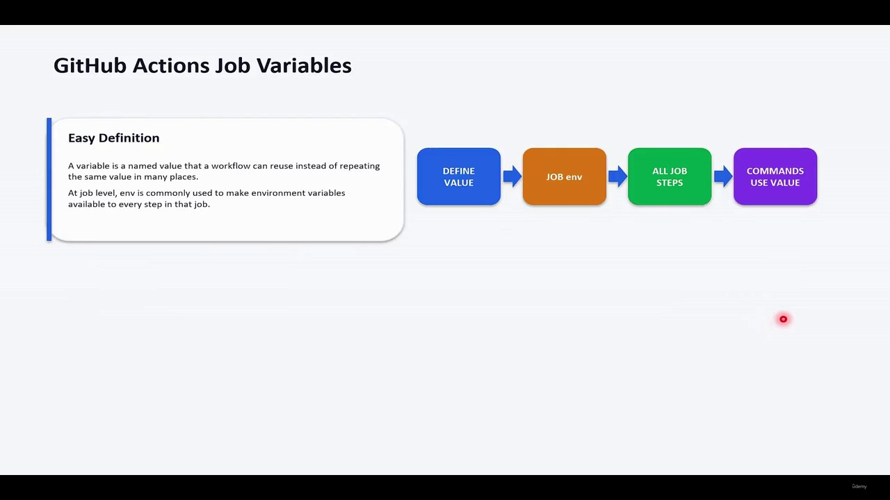

P42–P44 是三个连续实验：先把变量放在 job 级，再移到 workflow 级，最后移到 step 级。P44 还专门做了一个“反例”：第二个 step 不定义变量，却试图读取第一个 step 的 step 级变量，结果读不到。这个反例很重要，避免把“同一个 job 内变量到处都能用”理解错。

P45 讲仓库配置变量：在 GitHub UI 的 Settings → Secrets and variables → Actions → Variables 里建 `APP_NAME`、`NODE_ENV`，YAML 里用 `${{ vars.APP_NAME }}` 读取。P46–P47 讲 Secret：敏感值放仓库 Secret，YAML 里用 `${{ secrets.API_KEY }}` 读取，日志会掩码。P48–P49 讲 `timeout-minutes`：只按分钟计，不支持秒/小时；P49 用 `sleep 160` 故意超过 2 分钟。P50 讲失败处理：默认 step 失败会导致 job 失败、后续 step 跳过；`continue-on-error: true` 可以让流程继续。

## 2. 讲师原话（带「—— pNNN [MM:SS]」）

下面只摘关键原话，方便你确认概念边界。英文是逐字稿原文，中文是本文的复现说明。

> "变量帮助我们先存储一个值，然后在工作流的后续环节中使用它。"
> —— p041 [00:00]

变量是为了存值并复用，不是这一节的项目依赖。

> "在作业级别，我们通常用 ENV 来定义环境变量。一旦在作业级别定义了这些变量，该作业中的所有步骤都可以使用它们。"
> —— p041 [00:28]

所以 P42 的 `env` 放在 `jobs.build.env` 下，两个 step 都能读。

> "我们可以在工作流级别、作业级别或单个步骤级别定义 ENV。作业级别的值可以覆盖工作流级别的值，而步骤级别的值又可以再次覆盖它，但仅对该特定步骤生效。"
> —— p041 [01:23]

这就是 P42、P43、P44 三个实验的层级关系：workflow → job → step，逐层覆盖。

> "接下来是配置变量，我们通过 VARs 上下文来访问它。"
> —— p041 [01:50]

配置变量不是写死在 YAML 里，而是从 GitHub 仓库设置读取，YAML 里写 `${{ vars.XXX }}`。

> "在这次实践操作中，我创建了一个名为 job variables 的空 GitHub 仓库……"
> —— p042 [00:29]

P42 是从空仓库开始，创建 `.github/workflows/job-variable.yml`，然后 push 触发。

> "当我们在工作流级别定义变量时，这些变量可供该特定工作流内的作业和步骤使用。"
> —— p043 [03:38]

P43 把 `env` 从 job 内移到 workflow 顶层，作用域扩大到整个 workflow。

> "所以最终，步骤级别的变量只在那个特定步骤内可用。同一作业中的其他步骤无法访问。"
> —— p044 [05:34]

P44 的反例结论：step 级变量不跨 step 共享。

> "我们没有把值直接硬编码到 yaml 文件里，而是在 GitHub 设置中配置值，然后在工作流中通过 vars 上下文来访问它。"
> —— p045 [08:27]

P45 的重点是“值放 UI，YAML 只放引用”，以后改变量不用改工作流文件。

> "GitHub 为我们提供了一个安全的地方，叫做 secrets。"
> —— p046 [00:29]

Secret 用来放密码、API key、token、Webhook URL 等敏感值。

> "GitHub 会在工作流日志中对 secret 的值做标记处理。你无法在工作流日志中读到或找到这些值。"
> —— p046 [01:53]

P47 的日志不会打印真实 secret，而是星号掩码。

> "作业超时告诉 GitHub 一个作业允许运行多长时间。我们可以用 timeout-minutes 关键字来设置这个时间。"
> —— p048 [00:28]

P49 用 `timeout-minutes: 2` 限制整个 job 最多 2 分钟。

> "GitHub Actions 的超时以分钟为单位，不支持秒和小时。"
> —— p048 [00:58]

所以不要写 `timeout-seconds` 或 `timeout-hours`；课里只讲 `timeout-minutes`。

> "sleep 160，也就是超过两分钟。"
> —— p049 [02:47]

P49 用 `sleep 160` 让 `run tests` 步骤超过 2 分钟，从而观察 job 被取消。

> "默认情况下，当某个步骤失败时……作业就会失败，后续步骤会被跳过。"
> —— p050 [00:55]

P50 默认行为：失败 step 后面的 step 不执行。

> "有时候某个步骤失败也没关系。为此，我们使用 continue-on-error: true。"
> —— p050 [01:24]

`continue-on-error: true` 用于“这个步骤失败但我还想继续”的场景；P50 还提到 job 级也加 `continue-on-error`，让 workflow 继续到下一个 job。课里没有给 P50 的实操代码，本文第 4 节的 `failure-demo.yml` 会明确标注为示意。

## 3. 从零复现

### 3.1 准备环境

- GitHub 账号一个。
- Git 已安装。课里没有讲 Git 具体版本，本文用 Git 2.x 即可。
- 编辑器用 VS Code；课里明确使用 Visual Studio Code。
- 不需要 Node、npm、Java、Python。P49 的 `install dependencies` 只是 `echo`，不是真实安装依赖。
- Runner 用 GitHub 托管 runner：`ubuntu-latest`。

### 3.2 创建仓库和目录

在 GitHub 新建一个空仓库，例如 `gha-p41-p50-lab`。本地执行：

```bash
git init gha-p41-p50-lab
cd gha-p41-p50-lab
git branch -M main
git remote add origin https://github.com/<你的用户名>/gha-p41-p50-lab.git
mkdir -p .github/workflows
```

注意：P45 的工作流写了 `on.push.branches: main`，所以本地分支必须是 `main`，否则它不会触发。课里没有讲 `master` 分支兼容问题，这里先统一成 `main`。

创建后目录结构如下：

```text
gha-p41-p50-lab/
└── .github/
    └── workflows/
        ├── job-variable.yml
        ├── workflow-variable.yml
        ├── step-variable.yml
        ├── configuration-variable.yml
        ├── secrets.yaml
        ├── jobTimeout.yml
        └── failure-demo.yml
```

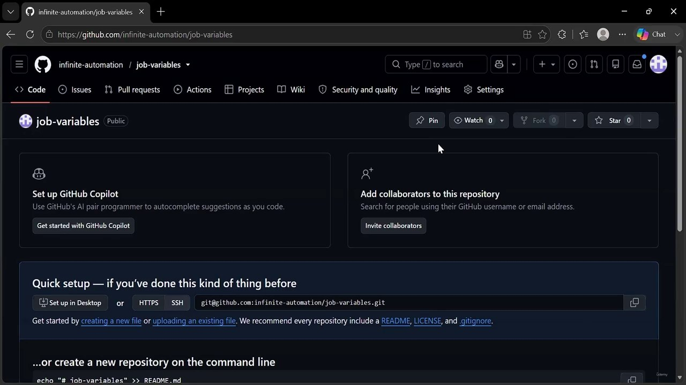

### 3.3 依次放入第 4 节的完整文件

把第 4 节的所有文件原样保存到 `.github/workflows/` 下。不要改缩进：GitHub Actions 的 YAML 对缩进敏感，`jobs`、`steps`、`env` 的层级错一格，工作流就会解析失败。

P42 的编辑器内容对应 job 级变量：`env` 在 `jobs.build` 下，两个 step 用 `$APP_NAME`、`$NODE_ENV` 读取。P43 把 `env` 移到 workflow 顶层。P44 把 `env` 放进第一个 step，第二个 step 故意不写 `env`，用来验证“读不到”。

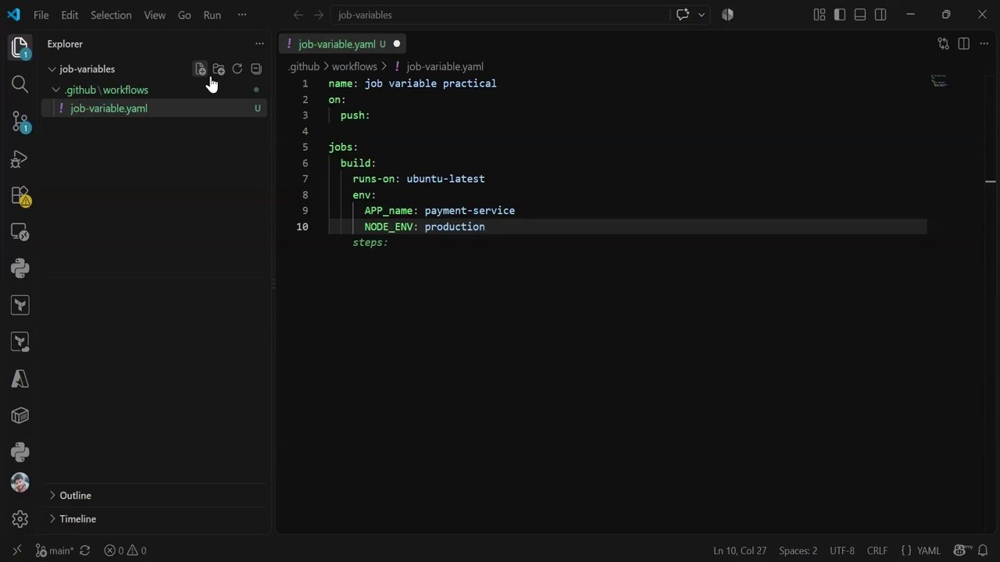

P44 的第二个 step 是实验重点：它没有自己的 `env`，却执行 `echo "应用名称是 $APP_NAME"`。由于 shell 变量未定义，日志里会看到空值。这不是 YAML 写错，而是 step 级变量的作用域限制。

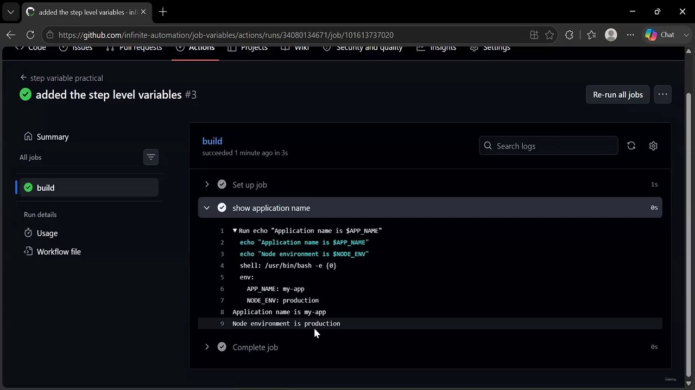

### 3.4 配置仓库变量和 Secret

P45 需要仓库变量。打开 GitHub 仓库页面：

1. Settings
2. Secrets and variables
3. Actions
4. 选 Variables
5. New repository variable

添加两个变量：

| 变量名 | 值 |
|---|---|
| `APP_NAME` | `my app` |
| `NODE_ENV` | `production` |

P45 的 YAML 里用：

```yaml
${{ vars.APP_NAME }}
${{ vars.NODE_ENV }}
```

逐字稿口头读作 “app name / node ENV”，没有强调大小写。本文统一写成 `APP_NAME`、`NODE_ENV`，你在 UI 和 YAML 里保持一致即可；如果你照讲师屏幕写成 `app_name`，那么 YAML 引用也要同步改。

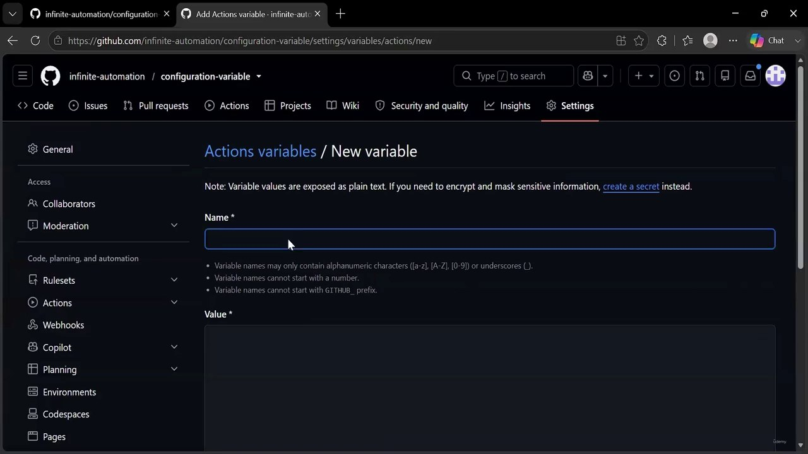

P47 需要仓库 Secret。路径：

1. Settings
2. Secrets and variables
3. Actions
4. 选 Secrets
5. New repository secret

添加：

| Secret 名 | 值 |
|---|---|
| `API_KEY` | 随便一个随机值，例如 `12345abcde`，不要用真实密钥 |

YAML 里写：

```yaml
${{ secrets.API_KEY }}
```

逐字稿口头读作 “api key”，本文统一写 `API_KEY`。Secret 名称在 UI 和 YAML 引用中保持一致。

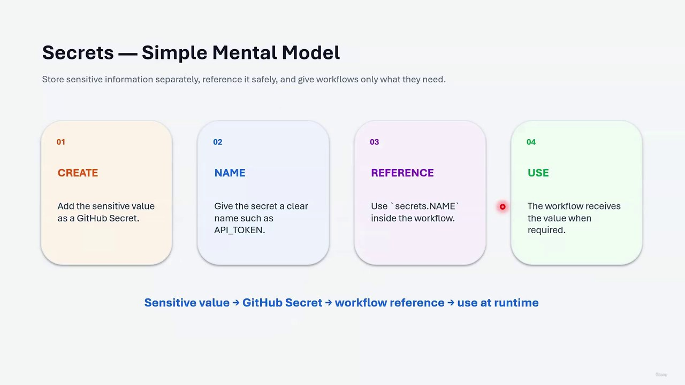

### 3.5 提交并触发工作流

保存所有文件后执行：

```bash
git add .
git commit -m "add p41-p50 GitHub Actions labs"
git push -u origin main
```

如果远程仓库已有 README，第一次 push 可能需要先 `git pull --rebase origin main`，但课里没有讲这个分支合并细节，按你仓库实际情况处理。

push 后，所有 `on: push` 的工作流都会触发；P45 只会在 `main` 分支触发。打开 GitHub 仓库的 Actions 标签，依次点进每个 workflow run，再点 job，展开 step 看日志。

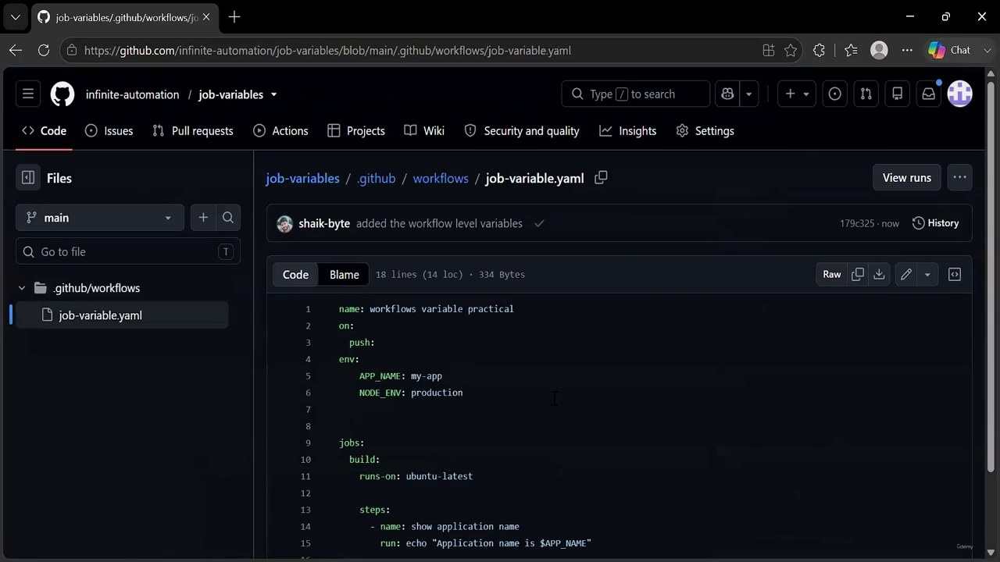

### 3.6 预期日志结果

| 工作流 | 预期输出 |
|---|---|
| `job variable practical` | `application name is payment service`、`node environment is production` |
| `workflow variable practical` | `application name is MyApp`、`node environment is production`（第二个值逐字稿没有重新念出，本文沿用上一节，便于复现） |
| `step variable practical` | 第一个 step 打印 `myApp`、`production`；第二个 step 打印空值 |
| `configuration variable practical` | `application name is my app`、`environment name is production` |
| `GitHub secret demo` | 日志显示星号掩码，不显示真实 secret |
| `job timeout practical` | `run tests` 步骤运行约 2 分钟后 job 被取消，不会等满 160 秒 |
| `failure handling demo` | 默认失败 job 的 `deploy` step 被跳过；`continue-on-error` 的 step 后面继续；job 级示意用于观察下游 job 是否继续 |

P49 的日志重点不是 `sleep` 成功，而是 job 在超时点被取消。逐字稿里讲师也是离开页面，等 2 分钟后再回来看结果。

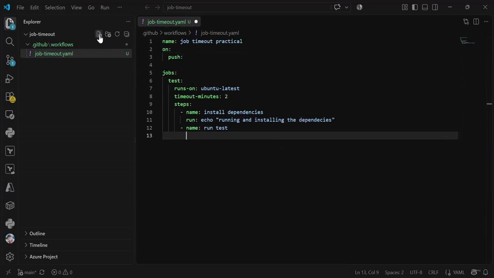

## 4. 完整代码

以下文件都是完整文件，可直接保存。P50 的 `failure-demo.yml` 在文件头明确标注：课里没有代码，以下为示意。

### 4.1 `.github/workflows/job-variable.yml`

对应 P42，job 级变量。

```yaml
name: job variable practical

on: push

jobs:
  build:
    name: build
    runs-on: ubuntu-latest
    env:
      APP_NAME: payment service
      NODE_ENV: production
    steps:
      - name: show application name
        run: echo "application name is $APP_NAME"

      - name: show node environment
        run: echo "node environment is $NODE_ENV"
```

### 4.2 `.github/workflows/workflow-variable.yml`

对应 P43，workflow 级变量。

```yaml
name: workflow variable practical

on: push

env:
  APP_NAME: MyApp
  NODE_ENV: production

jobs:
  build:
    runs-on: ubuntu-latest
    steps:
      - name: show application name
        run: echo "application name is $APP_NAME"

      - name: show node environment
        run: echo "node environment is $NODE_ENV"
```

说明：逐字稿确认了 `app name` 的值是 `MyApp`，并确认 `NODE_ENV` 这个变量名；`NODE_ENV` 的值没有在 P43 重新念出，本文沿用上一节的 `production`，方便你直接复现。你可以改成自己的值。

### 4.3 `.github/workflows/step-variable.yml`

对应 P44，step 级变量 + 跨 step 读取失败的反例。

```yaml
name: step variable practical

on: push

jobs:
  build:
    runs-on: ubuntu-latest
    steps:
      - name: show application name
        env:
          APP_NAME: myApp
          NODE_ENV: production
        run: |
          echo "application name is $APP_NAME"
          echo "node environment is $NODE_ENV"

      - name: show node environment
        run: |
          echo "application name is $APP_NAME"
          echo "node environment is $NODE_ENV"
```

第二个 step 没有 `env`，所以它读不到第一个 step 的 `APP_NAME`、`NODE_ENV`。这正是 P44 要演示的现象。

### 4.4 `.github/workflows/configuration-variable.yml`

对应 P45，仓库配置变量 `vars`。

```yaml
name: configuration variable practical

on:
  push:
    branches:
      - main

jobs:
  demo:
    runs-on: ubuntu-latest
    steps:
      - name: show application name
        run: echo "application name is ${{ vars.APP_NAME }}"

      - name: show environment name
        run: echo "environment name is ${{ vars.NODE_ENV }}"
```

### 4.5 `.github/workflows/secrets.yaml`

对应 P47，Secret 读取与日志掩码。

```yaml
name: GitHub secret demo

on: push

jobs:
  secret-demo:
    runs-on: ubuntu-latest
    steps:
      - name: access secret
        run: echo "API key is ${{ secrets.API_KEY }}"
```

### 4.6 `.github/workflows/jobTimeout.yml`

对应 P49，job 超时。

```yaml
name: job timeout practical

on: push

jobs:
  test:
    runs-on: ubuntu-latest
    timeout-minutes: 2
    steps:
      - name: install dependencies
        run: echo "Installing dependencies"

      - name: run tests
        run: sleep 160
```

`timeout-minutes: 2` 限制整个 `test` job 最多 2 分钟；`sleep 160` 是 160 秒，超过 2 分钟，所以会在 `run tests` 步骤被取消。逐字稿里 `install dependencies` 只是演示步骤，不是真实安装依赖。

### 4.7 `.github/workflows/failure-demo.yml`

对应 P50。**课里没有代码，以下为示意**，用于复现默认失败、step 级 `continue-on-error`、job 级 `continue-on-error` 三种情况。

```yaml
# 课里没有代码，以下为示意。
name: failure handling demo

on: push

jobs:
  default-failure:
    runs-on: ubuntu-latest
    steps:
      - name: install dependencies
        run: echo "install dependencies"

      - name: run tests will fail
        run: |
          echo "test failed on purpose"
          exit 1

      - name: deploy should be skipped
        run: echo "deploy should be skipped"

  step-continue:
    runs-on: ubuntu-latest
    steps:
      - name: run flaky test
        continue-on-error: true
        run: |
          echo "flaky test failed but continue"
          exit 1

      - name: after flaky test
        run: echo "this step still runs"

  job-that-fails:
    runs-on: ubuntu-latest
    continue-on-error: true
    steps:
      - name: fail this job
        run: |
          echo "job failed on purpose"
          exit 1

  after-job:
    needs: job-that-fails
    runs-on: ubuntu-latest
    steps:
      - name: after failed job
        run: echo "this job runs because job-that-fails has continue-on-error"
```

说明：P50 只讲了概念，没有给实操文件。上面是示意工作流，不是讲师逐字稿里的原始文件。job 级 `continue-on-error` 和 `needs` 的实际依赖图行为，建议以你仓库 Actions 页面实际结果为准；课里没有展开 `needs` 细节。

## 5. 逐行解释

### 5.1 P42 `job-variable.yml`

```yaml
name: job variable practical
```

工作流名称。GitHub Actions 页面会显示这个名字，方便你在 Actions 列表里找到它。

```yaml
on: push
```

每次 push 触发。课里 P42 就是 commit + push 后到 Actions 页面看运行结果。这里没有写分支过滤，所以任何分支 push 都会触发。

```yaml
jobs:
  build:
```

定义一个 job，job id 是 `build`。后面的 `name: build` 是显示名称。job id 用于依赖、引用；本文没有跨 job 依赖，所以简单写 `build`。

```yaml
    runs-on: ubuntu-latest
```

指定 GitHub 托管 runner 的系统。课里说 “Ubuntu GitHub hosted runner”，对应 `ubuntu-latest`。

```yaml
    env:
      APP_NAME: payment service
      NODE_ENV: production
```

这是 job 级环境变量。`env` 放在 `jobs.build` 下，所以 `build` 内所有 step 都能读到。P41 说 job 级变量对该 job 的所有 step 可用，这里就是落地写法。

`APP_NAME` 的值是 `payment service`，`NODE_ENV` 的值是 `production`。YAML 里值含空格时建议加引号，但 `payment service` 不加引号也能解析；为了减少歧义，你也可以写成 `"payment service"`。

```yaml
    steps:
      - name: show application name
        run: echo "application name is $APP_NAME"
```

`steps` 是 job 内的步骤列表。每个 step 有 `name` 和 `run`。`run` 里的 `$APP_NAME` 是 shell 变量展开，不是 GitHub Actions 的 `${{ }}` 表达式。因为 job 级 `env` 已经把 `APP_NAME` 注入到 shell 环境，所以 echo 能打印 `payment service`。

```yaml
      - name: show node environment
        run: echo "node environment is $NODE_ENV"
```

第二个 step 同样读取 job 级 `NODE_ENV`，打印 `production`。这两个 step 都没有自己的 `env`，值来自 job 级。

在前端/Node 视角可以类比：workflow 级 `env` 像模块级常量，job 级 `env` 像函数内常量，step 级 `env` 像块级变量。这个类比不涉及后端锁/事务，只是帮助理解作用域。

### 5.2 P43 `workflow-variable.yml`

```yaml
name: workflow variable practical

on: push

env:
  APP_NAME: MyApp
  NODE_ENV: production
```

关键变化：`env` 不在 `jobs.build` 下，而是在 `jobs` 之前，属于 workflow 顶层。P41 说 workflow 级变量对整个 workflow 可用；P43 的日志验证了 job 内 step 能读到它。

```yaml
jobs:
  build:
    runs-on: ubuntu-latest
    steps:
      - name: show application name
        run: echo "application name is $APP_NAME"
```

这里 job 内没有重复定义 `env`，但 step 仍能读取 `APP_NAME`，因为顶层 `env` 向下传递。P43 讲师在日志里看到 `MyApp`，就是读到了 workflow 级值。

```yaml
      - name: show node environment
        run: echo "node environment is $NODE_ENV"
```

同理，第二个 step 也能读到 `NODE_ENV`。如果以后你在 job 里再写一个同名 `env`，job 级会覆盖 workflow 级；如果在某个 step 里再写，step 级只覆盖该 step。P41 已经把覆盖顺序讲清楚，P43 只是把变量上移一层。

### 5.3 P44 `step-variable.yml`

```yaml
      - name: show application name
        env:
          APP_NAME: myApp
          NODE_ENV: production
        run: |
          echo "application name is $APP_NAME"
          echo "node environment is $NODE_ENV"
```

`env` 写在 step 内，所以只对当前 step 生效。`run: |` 表示多行 shell。第一行 echo 打印 `myApp`，第二行打印 `production`。这一步能正常读到值。

```yaml
      - name: show node environment
        run: |
          echo "application name is $APP_NAME"
          echo "node environment is $NODE_ENV"
```

第二个 step 没有 `env`。它虽然和第一个 step 在同一个 job 内，但 step 级变量不会自动共享给下一个 step。P44 的结论是：step 级变量只在当前 step 可用，同一个 job 的其他 step 不能访问。日志里会看到变量位置为空，这不是命令写错，而是作用域问题。

这个实验很值得保留：很多人会把 `env` 写到第一个 step，然后以为后面的 step 也能用；实际不是。你需要把变量提升到 job 级或 workflow 级，
你需要把变量提升到 job 级或 workflow 级，或者把两个 step 合并成一个 step 来执行。这里之所以要保留第二个 step 不写 `env`，就是为了让日志出现“空值”而不是报 YAML 错误。GitHub Actions 不会因为 shell 里读不到某个环境变量就判定 YAML 非法，`echo` 照常执行，只是变量位置为空。

另外，这个实验还有一个容易忽略的点：`APP_NAME`、`NODE_ENV` 在第一个 step 里定义过，但这不意味着它们会“残留”到第二个 step。每个 step 的 shell 进程是独立的，环境变量由 GitHub Actions 在启动该 step 时注入。第一个 step 的 `env` 只注入第一个 step 的进程，第二个 step 启动时没有注入这两个变量，所以读不到。用前端的说法类比：这更像两个独立的模块作用域，而不是同一个闭包里的变量；一个函数里的局部变量不会自动被下一个函数看见。

如果你希望两个 step 都能读到同一份值，正确做法是二选一：

- 把 `env` 移到 `jobs.build.env`，即 P42 的写法；
- 把 `env` 移到 workflow 顶层，即 P43 的写法。

这两种写法都不需要改 `run` 里的 `$APP_NAME`、`$NODE_ENV`，因为 shell 变量名没变，只是注入位置变了。这也是为什么 P42、P43、P44 三节可以共用同一套 echo 命令：变的只有 `env` 的位置。

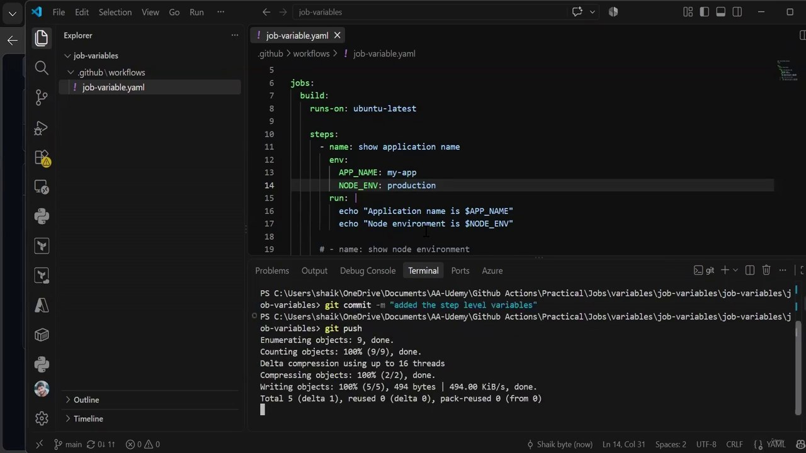

### 5.4 P45 `configuration-variable.yml`

```yaml
name: configuration variable practical
```

工作流名称。P45 讲师把它命名为 configuration variable practical，Actions 页面会按这个名字显示。

```yaml
on:
  push:
    branches:
      - main
```

这里比 P42–P44 多了分支过滤：只有 push 到 `main` 才触发。课里讲师在 GitHub UI 里选择的是 `main` 分支的 workflow run，所以本文也统一用 `main`。这意味着你在本地如果还在 `master` 分支上 push，这个工作流不会触发；这是复现时最常见的“为什么 Actions 没跑”的原因之一。

```yaml
jobs:
  demo:
    runs-on: ubuntu-latest
```

job id 是 `demo`，跑在 `ubuntu-latest`。这里没有 `name` 字段，所以 Actions 页面会直接显示 job id `demo`。P45 的日志里讲师打开的就是这个 `demo` job。

```yaml
    steps:
      - name: show application name
        run: echo "application name is ${{ vars.APP_NAME }}"
```

关键在 `${{ vars.APP_NAME }}`。这是 GitHub Actions 表达式，不是 shell 变量。GitHub 在把 step 交给 runner 之前，会先把 `${{ vars.APP_NAME }}` 替换成仓库变量 `APP_NAME` 的值，再执行 `echo`。所以最终 shell 收到的是 `echo "应用名称是“我的应用”"`（假设你在 UI 里把 `APP_NAME` 配成 `my app`）。

注意 `vars` 上下文只读取仓库级/组织级配置变量，不读取 `env`。也就是说，你在 workflow 里写 `env: APP_NAME: xxx` 并不会让 `${{ vars.APP_NAME }}` 变成 `xxx`；反过来，你在 UI 里配了 `APP_NAME`，也不会自动变成 shell 的 `$APP_NAME`，除非你显式把它映射到 `env`。这两套机制是分开的。课里没有讲两者混用的情况，复现时建议先只用一种，避免自己把自己绕进去。

```yaml
      - name: show environment name
        run: echo "environment name is ${{ vars.NODE_ENV }}"
```

第二个 step 读取 `vars.NODE_ENV`。P45 的日志显示它打印了 `production`，和你在 UI 里配置的值一致。这里再次强调：YAML 文件里没有出现 `my app`、`production` 这两个字面值，值完全来自 GitHub 设置。以后要改环境名，只改 UI，不用改工作流文件，也不用重新提交 commit。

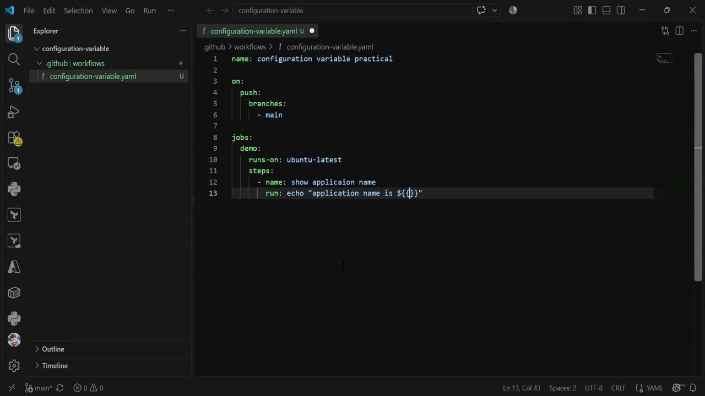

### 5.5 P47 `secrets.yaml`

```yaml
name: GitHub secret demo
```

工作流名称。P47 讲师在 GitHub Actions 页面看到的就是这个名字。

```yaml
on: push
```

每次 push 触发。这里没有分支过滤，任何分支 push 都会跑。

```yaml
jobs:
  secret-demo:
    runs-on: ubuntu-latest
    steps:
      - name: access secret
        run: echo "API key is ${{ secrets.API_KEY }}"
```

`secrets.API_KEY` 是 Secret 上下文。GitHub 在执行前把 `${{ secrets.API_KEY }}` 替换成你在仓库 Secret 里配置的值，然后执行 `echo`。但和 `vars` 不同的是，GitHub 会在日志里对 Secret 值做掩码：你看到的不是真实值，而是一串星号。P47 讲师在日志里明确展示了这一点，并解释这是 GitHub 对敏感信息的保护。

这里有一个常见误解：掩码只发生在日志输出层，不代表 shell 没拿到真实值。如果你的命令把 secret 写进文件、发到网络、或者拼接进别的字符串再打印，GitHub 仍会尽量掩码已知的 secret 字面值；但如果 secret 被编码、截断、拆分，掩码不一定能覆盖。课里没有讲这些边界情况，复现时只要按讲师的写法做 `echo` 即可，不要拿真实密钥做实验。

另外，`secrets` 上下文和 `vars` 上下文的写法很像，但用途不同：`vars` 放非敏感配置，`secrets` 放敏感值。P45 和 P47 分别验证了这两条路径。课里没有讲“什么时候该用 vars、什么时候该用 secrets”之外的细则，但至少记住：密码、API key、token、Webhook URL 这类不应该出现在日志或仓库文件里的值，放 `secrets`；环境名、应用名这类可以公开的值，放 `vars`。

### 5.6 P49 `jobTimeout.yml`

```yaml
name: job timeout practical
```

工作流名称。P49 的 Actions 页面显示的就是这个名字。

```yaml
on: push
```

每次 push 触发。P49 讲师 push 后在 Actions 里看到这次运行。

```yaml
jobs:
  test:
    runs-on: ubuntu-latest
    timeout-minutes: 2
```

`timeout-minutes` 写在 job 层，表示整个 `test` job 最多允许运行 2 分钟。注意它限制的是 job 总时长，不是单个 step 的时长。P48 说“a job timeout tells GitHub how long a job is allowed to run”，P49 把它落到 `test` job 上。

`timeout-minutes` 的单位是分钟，课里明确说 GitHub Actions 不支持秒和小时。所以不要写 `timeout-seconds` 或 `timeout-hours`，也不要写 `2m` 这种带单位的字符串；按课里的写法写数字 `2`。

```yaml
    steps:
      - name: install dependencies
        run: echo "Installing dependencies"
```

第一个 step 只是打印一句话，不是真的安装依赖。P49 用这个 step 模拟“前置步骤正常完成”的场景。它几乎瞬间结束，不会消耗 2 分钟。

```yaml
      - name: run tests
        run: sleep 160
```

第二个 step 执行 `sleep 160`，即 160 秒。因为 job 的 `timeout-minutes` 是 2 分钟（120 秒），这个 step 会在 120 秒左右被 GitHub 取消，不会真的睡满 160 秒。P49 讲师也是离开页面等超时后再回来看结果。

这里要区分两个概念：`timeout-minutes` 是 job 级超时；课里没有讲 step 级超时怎么写，也没有讲 `timeout-minutes` 的默认值。复现时只按课里的写法，把 `timeout-minutes: 2` 放在 job 下即可。如果你把 `sleep 160` 改成 `sleep 60`，job 会在 1 分钟内正常完成，不会触发超时，这样你可以先验证“正常路径”，再改回 160 验证“超时路径”。

另外，`sleep` 是 Linux runner 上的命令，`ubuntu-latest` 自带。课里用的就是 `sleep 160`，没有用 Node 的 `setTimeout` 或别的跨平台写法。

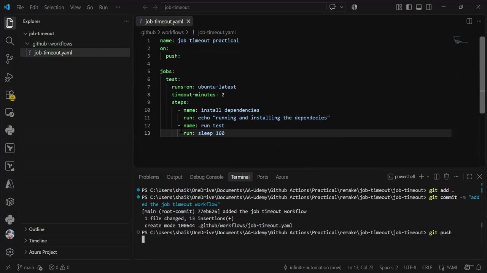

### 5.7 P50 `failure-demo.yml`（课里没有代码，以下为示意）

```yaml
# 课里没有代码，以下为示意。
```

这行注释是本文加的，提醒读者 P50 只有概念讲解，没有像 P42–P49 那样的实操文件。下面的 YAML 是为了让你能动手验证 P50 讲的默认失败、step 级 `continue-on-error`、job 级 `continue-on-error` 三种行为。

```yaml
name: failure handling demo

on: push
```

工作流名称和触发方式。每次 push 触发，和前面的实验保持一致。

```yaml
jobs:
  default-failure:
    runs-on: ubuntu-latest
    steps:
      - name: install dependencies
        run: echo "install dependencies"
```

这是第一个 job，用来演示“默认失败”路径。第一步模拟安装依赖，正常成功。

```yaml
      - name: run tests will fail
        run: |
          echo "test failed on purpose"
          exit 1
```

第二步故意失败。`exit 1` 让 shell 以非零状态退出，GitHub Actions 会把这一步判定为失败。P50 说默认情况下，step 失败会导致 job 失败，后面的 step 被跳过。这个 job 里后面的 `deploy should be skipped` 就是用来验证“被跳过”的。

```yaml
      - name: deploy should be skipped
        run: echo "deploy should be skipped"
```

如果默认行为符合预期，这一 step 不会执行，日志里会显示它被跳过，而不是打印这句话。你可以在 Actions 页面展开这个 job，看 step 列表的执行状态。

```yaml
  step-continue:
    runs-on: ubuntu-latest
    steps:
      - name: run flaky test
        continue-on-error: true
        run: |
          echo "flaky test failed but continue"
          exit 1
```

这是第二个 job，演示 step 级 `continue-on-error: true`。这一步仍然会失败，但因为加了 `continue-on-error`，GitHub 不会因为这一步失败而停止该 job 的后续 step。P50 说“If the step fails, GitHub will continue with the next step if we have added this continue on error true”，这里就是落地写法。

```yaml
      - name: after flaky test
        run: echo "this step still runs"
```

如果 `continue-on-error` 生效，这一 step 会执行并打印。注意：`continue-on-error` 不会把失败变成成功，step 本身仍然标记为失败，只是不阻断后续流程。课里没有展开这个细节，但复现时你会从日志颜色/状态里看出来。

```yaml
  job-that-fails:
    runs-on: ubuntu-latest
    continue-on-error: true
    steps:
      - name: fail this job
        run: |
          echo "job failed on purpose"
          exit 1
```

这是第三个 job，演示 job 级 `continue-on-error: true`。P50 说在 job 级加 `continue-on-error` 后，“even if this job fails, GitHub allow the workflow to continue for the next job”。这里的 `exit 1` 让 job 失败，但 job 级 `continue-on-error` 允许依赖它的下游 job 继续。

```yaml
  after-job:
    needs: job-that-fails
    runs-on: ubuntu-latest
    steps:
      - name: after failed job
        run: echo "this job runs because job-that-fails has continue-on-error"
```

`needs: job-that-fails` 表示这个 job 依赖前一个 job。正常情况下，上游 job 失败，下游 job 会被跳过；但因为上游 job 加了 `continue-on-error: true`，下游 job 仍有机会执行。课里没有讲 `needs` 的详细语义，也没有给这段 YAML，所以这一整段都只能作为示意，实际依赖图行为请以你仓库 Actions 页面的结果为准。如果你不想引入 `needs` 的复杂度，可以只保留前两个 job，先验证默认失败和 step 级 `continue-on-error`，这两条是 P50 讲得最明确的部分。

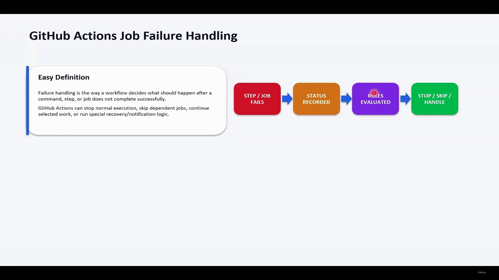

## 6. 复现检查清单

按顺序勾选，任何一项不对，先回到对应小节排查。

### 6.1 仓库与目录

- [ ] 仓库已创建，本地已 `git init`，分支是 `main`。
- [ ] 远程 `origin` 已配置，`git push -u origin main` 成功。
- [ ] `.github/workflows/` 目录存在，且 7 个 YAML 文件都在这个目录下，不是放在仓库根目录。
- [ ] 文件名与本文一致：`job-variable.yml`、`workflow-variable.yml`、`step-variable.yml`、`configuration-variable.yml`、`secrets.yaml`、`jobTimeout.yml`、`failure-demo.yml`。文件名不影响运行，但方便你对照本文和 Actions 列表。

### 6.2 P42 job 级变量

- [ ] `env` 缩进在 `jobs.build` 下，和 `runs-on`、`steps` 同级。
- [ ] 两个 step 的 `run` 里用的是 `$APP_NAME`、`$NODE_ENV`，不是 `${{ env.APP_NAME }}`。
- [ ] Actions 日志里 `show application name` 打印 `payment service`。
- [ ] Actions 日志里 `show node environment` 打印 `production`。

### 6.3 P43 workflow 级变量

- [ ] `env` 在 `jobs:` 之前，顶格写，不在任何 job 内。
- [ ] `APP_NAME` 的值是 `MyApp`，和 P42 的 `payment service` 不同，方便你确认读的是 workflow 级而不是 job 级。
- [ ] 日志里两个 step 都能打印出值。
- [ ] 如果你在 job 内又写了同名 `env`，确认 job 级值覆盖了 workflow 级值；如果没有写，确认读到的是 workflow 级值。

### 6.4 P44 step 级变量

- [ ] 第一个 step 内有 `env`，缩进在 `name` 下、`run` 上，和 `run` 同级。
- [ ] 第一个 step 的日志能打印 `myApp`、`production`。
- [ ] 第二个 step 没有 `env`。
- [ ] 第二个 step 的日志里变量位置为空，而不是报错退出。
- [ ] 你能解释“为什么第二个 step 读不到”，并知道修复方法是把 `env` 提到 job 级或 workflow 级。

### 6.5 P45 配置变量

- [ ] GitHub 仓库 Settings → Secrets and variables → Actions → Variables 里已添加 `APP_NAME`、`NODE_ENV`。
- [ ] UI 里的变量名和 YAML 里的 `vars.APP_NAME`、`vars.NODE_ENV` 大小写完全一致。
- [ ] 工作流只在 `main` 分支 push 时触发；如果你在别的分支测试，确认这是预期行为。
- [ ] 日志里 `show application name` 打印的是 UI 里配置的值，而不是 YAML 里的字面值。
- [ ] 你尝试改一次 UI 里的值，重新跑 workflow，确认不用改 YAML 就能生效。

### 6.6 P47 Secret

- [ ] GitHub 仓库 Settings → Secrets and variables → Actions → Secrets 里已添加 `API_KEY`。
- [ ] Secret 名和 YAML 里的 `secrets.API_KEY` 大小写一致。
- [ ] 日志里 `access secret` 显示的是掩码，不是真实值。
- [ ] 你没有把真实生产密钥放进这个实验仓库。
- [ ] 你能区分 `vars` 和 `secrets` 的用途：前者非敏感配置，后者敏感值。

### 6.7 P49 job 超时

- [ ] `timeout-minutes: 2` 写在 `jobs.test` 下，和 `runs-on`、`steps` 同级。
- [ ] `run tests` 里是 `sleep 160`，不是 `sleep 60`。
- [ ] 第一次运行时，你等到 2 分钟左右再回 Actions 页面，确认 job 在 `run tests` 步骤被取消。
- [ ] 你把 `sleep 160` 临时改成 `sleep 10`，确认 job 能正常完成，排除 YAML 本身的问题，再改回 160。
- [ ] 你知道 `timeout-minutes` 只支持分钟，不写秒或小时。

### 6.8 P50 失败处理（示意）

- [ ] `failure-demo.yml` 文件头有“课里没有代码，以下为示意”的注释，你知道这不是讲师原文件。
- [ ] `default-failure` job 里，`run tests will fail` 失败后，`deploy should be skipped` 被跳过。
- [ ] `step-continue` job 里，`run flaky test` 失败后，`after flaky test` 仍然执行。
- [ ] 如果你保留 `job-that-fails` 和 `after-job`，确认 `after-job` 的实际结果符合你的预期；如果不符合，知道这是示意代码，课里没有展开 `needs` 细节。
- [ ] 你能用自己的话解释：默认失败会阻断后续 step；`continue-on-error` 让流程继续，但不把失败变成成功。

### 6.9 整体验收

- [ ] Actions 页面能看到 7 个工作流（其中 `failure-demo` 是示意）。
- [ ] 每个工作流的 run 都能点开，看到 job 和 step 日志。
- [ ] 你能把 P42、P43、P44 三个实验的“变量作用域”差异讲清楚。
- [ ] 你能把 P45 的 `vars` 和 P47 的 `secrets` 差异讲清楚。
- [ ] 你能解释 P49 为什么 `sleep 160` 没有跑满。
- [ ] 你能解释 P50 默认失败和 `continue-on-error` 的区别。

## 7. 课里没讲但你会撞上的

这一节是本文补充，不是讲师逐字稿内容。标“课里没讲”的地方，表示 P41–P50 没有展开；你复现时如果遇到，按这里的提示排查。

### 7.1 YAML 缩进和冒号

课里没有专门讲 YAML 语法，但这是最容易翻车的地方。`env` 缩进错一格，可能变成另一个字段的子项，GitHub 会直接报 workflow 解析错误。建议：

- 用 VS Code 的 YAML 插件做缩进提示；
- 每个层级固定两个空格，不要混用 Tab；
- `run: echo "..."` 这种一行命令，冒号后面要有空格；
- 多行命令用 `run: |`，下面的命令统一缩进。

### 7.2 分支名不是 `main`

P45 的工作流写了 `branches: main`。课里没有讲如果你的默认分支叫 `master` 会怎样。实际结果是：push 到 `master` 不会触发这个工作流。复现时要么把本地分支改成 `main`，要么把 `branches` 改成你的默认分支名。P42–P44、P47、P49 没有分支过滤，不受影响。

### 7.3 变量名大小写

课里讲师口头读的是 “app name”“node ENV”，屏幕上的写法本文没有逐字确认。GitHub Actions 的 `vars`、`secrets` 引用是大小写敏感的：UI 里叫 `APP_NAME`，YAML 里写 `vars.app_name` 就取不到。复现时建议全部用大写加下划线，UI 和 YAML 保持一致。如果你照某个截图写成小写，也要两边一起改。

### 7.4 `env` 和 `vars` 不是一回事

课里分别讲了 `env` 和 `vars`，但没有讲混用。你可能会想：既然 UI 里配了 `APP_NAME`，为什么 shell 里 `$APP_NAME` 读不到？因为 `vars` 是 GitHub 表达式上下文，不会自动注入 shell 环境。要在 shell 里用，要么写 `${{ vars.APP_NAME }}` 让 GitHub 替换，要么在 `env` 里显式映射：

```yaml
env:
  APP_NAME: ${{ vars.APP_NAME }}
```

这段映射写法课里没有讲，是本文补充。它的作用是先把 `vars` 的值取出来，再作为环境变量注入 shell。复现 P45 时不需要这么写，按课里的 `${{ vars.APP_NAME }}` 直接放在 `run` 里即可。

### 7.5 Secret 掩码的边界

P47 只演示了 `echo` 一个 secret，日志被掩码。课里没有讲：如果 secret 被拼接、截断、Base64 编码后再打印，掩码可能不生效。复现时不要用真实密钥，也不要把 secret 写到文件再上传 artifact。课里没有讲 artifact，本文也不展开。

### 7.6 `timeout-minutes` 的默认值和最小值

P48 说可以设置 job 超时，但没有讲默认超时是多少，也没有讲最小值。本文不编造具体数字。你只需要知道：不写 `timeout-minutes` 时，job 使用 GitHub 的默认行为；写了 `2` 就是 2 分钟。复现 P49 时，2 分钟足够观察 `sleep 160` 被取消。如果你把值改得太小，可能 `install dependencies` 还没跑完就超时，那就不是 P49 想演示的现象了。

### 7.7 `continue-on-error` 不改变失败状态

P50 说 `continue-on-error: true` 可以让流程继续，但没有强调：失败 step 仍然标记为失败，job 的最终结论可能仍是失败（取决于失败位置和 job 级设置）。复现时你会看到 step 是红叉但后续 step 继续跑，这是正常现象，不是配置错了。课里没有讲 `if: always()`、`if: failure()` 这类条件执行，本文不把它们安到讲师头上；如果你需要“失败后才执行的清理步骤”，那是另一个话题。

### 7.8 多个工作流同时触发

你把 7 个文件一起 push 时，所有 `on: push` 的工作流会同时触发。Actions 页面会出现多条 run，容易看花眼。建议按本文顺序分批 push：先 P42–P44 三个变量实验，再 P45、P47，最后 P49、P50。这样每条 run 对应哪个知识点更清楚。课里讲师是一个实验一个仓库/一次 push，本文为了减少仓库数量合并到一个仓库，这是本文的组织方式，不是讲师原话。

### 7.9 `ubuntu-latest` 不是固定版本

课里说 “Ubuntu GitHub hosted runner”，本文统一写 `ubuntu-latest`。`ubuntu-latest` 会随 GitHub 更新指向新的 Ubuntu 版本，`sleep`、`echo` 这些基础命令不受影响。课里没有讲 runner 版本锁定；如果你需要固定版本，可以查 GitHub 文档，但这不是 P41–P50 的内容。

### 7.10 日志里看不到变量值时先别改代码

P44 第二个 step 打印空值是预期结果。如果你第一次看到空值就以为 YAML 写错了，可能会把 `env` 加到第二个 step，结果实验现象消失。建议先对照本文 6.4 的检查清单确认：第一个 step 有 `env`、第二个 step 没有 `env`、第二个 step 的 `run` 里仍然引用 `$APP_NAME`。这三条都满足，空值就是对的。

### 7.11 前端视角的类比边界

本文用“模块级常量 / 函数内常量 / 块级变量”类比 workflow / job / step 的 `env` 作用域，只是为了帮助前端读者理解，不是 GitHub 的官方术语。实际行为以 GitHub Actions 的求值顺序为准：workflow 级 `env` 先注入，job 级覆盖，step 级再覆盖；`vars`、`secrets` 是表达式上下文，在 step 执行前替换。课里没有用前端类比，本文的类比只用于解释，不改变 YAML 写法。

### 7.12 不要把实验仓库当生产仓库

P47 的 Secret 实验用了随机值，这是对的。实际项目中，Secret 一旦创建，GitHub 不允许在 UI 里回读原值，只能覆盖更新。课里没有讲 Secret 的轮换和权限，复现时建议单独建一个实验仓库，不要在你已有的生产仓库里加这些演示 workflow，避免误触发或误用密钥。

---

到这里，P41–P50 的复现路径就完整了：先在本地建目录和 7 个 YAML，按 P42→P43→P44 理解 `env` 的三层作用域，再按 P45、P47 把值从 YAML 移到 GitHub 设置，最后用 P49 验证 job 超时、用 P50 的示意文件验证失败处理。每一步都以 Actions 日志为准，不靠猜。