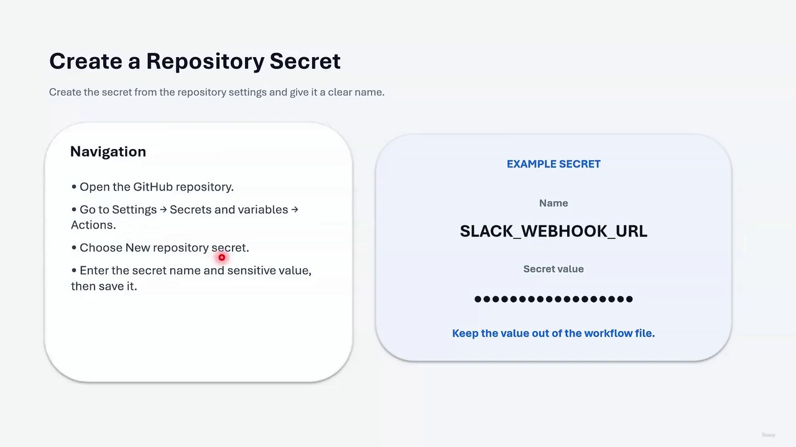
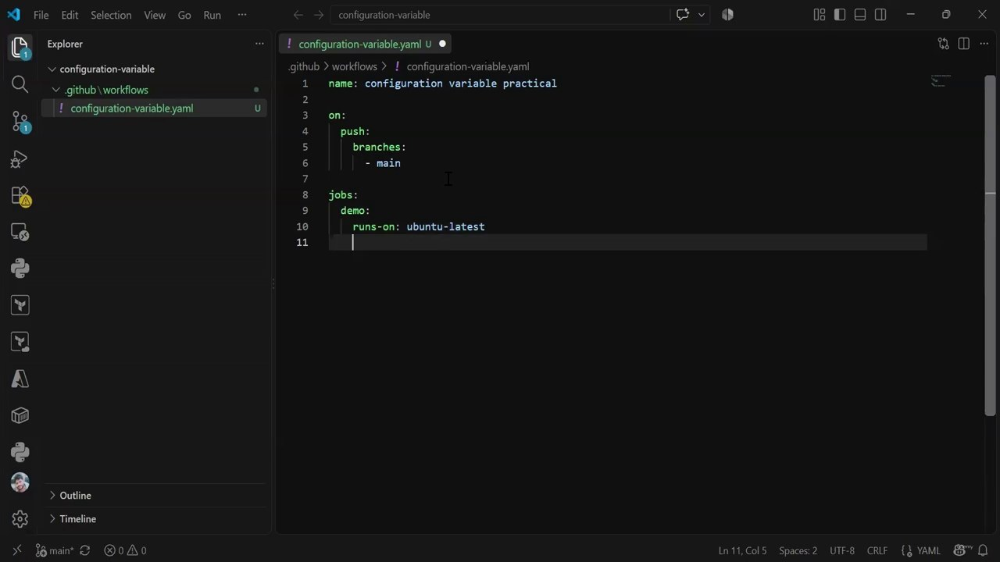
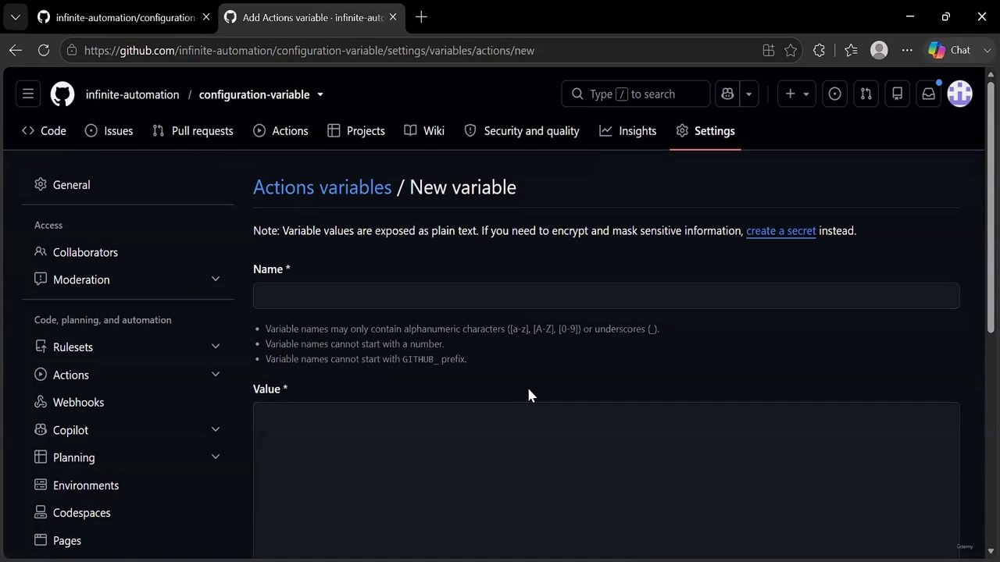
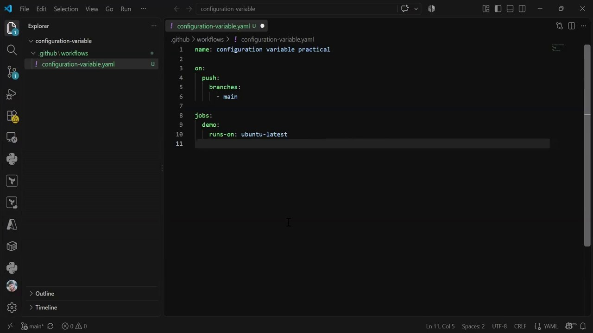
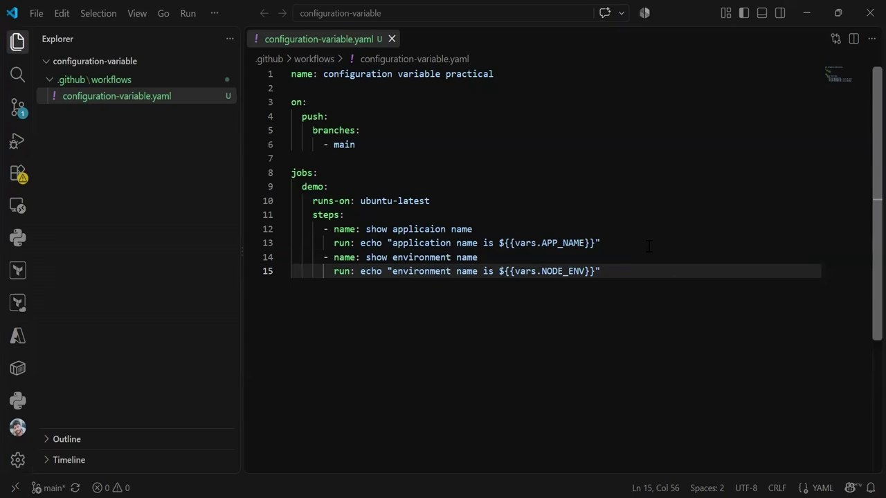
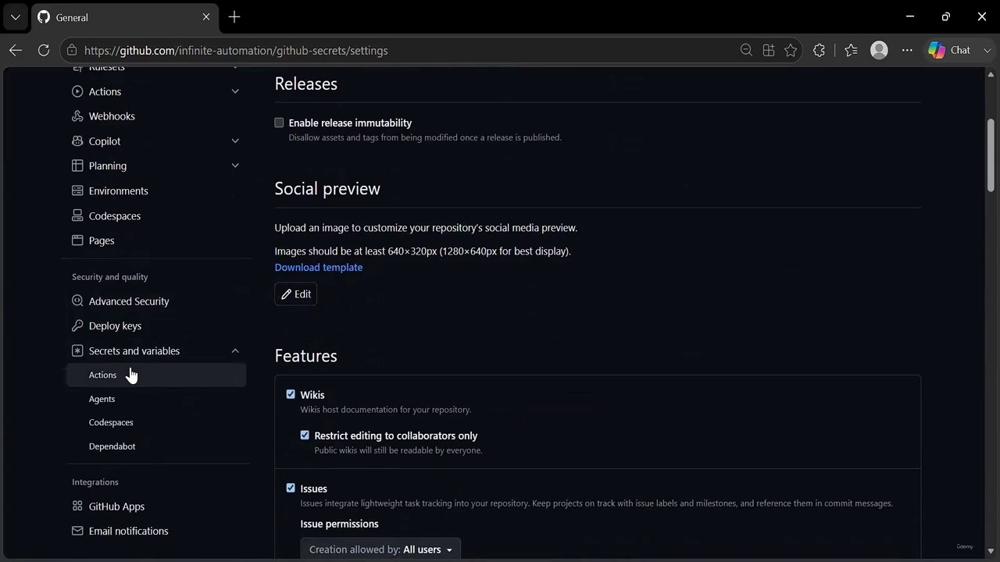
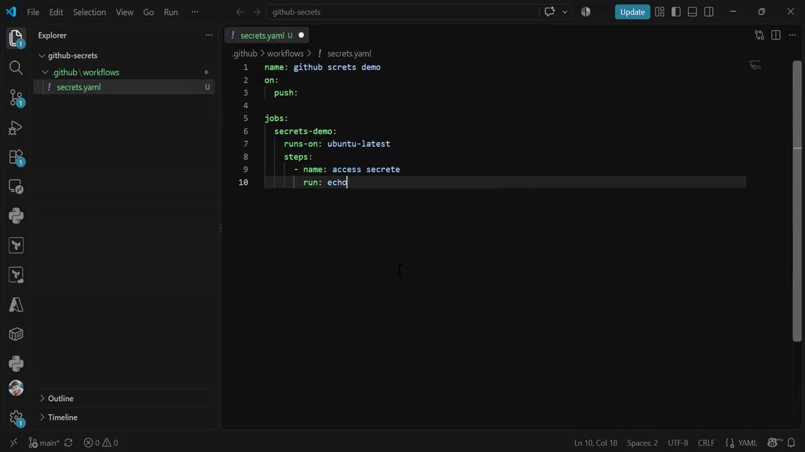

# GitHub Actions Complete P45–P48 复现文档：配置变量、Secrets 与 Job Timeout

> 本文按“读者能照着把东西跑起来”来写。课程 P45 和 P47 分别用了两个仓库：`configuration-variable` 与 `github-secrets`。P46 是 Secrets 的概念说明，不单独建文件；P48 是 Job Timeout 的概念与示例，课程没有给完整仓库路径和触发器，本文会明确标出哪些是为了可复现而补的最小内容。  
>
> 本节不需要安装 npm 依赖，也不需要本地 Node 服务；实际执行发生在 GitHub Actions 的 `ubuntu-latest` runner 上。课程没有给第三方 action 版本，也没有要求 `actions/checkout`，因为示例只做 `echo`，不读取仓库代码。

---

## 1. 这一节做什么

这一节要完成三件可验收的事：

1. **配置变量实战（P45）**：在 GitHub 仓库 Settings 里创建两个非敏感配置变量 `app_name` 和 `node_ENV`，然后在 workflow YAML 里用 `${{ vars.app_name }}`、`${{ vars.node_ENV }}` 读取，推送到 `main` 后，在 Actions 日志里看到 `my app` 和 `production`。
2. **Secrets 实战（P46–P47）**：理解敏感信息不能硬编码在 YAML 里；在 GitHub 仓库里创建 secret `api_key`，在 workflow 里用 `${{ secrets.api_key }}` 访问。运行后，日志里不应该出现明文，GitHub 会把值遮蔽成星号。
3. **Job Timeout（P48）**：用 `timeout-minutes` 限制一个 job 最多运行多少分钟。课程明确说单位是分钟，不支持秒和小时；超过限制 GitHub 会自动取消 job。

最终你会得到两份可推送的 GitHub 仓库代码：

| 仓库 | 文件 | 作用 |
|---|---|---|
| `configuration-variable` | `.github/workflows/configuration-variable.yml` | 读取 repository variables |
| `github-secrets` | `.github/workflows/secrets.yml` | 读取 repository secret |
| `github-secrets` | `.github/workflows/job-timeout-demo.yml` | 可选的 timeout 验证文件，课程未给完整路径，本文补全 |

环境与版本说明：

| 项 | 版本/说明 |
|---|---|
| GitHub Actions runner | `ubuntu-latest`。课程口述为 Ubuntu GitHub Hosted Runner，没有指定具体 Ubuntu 版本号 |
| 第三方 action | 无。本节不需要 `actions/checkout` |
| npm 依赖 | 无 |
| 本地工具 | Git；VS Code 可选。课程没有给 Git / VS Code 版本号，本文也不锁定版本 |
| 运行时 | 不需要本地 Node 服务；workflow 由 GitHub 托管 runner 执行 |

本节课涉及的“变量名/密钥名”如下。注意：它们不是 shell 里自动存在的环境变量，而是 GitHub 仓库设置里的 repository variable / secret，需要在 YAML 里用表达式读取。

| 名称 | 类型 | 课程中的值 | YAML 访问方式 |
|---|---|---|---|
| `app_name` | Repository variable | `my app` | `${{ vars.app_name }}` |
| `node_ENV` | Repository variable | `production` | `${{ vars.node_ENV }}` |
| `api_key` | Repository secret | 课程中填了随机值 | `${{ secrets.api_key }}` |

---

## 2. 讲师原话（带出处）

下面引用逐字稿里的关键原话，方便对照课程意图。英文原话后保留出处；必要处我用中文简述，不改变原意。

> "这里，配置变量用于在 GitHub 中存储非敏感的配置值。这样我们就能在工作流中复用这些值，而不必把它们硬编码到 YAML 文件中。"
> —— p045 [00:00]

> "我们进入“密钥和变量”页面，点击 Actions，在这里会看到变量。接下来点击“新建仓库变量”。"
> —— p045 [02:54]

> "配置变量要用美元符号和花括号，写成 `${{ vars.APP_NAME }}` 这种形式，也就是 `vars.APP_NAME`。"
> —— p045 [05:15]  
> 讲师这里说的是用 `${{ vars.变量名 }}` 的形式读取配置变量；逐字稿里 “vats” 是口音/转写问题，实际是 `vars`。

> "有时我们的工作流需要一些敏感信息，例如密码、API 密钥、令牌或 Webhook URL。"
> —— p046 [00:00]

> "即使工作流使用了密钥，GitHub 也会在工作流日志中遮蔽该密钥的值。"
> —— p046 [01:53]

> "如果要访问密钥，需要使用 `${{ secrets.<密钥名称> }}` 这种写法。"
> —— p047 [03:22]



> "可以使用 `timeout-minutes` 关键字来设置这个时间。"
> —— p048 [00:28]

> "GitHub Actions 的超时时间以分钟为单位，不支持秒和小时。"
> —— p048 [00:58]


从这些话可以提炼出本节的核心规则：**非敏感配置放 Variables，敏感信息放 Secrets，workflow 里分别用 `vars` 和 `secrets` 上下文读取；Job 超时只用 `timeout-minutes`，单位是分钟。**

---

## 3. 从零复现

### 3.1 准备两个空仓库并克隆到本地

在 GitHub 上创建两个空仓库。课程 P45 用的仓库名是 `configuration variable`，P47 用的仓库名是 `GitHub Secrets`。为了避免 URL 里出现空格，建议仓库名用短横线：

- `configuration-variable`
- `github-secrets`

课程里说仓库已经用 Git 命令克隆到本地，本文把本地初始化命令补全。下面命令里的 `<your-user>` 换成你的 GitHub 用户名。

```bash
git clone https://github.com/<your-user>/configuration-variable.git
cd configuration-variable
git checkout -B main
mkdir -p .github/workflows
code .
```

第二个仓库：

```bash
cd ..
git clone https://github.com/<your-user>/github-secrets.git
cd github-secrets
git checkout -B main
mkdir -p .github/workflows
code .
```

说明：空仓库克隆后可能还没有本地 `main` 分支，`git checkout -B main` 用来确保当前分支叫 `main`，因为后面 workflow 的 `on.push.branches` 写的是 `main`。这一步课程没有逐字演示，但为了让复现稳定，需要做。

### 3.2 在 GitHub UI 创建配置变量

进入 `configuration-variable` 仓库页面：

1. 点击 **Settings**。
2. 左侧找到 **Secrets and variables**。
3. 点击 **Actions**。
4. 选择 **Variables** 标签页。
5. 点击 **New repository variable**。
6. 填入：
   - Name：`app_name`
   - Value：`my app`
7. 点击添加。
8. 再点 **New repository variable**，填入：
   - Name：`node_ENV`
   - Value：`production`
9. 点击添加。





课程里口述的是 `app underscore name` 和 `node ENV`。本文按 GitHub 页面可输入的写法写成 `app_name` 和 `node_ENV`。如果你创建时用了别的名字，YAML 里的 `${{ vars.xxx }}` 必须同步改，否则读不到值。

### 3.3 编写 P45 的 configuration-variable workflow

在 `configuration-variable` 仓库中创建文件：

```text
.github/workflows/configuration-variable.yml
```

课程口述里出现过 “configuration variable dot yaml” 和 “configuration variable.yml”，GitHub 对 `.yml` 和 `.yaml` 都识别。本文统一用 `.yml`，避免你复制时文件名不一致。

文件内容见第 4 节完整代码。核心是两个 step：

- `Show application name`：执行 `echo "应用名称是 ${{ vars.app_name }}"`
- `Show environment name`：执行 `echo "环境名称是 ${{ vars.node_ENV }}"`



### 3.4 提交并触发 P45 workflow

在 `configuration-variable` 目录执行：

```bash
git add .
git commit -m "add configuration variable workflow"
git push -u origin main
```

课程里也演示了 `git add .`、`git commit -m ...`、`git push`。第一次推送用 `-u origin main` 可以把本地 `main` 和远端 `main` 关联起来。



推送后打开 GitHub 仓库的 **Actions** 标签页，点进这次 workflow run，再点开 `demo` job，展开两个 step。预期日志里能看到：

```text
Application name is my app
Environment name is production
```

这两个值来自 GitHub Settings 里的 Variables，不是硬编码在 YAML 里的。以后要改值，只需要去 Settings 改 `app_name` / `node_ENV`，不用改 workflow 文件。

### 3.5 创建 Secret 并编写 P47 workflow

进入 `github-secrets` 仓库页面：

1. **Settings**。
2. **Secrets and variables**。
3. **Actions**。
4. 选择 **Secrets** 标签页。
5. 点击 **New repository secret**。
6. Name 填 `api_key`。
7. Value 填一个你自己用的随机值。课程里讲师填的是类似 `12345` 加字母的随机文本；不要用真实生产密钥做练习。
8. 点击添加。



然后在 `github-secrets` 仓库创建：

```text
.github/workflows/secrets.yml
```

workflow 里用：

```yaml
run: echo "API key is ${{ secrets.api_key }}"
```

课程原话是 “dollar with the braces and secrets dot your secret name”，也就是 `${{ secrets.api_key }}`。



提交并推送：

```bash
git add .
git commit -m "add secrets workflow"
git push -u origin main
```

打开 Actions，进入 `secret demo` job，展开 `Access secret` step。日志里不会显示明文，而是显示星号，课程里描述为 “stars”。预期看到类似：

```text
API key is ***
```

具体星号数量以 GitHub 实际显示为准。关键是：**不要期待在日志里看到 secret 明文**。

### 3.6 编写 P48 的 Job Timeout 示例

P48 课程主要讲概念：`timeout-minutes` 告诉 GitHub 这个 job 最多允许运行多少分钟。课程示例把 `timeout-minutes` 设为 `2`，也就是最多 2 分钟；如果 job 在 2 分钟内完成就正常结束，如果达到 2 分钟限制，GitHub 会自动取消 job。课程还强调：**只支持分钟，不支持秒和小时**。

逐字稿没有给 P48 的完整仓库路径、触发器和 step 内容。为了让读者能实际看到“超时被取消”，本文在 `github-secrets` 仓库里补一个可选文件：

```text
.github/workflows/job-timeout-demo.yml
```

它使用 `workflow_dispatch` 手动触发，并放一个 `sleep 180` 的 step。因为 `timeout-minutes: 2` 是 2 分钟，而 `sleep 180` 是 3 分钟，所以 job 会在 2 分钟时被 GitHub 取消。这里要明确：`workflow_dispatch` 和 `sleep 180` 是为了验证 timeout 补的，不是逐字稿里展示的代码；课程只展示了 `timeout-minutes` 关键字和 2 分钟示例。

触发方式：推送到 `main` 后，打开 GitHub 仓库 **Actions**，左侧选择 `Job timeout demo`，点击 **Run workflow**，选择 `main` 分支运行。等待超过 2 分钟，job 会被取消。

---

## 4. 完整代码

目录结构：

```text
configuration-variable/
└── .github/
    └── workflows/
        └── configuration-variable.yml

github-secrets/
├── .github/
│   └── workflows/
│       ├── secrets.yml
│       └── job-timeout-demo.yml
```

### 4.1 `configuration-variable/.github/workflows/configuration-variable.yml`

完整文件，直接保存：

```yaml
name: configuration variable practical

on:
  push:
    branches:
      - main

jobs:
  demo:
    runs-on: ubuntu-latest
    steps:
      - name: Show application name
        run: echo "Application name is ${{ vars.app_name }}"

      - name: Show environment name
        run: echo "Environment name is ${{ vars.node_ENV }}"
```

### 4.2 `github-secrets/.github/workflows/secrets.yml`

完整文件，直接保存：

```yaml
name: GitHub secret demo

on:
  push:
    branches:
      - main

jobs:
  secret-demo:
    name: secret demo
    runs-on: ubuntu-latest
    steps:
      - name: Access secret
        run: echo "API key is ${{ secrets.api_key }}"
```

说明：课程口述的 job 名是 “secret demo”，但 YAML 的 job id 不能带空格，所以 job id 写成 `secret-demo`，再用 `name: secret demo` 显示成课程里的名字。这是 YAML 语法要求，不是课程新增概念。

### 4.3 `github-secrets/.github/workflows/job-timeout-demo.yml`

完整文件，直接保存。该文件是 P48 的可选验证文件；`workflow_dispatch` 与 `sleep 180` 是本文为可复现补的，课程未展示：

```yaml
name: Job timeout demo

on:
  workflow_dispatch:

jobs:
  test:
    runs-on: ubuntu-latest
    timeout-minutes: 2
    steps:
      - name: Print start
        run: echo "timeout demo started"

      - name: Wait longer than timeout
        run: sleep 180
```

---

## 5. 逐行解释

### 5.1 workflow 的通用骨架

以 P45 文件为例：

```yaml
name: configuration variable practical
```

这是 workflow 的显示名称，会出现在 Actions 页面左侧和 run 列表里。它不影响逻辑，只是方便识别。

```yaml
on:
  push:
    branches:
      - main
```

表示当 `main` 分支收到 `push` 时触发。课程 P45 和 P47 都用了 `push` 事件。你如果推送到别的分支，不会触发这个 workflow，除非改 `branches`。

```yaml
jobs:
  demo:
    runs-on: ubuntu-latest
```

`jobs` 下面是一个或多个 job。`demo` 是 job id；`runs-on: ubuntu-latest` 表示使用 GitHub 托管的 Ubuntu runner。课程口述为 Ubuntu GitHub Hosted Runner，没有指定具体 Ubuntu 版本。

```yaml
    steps:
      - name: Show application name
        run: echo "Application name is ${{ vars.app_name }}"
```

`steps` 是 job 内的步骤列表。`name` 是步骤显示名；`run` 表示执行 shell 命令。这里用 `echo` 输出一行文本。

关键点是 `${{ vars.app_name }}`：

- `${{ ... }}` 是 GitHub Actions 表达式语法。
- `vars` 是 repository variables 的上下文。
- `app_name` 是你在 GitHub Settings 的 Variables 里创建的名字。

它不是 shell 自带的环境变量，也不是 Node 的 `process.env.app_name`。如果你在 Node 项目里习惯写 `process.env.APP_NAME`，在这里不能直接等价替换；课程里是直接在 `run` 中用 GitHub Actions 表达式取值。

### 5.2 P45 的两个变量

P45 文件里有两个 step：

```yaml
      - name: Show environment name
        run: echo "Environment name is ${{ vars.node_ENV }}"
```

第二个变量名是 `node_ENV`，值是 `production`。课程口述 “node ENV”，本文按 `node_ENV` 写。你如果在 GitHub UI 里创建成 `node_env`，这里就要改成 `${{ vars.node_env }}`，名字必须对上。

P45 的核心优势是：**值存在 GitHub 仓库设置里，YAML 只引用变量名**。以后改 `app_name` 或 `node_ENV`，不需要改 workflow 文件，也不需要重新硬编码。

### 5.3 P47 的 secret 访问

P47 文件的核心行：

```yaml
        run: echo "API key is ${{ secrets.api_key }}"
```

`secrets` 是 GitHub Actions 的另一个上下文，专门读取 repository secrets。`api_key` 是你在 Settings > Secrets and variables > Actions > Secrets 里创建的名字。

课程 P46 明确说：workflow 使用 secret 时，GitHub 会在 workflow log 里标记/遮蔽 secret 的值，你无法在日志里读到明文，看到的是星号。P47 的演示就是用 `echo` 打印，然后观察日志被遮蔽。实际项目里不建议主动打印 secret；课程这样写是为了演示“遮蔽”效果。

注意 Variables 和 Secrets 是两个不同入口：

- 非敏感值放 **Variables**，用 `${{ vars.xxx }}`。
- 敏感值放 **Secrets**，用 `${{ secrets.xxx }}`。
- 把 API key 放到 Variables 里不会自动变成 secret；把普通配置放到 Secrets 里也不会被 `vars` 读到。

### 5.4 P48 的 `timeout-minutes`

P48 的核心配置：

```yaml
    timeout-minutes: 2
```

它放在 job 下面，表示这个 job 最多允许运行 2 分钟。课程明确说：

- GitHub Actions 的 timeout 使用分钟；
- 不支持秒；
- 不支持小时。

所以你不能写 `timeout-seconds` 或 `timeout-hours`。如果业务上需要 90 秒，课程没有给这种写法；按课程规则只能以分钟为单位设置。需要更长时间就写更大的分钟数，例如 `timeout-minutes: 60`。

课程描述的流程是：job 开始后 GitHub 记录运行时间；在限制内完成就正常结束；达到限制就自动取消 job。这个机制用来避免 job 因未知问题长时间卡住。

从 Node/前端视角类比：Node 里你可能用 `AbortController` 或 `Promise.race` 给异步任务加超时；这里不是代码层的 `setTimeout`，而是 GitHub Actions 在 job 级别做的硬超时。两者概念相似，但执行位置不同。

---

## 6. 复现检查清单

按下面顺序检查，基本能定位大部分问题：

- [ ] GitHub 上已创建 `configuration-variable` 仓库，并且本地已 clone。
- [ ] 本地当前分支是 `main`，`.github/workflows/configuration-variable.yml` 路径完全正确。
- [ ] GitHub 仓库 **Settings > Secrets and variables > Actions > Variables** 中存在 `app_name`，值为 `my app`。
- [ ] 同一页面存在 `node_ENV`，值为 `production`。
- [ ] YAML 中使用的是 `${{ vars.app_name }}` 和 `${{ vars.node_ENV }}`，没有拼写错误。
- [ ] 推送到 `main` 后，Actions 页面出现 `configuration variable practical` 运行记录。
- [ ] `demo` job 成功，`Show application name` 日志显示 `my app`。
- [ ] `Show environment name` 日志显示 `production`。
- [ ] `github-secrets` 仓库 **Settings > Secrets and variables > Actions > Secrets** 中存在 `api_key`。
- [ ] `.github/workflows/secrets.yml` 存在，且使用 `${{ secrets.api_key }}`。
- [ ] 推送后 `GitHub secret demo` 运行成功。
- [ ] `Access secret` step 日志显示 `***` 一类遮蔽值，而不是明文。
- [ ] 可选：`.github/workflows/job-timeout-demo.yml` 中 `timeout-minutes: 2` 位于 job 层级，不是 step 层级。
- [ ] 可选：手动运行 `Job timeout demo`，超过 2 分钟后 job 被取消。
- [ ] 没有在 YAML 里硬编码 `my app`、`production`、真实 API key。
- [ ] 没有把 secret 写进 Variables，也没有把普通变量写进 Secrets。

触发命令回顾：

```bash
# P45 仓库
git add .
git commit -m "add configuration variable workflow"
git push -u origin main

# P47 仓库
git add .
git commit -m "add secrets workflow"
git push -u origin main
```

P48 的 timeout 示例没有 push 触发，使用 GitHub Actions 页面的 **Run workflow** 手动触发。

---

## 7. 课里没讲但你会撞上的

1. **空仓库默认分支可能不叫 `main`**  
   课程说仓库已经 clone 好，但没有逐字演示空仓库初始化。如果你 clone 后发现当前分支不是 `main`，用 `git checkout -B main` 建一个本地 `main`，再推送 `git push -u origin main`。否则 `on.push.branches: main` 可能不会按预期触发。

2. **YAML 的 job id 不能带空格**  
   课程口述 “job name would be secret demo”，但 YAML 的 job id 不能写成 `secret demo`。本文写成 `secret-demo`，再用 `name: secret demo` 保留显示名。这是 YAML 语法限制，不是课程新增内容。

3. **Variables 和 Secrets 在不同标签页**  
   课程 P45 进的是 **Variables**，P47 进的是 **Secrets**。如果你在 Variables 页面找 `api_key`，或者在 Secrets 页面找 `app_name`，会找不到。`vars` 只读 Variables，`secrets` 只读 Secrets。

4. **变量名必须和 YAML 完全对应**  
   课程口述 `app underscore name`、`node ENV`，实际输入时是 `app_name`、`node_ENV`。如果你写成 `app-name` 或 `nodeEnv`，YAML 里也要同步改。名字不一致时，表达式不会报“变量不存在”这种明显错误，而是得到空值，日志看起来像少了一段。

5. **`${{ secrets.api_key }}` 不是 Node 的 `process.env.API_KEY`**  
   课程没有讲 `env:` 映射，也没有讲在 Node 代码里读 `process.env`。如果你后续要把 secret 传给 Node 脚本，需要在 step 里显式声明 `env:`，再用 `process.env` 读；这部分课程没讲，不要直接假设 secret 会自动变成环境变量。

6. **Secret 日志遮蔽不等于“可以随便打印”**  
   课程用 `echo` 演示日志会显示星号，但生产里不建议主动打印 secret。课程没有讲 secret 被拆分、编码、拼接后是否仍能完全遮蔽；不要依赖日志遮蔽来做安全边界。

7. **`timeout-minutes` 只认分钟**  
   课程明确说 GitHub Actions 的 timeout 不支持秒和小时。你不能写 `timeout-seconds`，也不能写 `timeout-hours`。需要 2 分钟就写 `2`；需要 1 小时就写 `60`。这条规则在 P48 里是重点。

8. **P48 的触发器和 `sleep 180` 是本文补的**  
   逐字稿只展示了 `timeout-minutes: 2` 的示例和“超时会取消”的说明，没有给完整 YAML 的触发器和 step。本文为了让你能实际看到取消效果，补了 `workflow_dispatch` 和 `sleep 180`。如果你只照课程原文，你只会得到 timeout 配置，不会自动有一个“跑 3 分钟”的 job。

9. **课程没有用 `actions/checkout`**  
   本节所有 job 只执行 `echo`，不读取仓库源码，所以不需要 `actions/checkout`。如果你后面要在 workflow 里运行前端项目的 `npm install` / `npm run build`，那才需要拉代码；这部分不在 P45–P48 的逐字稿范围内。

10. **课程没有给具体 Ubuntu 版本**  
    `ubuntu-latest` 是 runner 标签，不是固定版本号。课程没有说当前映射到哪个 Ubuntu 版本，本文也不编造。你只需要知道它用的是 GitHub 托管的 Ubuntu runner。

11. **workflow 文件扩展名 `.yml` 和 `.yaml` 都行**  
   课程口述里两种都出现过。GitHub 都识别。本文统一用 `.yml`。真正重要的是路径必须是 `.github/workflows/` 下面，文件名本身不影响触发。

12. **Job 被 timeout 取消后，外部副作用不一定自动清理**  
   课程只讲了 GitHub 会取消 job，没有讲取消后的清理策略。如果你在 job 里调用了外部 API、创建了云资源，超时取消不保证外部系统自动回滚；这是课程范围外、但真实项目会遇到的问题。