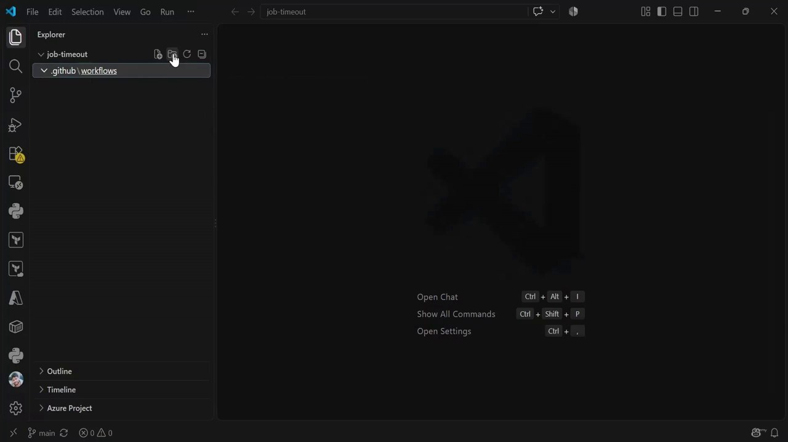
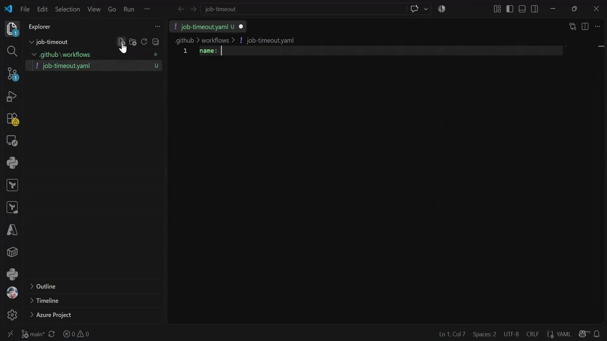
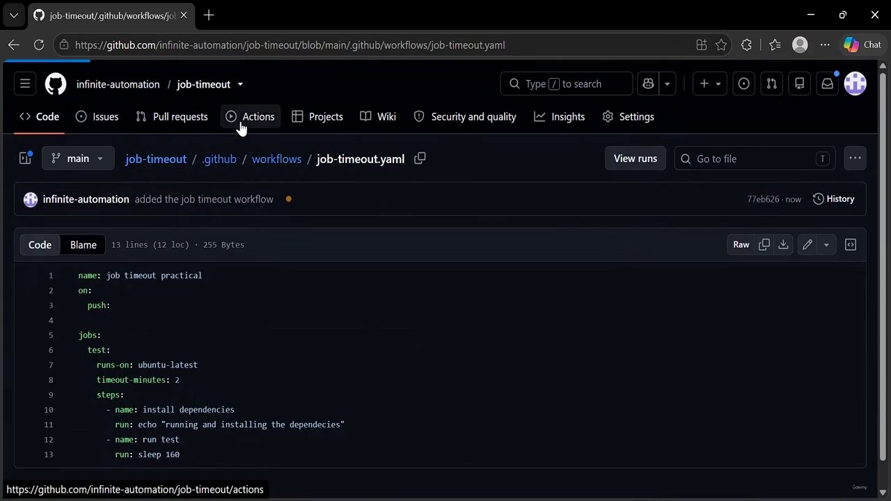
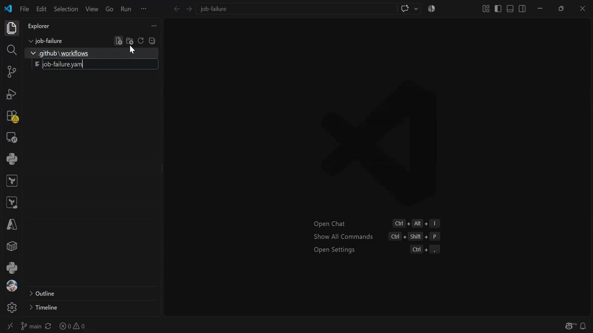
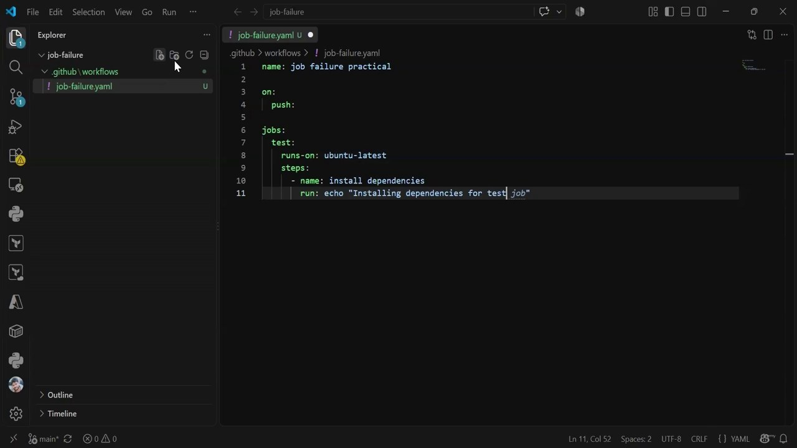
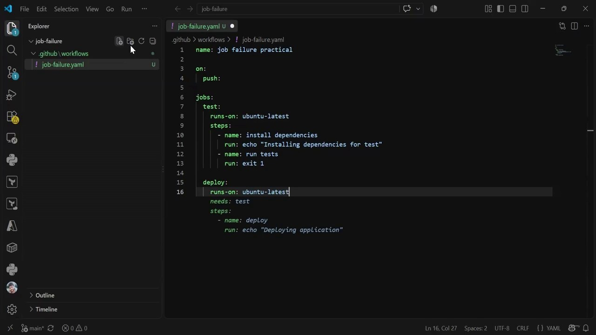
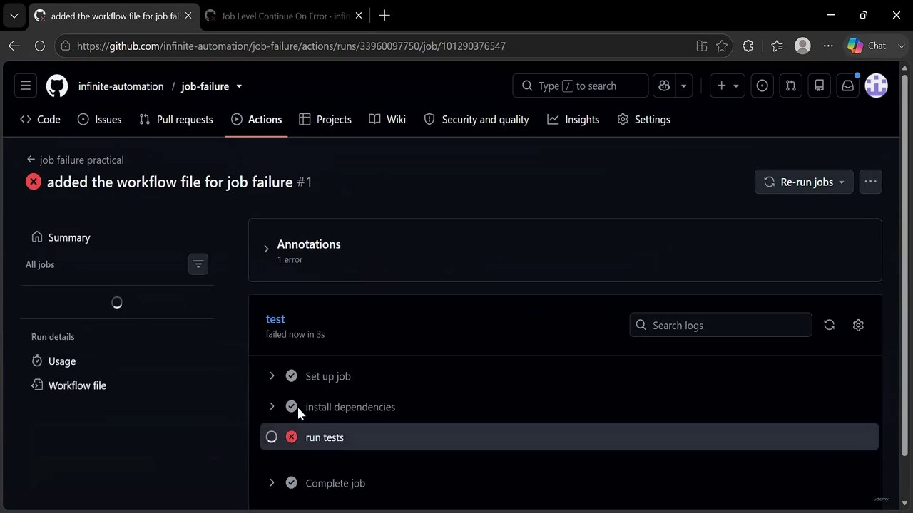
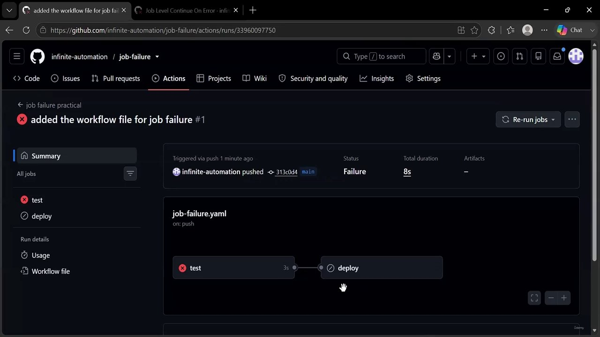
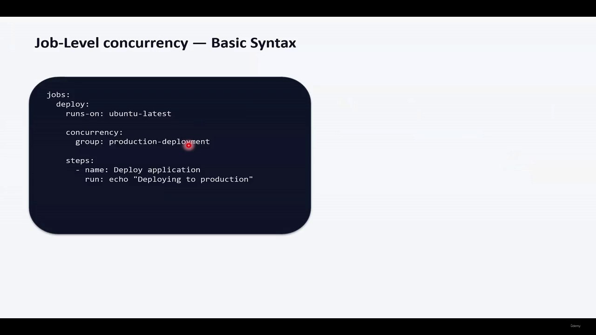

# GitHub Actions Complete｜P49–P52：让流水线“可控”——超时、失败处理与并发

> 覆盖课程：BV1CPap6DEjB 第 49–52 集
> 读者定位：前端 / Node 背景，正在转 AI 应用工程师
> 本节不涉及任何后端语言。唯一的“代码”是 YAML 配置和 shell 一行命令。

---

## 1. 这一节做什么

前三集讲的是“流水线能跑通”，这四集讲的是**流水线跑飞了你怎么办**。

把 GitHub Actions 想象成一个你不看着它干活的机器人：你 push 一次代码，它就自动跑一遍构建、测试、部署。问题在于这个机器人**默认非常“轴”**——

- 某一步卡住了（比如测试脚本 hang 在网络请求上），它会一直跑下去，烧你的免费额度，也不给你任何反馈；
- 某一步失败了，它会立刻把整条流水线判死，后面的部署步骤直接跳过；
- 你连着 push 了三次，三个部署任务可能同时在往同一个环境里写东西，互相踩。

这四集分别对应这三个痛点，一步一步用最小可运行的 YAML 复现出来：

| 集数 | 主题 | 用到的工作流关键字 | 本集性质 |
|---|---|---|---|
| P049 | 作业超时（Job Timeout） | `timeout-minutes` | 现场写文件 + 推送 + 观察失败 |
| P050 | 作业失败处理（概念） | `continue-on-error`（讲解层面） | **纯概念，无实操** |
| P051 | 作业失败处理（实操） | `needs`、`exit 1`、`continue-on-error` | 现场写文件 + 两次推送 + 对比结果 |
| P052 | 并发控制（Concurrency） | `concurrency`、`cancel-in-progress` | **纯概念 + 幻灯片，无实操** |

重要提示：**P050 和 P052 讲师没有在本地创建任何文件**，只在幻灯片上讲原理。P051 是 P050 的落地实现。所以本篇文章的可复现部分集中在 P049 与 P051，P052 我会在「完整代码」里给出一份**按讲师幻灯片描述补全的可运行版本**，并明确标注它是补写而非课上现场产出。

学完这四集，你会得到三个独立的小仓库，每个仓库里一个 workflow 文件，能分别观察到三种不同的 GitHub Actions 行为。

---

## 2. 讲师原话（带出处）

我挑了几句最能说明设计意图的原话，后面所有实现都是围绕这几句展开的。

**关于超时的意义：**

> "有时，由于命令长时间运行，或作业因未知问题卡住，作业可能会耗时过久。这里，我们不希望作业一直长时间运行下去。"
> —— p049 [00:00]

> "通过 timeout-minutes，我们可以定义作业允许运行的最长时间。"
> —— p049 [00:29]

> "现在，我们来添加 timeout-minutes 关键字，并将其值设为 2。这表示整个作业最多可以运行两分钟。"
> —— p049 [01:49]

**关于超时命中后的实际现象（这句最关键）：**

> "这里，我们的 sleep 命令本应运行 160 秒，但测试作业只被允许运行 2 分钟，也就是 120 秒。而这个步骤要运行 160 秒。因此，一旦达到超时限制，GitHub 就自动停止了这一测试作业。"
> —— p049 [05:12]

**关于 GitHub 的默认失败行为：**

> "这里，依赖安装成功，但测试失败。由于测试失败，作业失败，下一个步骤会被跳过。"
> —— p050 [00:55]

> "有时，某个步骤失败也没关系。为此，我们使用 continue-on-error: true。"
> —— p050 [01:04]

> "因此，即使这个作业失败，GitHub 也允许工作流继续执行下一个作业。"
> —— p050 [01:24]

**P051 里观察到的 `needs` 联动失败：**

> "所以，由于这个测试作业失败，整个作业也失败了，而下一个依赖测试作业的部署作业同样失败了。这就是 GitHub 的默认行为。"
> —— p051 [06:22]

**加上 `continue-on-error` 之后的反转：**

> "关键字是 continue-on-error: true。这里的 true 表示允许当前作业失败后继续执行下一个作业，也就是部署作业。"
> —— p051 [07:48]

**关于并发组：**

> "一旦把这些作业放入同一个并发组，GitHub 就能在组这一层级对它们进行控制。"
> —— p052 [00:56]

> "也就是说，如果同一并发组中已有旧作业在运行，而这时有新作业进入，GitHub 就会取消旧作业并启动新作业。"
> —— p052 [01:26]

---

## 3. 从零复现

### 3.1 你需要准备什么

**必须有的：**

- 一个 GitHub 账号（免费版即可）
- 本地装有 Git，并能 `git push`（配好 SSH key 或 PAT）
- VS Code（讲师全程用它，但任何编辑器都行）
- 一个终端

**不需要的：**

- 不需要 Node.js、不需要 npm、不需要 Java、不需要 Docker。
- 这四集**完全没有任何依赖安装**。讲师在 P049 的第一步写了个 `echo` 假装“安装依赖”，P051 也一样（原话：*"由于我们并不运行实际的测试，这里用 sleep 命令即可"* —— p049 [02:47]）。所以你不要去找 `package.json`，它不存在。

**关于 runner：**

讲师用的是 GitHub 托管的 Ubuntu runner。原话被字幕识别错了，写成 "ubuntu-latest，也就是 GitHub Actions 运行器。"（p049 [01:49]），正确写法是 `ubuntu-latest`。

### 3.2 建两个仓库（P052 可选建第三个）

讲师在 P049 和 P051 分别建了两个**空的** GitHub 仓库，然后 clone 到本地：

1. `JobTimeout` —— 对应 P049（讲师原话："我已经创建了名为 JobTimeout 的空 GitHub 仓库"，p049 [00:29]）
2. `job-failure` —— 对应 P051（讲师口述为 "job failure"，p051 [00:29]；GitHub 仓库名不能带空格，用连字符或驼峰都行）
3. `concurrency-practical` —— 对应 P052 的补写版本（**课上没有建这个仓库**）

在 GitHub 网页上创建时勾选 **Add a README file 不要勾**（保持空仓库），然后：

```bash
git clone https://github.com/<你的用户名>/JobTimeout.git
cd JobTimeout

git clone https://github.com/<你的用户名>/job-failure.git
cd job-failure

# 如果要做 P052 的补写实验
git clone https://github.com/<你的用户名>/concurrency-practical.git
cd concurrency-practical
```

如果你不想建三个仓库，也可以只建一个，把三个 YAML 都放在 `.github/workflows/` 下。但那样每次 push 会同时触发三条流水线，观察结果会很乱。**建议老老实实建两个（或者三个）仓库，和讲师保持一致。**

### 3.3 建立目录结构

讲师在 P049 和 P051 都重复了同一套动作：在仓库根目录下创建 `.github/workflows/`。

macOS / Linux / Git Bash：

```bash
mkdir -p .github/workflows
```

Windows CMD：

```bat
mkdir .github\workflows
```

Windows PowerShell：

```powershell
New-Item -ItemType Directory -Force -Path .github\workflows
```



**这一步踩坑率极高**：目录名一定是 `.github`（前面有英文句点），里面是 `workflows`（复数，不是 `workflow`）。写成 `workflow` 的话，GitHub 会完全无视你的文件，Actions 页面一片空白，也不报错。

### 3.4 P049：写 jobTimeout.yml

在 `JobTimeout/.github/workflows/` 下新建 `jobTimeout.yml`，内容见第 4 节。

注意讲师在这里有个口误：P049 [00:54] 他说文件名叫 `jobTimeout.yml`，到 P049 [04:17] 去 GitHub 页面核对时又说成 "jobtimeout.yaml"。**两种后缀 GitHub 都认**，`.yml` 和 `.yaml` 等价。你统一用 `.yml` 就行。



写完提交：

```bash
git add .
git commit -m "added the job timeout workflow"
git push
```

（讲师原话把 `git push` 说成了 "gate push"，是口音导致字幕错误，p051 [05:31]。）

### 3.5 P049：观察结果

推到 GitHub 之后，进入仓库的 **Actions** 标签页：



你会看到一条名字叫 `Job Timeout Practical` 的运行记录，副标题是刚才的提交信息。点进去看 `test` 这个 job：

**不要干等。** 讲师原话就是 *"与其在这里等两分钟，不如等超时时间到了再回来"*（p049 [04:43]）。两分钟后再刷新。

刷新后预期现象：

- `test` job 的状态是失败（红色叉）
- 它**停在 `Run Tests` 这个 step 上**，后面的步骤不会再执行
- `Run Tests` 这个 step 的实际耗时大约 2 分钟，而不是 `sleep 160` 应该跑的 160 秒

讲师对现象的解释原文是：*"这个测试作业在运行测试步骤这一层被停止了，因为它达到了两分钟的超时限制"*（p049 [05:12]）。

### 3.6 P051：写 jobFailure.yml（第一版）

在 `job-failure/.github/workflows/` 下新建 `jobFailure.yml`。



第一版的目的是**先看见默认行为有多狠**，所以故意让 `test` job 失败：



再添加一个依赖 `test` 的 `deploy` job：



提交并推送：

```bash
git add .
git commit -m "added the workflow file for job failure"
git push
```

### 3.7 P051：第一次观察——默认行为

进 Actions 页面，点开最新一次运行：



预期现象：

- `test` job：**失败**，挂在 `Run Test` 这一步（因为 `exit 1`）
- `deploy` job：**灰色，Skipped**，一步都没跑

这就是 `needs: test` 的默认语义——上游失败，下游不跑。

### 3.8 P051：第二版——加 `continue-on-error`

回到编辑器，在 `test` job 层级（注意：**是 job 层级，不是 step 层级**）加上：

```yaml
continue-on-error: true
```



同时，按讲师 P051 [08:14] 的原话 "把这个删掉吧，我们不需要它"，把多写的那个步骤删掉（详见第 4 节对 "run tags" 步骤的说明）。

重新提交：

```bash
git add .
git commit -m "added continue on error as true"
git push
```

再次进 Actions 页面，预期现象变成：

- `test` job：**仍然失败**（`run test` 里的 `exit 1` 没改）
- `deploy` job：**这次跑了**，打印出 "部署应用程序"

讲师对这一幕的总结是：*"这里有一个测试作业失败了，但由于我们在测试上配置了出错后继续，所以在作业层面，GitHub 允许工作流继续执行部署作业"*（p051 [09:11]）。

**注意核心点**：失败还是失败，`continue-on-error` 不是把错误吞掉，而是把「失败」这件事的**传播范围**限制在这个 job 内，不向上、向下蔓延。这就是 P050 [00:55] 讲的 *"失败处理决定当某个步骤或作业失败时应该发生什么"*。

### 3.9 P052：并发（无现场实操）

P052 整集只有幻灯片。讲师在 [00:56] 说这是一个 *"简单的作业级并发示例"*：一个 `deploy` job 使用名为 `production deployment` 的并发组，并设置了 `cancel-in-progress: true`。




**课上没有写这个文件，也没有推送。** 第 4 节给出的 `concurrency.yml` 是我按幻灯片描述补全的可运行版本，你可以新建一个 `concurrency-practical` 仓库自己验证一遍。

---

## 4. 完整代码

### 4.1 目录总览

```text
JobTimeout/
└── .github/
    └── workflows/
        └── jobTimeout.yml

job-failure/
└── .github/
    └── workflows/
        └── jobFailure.yml

concurrency-practical/            ← 课上未建，为复现 P052 补建
└── .github/
    └── workflows/
        └── concurrency.yml
```

### 4.2 `JobTimeout/.github/workflows/jobTimeout.yml`

```yaml
name: Job Timeout Practical

on:
  push:

jobs:
  test:
    runs-on: ubuntu-latest
    timeout-minutes: 2

    steps:
      - name: Install Dependencies
        run: echo "Installing dependencies"

      - name: Run Tests
        run: sleep 160
```

**关于 `echo` 的内容**：讲师在 P049 [02:19]–[02:47] 说这一步 "将执行运行并安装依赖。Echo"，逐字稿没有完整记录引号里的字符串。上面写的 `echo "安装依赖"` 只是一个占位文案，你可以改成任何内容，**不影响超时实验的结果**。

### 4.3 `job-failure/.github/workflows/jobFailure.yml`（第一版：演示默认行为）

```yaml
name: Job Failure Practical

on:
  push:

jobs:
  test:
    runs-on: ubuntu-latest

    steps:
      - name: Install Dependencies
        run: echo "Installing dependencies for test"

      - name: Run Test
        run: exit 1

      - name: Run Tags
        run: exit 1

  deploy:
    runs-on: ubuntu-latest
    needs: test

    steps:
      - name: Deploy
        run: echo "Deploying the application"
```

**关于 `Run Tags` 这个步骤**：讲师在 P051 [03:16]–[03:45] 确实说了 *"再加一个步骤。步骤名称叫 run tags。然后用 run 并带上退出码 1。"*，所以在第一版里它是存在的。但到 P051 [08:14] 他又说 *"我们把这一项删掉，我们不需要它。"*——逐字稿没有明确指代 "this one" 是哪个，按上下文最可能是这个多余的 `Run Tags` 步骤。所以第一版保留它、第二版删掉它，这是最贴合录音的还原方式。

**这一步加不加其实不影响结论**：`Run Test` 里的 `exit 1` 一执行，job 就已经失败了，`Run Tags` 根本不会跑。它纯粹是讲师多写的一段。

### 4.4 `job-failure/.github/workflows/jobFailure.yml`（第二版：最终版本）

```yaml
name: Job Failure Practical

on:
  push:

jobs:
  test:
    runs-on: ubuntu-latest
    continue-on-error: true

    steps:
      - name: Install Dependencies
        run: echo "Installing dependencies for test"

      - name: Run Test
        run: exit 1

  deploy:
    runs-on: ubuntu-latest
    needs: test

    steps:
      - name: Deploy
        run: echo "Deploying the application"
```

这是 P051 结束时仓库里的最终状态。逐字稿原话：*"如你所见，我们已经成功地把 continue on error true 加到了测试作业里"*（p051 [09:11]）。

### 4.5 `concurrency-practical/.github/workflows/concurrency.yml`（按 P052 幻灯片补写，课上未现场创建）

```yaml
name: Concurrency Practical

on:
  push:

jobs:
  deploy:
    runs-on: ubuntu-latest

    concurrency:
      group: production-deployment
      cancel-in-progress: true

    steps:
      - name: Deploy
        run: echo "Deploying the application"
```

**必须说清楚**：讲师在 P052 只讲了「`deploy` job 使用名为 `production deployment` 的并发组」和「`cancel in progress` 设成 `true`」这两件事（p052 [00:56]、p052 [01:26]）。他**没有**现场敲这个 YAML，也没有说明确切的键名拼写和缩进层级。上面的写法是按 GitHub Actions 的 `jobs.<job_id>.concurrency` 结构补的，用于让你能真正跑一遍。如果你在实际环境中发现字段名或行为与预期不符，**以你终端/Actions 页面上的实际输出为准**。

---

## 5. 逐行解释

### 5.1 `jobTimeout.yml`

```yaml
name: Job Timeout Practical
```

工作流在 Actions 列表里显示的名字。讲师原话：*"把工作流命名为 job timeout practical。"*——p049 [01:21]。这个名字**只是给人看的**，改它不影响行为。

```yaml
on:
  push:
```

触发条件：任何一次 push 都跑。讲师原话：*"加上 on 关键字，事件用 push"*——p049 [01:21]。

这里有两个坑：

1. `on:` 后面**必须有内容**，`push` 后面可以什么都不跟（表示所有分支），也可以跟 `branches: [main]`。本课用的是「什么都不跟」。
2. `on` 在 YAML 1.1 里会被解析成布尔值 `true`，很多编辑器会给你标黄。**别管它**，GitHub 自己解析没问题。VS Code 装了 GitHub Actions 插件的话也会提示，忽略即可。

```yaml
jobs:
  test:
```

`jobs` 下面每一个键就是一个 job 的 **id**。`test` 是 id，不是显示名——显示名在 Actions 页面里就是 `test`，因为讲师没写 `name:`。

```yaml
    runs-on: ubuntu-latest
```

指定 runner 操作系统。`ubuntu-latest` 是 GitHub 托管的免费 runner。**这一行决定了你下面能写什么 shell 命令**：`sleep` 是 Linux/macOS 的，Windows runner 上要写 `Start-Sleep -Seconds 160` 或 `timeout /t 160`。

> **给前端同学的对照**：`runs-on` 有点像 `package.json` 里的 `os` 字段，它决定了你的脚本跑在什么「宿主机」上。你在 Node 里写 `process.platform === 'win32'` 分支判断，在这里就变成了「选 `ubuntu-latest` 还是 `windows-latest`」。

```yaml
    timeout-minutes: 2
```

**本集的唯一主角。** 含义是：这个 job 从开始到结束，最多允许占用 2 分钟。

讲师的解释：*"值设为二。也就是说整个作业最多可以运行两分钟。如果作业在两分钟内完成，就正常继续。如果超过两分钟，GitHub 会取消该作业。"*（p049 [01:49]，"sell" 是 "cancel" 的误识别）。

注意三个细节：

1. **单位是分钟**，不是秒。`sleep 160`（160 秒 ≈ 2.67 分钟）刚好越过 `timeout-minutes: 2`（120 秒）的线，讲师是**故意**挑的 160 这个数字。
2. `timeout-minutes` 是 **job 级**配置，管的是整个 job 的总时长，**包括所有 step 加起来**，不是单个 step 的时长。
3. 超时触发后，job 直接判为**失败**，并且停在当时正在执行的那个 step 上。

> **给前端同学的对照**：这就是浏览器的 `AbortSignal.timeout(120_000)`，只不过它中止的不是 fetch，而是一个 CI job。你在 Node 里写 `fetch(url, { signal: AbortSignal.timeout(120000) })` 时的那种「到点就掐」，和 `timeout-minutes` 是同一个心智模型。

```yaml
    steps:
      - name: Install Dependencies
        run: echo "Installing dependencies"
```

第一个 step。`name` 是在 Actions 页面里左侧那一行文字，`run` 是要执行的 shell 命令。

讲师在这一步**没有真的安装任何依赖**，就是一个 `echo`。原话：*"这将执行运行并安装依赖"*（p049 [02:19]）——他只是占个位，让流水线看起来像真实项目。

```yaml
      - name: Run Tests
        run: sleep 160
```

第二个 step，也是**超时命中的地方**。

`sleep 160` 让这个 step 空转 160 秒。讲师原话：*"由于我们并不运行实际的测试，这里用 sleep 命令故意让这个步骤运行超过两分钟"*（p049 [02:47]）。

因为 job 总共只给 120 秒，脚本走到第 120 秒时会被 GitHub 强制掐断，`sleep 160` **跑不完**。这就是你在 Actions 页面看到「耗时约 2 分钟」而不是「160 秒」的原因。

**换个角度理解**：如果你想验证「不是 sleep 本身有问题」，可以把 `timeout-minutes` 改成 `5`，再推一次，你会发现这次 `Run Tests` 真的跑满了 160 秒并且成功。这个对照实验讲师没做，但值得你自己做一次——它能让你彻底分清「脚本失败」和「被超时掐死」这两种红色叉的区别。

### 5.2 `jobFailure.yml`（第一版）

```yaml
name: Job Failure Practical

on:
  push:
```

和上一集完全一样，讲师在 P051 [01:24]–[01:52] 又写了一遍。

```yaml
jobs:
  test:
    runs-on: ubuntu-latest
```

`test` job 的骨架。

```yaml
    steps:
      - name: Install Dependencies
        run: echo "Installing dependencies for test"
```

第一个 step，成功。原话：*"用 run 关键字执行 shell，带上 echo 键并安装测试依赖"*——p051 [02:21]。

这一步的作用是**建立一个成功的对照**：你能在页面上看到第一个 step 是绿色的，第二个是红色的，从而确认「失败精确地发生在 `Run Test`，不是别的地方」。

```yaml
      - name: Run Test
        run: exit 1
```

**关键的一行。** `exit 1` 是一个 Unix 命令，作用是「立即退出，返回退出码 1」。

在 Unix 世界里，**退出码 0 = 成功，非 0 = 失败**。讲师专门解释过这一点：*"这里，退出码 0 表示命令成功完成。而这里我们用的是退出码 1，只是为了给我们的实践故意制造一个作业失败。"*（p051 [02:50]，"exist" 是 "exit" 的误识别）。

GitHub Actions 就是靠这个退出码判断 step 成功还是失败的。任何 `run` 步骤，只要最后一条命令的退出码非 0，这个 step 就红。

> **给前端同学的对照**：这就是 Node 里的 `process.exit(1)`。你在 `package.json` 里写 `"test": "jest"`，Jest 有测试挂了就 `exit 1`，然后 `npm test` 在 CI 里就红——完全一样的机制。区别只是这里你用一行 `exit 1` 手动模拟了「测试挂了」。

```yaml
      - name: Run Tags
        run: exit 1
```

（第二版会删掉这一段，见下。）

讲师在 P051 [03:16] 说 *"步骤名称叫 run tags"*，然后又补了一句 *"我们使用 run，并把退出码设为 1。加上它，是因为我们想看看 GitHub 默认会如何处理这个错误。"*。

但这里有个逻辑矛盾：`Run Test` 已经 `exit 1` 了，job 在那一刻就失败，`Run Tags` **根本不会被执行**（P050 [00:55] 讲得很清楚：*"因为测试失败，作业失败，下一个步骤被跳过"*）。所以这个 step 在实验上是**完全无效**的，删掉不影响任何结论。讲师自己也在 [08:14] 说了 "我们不需要这个。"。

```yaml
  deploy:
    runs-on: ubuntu-latest
    needs: test
```

第二个 job。

`needs: test` 是**依赖声明**：`deploy` 必须等 `test` 才有资格跑。讲师原话：*"这里的部署作业依赖于测试作业。加上 needs test。"*——p051 [04:05]。

默认语义（也就是本集的第一个观察点）：

- `test` 成功 → `deploy` 正常跑
- `test` 失败 → `deploy` **直接跳过**（Skipped，灰色），一步都不执行

这就是 P051 [06:22] 观察到的现象："由于这个测试作业失败，整个作业失败，而下一个依赖于测试作业的部署作业也失败了。"

```yaml
    steps:
      - name: Deploy
        run: echo "Deploying the application"
```

部署步骤的占位实现。真实项目里这里会是 `npm run deploy` 或者 `vercel deploy` 之类的，本课只 `echo` 一行，原话：*"它将执行 shell 作为部署应用程序"*——p051 [04:34]。

### 5.3 `jobFailure.yml`（第二版）——唯一的变化

```yaml
  test:
    runs-on: ubuntu-latest
    continue-on-error: true
```

只多了这一行。但它改的是**语义**，不是语法糖。

P050 [01:04] 讲师区分了两个层级：

> "有时，某个步骤失败也没关系。为此，我们使用 continue-on-error: true。如果添加了 continue-on-error: true，那么该步骤失败后，GitHub 仍会继续执行下一个步骤。"
> —— p050 [01:04]

> "这是在作业级别使用 continue-on-error。这里，我们在作业级别添加了 continue-on-error。因此，即使这个作业失败，GitHub 也允许工作流继续执行下一个作业。"
> —— p050 [01:24]

也就是说：

| 写在哪个层级 | 效果 |
|---|---|
| **step 级**（`steps[].continue-on-error`） | 这一步挂了，**当前 job 继续跑下一个 step**；job 整体仍可能成功 |
| **job 级**（`jobs.<id>.continue-on-error`，本课用法） | 这个 job 挂了，**整条 workflow 继续跑下一个 job**；`needs` 依赖它的 job 不被跳过 |

本课用的是**后者**：写在 `test:` 下面、和 `runs-on:` 同级。

P051 [07:48] 讲师的原话：*"尽管这个测试作业失败了，在 run test 这个步骤上，工作流仍然可以继续进入部署作业。所以关键字就是 continue on error true。"*

> **给前端同学的对照**：这非常像 `Promise.allSettled()` vs `Promise.all()` 的差别。
> `Promise.all()` 是默认行为——一个 reject，整个 Promise 链就断了，后面的 `.then` 不执行（≈ 没有 `needs` 的默认跳过）。
> `Promise.allSettled()` 是 `continue-on-error: true`——每个结果都被记下来，失败的只是 `{status: 'rejected'}`，流程本身不中断，你还能继续处理下一段。
> 本质上 GitHub 在这里的默认值等同于「fail-fast 模式」，`continue-on-error` 就是显式关掉 fail-fast。

### 5.4 `concurrency.yml`（补写）

```yaml
    concurrency:
      group: production-deployment
      cancel-in-progress: true
```

这是**job 级**的并发控制。讲师在 P052 [00:56] 的解释：

> "并发可帮助我们控制属于同一组的作业。例如，我们可能不希望两个生产部署同时运行。因此，这里我们可以把这些部署作业放入同一个并发组。"

拆开看：

- `group: production-deployment` —— **并发组的名字**。名字相同的 job 进同一个"队列"。讲师幻灯片里口述的是 `production deployment`（带空格），YAML 里写成 `production-deployment` 更稳妥；组名是**区分大小写还是忽略大小写、允许哪些字符，课里没讲**，以官方文档为准。
- `cancel-in-progress: true` —— 讲师 P052 [01:26] 的解释是：*"如果有一个旧作业正在运行，而同一组中来了新作业，GitHub 会取消旧作业并启动新作业。所以当我们更关心工作流的最新一次执行时，这很有用。"*
- 不写 `cancel-in-progress` 时，新任务会**排队等待**旧任务跑完（讲师 P052 [00:56]–[01:21]：*"新作业可能会在当前作业运行期间等待。"*）。

P052 [01:55] 讲师给了一个流程总结，翻译过来是：

1. 一个 job 来了
2. GitHub 检查它有没有并发组
3. 有的话，检查同组里是否已经有 job 在跑或在等
4. 根据并发设置，这个 job 可能**等待**，也可能**取消旧的**

> **给前端同学的对照**：`group` 就是一个**按名字取的互斥锁（mutex）**。你在 Node 里可能见过这种写法：
>
> ```js
> const locks = new Map();
> function withLock(key, fn) {
>   const prev = locks.get(key) ?? Promise.resolve();
>   const next = prev.then(fn, fn);
>   locks.set(key, next);
>   return next;
> }
> ```
>
> `withLock('production-deployment', deploy)` 里那个 `'production-deployment'` 字符串，就是 `group` 的值。而 `cancel-in-progress: true` 对应的是另一种策略：不是排队，而是**用 `AbortController` 把上一个请求 abort 掉，只保留最新的那个**。前端熟悉的「输入即搜索、取消上一次请求」用的就是这个模式。

---

## 6. 复现检查清单

按顺序打勾，每一项都对应一个你能亲眼看到的现象。

### P049 — 超时

- [ ] 仓库 `JobTimeout` 已在 GitHub 上创建，并且是空仓库（没有 README）
- [ ] 本地 `git clone` 成功，`git status` 干净
- [ ] `.github/workflows/jobTimeout.yml` 存在，注意 `.github` 有点、`workflows` 是复数
- [ ] 文件里 `timeout-minutes: 2` 写在 **`test:` job 下面**，和 `runs-on:` 同级，缩进 4 个空格
- [ ] `sleep 160` 在 `Run Tests` 这个 step 的 `run:` 里
- [ ] `git add . && git commit -m "added the job timeout workflow" && git push` 三条都成功
- [ ] GitHub 网页刷新后，能看见 `.github/workflows/jobTimeout.yml` 这个文件
- [ ] Actions 标签页出现了名为 `Job Timeout Practical` 的运行记录
- [ ] **等 2 分钟后刷新**，`test` job 是**红色失败**
- [ ] 点进 `test` job，能看见 `Install Dependencies` 是绿色的、`Run Tests` 是红色的
- [ ] `Run Tests` 的实际耗时约 2 分钟（120 秒），**不是 160 秒**
- [ ] （加分项）把 `timeout-minutes` 改成 `5` 再推一次，确认 `Run Tests` 这次能跑满并成功——证明不是脚本本身的问题

### P051 — 失败处理

- [ ] 仓库 `job-failure` 已创建并 clone
- [ ] `.github/workflows/jobFailure.yml` 存在（注意是 `jobFailure`，驼峰）
- [ ] 第一版里有 `Run Test` → `run: exit 1`
- [ ] `deploy` job 里有 `needs: test`
- [ ] 推送后 Actions 页面能看到运行记录
- [ ] **第一次观察**：`test` job 红色失败，`deploy` job 灰色 Skipped
- [ ] 点进 `test` job，失败精确发生在 `Run Test` 这一步，`Install Dependencies` 是绿的
- [ ] 编辑文件，在 `test:` 下加 `continue-on-error: true`（位置和 `runs-on:` 同级）
- [ ] （可选）删掉 `Run Tags` 那个多余步骤
- [ ] `git commit -m "added continue on error as true"` 并 push
- [ ] GitHub 网页上确认文件里确实有 `continue-on-error: true`
- [ ] **第二次观察**：`test` job **仍然是红的**，但 `deploy` job **跑了**，不再是 Skipped
- [ ] 点开 `deploy` job 的日志，能看见 `Deploying the application`

> 这两次观察的对比就是 P051 的全部价值。如果你第二次 `deploy` 还是 Skipped，99% 是 `continue-on-error` 缩进错了位置——它必须在 job 层级，不能缩进到 `steps:` 里面去。

### P052 — 并发（补写实验）

- [ ] 仓库 `concurrency-practical` 已创建并 clone
- [ ] `.github/workflows/concurrency.yml` 已推送
- [ ] 在 30 秒内**连续 push 两次**（可以 `git commit --allow-empty -m "trigger" && git push` 重复）
- [ ] Actions 页面出现**两条**运行记录
- [ ] 观察：如果第一条还在跑，第二条进来后第一条变成了 **Cancelled**（因为 `cancel-in-progress: true`）
- [ ] （对照实验）把 `cancel-in-progress` 改成 `false` 或者干脆删掉，再连推两次，观察第一条这次是**跑完**还是被取消

> 如果你没看到 Cancelled，别急着怀疑自己：短时间内两次触发的排队时序、以及第一条是不是已经跑完了，都会影响现象。这门课**没有**演示这个实际效果，所以这里只作为自测建议。

---

## 7. 课里没讲但你会撞上的

这一节全部是**课上没讲**的内容，有些是我替你踩过的坑，有些是这门课刻意留白的部分。看的时候请明确：**这些不是讲师的说法**。

**1. `timeout-minutes` 的默认值和上限，课里没讲。**
讲师只演示了显式设置 `2`。如果你的 workflow 里不写这一行，会发生什么？能跑多久？上限是多少？——**课里没讲**。别凭记忆填数字，去官方文档查 `jobs.<job_id>.timeout-minutes` 那一页。这个值一旦设小了，正常的慢测试也会被误杀，比不设还危险。

**2. `sleep` 不是跨平台的，课里没讲。**
讲师全程用 `ubuntu-latest`，所以 `sleep 160` 直接能用。但你如果哪天把 `runs-on` 改成 `windows-latest`，`sleep` 会报「command not found」，得换成 PowerShell 的 `Start-Sleep -Seconds 160`。这是 runner 操作系统差异，不是 GitHub Actions 的坑。

**3. YAML 缩进错一位，报错信息极其难懂，课里没讲。**
讲师全程在 VS Code 里手写，缩进都是对的，所以没演示错误情况。实际写的时候最常见的三种翻车：
- 用了 Tab 而不是空格（YAML **禁止** Tab）
- `.github/workflows/` 拼成 `.github/workflow/`（少个 s，GitHub 静默忽略，**不报错**）
- `steps:` 下面的 `-` 和 `name:` 之间对不齐

第三种尤其阴，因为它可能「能跑」，只是 step 顺序/嵌套和你以为的不一样。建议装 VS Code 的 **YAML** 扩展（Red Hat 出品那个），它会实时标红。

**4. job 级 `continue-on-error` 和 step 级的区别，P050 只讲了一句。**
讲师在 P050 [01:04] 提了 step 级、[01:24] 提了 job 级，但**没讲清楚两者可以叠加**，也没讲 job 级 `continue-on-error` 之后，上游 job 的 `needs.<job_id>.result` 到底算成功还是失败。这门课停在「下游 job 跑了」这个观察上。如果你要做更复杂的 DAG（比如「测试挂了也要发通知，但不能部署」），光靠 `continue-on-error` 是不够的——那是 `if:` 条件表达式的活。**具体写法课里没讲，请查官方文档的 `jobs.<job_id>.if` 一节。**

**5. `needs` 的默认跳过是「不可逆」的，课里没讲。**
P051 只演示了「上游失败 → 下游 skip」。但如果你想要「上游失败 → 下游**照样跑**」，除了 `continue-on-error`，还有另一条路是在下游 job 上加 `if: always()`。这两条路的语义不一样：`continue-on-error` 是**让上游的失败不扩散**，`if: always()` 是**让下游无视上游状态强制跑**。讲师只讲了前者。**后者课里没讲**，你需要自己权衡用哪个。

**6. 并发组是跨 workflow 生效的，课里没讲。**
P052 只讲了「同一个 workflow 里的 job 之间」。实际上 `concurrency` 也可以写在 **workflow 顶层**（和 `on:`、`jobs:` 同级），而且**组名相同的 workflow 之间也会互相影响**——哪怕它们来自不同的 `.yml` 文件。这意味着如果你在三个仓库里都用了 `group: production-deployment`，理论上它们会挤同一把锁。**这一点课里完全没提**，但对多仓库项目影响很大，值得单独查文档。

**7. `cancel-in-progress` 可能会取消掉你不想取消的运行，课里没讲。**
讲师说这个选项"当我们更关心最新一次执行时很有用"。但真实场景里，如果你一次 push 触发了 build + test + deploy 三个阶段，而并发组设在 deploy 上，那么「连着 push 两次」会把第一次的 deploy 掐掉——如果第一次已经在往生产写数据了，这就是**数据不一致**的来源。课上没讨论这个风险。真要上生产，一般会给 `group` 加上 `${{ github.ref }}` 之类的动态后缀，只让同一个分支自己互斥。**具体表达式写法课里没讲。**

**8. AI 应用场景的一个直接映射（这是我加的，不是讲师说的）。**
你以后做 LLM 应用，CI 里大概率会跑「评测集回归」——几百条 prompt 打给模型 API，跑一次十几分钟。这时候：
- `timeout-minutes` 就是防止评委脚本卡死烧钱的保险丝（对应你在 Node 里给每次 LLM 请求设 `AbortSignal.timeout()`）；
- `continue-on-error` 对应「某个 case 挂了不要中断整批评测，跑完再统一出报告」；
- `concurrency` 对应「同一个分支上不许两个评测任务同时跑，否则结果互相覆盖」。

这三件事和这门课演示的三个关键字是**一一对应**的，只是把 `echo` 换成了真实的评测脚本。所以这四个小实验别嫌简单，它们是后面所有复杂流水线的最小骨架。

---

## 附：四集排错速查

| 现象 | 最可能的原因 | 对应集数 |
|---|---|---|
| Actions 页面完全空白，没有运行记录 | `.github/workflows/` 目录名拼错（少 s、或者写成 `workflow`） | P049 |
| workflow 出现了，但状态是 "无效的工作流文件" | YAML 缩进/语法错误，用 VS Code 的 YAML 扩展检查 | 全部 |
| job 跑了很久没停 | `timeout-minutes` 写在了 `steps:` 里面而不是 job 层级 | P049 |
| `deploy` 加了 `continue-on-error` 还是 Skipped | `continue-on-error` 缩进到了 `steps:` 里，应该和 `runs-on:` 同级 | P051 |
| `deploy` job 根本没出现在页面上 | `needs: test` 里的 `test` 和实际 job id 不一致（大小写敏感） | P051 |
| 连推两次，两条都在跑没被取消 | `cancel-in-progress` 拼写错误，或者被写在 `steps:` 层级了 | P052 |

**最后一句提醒**：P050 和 P052 是纯理论集，没有可执行产物。如果你只想要「跑起来」，重点在 P049 和 P051 的两个 YAML 文件；P052 的 YAML 是本文补写的，跑不跑得出预期效果取决于你对并发时序的把握，**别把它当成课上验证过的结论**。