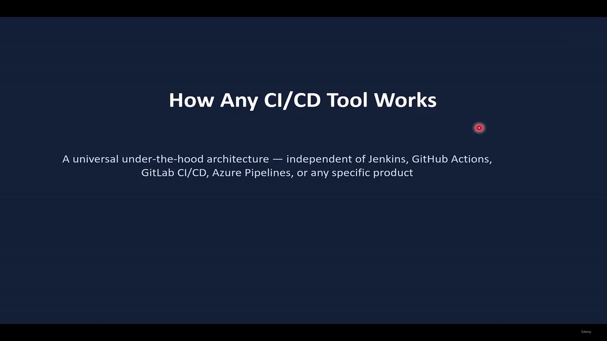
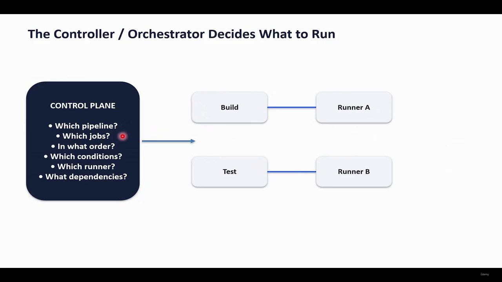
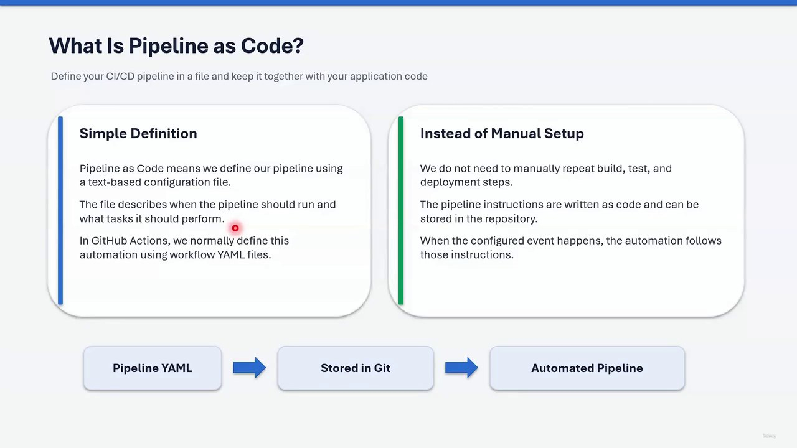
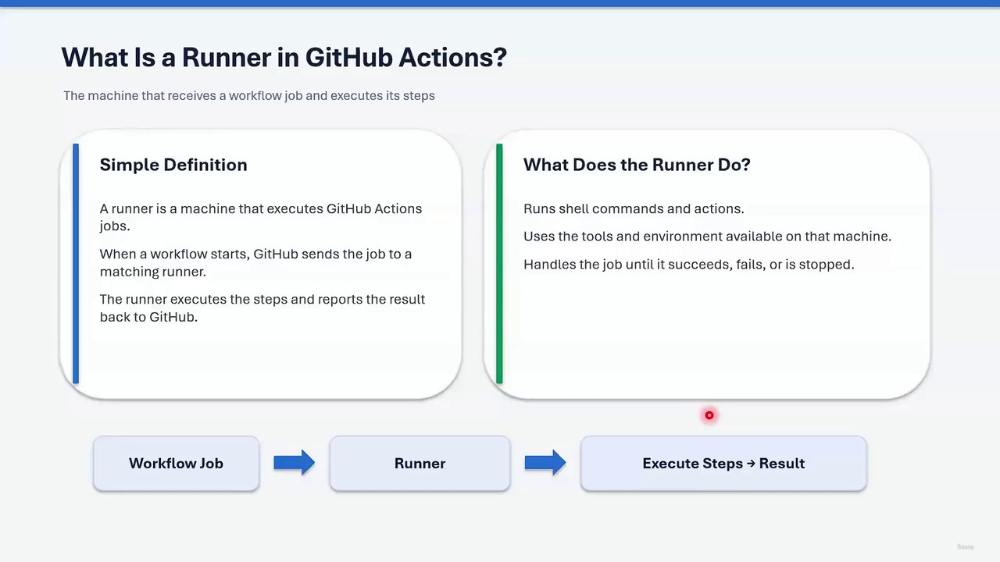
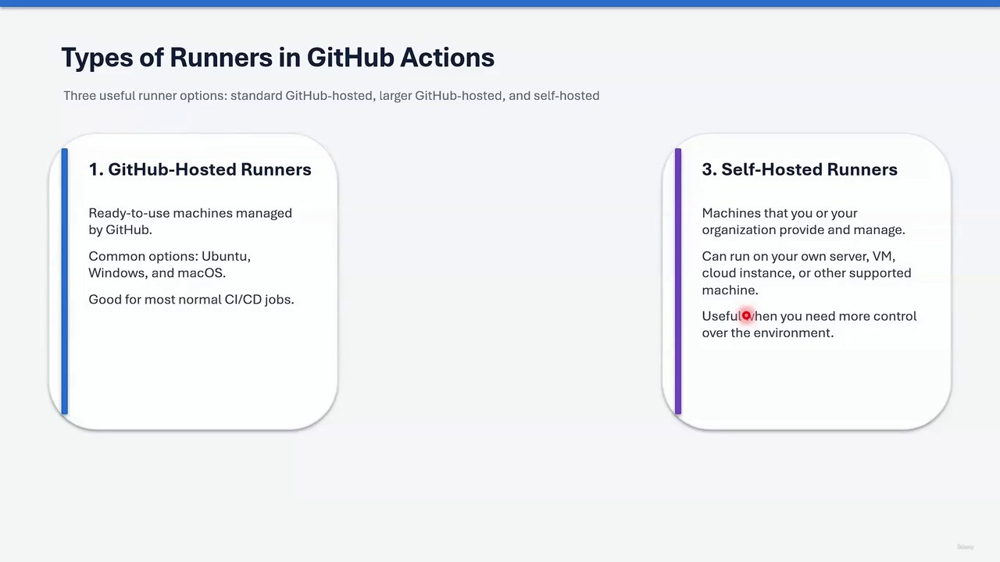
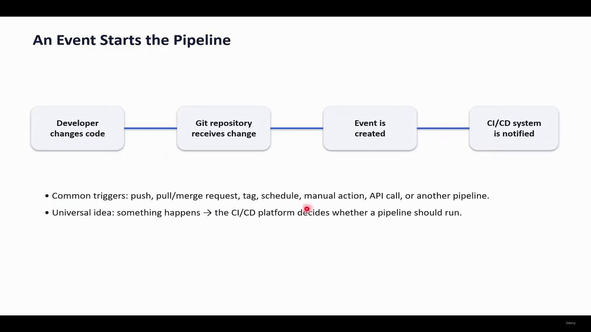
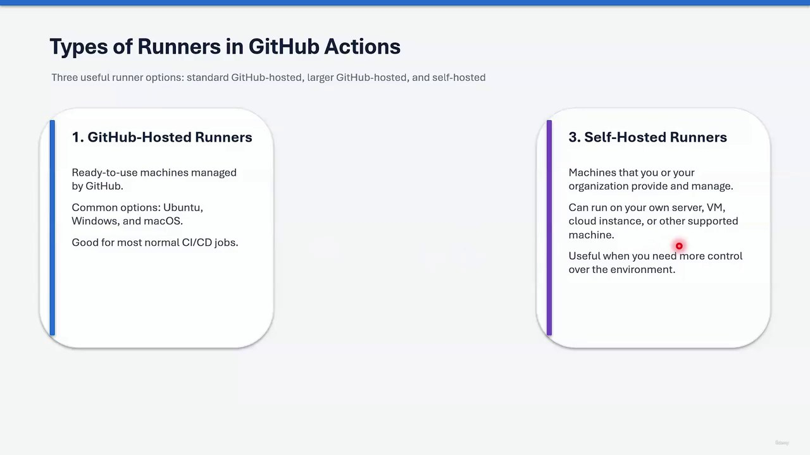

# GitHub Actions 完整入门（P5–P8）：把「事件 → 调度 → Runner → 产物」跑通

## 1. 这一节做什么

P5–P8 这四节是纯概念课，讲师没有在镜头里敲过一行命令，也没有给出任何 YAML。他讲的是四件事：

1. **P5**：任何 CI/CD 工具内部都是同一条流水线——事件发生、控制器读流水线定义、Runner 执行命令、回收日志与产物、最后进入部署阶段。
2. **P6**：Pipeline as Code——把「构建什么、什么时候构建」写成文本配置文件，在 GitHub Actions 里就是 `.yaml` 工作流文件。
3. **P7**：Runner 是真正执行 job 的机器，job 跑完把结果回报给 GitHub。
4. **P8**：Runner 分两类——GitHub 托管（Ubuntu / Windows / macOS）和自托管（你自己的机器）。

概念课最大的问题是「听完不知道怎么下手」。所以这份文档做一件事：**用一个小到可以 5 分钟读完、又完整到可以直接 push 的仓库，把这四节课的每个概念落到一个你看得见的文件、一行你看得见的日志上。**

最终你会得到一个真实可运行的仓库 `gha-demo`，包含：

- 一个零第三方依赖的 Node 项目（`src/`、`test/`、`scripts/`）
- 一个主工作流 `.github/workflows/ci.yml`，把 P5 的「事件 → 控制器 → Runner → 产物 → 部署」整条链路走一遍
- 一个自托管 Runner 冒烟工作流 `.github/workflows/self-hosted-smoke.yml`，对应 P8 的后半段
- 每个概念都能在 GitHub Actions 页面上找到对应的证据（第 6 节是检查清单）

**一句必须提前说的话**：课里只讲了概念，**没有给过任何 YAML 写法、没有提过 `actions/checkout`、`actions/setup-node`、`upload-artifact` 这些具体 action 的名字，也没有讲自托管 Runner 的注册命令**。第 4 节的所有代码都是为了「让概念能被复现」由本文补的最小示例，不是讲师的原代码。凡是课里没讲的，我在第 5、7 节都单独标了出来。

---

## 2. 讲师原话

先说明一个坑：这门课的英文字幕是自动生成的，把 CI/CD 记成了 `CSED`、`CACD`，把 `build` 记成了 `bill`，把 `self-hosted` 记成了 `cell foster`。下面引用时按上下文还原成 CI/CD，其余保持原样。

### 2.1 所有 CI/CD 工具后台流程是一样的（P5）

> 译：不同工具的名字、功能、语法可能不同，但底层工作流程高度相似——事件发生，CI/CD 系统接收事件并启动工作流自动化，然后所需的 job 和命令在 runner 上执行。
>
> —— p005 [00:28]



### 2.2 控制器只负责「决定跑什么」，不负责跑（P5）

> 译：控制器检查流水线定义，决定需要跑什么；然后提供一个 runner（或 agent）来执行我们的命令和脚本。
>
> —— p005 [00:57]

> 译：它可能决定 build 要先于 test 运行。控制器只协调和管理整个执行流；真正执行命令的是 runner，不是控制器。这一点必须记住。
>
> —— p005 [02:22] / p005 [02:52]



### 2.3 Runner 上手做的三件事：备环境、拉代码、注入配置（P5）

> 译：runner 准备好操作系统、工具和工作环境；然后把源码 checkout / clone 到它准备好的工作区；再把所需的 secret 和配置提供给这个 job，用来执行 MVN 之类的构建命令。
>
> —— p005 [03:22]

这三句话，就是第 4 节 `ci.yml` 里 `actions/checkout`、`actions/setup-node` 和仓库 Secrets 设置存在的全部理由。**注意讲师只举了 MVN（Maven）当例子，没有提 Node/npm**——本文改成 Node，是为了对上你的技术栈。

### 2.4 什么是 Pipeline as Code（P6）

> "流水线即代码意味着我们使用基于文本的配置文件来定义持续集成与持续交付流水线。"
>
> —— p006 [00:00]

> 译：在 GitHub Actions 里，这些指令写在 yaml 工作流文件中；在文件里告诉 GitHub 流水线什么时候开始、要执行什么任务，扩展名是 `.yaml`（实际仓库里更常见的是 `.yml`）。
>
> —— p006 [00:28] / p006 [00:57]



好处只有三条，讲师讲得很克制：

> 译：一是流水线被版本控制（Git 能记录谁在什么时候改了流水线）；二是可重复性（同一套步骤能一遍遍跑）；三是团队更容易评审流水线。
>
> —— p006 [01:27]

### 2.5 Runner 是什么（P7）

> "运行器是一台执行我们的 GitHub Actions 作业的机器。因此，每当我们的工作流启动并且有作业准备好运行时，GitHub 实际上都需要一些机器来完成这项工作。"
>
> —— p007 [00:28]

> 译：job 结束后，结果回报给 GitHub。
>
> —— p007 [00:57]



### 2.6 两类 Runner 的区别只在一句话：谁管这台机器（P8）

> "我们需要理解的核心问题是谁来管理运行器所在的机器。这里，我们可以使用由 GitHub 管理的机器，也可以自行提供并管理自己的机器。"
>
> —— p008 [00:29]

> "在这里，GitHub 为我们提供并管理运行器。因此，我们不需要创建服务器、安装运行器软件包或自行维护机器。例如，我们可以在 GitHub 托管的运行器上，使用 Ubuntu、Windows 或 macOS 运行作业。"
>
> —— p008 [00:58]

> "使用自托管运行器时，我们自行提供并管理机器。例如，它可以是我们自己的物理服务器、虚拟机或云资源等。但与此同时，我们也要负责维护运行器所用的机器，并保障其安全。"
>
> —— p008 [01:28]



---

## 3. 从零复现

### 3.0 前置条件

| 项 | 版本 / 要求 | 说明 |
|---|---|---|
| Git | 2.28+ | 需要 `git init -b`（指定默认分支名） |
| Node.js | 20.x LTS | 用到内置 `node --test`，18 以下不行 |
| GitHub 账号 | 有仓库创建权限 | Actions 在公开仓库免费，私有仓库按额度计费（额度以你账号的 Billing 页为准） |
| 自托管 Runner | 可选，一台 Linux/macOS/Windows 机器 | 只做第 3.7 步才需要 |

本地先确认：

```bash
node -v      # 期望 v20.x 或更高
git --version
```

### 3.1 建仓库骨架

```bash
mkdir gha-demo && cd gha-demo
git init -b main
mkdir -p src test scripts .github/workflows
```

目录结构最终长这样：

```
gha-demo/
├── .github/
│   └── workflows/
│       ├── ci.yml
│       └── self-hosted-smoke.yml
├── scripts/
│   └── build.js
├── src/
│   └── sum.js
├── test/
│   └── sum.test.js
└── package.json
```

**为什么强调这个路径**：GitHub 只会扫描 `.github/workflows/` 目录下的 `.yml` / `.yaml` 文件。你放在 `workflows/`、`.github/workflow/`、根目录，一律不生效——而且不会有任何报错提示，这是新手第一个卡点。

### 3.2 把第 4 节的 5 个文件原样写进去

不要边写边改，先一次性写完，本地跑通再看 CI。

### 3.3 本地先跑通（这一步不能跳）

CI 的本质是「把你在本地跑过的命令搬到别人的机器上再跑一遍」。本地跑不通，流水线只会把同一个错误重放一遍，还多花你 3 分钟等日志。

```bash
node --check src/sum.js
node --check scripts/build.js
npm run build
cat dist/build-info.json
npm test
```

预期输出（本地）：

```
build-info.json 已生成：
{
  "builtAt": "2025-01-01T09:12:33.120Z",
  "commit": "local",
  "ref": "local",
  "runner": "linux"
}
```

`npm test` 会以 TAP 格式输出两行 `ok`，最后 `# pass 2`。

看到 `dist/build-info.json` 生成了，说明构建这一步是可复现的。

### 3.4 提交并推到 GitHub

先在 GitHub 网页上建一个**空仓库**（不要勾选自动生成 README，否则会冲突），然后：

```bash
git add .
git commit -m "ci: 最小可运行流水线"
git remote add origin git@github.com:<你的账号>/gha-demo.git
git push -u origin main
```

### 3.5 观察第一次运行：把 P5 的流程对上号

推送后立刻打开仓库的 **Actions** 标签页：

1. 左侧出现 workflow 名 `ci`，右侧是这次运行的记录，**触发者是 push 事件**——对应 P5「事件是整条流水线的起点」。
2. 点进去，页面左侧会列出 `build`、`test`、`cross-os (ubuntu-latest)`、`cross-os (windows-latest)`、`cross-os (macos-latest)`、`deploy` 这几个 job，并且有一个可视化连线图：`build` 在最上，`test` 和 `cross-os` 指向它，`deploy` 在最下。
   这张图就是 P5 里「控制器检查 pipeline 定义、决定 job 顺序、build 要在 test 之前」的**可视化结果**。你看到的图是结果，做决策的「控制器」在 GitHub 侧，你既看不到也改不了。
3. 点开 `build` → 展开「拉取源码」这一步，日志里会出现 `Checking out the ref` 之类的行——对应 P5「源码被 checkout 到 runner 准备的工作区」。
4. 展开「构建产物」这一步，日志里就是你本地跑 `npm run build` 的那段输出——**一模一样**。它这次跑在 GitHub 的机器上，不在你电脑上。
5. 回到运行详情页底部，`Artifacts` 区域会出现 `dist`，可以下载到一个 zip，解压后的 `build-info.json` 里 `commit` 字段是一个 40 位 SHA（本次提交的哈希），`runner` 是 `Linux`——这两个值的变化，正好证明它确实跑在另一个环境、且拿到了本次代码。



### 3.6 验证三种触发方式（对应 P5 讲的 event 类型）

| 想验证的 event | 怎么做 | 预期 |
|---|---|---|
| `push` | 改一下 `src/sum.js` 里的注释，`git commit && git push` | 新运行自动出现 |
| `pull_request` | 新建分支 `git switch -c feat/x`，改点东西推上去，然后在网页上开 PR | PR 页面底部会出现检查项（checks）；`deploy` 不会跑，因为被 `if` 挡住了 |
| `workflow_dispatch` | Actions → 左侧 `ci` → 右上「Run workflow」→ 选 `main` | 手动运行出现，且 `deploy` 也不会跑（事件不是 push） |

课里提到的另外两类事件——`schedule`（定时）和 API 调用——本文的 `ci.yml` 没有配。要加定时可以写 `schedule: - cron: '0 2 * * *'`，但**课里没讲 cron 语法，也没演示过 API 调用**，本节不展开。

### 3.7 可选：接一台自托管 Runner（对应 P8 后半段）

课里讲了「自托管就是你自己的机器、你自己维护」，但**没讲怎么注册**。具体注册命令是 GitHub 页面动态生成的，不能照抄本文，所以流程是：

1. 仓库 → **Settings → Actions → Runners → New self-hosted runner**
2. 选操作系统，页面会给你一段下载 + `config.sh` 的脚本，**在你自己那台机器上执行**，一路回车即可（提示输入 token 时用页面上的临时 token）
3. 注册完成后，运行 `./run.sh` 保持在线（生产环境应装成系统服务，具体命令同样以页面提示为准）
4. 回到 Actions → `self-hosted-smoke` → Run workflow

如果这时你的机器没开 `run.sh`，这个 job 会一直显示黄色「Waiting for a runner to pick up this job」，**不是报错，是排队**。这一点非常多人误解，以为卡死了。



---

## 4. 完整代码

### `package.json`

```json
{
  "name": "gha-demo",
  "version": "1.0.0",
  "private": true,
  "description": "GitHub Actions P5-P8 概念复现仓库",
  "scripts": {
    "build": "node scripts/build.js",
    "test": "node --test test/sum.test.js"
  },
  "engines": {
    "node": ">=20"
  }
}
```

### `src/sum.js`

```js
'use strict';

/**
 * 返回两个数字之和。
 * 非数字入参直接抛 TypeError，用来演示「测试失败会让流水线变红」。
 */
function sum(a, b) {
  if (typeof a !== 'number' || typeof b !== 'number') {
    throw new TypeError('sum() 只接受数字');
  }
  return a + b;
}

module.exports = { sum };
```

### `test/sum.test.js`

```js
'use strict';

const test = require('node:test');
const assert = require('node:assert/strict');

const { sum } = require('../src/sum.js');

test('sum 返回两数之和', () => {
  assert.equal(sum(2, 3), 5);
  assert.equal(sum(-1, 1), 0);
});

test('sum 拒绝非数字入参', () => {
  assert.throws(() => sum('2', 3), TypeError);
});
```

### `scripts/build.js`

```js
'use strict';

const fs = require('node:fs');
const path = require('node:path');

const distDir = path.join(__dirname, '..', 'dist');
fs.mkdirSync(distDir, { recursive: true });

const info = {
  builtAt: new Date().toISOString(),
  commit: process.env.GITHUB_SHA || 'local',
  ref: process.env.GITHUB_REF || 'local',
  runner: process.env.RUNNER_OS || process.platform
};

const outFile = path.join(distDir, 'build-info.json');
fs.writeFileSync(outFile, JSON.stringify(info, null, 2) + '\n', 'utf8');

console.log('build-info.json 已生成：');
console.log(JSON.stringify(info, null, 2));
```

### `.github/workflows/ci.yml`

```yaml
name: ci

on:
  push:
    branches: [main]
  pull_request:
  workflow_dispatch:

permissions:
  contents: read

env:
  NODE_VERSION: '20'

jobs:
  build:
    name: build
    runs-on: ubuntu-latest
    steps:
      - name: 拉取源码
        uses: actions/checkout@v4

      - name: 准备 Node
        uses: actions/setup-node@v4
        with:
          node-version: ${{ env.NODE_VERSION }}

      - name: 语法检查
        run: |
          node --check src/sum.js
          node --check scripts/build.js

      - name: 构建产物
        run: npm run build

      - name: 上传产物
        uses: actions/upload-artifact@v4
        with:
          name: dist
          path: dist/
          retention-days: 3

  test:
    name: test
    needs: build
    runs-on: ubuntu-latest
    steps:
      - name: 拉取源码
        uses: actions/checkout@v4

      - name: 准备 Node
        uses: actions/setup-node@v4
        with:
          node-version: ${{ env.NODE_VERSION }}

      - name: 运行单元测试
        run: npm test

  cross-os:
    name: smoke (${{ matrix.os }})
    needs: build
    runs-on: ${{ matrix.os }}
    strategy:
      fail-fast: false
      matrix:
        os: [ubuntu-latest, windows-latest, macos-latest]
    steps:
      - name: 拉取源码
        uses: actions/checkout@v4

      - name: 准备 Node
        uses: actions/setup-node@v4
        with:
          node-version: ${{ env.NODE_VERSION }}

      - name: 打印运行环境
        run: node -e "console.log(process.platform, process.version)"

  deploy:
    name: deploy
    needs: [build, test]
    if: github.event_name == 'push' && github.ref == 'refs/heads/main'
    runs-on: ubuntu-latest
    environment: production
    steps:
      - name: 下载产物
        uses: actions/download-artifact@v4
        with:
          name: dist
          path: dist

      - name: 打印部署信息
        run: |
          echo "准备部署 commit=$GITHUB_SHA"
          cat dist/build-info.json
```

### `.github/workflows/self-hosted-smoke.yml`

```yaml
name: self-hosted-smoke

on:
  workflow_dispatch:

jobs:
  ping:
    name: ping
    runs-on: [self-hosted, linux, x64]
    steps:
      - name: 打印机器信息
        run: |
          hostname
          uname -a
          node --version || echo "这台机器没装 Node"
```

---

## 5. 逐行解释

### 5.1 `package.json`

- `"private": true` —— 防止误 `npm publish`。CI 里不需要，但真实项目必须有。
- `"scripts.test": "node --test test/sum.test.js"` —— 用 Node 20 内置的测试运行器，**不装 jest、不装 vitest**。这是刻意的：零依赖意味着流水线里不需要 `npm install`，也就不用处理 lockfile、缓存、私有 registry 这些和本节主题无关的变量。
- `"engines"` —— 声明 Node 版本下限。它不会自动阻止旧版本运行，只是提示；真正的版本钉死在 workflow 的 `setup-node` 里。

### 5.2 `src/sum.js`

`typeof a !== 'number'` 判断而不是 `isNaN`，因为 `isNaN('2')` 是 `false`（字符串会被隐式转换），会漏掉字符串入参。第二个测试用例就是为了证明「抛错路径也被覆盖到了」——**测试不通过会让 job 变红，进而让后面的 `deploy` 不执行**，这就是 P5 里「job 有依赖顺序」的实际意义。

`module.exports` 是 CommonJS 写法。如果你之后改成 ESM（`export`），记得 `test` 文件里同步改成 `import`，并把 `package.json` 加上 `"type": "module"`。课里没讲模块系统，这里只是提醒。

### 5.3 `test/sum.test.js`

- `node:test` 的 `test()` 注册用例，`node:assert/strict` 提供 `equal` / `throws`。
- 文件名必须能被 `--test` 里写的路径对上；如果你写成 `node --test test/`，Node 会扫描该目录下符合命名约定的文件（`*.test.js` 等）。本文用显式路径，避免不同小版本的扫描规则差异。
- 输出是 TAP 格式。GitHub 的日志页面会原样展示，**没有漂亮的折叠面板**——课里说的「结果回报给 GitHub」，你看到的就是这段纯文本加上 job 的成功/失败状态。

### 5.4 `scripts/build.js`

- `__dirname` 在 CommonJS 里是当前文件所在目录；产物写到上一级的 `dist/`，和 workflow 里 `path: dist/` 保持一致。**这两处路径必须成对改，改一个不改另一个，artifact 会是空的**。
- `fs.mkdirSync(distDir, { recursive: true })` —— `recursive` 相当于 `mkdir -p`。runner 是一台全新机器，`dist/` 一定不存在，不写这行第一次运行必挂。
- `process.env.GITHUB_SHA` / `GITHUB_REF` / `RUNNER_OS` 这三个是 GitHub Actions 在 runner 上自动注入的环境变量，**课里没提过它们的名字**，是我为了让产物能自证「跑在哪个 commit、哪个系统上」才用的。它们在本地运行时时不存在，所以有 `|| 'local'` / `|| process.platform` 兜底——这正是「同一份代码本地和 CI 都能跑」的关键写法。
- 注意 `RUNNER_OS` 的值是 `Linux` / `Windows` / `macOS`（首字母大写），而本地的 `process.platform` 是 `linux` / `win32` / `darwin`。两个来源格式不同，属于正常现象，不是 bug。

### 5.5 `ci.yml` 逐键说明

| 键 | 作用 | 对应课程 |
|---|---|---|
| `name: ci` | workflow 显示名，Actions 左侧列表里就是它 | — |
| `on:` | **事件定义**。这段是整个文件的入口 | P5「事件是流程起点」 |
| `push.branches: [main]` | 只有推 main 才触发；推别的分支不触发 | P5 事件过滤 |
| `pull_request:`（值留空） | 任何 PR 的 opened/synchronize/reopened 都触发 | P5「PR 事件」 |
| `workflow_dispatch:` | 在网页上出现「Run workflow」按钮 | P5「手动触发」 |
| `permissions.contents: read` | 把自动发放的 `GITHUB_TOKEN` 权限降到只读 | 课里没讲，见第 7 节 |
| `env.NODE_VERSION` | workflow 级环境变量，下面用 `${{ env.NODE_VERSION }}` 取值 | 课里没讲表达式语法 |
| `jobs.<id>` | job 的**内部 id**（`build` / `test`），被 `needs` 引用 | P5「job 顺序」 |
| `jobs.<id>.name` | 页面上显示的名字 | — |
| `runs-on` | **指定 Runner**。写 `ubuntu-latest` 就是 GitHub 托管 | P8 托管 Runner |
| `needs: build` | 声明依赖：build 成功后才跑 test | P5「build 要在 test 之前」 |
| `if:` | 条件表达式。不满足则整个 job 被跳过（灰色，不是失败） | 课里没讲，但对应「部署阶段」的门槛 |
| `environment: production` | 关联仓库的 environment，可配审批人 | 课里只提了「deployment 阶段」 |
| `strategy.matrix` | 同一 job 按参数展开成多份并行运行 | P8「Ubuntu/Windows/macOS」 |
| `fail-fast: false` | 一个 OS 失败，其他 OS 继续跑完 | 课里没讲 |
| `steps[].uses` | 调用一个现成 action | 课里只说了「步骤可以是命令或 action」 |
| `steps[].with` | 给 action 传参数 | 课里没讲 |
| `steps[].run` | 执行 shell 命令 | P5「runner 执行命令」 |
| `run: \|` | YAML 块标量，多行命令合成一个 shell 脚本 | 课里没讲 YAML 语法 |

关于「控制器 vs Runner」的对照，可以直接这样理解：

- `on` / `needs` / `if` / `matrix` 这些**声明**是写给控制器看的，控制器据此画出那个连线图，决定谁先谁后、谁跳过。
- `run:` 里的内容是写给 Runner 看的，控制器**不解析、不执行**，只是把它原样随 job 一起发给 Runner。
- 这也是为什么 `run:` 里写错命令时，报错出现在 Runner 的日志里，而不是「workflow 文件校验失败」。

**并发补充（给前端/Node 背景）**：`needs` 形成的是一张有向无环图，多个无依赖的 job 默认并行执行，语义上接近 `Promise.all([build, test])`；`needs: build` 接近 `await build`。但这里**没有任何锁**——两个 push 几乎同时到达时，两条流水线会各跑各的，`deploy` 可能重叠。GitHub 有 `concurrency` 键可以做串行化，**但课里没讲**，我把它放在第 7 节。

### 5.6 `self-hosted-smoke.yml` 逐键说明

- `on: workflow_dispatch:` 只有手动触发。这是刻意的：自托管 Runner 不在线时 job 会一直排队，如果配成 push 触发，你会以为流水线坏了。
- `runs-on: [self-hosted, linux, x64]` —— 数组形式表示**标签全部匹配**才选中。GitHub 会给每台自托管 Runner 自动打上 `self-hosted` 和操作系统标签，`x64` 需要你在注册时确认（或手动加自定义标签）。三个标签少一个，job 就会一直挂着。
- `node --version || echo ...` —— 自托管机器上的软件是**你自己装的**，很可能没 Node。这个 `||` 保证脚本不会因为退出码非 0 而让 job 失败，同时把「没装」这件事明确打印出来。这一行正好是 P8 那句「你也要负责维护和安全」的最小注解：托管 Runner 里 `setup-node` 一行就能装好 Node，自托管你得自己来。

---

## 6. 复现检查清单

按顺序勾，任何一项对不上都先停下排查，不要往后走。

- [ ] `node -v` 输出 `v20.x` 或更高
- [ ] 仓库里存在 `.github/workflows/ci.yml`，且路径逐字符正确（`workflows` 复数、`.github` 前有点）
- [ ] 本地 `npm run build` 能生成 `dist/build-info.json`
- [ ] 本地 `npm test` 显示 2 个用例通过
- [ ] push 到 main 后，Actions 页出现名为 `ci` 的运行，触发事件标注为 push
- [ ] 运行详情页的 job 依赖图里，`test`、`cross-os (...)` 排在 `build` 之后，`deploy` 在最后
- [ ] `build` job 的日志里能看到「build-info.json 已生成」这段输出
- [ ] 运行详情页出现 `dist` 这个 Artifact，可下载，解压后 `build-info.json` 的 `commit` 是本次提交的 SHA，`runner` 为 `Linux`
- [ ] `cross-os` 下有三条运行记录，`windows-latest` 那条的日志里 `process.platform` 为 `win32`
- [ ] 开一个 PR：检查项出现，但 `deploy` 显示为灰色「Skipped」，且原因与 `if` 条件相关
- [ ] 用「Run workflow」手动触发：能跑，但 `deploy` 同样跳过（事件不是 push）
- [ ] （可选）自托管 Runner 注册后，`self-hosted-smoke` 能在你自己的机器上跑完，日志里的 `hostname` 是你那台机器的主机名

第 11 项是整份文档最关键的验证点：**只有它成功了，你才能确认「Runner 是一台真正的机器，而不是 GitHub 内部的某个黑盒」**。

---

## 7. 课里没讲但你会撞上的

1. **YAML 缩进是用空格，不是 Tab。** 一个 Tab 就会让整份文件解析失败，报错信息通常指向一个和真正出错位置无关的行号。建议编辑器开「显示空白字符」。
2. **`on` 这个键在某些 YAML 1.1 解析器（如旧版 `yamllint`、部分 IDE 插件）里会被当成布尔值 `true`。** GitHub 自己的解析器没问题，本地校验工具可能报警，看到警告不必惊慌，以 GitHub 上的实际行为为准。
3. **`ubuntu-latest` 是一个会随时间迁移的别名**，不是固定的 Ubuntu 版本。要稳定可复现，应该钉死具体版本（如 `ubuntu-22.04`）。具体当前映射到哪个版本，以 GitHub 官方文档为准，我这里不能替你断言。
4. **action 的版本号必须真实存在。** `actions/checkout@v4`、`actions/setup-node@v4`、`actions/upload-artifact@v4`、`actions/download-artifact@v4` 是本文使用的版本；v3 版本的 artifact 系列已被弃用，照抄旧教程会直接失败。版本请以 Marketplace 当前状态为准。
5. **`permissions: contents: read` 不是可有可无的装饰。** 仓库或组织可以把默认 token 权限设成只读，这时依赖写权限的 action 会失败；反过来，公开仓库不限制权限会放大供应链风险。课里完全没提 token，但这是你接第一个真实项目就会遇到的第一个安全配置。
6. **来自 fork 的 PR 拿不到仓库 Secrets。** 这是 GitHub 的硬性设计，不是 bug。想在 fork 的 PR 上跑需要密钥的集成测试，得用 `pull_request_target` 之类的机制，而它本身有安全陷阱——课里没讲，遇到时请单独查资料，不要凭直觉改触发器。
7. **自托管 Runner 不要挂在公开仓库上。** 任何人都能通过开 PR 让你的机器执行任意 `run:` 命令。讲师说「你也要负责维护和安全」，说的就是这件事，但没展开风险场景。
8. **`environment: production` 引用的环境如果仓库里还没建，第一次运行时的表现请以你的仓库实际显示为准**；要加「部署前需人工审批」，必须去 Settings → Environments 里手动配置审批人和分支保护，YAML 里只写 `environment:` 是不够的。
9. **缓存不是必须的，但一旦加了依赖就会想加。** 本文零依赖所以没有 `npm install` 步骤。你一旦引入依赖，就得在 `build` 和 `test` 两个 job 里各装一次（job 之间不共享文件系统），要么加 `actions/cache`，要么把安装和测试合进同一个 job。这是新手最常问的「为什么装了两遍」。
10. **自托管 Runner 一次只跑一个 job。** 同一台机器上排了两个 job，第二个会等第一个结束。这不是锁，是排队；想并行就多注册几台，或者加自定义标签做分流。放在 Node 语境里类比：它更像单线程的 worker，而不是 `Promise.all`。
11. **job 之间不共享 workspace，只共享 artifact。** 所以本文 `deploy` 里必须重新 `download-artifact` 才能看到 `dist/`。如果你在 `test` 里直接 `cat dist/build-info.json`，一定会 No such file。
12. **日志里的环境变量名（`GITHUB_SHA` / `GITHUB_REF` / `RUNNER_OS`）来自 GitHub 的默认变量列表，课里没提过。** 其他变量名请在用到时查官方文档确认，不要凭印象拼写——写错不会报错，只会得到一个空字符串，然后你在 `if` 里判断失败却找不到原因。
13. **Windows runner 的默认 shell 是 PowerShell，不是 bash。** 本文的 `node -e "..."` 两种 shell 都成立，但一旦你写 `&&` 链式命令、`export VAR=1`、`$(...)`，就会在 Windows 上崩。要统一，可以给那一步加 `shell: bash`。
14. **失败重跑不会复用上一次的产物。** 点「Re-run jobs」是整份重新跑，runner 是全新的、空的。这又一次印证 P5 的顺序：环境准备 → 拉代码 → 注入配置 → 执行，每次都是从零开始。