# GitHub Actions Complete（P051–P060）复现文档：失败处理、并发、环境、作业容器与 step 语法

> 覆盖课程 P051–P060。这 10 集里，P051 / P053 / P055 / P057 是四个可以完整跑起来的小项目，P052 / P054 / P056 / P058 / P059 / P060 是配套的概念课。本文按「四个可复现项目 + 三个语法点」重组，不按集数顺序流水账。

---

## 1. 这一节做什么

这 10 集要交付的东西很具体：**四个能在 GitHub 上真实跑起来、并看到不同行为的 workflow 文件**，以及三个必须分清的语法点。具体产出如下。

| 产出 | 文件（全部位于 `<repo>/.github/workflows/`） | 你能亲眼看到的现象 |
|---|---|---|
| 作业失败处理 | `jobFailure.yml` | 上一个 job 失败，`needs` 依赖它的 job 被跳过；加 `continue-on-error: true` 后不再跳过 |
| 并发控制 | `concurrency.yml` | 连推两次代码，两个 workflow 抢同一个 concurrency group：先等待，加 `cancel-in-progress` 后变成「取消旧的、跑新的」 |
| 环境与审批 | `environment.yml` | job 卡在「等待审批」，人工点 Approve 之后才真正执行 |
| 作业容器 | `jobcontainer.yml` | 命令不是跑在 runner 的默认系统里，而是跑在 `maven:3.9-eclipse-temurin-17` 容器里，`mvn --version` / `java --version` 输出容器内的版本 |
| 语法点 | `run` / `uses` / `steps` 的用法 | 同一个 job 里，`run` 跑自己的命令，`uses` 调别人写好的 action |

能力目标：读完并跟着做，你应该能独立写出「A 作业失败但不阻塞 B 作业」「同一时间只允许一个生产部署」「部署前必须人工审批」「在固定 Java 版本容器里构建」这四类配置。

前置条件（课里默认你已有，这里明写）：

- 一个 GitHub 账号，能创建空仓库；
- 本机装了 `git`，配好 SSH key 或 PAT（课里用 `git push` 直接推，没演示认证配置）；
- 装了 Visual Studio Code（讲师全程用它编辑 YAML，见 p051 开头）；
- 四个**空仓库**：`job-failure`、`job-concurrency`、`environments`、`job-containers` —— 名字是讲师起的，你可以换，但后面命令里的 URL 要跟着换。

---

## 2. 讲师原话

关于失败处理的默认行为，讲师在演示完第一次运行后是这样总结的：

> "由于这个测试作业失败，整个作业就失败了，而下一个依赖测试作业的部署作业也无法继续。这就是 GitHub 的默认行为：只要一个作业依赖另一个作业，前一个作业失败，依赖它的作业就会被跳过。"
> —— p051 [06:22]

关于 `continue-on-error` 的动机，讲师讲得很直白：

> "有时作业可能失败，但我们仍希望下一个作业继续运行。作业失败意味着作业内的步骤可能失败，但我们仍希望继续执行下一个作业。因此，这里我们要在作业级别添加 continue-on-error。"
> —— p051 [07:02]

关于并发要解决的问题，讲师举的是生产部署撞车的例子：

> "设想一个部署作业已经在把应用部署到生产环境。与此同时，另一个部署作业又开始部署到同一个环境。两者同时运行可能会在部署过程中引发问题。这时就需要用并发控制来管理作业。"
> —— p052 [00:10]

关于 `cancel-in-progress` 的语义：

> "这里我们把 cancel-in-progress 设为 true。也就是说，如果同一个组里有一个较早的作业正在运行，而新的作业进来了，GitHub 会取消旧作业并启动新作业。当我们更关心工作流的最新一次执行时，这个设置就很有用。"
> —— p052 [01:11]

关于 environment 的作用：

> "环境本质上是一个部署目标，比如开发、预发布或生产环境。在这里，我们还可以为每个环境保留特定的密钥和变量。此外，我们还可以在部署继续之前添加保护规则。"
> —— p054 [00:32]

关于作业容器要解决的痛点（Java 版本不一致）：

> "运行器上装有不同版本的 Java。由于这种不匹配，作业失败了。因此，我们需要作业每次在运行器上运行时都有一致的环境。为解决这个问题，我们使用作业容器。"
> —— p056 [00:11]

关于 runner 与 container 的分工，这句话是 P056 的核心：

> "运行器是启动并管理我们作业的机器。容器运行在运行器上，为我们的步骤提供环境。因此，运行器管理作业，而我们的命令在容器内运行。"
> —— p056 [01:36]

关于 `run` 和 `uses` 的分工：

> "如果我们要执行自己的命令，通常使用 run。如果希望某个步骤调用可复用的操作逻辑，可以使用 uses。"
> —— p060 [01:38]

---

## 3. 从零复现

下面按「阶段」走，每个阶段都是一次完整的 编辑 → 提交 → 推送 → 观察 循环。**四个阶段互相独立，可以只做你需要的那个**。

### 阶段 0：准备一个工作仓库

以第一个项目为例（其余三个同理，只换仓库名）：

```bash
# 先在 GitHub 网页上创建一个空仓库（不要勾选 README / .gitignore），
# 假设你的账号是 your-name，仓库名 job-failure
git clone https://github.com/your-name/job-failure.git
cd job-failure
mkdir -p .github/workflows
code .          # 用 VS Code 打开当前目录
```

`mkdir -p` 里的 `-p` 是必须的：`.github` 目录不存在时，不加 `-p` 的 `mkdir` 会报错。讲师是手动在 VS Code 里点新建文件夹做成 `.github/workflows` 的（p051 [00:38] 前后），效果一样。

### 阶段 A：作业失败处理（对应 P051）

1. 在 `.github/workflows/` 下新建 `jobFailure.yml`。
2. 先写**不带** `continue-on-error` 的版本：一个 `test` job（里面有一步 `run: exit 1`），一个 `deploy` job 用 `needs: test` 依赖它。完整内容见第 4 节，把 `continue-on-error: true` 那一行**暂时删掉**。
3. 提交并推送：

```bash
git add .
git commit -m "added the workflow file for job failure"
git push
```

4. 打开仓库页 → **Actions** 标签页，点进这次运行。你会看到 `test` 这个 job 因为 `run test` 那一步的 `exit 1` 而失败，`deploy` 这个 job 被跳过 —— 这正是讲师说的 GitHub 默认行为。

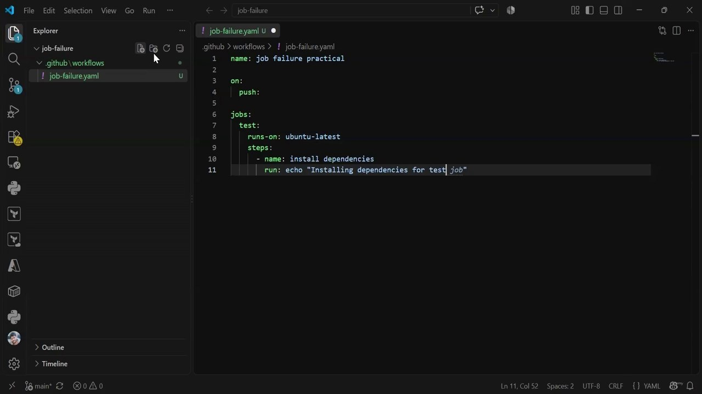

5. 现在把 `continue-on-error: true` 加回到 `test` job 上（位置见第 4 节完整代码），再提交推送一次：

```bash
git add .
git commit -m "added continue on error as true"
git push
```

6. 回到 Actions 看新的一次运行：`test` 里那一步依然是失败的（讲师特意强调 "我们还没有修复这个运行测试。"），但 `deploy` 这次**被执行了**。

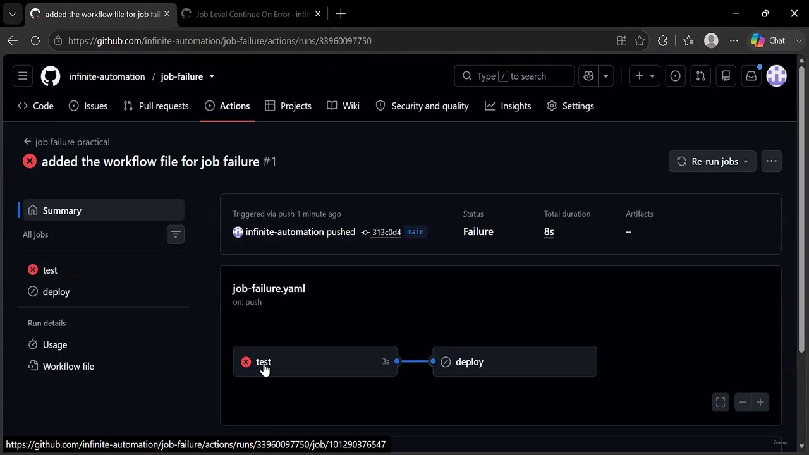

这里有个容易看错的地方：`continue-on-error` 写在 **job** 上（`test:` 的下一层，和 `runs-on` 平级），不是写在 step 上。讲师原话是 "我们将在作业级别添加 continue-on-error。"（p051 [07:02]）。

### 阶段 B：并发控制（对应 P052 / P053）

1. 新建空仓库 `job-concurrency`，clone 下来，`mkdir -p .github/workflows`，新建 `concurrency.yml`。
2. **第一轮：不加并发配置**。文件里只有一个 `deploy` job，步骤用 `|` 多行写法：先 `echo "部署已开始。"`，然后 `sleep 80`，再 `echo "部署完成"`。
3. 推一次代码，立刻去 Actions 看：workflow 正在跑，会卡在 `sleep 80` 那一步大约 80 秒。
4. **趁它还在跑**，随便改一个字（讲师是在文件里加了一个 `.`）再提交推送：

```bash
git add .
git commit -m "dummy commit"
git push
```

5. 回到 Actions：你会看到**两个 workflow run 同时在跑**。这就是没有并发控制时的默认行为。

```markdown
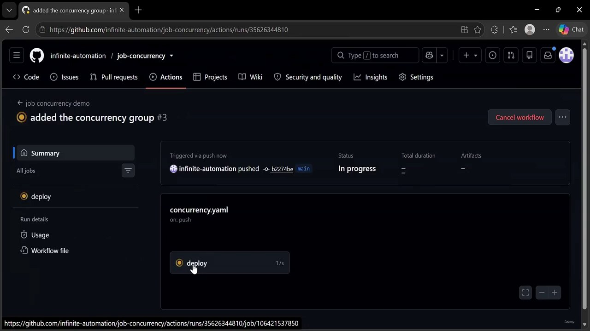
```

6. **第二轮：加并发组**。在 `deploy` job 里、`runs-on` 同级加：

```yaml
    concurrency:
      group: production-deployment
```

提交推送，然后再做一次 dummy commit。这次点进新的 workflow run，会看到提示「该 workflow 里的某个 job 正在 waiting」，点进去会跳到那个还在跑的旧运行 —— 新 job 在排队等旧的跑完。

7. **第三轮：加上 `cancel-in-progress`**：

```yaml
    concurrency:
      group: production-deployment
      cancel-in-progress: true
```

提交推送后（这一步本身就会触发一次运行），再立刻做一次 dummy commit 并推送。刷新 Actions 页面，会看到**旧的运行被取消**，新的运行接管。

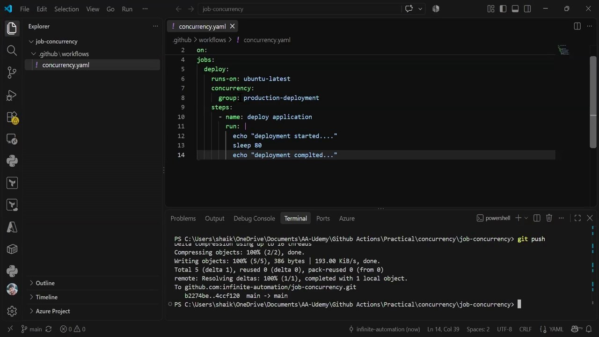

关于 `group` 的写法：讲师口述的是 "生产部署。"（p053 [05:19]），带空格。写成带空格的字符串 `group: production deployment` 或带连字符的 `production-deployment` 都能用 —— 它只是一个字符串标识，关键是**同一个仓库里、你希望互斥的那些 job 必须用完全相同的字符串**。

```markdown
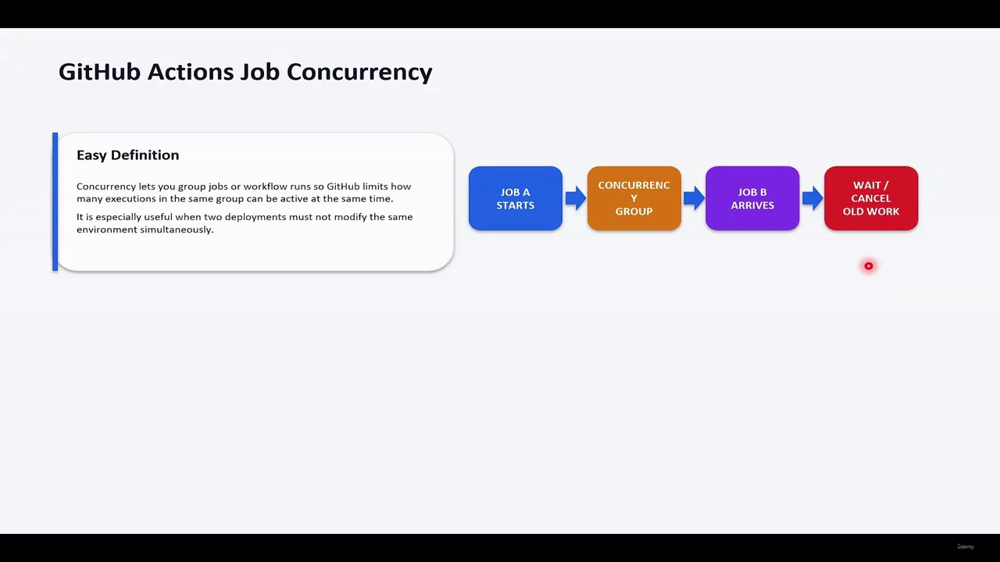
```

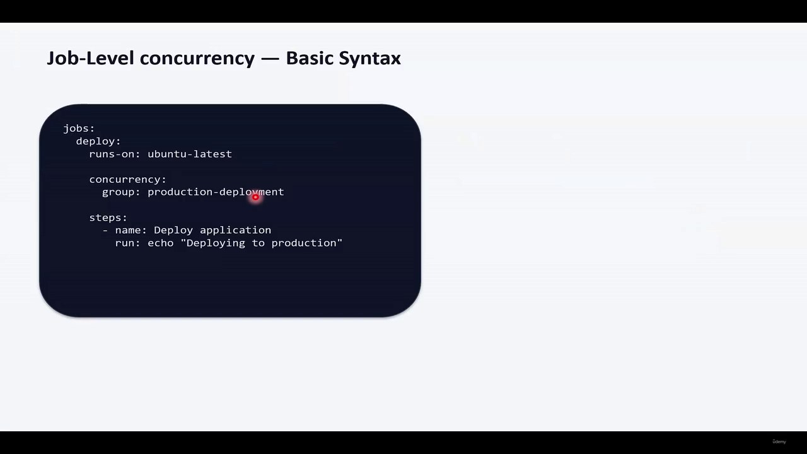

### 阶段 C：环境与人工审批（对应 P054 / P055）

1. 新建空仓库 `environments`，clone，`mkdir -p .github/workflows`，新建 `environment.yml`。触发条件这次要写全：`on: push` 下限定 `branches: [main]`。
2. 先在**没有** `environment:` 的情况下推一次，看 job 直接跑完 —— 说明此时没有任何保护规则。
3. 在 `deploy` job 里加上 `environment: production`（和 `runs-on` 同级）。
4. 关键一步：**去 GitHub 网页上创建同名环境**。进仓库 → **Settings** → 左侧 **Environments** → **New environment** → 输入 `production`（必须和 YAML 里名字一模一样）→ **Configure environment**。
5. 在这个环境的配置页里勾上 **Required reviewers**，在输入框里填审批人的 GitHub 用户名（讲师填的是他自己的账号，输入时会出现下拉候选，点选即可），最多可以加到 6 人。页面里还有一个 **Prevent self-review** 选项：勾上之后，触发这次 workflow 的人不能自己批自己的部署。

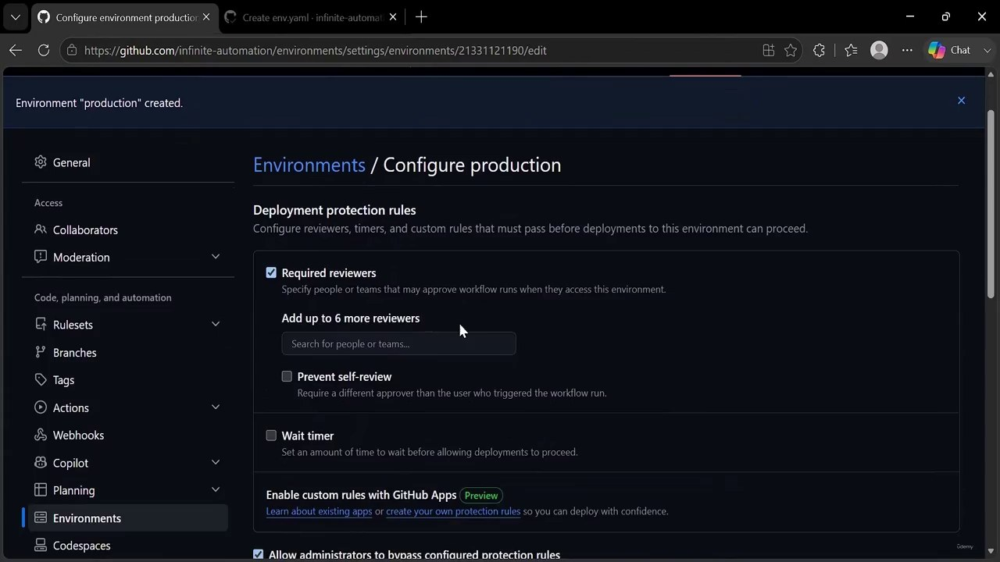

6. 保存保护规则，把 YAML 改动推上去：

```bash
git add .
git commit -m "added the environments rule set"
git push
```

7. 去 Actions 点进这次运行：`deploy` job **不会直接开始**，页面出现 **Review deployments** 按钮。选中 `production`，可以填一句备注（讲师填的是 "reviewed"），点 **Approve and deploy**，job 才开始跑。


```markdown
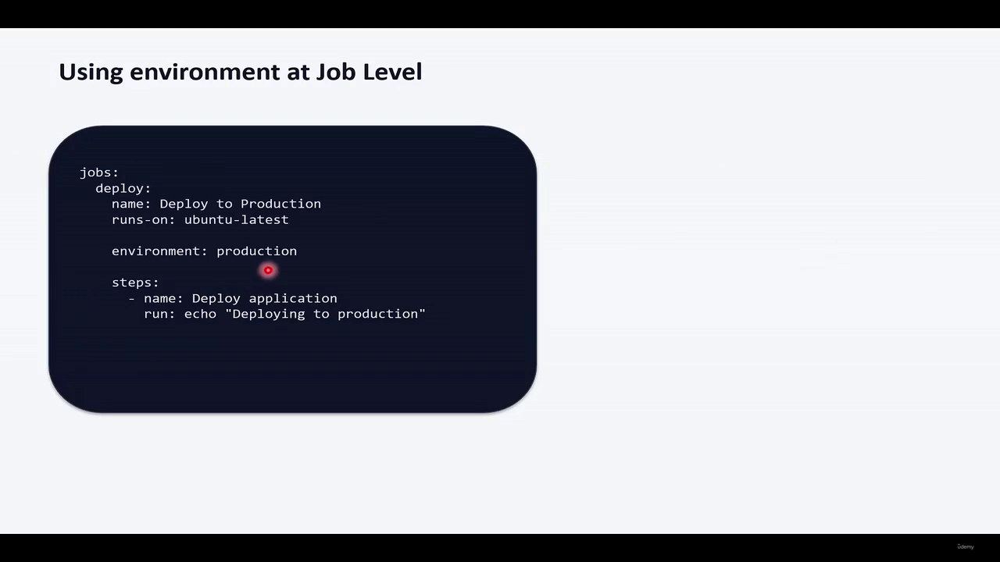
```

### 阶段 D：作业容器（对应 P056 / P057）

1. 新建空仓库 `job-containers`，clone，`mkdir -p .github/workflows`，新建 `jobcontainer.yml`。
2. 在 `test` job 的 `runs-on` 下面加 `container: image: maven:3.9-eclipse-temurin-17`。讲师口述这句时发音是 "Maven 3.9、Eclipse Temurin 17"，指的就是 Docker Hub 上官方 Maven 镜像的这个 tag —— 它自带 Maven 和 Java 17。
3. 两个 step：`mvn --version` 和 `java --version`。
4. 提交推送，进 Actions 点进 job 日志：先看到 runner 初始化（操作系统、版本），然后看到**拉取容器镜像、启动容器**的日志段，最后才是你写的两条命令的输出。讲师在画面里看到的 Maven 版本是 3.9.16、Java 是 17。

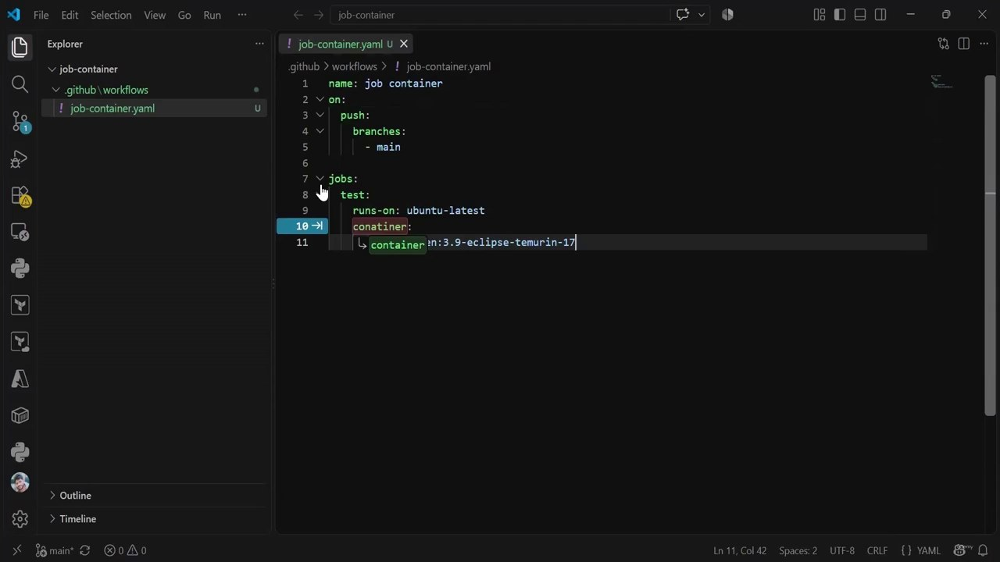

```markdown
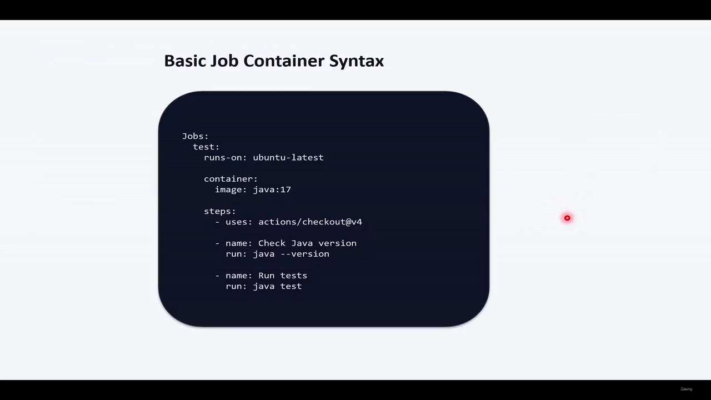
```

### 阶段 E：steps / run / uses 三个语法点（对应 P058–P060）

这三个是概念课，不用单独建仓库。最省事的做法是：在上面任意一个仓库里新建一个 `syntax-demo.yml` 对照着看。

- **step**：job 里一个任务。可以给 `name`，用 `run` 执行命令，或用 `uses` 调用现成 action。
- **`run`**：在 runner 上执行你自己的 shell 命令。想在一个 step 里跑多条命令，就在 `run:` 后面用 `|` 写多行，它们会按顺序执行。
- **`uses`**：调用一个已经打包好的 action。讲师举的例子是 `actions/checkout@v6`，用来把仓库代码拉到 runner 上。

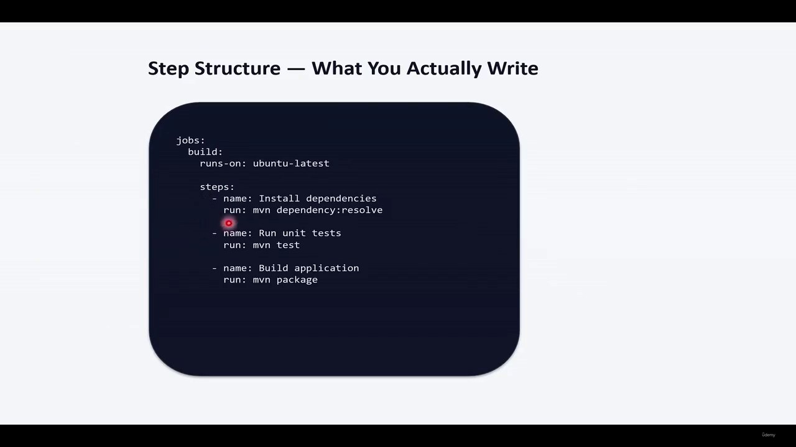

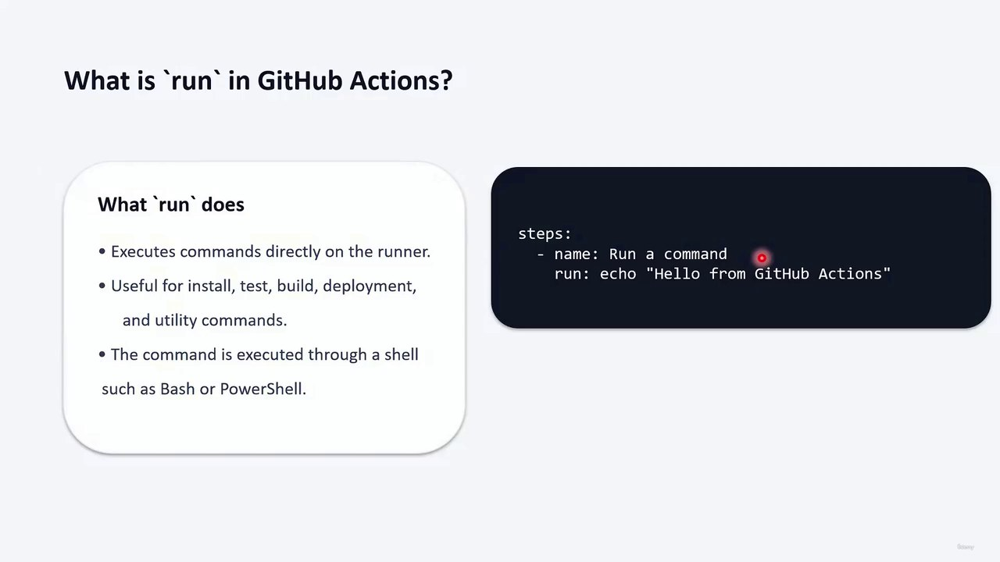

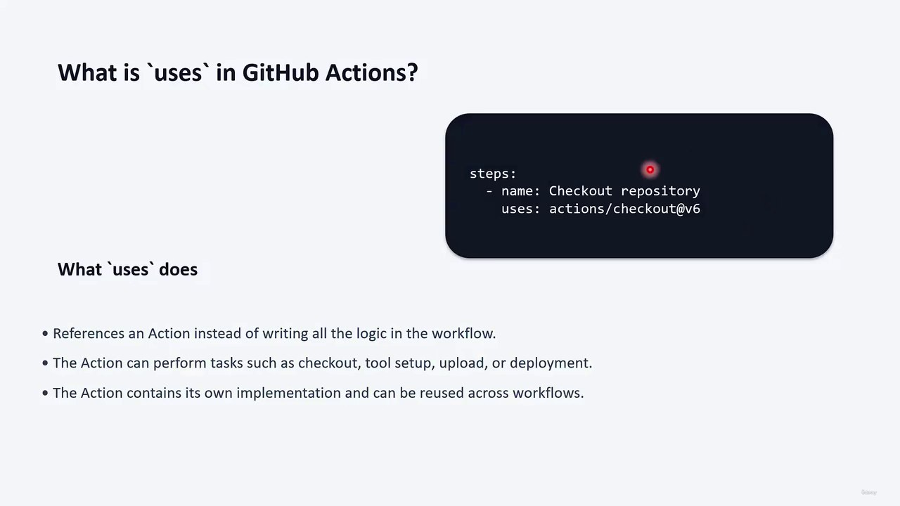

---

## 4. 完整代码

下面四个文件是**最终形态**，可以直接保存运行。路径统一为 `<repo>/.github/workflows/<文件名>`。

### 4.1 `jobFailure.yml`（P051 最终版）

```yaml
name: Job Failure Practical

on: push

jobs:
  test:
    name: test
    runs-on: ubuntu-latest
    continue-on-error: true
    steps:
      - name: Install Dependencies
        run: echo "installing dependencies for test"

      - name: Run Test
        run: exit 1

      - name: Run Tags
        run: exit 1

  deploy:
    name: deploy
    runs-on: ubuntu-latest
    needs: test
    steps:
      - name: Deploy
        run: echo "deploying the application"
```

> 想看「默认行为」那一轮，把 `continue-on-error: true` 这一行删掉重推即可，其余不动。

### 4.2 `concurrency.yml`（P053 最终版）

```yaml
name: Job Concurrency Demo

on: push

jobs:
  deploy:
    name: deploy
    runs-on: ubuntu-latest
    concurrency:
      group: production-deployment
      cancel-in-progress: true
    steps:
      - name: Deploy Application
        run: |
          echo "Deployment started"
          sleep 80
          echo "Deployment completed"
```

> 想复现「无并发 → 加 group 等待 → 加 cancel-in-progress 抢占」这三轮，按顺序：先删掉整个 `concurrency:` 块推一次；再只留 `group` 推一次；最后补上 `cancel-in-progress: true` 推一次。

### 4.3 `environment.yml`（P055 最终版）

```yaml
name: Environment Practical

on:
  push:
    branches:
      - main

jobs:
  deploy:
    name: deploy
    runs-on: ubuntu-latest
    environment: production
    steps:
      - name: Deploy Application
        run: echo "deploying to the production environment"
```

> `environment: production` 里的 `production` 必须和你在 Settings → Environments 里创建的环境名**完全一致**（含大小写）。

### 4.4 `jobcontainer.yml`（P057 最终版）

```yaml
name: Job Container

on: push

jobs:
  test:
    name: test
    runs-on: ubuntu-latest
    container:
      image: maven:3.9-eclipse-temurin-17
    steps:
      - name: Check Maven Version
        run: mvn --version

      - name: Check Java Version
        run: java --version
```

### 4.5 `syntax-demo.yml`（P058–P060 语法点，可选）

这个文件是为了把 `run` 和 `uses` 放在一处对照。注意：`actions/setup-java` 这一行讲师**只说了「set up a Java」这个任务，没有给出具体版本号**，下面用占位符，你换成当时仓库页面上推荐的版本再推。

```yaml
name: Steps Run Uses Demo

on: push

jobs:
  build:
    name: build
    runs-on: ubuntu-latest
    steps:
      - name: Checkout Code
        uses: actions/checkout@v6

      - name: Install Dependencies
        run: |
          echo "installing dependencies"
          echo "installing dependencies done"

      - name: Run Unit Test
        run: echo "running unit test"

      - name: Build Application
        run: echo "building application"
```

---

## 5. 逐行解释

### 5.1 `jobFailure.yml`

- `name: Job Failure Practical` —— 工作流显示名，出现在 Actions 左侧列表里。讲师口述就是 "作业失败实操。"。
- `on: push` —— 任何一次 push 都触发。注意 YAML 里裸写的 `on` 在部分编辑器里会被高亮成布尔值，这是 YAML 1.1 的历史问题，GitHub 能正确解析，不用管。
- `test:` / `deploy:` —— 这两个是 **job id**，`needs: test` 引用的就是 id，不是 `name`。讲师把 `name` 也写成了 `test` / `deploy`，容易让人以为 `needs` 引用的是显示名，其实不是。
- `runs-on: ubuntu-latest` —— 用 GitHub 托管的 Ubuntu runner。讲师反复强调 "Ubuntu 最新版，由 GitHub 托管。"。
- `continue-on-error: true`（job 级）—— 这一行的作用是：这个 job 内部某步失败了，**不阻止依赖它的下游 job 运行**。讲师的选择是放在 job 级；放在 step 级（`- name: Run Test` 下面加 `continue-on-error: true`）语义不同，课里没讲 step 级用法。
- `run: exit 1` —— 故意用非零退出码造失败。讲师特意解释过 "退出码 0 表示命令成功完成。这里我们使用的是退出码 1。"。
- 为什么写两步 `exit 1`（`Run Test` 和 `Run Tags`）？讲师的说法是想看看 GitHub 默认怎么处理错误 —— 默认情况下第一步失败，同 job 里后面的 step 会被跳过（这一点 P058 又讲了一遍："默认情况下，在作业中，如果某个步骤失败，后续步骤会被跳过。"）。
- `needs: test` —— 声明依赖。没有它，`deploy` 会和 `test` 并行跑，失败也就不会传导。
- `run: echo "deploying the application"` —— 用一个 echo 假装部署。真正要看的是**这个 step 有没有被执行**，而不是它输出了什么。

### 5.2 `concurrency.yml`

- `concurrency:` 的位置在 job 内、和 `runs-on` 同级。讲师是在 `deploy` job 下面加的。
- `group: production-deployment` —— 组名。同一个组里的运行互斥。讲师给的名字是 "生产部署。"。
- `cancel-in-progress: true` —— 新运行进来时，把同组里正在跑的那个**取消掉**，而不是排队等。讲师对这种行为的描述是"它会优先处理最新的那个，并停止旧的那个。"。
- `run: |` —— 竖线是 YAML 的多行字符串写法，`|` 后面的每一行都会作为同一个 shell 脚本的一部分执行。讲师的说法是 "我们需要使用管道符号。"。
- `echo "Deployment started"` → `sleep 80` → `echo "Deployment completed"` —— 80 秒的等待就是故意拉长运行时间，给你 80 秒的窗口去做第二次 commit，好观察并发行为。你自己复现时如果手速慢，可以把 80 改大。
- 在 JS/Node 里的类比：这个 group 的语义接近一把**互斥锁**（一次只允许一个 in-flight 的任务），而 `cancel-in-progress: true` 更像 `AbortController` —— 新请求来时把旧的取消掉，而不是排队。这只是帮你建立直觉的类比，课里没做这个对比。

### 5.3 `environment.yml`

- `on: push` 下面挂 `branches: [main]` —— 只对推送到 `main` 生效。讲师口述是 "推送到 main 分支的条件。"。
- `environment: production` —— 一行声明把这个 job 绑到名为 `production` 的环境上。讲师的说法是 "这会告诉 GitHub，这个作业正在部署到生产环境。"。这一行的效果是：GitHub 会去查这个环境上配置的保护规则（要求审批、限制可部署分支等），规则没过，job 就停在那儿。
- 环境的**本体是在网页上创建的**，YAML 里只是引用。这是初学者最容易漏的一步：只写 YAML 不建环境，行为和没写一样。
- `run: echo "deploying to the production environment"` —— 真正跑起来之后你只能看到这一行输出，重点是它**什么时候**被打印。

### 5.4 `jobcontainer.yml`

- `container: image: ...` 和 `runs-on` 同级，属于 job 级配置。层级写错（比如塞进 `steps` 里）会直接报语法错误。
- `maven:3.9-eclipse-temurin-17` —— 从 Docker Hub 拉的公共镜像，自带 Maven 和 Java 17。讲师强调过这是 "公共镜像仓库。" 上的镜像，运行时 GitHub 会先 pull 再起容器。
- 执行顺序：GitHub 先给一个 Ubuntu runner，runner 再拉镜像、起容器，最后你 `steps` 里的命令在容器里执行。讲师专门提醒别把这两层搞混："不要混淆运行器和容器。"。
- `mvn --version` / `java --version` —— 注意是**两个连字符**，不是 `-version`。输出里的版本号证明了命令跑在容器里，而不是 runner 自带的环境里。讲师画面上看到的是 Maven 3.9.16 / Java 17；这个 tag 是滚动的，你拉到的具体小版本号可能不同，属正常。

### 5.5 `syntax-demo.yml`

- `uses: actions/checkout@v6` —— 调用别人写好的 action，`@` 后面是版本。讲师给的就是 `v6`。不写这一步，runner 上没有你的仓库代码，后面的构建命令多半会失败。
- `run: |` 多行命令 —— 和 concurrency 那里同一套写法，多条命令在同一个 step 里按顺序跑。
- 三步的顺序（装依赖 → 单测 → 构建）不能乱，讲师的原话是 "我们应该在运行构建、测试和打包之前安装依赖。"。
- `run` vs `uses` 的选择：想执行自己的终端命令用 `run`，想复用别人打包好的逻辑用 `uses`。这是 P060 唯一的决策点。

---

## 6. 复现检查清单

按顺序打勾，任何一项不对就回到对应阶段。

**通用**
- [ ] 四个空仓库都创建成功，且本地 `git clone` 后 `ls -a` 能看到 `.git` 目录
- [ ] 每个仓库里都存在 `.github/workflows/` 这条路径（注意 `.github` 前面有个点）
- [ ] YAML 用**空格**缩进，没有混入 Tab（VS Code 右下角可以看缩进设置）

**阶段 A（job failure）**
- [ ] 第一轮：`test` job 红色失败，`deploy` job 显示被跳过
- [ ] 第一轮：点进 `test` job，失败的是 `Run Test` 那一步
- [ ] 第二轮：加了 `continue-on-error: true` 后，`test` 里那一步**依然失败**，但 `deploy` 真的执行了
- [ ] 能说清 `continue-on-error` 是写在 job 上还是 step 上

**阶段 B（concurrency）**
- [ ] 不加 `concurrency` 时，能同时看到两个 run 在跑
- [ ] 只加 `group` 后，新的 run 显示为等待，旧 run 跑完后它才开始
- [ ] 加了 `cancel-in-progress: true` 后，旧的 run 变成已取消状态，新的 run 在跑
- [ ] `sleep 80` 确实让每一步卡了大约 80 秒（说明多行 `run` 生效）

**阶段 C（environments）**
- [ ] Settings → Environments 里能看到 `production`，名字和 YAML 完全一致
- [ ] `production` 环境里 Required reviewers 至少有一个用户名
- [ ] 推送后 job 停在等待审批，页面上出现 Review deployments
- [ ] 点 Approve and deploy 之后，`deploying to the production environment` 才出现在日志里
- [ ] 试过打开 Prevent self-review 后，自己不能批自己的部署

**阶段 D（job containers）**
- [ ] 日志里能看到「拉取镜像 / 启动容器」这一段，出现在你自己命令的日志之前
- [ ] `mvn --version` 输出了 Maven 版本，`java --version` 输出了 Java 17
- [ ] 能用自己的话说清 runner 和 container 谁管理谁

**阶段 E（语法）**
- [ ] 能指出 `syntax-demo.yml` 里哪几行是 `run`、哪一行是 `uses`
- [ ] 知道 `uses` 后面 `@` 的含义

---

## 7. 课里没讲但你会撞上的

1. **环境名不一致会静默失效。** YAML 写 `environment: production`，网页上建的是 `Production` 或 `prod`，GitHub 不会报错，只会「找不到保护规则，直接放行」或者新建一个空环境的引用。复现时务必复制粘贴对齐。
2. **Required reviewers 在私有仓库上可能要付费计划。** 讲师用的是自己的账号演示（他自己也说 "因为这只是一个实操演示。"），没提计划限制。如果你在私有仓库里看不到 Required reviewers 选项，先把仓库改成 public 试一次，或者去查当前计划的文档 —— 课里没讲这块。
3. **`continue-on-error` 写在 job 级之后，job 的状态颜色容易让人误解。** 讲师只说了「deploy 会继续跑」，界面上 `test` 这个 job 最终呈现成什么状态、workflow 整体算不算成功，他没细讲。以你实际看到的界面为准，别凭印象下结论。
4. **`cancel-in-progress` 的取消不是瞬时的。** 讲师演示时也是一直刷新页面等了一会儿才看到 "旧工作流已被取消。"（p053 [10:43] 附近）。如果你的 `sleep` 很长，取消可能要几秒到十几秒才反映出来，别以为配置没生效。
5. **`concurrency` 放在 job 级和放在 workflow 级语义不同。** 课里全程只在 job 级演示。workflow 级的 `concurrency` 是另一回事，课里没讲，别混用。
6. **容器里的 job 拿不到你的仓库代码。** `jobcontainer.yml` 里没有任何 checkout 步骤，因为 `mvn --version` 不需要代码。一旦你想在容器里跑 `git` 或读取仓库文件，就得多加一步 checkout —— 而且像 `maven:3.9-eclipse-temurin-17` 这种精简镜像里未必装了 git。课里没覆盖这个场景。
7. **Maven 镜像体积不小，第一次拉取会明显慢。** 日志里那段拉取时间不是卡住了。第二次同 tag 的运行通常快很多。
8. **`on: push` 不区分分支。** 除了 `environment.yml` 限定了 `main`，其他三个文件都是推到任意分支都会触发。如果你在 PR 分支上反复推送，Actions 会跑很多次，配额消耗要留意。
9. **空仓库 clone 下来的默认分支名。** 网页建空仓库时默认分支通常是 `main`，但如果你本地 `git config init.defaultBranch` 设置成别的，可能出现本地 `master` 推上去另起一个分支、`environment.yml` 的 `branches: main` 限制不生效的情况。用 `git branch --show-current` 确认一下当前分支。
10. **`actions/checkout@v6` 的具体版本以仓库页面为准。** 讲师用的是 v6，action 的版本会随时间演进，你写的时候去 Marketplace 上确认为准。同理，`actions/setup-java` 讲师只提了用途没给版本 —— 本文第 4.5 节的示例里也留了占位，需要你自己补。

---

**一句话总结这 10 集**：`needs` 决定失败会不会传导（`continue-on-error` 用来打断这个传导），`concurrency` 决定同一时刻能有几个同类任务在跑（`cancel-in-progress` 决定新的挤掉旧的还是排队），`environment` 决定敏感部署前要不要人点头，`container` 决定你的命令在什么环境里执行，而 `run` / `uses` 决定一个 step 到底是自己动手还是调现成的。