# GitHub Actions Complete（P53–P56）复现文档：Job Concurrency、Environments 与 Job Containers

本文覆盖 P53–P56。读者照着做，会得到两个可运行的 GitHub Actions 实验：

1. **Job Concurrency 实验**：先观察“默认并行部署”，再加 `concurrency.group` 让新任务等待，最后加 `cancel-in-progress: true` 让新任务取消旧任务。
2. **Environments 实验**：把 `deploy` job 绑定到 `production` environment，在 GitHub 里配置 required reviewers，使部署必须人工批准后才继续。
3. **Job Containers 概念**：P56 只讲概念，课程没有给出可直接运行的 Java 17 镜像名，因此本文不会编造一个“可运行”的容器 YAML；只把讲师讲清楚的 runner/container 分工写出来。

---

## 1. 这一节做什么

这一节不是单纯讲名词，而是用两个 GitHub 仓库把“部署并发冲突”和“生产环境审批”跑出来。

### 1.1 最终目录结构

实验 A 仓库，课程口述名为 `job concurrency`；GitHub 仓库名实际创建时建议用连字符，例如 `job-concurrency`，下文路径按 `job-concurrency` 写：

```text
job-concurrency/
└── .github/
    └── workflows/
        └── concurrency.yaml
```

实验 B 仓库，课程口述名为 `environments`：

```text
environments/
└── .github/
    └── workflows/
        └── environment.yaml
```

### 1.2 依赖与环境

| 项目 | 版本/说明 |
|---|---|
| Git | 任意可正常 `clone`、`add`、`commit`、`push` 到 GitHub 的版本；课程未指定 Git 版本 |
| VS Code | 课程使用 Visual Studio Code 作为编辑器；未指定版本 |
| GitHub Actions Runner | `ubuntu-latest`，课程明确指定 |
| Node/npm | **不需要**。这两个实验没有 Node 依赖，也没有 `package.json` |
| Docker | P56 概念涉及容器；课程没有给出 Java 17 镜像名，也没有给本地 Docker 安装步骤 |
| 环境变量 | **无**。两个实验都没有使用环境变量；P54 只提到 environment 可以保存 specific secrets and variables，P55 没有配置具体名称 |
| 启动命令 | `git push`。推送到 GitHub 后由 Actions 自动触发，没有本地 `npm start` 之类的启动命令 |

### 1.3 你会看到的三个关键现象

- 不加并发控制时：连续两次 push，会出现两个 `deploy` job 同时运行，因为第一个 job 里 `sleep 80` 还在等。
- 加 job 级 `concurrency.group` 后：同一 group 已有 job 在跑，新 workflow run 里的 deploy job 会进入等待。
- 加 `cancel-in-progress: true` 后：新 run 到来时，旧 run 被取消，新 run 获得优先执行。
- Environments 实验中：job 不会直接跑，而是等待 `Review deployments`，批准后才执行 `Deploy application`。

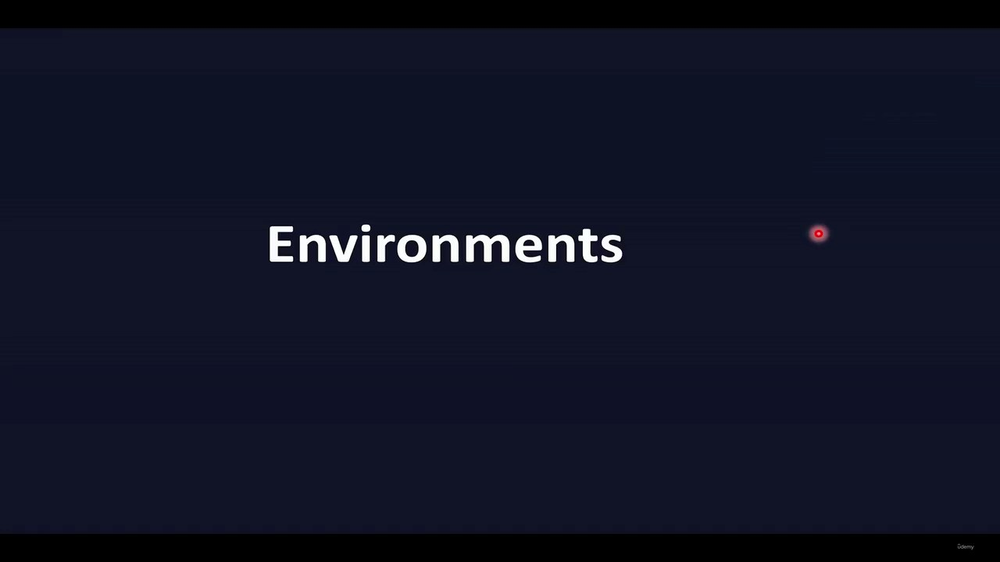

---

## 2. 讲师原话（带出处）

下面按主题引用，不按 P 编号流水账排列。

### 2.1 并发控制到底控制什么

> "并发用于控制同一个并发组中同时运行多少个工作流。"
> —— p053 [00:00]

讲师这里说的是“同一个 concurrency code/组”下同时能跑多少 workflow。实际 YAML 里落地为 `concurrency.group`。你可以把它理解成：**同一个 group 名就是同一把锁的 key**。

> "运行多个部署作业——甚至任意作业——是 GitHub Actions 的默认行为：只要我们从本地系统向远程仓库提交。"
> —— p053 [04:41]

这句话对应实验 A 的第一阶段：你连续 push 两次，GitHub Actions 默认会分别触发 workflow run，不会自动帮你排队。

> "当我们添加并发组后，GitHub 就不允许这两个作业同时运行。"
> —— p053 [07:31]

讲师在 Actions 页面看到新 workflow run 显示 waiting，原因是同一 group 里已有 job 在运行。

> "如果旧的部署工作流正在运行，而新的部署工作流到来，GitHub 会取消旧的那个，并优先处理新的那个。"
> —— p053 [08:26]

这是 `cancel-in-progress: true` 的语义：旧部署还在跑时，新部署到来，旧 run 被取消，新 run 优先。

### 2.2 Environments 解决什么问题

> "为了解决这样的问题，我们使用 GitHub 环境。"
> —— p054 [00:29]

这里的“problem”是：不希望每个 job 都直接部署到 production，希望部署前有规则或审批。

> "环境基本上就是一个部署目标，比如开发、预发布或生产环境。"
> —— p054 [00:56]

environment 是部署目标，不只是个变量名。它可以挂保护规则，也可以保存该环境自己的 secrets/variables。课程只提到 secrets/variables 能力，没有演示具体创建。

> "我们可以使用在部署前要求审批的功能。"
> —— p054 [01:24]

P55 实操就是配置 required reviewers，让 deploy job 等待人工批准。

> "我们还需要在 GitHub 仓库设置中创建相同的环境。"
> —— p055 [05:26]

这句非常关键：YAML 里写 `environment: production`，GitHub 仓库 Settings 里也要创建同名 `production` environment。名字要一致。

> "点击配置环境后，我们就可以在特定环境中启用必需的审核者。"
> —— p055 [06:20]

配置入口是 Settings → Environments → New environment → Configure environment。

> "我们点击批准部署。如你所见，我们的部署作业已经启动了……"
> —— p055 [10:44]

批准后 job 才真正开始执行。

### 2.3 Job Containers 的分工

> "运行器上有不同版本的 Java。由于这种不匹配，作业失败了。"
> —— p056 [00:29]

讲师用 Java 17 应用举例：CI/CD runner 上 Java 版本不一致，job 可能失败。需要一致环境。

> "运行器仍然管理作业，但容器提供环境。"
> —— p056 [01:25]

runner 负责启动和管理 job；container 提供 job steps 运行的环境。

> "运行器是一台启动并管理我们作业的机器。容器运行在运行器上，并为我们的步骤提供环境。"
> —— p056 [01:55]

这句话把 runner 与 job container 的职责说得很清楚。

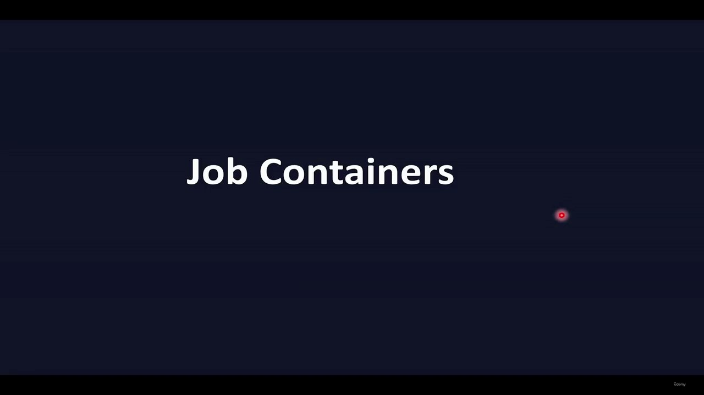

---

## 3. 从零复现

下面按“先做实验 A，再做实验 B，最后理解 P56”的顺序写。每一步都给出可执行命令和观察点。

### 3.1 准备：创建并克隆两个空仓库

在 GitHub 上创建两个空仓库：

- `job-concurrency`：对应 P53 的 Job Concurrency 实验。课程口述为 `job concurrency`，实际仓库名用连字符。
- `environments`：对应 P55 的 Environments 实验。

本地执行：

```bash
git clone https://github.com/<你的账号>/job-concurrency.git
cd job-concurrency
mkdir -p .github/workflows
code .
```

再开一个终端：

```bash
git clone https://github.com/<你的账号>/environments.git
cd environments
mkdir -p .github/workflows
code .
```

两个仓库都不需要 `npm init`，也不需要安装依赖。

---

### 3.2 实验 A 第一阶段：先不加并发，观察默认并行

在 `job-concurrency` 仓库中创建 `.github/workflows/concurrency.yaml`。第一阶段先写“无并发控制”的完整版本：

```yaml
name: Job Concurrency Demo

on: push

jobs:
  deploy:
    runs-on: ubuntu-latest
    steps:
      - name: Deploy application
        run: |
          echo "Deployment started"
          sleep 80
          echo "Deployment completed"
```

保存后执行：

```bash
git add .
git commit -m "added the concurrency workflows"
git push
```

打开 GitHub 仓库 → Actions。你会看到 `Job Concurrency Demo` 已经开始运行，deploy job 正在执行 `Deploy application`。因为里面有 `sleep 80`，它会停留在运行状态约 80 秒。

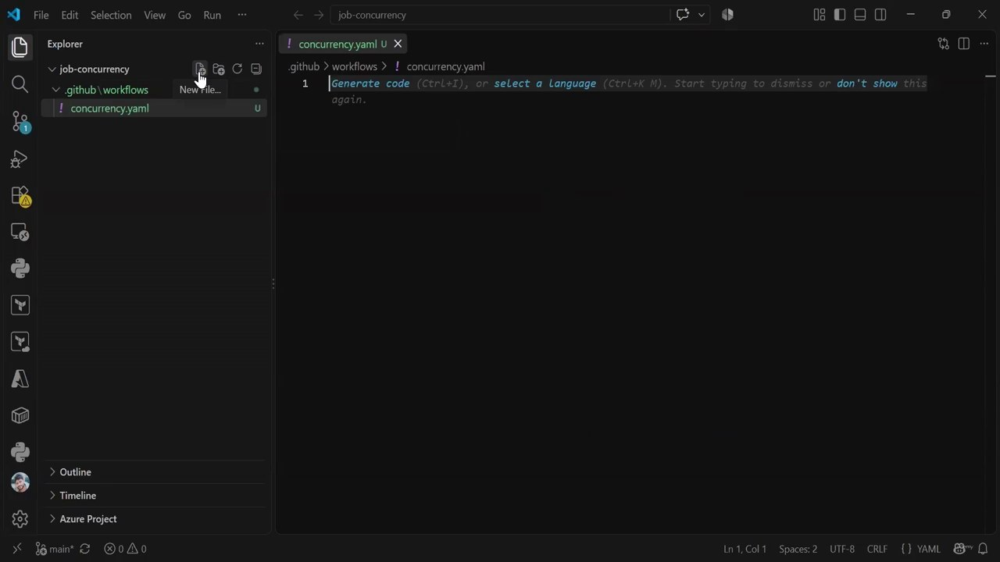

接着做一次 dummy commit，再 push：

```bash
echo "# trigger deploy" >> README.md
git add .
git commit -m "dummy commit to trigger deploy"
git push
```

这时打开 Actions，应该能看到第二次 workflow run。由于第一个 run 里的 `sleep 80` 还没结束，两个 deploy job 会同时处于运行状态。讲师的观察就是：**没有 concurrency 时，多个 deployment job 会同时跑**。

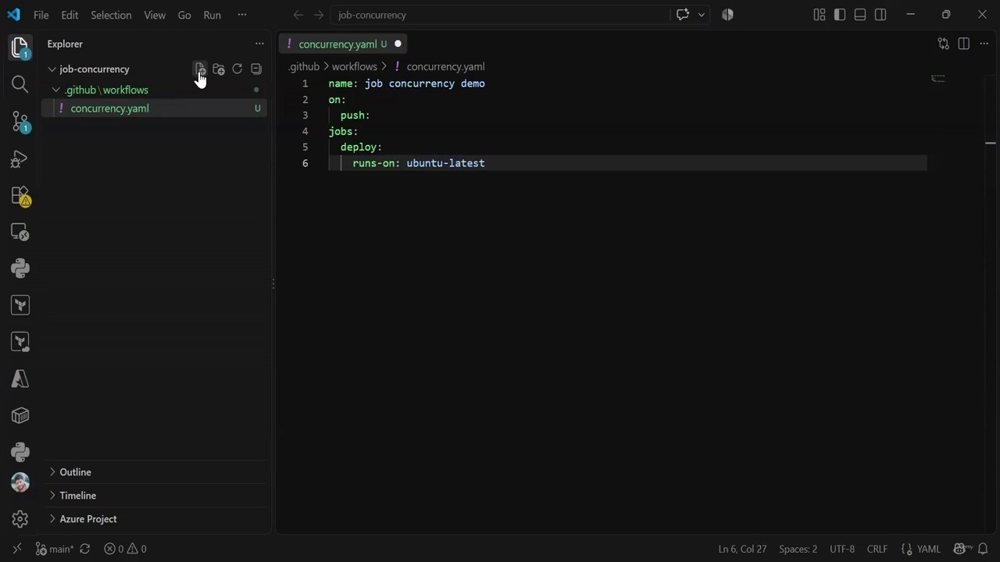

---

### 3.3 实验 A 第二阶段：加 job 级 concurrency group

把 `concurrency.yaml` 改成最终版，在 `deploy` job 下加 `concurrency`：

```yaml
name: Job Concurrency Demo

on: push

jobs:
  deploy:
    runs-on: ubuntu-latest
    concurrency:
      group: "production deployment"
    steps:
      - name: Deploy application
        run: |
          echo "Deployment started"
          sleep 80
          echo "Deployment completed"
```

注意：讲师口述 group 名为 `production deployment`，中间有空格。YAML 里建议加引号，写成 `"生产环境部署"`，避免阅读和解析歧义。

提交并 push：

```bash
git add .
git commit -m "added the concurrency group"
git push
```

打开 Actions，先让这次 run 开始执行。然后马上再做一次 dummy commit：

```bash
echo "# second trigger" >> README.md
git add .
git commit -m "dummy commit to observe waiting"
git push
```

这时新 workflow run 中的 deploy job 不应该直接运行，而会显示等待，因为同一个 group `production deployment` 里已经有一个 job 在跑。讲师在页面里看到的现象是：新 run 里 job 在 waiting，点击后会指向正在运行的那一个。

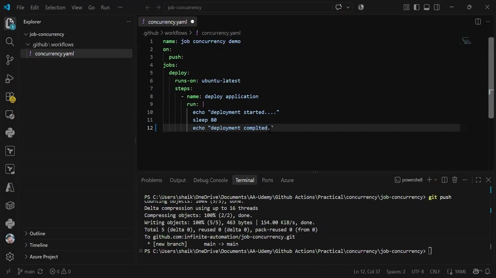

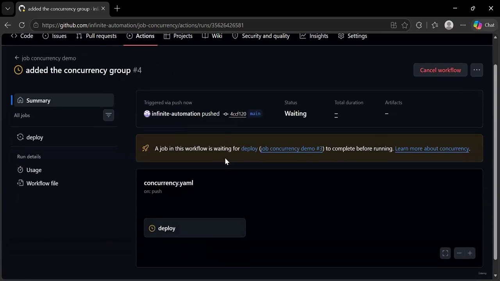

---

### 3.4 实验 A 第三阶段：加 cancel-in-progress

继续改 `concurrency.yaml`，在 group 下面加 `cancel-in-progress: true`：

```yaml
name: Job Concurrency Demo

on: push

jobs:
  deploy:
    runs-on: ubuntu-latest
    concurrency:
      group: "production deployment"
      cancel-in-progress: true
    steps:
      - name: Deploy application
        run: |
          echo "Deployment started"
          sleep 80
          echo "Deployment completed"
```

提交并 push：

```bash
git add .
git commit -m "added the cancel in progress"
git push
```

等这次 run 开始后，再做一次 dummy commit 并 push：

```bash
echo "# third trigger" >> README.md
git add .
git commit -m "dummy commit to observe cancellation"
git push
```

打开 Actions，刷新页面。你会看到旧 run 被取消，新 run 获得执行机会。讲师在 [10:43] 左右观察到的就是：旧 workflow 被 canceled，新 workflow run 开始运行。

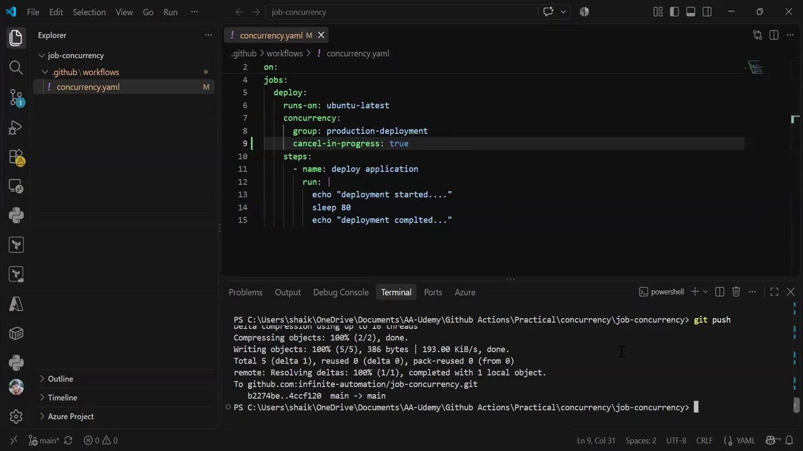

---

### 3.5 实验 B 第一阶段：先不加 environment，观察直接部署

进入 `environments` 仓库，创建 `.github/workflows/environment.yaml`。先写一个没有 environment 的版本：

```yaml
name: Environment Practical

on:
  push:
    branches:
      - main

jobs:
  deploy:
    runs-on: ubuntu-latest
    steps:
      - name: Deploy application
        run: echo "Deploying to the production environment"
```

如果你的仓库默认分支是 `master`，把 `main` 换成 `master`；课程按 `main` 讲解。

提交并 push：

```bash
git add .
git commit -m "added the environment workflow"
git push
```

打开 Actions，deploy job 会直接运行，不会等待审批。因为此时 job 没有绑定任何 environment，也没有 required reviewers。

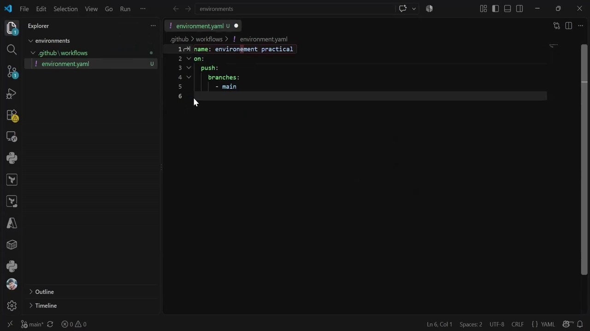

---

### 3.6 实验 B 第二阶段：加 environment 关键字并创建同名 environment

把 `environment.yaml` 改成最终版，在 job 下加 `environment: production`：

```yaml
name: Environment Practical

on:
  push:
    branches:
      - main

jobs:
  deploy:
    runs-on: ubuntu-latest
    environment: production
    steps:
      - name: Deploy application
        run: echo "Deploying to the production environment"
```

先不要急着 push。课程的顺序是：本地 YAML 加 `environment` 后，先去 GitHub 仓库 Settings 创建同名 environment，配置保护规则，再 commit/push。

在 GitHub 仓库页面操作：

1. 点击 `Settings`。
2. 左侧进入 `Environments`。
3. 点击 `New environment`。
4. 名称填 `production`，必须和 YAML 里的 `environment: production` 完全一致。
5. 点击 `Configure environment`。
6. 勾选/启用 `Required reviewers`。
7. 添加 reviewer。课程中讲师添加了自己；界面允许添加最多 6 名 reviewer，添加自己后还会显示可继续添加的名额。课程没有继续演示多人审批行为。
8. 可选勾选 `Prevent self-review`。课程解释：启用后，触发 workflow 的人不能批准自己的部署，必须由其他 reviewer 批准。
9. 点击保存保护规则。课程口述为 save protection rules，界面文案以实际为准。

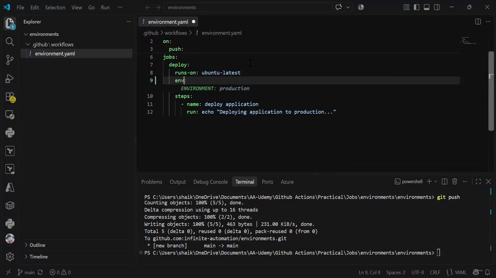

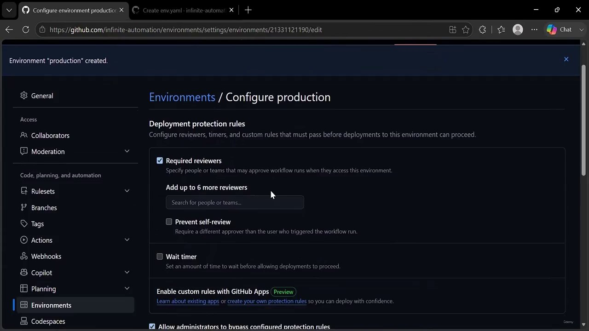

配置完成后，回到本地提交并 push：

```bash
git add .
git commit -m "added the environments rule set"
git push
```

打开 Actions，点击最新的 workflow run。此时 deploy job 不会直接执行，而是等待审批。页面上会出现 `Review deployments` 相关入口。讲师在 [09:46] 左右说明：因为 job 关联了 production environment，并且配置了 required reviewers，所以 GitHub 在部署前等待 approval。

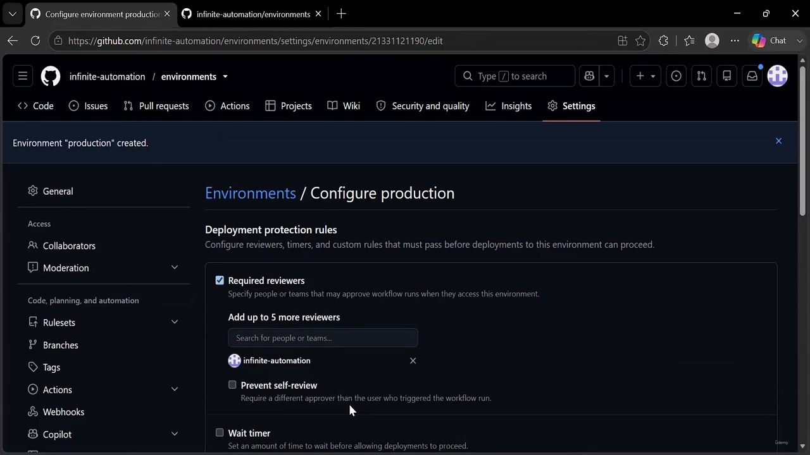

点击 `Review deployments`，选择 `production`，评论可选，课程里讲师填了 `reviewed`。然后点击批准部署。课程口述为 “approve the deployment”，界面文案以实际为准。

批准后，deploy job 才会开始运行，并执行 `Deploy application`，最后完成。

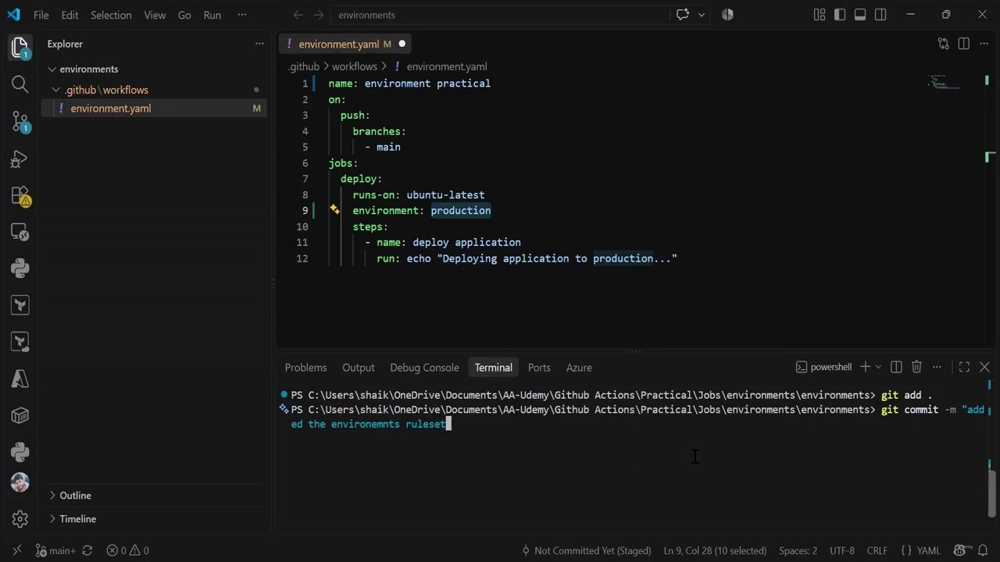

---

### 3.7 P56：Job Containers 只做概念复现

P56 没有实操仓库，也没有给出完整 YAML。讲师只讲了结构和分工：

- runner 是启动、管理 job 的机器；
- job container 是跑在 runner 上的 Docker container；
- container 提供 job steps 需要的环境；
- 讲师用 Java 17 应用举例：runner 上 Java 版本不一致会导致 job 失败，所以把 job 放进固定 Java 17 镜像的容器里，获得一致环境。

课程没有给出 Java 17 镜像的具体名称，因此本文不提供“可直接保存运行”的 P56 YAML。你实际做项目时，需要使用团队镜像仓库里真实的 Java 17 镜像名，并按 GitHub Actions 的 `container` 语法配置；这部分课程没讲。

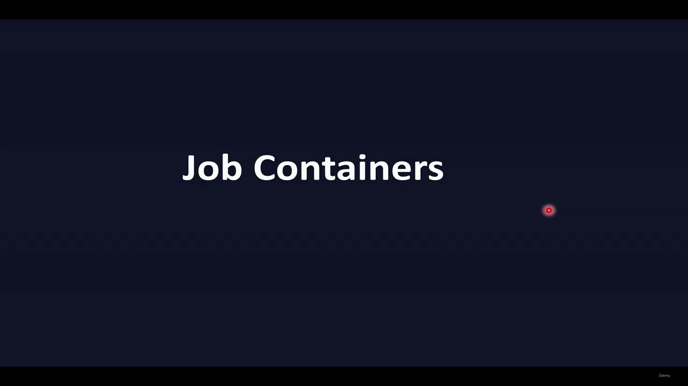

---

## 4. 完整代码

下面三个文件都是完整文件，可直接保存。注意：`concurrency-no-control.yaml` 只用于实验 A 第一阶段观察默认并行；观察完请删除或改成最终 `concurrency.yaml`，不要和最终文件同时放在 `.github/workflows/` 下，否则两个 workflow 都会被 push 触发。

### 4.1 `.github/workflows/concurrency.yaml`（最终版）

```yaml
name: Job Concurrency Demo

on: push

jobs:
  deploy:
    runs-on: ubuntu-latest
    concurrency:
      group: "production deployment"
      cancel-in-progress: true
    steps:
      - name: Deploy application
        run: |
          echo "Deployment started"
          sleep 80
          echo "Deployment completed"
```

### 4.2 `.github/workflows/concurrency-no-control.yaml`（阶段 A 对照版）

```yaml
name: Job Concurrency Demo No Control

on: push

jobs:
  deploy:
    runs-on: ubuntu-latest
    steps:
      - name: Deploy application
        run: |
          echo "Deployment started"
          sleep 80
          echo "Deployment completed"
```

### 4.3 `.github/workflows/environment.yaml`（最终版）

```yaml
name: Environment Practical

on:
  push:
    branches:
      - main

jobs:
  deploy:
    runs-on: ubuntu-latest
    environment: production
    steps:
      - name: Deploy application
        run: echo "Deploying to the production environment"
```

### 4.4 P56 为什么没有完整 YAML

P56 是概念课。讲师说使用 Java 17 container image，但没有给出 image 名，也没有给出完整 workflow 文件。为了不编造，本文不写一个假的 `container: ...` 文件。你只要记住结构关系：`runs-on` 选 runner，`container` 指定 job steps 运行的环境；具体镜像名以你实际项目为准。

---

## 5. 逐行解释

### 5.1 `concurrency.yaml` 逐字段解释

| 配置 | 含义 | 注意 |
|---|---|---|
| `name: Job Concurrency Demo` | workflow 名称 | Actions 页面显示的名字 |
| `on: push` | 任意 push 触发 | 课程没有加分支过滤 |
| `jobs.deploy` | job id 为 `deploy` | 页面显示 deploy job |
| `runs-on: ubuntu-latest` | 使用 GitHub 托管 Ubuntu runner | 课程明确指定 |
| `concurrency.group: "production deployment"` | 同一 group 下的 job 不允许同时运行 | 讲师口述 group 名就是 `production deployment` |
| `cancel-in-progress: true` | 新 run 到来时取消旧 run | 生产环境要谨慎，可能中断正在执行的部署 |
| `steps` | job 内的步骤列表 | 只有一个 step |
| `name: Deploy application` | step 名称 | Actions 页面显示 |
| `run: \|` | 多行 shell 脚本 | `|` 表示保留换行 |
| `echo "Deployment started"` | 打印开始 | 用于观察日志 |
| `sleep 80` | 等待 80 秒 | 制造“部署还在跑”的时间窗口 |
| `echo "Deployment completed"` | 打印完成 | 正常结束后显示 |

对前端读者的类比：`concurrency.group` 很像以 group 字符串为 key 的互斥锁。同一个 key 同时只允许一个部署任务进入。Node 里没有 GitHub Actions 这种内置队列语义，通常要自己用锁或队列实现；这里也不要把它当数据库事务，它不会回滚已经执行的 shell。`cancel-in-progress: true` 更像“只保留最新一次请求”，类似前端取消旧请求、只处理最新请求，但这里取消的是整个 workflow run。

### 5.2 `environment.yaml` 逐字段解释

| 配置 | 含义 | 注意 |
|---|---|---|
| `name: Environment Practical` | workflow 名称 | 课程命名 |
| `on.push.branches` | 只在 push 到指定分支时触发 | 课程口述 main 分支 |
| `branches: - main` | 分支列表 | 默认分支不是 main 时改成 master |
| `jobs.deploy` | 部署 job | 后面绑定 environment |
| `runs-on: ubuntu-latest` | GitHub 托管 runner | 与 P53 相同 |
| `environment: production` | 把 job 绑定到 production 环境 | 必须和 Settings 里创建的 environment 同名 |
| `steps` | 步骤列表 | 只有一个部署步骤 |
| `name: Deploy application` | step 名称 | 审批通过后才执行 |
| `run: echo "Deploying to the production environment"` | 模拟部署命令 | 课程没有真正部署应用，只打印 |

`environment` 是 job 级配置，不是 step 级。它告诉 GitHub：这个 job 属于 production 部署目标，因此要应用 production environment 上配置的保护规则。保护规则在 GitHub UI 里配置，不在 YAML 里写 reviewer 名单。课程没有讲用 YAML 写审批人，实际也不是在 YAML 里写。

### 5.3 P56 runner 与 container 的分工

| 角色 | 负责什么 | 课程原话对应 |
|---|---|---|
| runner | 启动、管理 job | “The runner is a machine that starts and manages our job.” |
| job container | 提供 job steps 的运行环境 | “The container runs on the runner and provide the environment for our steps.” |
| job steps | 在 container 环境里执行命令 | “our commands runs using the tools available inside that particular container.” |

对前端读者的类比：这有点像你不直接在 CI 机器上跑 `node`，而是固定使用一个带指定 Node 版本的 Docker 镜像跑测试，避免 runner 自带 Node 版本漂移。注意这是类比；课程原例是 Java 17。

---

## 6. 复现检查清单

### 实验 A：Job Concurrency

- [ ] 已创建 `job-concurrency` 仓库并 clone 到本地。
- [ ] 已创建 `.github/workflows/concurrency.yaml`。
- [ ] 第一次 push 后，Actions 里 deploy job 开始运行，日志出现 `Deployment started`。
- [ ] 在 `sleep 80` 结束前做第二次 dummy commit 并 push。
- [ ] 能观察到两个 deploy job 同时运行（无并发控制阶段）。
- [ ] 加上 `concurrency.group: "生产环境部署"` 后，第二次 push 的新 run 出现 waiting，而不是直接执行。
- [ ] 等旧 run 完成后，新 run 能继续执行。
- [ ] 加上 `cancel-in-progress: true` 后，再做 dummy commit，旧 run 被取消，新 run 获得执行。
- [ ] Actions 页面状态文案以实际显示为准；课程中出现的是 waiting、canceled、started、completed 这类状态描述。

### 实验 B：Environments

- [ ] 已创建 `environments` 仓库并 clone 到本地。
- [ ] 先不加 `environment` 时，push 后 deploy job 直接运行完成。
- [ ] 本地 YAML 加上 `environment: production`。
- [ ] GitHub 仓库 Settings → Environments 已创建同名 `production`。
- [ ] 已启用 Required reviewers，并添加至少一个 reviewer。
- [ ] 如启用 Prevent self-review，确认触发者不是唯一 reviewer，否则可能无人能批准。
- [ ] push 后 Actions 中 deploy job 等待审批。
- [ ] 点击 Review deployments，选择 production，填写可选评论并批准。
- [ ] 批准后 deploy job 开始执行并完成。
- [ ] environment 名称与 YAML 中 `production` 完全一致。

### P56：Job Containers

- [ ] 能说清 runner 负责启动和管理 job。
- [ ] 能说清 job container 提供 job steps 的运行环境。
- [ ] 知道课程没有给出 Java 17 镜像名，不能照抄一个不存在的完整 YAML。

---

## 7. 课里没讲但你会撞上

1. **workflow 级 concurrency 和 job 级 concurrency 不是一回事。** 课程只演示了 job 级：`jobs.deploy.concurrency`。workflow 级写法课里没讲，不要混用。
2. **group 名有空格。** 讲师口述 `production deployment`，实际 YAML 建议加引号。空格、大小写不一致都会导致你以为“同一组”但其实不是同一组。
3. **`cancel-in-progress: true` 不等于安全回滚。** 它只取消旧 run，不会帮你回滚已经执行的部署命令。生产环境要谨慎，课程没有讲回滚策略。
4. **`sleep 80` 会占用 Actions 分钟数。** 免费额度、计费规则课程没讲；如果你反复触发，注意额度。
5. **environment 名称必须和 Settings 里完全一致。** YAML 写 `production`，UI 也必须是 `production`；大小写不同可能绑定不到你以为的保护规则。
6. **`Prevent self-review` 可能把你自己卡住。** 如果你既是触发者又是唯一 reviewer，开启后可能无法自己批准。课程提到该选项，但没有演示“卡住”的后果。
7. **required reviewers 最多人数以 UI 实际为准。** 讲师说最多 6 人，添加自己后界面显示还可加 5 人；课程没有演示多人审批的完整流程。
8. **environment secrets/variables 课里只提了能力，没有演示。** P54 说 environment 可以保存 specific secrets and variables，但 P55 没有创建具体 secret/variable，所以本文也没有写具体名称。
9. **P56 的 Java 17 镜像名缺失。** 课程只说 Java 17 container image，没有给 image 名。不要从本文找“完整可运行容器 YAML”，本文刻意不编造。
10. **Actions 页面按钮文案可能随 GitHub 版本变化。** 课程里说 Review deployments、approve the deployment；你实际看到的按钮文案可能略有差异，以页面为准。
11. **YAML 里的 `on` 在部分编辑器会被识别成布尔值。** 这是编辑器语法高亮/解析问题，不影响 GitHub Actions 按 workflow 解析；课程没有展开讲。
12. **前端读者不要把 concurrency group 当数据库事务。** 它只做运行排队/取消，不做数据一致性；在 Node 里对应的是“按 key 串行化任务”的思路，但具体实现要自己写。