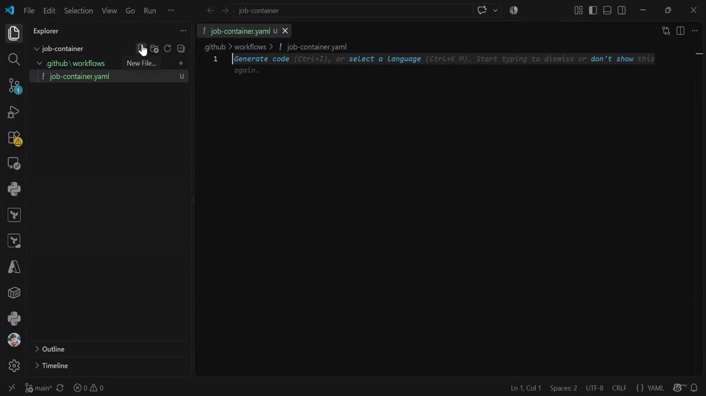
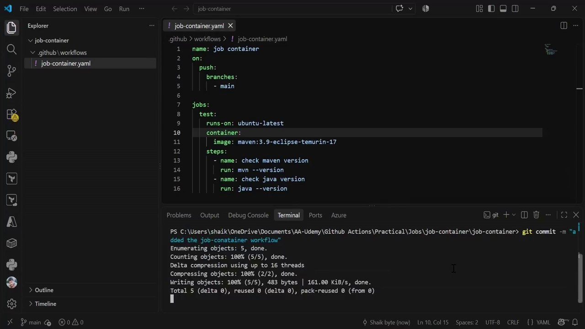
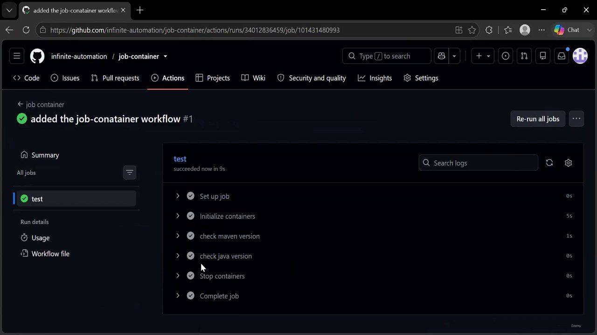
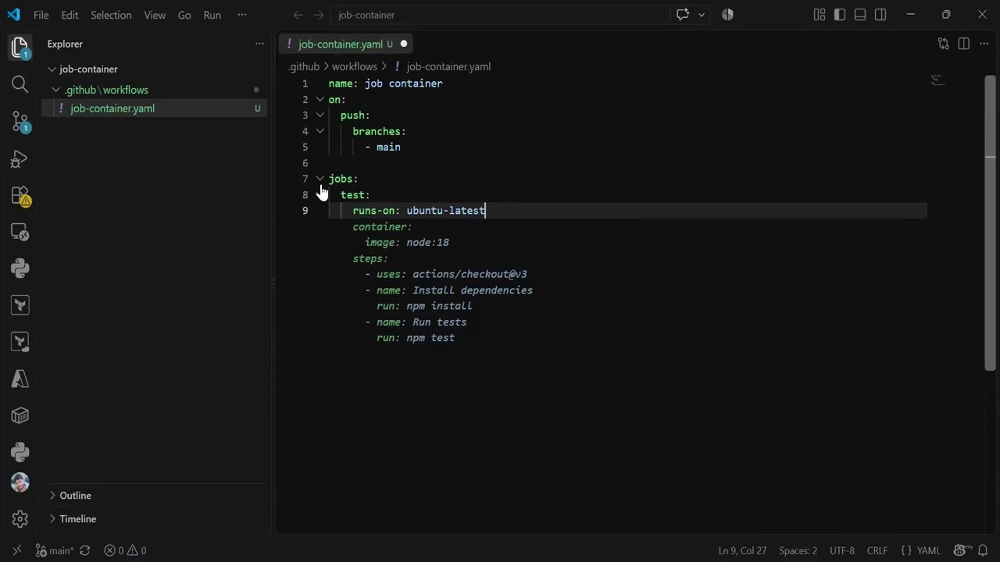
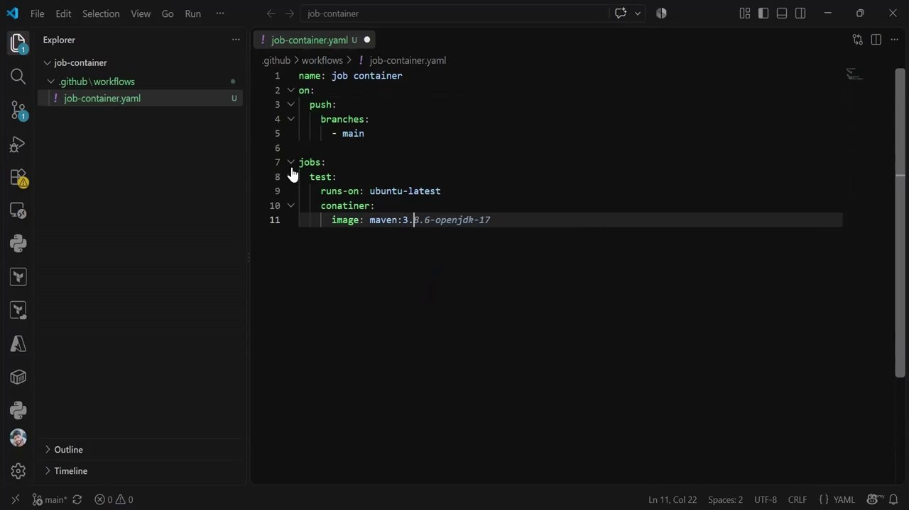
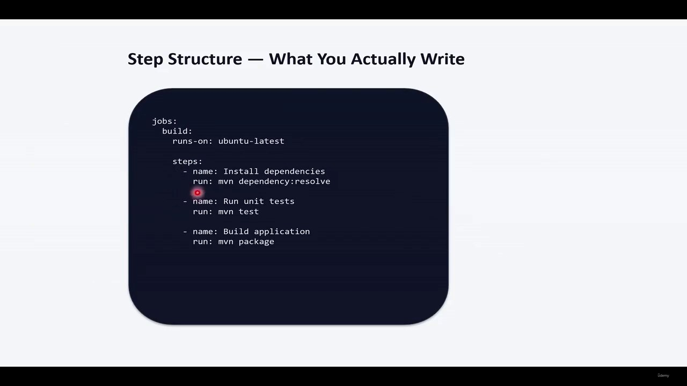
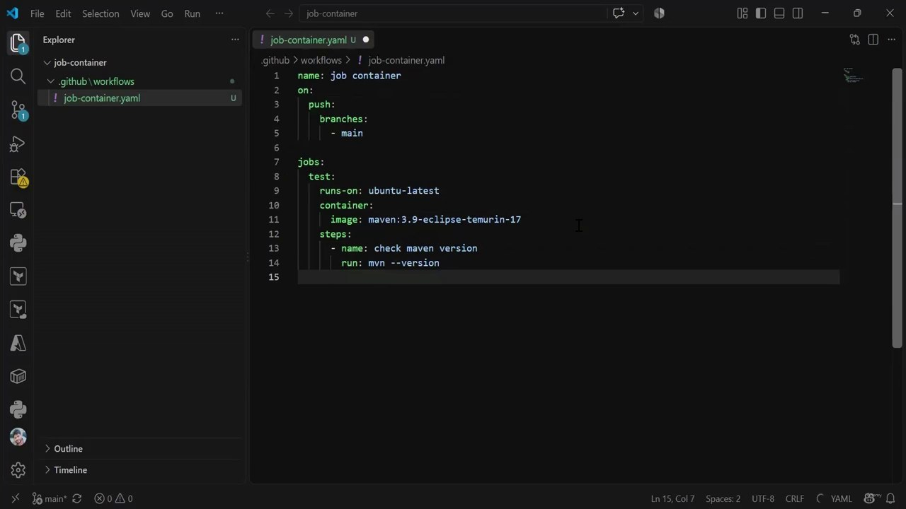
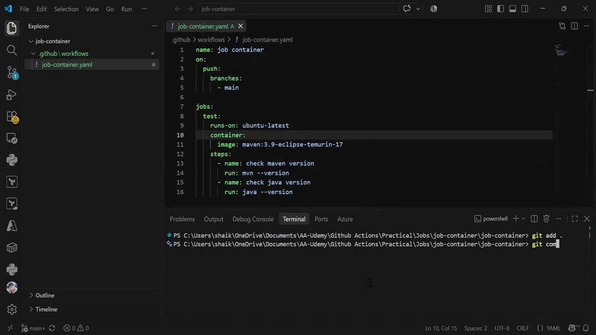

# GitHub Actions 实战：用 Job Container 跑通 Maven + Java 17

本文覆盖 **P057–P060**。P057 是动手实操：创建一个 job container workflow，让 job 里的所有 step 都在 Maven 容器里执行，并用 `mvn --version`、`java --version` 验证环境。P058–P060 是三个短概念课，分别讲 step、run、uses，本文会把它们落到 P057 的 workflow 文件里，避免概念和代码两张皮。

读完后你应该能得到一个可以 push 到 GitHub、并在 Actions 页面看到 Maven 与 Java 版本输出的仓库。

---

## 1. 这一节做什么

先给结论：这一节要交付的是一个**只做环境验证**的最小 workflow，不构建真实项目。

最终目录结构只有两层：

```
job-containers/
└── .github/
    └── workflows/
        └── jobcontainer.yml
```

这个 workflow 的行为是：

1. 你往 GitHub 仓库 push 任意提交；
2. GitHub 启动一台 Ubuntu 的 hosted runner（托管运行器）；
3. runner 再启动一个 Docker 容器，镜像用 `maven:3.9-eclipse-temurin-17`；
4. job 里的两个 step 依次在这个容器里执行：`mvn --version` 和 `java --version`；
5. 在 Actions 页面能看到 Maven 版本和 Java 17 的输出。

为什么需要 job container？讲师在 P057 开头给的定义是：job container 允许我们把 job 的 step 放在一个带有“我们需要的环境”的容器里运行。翻译成前端能懂的话：你本地用 `nvm use 18` 切 Node 版本，再 `npm i -g pnpm` 装全局工具；job container 就是把这个“版本 + 全局工具”的现场冻结成一个镜像，GitHub 每次跑 job 时先把这个镜像拉下来，再在镜像里执行命令。这样就不会出现“我本地 Maven 3.9、runner 上是别的版本”的偏差。再具体一点，前端本地常见的是“Node 版本不对、包管理器版本不对、系统依赖缺失”，Java 这边对应的就是“Maven 版本不对、JDK 版本不对、容器里缺少某个命令行工具”。job container 的价值不是替代 `actions/setup-java` 这类方案，而是本节要验证的一个最小模型：先把环境装进容器，再让 step 进入这个容器执行。

注意一个容易混淆的点：**runner 和 container 是两层**。runner 是 GitHub 提供的虚拟机，container 是跑在这台虚拟机里的 Docker 容器。讲师在 P057 [03:20] 特意提醒“don't get confused between the runner and the container”，后面第 5 节会展开。你可以把 runner 想成一台刚刚装好操作系统的电脑，把 container 想成这台电脑里启动的一个隔离环境；`runs-on` 决定电脑类型，`container.image` 决定隔离环境用哪个镜像。两个配置不在同一层，所以缩进也不能写错。

P058–P060 三节概念课分别回答三个问题：

- step 是什么：job 里的一项任务，按顺序从上到下执行（P058）；
- run 是什么：在 runner 上执行你自己的 shell 命令（P059）；
- uses 是什么：调用一个已经打包好的 action，比如 `actions/checkout@v6`（P060）。

本 workflow 只用到 `run`，没有用到 `uses`。第 7 节会补一个 `uses` 的扩展示例，并明确说明“课里没讲”的部分。学习时不要把“容器里执行”和“runner 上执行”对立起来：在 job container 场景下，step 仍然属于这个 job，只是 GitHub 会把这个 job 的 step 放进容器里跑；所以 P059 说 `run` 执行自己的命令，P057 说 step 在容器里执行，两句话叠加起来才是本 workflow 的完整行为。

---

## 2. 讲师原话

### 2.1 job container 的定义

—— p057 [00:00]

> a job container allows us to run the step of a job inside a container with the environment we need.

这句话是整节课的锚点：重点不是“用 Docker”，而是“让 step 跑在指定环境里”。换句话说，Docker 只是实现手段，真正要解决的是环境一致性问题。前端同学可以把它类比成“把 `.nvmrc`、`packageManager` 字段和全局 CLI 一起固化”，只不过这里固化成的是一个完整镜像。

### 2.2 runner 与 container 的分层

—— p057 [03:20]

> GitHub first provide the Ubuntu runner. Then the runner starts our Maven container. Then the step of this job run inside the container.

—— p057 [07:04]

> whenever we push our changes, first GitHub started the GitHub hosted runner and then it started the image that we have provided as a container. It started the container and then it has executed the step that we have provided in the job.

这两段话把执行链路说得很清楚：push → runner → container → step。后面看 Actions 日志时，你会先看到 runner 初始化，再看到 container 初始化，最后才是你的 `mvn --version`。如果日志顺序和你预期不一致，优先检查是不是把“runner 的 Ubuntu 环境”和“container 的 Maven 环境”混在一起理解了。

### 2.3 step 的定义与失败行为

—— p058 [00:00]

> A step is basically one task that we perform inside a job. For example, a step can install dependencies, run tests, or build our application.

—— p058 [00:59]

> Step inside a job normally runs one by one from top to bottom. The order is important because a next step may depends on earlier step.

—— p058 [01:28]

> In a job by default if the step fails the next step are skipped. But we can use conditions like failure when we want to run some work after a failure.

P058 只给了“failure 条件”这个概念，没有展开完整语法。第 7 节会说明这一点，不会把 `if: failure()` 的写法安到讲师头上。这里要记住两个默认行为：第一，step 默认从上到下串行执行；第二，前面的 step 失败后，后面的 step 默认跳过。这个规则在你后面写“安装依赖 → 跑测试 → 构建产物”时非常关键，因为一旦安装依赖失败，后面的测试和构建通常不会再执行。

### 2.4 run 关键字的执行位置

—— p059 [00:00]

> we use the run keyword when we want to execute our own commands or a script on the render.

—— p059 [00:28]

> the commands we write at the run is actual execute inside the runner. ... By using a pipe symbol after the run, we can use multiple commands and they execute one after another in the same step.

这里讲师说的是“在 runner 上执行”。放到 job container 场景里要补一句：当 job 配置了 `container` 时，`run` 的命令实际是在容器里执行的，因为 step 已经被容器接管了。这是 P057 和 P059 两节课叠加后的实际行为。学习时不要因为 P059 说“runner”就以为命令一定在宿主机上执行；更准确的理解是：`run` 表示“执行一条命令”，命令最终落在哪个环境，要看 job 是否配置了 `container`。

### 2.5 uses 关键字

—— p060 [00:00]

> Imagine our workflow needs to check out the code, set up a Java, and then build the application. ... Some of these works has been already packaged as an action in GitHub.

—— p060 [00:57]

> action checkout is used to check out our repository code onto the runner. ... we simply use an existing action with the actions checkout at v6 version.

—— p060 [01:27]

> If we want to execute our own commands, we normally use run. If we want a step to call reusable action logic, we can use uses.

P060 给了一个很实用的决策规则：**自己的命令用 run，复用别人的逻辑用 uses**。本 workflow 两个 step 都是自己的命令，所以只用 run。前端对照可以这样记：`run` 更像在 CI 里直接写 `npm ci`、`npm test`；`uses` 更像调用一个已经封装好的 action，相当于把一段通用 CI 逻辑当成“依赖”来复用。

---

## 3. 从零复现

### 3.1 前置条件

- 一个 GitHub 账号；
- 本地装了 Git；
- 编辑器用 VS Code（可选，讲师用的是 VS Code）；
- **不需要本地装 Docker**。容器是 GitHub runner 拉的，不是你本地拉的。

如果你本地没有 Docker，不影响复现 P057 的主流程。只有想做第 3.7 节的本地等价验证时，才需要本地 Docker。前端同学可以把这一步类比成“CI 在远端机器上装 Node，不需要你本机装同一个 Node 版本”，区别只是这里远端机器会再启动一个容器。

### 3.2 创建仓库并 clone

在 GitHub 网页上新建一个空仓库，名字用 `job-containers`（讲师口述为 “job containers”，GitHub 仓库名通常用连字符）。初始化时不要勾选 README，保持空仓库。

然后本地执行：

```bash
git clone git@github.com:<你的用户名>/job-containers.git
cd job-containers
```

如果你用 HTTPS，把 `git@github.com:` 换成 `https://github.com/` 即可。

命令解释：`git clone` 会把远端仓库复制到本地；`cd job-containers` 进入仓库目录，后面的 `.github/workflows` 必须建在这个目录下面。常见错误是：在仓库外层创建了 `.github`，结果 push 上去的路径不对；或者仓库初始化时勾选了 README，导致本地 clone 后已有提交，和后面的最小复现步骤混在一起。排查时用 `pwd` 确认当前目录，用 `git status` 确认仓库根目录，用 `git remote -v` 确认远端地址。

### 3.3 创建目录结构

```bash
mkdir -p .github/workflows
```

`.github/workflows` 是 GitHub Actions 固定识别的目录，不能改名，也不能放到子目录里。`mkdir -p` 的好处是父目录不存在时一起创建，重复执行也不会报错。前端对照：这有点像项目里固定的 `src/` 或 `public/` 目录，路径本身参与约定；你把 workflow 放到 `workflows/` 根目录或 `.github/workflow/` 单数目录，GitHub 都不会按预期识别。验证方式是执行 `find . -maxdepth 3 -type d -path './.github/workflows'`，或者直接 `ls -la .github/workflows`。

### 3.4 写 workflow 文件

在 `.github/workflows/` 下新建 `jobcontainer.yml`。讲师口述时先说了 `jobcontainer.yml`，后面又说成 `jobcontainer.yaml`，两个扩展名 GitHub 都认，本文统一用 `.yml`。



把第 4 节的完整代码粘进去。这里先提醒两个容易写错的地方：

- `container:` 和 `runs-on:` 是**同级**，都缩在 job id 下面；
- `image:` 再缩一层，挂在 `container:` 下面。

YAML 对缩进非常敏感，但不要用 Tab。常见错误是把 `container:` 缩进到 `runs-on:` 里面，或者把 `image:` 和 `container:` 写成同级；这样 YAML 解析会失败，Actions 页面可能直接显示 workflow 文件错误。前端对照：它不像 JSON 那样用大括号表达层级，而是靠空格表达层级，所以“看起来对齐”不够，必须保证同一层级空格数一致。

### 3.5 提交并推送

讲师在 P057 [04:43] 用的提交信息是 “added the job container workflow”，照抄即可：

```bash
git add .
git commit -m "added the job container workflow"
git push
```



命令解释：`git add .` 把当前目录下的新增和修改加入暂存区；`git commit -m ...` 生成一次提交；`git push` 推送到远端。常见错误有三个：第一，当前目录不是仓库根目录，导致 `.github` 没被加入；第二，推送到了错误分支，而 Actions 页面看的是另一个分支；第三，SSH key 没配好，`git push` 报权限错误。排查时先看 `git status` 里是否出现 `.github/workflows/jobcontainer.yml`，再看 `git log --oneline -1` 是否是你刚写的提交。

### 3.6 在 Actions 页面观察结果

push 成功后打开仓库页面，点 **Actions** 标签。你会看到名为 `jobcontainer` 的 workflow 被触发，里面有一个 `test` job。



点进这次 run，再点 `test` job，日志里会按顺序出现几类 step：

1. **Set up job**：runner 初始化，会显示操作系统版本等信息；
2. **Initialize containers**：拉取 `maven:3.9-eclipse-temurin-17` 镜像并启动容器；
3. **Check Maven version**：执行 `mvn --version`；
4. **Check Java version**：执行 `java --version`。

讲师在 P057 [06:07] 描述这一段时说：“First, it set up the runner with the version, with the operating system, and then it has initialized the container.” 其中 `Set up job` 和 `Initialize containers` 是 GitHub 平台自动加的 step，不是你写的，第 7 节会再解释。

`Check Maven version` 的输出里能看到 Maven 版本号。逐字稿 [06:37] 记录的是 **3.9.16**，注意镜像 tag 写的是 `3.9`，实际跑出来是 3.9.x 的具体小版本，这个差异在第 7 节展开。

`Check Java version` 的输出里能看到 Java 17。逐字稿 [06:37] 的原话是 “Now it has been executed Java 17. which is it showing the Java version.” 具体输出格式以实际镜像为准，不同 JDK 发行版的抬头行不完全一样。

如果 Actions 页面没有出现你预期的 workflow，先看三个地方：仓库的 Actions 功能是否可用、文件路径是否是 `.github/workflows/jobcontainer.yml`、当前分支的最近提交是否包含这个文件。前端对照：这和“CI 没跑”排查类似，先确认配置文件路径和触发分支，再看平台日志，不要一上来就怀疑命令本身。

### 3.7 本地等价验证（可选，课里没讲）

如果你本地有 Docker，可以先用一条命令确认镜像里确实有这两个工具，避免 push 之后才发现镜像名写错：

```bash
docker run --rm maven:3.9-eclipse-temurin-17 mvn --version
docker run --rm maven:3.9-eclipse-temurin-17 java --version
```

这**不是** GitHub Actions 的运行方式，只是本地验证镜像内容。课里没有讲这一步，属于额外排错手段。`--rm` 表示容器退出后自动删除，避免本地堆积临时容器；`mvn --version` 和 `java --version` 是直接让容器执行命令。常见错误是本地 Docker 没启动、镜像拉取超时，或者镜像名拼错；这些错误至少能在 push 前暴露，减少远端调试成本。

---

## 4. 完整代码

文件路径：`.github/workflows/jobcontainer.yml`

```yaml
name: jobcontainer

on: push

jobs:
  test:
    runs-on: ubuntu-latest
    container:
      image: maven:3.9-eclipse-temurin-17
    steps:
      - name: Check Maven version
        run: mvn --version

      - name: Check Java version
        run: java --version
```

就这一个文件，不需要 `package.json`，不需要 `pom.xml`，不需要 Dockerfile。

关于镜像名要特别说明：讲师在 P057 [02:51] 口述的镜像名被语音识别成了 “Maven 3.9 iPhone Eclipse Tomorin 17”。把识别噪声去掉，对应 Docker Hub 上的官方镜像 `maven:3.9-eclipse-temurin-17`。这个镜像同时包含 Maven 和 Java 17，正好覆盖我们要验证的两个工具。如果你要严格对照讲师仓库，请以他仓库里的 `image:` 值为准；本文按 Docker Hub 官方命名给出可运行版本。

关于 `runs-on`：讲师在 P057 [01:52] 只说了 “this will schedule on Ubuntu GitHub hosted runner”，没有逐字念出 tag。本文写 `ubuntu-latest`，这是 GitHub 托管 runner 的常见写法；具体 tag 以你实际仓库为准。前端对照：`runs-on` 类似选择 CI 的“机器类型”，`container.image` 类似选择项目运行时的“环境镜像”，两者不是同一个层级。

---

## 5. 逐行解释

### 5.1 `name: jobcontainer`

workflow 的显示名，会出现在 Actions 页面左侧列表里。不写也能跑，默认用文件路径当名字。常见错误是把 `name` 和 job id 混淆：这里的 `name` 是 workflow 名字，不是 job 名字。验证方式是 push 后看 Actions 页面左侧是否显示 `jobcontainer`。

### 5.2 `on: push`

触发条件：任何 push 到仓库的动作都会触发这个 workflow。也可以写成数组形式 `on: [push]`。课里只讲了 push 这一个事件，没有展开 `pull_request`、`workflow_dispatch` 等。常见错误是 YAML 把 `on` 解析成布尔值的历史坑，但在 GitHub Actions 的这份文件里按原样写即可；如果你改写成别的结构，先确认缩进和冒号。前端对照：类似 `package.json` 里的 scripts 触发条件，只有事件匹配才会执行。

### 5.3 `jobs:` 与 `test:`

`jobs:` 下面可以放多个 job，默认并行执行。这里只有一个 `test`。`test` 是 job 的 **id**，不是显示名；显示名可以用 job 级别的 `name:` 覆盖，但课里没讲，本文件也没写。常见错误是把 `test:` 和 `steps:` 写成同级，导致 job 下没有 step。验证方式是看 `test:` 下面是否包含 `runs-on`、`container`、`steps` 三个同级键。

### 5.4 `runs-on: ubuntu-latest`

指定 GitHub 托管的 runner 类型。讲师的描述是 “Ubuntu GitHub hosted runner”。这一行决定的是**外层虚拟机**，不是容器。



常见错误是以为 `runs-on` 写的是容器镜像；不是，容器镜像在 `container.image`。前端对照：`runs-on` 更像选择 CI 机器，`container` 更像选择 Docker/devcontainer 环境。

### 5.5 `container:` 与 `image:`

这是 P057 的核心。`container` 挂在 job 级别，不挂在 step 级别，意味着**这个 job 的所有 step 共享同一个容器**。



`image:` 指定镜像地址。讲师在 P057 [02:51] 说明这个镜像来自 Docker Hub 的公共镜像仓库，里面已经包含 Maven 和 Java 17。GitHub 在 job 启动时会先 pull 这个镜像，再创建容器。

这里要再次强调分层关系：runner 是外层 Ubuntu 虚拟机，container 是里层 Docker 容器，step 在里层执行。讲师在 P057 [03:20] 的原话是：“GitHub first provide the Ubuntu runner. Then the runner starts our Maven container. Then the step of this job run inside the container.” 常见错误是镜像名写错、tag 写错，或者网络拉取失败；现象通常是 `Initialize containers` 这一步失败或耗时很久。排查时先在本地执行第 3.7 节的 `docker run`，或者回到 Docker Hub 确认镜像名。

### 5.6 `steps:`

对应 P058 的定义：step 是 job 里的一项任务，按从上到下的顺序执行。落到 YAML 里就是 `steps:` 数组，数组每一项是一个 step。



P058 还讲了两条规则，虽然本 workflow 只有两个 step，但后面写真实项目一定会撞上：

- **顺序重要**：下一个 step 可能依赖上一个 step。比如必须先装依赖，再跑测试，再构建。
- **默认失败即跳过**：某个 step 失败后，后面的 step 默认不执行。P058 [01:28] 提到可以用 `failure` 条件在失败后执行一些收尾工作，但课里没有给完整语法，第 7 节会说明。

常见错误是 step 的 `- name` 缩进不对，或者 `run` 和 `name` 没对齐。验证方式是看每个 step 是否以 `-` 开头，`name` 和 `run` 是否在同一级缩进。

### 5.7 第一个 step：`Check Maven version`

```yaml
- name: Check Maven version
  run: mvn --version
```



`name` 是 step 的显示名，会出现在日志里。`run` 对应 P059 的关键字：执行你自己的命令。P059 [00:28] 说命令实际在 runner 上执行；在本 workflow 里因为配置了 `container`，命令实际落在容器里执行。

`mvn --version` 是 Maven 的版本查询命令。Maven 是 Java 生态的构建工具，类比前端就是 `npm` / `pnpm` 这一类角色；`mvn --version` 类比 `npm --version`。Java 命令语法不需要深入，知道它是“查版本”即可。常见错误是把 `--version` 写成 `-version`，或者把 `mvn` 写成 `maven`；前者在某些命令里含义不同，后者根本不是这个镜像里的可执行命令。验证方式是看日志中该 step 是否出现 Maven 版本号。

### 5.8 第二个 step：`Check Java version`

```yaml
- name: Check Java version
  run: java --version
```



同上。`java --version` 是 Java 9 以后支持的写法，Java 8 只认 `java -version`。这个镜像里是 Java 17，所以 `--version` 可用。常见错误是镜像版本不是 Java 17 却照抄 `--version`，或者命令前多了 `$`。前端对照：类似 `node --version` 查 Node 版本，输出内容不同但用途一致。

两个 step 都只用 `run`，没有用 `uses`。P060 的决策规则在这里体现得很清楚：命令是自己写的，就用 `run`；如果要复用别人打包好的逻辑（比如 checkout 代码），才用 `uses`。

### 5.9 P059 的 pipe 用法（本文件未使用，但要知道）

P059 [00:28] 提到：在 `run` 后面用管道符 `|` 可以写多条命令，按顺序在同一个 step 里执行。形式大概是这样：

```yaml
- name: Install and test
  run: |
    npm ci
    npm test
```

本 workflow 每条 step 只有一条命令，所以没用 `|`。但后面你写真实项目时，把“装依赖 + 跑测试”合并到一个 step 里会用到。注意这是 P059 讲的通用写法，不是本文件的内容。常见错误是 `|` 后面第一行命令缩进不一致，或者把多条命令写在同一行却没有分隔符；排查时看日志里这个 step 是否把每条命令都打印出来。

### 5.10 P060 的 uses（本文件未使用）

P060 讲的是 `uses`：调用一个已打包的 action。讲师举的例子是 `actions/checkout@v6`，用来把仓库代码 checkout 到 runner 上。

本 workflow 没有 checkout 代码，因为它的目的只是验证容器环境，不构建项目。如果你要把它扩展成“在容器里构建一个真实 Maven 项目”，就需要在 `steps:` 最前面加一个 checkout step。具体写法见第 7.4 节，并会标注哪些是课里没讲的。常见错误是把 `uses` 和 `run` 混用：`uses` 后面接 action 名称，不是 shell 命令；`run` 后面才是命令。

---

## 6. 复现检查清单

push 之前逐项核对：

- [ ] 仓库是空的，或者至少没有同名 workflow 冲突；  
  验证：打开仓库首页看文件列表，确认没有另一个 `.github/workflows/jobcontainer.yml`，必要时用 `find .github -type f` 查看。

- [ ] 目录是 `.github/workflows/`，不是 `github/workflows/`，也不是 `.github/workflow/`；  
  验证：执行 `ls -la .github/workflows`，确认输出中能看到 `jobcontainer.yml`。

- [ ] 文件名是 `jobcontainer.yml`，扩展名是 `.yml` 或 `.yaml`；  
  验证：执行 `ls .github/workflows/jobcontainer.yml`，不要只看编辑器标签名。

- [ ] YAML 缩进全部用空格，没有 tab；  
  验证：用编辑器显示不可见字符，或执行 `grep -nP "\t" .github/workflows/jobcontainer.yml`，没有输出才表示没有 tab。

- [ ] `container:` 和 `runs-on:` 同级；  
  验证：看两行开头空格数是否一致，二者都应在 `test:` 下缩进同一层。

- [ ] `image:` 比 `container:` 多缩两格；  
  验证：`image:` 应挂在 `container:` 下面，不能和 `container:` 平级。

- [ ] `steps:` 和 `container:` 同级；  
  验证：`steps:` 应在 job `test:` 下面，与 `runs-on`、`container` 同一层。

- [ ] 镜像名是 `maven:3.9-eclipse-temurin-17`，没有拼写错误；  
  验证：直接复制本文件中的镜像名，或本地执行 `docker run --rm maven:3.9-eclipse-temurin-17 mvn --version`。

- [ ] `mvn --version` 是两个连字符，不是 `mvn -version`；  
  验证：在文件中搜索 `mvn`，确认后面是 `--version`。

- [ ] `java --version` 是两个连字符；  
  验证：在文件中搜索 `java`，确认后面是 `--version`。

- [ ] commit message 和讲师一致：`added the job container workflow`；  
  验证：执行 `git log --oneline -1`，看最近一次提交信息。

- [ ] push 后在 Actions 页面能看到 `jobcontainer` workflow；  
  验证：打开仓库 Actions 标签，确认左侧或运行列表出现 `jobcontainer`。

- [ ] 点进 `test` job 后，能看到 `Initialize containers` 这一步；  
  验证：在 job 日志中展开 step 列表，查找 `Initialize containers`，它表示容器初始化。

- [ ] `Check Maven version` 的输出里有 Maven 版本号；  
  验证：点开该 step 日志，搜索 `Apache Maven` 或 `Maven`，应能看到版本信息。

- [ ] `Check Java version` 的输出里有 Java 17；  
  验证：点开该 step 日志，搜索 `17` 或 `openjdk`，应能看到 Java 17 相关信息。

如果 Actions 页面完全没有出现 workflow，先检查仓库的 Actions 功能是否可用、`.github/workflows/jobcontainer.yml` 是否在默认分支或你 push 的分支上、文件名和目录是否拼写正确；如果出现了 workflow 但 job 失败，先看失败发生在 `Set up job`、`Initialize containers` 还是你的 step，再分别排查 YAML、镜像拉取和命令本身。

---

## 7. 课里没讲但你会撞上的（表格：现象 / 原因 / 怎么办）

| 现象 | 原因 | 怎么办 |
|---|---|---|
| Actions 页面完全没有 `jobcontainer` | 文件不在 `.github/workflows/`，或文件名、扩展名不对，或 Actions 未启用 | 用 `find .github -type f` 确认路径；确认文件名是 `jobcontainer.yml`；到仓库 Settings → Actions 检查是否允许 Actions |
| workflow 出现但立刻报 YAML 错误 | 缩进用了 Tab，或 `container`、`image`、`steps` 层级写错 | 改用空格；对照第 4 节代码逐层检查；用编辑器显示不可见字符 |
| `Initialize containers` 失败 | 镜像名拼错、tag 不存在、Docker Hub 拉取超时 | 先本地 `docker run --rm maven:3.9-eclipse-temurin-17 mvn --version`；确认镜像名和 tag；重试 run |
| `mvn --version` 报 command not found | 镜像不是 Maven 镜像，或命令拼成 `maven` | 确认 `image:` 是 `maven:3.9-eclipse-temurin-17`；命令写 `mvn --version` |
| `java --version` 报错 | 镜像里的 Java 版本不支持 `--version`，或命令写错 | 本镜像是 Java 17，应支持 `--version`；若换镜像，先用 `java -version` 验证 |
| Maven 实际版本不是 3.9 整 | `3.9` 是 tag，实际解析到具体小版本 | 这是正常现象；看日志里的具体版本号，不要误以为配置失败 |
| 分不清 runner 和 container | 把 `runs-on` 当成容器，或把 `container` 当成机器类型 | 记住 `runs-on` 选外层虚拟机，`container.image` 选里层容器 |
| step 失败后后面的 step 不执行 | P058 讲的默认行为：失败后跳过后续 step | 先修失败的那个 step；课里提到的 `failure` 条件课里没展开，不要照搬未验证语法 |
| 需要 checkout 代码却没有代码 | 只写了 `run`，没有用 `uses: actions/checkout@v6` | 在 `steps:` 最前面加 checkout，见本节 7.4 示例 |
| `run` 和 `uses` 混用 | `uses` 后面写了 shell 命令，或 `run` 后面写了 action 名 | 自己的命令用 `run`，复用 action 用 `uses` |
| 多条命令只写了第一行 | 忘记 `run: |`，或 `|` 后缩进不一致 | 使用 `run: |`，下面每行命令保持同一缩进 |
| push 后没有触发 | 当前分支不是你以为的分支，或提交没包含 workflow | `git status` 看文件是否已提交；`git log --oneline -1` 看提交；确认 push 的分支 |
| 本地能跑、Actions 不能跑 | 本地环境与容器环境不同 | 以容器内命令为准；用第 3.7 节本地 Docker 命令模拟镜像环境 |
| `Check Java version` 输出格式和预期不同 | 不同 JDK 发行版的版本抬头格式不完全一样 | 只要能看出 Java 17 即可，不必逐字匹配讲师输出 |
| 镜像拉取很慢 | 公共镜像首次拉取或网络抖动 | 等待重试；不要频繁改镜像名；必要时换网络环境重试 |

### 7.4 uses 扩展示例（课里没讲）

前文 5.10 提到，如果你要把这个 workflow 扩展成“在容器里构建真实 Maven 项目”，需要在 `steps:` 最前面 checkout 代码。下面只是扩展示例，**不是 P057 原文件内容**，也没有声称讲师在课里写了这段：

```yaml
steps:
  - name: Checkout code
    uses: actions/checkout@v6

  - name: Check Maven version
    run: mvn --version
```

这一段体现 P060 的决策规则：checkout 是复用已有 action，所以用 `uses`；版本查询是自己写的命令，所以用 `run`。如果你只是复现 P057 的环境验证，不要加这一段；如果你要在容器里构建真实项目，再按项目需要追加 `mvn test`、`mvn package` 等命令。