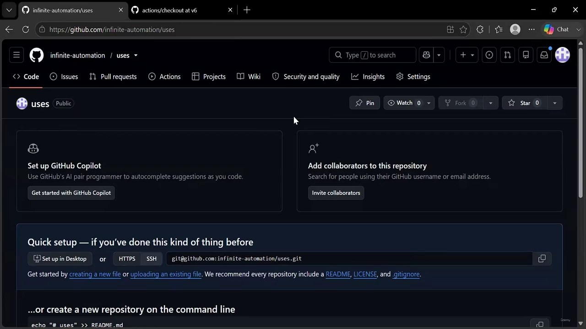
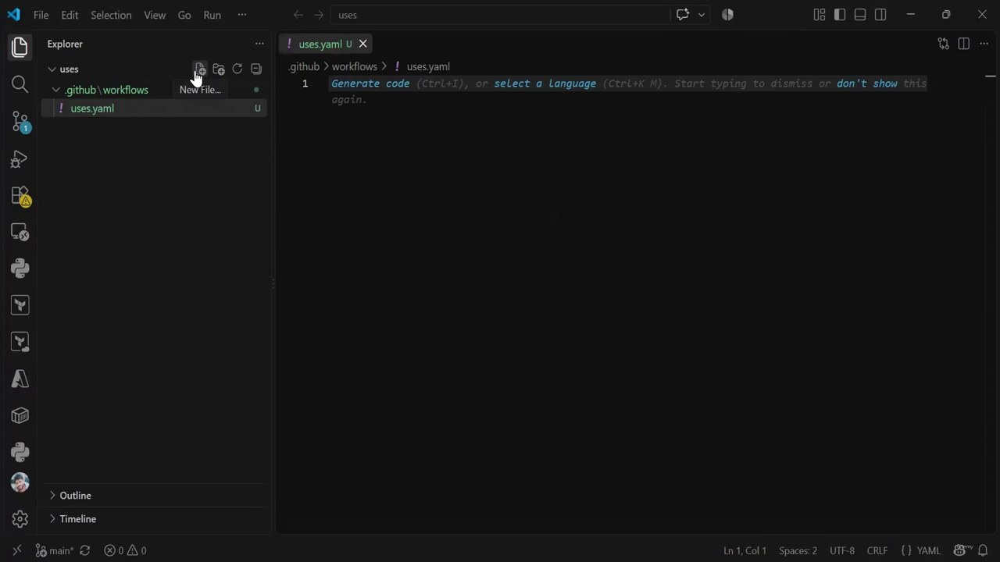
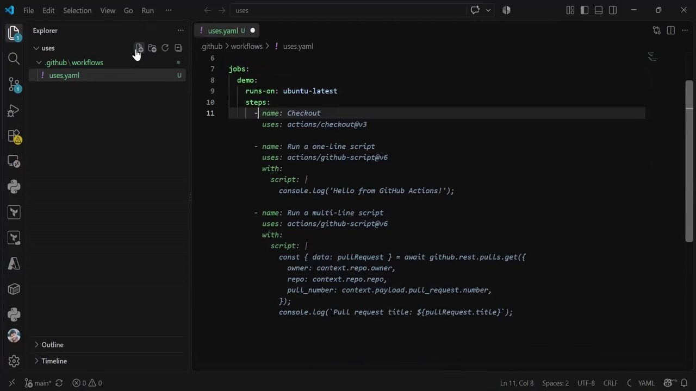
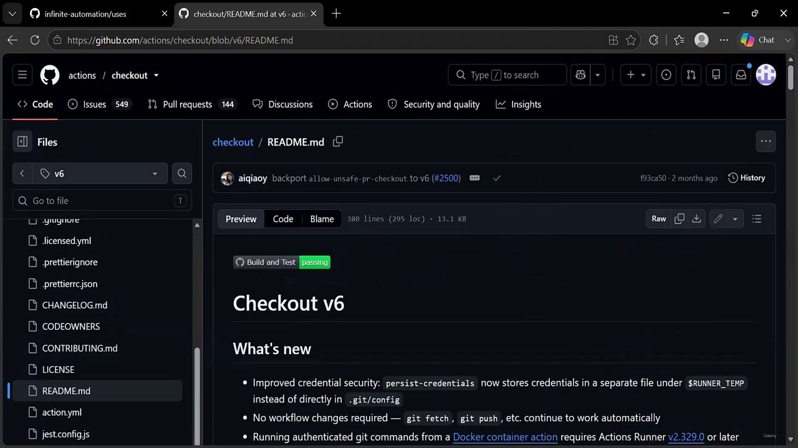
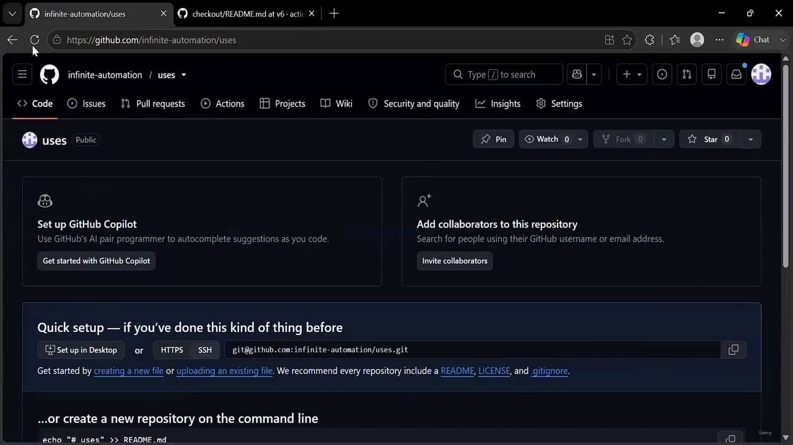
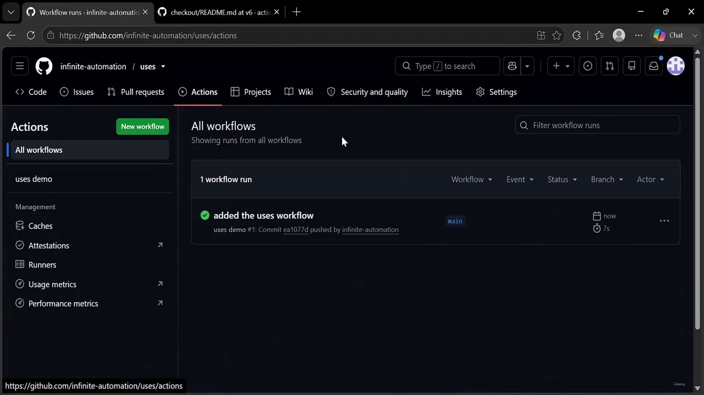
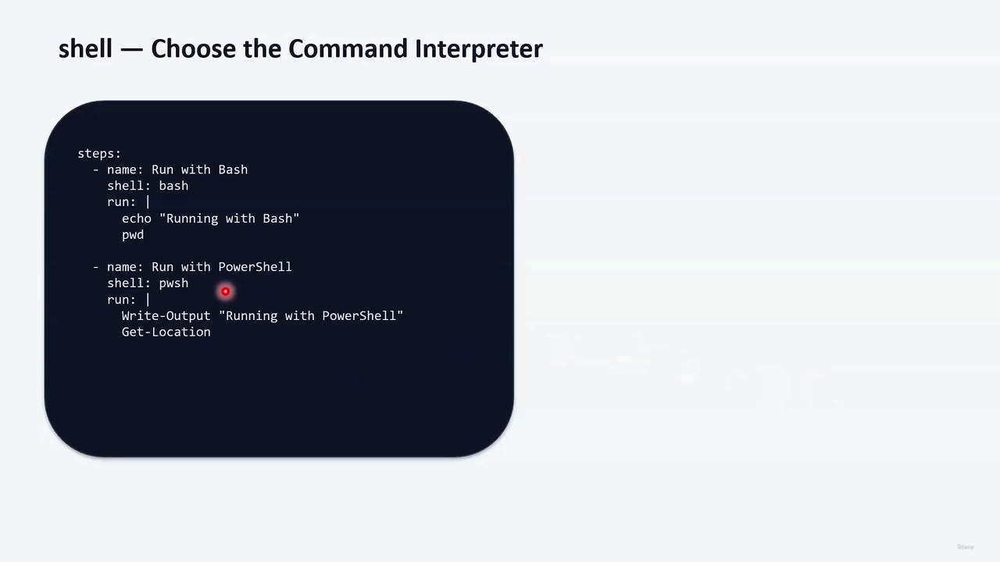
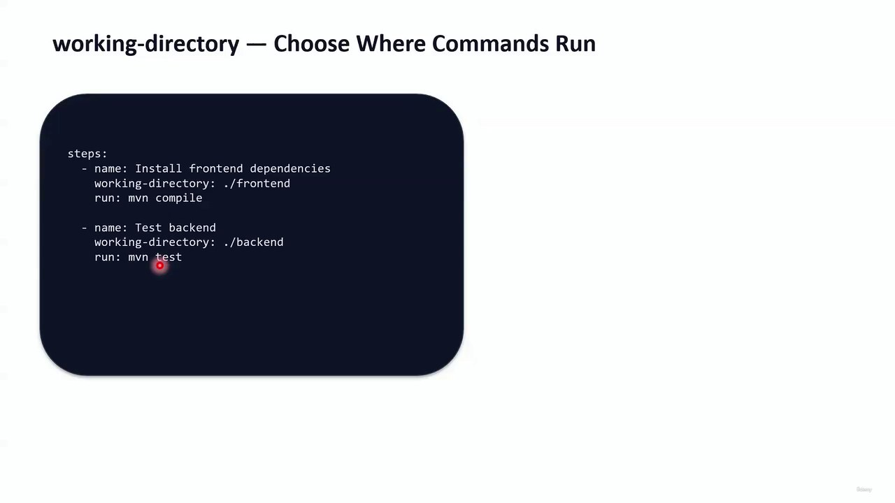
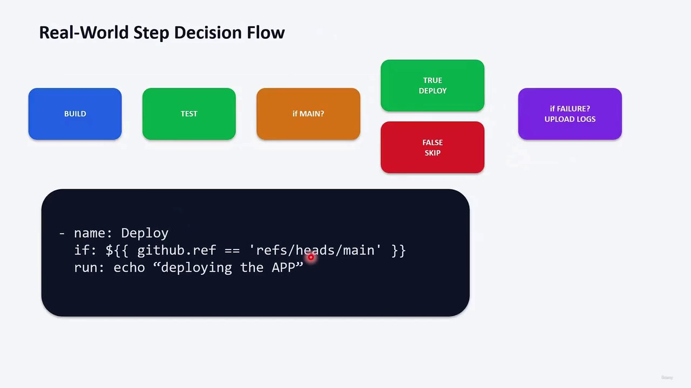

# GitHub Actions Complete（BV1CPap6DEjB）P61–P64 复现文档

## 读前必看：逐字稿的三处系统性串音

逐字稿是英文语音转写，有三处会让人看错代码的地方，先记下来：

1. **`users` / `user's` 一律是 `uses`**。这一节讲的 GitHub Actions 关键字是 `uses`，讲师建的仓库名也叫 `uses`（"named as uses" —— p061 [00:29]）。
2. **"ML configuration" 是 "YAML 配置" 的误转**（—— p061 [01:22]）。
3. **"hyphen m" = `-m`，"per ls" = "for ls"，"working-directly" = `working-directory`**。

另外说明本文的取材边界：**P061 是讲师完整演示、可逐帧照做的一节**；**P062 / P063 / P064 三节加起来不到 6 分钟，讲师全程只讲概念和关键字语义，没有打开编辑器敲代码**。所以后三节我会按讲师给出的关键字与语义补成可运行的 workflow 文件，并且在每处明确标注「示例：讲师本节未实际敲出这段 YAML」。凡是这样标注的代码，都是本文补充的，不是讲师演示过的。

---

## 1. 这一节做什么

P61–P64 是 GitHub Actions 里四个"语法积木"，学完你应该能写出一个「拉代码 → 跑命令 → 按条件只跑一部分 → 无论成败都收尾」的完整流水线。

本节最终产物是一个 GitHub 仓库 `uses`，里面放 4 个 workflow 文件 + 若干被操作的文件：

```
uses/                                   ← GitHub 上的空仓库，克隆到本地
├── .github/
│   └── workflows/
│       ├── uses.yaml                   ← P061 主讲，讲师亲手写的，能跑通
│       ├── status-functions.yaml       ← P062 示例（本文补的）
│       ├── shell-workdir.yaml          ← P063 示例（本文补的）
│       └── step-conditions.yaml        ← P064 示例（本文补的）
├── uses.txt                            ← 讲师建，为了给 ls 有东西可列
├── frontend/                           ← P063 working-directory 用（本文补的）
│   ├── index.html
│   └── check.sh
└── backend/                            ← 同上（本文补的）
    ├── server.js
    └── check.sh
```

四个文件各承担一件事：

| 文件 | 覆盖的 P | 核心关键字 | 跑起来会看到什么 |
|---|---|---|---|
| `uses.yaml` | P061 | `uses` | 两步都绿，第二步日志里列出根目录文件，含 `uses.txt` |
| `status-functions.yaml` | P062 | `success()` `failure()` `cancelled()` `always()` | 故意让中间一步失败，整个 run 变红，但 `failure()` / `always()` 的步骤仍然执行 |
| `shell-workdir.yaml` | P063 | `shell`、`working-directory` | 4 个步骤，日志里 `pwd` 一个显示仓库根、两个分别显示 `frontend`、`backend` |
| `step-conditions.yaml` | P064 | `if` | 在 `main` 分支上推：deploy 步骤执行；在别的分支推：deploy 步骤显示 skipped |

四个文件单独提交、单独触发，互不干扰，可以一个一个验。

### 环境与版本

- **本地只需要三样**：Git、VS Code、一个 GitHub 账号。**不需要本地装 Node、Docker、PowerShell** —— 所有命令都在 GitHub 托管的 Ubuntu runner 上跑，你本地只负责 `git push`。
- **`actions/checkout@v6`**：讲师在 P061 [02:44] 明确说用 v6。这是本节的唯一外部依赖。

---

## 2. 讲师原话

> "在这里，users 用于在 GitHub Action 步骤中运行一个可复用的 action。我们不必自己编写所有命令，而是可以使用现有的 action 来执行这个特定任务。"
> —— p061 [00:00]

> "对于这个实现，我创建了一个空的 GitHub 仓库，命名为 uses，并通过 Git 命令将其克隆到了本地系统。我们将使用 Visual Studio Code 作为代码编辑器。"
> —— p061 [00:29]

> "让我们为流程创建目录结构。我的意思是，创建 .github 和 workflows 目录。在 workflows 目录内，创建 yaml 文件。"
> —— p061 [00:54]

> "我们将工作流命名为 users demo，并添加 on 关键字，事件为 push。"
> —— p061 [01:22]

> "作业名称设为 demo，它将在 Ubuntu GitHub Hosted Runner 上调度运行。现在添加步骤部分。步骤名称设为 checkout clone repository。然后添加 uses 关键字，引用一个可复用的 action：actions checkout v6。"
> —— p061 [01:51]

> "这里 actions 是维护该 action 的 GitHub 组织，checkout 是 action 的名称，v6 是我们使用的 action 版本。"
> —— p061 [02:44]

> "现在添加另一个步骤，名为 show repository files。在添加该步骤之前，先在根目录下添加一个 users.ext 文件，这样执行工作流时就可以运行 ls 了。"
> —— p061 [03:41]

> "在这里，我们并没有自己编写完整的 checkout 克隆逻辑。我们只是通过 uses 调用了一个现有的 action，该 action 公开可用，来自某个仓库，由他人贡献并维护。"
> —— p061 [06:05]

> "run 用于我们想执行自己的命令时。例如，我们用 run 来执行 ls；而 uses 用于我们想调用存储在其它仓库或同一仓库中的现有 action 时。"
> —— p061 [06:35]

> "这里的 status 函数帮助我们检查之前发生了什么。例如，前一个作业是成功、失败还是被取消了？据此我们可以决定下一步应该做什么。"
> —— p062 [00:29]

> "cancelled 检查工作负载是否被取消，always 则在我们希望某些工作无论之前发生什么都运行时很有用。例如，我们可以用它来做清理或上传报告。"
> —— p062 [00:59]

> "这里有个简单的记忆方法：success 表示成功了吗？failure 表示失败了吗？cancelled 表示被取消了吗？always 表示无论结果如何都会运行。"
> —— p062 [01:58]

> "这里的 shell 告诉 GitHub 应该用哪个命令解释器来运行我们的命令。而 working directory 告诉 GitHub 命令应该从哪个目录运行。"
> —— p063 [00:00]

> "我们也可以在同一步骤中同时使用 shell 和 working directory。这里 bash 用作 shell，frontend 用作工作目录。因此我们的 frontend 命令将使用 bash 从该目录运行。"
> —— p063 [01:25]

> "让我们用非常简单的方式来记住这一点：shell 决定命令如何运行，working directory 决定命令在哪里运行。"
> —— p063 [01:53]

> "假设我们只想在代码来自 main 分支时才部署应用。这意味着我们不希望部署步骤对每个分支都运行。要控制某个步骤应该运行还是跳过，我们可以使用步骤条件，关键字是 if。"
> —— p064 [00:00]

> "这里的 if 条件会在运行步骤之前检查规则。如果条件为真，步骤运行；否则，步骤被跳过。"
> —— p064 [00:29]

> "GitHub 到达该步骤时，检查 if 条件并得到真或假。如果为真，步骤运行；如果为假，步骤被跳过。"
> —— p064 [01:26]

---

## 3. 从零复现

### 步骤 0：确认本地环境

```bash
git --version    # 任意 2.x
code --version   # 装了 VS Code 才有这条；没有就用图形界面打开
```

### 步骤 1：在 GitHub 上建一个**空**仓库

浏览器打开 `https://github.com/new`：

- Repository name 填 **`uses`**（讲师原话 "named as uses" —— p061 [00:29]）
- **Add a README file / Add .gitignore / Choose a license 这三个勾全部不勾**
- 点 Create repository

必须留空，因为讲师说的是 "空的 GitHub 仓库"。空仓库建好后，页面会直接显示 push 命令提示。

### 步骤 2：克隆到本地

```bash
git clone https://github.com/<你的GitHub用户名>/uses.git
cd uses
code .
```

命令里的 URL 换成你自己仓库页面上显示的那个。讲师没有念出具体 URL，只说了 "通过 Git 命令克隆到了我的本地系统" —— p061 [00:29]。



### 步骤 3：建目录结构

逐字稿原话是 "我们来创建 .github 和 workflows 目录" —— p061 [00:54]。两条命令都行：

```bash
mkdir -p .github/workflows
```

```bash
# Windows PowerShell 里等价写法
New-Item -ItemType Directory -Force -Path .github/workflows
```

### 步骤 4：写 `uses.yaml`

在 `.github/workflows/` 下新建 `uses.yaml`，内容见第 4 节。先写 `name` 和 `on`：



对应讲师这几句：`Let's name the workflow as a users demo`, `let's add the on keyword with the event called push` —— p061 [01:22]。注意 `name` 值是 `uses demo`（讲师口语读成 "users demo"，实际就是 `uses`）。

再补 `jobs` / `runs-on` / `steps`，然后写第一个 step：



### 步骤 5：搞懂 `owner/repo@version` 这个三段式

`uses: actions/checkout@v6` 拆开是三个东西，讲师专门停下来解释过（—— p061 [02:44]）：

- `actions` → **GitHub 组织**（owner），维护这个 action 的一方
- `checkout` → **action 的名字**（也就是那个仓库的名）
- `v6` → **版本**（git ref / tag）

讲师当时在浏览器里打开了 `actions/checkout` 这个仓库的源码页，翻到 `README.md`，看 `README.md` 里写的用法示例（—— p061 [03:13] / [03:41]）：



这个动作值得你自己做一遍：**在你准备抄任何 `uses:` 之前，先去那个仓库的 README 确认它当前支持的版本号**。README 是使用说明，仓库本体是源码，两个在同一个页面里。

### 步骤 6：建 `uses.txt`，再加第二个 step

讲师原话："我们在根目录层级添加一个名为 users.ext 的文件，以便执行此工作流时可以运行 ls 命令" —— p061 [03:41]。仓库根目录新建 `uses.txt`，随便写点文本即可，讲师写的是随机文本。

然后第二个 step 只写 `name` + `run`：



为什么必须放一个文件在根目录？因为**如果仓库里除了 `.github/` 什么都没有，`ls` 的输出会很少，你没法确认 checkout 到底有没有把文件拉下来**。放一个 `uses.txt`，`ls` 里出现了 `uses.txt`，就证明"上一步的 checkout 真的生效了"。

### 步骤 7：提交并推送

讲师用的命令（—— p061 [05:09]）：

```bash
git add .
git commit -m "added the uses workflow"
git push
```


推送前刷新一下网页上那个空仓库，推送后刷新，能看到文件进去了，就说明推成功。

### 步骤 8：到 Actions 页看运行结果

打开仓库 → 顶部 **Actions** 标签页。因为 `on: push`，推上去的瞬间就有一个 run 在跑（—— p061 [05:37]）。



点进 run → 点进 job `demo` → 展开两个 step：

- `checkout clone repository` —— 打勾。里面是 checkout action 自己的日志（git 相关输出），不是你写的命令，这正是 `uses` 的意义：**这段逻辑你一行没写，是别人维护的**（—— p061 [06:05]）
- `show repository files` —— 打勾。里面是 `ls` 的输出，应该能看到 `.github`、`uses.txt`

### 步骤 9：补上 P062 的 `status-functions.yaml`

在 `.github/workflows/` 下新建 `status-functions.yaml`，内容见第 4 节。它中间有一个**故意失败**的步骤（`exit 1`），所以这个 run 整体会变红，这是**预期结果，不是配错了**。

### 步骤 10：补上 P063 的目录与 `shell-workdir.yaml`

```bash
mkdir -p frontend backend
```

按第 4 节的内容分别写 `frontend/index.html`、`frontend/check.sh`、`backend/server.js`、`backend/check.sh`，再写 `shell-workdir.yaml`。

### 步骤 11：补上 P064 的 `step-conditions.yaml`

内容见第 4 节。为了让"只在 main 上部署"和"只在 push 时跑"两个条件都能被验证，触发方式用 `on: push` + `workflow_dispatch`（后者让你能在网页上手动点一次，用来对照）。

### 步骤 12：一次性推送四个文件

```bash
git add .
git commit -m "add status functions, shell, working directory and step conditions demos"
git push
```

推上去之后 Actions 页会同时出现 4 条 run（每个 workflow 各一条），逐个点开对照第 6 节的检查清单。

**验证 P064 的 else 分支**：建一个非 main 的分支推一次，看 deploy 步骤变成 skipped：

```bash
git checkout -b feature/test-conditions
git push -u origin feature/test-conditions
```

到 Actions 页打开这次 run，展开 job，`deploy` 那一步前面的图标是灰色的、写着 skipped。

---

## 4. 完整代码

### 4.1 `.github/workflows/uses.yaml`（P061 讲师演示，逐字稿可完全还原）

```yaml
name: uses demo

on: push

jobs:
  demo:
    runs-on: ubuntu-latest
    steps:
      - name: checkout clone repository
        uses: actions/checkout@v6

      - name: show repository files
        run: ls
```

### 4.2 `uses.txt`（P061 讲师建，内容为随机文本）

```text
this is a random text file placed at the repository root, so that the "ls" step has something to list
```

### 4.3 `.github/workflows/status-functions.yaml`

> **示例：讲师本节未实际敲出这段 YAML。** P062 全程只讲了 `success` / `failure` / `cancelled` / `always` 四个函数的语义（—— p062 [00:29] ~ [01:58]），没有演示写法。下面的结构是按讲师描述的函数名与用途构建的最小可运行版本。`if:` 后面不加 `${{ }}` 直接写函数是本文件采用的写法，课里没有讲这一点。

```yaml
name: status functions demo

on: push

jobs:
  demo:
    runs-on: ubuntu-latest
    steps:
      - name: checkout clone repository
        uses: actions/checkout@v6

      - name: step that fails on purpose
        run: |
          echo "this step fails on purpose, so that failure() and always() have something to react to"
          exit 1

      - name: runs only when everything above succeeded
        if: success()
        run: echo "success() -> all previous steps succeeded"

      - name: runs when something above failed
        if: failure()
        run: echo "failure() -> at least one previous step failed"

      - name: runs when the run was cancelled
        if: cancelled()
        run: echo "cancelled() -> this run was cancelled"

      - name: runs no matter what happened before
        if: always()
        run: echo "always() -> runs regardless of success, failure or cancellation"
```

### 4.4 `.github/workflows/shell-workdir.yaml`

> **示例：讲师本节未实际敲出这段 YAML。** P063 只讲到"第一个 step 用 bash、第二个用 PowerShell、frontend 命令在 frontend 目录跑、shell 和 working-directory 可以同时用"（—— p063 [00:00] ~ [01:53]），没有给出具体的 shell 标识符字符串，也没有给出 `frontend` / `backend` 目录里的内容。

```yaml
name: shell and working directory demo

on: push

jobs:
  demo:
    runs-on: ubuntu-latest
    steps:
      - name: checkout clone repository
        uses: actions/checkout@v6

      - name: run with bash
        shell: bash
        run: |
          echo "interpreter: bash"
          pwd

      - name: run with powershell
        shell: pwsh
        run: Write-Host "interpreter: PowerShell"

      - name: backend command
        shell: bash
        working-directory: backend
        run: |
          pwd
          bash check.sh

      - name: frontend command
        shell: bash
        working-directory: frontend
        run: |
          pwd
          bash check.sh

      - name: bash and working-directory together
        shell: bash
        working-directory: frontend
        run: echo "this command runs inside the frontend directory using bash"
```

### 4.5 `frontend/index.html`

```html
<!doctype html>
<html lang="zh-CN">
  <head>
    <meta charset="utf-8" />
    <title>frontend</title>
  </head>
  <body>
    <h1>frontend placeholder</h1>
  </body>
</html>
```

### 4.6 `frontend/check.sh`

```bash
#!/usr/bin/env bash
set -euo pipefail

echo "frontend check passed, running inside: $(pwd)"
```

### 4.7 `backend/server.js`

```js
// 占位文件：只为让 backend/ 目录里有东西可列
console.log('backend placeholder');
```

### 4.8 `backend/check.sh`

```bash
#!/usr/bin/env bash
set -euo pipefail

echo "backend check passed, running inside: $(pwd)"
```

### 4.9 `.github/workflows/step-conditions.yaml`

> **示例：讲师本节未实际敲出这段 YAML。** P064 只讲到"用 `if` 控制某一步跑不跑、只在 main 分支部署、只在 push 事件跑"（—— p064 [00:00] ~ [01:40]），**没有给出条件的表达式原文**。下面用的是 GitHub Actions 里对应的标准上下文写法，课里未演示，请以 GitHub 官方文档的 `github` 上下文说明为准。

```yaml
name: step conditions demo

on:
  push:
  workflow_dispatch:

jobs:
  demo:
    runs-on: ubuntu-latest
    steps:
      - name: checkout clone repository
        uses: actions/checkout@v6

      - name: deploy
        if: github.ref == 'refs/heads/main'
        run: echo "branch is main -> deploy runs here"

      - name: only on push event
        if: github.event_name == 'push'
        run: echo "this run was triggered by a push event"

      - name: deploy but only on push to main
        if: github.ref == 'refs/heads/main' && github.event_name == 'push'
        run: echo "main + push -> both conditions matched"
```

### 4.10 `.gitignore`（可选）

```gitignore
node_modules/
.DS_Store
```

---

## 5. 逐行解释

### `uses.yaml`

```yaml
name: uses demo
```
workflow 的显示名。Actions 页左侧列表里显示的就是它，不是文件名。讲师用它区分"这是演示 `uses` 的那个 workflow"。

```yaml
on: push
```
触发事件。只要往这个仓库推任何分支，就触发一次。**课里没有讲分支过滤**，所以这里就是"任何 push 都跑"。

```yaml
jobs:
  demo:
```
`jobs` 下可以挂多个 job，`demo` 是 job 的 id（不是显示名）。**job 之间默认是并行的、互相独立的**——这点跟"步骤"完全不同，P062 的状态函数只在**同一个 job 内部**按顺序生效，跨 job 不生效。这个区别讲师没有明说，但它是理解 P062 的前提。

```yaml
    runs-on: ubuntu-latest
```
在 GitHub 托管的 Ubuntu runner 上跑。讲师原话只说 "Ubuntu 的 GitHub 托管运行器"（—— p061 [01:51]），`ubuntu-latest` 是官方标识符写法。

```yaml
    steps:
      - name: checkout clone repository
        uses: actions/checkout@v6
```
`-` 开头的每一项是一个 step。`name` 是日志里显示的名字。`uses: actions/checkout@v6` 是本节的主角：

- `actions` 是 GitHub 组织
- `checkout` 是这个 action 的名字（也是那个 public 仓库的名字）
- `v6` 是版本（git tag）

**关键理解**：这一行没有任何命令。你去 Actions 日志里点开这一步，看到的所有 git 输出，都来自 `actions/checkout` 仓库里别人写的代码。讲师强调的正是这点："我们没有自己编写完整的检出和克隆逻辑"（—— p061 [06:05]）。

**为什么它必须是第一步**：runner 启动时，工作目录里只有 runner 自己的环境，**没有你的仓库**。不 checkout，后面的 `ls` 列出来的是 runner 的东西，不是你的项目文件。

```yaml
      - name: show repository files
        run: ls
```
`run` 是"我自己写的命令"，跟 `uses` 正好互补：

- `run` = 执行我写的命令（讲师原话："当我们想执行命令时，就使用 run" —— p061 [06:35]）
- `uses` = 调用别人写好的 action（同一句原话）

**一个 step 里 `uses` 和 `run` 只能二选一**，两个都写会校验失败。

**前端类比**：`uses` 很像 `package.json` 里的依赖 —— 你写 `"lodash": "4.17.21"`，代码不用自己实现 lodash，只是"引用"；`v6` 就是版本号，`actions/checkout` 就是包名，`actions` 就是 npm scope（`@scope/pkg` 里的 scope）。区别是 npm 装到 `node_modules` 本地，`uses` 是 GitHub 在 runner 上现场拉取并执行。

### `status-functions.yaml`

```yaml
      - name: step that fails on purpose
        run: |
          echo "..."
          exit 1
```
`|` 是 YAML 的"多行字符串"，把下面缩进对齐的几行合并成一段脚本交给 shell 执行，等价于 `run: "echo ...
exit 1"`。`exit 1` 让这一步以非零码退出，GitHub 就判定这一步失败。

```yaml
        if: success()
```
只在**前面所有步骤都成功**时才跑。注意：**不写 `if` 的步骤，默认行为就相当于 `if: success()`**。所以这个显式写出来的步骤，和"什么都不写"效果一样——讲师把它列出来是为了跟下面三个形成对照。

```yaml
        if: failure()
```
只要前面**有任何一步失败**就跑。因为失败发生在它上面，所以这一步反而会执行。

```yaml
        if: cancelled()
```
只有**这次 run 被取消**时才跑。正常的 push 跑完不会取消，所以**这一项在日志里会一直显示 skipped，这是正常的，不是配置错误**。想真看到它执行，得在 run 跑的过程中点 Cancel。

```yaml
        if: always()
```
不管成功、失败、取消，都跑。讲师给的典型用途就是 cleanup、上传报告这类收尾工作（—— p062 [00:59]）。

**前端类比（重要）**：这四个函数本质上是 `try / catch / finally`：

| GitHub Actions | JS |
|---|---|
| 默认行为（不写 `if`） | `try {}` 里的下一句 |
| `if: failure()` | `catch {}` 块 |
| `if: always()` | `finally {}` 块 |
| `if: cancelled()` | 类似 `AbortController` 的 abort 回调 |

`finally` 一定执行，`always()` 也一定执行——两者在语义上是同一个东西。你在 Node 里写 `try { test() } finally { uploadReport() }`，在 Actions 里就是写一个 `if: always()` 的步骤。

**还有一个容易踩的点**：状态函数只反映**同一个 job 内前面的步骤**。你说"上一个 workflow 成功了我就部署"，这不是 `success()` 能做的，那属于 job 之间 / workflow 之间的关系，课里没讲。

### `shell-workdir.yaml`

```yaml
        shell: bash
```
指定用 bash 来解释 `run` 里那几行。**`runs-on` 是 `ubuntu-latest` 时，bash 本来就是默认**，讲师显式写出来是为了演示这个关键字存在。

```yaml
        shell: pwsh
```
PowerShell 在 Linux runner 上的标识符。讲师原话只说 "PowerShell"（—— p063 [00:40]），**没有给出具体标识符字符串**。Windows runner 上一般写 `powershell`，Linux runner 上跑的是 PowerShell Core，标识符是 `pwsh`。这两个值请以 GitHub 官方 `jobs.<job_id>.steps[*].shell` 文档为准。

```yaml
        working-directory: frontend
```
命令在哪个目录下执行。`pwd` 会打出 `.../frontend`，`ls` 列出的是 `frontend` 里的东西，而不是仓库根。

讲师的原话很干脆："命令解释器决定命令如何运行，工作目录决定命令在哪里运行"（—— p063 [01:53]）。一个是**怎么跑**，一个是**在哪跑**。

```yaml
      - name: bash and working-directory together
        shell: bash
        working-directory: frontend
```
两个关键字在同一个 step 里共存，这就是讲师 [01:25] 讲的组合用法。





**前端类比（这个特别贴）**：`working-directory` 就是 Node 里 `child_process` 的 `cwd` 选项：

```js
// Node 里
execSync('bash check.sh', { cwd: 'frontend' })

// GitHub Actions 里
// working-directory: frontend
// run: bash check.sh
```

两者是同一个概念。你在 Node 里写 `exec('npm run build', { cwd: 'frontend' })` 和写 `working-directory: frontend` + `run: npm run build` 完全等价。monorepo 里"前端命令在前端目录跑、后端命令在后端目录跑"就是这个用法，讲师 [01:02] 举的正是这个例子。

### `step-conditions.yaml`

```yaml
on:
  push:
  workflow_dispatch:
```
`push:` 后面留空，等于"任何分支的 push 都触发"。`workflow_dispatch:` 让你可以在 Actions 页点 "Run workflow" 手动触发一次——这一条**课里没讲**，是本文为了让你能对照"push 事件"和"手动事件"两种情况加上的。

```yaml
        if: github.ref == 'refs/heads/main'
```
`github.ref` 是当前运行的分支引用，main 分支上它的值是 `refs/heads/main`。讲师只说了"仅当分支为 main 时才运行部署步骤"（—— p064 [00:29]），**没有给出表达式原文**，这个写法请对照官方 `github` 上下文文档确认。

```yaml
        if: github.event_name == 'push'
```
`github.event_name` 是触发事件名。讲师讲到"仅当事件为 push 时，我们才能运行某个步骤"（—— p064 [00:57]）——同样没给表达式原文。

```yaml
        if: github.ref == 'refs/heads/main' && github.event_name == 'push'
```
`&&` 是"且"。多个条件用 `&&` / `||` / `!` 组合，这一点课里没讲，属于补充。




**前端类比**：`if:` 就是普通 `if` 语句，只不过判断的对象是 CI 注入给你的一个运行时对象 `github`。可以理解成 `if (github.ref === 'refs/heads/main') { runThisStep() }`。`github` 这个对象之于 workflow，就像 `process.env` 之于 Node 脚本——都是运行环境塞给你的上下文。

**一个语法细节**（课里没讲）：`if:` 后面直接写表达式，不需要包 `${{ }}`。包了也能跑，但不必。

### 关于 `uses.yaml` 的执行顺序

四段代码里唯一有"顺序依赖"的就是它：`uses` 必须在 `run` 前面。因为 `ls` 依赖工作目录里已有文件，而文件是 checkout 拉下来的。


（这张截图与前面 3.5 是同一帧，这里再提一次，是因为"看 README 确认版本"这件事本身就是复现流程的一环——你抄 `uses:` 时应该先去看来源仓库。）

---

## 6. 复现检查清单

按顺序勾，每一项都能在界面上看到结果：

**仓库与推送**
- [ ] GitHub 上的 `uses` 仓库建的时候三个勾都没勾（真·空仓库）
- [ ] `git clone` 到本地成功，`cd` 进去后 `git status` 干净
- [ ] 本地 `.github/workflows/` 目录存在
- [ ] 4 个 yaml 文件都在 `.github/workflows/` 下
- [ ] 仓库根目录有 `uses.txt`
- [ ] `frontend/`、`backend/` 两个目录存在，各有 2 个文件

**P061 验证（uses.yaml）**
- [ ] 推上去后 Actions 页出现一条名为 `uses demo` 的 run
- [ ] run 状态是绿色对勾
- [ ] 点进 job `demo`，两步都是对勾
- [ ] `checkout clone repository` 展开后是 git 相关的输出（不是你写的命令）
- [ ] `show repository files` 展开后，`ls` 输出里能看到 `uses.txt`
- [ ] 打开 `https://github.com/actions/checkout` 能找到 `v6` 这个 tag（否则改成一个存在的版本）

**P062 验证（status-functions.yaml）**
- [ ] 这个 run 整体是**红色**的（预期，因为 `exit 1`）
- [ ] `step that fails on purpose` 显示失败
- [ ] `runs when something above failed`（`if: failure()`）**执行了**
- [ ] `runs no matter what happened before`（`if: always()`）**执行了**
- [ ] `runs only when everything above succeeded`（`if: success()`）显示 **skipped**
- [ ] `runs when the run was cancelled`（`if: cancelled()`）显示 **skipped**（正常现象）

**P063 验证（shell-workdir.yaml）**
- [ ] `run with bash` 的日志里 `pwd` 是仓库根
- [ ] `run with powershell` 执行成功，日志里有 `interpreter: PowerShell`
- [ ] `frontend command` 的日志里 `pwd` 结尾是 `/frontend`
- [ ] `backend command` 的日志里 `pwd` 结尾是 `/backend`
- [ ] 两个 `check.sh` 都打出了 `... check passed`
- [ ] `bash and

## 7. 课里没讲但你会撞上的

| 现象 | 原因 | 怎么办 |
|---|---|---|
| `show repository files` 日志里只看到 `uses.txt`，看不到 `.github` | 补充，课里没讲：`ls` 默认不列以 `.` 开头的隐藏目录 | 这是正常现象，确认 `uses.txt` 已列出即可证明 checkout 生效；要看隐藏目录改成 `ls -a` |
| Actions 页没有 “Run workflow” 按钮 | 补充，课里没讲：`workflow_dispatch` 只有在 workflow 已存在于默认分支时才会显示手动触发入口 | 先把 `step-conditions.yaml` 推到默认分支（main/master），再回 Actions 页手动触发 |
| `deploy` 步骤一直 skipped，即使看起来是在“主分支”上推 | 补充，课里没讲：条件写死为 `github.ref == 'refs/heads/main'`，但仓库默认分支可能叫 `master` 或其他名字 | 在仓库首页确认默认分支名；把条件改成实际分支，或切到 `main` 分支再测 |
| 手动 Run workflow 后，`only on push event` 步骤显示 skipped | 补充，课里没讲：手动触发时 `github.event_name` 是 `workflow_dispatch`，不是 `push` | 这是条件在按预期工作；要验证这一步执行，用 `git push` 触发，不要用手动触发 |
| PowerShell 里执行 `mkdir -p frontend backend` 报参数错误，或只建出一个目录 | 补充，课里没讲：PowerShell 的 `mkdir` 不是 GNU `mkdir`，`-p` 语义不同 | 用 `New-Item -ItemType Directory -Force -Path frontend,backend`，或分别建两个目录 |
| `bash check.sh` 报 `$'\r': command not found` 之类错误 | 补充，课里没讲：Windows 上保存的 `check.sh` 是 CRLF 行尾，Linux runner 的 bash 不认 | 把 `.sh` 保存为 LF；或在仓库加 `.gitattributes`：`*.sh text eol=lf` |
| 推上去后 Actions 页完全没有新 run | 补充，课里没讲：YAML 缩进用了 Tab、`steps` 没挂在 job 下、文件不在 `.github/workflows/` 等导致 workflow 解析失败 | 用空格缩进，检查目录和层级；到 Actions 页看是否有 workflow 语法错误提示 |
| `working-directory: frontend` 的步骤报 “No such file or directory” | 补充，课里没讲：本地没有把 `frontend/` 目录一起提交/推送，或目录名大小写不一致 | 确认 `frontend/`、`backend/` 和里面的文件已 `git add` 并推送；Linux 路径区分大小写 |
| `git push` 被拒或一直提示认证失败 | 补充，课里没讲：GitHub 的 HTTPS 推送通常不能用账号密码，需要 PAT 或 SSH | 用 Personal Access Token、SSH key，或 `gh auth login` 后再推 |
