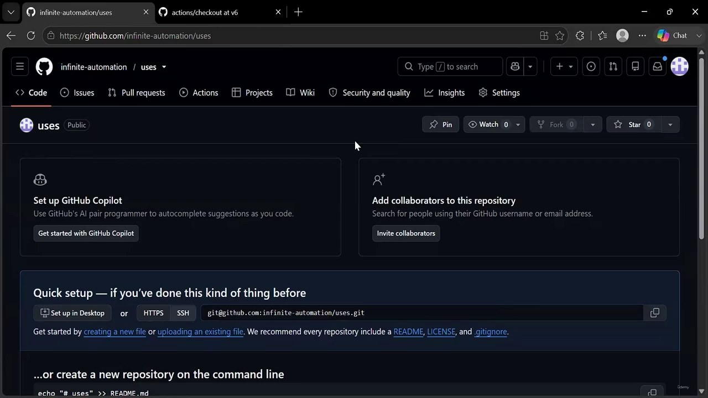
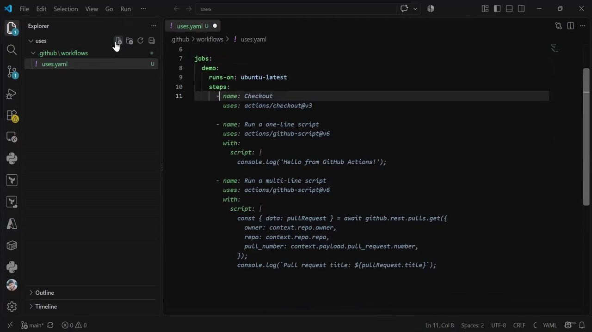
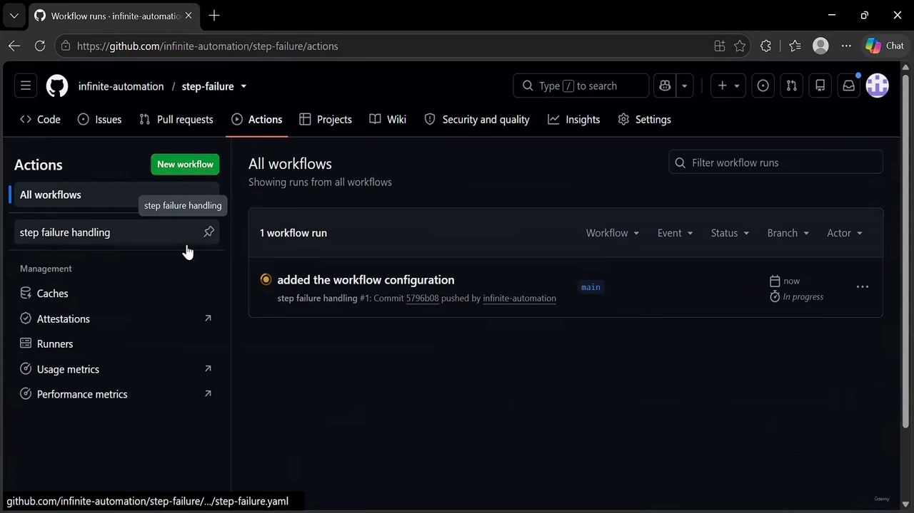
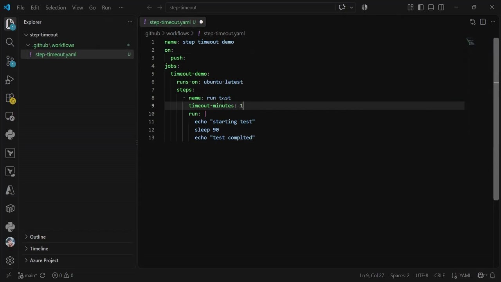
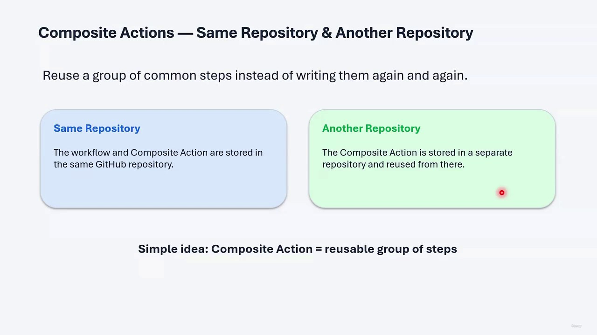
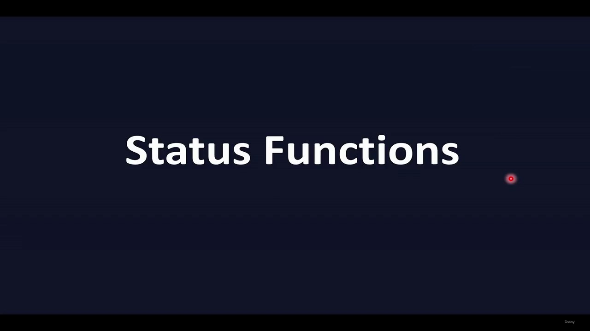
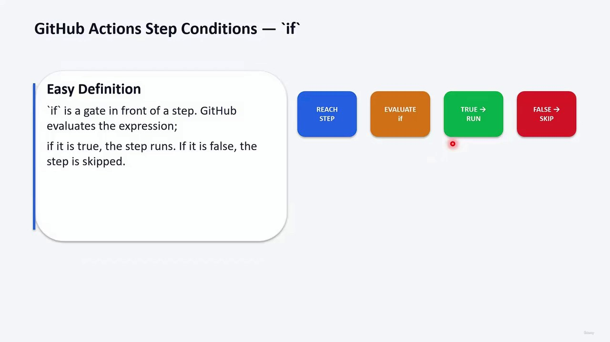
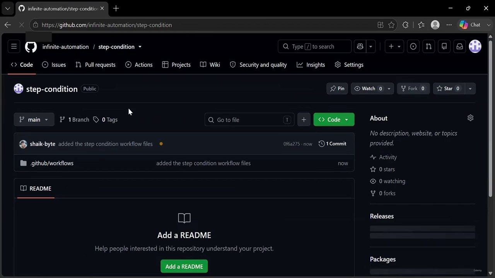
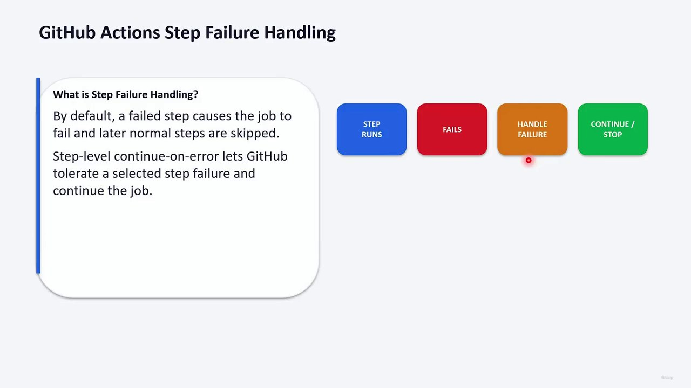
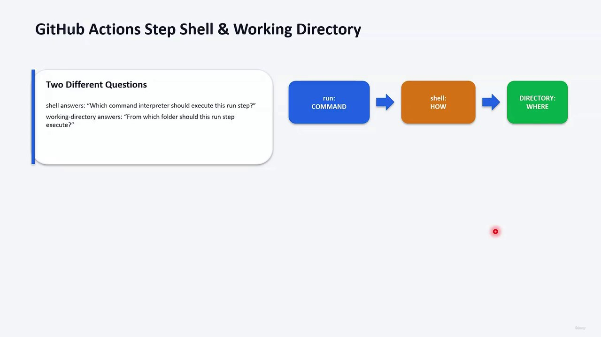

# GitHub Actions Complete（P61–P70）复现文档

## 1. 这一节做什么

这一节覆盖 GitHub Actions 里 7 个紧密相关的能力：用 `uses` 调用已有 action、状态函数、`shell` 与 `working-directory`、步骤级 `if` 条件、`continue-on-error` 失败处理、`timeout-minutes` 步骤超时、以及 composite action 复合动作。

课程里 P61、P65、P67、P69 是 VS Code + GitHub 仓库的实操；P62、P63、P64、P66、P68 偏概念讲解；P70 讲了 composite action 的结构和调用方式，但没有像前面那样完整走一遍“建仓库、提交、看 Actions”的实操。为了让你能照着跑，本文把 P61、P65、P67、P69 的实操合并到一个仓库里复现，并为 P70 补一个明确标注为“示意”的本地 composite action 示例。课程原本是多个独立空仓库，这里合并只是文档组织方式，不改变每个 workflow 的触发方式。

最终你会得到这样一个仓库：

```text
github-actions-complete/
├── .github/
│   ├── actions/
│   │   └── demo/
│   │       └── action.yml
│   └── workflows/
│       ├── uses.yaml
│       ├── stepcondition.yaml
│       ├── stepfailure.yml
│       ├── steptimeout.yaml
│       └── composite-demo.yaml
└── uses.txt
```

每次 `git push` 后，GitHub Actions 会按各个 workflow 的 `on: push` 触发运行。你在仓库的 **Actions** 标签里观察每一步是成功、失败、跳过还是超时。



课程里默认你已经有 GitHub 账号、Git 和 VS Code；安装步骤课里没有讲。本文也不假装讲安装，只从“已经有空仓库并克隆到本地”开始。

---

## 2. 讲师原话（带「—— pNNN [MM:SS]」）

> "与其自己编写所有命令，不如使用现有的 action 来完成这个特定任务。"
> —— p061 [00:00]

> "状态函数能帮我们检查之前发生了什么，例如上一次工作是成功了、失败了，还是被取消了？"
> —— p062 [00:29]

> "shell 告诉 GitHub 用哪个命令解释器运行我们的命令；working directory 告诉 GitHub 命令应当从哪个目录运行。"
> —— p063 [00:00]

> "我们希望 deploy 步骤只在分支为 main 时运行。"
> —— p065 [03:21]

> "默认情况下，如果某个步骤失败，job 就会失败，后续步骤会被跳过。"
> —— p066 [00:27]

> "`timeout-minutes` 用于设置某个步骤在 workflow 中允许运行的最长时间。"
> —— p068 [00:29]

> "composite action 基本上就是一组可复用的步骤。"
> —— p070 [00:29]

这些原话对应本文的实现顺序：先用 `uses` 调 checkout，再用 `if` 控制 deploy，再用 `continue-on-error` 让失败步骤不阻断后续步骤，再用 `timeout-minutes` 限制步骤运行时间，最后把重复步骤收进 composite action。

---

## 3. 从零复现

### 3.1 准备空仓库并克隆

课程里讲师先创建空 GitHub 仓库，例如名为 `uses`、`step condition`、`step failure`、`step timeout`，然后用 Git 命令克隆到本地，用 VS Code 打开。本文用一个仓库复现，仓库名可以叫 `github-actions-complete`。

在 GitHub 上新建空仓库后，在本地执行：

```bash
git clone https://github.com/<你的用户名>/github-actions-complete.git
cd github-actions-complete
```

如果你是在本地新建目录而不是克隆，则执行：

```bash
mkdir github-actions-complete
cd github-actions-complete
git init
git branch -M main
git remote add origin https://github.com/<你的用户名>/github-actions-complete.git
```

课程没有讲 Git 安装、GitHub 登录、SSH key 配置，这些按你本机已有环境处理。

### 3.2 创建目录结构

```bash
mkdir -p .github/workflows
mkdir -p .github/actions/demo
```

` .github/workflows ` 是 GitHub Actions 默认读取 workflow 文件的目录。` .github/actions/demo ` 是本文为 P70 composite action 示意准备的位置。P70 课里讲的是“同一个仓库用本地路径调用”，但没有给出完整可运行仓库，所以这里明确标注：composite action 部分是按讲师描述补的示意实现。

### 3.3 写入 `uses.txt`

在仓库根目录创建 `uses.txt`：

```text
this is a random text file for ls
```

这个文件的作用是让 P61 的 `ls` 步骤能在日志里看到仓库根目录的文件。课程里讲师也是先在根目录加一个 `uses.txt`，再在 workflow 里执行 `ls`。

### 3.4 写入 `uses.yaml`

创建 `.github/workflows/uses.yaml`，内容见第 4 节完整代码。这个 workflow 做两件事：先用 `actions/checkout@v6` 把仓库克隆到 runner，再执行 `ls` 列出文件。

课程里讲师解释了 `uses: actions/checkout@v6` 的组成：`actions` 是维护这个 action 的 GitHub 组织，`checkout` 是 action 名，`v6` 是版本。这个解释很关键：`uses` 不是随便写命令，而是在引用一个已经存在、由别人维护的 action。



### 3.5 写入 `stepcondition.yaml`

创建 `.github/workflows/stepcondition.yaml`。这个 workflow 有 build、test、deploy 三步，其中 deploy 加了：

```yaml
if: github.ref == 'refs/heads/main'
```

课程里讲师先 push 到 main，看到 deploy 运行；然后创建 `feature` 分支再 push，看到 build 和 test 运行，但 deploy 被跳过。

创建并推送 feature 分支的命令：

```bash
git checkout -b feature
git add .
git commit -m "added the feature branch"
git push -u origin feature
```

课程里说的是 `git checkout -b`，逐字稿里可能识别成 `checkout-b`，实际命令是 `git checkout -b`。第一次推 feature 分支需要 `-u origin feature`。

### 3.6 写入 `stepfailure.yml`

创建 `.github/workflows/stepfailure.yml`。这个 workflow 里 test 步骤故意执行 `exit 1` 制造失败。第一次先不加 `continue-on-error`，push 后你会看到 build 成功、test 失败、deploy 被跳过，整个 job 失败。

然后给 test 步骤加：

```yaml
continue-on-error: true
```

再次 push，你会看到 test 步骤仍然显示失败，但 GitHub 允许继续执行 deploy，最终 job 可以显示成功。课程里明确对比了“上一次执行”和“这一次执行”的差异。



### 3.7 写入 `steptimeout.yaml`

创建 `.github/workflows/steptimeout.yaml`。第一个步骤 `run test` 里执行：

```bash
echo "starting test"
sleep 90
echo "test completed"
```

并设置：

```yaml
timeout-minutes: 1
```

因为 `sleep 90` 是 90 秒，超过 1 分钟，所以这个步骤会被 GitHub 停止并标记失败，后面的步骤会被跳过。课程里讲师特意这样配置，就是为了看到超时效果。



### 3.8 写入 composite action 示意文件

P70 课里没有走完整实操，只讲了 composite action 的结构：用 `using: composite`，在 `steps` 里定义公共步骤，然后在 workflow 里用 `uses` 调本地路径。本文按这个描述补一个示意：

`.github/actions/demo/action.yml` 和 `.github/workflows/composite-demo.yaml` 的完整内容见第 4 节。注意：这两份文件是“按课程描述补的示意实现”，不是讲师在 P70 里逐行敲出来的完整仓库。



### 3.9 提交并推送

```bash
git add .
git commit -m "added the uses workflow"
git push
```

课程里 P61 的提交信息是 `added the uses workflow`，P65 是 `added the step condition workflow files`，P67 是 `added the workflow configuration`，P69 也是 `added the workflow configuration`。你可以按这个提交，也可以合并成一次提交。

推送后打开 GitHub 仓库，先刷新仓库首页确认文件已经到达，再点 **Actions** 标签。你会看到多个 workflow 运行记录。点进具体运行，再点 job，展开每一步查看日志。

---

## 4. 完整代码

下面所有文件都可以直接保存。YAML 对缩进敏感，建议用空格，不要用 Tab。

### 4.1 `.github/workflows/uses.yaml`

```yaml
name: uses demo

on: push

jobs:
  demo:
    runs-on: ubuntu-latest
    steps:
      - name: checkout clone repository
        uses: actions/checkout@v6

      - name: show repository files
        run: ls
```

### 4.2 `uses.txt`

```text
this is a random text file for ls
```

### 4.3 `.github/workflows/stepcondition.yaml`

```yaml
name: step condition demo

on: push

jobs:
  demo:
    runs-on: ubuntu-latest
    steps:
      - name: build application
        run: echo "building application"

      - name: test application
        run: echo "testing application"

      - name: deploy application
        if: github.ref == 'refs/heads/main'
        run: echo "deploying application"
```

### 4.4 `.github/workflows/stepfailure.yml`

这是加了 `continue-on-error` 之后的最终版本。如果你想复现“第一次默认失败”的现象，先把 `continue-on-error: true` 这一行删掉或注释掉，push 看一次，再加回来。

```yaml
name: stepfailure handling

on: push

jobs:
  demo:
    runs-on: ubuntu-latest
    steps:
      - name: build
        run: echo "build complete"

      - name: test
        continue-on-error: true
        run: exit 1

      - name: deploy
        run: echo "Deploying application"
```

### 4.5 `.github/workflows/steptimeout.yaml`

```yaml
name: step timeout demo

on: push

jobs:
  timeout-demo:
    runs-on: ubuntu-latest
    steps:
      - name: run test
        timeout-minutes: 1
        run: |
          echo "starting test"
          sleep 90
          echo "test completed"

      - name: run test after timeout
        run: echo "running the test"
```

课程里第二个步骤命名比较随意，这里用 `run test after timeout` 让日志更容易区分。核心配置是第一个步骤的 `timeout-minutes: 1` 和 `sleep 90`。

### 4.6 `.github/actions/demo/action.yml`

P70 课里没有给出可直接运行的完整仓库，以下是按讲师描述的 composite action 结构补的示意实现。

```yaml
name: demo composite action
description: 按 P70 描述补的示意复合动作

runs:
  using: composite
  steps:
    - name: show message
      shell: bash
      run: echo "starting build"

    - name: list files
      shell: bash
      run: ls
```

### 4.7 `.github/workflows/composite-demo.yaml`

同样，这是 P70 的示意调用 workflow，不是讲师在课里完整跑过的文件。

```yaml
name: composite action demo

on: push

jobs:
  demo:
    runs-on: ubuntu-latest
    steps:
      - name: checkout repository
        uses: actions/checkout@v6

      - name: call local composite action
        uses: ./.github/actions/demo
```

---

## 5. 逐行解释

### 5.1 `uses.yaml`：为什么先 checkout

`name: uses demo` 是 workflow 显示名称，出现在 Actions 列表里。`on: push` 表示每次 push 触发。`jobs.demo` 是 job 的 id，`runs-on: ubuntu-latest` 表示使用 GitHub 托管的 Ubuntu runner。

`uses: actions/checkout@v6` 是本节第一个核心点。课程里讲师明确说：`actions` 是 GitHub 组织，`checkout` 是 action 名，`v6` 是版本。它的作用是克隆仓库。我们不需要自己写 `git clone` 那一长串逻辑，而是调用一个已有 action。这里注意：`uses` 和 `run` 是两种不同的步骤类型。`uses` 调 action，`run` 执行 shell 命令。

`run: ls` 是普通命令步骤。它运行在 runner 的当前工作目录里。因为前面已经 checkout，所以 `ls` 能看到仓库文件，包括 `uses.txt` 和 `.github`。课程里讲师就是这样验证的：checkout 步骤成功，下一个步骤的 `ls` 列出了根目录文件。



P62 的状态函数是后续 `if` 条件的基础。课程里说：`success()` 检查之前是否成功，`failure()` 检查是否失败，`cancelled()` 检查是否被取消，`always()` 表示不管前面结果如何都运行。它们常常用在步骤级 `if` 里。P62 没有给完整可运行 workflow，所以本文不把状态函数硬塞进实验文件；你只要理解：`if` 里可以放这些状态判断。

### 5.2 `stepcondition.yaml`：`if` 让 deploy 只在 main 跑

`build application` 和 `test application` 都是 `run: echo`，用于模拟构建和测试。真正的控制点在 deploy：

```yaml
if: github.ref == 'refs/heads/main'
```

`github.ref` 是当前触发 ref。push 到 main 时，它通常是 `refs/heads/main`；push 到 feature 分支时，它是 `refs/heads/feature`。所以条件在 main 上为 true，deploy 运行；在 feature 上为 false，deploy 跳过。课程里讲师先看 main 的运行，deploy 执行；再创建 feature 分支 push，build 和 test 执行，deploy 被跳过。



P64 的概念在这里落地：GitHub 到达这个步骤时先检查 `if`，true 就运行，false 就跳过。注意，`if` 写在步骤级别，不是 job 级别。课程里讨论的是“步骤条件”，不是“整个 job 的条件”。



### 5.3 `stepfailure.yml`：`exit 1` 与 `continue-on-error`

`build` 步骤执行 `echo "build complete"`，正常成功。`test` 步骤执行 `exit 1`。课程里解释：Linux 里 `exit 0` 通常表示成功，非 0 退出码表示失败，所以 `exit 1` 是故意制造失败。

默认情况下，test 失败后，GitHub 会把 job 标记失败，并跳过 deploy。课程里第一次运行没有加 `continue-on-error`，所以 build 成功、test 失败、deploy 被跳过。

加上：

```yaml
continue-on-error: true
```

之后，test 步骤本身仍然会显示失败，但 GitHub 允许继续执行后面的 deploy。课程里第二次运行就看到了这个差异：test 失败，但 deploy 运行，最终 job 显示成功。这里要区分“步骤结果”和“job 结果”：步骤失败不等于一定阻断 job，`continue-on-error: true` 就是让这个失败不阻断后续步骤。



在 JS/Node 里可以粗略类比成 `try { ... } catch {}`：错误发生了，但你没有让错误继续往外抛。当然，GitHub Actions 的语义更细，课程里只讲到“允许这个步骤失败并继续下一步”。

### 5.4 `steptimeout.yaml`：`timeout-minutes` 只限制这个步骤

`run: |` 表示后面是多行 shell 脚本。这里先打印 `starting test`，再 `sleep 90`，再打印 `test completed`。`timeout-minutes: 1` 表示这个步骤最多运行 1 分钟。90 秒超过 1 分钟，所以 GitHub 会停止这个步骤并标记失败。第一个步骤失败后，第二个步骤 `run test after timeout` 被跳过。

课程里特别区分：步骤超时控制一个步骤，job 超时控制整个 job。P68 只讲了概念，P69 用 `sleep 90` 和 `timeout-minutes: 1` 做了实操。


在 Node 里可以类比成给一个异步任务加 `AbortController` 或超时定时器：时间到了就中止，而不是无限等下去。这里不需要真的写 Node 代码，理解“到点停止并标记失败”即可。

### 5.5 P63 的 `shell` 与 `working-directory`

P63 是概念讲解，没有完整实操文件。课程里说：`shell` 决定用哪个命令解释器，比如 bash、PowerShell；`working-directory` 决定命令从哪个目录运行。讲师给的例子是 frontend 命令在 frontend 目录跑，backend 命令在 backend 目录跑。

按讲师描述，片段示意如下（这不是本文的实验文件，只是概念还原）：

```yaml
# 课里只讲概念示例，没有给出完整可运行仓库；下面是片段示意
- name: frontend command
  shell: bash
  working-directory: frontend
  run: echo "frontend command"
```

`shell: bash` 表示用 bash 解释命令；`working-directory: frontend` 表示从 `frontend` 目录执行。课程里还提到 shell 和 working directory 可以放在同一个步骤里。对前端转 Node 的读者，`working-directory` 很像 `child_process.exec` 的 `cwd` 参数：不是换 shell，而是换命令的工作目录。



### 5.6 composite action：把重复步骤收起来

P70 课里说，如果很多 workflow 都有同样五六个步骤，反复写会让 workflow 很长，所以可以把公共步骤写成 composite action。同一个仓库里，workflow 用本地路径 `uses` 调用；另一个仓库里，用 owner、repository、action path、version/branch 引用。

本文示意文件里，`action.yml` 的 `runs.using: composite` 表示这是复合动作。`steps` 下的每个 `run` 步骤都必须写 `shell`，这里写 `shell: bash`。第一个步骤打印 `starting build`，第二个步骤执行 `ls`。调用方 `composite-demo.yaml` 先 checkout，再用：

```yaml
uses: ./.github/actions/demo
```

调用本地 action。这里有一个课里没讲但你会撞上的点：调用本地 action 前必须先 checkout 仓库，否则 runner 上还没有 `./.github/actions/demo` 这个目录。课程 P70 只讲了“同仓库用本地路径”，没有展开 checkout 顺序，所以本文在示意 workflow 里先放了 checkout。


---

## 6. 复现检查清单

按下面顺序勾选，基本就能确认每个实验都跑对了。

- [ ] 仓库根目录存在 `uses.txt`，内容不是空的。
- [ ] `.github/workflows/uses.yaml` 已推送，Actions 里出现 `uses demo` 运行记录。
- [ ] 打开 `uses demo` 的 `demo` job，`checkout clone repository` 步骤成功。
- [ ] `show repository files` 步骤日志里的 `ls` 输出包含 `uses.txt` 和 `.github`。
- [ ] `.github/workflows/stepcondition.yaml` 已推送，main 分支运行时 `deploy application` 步骤执行。
- [ ] 创建 `feature` 分支并 push 后，`step condition demo` 在 feature 分支运行，`build` 和 `test` 执行，`deploy` 显示 skipped。
- [ ] `.github/workflows/stepfailure.yml` 第一次不带 `continue-on-error` 时，`test` 失败后 `deploy` 被跳过，job 失败。
- [ ] 加上 `continue-on-error: true` 后，`test` 仍显示失败，但 `deploy` 执行，job 最终成功。
- [ ] `.github/workflows/steptimeout.yaml` 运行后，`run test` 步骤因超过 1 分钟失败。
- [ ] `run test after timeout` 步骤显示 skipped。
- [ ] `composite-demo.yaml` 运行后，`call local composite action` 步骤成功，日志里出现 `starting build` 和 `ls` 输出。
- [ ] 所有 workflow 都从 `on: push` 触发；没有在本地执行 GitHub Runner 的命令。

查看入口统一是：GitHub 仓库首页 → **Actions** → 左侧选择 workflow 名称 → 点具体运行 → 点 job → 展开步骤看日志。

---

## 7. 课里没讲但你会撞上的

1. **默认分支不一定是 main。** `stepcondition.yaml` 的条件写死了 `refs/heads/main`。如果你的仓库默认分支是 `master`，deploy 在默认分支上也会被跳过。课程里默认在 main 上演示，没有讲默认分支设置。解决方式：把仓库默认分支设为 main，或把条件改成你的分支名。

2. **`actions/checkout@v6` 是课程里明确使用的版本。** 如果 GitHub 提示该版本无法解析或已变化，以仓库实际可用版本为准。课程没有讲版本兼容和降级策略，本文也不替你编造一个“保证存在”的版本号。

3. **本地 composite action 必须先 checkout。** P70 只讲了同仓库用本地路径调用，没有给完整 workflow。实际运行时，`uses: ./.github/actions/demo` 之前如果没有 `actions/checkout`，runner 上就没有这个目录，步骤会找不到 action。

4. **composite action 里的 `run` 步骤要写 `shell`。** 课程示例里有 `shell`，本文示意也写了 `shell: bash`。漏写时 GitHub 会报错；课程没有展开这个报错长什么样。

5. **`timeout-minutes` 是步骤级限制，不是 job 级限制。** 课程里明确说步骤超时控制一个步骤，job 超时控制整个 job。你要限制整个 job，需要写 job 级配置，P68/P69 没有展开 job 级超时。

6. **`sleep 90` 超过 1 分钟是故意设计。** 如果你把 `timeout-minutes` 改成 2，`sleep 90` 就会在 2 分钟内完成，步骤不会超时，后面的步骤也会继续。课程里的失败现象依赖这个时间差。

7. **`continue-on-error: true` 不是“让步骤变成成功”。** 课程里 test 步骤仍然显示失败，只是 job 可以继续并最终成功。不要把它理解成把失败改写成成功。

8. **`run: |` 的多行缩进很容易写错。** `echo` 和 `sleep` 必须相对于 `run:` 有正确缩进。YAML 缩进错了，GitHub Actions 可能直接报解析错误，而不是运行到 shell。

9. **`ls` 是 Ubuntu runner 上的命令。** 课程用 `runs-on: ubuntu-latest`，所以 `ls`、`sleep`、`exit 1` 都可用。如果你换成 Windows runner，shell 和命令会不同；课程没有讲跨平台写法。

10. **多个 workflow 会在同一次 push 时一起触发。** 本文把四个实操放进同一个仓库，push 后 Actions 列表会出现多个运行。课程原本是分开的仓库，所以不会同时看到这么多。观察某个实验时，在左侧选中对应 workflow 名称即可，不要被其他运行记录干扰。