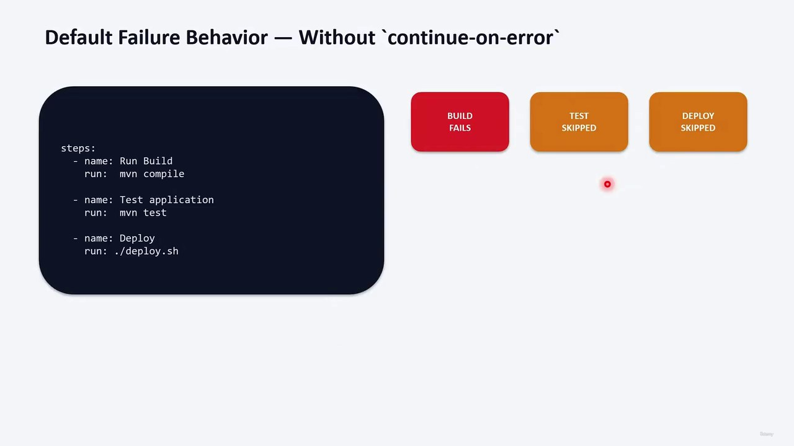
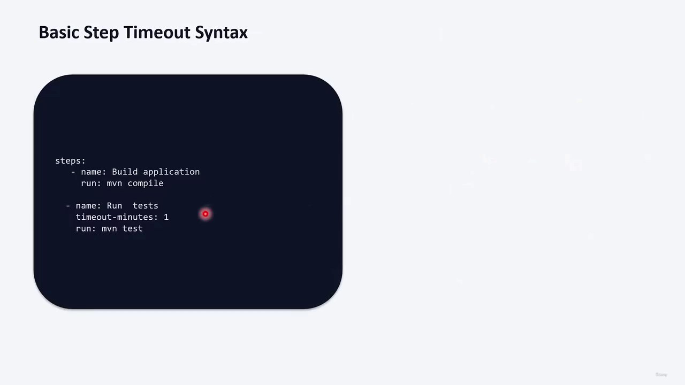
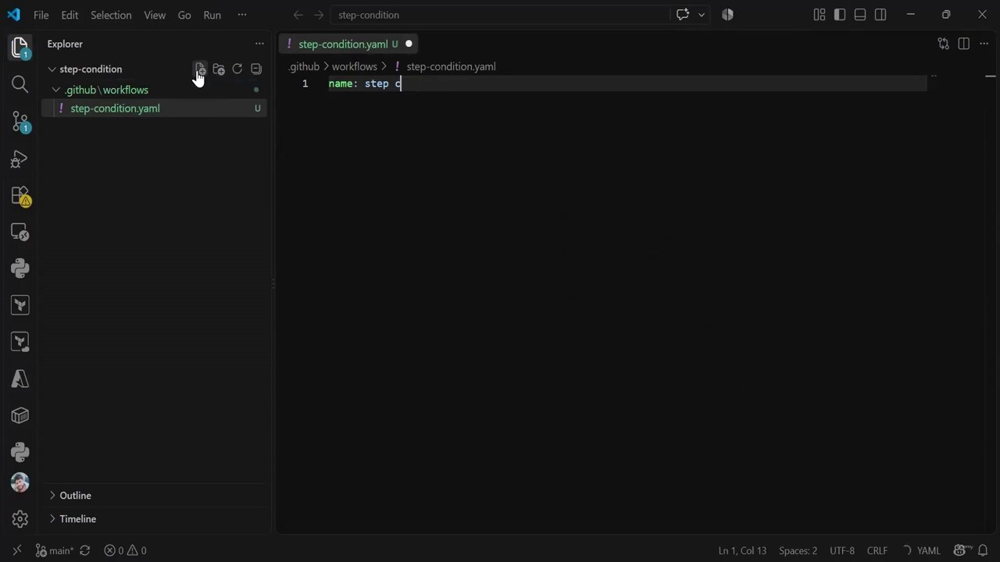
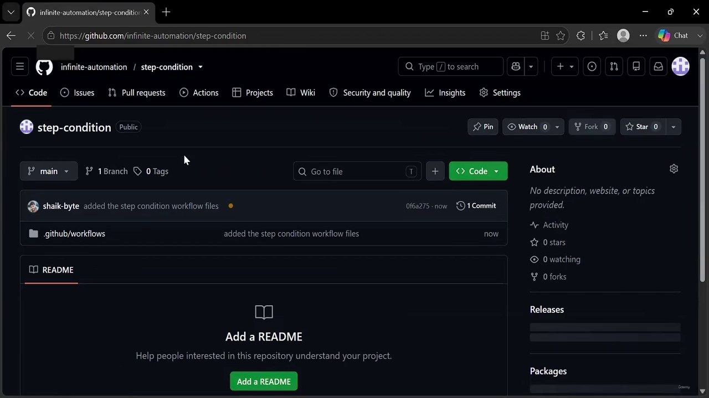
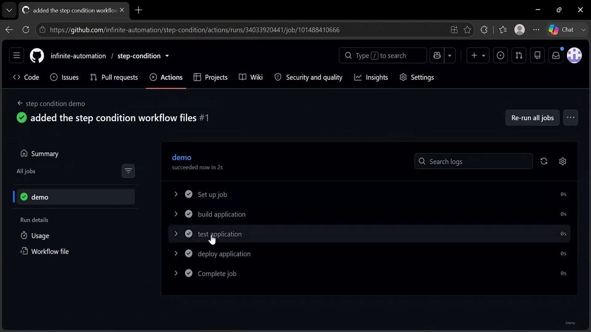
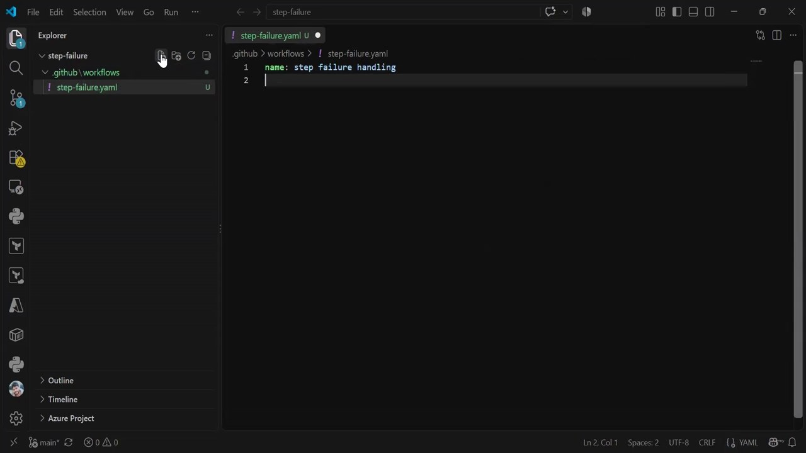
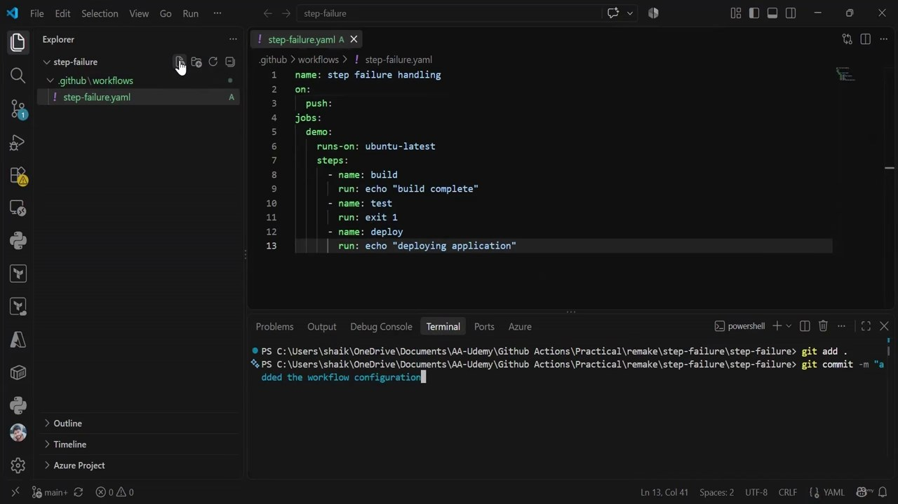
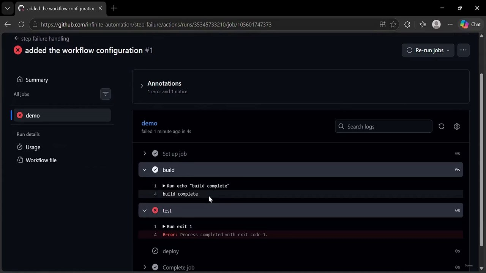
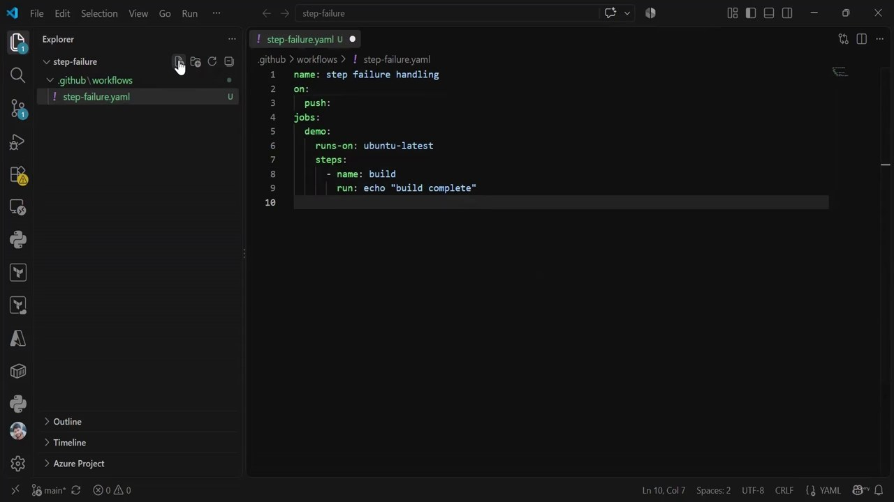

# GitHub Actions Complete（P65–P68）复现文档：步骤条件、失败继续与步骤超时

本文覆盖三门可落地的小能力：

1. **Step Condition**：用 `if` 控制某个 step 是否执行，例如只在 `main` 分支部署。
2. **Step Failure Handling**：用 `continue-on-error` 控制某个 step 失败后，是否继续执行后续 step。
3. **Step Timeout**：用 `timeout-minutes` 控制某个 step 最长运行时间，超时后停止并标记失败。

P65 和 P67 有完整实操；P66、P68 主要是概念讲解。P68 没有给仓库名和完整 YAML，本文会明确标注“按概念补齐”的验证工程，避免把补齐内容误认为讲师原课内容。

---

## 1. 这一节做什么

最终会得到两个完整实操仓库，以及一个用于验证 P68 概念的仓库：

```text
step-condition/
└── .github/
    └── workflows/
        └── stepcondition.yaml

step-failure/
└── .github/
    └── workflows/
        └── stepfailure.yml

step-timeout/                 # P068 概念验证用，课程未给仓库名
└── .github/
    └── workflows/
        └── steptimeout.yml
```

实现目标：

- 向 `step-condition` 仓库的 `main` 分支推送代码时，`build`、`test`、`deploy` 三个 step 都执行。
- 向 `feature` 分支推送时，`build`、`test` 执行，`deploy` 因 `if` 条件为 false 被跳过。
- 向 `step-failure` 仓库推送时，先让 `test` step 执行 `exit 1`，观察默认失败行为：job 失败，后面的 `deploy` 被跳过。
- 给 `test` step 加上 `continue-on-error: true` 后再次推送，观察：`test` step 仍失败，但 job 成功，`deploy` 继续执行。
- 用 `timeout-minutes: 1` 限制一个运行 `sleep 90` 的 step，观察超时失败。

前置环境：

- 一个 GitHub 账号。
- 本地安装 Git。
- 可选安装 VS Code。课程使用 VS Code 编辑 YAML。
- 能访问 GitHub Actions。课程使用 GitHub 托管运行器 `ubuntu-latest`。
- 不需要数据库、不需要后端服务、不需要密钥。

---

## 2. 讲师原话

讲师先解释 step condition 的定义：`if` 条件为 true 时 step 运行，为 false 时 step 被跳过。

> "步骤条件决定某个特定步骤应当运行还是跳过。这里，如果条件为真，该步骤就运行；如果条件为假，该步骤就跳过。"
> —— p065 [00:00]

创建目录和文件时，讲师说：

> "我们来创建 .github 和 workflows 目录。在 workflows 目录中，我们来创建 .yaml 文件。我把它命名为 stepcondition.yaml。"
> —— p065 [00:56]

配置部署条件时，讲师口述为检查 `github.reference` 是否等于 `refs/heads/main`，本质是判断当前分支是不是 `main`：

> "我们在检查 github.ref 是否等于 refs/heads/main……简单来说，我们是在检查当前分支是不是 main。"
> —— p065 [03:50]

在 `feature` 分支验证时，讲师观察到：

> "构建和测试步骤成功运行了……但当 GitHub 执行到部署步骤时，它会检查条件。这里当前分支是 feature，而不是 main 分支。因此条件变为假，部署步骤也因此被跳过。"
> —— p065 [08:08]

P66 解释默认失败行为：

> "默认情况下，如果某个步骤失败，作业就会失败，后续步骤会被跳过。"
> —— p066 [00:27]


P66 解释 `continue-on-error: true`：

> "这意味着我们允许这个特定步骤失败。即使该步骤失败，GitHub 也可以继续执行正常步骤，也就是下一步。"
> —— p066 [00:56]



P67 实操中，讲师在 `test` step 里故意执行 `exit 1`：

> "这里我故意添加了 exit 1 命令，让这个步骤失败……exit 0 通常表示命令成功完成，而非零退出码表示失败。"
> —— p067 [02:11]

加入 `continue-on-error: true` 后，讲师说：

> "测试步骤已经失败，但我们把 continue-on-error 设为 true……GitHub 允许这次失败，并继续执行下一步，也就是部署。"
> —— p067 [06:23]

P68 解释超时：

> "timeout-minutes 设置某个步骤在工作流中可运行的最长时间。如果该步骤在限定时间内完成，一切都会正常继续。如果超过时间限制，GitHub 会停止该步骤并将其标记为失败。"
> —— p068 [00:29]



---

## 3. 从零复现

### 3.1 创建并克隆 `step-condition` 仓库

在 GitHub 上新建一个空仓库，名字用：

```text
step-condition
```

不要勾选自动生成 README、`.gitignore` 或 license，保持空仓库。然后本地执行：

```bash
git clone https://github.com/<你的用户名>/step-condition.git
cd step-condition
mkdir -p .github/workflows
code .
```

如果你用 SSH，也可以：

```bash
git clone git@github.com:<你的用户名>/step-condition.git
```

目录创建完成后，在 VS Code 里新建：

```text
.github/workflows/stepcondition.yaml
```



**命令逐条解释与常见排查：**

- `git clone https://github.com/<你的用户名>/step-condition.git`：把 GitHub 上的远程空仓库复制到本地，并自动创建 `step-condition` 目录。如果提示 `destination path already exists`，说明本地同名目录已存在，换一个父目录执行，或先确认是否已经克隆过。
- `cd step-condition`：进入刚克隆下来的仓库目录。后续的 `mkdir`、`git add`、`git push` 都必须在仓库根目录执行；如果提示 `No such file or directory`，先执行 `ls` 检查克隆是否成功、目录名是否写错。
- `mkdir -p .github/workflows`：递归创建 `.github/workflows` 目录。`-p` 的作用是父目录不存在时一起创建，且目录已存在时不报错。这个路径必须位于仓库根目录下，GitHub 只会识别 `.github/workflows` 里的工作流文件。
- `code .`：用 VS Code 打开当前目录。如果提示 `code: command not found`，说明 VS Code 命令行工具未加入 PATH，可以手动打开 VS Code，或直接在文件管理器里新建目录和文件，不影响后续复现。
- SSH 方式 `git clone git@github.com:...`：需要本地已经配置 SSH key。如果提示 `Permission denied (publickey)`，改用 HTTPS 克隆，或先配置 SSH key。

**与前台的对照：** 此时 GitHub 仓库页面上可能还是空仓库提示。等你创建 workflow 文件并 push 后，仓库首页才会出现 `.github/workflows/stepcondition.yaml`；Actions 页面也只会在推送触发后出现运行记录。因此本地文件创建完成但 Actions 没反应时，先确认是否已经 commit 和 push。

### 3.2 写入 `stepcondition.yaml`

完整文件见第 4 节。核心逻辑是：

- `on: push`：任意分支 push 都触发。
- `build application`：普通执行。
- `test application`：普通执行。
- `deploy application`：加 `if: github.ref == 'refs/heads/main'`，只有 `main` 分支才执行。

写完后提交并推送：

```bash
git add .
git commit -m "added the step condition workflow files"
git push
```

> 逐字稿里讲师提交信息是 “added the step condition workflow files”，这里保持一致。若你的默认分支不是 `main`，先执行 `git branch -M main` 再推送，原因见第 7 节。

**命令逐条解释与常见排查：**

- `git add .`：把当前目录下所有新增和修改的文件加入暂存区，包括隐藏目录 `.github`。如果担心漏文件，可先执行 `git status`，确认 `.github/workflows/stepcondition.yaml` 出现在待提交列表里。
- `git commit -m "..."`：生成一次本地提交，提交信息用于在 GitHub 提交历史和 Actions 运行记录里识别本次变更。如果提示 `nothing to commit`，说明没有文件变更或没有执行 `git add`。
- `git push`：把本地提交推送到远程仓库。如果提示 `no upstream branch`，说明当前分支还没有和远程分支建立跟踪关系，可执行 `git push -u origin main`。如果提示认证失败，检查 GitHub 账号、PAT 或 SSH key。

**与前台的对照：** push 成功后，GitHub 仓库页面会出现这次 commit；Actions 页面会出现一次由 `push` 触发的工作流运行。若 Actions 页面完全没有新运行，优先检查三点：文件是否真的在 `.github/workflows/` 下、YAML 是否能被解析、仓库 Actions 功能是否被禁用。

### 3.3 在 GitHub Actions 观察 `main` 分支运行结果

打开 GitHub 仓库页面：

1. 点击 `Actions` 标签。
2. 点击 `step condition demo` 工作流运行记录。
3. 点击 `demo` job。
4. 展开 step 列表。

你应该看到：

- `build application` 执行成功。
- `test application` 执行成功。
- `deploy application` 执行成功。

因为当前分支是 `main`，`github.ref` 的值是 `refs/heads/main`，条件为 true。





**与前台的对照：** `Actions` 标签里先看到工作流名称 `step condition demo`，点进去看到某一次 run，再点 `demo` job，最后看到 step 列表。成功 step 通常显示成功状态；如果 `deploy application` 没有出现执行日志，而是显示 skipped，说明条件为 false。若页面显示 YAML 解析错误，通常会在 run 详情顶部或 job 旁出现红色提示，需要回到文件检查缩进、冒号和 `if` 表达式。

**常见错误与排查：**

- 看不到 `step condition demo`：检查 `name:` 是否写在工作流顶层，文件是否在 `.github/workflows/` 下。
- `deploy application` 在 `main` 上也被跳过：检查 `if: github.ref == 'refs/heads/main'` 是否写错，尤其不要把 `github.ref` 写成 `github.reference`。
- `if` 表达式报错：确认表达式没有多余引号嵌套错误，字段名和值之间用 `==`。
- workflow 文件存在但 Actions 无运行：检查是否 push 成功、是否推到了远程仓库、仓库是否禁用 Actions。

### 3.4 创建 `feature` 分支并验证 deploy 被跳过

本地执行：

```bash
git checkout -b feature
git commit --allow-empty -m "added the feature branch"
git push -u origin feature
```

说明：逐字稿里讲师执行了 `git add .`、`git commit -m ...`、`git push`。如果你创建分支后没有改文件，直接 `git commit` 会提示没有变更。为了让流程稳定可复现，这里用 `--allow-empty` 生成一个空提交。这个细节课程没讲，但你会遇到。

推送后回到 GitHub：

1. 打开 `Actions`。
2. 找到从 `feature` 分支触发的最新运行。
3. 打开 `demo` job。

预期结果：

- `build application` 成功。
- `test application` 成功。
- `deploy application` 被跳过。

原因是 `feature` 分支上的 `github.ref` 是 `refs/heads/feature`，不等于 `refs/heads/main`，所以 `if` 条件为 false。

**命令逐条解释与常见排查：**

- `git checkout -b feature`：创建并切换到 `feature` 分支。如果提示分支已存在，可改用 `git checkout feature` 切换过去；如果本地有未提交改动，先提交或暂存。
- `git commit --allow-empty -m "..."`：创建一个没有文件变更的空提交。它的作用是稳定触发一次 push 和 Actions 运行，避免“没有改动导致 commit 失败”。这不是课程原命令，但为了复现稳定而加入。
- `git push -u origin feature`：把本地 `feature` 分支推送到远程，并用 `-u` 建立跟踪关系。之后在该分支上可以直接 `git push`。如果远程已有同名分支且历史不同，先确认是否需要合并或换分支名，不要直接强推。

**与前台的对照：** 在 Actions 运行详情里，通常可以看到触发分支是 `feature`。展开 job 后，`build application` 和 `test application` 有执行日志，`deploy application` 没有实际执行日志，而显示为 skipped/跳过。这个 skipped 不是失败，不会导致 job 失败。

### 3.5 创建并克隆 `step-failure` 仓库

在 GitHub 上新建空仓库：

```text
step-failure
```

本地执行：

```bash
git clone https://github.com/<你的用户名>/step-failure.git
cd step-failure
mkdir -p .github/workflows
code .
```

新建文件：

```text
.github/workflows/stepfailure.yml
```



**命令逐条解释与常见排查：**

- `git clone ...step-failure.git`：克隆第二个空仓库。注意不要和 `step-condition` 目录混在一起，后续命令中的仓库名、workflow 文件名都不同。
- `cd step-failure`：进入新仓库根目录。若当前终端还在 `step-condition`，直接执行 `git add` 会把文件提交到错误仓库。
- `mkdir -p .github/workflows`：创建工作流目录。若之前已经创建过，该命令不会报错。
- `code .`：用 VS Code 打开当前仓库。也可以手动创建 `.github/workflows/stepfailure.yml`，关键是路径必须正确。

**与前台的对照：** 第二个仓库首次 push 后，Actions 里出现的是 `stepfailure handling`，不要和第一个仓库的 `step condition demo` 混淆。两个仓库、两个 workflow 名称、两个文件路径要分别对应。

### 3.6 第一次推送：观察默认失败行为

第一次提交时，`test` step 使用：

```yaml
- name: test
  run: exit 1
```

完整第一次版本见第 4 节。提交：

```bash
git add .
git commit -m "added the workflow configuration"
git push
```

打开 GitHub `Actions`：

- 工作流名称是 `stepfailure handling`。
- `demo` job 会显示失败。
- `build` step 成功。
- `test` step 失败，因为 `exit 1` 返回非零退出码。
- `deploy` step 被跳过。

这正是默认行为：一个 step 失败后，job 失败，后续 step 不再执行。



**命令逐条解释与常见排查：**

- `git add .`：把 `stepfailure.yml` 加入暂存区。执行后可先用 `git status` 确认文件路径是 `.github/workflows/stepfailure.yml`。
- `git commit -m "added the workflow configuration"`：提交第一次版本。这个版本中 `test` 只有 `run: exit 1`，没有 `continue-on-error`。
- `git push`：推送到远程并触发 Actions。若没有触发，检查当前分支是否推送到远程、文件是否在默认分支上。

**与前台的对照：** 运行详情里 `demo` job 会显示失败结论。展开 step 后，`build` 成功；`test` 失败，日志里能看到 `exit 1` 导致 shell 返回非零退出码；`deploy` 没有执行日志，显示跳过。这里的跳过不是 `if` 造成的，而是前面的失败阻断了后续 step，这一点要和 P65 的 `if` 跳过区分开。

**常见错误与排查：**

- `test` 没有失败：确认 `run` 下写的是 `exit 1`，不是 `echo "exit 1"`。
- `deploy` 仍然执行：确认没有提前加上 `continue-on-error: true`，且 YAML 缩进正确。
- workflow 解析失败：检查 `name`、`on`、`jobs`、`steps` 的层级，以及 `run: exit 1` 是否写在 `test` step 下。

### 3.7 第二次推送：加入 `continue-on-error: true`

编辑 `.github/workflows/stepfailure.yml`，给 `test` step 增加一行：

```yaml
continue-on-error: true
```

最终版本见第 4 节。提交：

```bash
git add .
git commit -m "added the continue on error as true"
git push
```

再次打开最新一次 Actions 运行。预期结果：

- `demo` job 整体成功。
- `build` step 成功。
- `test` step 仍失败，因为 `exit 1` 仍会返回非零退出码。
- `deploy` step 被执行，因为 `continue-on-error: true` 允许该 step 失败后继续。



**命令逐条解释与常见排查：**

- `git add .`：把修改后的 workflow 文件加入暂存区。若只改了一个文件，也可以用 `git add .github/workflows/stepfailure.yml`。
- `git commit -m "added the continue on error as true"`：提交第二次版本。提交信息与课程保持一致，便于在历史中区分“默认失败”和“允许失败继续”两次运行。
- `git push`：触发第二次 Actions 运行。注意要打开最新一次运行，而不是第一次失败的旧运行。

**与前台的对照：** 最新运行中，`test` step 仍会因为 `exit 1` 失败；但因为 `continue-on-error: true`，`deploy` step 会继续执行并有日志。job 最终结论会变为成功。页面展示细节可能随 GitHub UI 版本变化，但判断标准是：`test` 的实际命令没有成功，`deploy` 确实执行了，job 没有被该失败阻断。

**常见错误与排查：**

- `continue-on-error` 拼写错误：必须是带连字符的 `continue-on-error`，不要写成 `continueOnError` 或 `continue_on_error`。
- 缩进错误：它必须和 `name`、`run` 同级，位于 `test` step 下，不能写到 `steps` 下或 `run` 下。
- job 仍失败：如果页面仍失败，检查 `continue-on-error: true` 是否真的属于 `test` step，而不是别的 step。
- `test` 变成功：`continue-on-error` 不会把 `exit 1` 变成成功；`test` 命令本身仍失败，只是失败被允许继续。

### 3.8 P68：补齐一个 `step-timeout` 验证工程

P68 课程只讲概念和一行 `timeout minutes` 示例，没有给仓库名、完整 YAML 和实操运行。下面是为了让你亲手验证概念而补齐的最小工程，不是讲师原课里的仓库。

新建空仓库：

```text
step-timeout
```

本地执行：

```bash
git clone https://github.com/<你的用户名>/step-timeout.git
cd step-timeout
mkdir -p .github/workflows
code .
```

新建：

```text
.github/workflows/steptimeout.yml
```

完整内容见第 4 节。核心是：

```yaml
timeout-minutes: 1
run: |
  echo "start test"
  sleep 90
  echo "test finished"
```

提交并推送：

```bash
git add .
git commit -m "added the step timeout demo"
git push
```

打开 Actions，等待约 1 分钟。预期：该 step 超过 1 分钟后被 GitHub 停止，并标记为失败。注意：GitHub 的排队时间不算 step 运行时间，超时从 step 真正开始执行时计算。

**命令逐条解释与常见排查：**

- `git clone ...step-timeout.git`：克隆 P68 概念验证仓库。这里明确标注：仓库名和完整 workflow 是按概念补齐的，不是课程原课给出的内容。
- `cd step-timeout`：进入验证仓库。后续提交只影响这个仓库。
- `mkdir -p .github/workflows`：创建 workflow 目录。
- `code .`：打开编辑器创建 `steptimeout.yml`。
- `git add .`、`git commit`、`git push`：提交并推送验证文件，触发 Actions。若推送后暂时看不到运行，先确认 Actions 是否启用、文件路径是否正确。

**与前台的对照：** 打开 Actions 后先看到 `step timeout demo` 工作流，再进入 `demo` job，展开 `run test` step。step 开始后日志里会出现 `start test`；约 1 分钟后，日志不会打印 `test finished`，因为 `sleep 90` 还没结束就被超时停止。页面会把该 step 标记为失败/超时，job 也随之失败。若等待时间明显超过 1 分钟仍未失败，先确认 step 是否还在排队尚未开始。

---

## 4. 完整代码

### 4.1 `step-condition/.github/workflows/stepcondition.yaml`

```yaml
name: step condition demo

on:
  push:

jobs:
  demo:
    runs-on: ubuntu-latest
    steps:
      - name: build application
        run: echo "building application"

      - name: test application
        run: echo "testing application"

      - name: deploy application
        if: github.ref == 'refs/heads/main'
        run: echo "deploying application"
```

### 4.2 `step-failure/.github/workflows/stepfailure.yml` 第一次运行版本

这个版本用于复现默认失败行为：`test` 失败后，`deploy` 被跳过。

```yaml
name: stepfailure handling

on:
  push:

jobs:
  demo:
    runs-on: ubuntu-latest
    steps:
      - name: build
        run: echo "build complete"

      - name: test
        run: exit 1

      - name: deploy
        run: echo "Deploying application"
```

### 4.3 `step-failure/.github/workflows/stepfailure.yml` 最终版本

在 `test` step 下增加 `continue-on-error: true`。

```yaml
name: stepfailure handling

on:
  push:

jobs:
  demo:
    runs-on: ubuntu-latest
    steps:
      - name: build
        run: echo "build complete"

      - name: test
        continue-on-error: true
        run: exit 1

      - name: deploy
        run: echo "Deploying application"
```

### 4.4 `step-timeout/.github/workflows/steptimeout.yml`

P068 只给概念和 `timeout minutes` 示例，下面是按该概念补齐的可运行文件。

```yaml
name: step timeout demo

on:
  push:

jobs:
  demo:
    runs-on: ubuntu-latest
    steps:
      - name: run test
        timeout-minutes: 1
        run: |
          echo "start test"
          sleep 90
          echo "test finished"
```

---

## 5. 逐行解释

### 5.1 `stepcondition.yaml`

```yaml
name: step condition demo
```

工作流名称。GitHub Actions 页面左侧和运行记录里会显示这个名字。课程里讲师命名为 “step condition demo”。如果这个名字写错，Actions 页面仍可能运行，但你在列表中看到的名字会不同，排查时容易找错工作流。

```yaml
on:
  push:
```

触发条件：任意分支发生 push 时触发。这里没有写 `branches` 过滤，所以 `main` 和 `feature` 分支 push 都会运行。正是因为这样，后面才能对比两个分支下 `deploy` step 的行为。常见错误是把 `on` 写成 `true` 或缩进错误，导致工作流无法解析。

```yaml
jobs:
  demo:
```

定义一个 job，job 的 ID 是 `demo`。课程里 job 名就是 `demo`。`demo` 是 job 的标识，不是工作流名称；Actions 页面里会看到工作流名和 job 名两层结构。

```yaml
    runs-on: ubuntu-latest
```

指定运行器。课程说使用 GitHub hosted runner，也就是 GitHub 托管的 `ubuntu-latest`。这决定了 step 里的 `run` 默认在 Linux bash 中执行。如果改成 Windows 运行器，`echo` 和 shell 语法可能不同，本节命令都按 Ubuntu 编写。

```yaml
    steps:
      - name: build application
        run: echo "building application"
```

第一个 step，名字是 `build application`，执行 shell 命令输出一段文本。课程里讲师用 shell 模拟“构建应用”。`name` 是页面展示名，`run` 是实际执行命令。如果 `run` 缺失，step 无法执行。

```yaml
      - name: test application
        run: echo "testing application"
```

第二个 step，模拟测试应用。它没有条件，所以任何分支都会执行。它也没有 `continue-on-error`，因此如果它失败，默认会阻断后续 step。

```yaml
      - name: deploy application
        if: github.ref == 'refs/heads/main'
        run: echo "deploying application"
```

第三个 step，关键在 `if`。

- `if` 写在 step 级别，表示只控制这个 step。
- `github.ref` 是 GitHub Actions 提供的上下文值，表示触发工作流的 ref。
- 在 `main` 分支上，它的值是 `refs/heads/main`。
- 在 `feature` 分支上，它的值是 `refs/heads/feature`。
- 所以只有 `main` 分支 push 时，该表达式为 true，`deploy application` 才执行。

注意：逐字稿中讲师口述为 `github.reference`，这是口述/转录层面的说法；写 YAML 时必须使用实际字段 `github.ref`。否则表达式取不到正确值，部署条件不会按预期工作。

`if` 条件为 false 时，step 状态是 skipped，不是 failed。也就是说，被跳过的 step 不会让 job 失败。常见错误是把 `if` 写到 job 级别或 workflow 级别，导致作用范围与预期不同；本节要控制的是 `deploy application` 这个 step，所以 `if` 必须缩进在该 step 下。

### 5.2 `stepfailure.yml` 第一次版本

```yaml
name: stepfailure handling
```

工作流名称。课程里讲师命名为 `stepfailure handling`。在 Actions 页面中，这个名称用于区分不同工作流。

```yaml
on:
  push:
```

任意分支 push 触发，和 P65 一样。只要推送了包含该 workflow 的分支，就会产生一次运行。

```yaml
jobs:
  demo:
    runs-on: ubuntu-latest
```

一个名为 `demo` 的 job，运行在 `ubuntu-latest` 上。`demo` job 下包含 `build`、`test`、`deploy` 三个 step。

```yaml
      - name: build
        run: echo "build complete"
```

构建 step，输出 `build complete`。逐字稿里讲师说 “execute shell as build complete”。这个 step 正常情况下会成功，用于证明后续失败只影响它之后的 step。

```yaml
      - name: test
        run: exit 1
```

关键 step。`exit 1` 是 Linux shell 命令，表示以非零退出码结束。

- `exit 0`：命令成功。
- 非零退出码：命令失败。
- `exit 1`：故意制造失败。

GitHub Actions 根据 shell 退出码判断 step 是否成功。`exit 1` 会让 `test` step 失败。常见错误是写成 `exit 0`，这样 step 会成功，就无法复现默认失败行为。

在 JS/Node 项目里，测试框架失败时通常也是返回非零退出码；如果你自己写 Node 脚本，等价写法可以是 `process.exit(1)`。这里不需要 Node，直接用 bash 的 `exit 1` 就能复现。



```yaml
      - name: deploy
        run: echo "Deploying application"
```

部署 step。默认情况下，由于前面的 `test` step 失败，这个 step 不会执行。逐字稿中第一次运行结果正是：`build` 成功，`test` 失败，`deploy` 被跳过。如果发现 `deploy` 仍然执行，优先检查是否误加了 `continue-on-error`，或 `test` 是否真的返回了非零退出码。

### 5.3 `stepfailure.yml` 最终版本

最终版本只在 `test` step 下增加一行：

```yaml
        continue-on-error: true
```

它的含义是：允许这个 step 失败，失败后不阻断 job 中后续 step 的执行。

需要区分两个层面：

- `test` step 本身仍然失败，因为 `exit 1` 没有被删除。
- job 不会因为这个 step 失败而立即停止，后面的 `deploy` 仍会运行。
- 最终 `demo` job 显示成功，但 `test` step 仍显示失败。

这就是逐字稿中讲师观察到的现象：`test` failed，但 job succeeded，`deploy` 执行了。

`continue-on-error: false` 是默认行为：失败不被忽略，job 失败，后续 step 被跳过。课程 P66 明确讲了 true 和 false 的差异。

不要把 `continue-on-error: true` 用在关键部署或关键安全扫描上。它适合“非关键测试”“可选检查”“允许失败但想保留执行记录”的场景。课程里讲师举的例子是：某个 test 不是 critical，即使失败也仍想继续 deploy。

P66 还提到 GitHub 会先记录 step 的实际结果，也就是 outcome，然后 `continue-on-error` 影响失败如何被处理。逐字稿没有展开更多 UI 字段；实际页面里如果看到其他状态字段，以 GitHub 当前输出为准。常见错误是把 `continue-on-error` 写到 job 下，或拼写成其他形式；本节只控制 `test` step，所以该字段必须归属于 `test` step。

### 5.4 `steptimeout.yml`

```yaml
      - name: run test
        timeout-minutes: 1
```

`timeout-minutes` 写在 step 级别，表示这个 step 最多运行 1 分钟。课程 P68 的口述是 “timeout minutes”，实际 YAML 键名是 `timeout-minutes`。常见错误是写成 `timeout_minutes`、`timeoutMinutes` 或写到 `run` 下面，都会导致字段不生效或 YAML 解析异常。

```yaml
        run: |
          echo "start test"
          sleep 90
          echo "test finished"
```

`run: |` 表示多行 shell。`sleep 90` 让 step 运行 90 秒，明显超过 1 分钟，所以 GitHub 会停止该 step 并标记失败。日志中通常会先看到 `start test`，然后因为超时被中断，`test finished` 不一定出现。

P68 还强调了一点：step timeout 控制单个 step，job timeout 控制整个 job。课程没有给 job timeout 的完整示例，所以本文不展开 job 级配置；你只需要记住两者作用范围不同。常见错误是把排队时间也算进超时，误以为一 push 就开始计时；实际是从 step 开始执行后计算。

---

## 6. 复现检查清单

### `step-condition` 仓库

- [ ] GitHub 上创建的是空仓库 `step-condition`。  
  说明：空仓库可以避免 README 自动提交干扰第一次 push；如果你勾选了 README，仍可复现，只是本地需要先 `git pull` 或重新克隆。

- [ ] 本地已执行 `git clone` 并进入仓库目录。  
  说明：如果终端路径不在仓库根目录，后续 `.github` 可能创建到错误位置，导致 GitHub 找不到工作流。

- [ ] 存在文件 `.github/workflows/stepcondition.yaml`。  
  说明：路径必须是仓库根目录下的 `.github/workflows`，文件名大小写和扩展名要和 push 的内容一致。

- [ ] YAML 中 `on` 是 `push`。  
  说明：如果触发条件写错，push 后 Actions 不会自动运行。

- [ ] job ID 是 `demo`，`runs-on` 是 `ubuntu-latest`。  
  说明：这样 Actions 页面里的 job 名称和课程一致，shell 命令也按 Ubuntu 环境执行。

- [ ] `deploy application` step 上有 `if: github.ref == 'refs/heads/main'`。  
  说明：这是控制 `main` 分支部署、`feature` 分支跳过的核心条件。

- [ ] 推送到 `main` 后，Actions 中三个 step 都执行。  
  说明：如果 `deploy` 仍跳过，检查当前默认分支是否真的是 `main`，以及 `github.ref` 是否写错。

- [ ] 创建 `feature` 分支并 push 后，`build`、`test` 执行，`deploy` 被跳过。  
  说明：跳过状态不是失败，说明 `if` 为 false，符合预期。

- [ ] 如果 `feature` 分支没有文件改动，使用 `git commit --allow-empty` 而不是直接 `git commit`。  
  说明：空提交可以稳定触发一次新的 push 和工作流运行，避免“没有变更无法提交”的问题。

### `step-failure` 仓库

- [ ] GitHub 上创建的是空仓库 `step-failure`。  
  说明：这是第二个独立仓库，不要和 `step-condition` 混用文件和历史。

- [ ] 存在文件 `.github/workflows/stepfailure.yml`。  
  说明：工作流文件名和课程一致，便于对照 Actions 中的运行记录。

- [ ] 第一次提交版本中，`test` step 是 `run: exit 1`，没有 `continue-on-error`。  
  说明：第一次运行必须复现默认失败行为，因此不能提前加入允许失败的配置。

- [ ] 第一次运行：`demo` job 失败，`build` 成功，`test` 失败，`deploy` 跳过。  
  说明：这说明默认失败会阻断后续 step，是 P66 概念的实际验证。

- [ ] 第二次提交版本中，`test` step 增加 `continue-on-error: true`。  
  说明：该字段必须位于 `test` step 下，并与 `run` 同级。

- [ ] 第二次运行：`demo` job 成功，`test` 仍失败，`deploy` 执行。  
  说明：这里要区分“step 失败”和“job 最终结论”，`continue-on-error` 影响的是失败是否阻断后续流程。

- [ ] 已确认 `continue-on-error` 拼写带连字符，且缩进在 `test` step 下。  
  说明：拼写或缩进错误是本节最常见的失败原因。

### `step-timeout` 验证工程

- [ ] 这是 P68 概念验证工程，不是讲师原课仓库。  
  说明：课程只给概念和示例，本仓库是按概念补齐的可运行验证。

- [ ] 存在文件 `.github/workflows/steptimeout.yml`。  
  说明：文件路径正确才会被 GitHub Actions 识别。

- [ ] `timeout-minutes: 1` 写在 `run test` step 下。  
  说明：它控制的是单个 step 的最长运行时间，不是整个 job。

- [ ] `run` 中包含 `sleep 90`。  
  说明：90 秒大于 1 分钟，用于触发超时停止。

- [ ] 推送后等待约 1 分钟，step 被停止并标记失败。  
  说明：如果等待更久仍未失败，先确认 step 是否已经开始执行。

- [ ] 已理解排队时间不算 step 执行时间，超时从 step 开始运行时计算。  
  说明：这能避免把 Actions 排队误判为超时未生效。

---

## 7. 课里没讲但你会撞上的

1. **默认分支可能叫 `master` 而不是 `main`**

   课程里的条件是 `refs/heads/main`。如果你的仓库默认分支是 `master`，那么 `github.ref` 是 `refs/heads/master`，`deploy` 在默认分支上也会被跳过。解决办法是把默认分支改成 `main`，或者把条件改成你实际的分支名。

2. **创建 `feature` 分支后直接 commit 可能失败**

   如果你只是 `git checkout -b feature`，没有修改任何文件，`git commit` 会提示没有变更。逐字稿里讲师执行了 commit，但实际本地可能产生过改动。为了稳定复现，使用：

   ```bash
   git commit --allow-empty -m "added the feature branch"
   ```

3. **`github.reference` 不是实际字段**

   讲师口述为 `github.reference`，但 workflow 中应写 `github.ref`。这是复现时最容易卡住的地方之一。判断分支时用：

   ```yaml
   if: github.ref == 'refs/heads/main'
   ```

4. **`continue-on-error` 是带连字符的 YAML 键**

   不是 `continueOnError`，也不是 `continue_on_error`。写成：

   ```yaml
   continue-on-error: true
   ```

   并且要放在具体 step 下，缩进层级不能错。

5. **`continue-on-error: true` 不会让失败的 step 变成成功**

   `test` step 仍然会因为 `exit 1` 失败。它只是让失败不阻断后续 step，并让 job 整体可以成功。不要把“step 失败但 job 成功”误解为“test 通过”。

6. **`timeout-minutes` 是实际键名**

   课程口述是 “timeout minutes”，YAML 中写：

   ```yaml
   timeout-minutes: 1
   ```

   如果写成 `timeout_minutes` 或 `timeoutMinutes`，GitHub Actions 不会按预期识别。

7. **P68 没有完整实操**

   课程 P68 主要讲概念和一行 timeout 示例，没有给仓库名、完整 workflow 和运行结果。本文的 `step-timeout` 仓库是按概念补齐的验证工程。你如果在课程视频里找不到对应操作，是正常的。

8. **超时后 step 会被停止并标记失败**

   这和第 6 点相关：`timeout-minutes` 到时间不是“跳过”，而是停止该 step 并标记失败。后面的 step 是否继续，仍取决于默认失败处理或 `continue-on-error` 等配置。

9. **GitHub Actions 的排队时间不等于 step 运行时间**

   你推送后可能先在队列里等待。`timeout-minutes` 从 step 开始执行时算，不是从 push 那一刻算。所以看到“过了很久还没失败”时，先确认 step 是否已经开始。

10. **课程没有讲 secrets、权限、缓存、矩阵构建**

    本段只覆盖 step condition、step failure handling、step timeout。像 secrets、permissions、cache、matrix 这些都没有出现在逐字稿里。不要为了复现本节而额外配置它们。

11. **这里不涉及数据库锁、事务、并发控制**

    本节是 CI 工作流控制逻辑，不涉及后端锁或事务。唯一和“退出码”相关的点是：shell 的 `exit 1` 等价于告诉 CI “这个命令失败”；在 Node 里你可以把它理解成 `process.exit(1)` 或测试框架返回非零退出码。

12. **YAML 缩进错误会直接导致工作流无法解析**

    最容易错的是把 `if`、`continue-on-error`、`timeout-minutes` 写到 `run` 下面，或者和 `steps` 同级。记住它们都是 step 级别字段，应和 `name`、`run` 处于同一缩进层级。排查时先看 Actions 页面顶部的解析错误，再回到文件逐层检查 `jobs`、`steps`、`name`、`run` 的缩进。