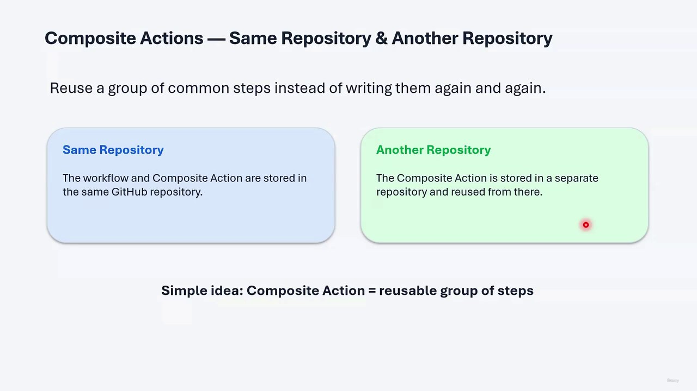
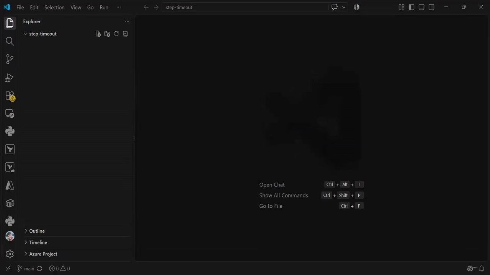
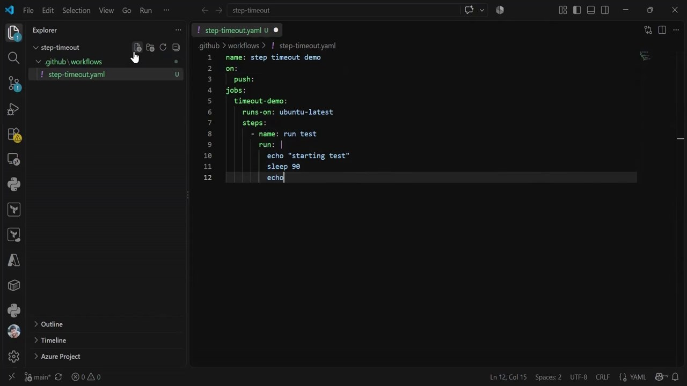
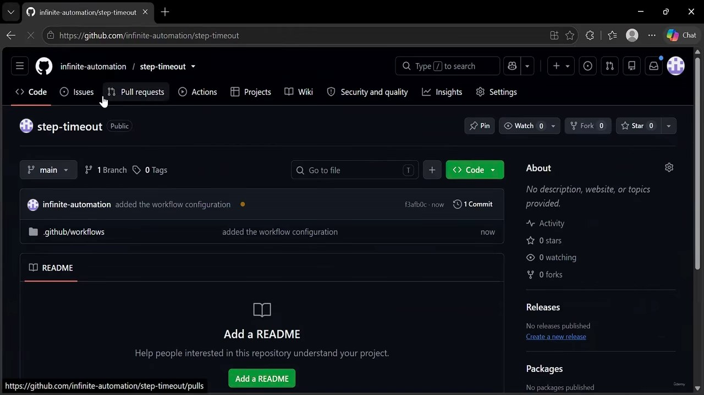
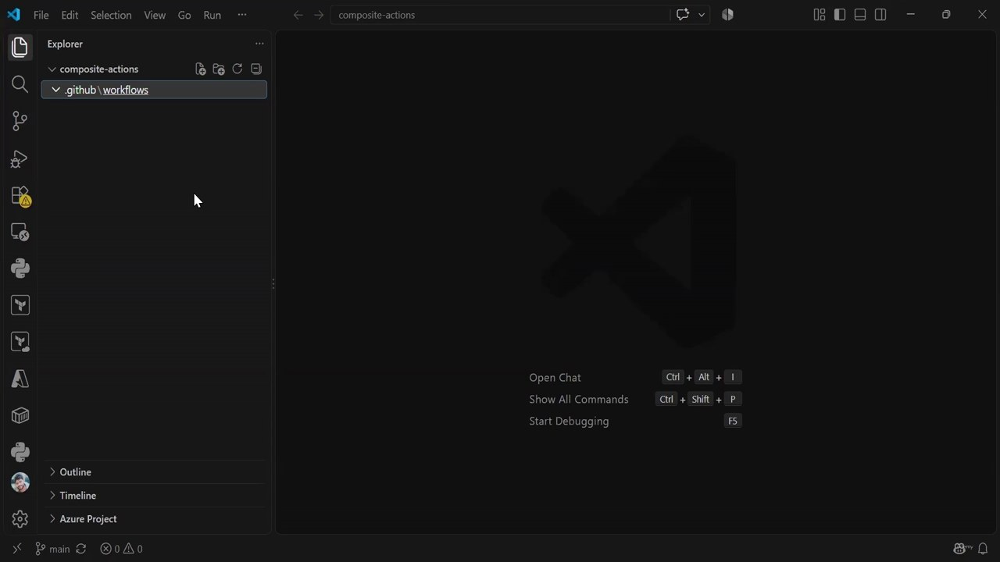
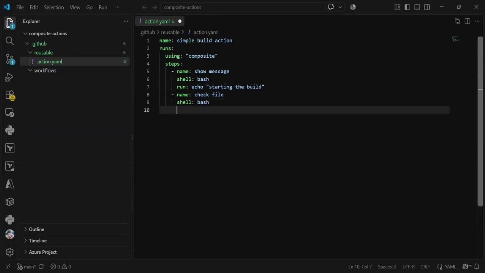
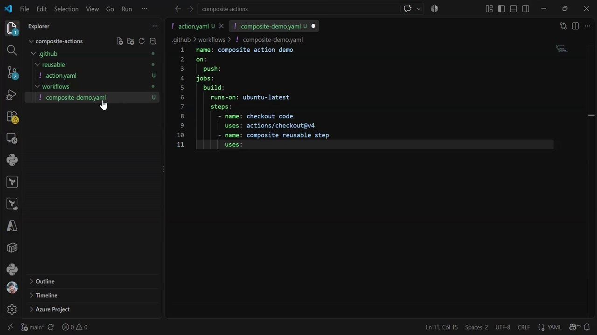
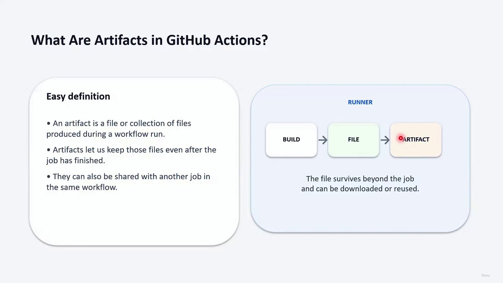

# GitHub Actions 实战：Step Timeout、Composite Action 与 Artifacts（P69–P72）

这份文档把 P69–P72 重组为两个可以照着做的仓库实验，外加一个概念说明：

- **实验 A（P69）**：在 step 级别设置 `timeout-minutes`，故意让 `sleep 90` 超过 1 分钟，观察 GitHub 如何中断步骤、后续步骤如何被跳过。
- **实验 B（P70–P71）**：把重复步骤抽成 composite action，放在 `.github/reusable/action.yml`，再由 workflow 用本地路径 `uses` 调用。
- **概念 C（P72）**：Artifacts 的“job 创建文件 → 上传 → GitHub 保存 → 下载复用”流程。课里只讲概念，**没有给 upload/download 的完整 YAML 参数**，本文不会编造这部分代码。

两个实验是两个独立仓库，不要混在同一个仓库里做。课里没有涉及锁、事务、数据库并发；如果你用 Node 后端思维理解，这里的 timeout 只是“给一个 CI 步骤加外层执行时限”，不是 JS 里的锁超时。

---

## 1. 这一节做什么

P69 做的是 **step timeout 的实操**。讲师先创建一个空的 GitHub 仓库，克隆到本地，用 VS Code 打开，然后建立 `.github/workflows/steptimeout.yaml`。workflow 在 push 时触发，job 跑在 `ubuntu-latest` 上。关键步骤里执行：

```bash
echo starting test
sleep 90
echo test completed
```

同时给这个 step 设置 `timeout-minutes: 1`。因为 90 秒大于 1 分钟，step 会先打印 `starting test`，然后在超时点被 GitHub 停止并标记失败；后面的步骤默认被跳过。

P70 解释 composite action 的概念：如果多个 workflow 都要重复写同样的五六个步骤，就把这些公共步骤抽成一个可复用的 group。composite action 可以用在同一仓库，也可以用另一个仓库的 action；同仓库用本地路径，跨仓库用 owner/repo/path/version 引用。

P71 是 composite action 的实操：在仓库里创建 `.github/reusable/action.yml`，把 `echo starting the build` 和 `ls` 两条命令做成 composite action；再创建 `.github/workflows/composite-demo.yaml`，先用 `actions/checkout@v4` 检出代码，再用本地 `uses` 调用这个 composite action。运行后，GitHub 会把 composite action 内部的两个子步骤展开执行。

P72 解释 artifacts：job 可能产生 build 文件、测试报告、日志、覆盖率报告等；如果 job 结束后还要保留，就上传为 artifact，之后下载复用。上传用 upload artifact action，下载用 download artifact action。课里没有给具体 `with` 参数。

---

## 2. 讲师原话（带出处）

> “During the workflow run, sometimes a step may take longer than expected or it may get stuck due to unknown issue… We can use timeout minutes to set a maximum that particular step is allowed to run. Here remember one thing, step timeout applicable only the respected step.”
>
> —— p069 [00:00]–[00:27]

> “At this line number 12 the sleep command needs 90 seconds but our timeout is only one minute so here I have intentionally configured it so that we can see what happens when the step crosses its timeout limit.”
>
> —— p069 [03:46]

> “Once the step reached that limit, GitHub automatically stopped it and marked the step as a failed. Because this step failed, the next step, which is run test, would be skipped.”
>
> —— p069 [05:38]–[06:07]

> “A composite action is basically a reusable group of step. We write the common step once and use them whenever we need.”
>
> —— p070 [00:29]

> “For composite action, GitHub expects the file to be named as an action.yml. If we use another name, GitHub will not recognize.”
>
> —— p071 [02:21]

> “Here, instead of writing those commands again inside this workflow, we are going to call our composite action using Uses… we need to specify the path of our composite action. .github and directory is reusable.”
>
> —— p071 [06:39]–[07:09]

> “During the workflow run, our job may create some files like build files, test report, or logs. If we want them to keep those files after the job completed, we can store them as an artifact.”
>
> —— p072 [00:00]

> “To upload an artifact, we can use upload artifact action. To get it back, we can use download artifact particular action.”
>
> —— p072 [01:27]



---

## 3. 从零复现

### 3.1 环境、版本与前置条件

课里用到的环境很轻：

- 一个 GitHub 账号；
- 本地安装 Git；
- 本地安装 Visual Studio Code；
- GitHub 托管 runner 使用 `ubuntu-latest`；
- composite workflow 里使用 `actions/checkout@v4`；
- 两个实验都**没有 npm 依赖、没有 Node 版本要求、没有环境变量**。课里没有让你设置任何 `env`，不要凭记忆往 YAML 里加。

先在 GitHub 网页上创建两个空仓库，建议命名：

- `step-timeout`（对应 P69 的 “step timeout” 仓库）；
- `composite-action`（对应 P71 的 “Composite Action” 仓库）。

创建时不要初始化 README、不要加 `.gitignore`，保持空仓库，然后本地克隆。这样和讲师“创建空仓库再克隆”的流程一致。

项目 A 的目录结构最终是：

```text
step-timeout/
└── .github/
    └── workflows/
        └── steptimeout.yaml
```

项目 B 的目录结构最终是：

```text
composite-action/
└── .github/
    ├── reusable/
    │   └── action.yml
    └── workflows/
        └── composite-demo.yaml
```

注意：P71 讲师明确说 reusable 目录放在 `.github` 下，但**不要**放进 `.github/workflows`，因为 workflows 目录主要放 workflow 文件，公共 composite action 单独放在 `.github/reusable` 更清晰。课里没有讲 GitHub 对 `.github/reusable` 这个目录名有特殊要求；它只是本仓库内的一个普通目录，真正被识别的是目录里的 `action.yml`。

### 3.2 实验 A：step timeout 复现步骤

1. 克隆空仓库：

```bash
git clone https://github.com/<你的用户名>/step-timeout.git
cd step-timeout
code .
```

2. 创建目录和 workflow 文件：

```bash
mkdir -p .github/workflows
touch .github/workflows/steptimeout.yaml
```



3. 把第 4 节的 `steptimeout.yaml` 完整内容粘贴进去。注意 YAML 缩进用空格，不要用 Tab。

4. 在 step 上设置超时。课里口述为 “timeout minutes”，YAML 键写成 `timeout-minutes`。它放在具体 step 下，和 `run` 同级：

```yaml
timeout-minutes: 1
```



5. 提交并推送，push 本身触发 workflow：

```bash
git add .
git commit -m "added the workflow configuration"
git push
```

6. 打开 GitHub 仓库页面，刷新，确认 `.github/workflows/steptimeout.yaml` 已经出现；然后进 Actions 标签页，点开 `step timeout demo` 这次运行，再点开 job `timeout-demo`。



7. 等待大约 1 分钟。预期结果：

- 第一个 `run test` 步骤先输出 `starting test`；
- `sleep 90` 还没结束，step 到达 `timeout-minutes: 1`；
- GitHub 停止该 step，并把它标记为 failed；
- 后面的第二个 `run test` 步骤被 skipped，不会输出 `running the test`；
- 日志里不会出现第一个步骤的 `test completed`，因为它在 `sleep 90` 之后才执行。

课里没有讲超时后具体会显示哪些内部错误字段；你在日志里看到的具体字段名请以实际输出为准，不要照记忆写 `ExitCode` 之类的字段。

### 3.3 实验 B：composite action 复现步骤

1. 克隆第二个空仓库：

```bash
git clone https://github.com/<你的用户名>/composite-action.git
cd composite-action
code .
```

2. 创建目录：

```bash
mkdir -p .github/reusable
mkdir -p .github/workflows
touch .github/reusable/action.yml
touch .github/workflows/composite-demo.yaml
```



3. 先把公共步骤写进 `.github/reusable/action.yml`。核心是：

```yaml
runs:
  using: composite
  steps:
    - name: show message
      shell: bash
      run: echo starting the build
    - name: check files
      shell: bash
      run: ls
```

课里强调 composite action 的文件名要用 `action.yml`。逐字稿后面曾口误说成 `actions.yaml`，但前面明确说 GitHub expects `action.yml`。复现时以 `action.yml` 为准，并把它放在 `.github/reusable` 目录里。



4. 再写 workflow `.github/workflows/composite-demo.yaml`。它先 checkout 代码，因为 composite action 和仓库文件需要在 runner 上可见；然后调用本地 action。`uses` 的路径要写成仓库根目录相对路径，并以 `./` 开头：

```yaml
- name: composite reusable step
  uses: ./.github/reusable
```

课里口述路径是 “.github and directory is reusable”，实际 YAML 里写本地 action 路径时要带 `./`。如果你只写 `.github/reusable`，GitHub 不会把它当成本地路径处理；这是课里没展开、但你会撞上的点。



5. 提交推送：

```bash
git add .
git commit -m "added the composite action workflows"
git push
```

6. 打开 Actions 页面，点开 `composite action demo`，再点开 `build` job。预期：

- `checkout code` 成功，仓库文件被检出；
- `composite reusable step` 被展开；
- 展开后能看到 `show message` 和 `check files` 两个子步骤；
- `show message` 输出 `starting the build`；
- `check files` 执行 `ls`，输出仓库根目录文件列表。

### 3.4 P72 artifacts：为什么本文不给可执行 YAML

P72 是概念课，逐字稿只讲了 artifact 的用途和动作名称：

- job 产生 build 文件、测试报告、日志、覆盖率报告；
- 用 upload artifact action 上传；
- GitHub 保存；
- 之后用 download artifact action 下载复用。

课里**没有给** upload/download 的 `with` 参数、artifact 名称、路径、保留天数、下载目录等配置。因此本文不提供“看起来能跑”的 artifact YAML，否则就是编造。你可以先把 P69 和 P71 两个实验跑通，把 P72 作为后续扩展：真正要写 artifact 时，按官方 action 文档确认参数，不要照记忆填。



---

## 4. 完整代码

### 4.1 项目 A：`.github/workflows/steptimeout.yaml`

保存到 `step-timeout/.github/workflows/steptimeout.yaml`：

```yaml
name: step timeout demo

on:
  push:

jobs:
  timeout-demo:
    runs-on: ubuntu-latest
    steps:
      - name: run test
        run: |
          echo starting test
          sleep 90
          echo test completed
        timeout-minutes: 1

      - name: run test
        run: echo running the test
```

说明：讲师在口述第二个步骤时犹豫过 “deploy” 还是 “run test”，最后说 keep it as a run test。因此这里第二个步骤名也写成 `run test`，和逐字稿保持一致。实际 UI 里会出现两个同名步骤；如果你只是为了自己好读，可以改成 `deploy`，但那就不是逐字稿原样。

### 4.2 项目 B：`.github/reusable/action.yml`

保存到 `composite-action/.github/reusable/action.yml`：

```yaml
name: simple build action
description: Reusable build steps for the composite action demo

runs:
  using: composite
  steps:
    - name: show message
      shell: bash
      run: echo starting the build

    - name: check files
      shell: bash
      run: ls
```

说明：课里逐字稿重点讲的是 `name`、`runs`、`using: composite`、`steps`、`shell: bash`、`run`。`description` 这一行是 action 元数据里常见的一行；课里没有逐字解释它的校验规则。若你严格照课堂最小文件先删掉它，GitHub 若提示需要补元数据，再加回来即可。

### 4.3 项目 B：`.github/workflows/composite-demo.yaml`

保存到 `composite-action/.github/workflows/composite-demo.yaml`：

```yaml
name: composite action demo

on:
  push:

jobs:
  build:
    runs-on: ubuntu-latest
    steps:
      - name: checkout code
        uses: actions/checkout@v4

      - name: composite reusable step
        uses: ./.github/reusable
```

说明：课里验证时提到 `composite demo.yaml`，这里为了文件名稳定使用 `composite-demo.yaml`。GitHub 识别的是 `.github/workflows` 目录下的 workflow 文件，文件名不是本节的核心；关键是 `uses` 指向包含 `action.yml` 的本地目录。

---

## 5. 逐行解释

### 5.1 `steptimeout.yaml`

- `name: step timeout demo`：workflow 的显示名称，会出现在 Actions 页面左侧。
- `on:` 下面写 `push:`：表示向仓库 push 时触发。课里没有加分支过滤，也没有加手动触发。
- `jobs:` 下定义 job。`timeout-demo:` 是 job 的 id；YAML 里 job id 不建议带空格，所以这里用连字符。讲师口述为 “timeout demo”，实际写成合法 id。
- `runs-on: ubuntu-latest`：指定 GitHub 托管 runner 使用 Ubuntu 最新环境。因为后面用了 `sleep` 和 bash 风格的多行命令，跟着课里选 Ubuntu 最稳。
- `steps:` 是步骤列表。第一个步骤 `name: run test` 只是 UI 显示名。
- `run: |`：YAML 的块标量写法，表示下面几行作为一段 shell 脚本执行。它等价于把这个 step 要跑的命令写成多行。
- `echo starting test`：先打印开始信息。运行日志里应该能看到它。
- `sleep 90`：让当前 shell 等待 90 秒。课里故意让它超过 1 分钟。
- `echo test completed`：原本想在 sleep 后打印完成；但由于超时，这一行不会执行到。
- `timeout-minutes: 1`：这是本节的核心。它只作用于当前这个 step，不作用于整个 job，也不作用于其他 step。讲师原话强调 “step timeout applicable only the respected step”。
- 第二个 `- name: run test`：这是另一个 step，执行 `echo running the test`。因为前一个 step 失败，默认情况下它会被跳过。

在 Node/前端视角里，你可以把 `timeout-minutes` 理解成“给这个 CI 步骤套一个外层定时器”；它不是在你的 Node 代码里写 `setTimeout`，也不是 `AbortController` 去取消某个 fetch。你的脚本本身不需要改，限制发生在 GitHub runner 执行 step 的层面。

### 5.2 `action.yml`

- `name: simple build action`：composite action 自己的名称。它和 workflow 的 `name` 不是一回事。
- `description:`：action 元数据描述。课里没有展开讲，保留它可以让 action 元数据更完整；若按课堂最小化复现，可以按实际校验情况调整。
- `runs:`：composite action 的执行入口。
- `using: composite`：告诉 GitHub 这不是 Docker action，也不是 JavaScript action，而是一个由多个 step 组成的 composite action。
- `steps:`：composite action 内部的步骤列表。注意这些步骤最终会在调用它的 workflow job 里展开执行。
- `name: show message`：子步骤显示名。
- `shell: bash`：composite action 的每个子步骤要明确 shell。课里写了 `shell: bash`，但没有解释原因；你可以理解为“子步骤不是 workflow 顶层 step，不能想当然继承一切，必须写清楚用什么 shell”。
- `run: echo starting the build`：真正执行的命令，输出 `starting the build`。
- `name: check files`：第二个子步骤显示名。
- `shell: bash`：同样指定 bash。
- `run: ls`：列出当前目录文件。因为 workflow 里先 checkout 了代码，所以这里能看到仓库文件。

如果你用 Node 项目类比：这有点像把重复的 `npm run build`、`npm test` 抽到一个脚本文件里，让多个 workflow 调用；但 composite action 不是 npm script，它的每个子步骤仍然是 GitHub Actions 的 step，所以需要 `shell`。

### 5.3 `composite-demo.yaml`

- `name: composite action demo`：workflow 显示名，和 P71 讲师口述一致。
- `on: push:`：push 触发。
- `jobs.build:`：job id 为 `build`。
- `runs-on: ubuntu-latest`：使用 GitHub 托管 Ubuntu runner。
- 第一个 step `checkout code` 使用 `actions/checkout@v4`。课里明确说这一步是把代码仓库检出，使仓库文件在 runner 上可用。没有 checkout，后面的本地 composite action 和 `ls` 可能看不到仓库内容。
- 第二个 step `composite reusable step` 使用 `uses: ./.github/reusable`。这是本地 action 路径，指向包含 `action.yml` 的目录。GitHub 会读取该目录下的 `action.yml`，把里面的 `steps` 展开执行。
- 课里口述路径是 `.github` 下的 `reusable` 目录；YAML 里必须写成 `./.github/reusable` 这样的相对路径。不要写成 `/.github/reusable`，也不要写成远程仓库引用。

### 5.4 Artifacts 概念

P72 没有代码，只记流程：

1. job 运行，产生文件；
2. 用 upload artifact action 上传；
3. GitHub 保存 artifact；
4. 之后用 download artifact action 下载；
5. 在同一个 workflow 的后续 job，或之后需要时复用。

课里举的例子是 build job 产生 `app.gip`（逐字稿发音，可能是某个包文件），部署 job 不想重新构建，就可以用 artifact。测试报告、日志、覆盖率报告也可以这样保存。这里不要把 artifact 和“缓存”混为一谈；课里没有讲 cache。

---

## 6. 复现检查清单

### 项目 A：step timeout

- [ ] GitHub 上存在空仓库 `step-timeout`，本地已 clone。
- [ ] 存在文件 `.github/workflows/steptimeout.yaml`。
- [ ] YAML 中 `timeout-minutes: 1` 位于第一个 `run test` step 下，和 `run` 同级。
- [ ] 已执行 `git add .`、`git commit -m "添加了工作流配置"`、`git push`。
- [ ] GitHub Actions 出现 workflow `step timeout demo`。
- [ ] job `timeout-demo` 在 `ubuntu-latest` 上运行。
- [ ] 第一个 `run test` 日志出现 `starting test`。
- [ ] 等待约 1 分钟后，该 step 变为 failed。
- [ ] 日志中没有出现 `test completed`（因为 `sleep 90` 后被中断）。
- [ ] 第二个 `run test` 显示 skipped，没有输出 `running the test`。
- [ ] 你能用一句话解释：`timeout-minutes` 只作用于当前 step，超时后 GitHub 停止该 step 并标记失败。

### 项目 B：composite action

- [ ] GitHub 上存在空仓库 `composite-action`，本地已 clone。
- [ ] 存在 `.github/reusable/action.yml`，且文件名不是 `actions.yaml`。
- [ ] `action.yml` 中有 `runs.using: composite`。
- [ ] `action.yml` 的每个子步骤都有 `shell: bash`。
- [ ] 存在 `.github/workflows/composite-demo.yaml`。
- [ ] workflow 第一步使用 `actions/checkout@v4`。
- [ ] workflow 调用本地 action 的路径是 `./.github/reusable`，以 `./` 开头。
- [ ] 已执行 `git add .`、`git commit -m "添加了复合操作工作流"`、`git push`。
- [ ] Actions 中出现 workflow `composite action demo`。
- [ ] job `build` 成功。
- [ ] `checkout code` 成功。
- [ ] `composite reusable step` 展开后能看到 `show message` 和 `check files`。
- [ ] `show message` 输出 `starting the build`。
- [ ] `check files` 执行 `ls` 并输出文件列表。

### P72 概念检查

- [ ] 能复述 artifact 流程：job 创建文件 → 上传 → GitHub 保存 → 下载复用。
- [ ] 能说出 upload 用 upload artifact action，download 用 download artifact action。
- [ ] 知道课里没有给 upload/download 的 `with` 参数，不把记忆中的参数当成讲师原话。

---

## 7. 课里没讲但你会撞上的

1. **本地 action 的 `uses` 路径必须带 `./`。**  
   课里口述 “.github and directory is reusable”，但 YAML 里要写 `uses: ./.github/reusable`。只写 `.github/reusable` 不会按本地路径处理。这是最常见的一个坑。

2. **`action.yml` 要放在目录里，不是随便一个 YAML 文件。**  
   课里强调文件名是 `action.yml`。逐字稿后面出现 `actions.yaml` 的口误；复现时用 `action.yml`。另外，`uses` 指向的是目录，GitHub 在目录里找 action 元数据文件。

3. **composite action 的每个子步骤要写 `shell`。**  
   课里写了 `shell: bash`，但没解释原因。你如果漏掉，可能会在 composite action 校验或执行时出问题。按课里写，别省。

4. **`timeout-minutes` 是 step 级，不是 job 级。**  
   课里反复强调它只作用于当前 step。如果你把 `timeout-minutes` 放到 job 下，含义会变；课里没有讲 job 级超时怎么写，不要混。

5. **超时后后续步骤默认 skipped。**  
   课里已经演示了。若你想让后续步骤无论失败都执行，需要写 `if: always()` 或 `if: failure()` 之类条件；课里没讲这些条件，先不要加。

6. **`timeout-minutes` 的最小粒度、排队时间是否计入、取整规则，课里没讲。**  
   你如果设置 `1` 分钟，实际观察可能受 runner 调度影响。具体规则以 GitHub 官方文档和实际日志为准，不要凭印象断言。

7. **YAML 的 `on:` 在有些编辑器/YAML 工具里会被当成布尔值。**  
   GitHub Actions 里就是按字面 `on:` 写。用 VS Code 或 GitHub 网页编辑器时注意不要被自动格式化改坏；课里没有讲这个编辑器坑。

8. **workflow 文件必须放在 `.github/workflows`，composite action 不要塞进 workflows。**  
   课里专门建了 `.github/reusable` 来分离公共步骤。你如果为了省事把 `action.yml` 放进 `.github/workflows`，虽然文件在仓库里，但结构会混乱，也容易和 workflow 文件混淆。

9. **`actions/checkout@v4` 的版本是课里指定的。**  
   课里用 v4，你不要随手改成记忆里的其他版本。版本变化可能带来行为差异；课里没有讲各版本差异。

10. **P72 的 upload/download artifact 参数课里没讲。**  
    不要凭记忆写 `with: name/path` 然后说这是讲师教的。课里只讲了动作名称和流程。真正写的时候查官方文档，确认当前 action 版本和参数。

11. **本节不涉及锁、事务、并发控制。**  
    如果你从 Node 后端转过来，可能会把 timeout 联想成锁超时；这里不是。它只是 GitHub runner 给 step 加执行上限。你的业务代码里该用 `AbortController`、`Promise.race` 还是别的方式，是另一件事，课里没讲。

12. **私有仓库的 Actions 额度和权限课里没讲。**  
    公开仓库跑这两个实验一般没问题；私有仓库可能涉及额度、权限、默认分支等设置，课里没有展开。遇到 “workflow 不触发” 或 “权限不足”，先按实际报错查仓库设置，不要硬改 YAML。

---

按上面两个仓库分别复现，你就能得到课程里演示的两个关键结果：**step 到 1 分钟被 GitHub 停止、后续步骤 skipped**；以及 **workflow 通过 `uses` 调用本地 composite action，展开执行 `echo starting the build` 和 `ls`**。P72 的 artifacts 先作为概念掌握，等需要真实上传产物时再按官方参数补 YAML。