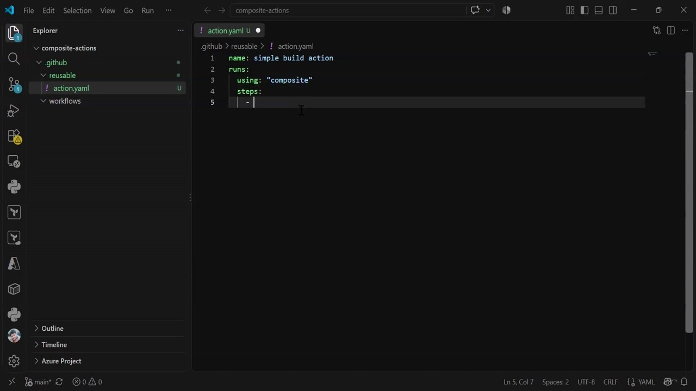
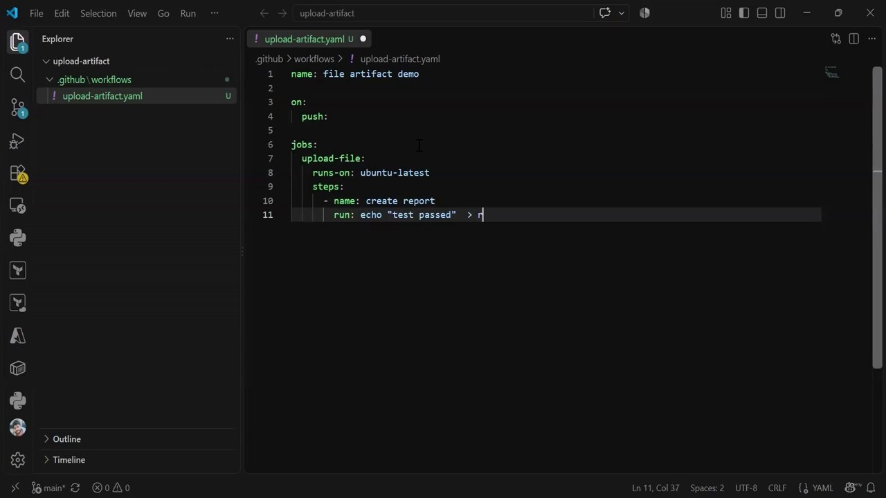
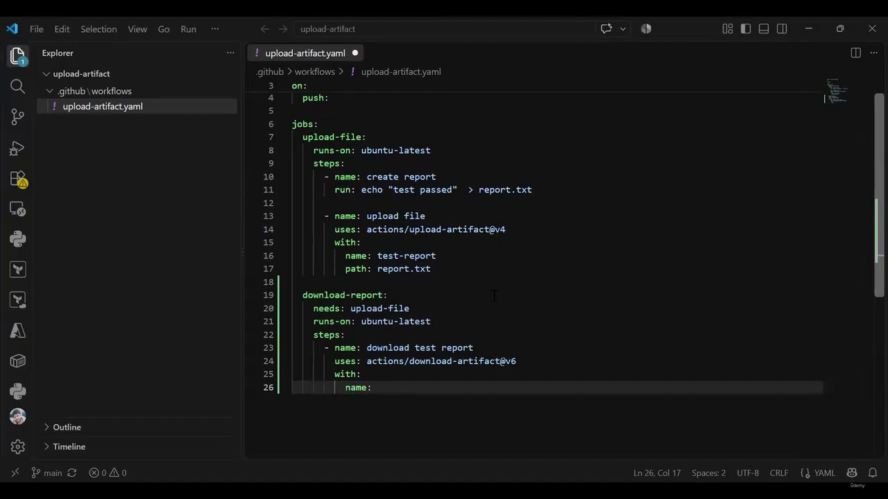
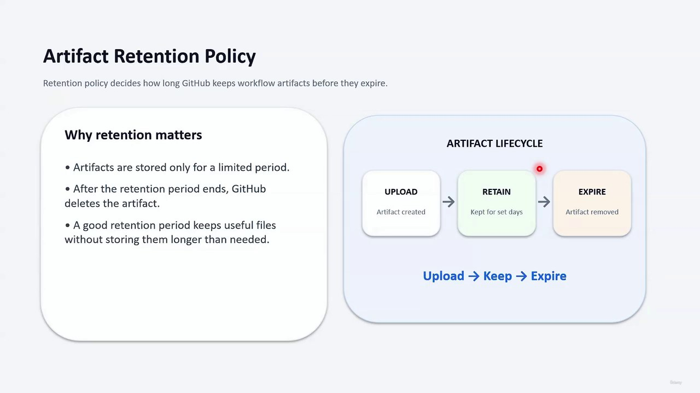
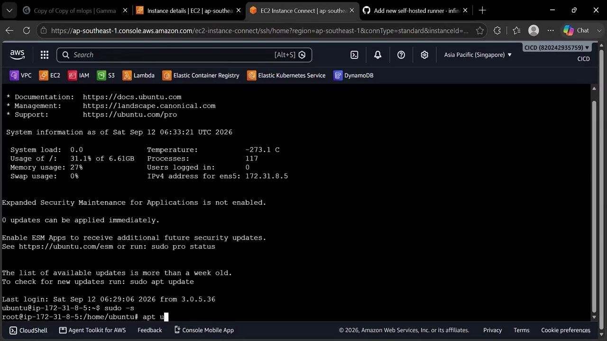
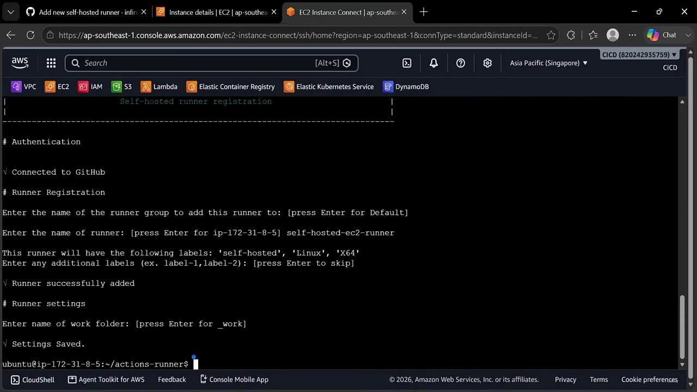
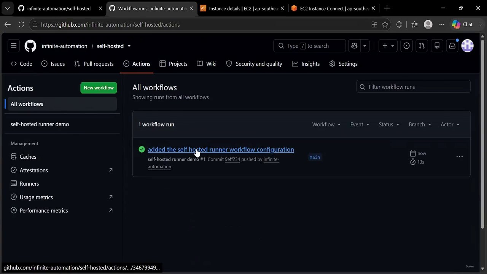
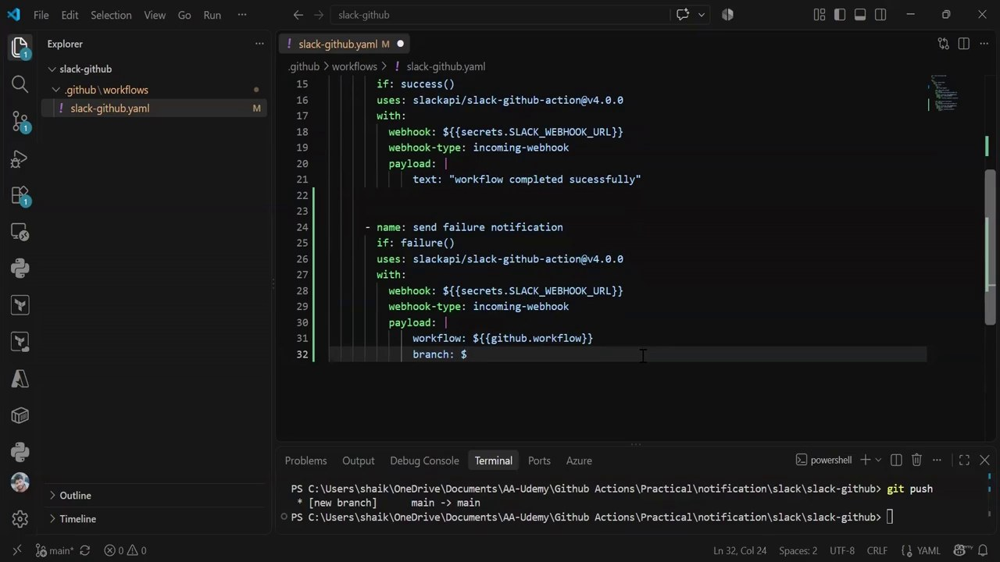
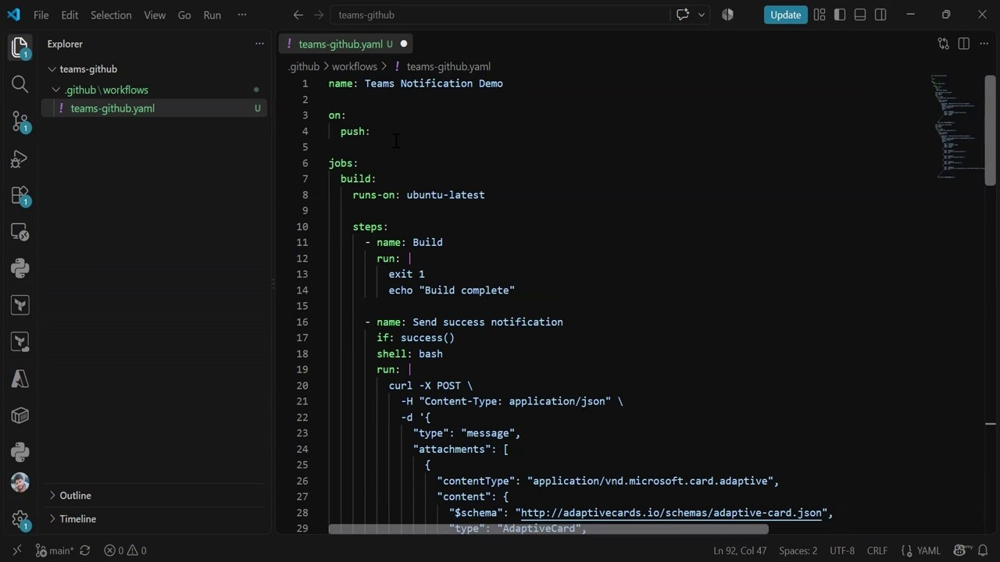

# GitHub Actions 实战：Composite Action、Artifacts、Self-hosted Runner、Slack / Teams 通知（P71–P86）

> 本文按“能照着跑起来”的标准组织。全部路径都相对**仓库根目录**；每个模块对应讲师新建的一个空仓库，你可以一个模块建一个仓库，也可以把 5 个 workflow 放进同一个仓库（文件名不同，不会冲突，但 self-hosted 那个 workflow 在没有 runner 时会一直排队，验证完建议先删掉或停用）。

---

## 1. 这一节做什么

P71–P86 并不是一条连续的大项目，而是**五个可以独立交付的小项目**，每个都能推到 GitHub 上跑出真实结果。把它们合起来，你得到一套“把 GitHub Actions 用到生产可用程度”的最小能力集：

| 线路 | 集数 | 你要做出来的东西 | 验证成功的标志 |
|---|---|---|---|
| A. 复合动作 | P71 | `.github/reusable/action.yml` + 调用它的 workflow | Actions 日志里出现 action.yml 中定义的两条命令输出 |
| B. 构建产物 | P72–P78 | 上传 artifact 的 job + 下载 artifact 的 job | 第二个 job 用 `cat` 打印出第一个 job 生成的内容；页面 Artifacts 区能下载 zip |
| C. 自托管 runner | P79–P81 | AWS EC2 上常驻的 runner + 指定 `runs-on: self-hosted` 的 workflow | Runners 页面显示 Idle；日志里 `hostname` 输出的是 EC2 私网 IP |
| D. Slack 通知 | P82–P84 | Slack App 的 Incoming Webhook + 成功/失败两条通知 | 成功跑一次，Slack 频道收到消息；故意 `exit 1` 后收到失败消息 |
| E. Teams 通知 | P85–P86 | Teams 频道 webhook + 自适应卡片通知 | 失败构建后 Teams 频道收到含工作流名、分支、状态、链接的卡片 |

前置条件：GitHub 账号、本地 `git`、VS Code；线路 C 需要 AWS 账号（讲师用的是 EC2，也说明 Azure / GCP / 自建机房都一样）；线路 D 需要 Slack 账号；线路 E 需要 **Microsoft 365 商业账号**（讲师在原话里明确说过个人账号部分功能不可用）。

对前端背景读者的类比：**job 之间默认是并行的，像 `Promise.all`；`needs` 就是 `await`**；artifact 相当于“把文件先扔到对象存储，下一个 job 再拉回来”；self-hosted runner 相当于把 CI 进程常驻在你自己的服务器上，思路和用 `pm2`/`systemd` 把 Node 进程常驻是一样的。

---

## 2. 讲师原话（关键判断都出自这里）

> "与其每次都编写相同的步骤，我们可以把这些步骤放进复合操作中，以便作为通用内容复用。"
> —— p071 [00:00]（复合动作的动机：把重复步骤抽出来复用）

> "对于复合操作，GitHub 要求文件命名为 action.yml。如果使用其他名称，GitHub 将无法识别。"
> —— p071 [02:21]（文件名必须是 `action.yml`，这条是硬约束）

> "我们可以把可复用的步骤放在 .github 目录中吗？答案是可以……但不应把它们放在 .github 和 workflows 目录中，因为 workflows 目录主要用于存放工作流文件。"
> —— p071 [00:56]–[01:25]（可以放 `.github` 下，但别塞进 `workflows`，要单独一个目录做区分）

> "在工作流运行期间，我们的作业可能会生成一些文件，例如构建文件、测试报告或日志。如果希望在作业完成后保留这些文件，我们可以把它们存储为制品。"
> —— p072 [00:00]（artifact 的定义：job 结束后还想留下的文件）

> "要上传制品，我们主要需要三项内容：uses、name 和 path。"
> —— p073 [00:00]–[00:28]（上传三要素）

> "这里我们不再使用 run，而是使用 uses。uses 表示我们要使用一个现有的 GitHub Actions，它由我们的 GitHub 组织、某个人或其他组织编写。"
> —— p074 [03:33]（`run` 跑命令，`uses` 调别人写好的 action）

> "这个作业依赖于我们之前创建的 upload report。通过 needs，它依赖于 upload file 作业。"
> —— p077 [00:27]（跨 job 用 artifact 必须先声明依赖）

> "默认情况下，GitHub 会将我们上传的制品保留 90 天。我们也可以在上传制品时设置保留期限……我把保留天数设为了 7。"
> —— p078 [00:00]–[00:29]（默认 90 天，可用 `retention-days` 改短）

> "如果你运行这个，这个命令会以命令行方式执行。但我们不想这样做。我们希望把服务器作为服务运行……如果你关闭命令行，这个特定进程、运行器就会停止，或者变为离线。所以这就是为什么我们希望在 Ubuntu 上把这个运行器作为服务运行。"
> —— p080 [05:33]–[07:00]（为什么用 `svc.sh` 而不是 `run.sh`）

> "到这里，我们已经成功添加了网络钩子类型和负载。但我们忘了添加文本。"
> —— p084 [15:41]–[16:10]（Slack payload 少了 `text` 就收不到消息，这是他在课里真实踩到的坑）

> "这里我们使用 if success，因此这一步只会在前一步成功时运行……然后还有另一个名为 send failure notification 的步骤，这里我们使用 if failure。"
> —— p086 [03:53]–[04:22]（成功/失败两条通知用 `if: success()` / `if: failure()` 分流）

> "对于这两种通知，我们都使用简单的 curl 命令，通过 HTTPS 向 Microsoft Teams 发起请求。在这个请求中，我们发送自适应卡片。"
> —— p086 [04:22]（Teams 侧是 curl + 自适应卡片）

---

## 3. 从零复现

### 阶段 0：本地准备

```bash
git --version     # 任意较新版本即可
```

每个模块的做法都一样：在 GitHub 上新建一个**空仓库**（不勾 README、不勾 .gitignore，保持空），然后本地 `git clone`。

```bash
git clone https://github.com/<你的用户名>/<仓库名>.git
cd <仓库名>
code .
```

讲师用的是这套流程（“it has been cloned into my local system with the commands... we are going to use Visual Studio Code as a code editor”—— p071 [00:29]）。如果你更喜欢本地先建目录，也可以 `git init` + `git remote add origin <url>`，效果等价。

### 阶段 1：线路 A —— Composite Action

最终目录：

```
composite-action/
└── .github/
    ├── reusable/
    │   └── action.yml          ← 复合动作本体
    └── workflows/
        └── composite-demo.yaml ← 调用方
```

1. 建目录：`.github/workflows` 和 `.github/reusable`。**注意顺序**：先建 `.github`，再在里面建 `workflows` 和 `reusable`，两者是平级的兄弟目录，不是 `workflows/reusable`。
2. 在 `.github/reusable` 下建 `action.yml`，写入第 4 节的文件 1。三个要点：顶层 `name`；`runs.using: composite`；所有 `run` 步骤**必须显式写 `shell`**（讲师每一步都写了 `shell: bash`）。
3. 在 `.github/workflows` 下建 `composite-demo.yaml`，写入第 4 节的文件 2。注意第一个 step 必须是 `actions/checkout@v4`——本地 action 是把仓库里的文件当作 action 来用，不 checkout 就没有这些文件。
4. 提交推送：

```bash
git add .
git commit -m "added the composite action workflows"
git push
```

5. 打开仓库 → Actions 标签 → 点进 `Composite Action Demo` 的运行 → 展开 `build` job。你会看到 3 个 step：`Checkout code`、`Composite reusable step`（它内部再展开成 `Show message` 和 `Check files` 两步）。



### 阶段 2：线路 B —— Artifacts（上传 + 下载 + 保留期）

最终目录：

```
upload-artifact/
└── .github/
    └── workflows/
        └── upload-artifact.yaml   ← 两个 job：upload-file / download-report
```

1. 建 `.github/workflows/upload-artifact.yaml`，先只写 `upload-file` 这一个 job（对应 P74）：一个 `run` 步骤生成 `report.txt`，一个 `uses: actions/upload-artifact@v4` 步骤把它传上去。
2. 推送后打开 Actions，展开 `upload-file` job。页面底部（或运行详情页的 Artifacts 区）会出现 `test-report`，可以点下载（对应 P76 的“下载到本地”验证：下载下来是 zip，解压得到 `report.txt`，内容就是 `test passed`）。
3. 再往同一个文件里加第二个 job `download-report`，用 `needs: upload-file` 声明依赖，第一步 `uses: actions/download-artifact@v6` 并带上 `name: test-report`，第二步 `cat report.txt` 把内容打到日志里（对应 P77）。
4. 若想验证保留期，给上传步骤加 `retention-days: 7`，然后重新跑一次（对应 P78）。







### 阶段 3：线路 C —— AWS EC2 上的 self-hosted runner

**3.1 开机器（P79）**：AWS 控制台 → EC2 → Launch instance。

- Name：`GitHub Actions Runner`
- 操作系统：Ubuntu（讲师口述为“O1 too”，具体版本号以控制台实际选项为准）
- 实例类型：`t3.micro`（讲师明确说 demo 够用）
- Key pair：`Create new key pair`，命名 `self-hosted-key`，创建后 `.pem` 会下载到本地
- 网络设置：新建安全组，允许 SSH、HTTP、HTTPS
- 实例数量：1 → Launch

**3.2 把机器变成 runner（P80）**：EC2 实例页 → 选中实例 → Connect（讲师走的是 AWS 控制台里那个浏览器终端入口）→ 进入终端。

```bash
sudo su -          # 切 root（讲师说 "switch it as a root user"）
apt update         # 先更新系统
exit               # 再切回普通用户（讲师说 "switch as a normal user by entering the exit command"）
```

然后去 GitHub 仓库 → Settings → Actions → Runners → `New self-hosted runner` → 选 **Linux / x64**。页面会给出四条命令，**按顺序一条一条复制到终端执行**：

1. `mkdir actions-runner && cd actions-runner`
2. 一条 `curl -o actions-runner-linux-x64-<版本>.tar.gz -L https://github.com/actions/runner/releases/download/v<版本>/...`（下载包）
3. 一条 `sha256sum` 校验（讲师说 “Now let's do checksum. Yes, it's OK.”）
4. `tar xzf ...`（解压，“If I do ls, I can see all the packages related to OverRunner”）

> 这几条命令的具体版本号、URL、校验值都由页面实时生成，逐字稿里没有念出来（只提到 runner 版本是 `2.337.0`），所以请**原样复制页面上的那四条**，不要手抄我这里的示意。

接下来跑配置（讲师在 P80 [04:37] 说 “config.sh — it is authenticating first”）：

```bash
./config.sh
```

交互项按讲师的选择填：

- 认证：页面给的 `config.sh` 命令里已带一次性凭据，回车通过
- runner name：`self-hosted-EC2-runner`（讲师在几个叫法之间犹豫后定的是这个名字）
- runner group：直接回车用 `default`
- labels：直接回车跳过（不额外加标签）
- work folder：直接回车用默认

看到 “Settings has been saved” 即配置完成。此时可以用 `./run.sh` 临时跑起来，但**不要这么做**，原因见讲师原话那一段——关掉终端 runner 就掉线。所以改用服务方式（需要 root）：

```bash
sudo su -
./svc.sh install
./svc.sh start
exit
```

回到 GitHub → Settings → Actions → Runners，状态应为 **Idle**，并带 `self-hosted` 等默认标签。

**3.3 跑一个 workflow（P81）**：新建仓库（讲师叫 `selfhosted`），建 `.github/workflows/selfhosted.yaml`，写入第 4 节的文件 4，推送。日志里这三行必须都对得上：`hello from self-hosted runner`、`hostname` 输出的私网 IP（与 EC2 实例页的 Private IP 一致）、`whoami` 输出 `ubuntu`。







### 阶段 4：线路 D —— Slack 通知

**4.1 Slack 侧（P83）**：登录 Slack → 建 workspace（讲师建了一个叫 `integration` 的）→ 建频道 `workflow-notification`（公开即可）→ 打开 Slack API 网站 → `Create an app` → `From scratch` → app 名 `workflow-notification-app`，workspace 选 `integration` → 左侧 **Incoming Webhooks** → 开关置为 **On** → 页面底部 `Add New Webhook to Workspace` → 频道选 `workflow-notification` → `Allow` → 拿到一条 webhook URL。

**4.2 GitHub 侧（P84）**：仓库 → Settings → Secrets and variables → Actions → `New repository secret`：

- Name：`SLACK_WEBHOOK_URL`
- Secret：粘贴上一步的 URL

**4.3 workflow**：建 `.github/workflows/slack-github.yaml`（第 4 节文件 5），推送。先跑成功的版本，确认 Slack 频道收到 “Workflow completed successfully”。然后把 `Build` 步骤改成 `run: exit 1`，再推一次，确认收到失败消息（含工作流名、分支、状态、链接），同时 `Send success message` 显示 **skipped**。



### 阶段 5：线路 E —— Teams 通知

**5.1 Teams 侧（P85）**：用 Microsoft 365 商业账号登录 Teams → `see all your Teams` → 建团队 `GitHub Actions notifications`、频道 `workflow status` → 左侧 `+` → Apps → **Workflows** → 齿轮图标进入 `Manage workflows` → `Create workflow` → 选模板 **“Send webhook alerts to channel”** → 填团队名和频道名 → Save → 复制生成的 webhook URL。

**5.2 GitHub 侧（P86）**：新建仓库，Settings → Secrets and variables → Actions → `New repository secret`，Name `TEAMS_WEBHOOK_URL`，值粘贴上一步 URL。

**5.3 workflow**：建 `.github/workflows/teams-github.yaml`（第 4 节文件 6），推送。因为里面写的是 `exit 1`，构建必失败；展开日志应看到 `Build` 失败、`Send success notification` 被跳过、`Send failure notification` 执行；Teams 频道收到卡片，点卡片里的链接能跳回这次失败的运行。



---

## 4. 完整代码

### 文件 1：`.github/reusable/action.yml`

```yaml
name: Simple Build Action

runs:
  using: composite
  steps:
    - name: Show message
      shell: bash
      run: echo "Starting the build"

    - name: Check files
      shell: bash
      run: ls
```

### 文件 2：`.github/workflows/composite-demo.yaml`

```yaml
name: Composite Action Demo

on:
  push:

jobs:
  build:
    runs-on: ubuntu-latest
    steps:
      - name: Checkout code
        uses: actions/checkout@v4

      - name: Composite reusable step
        uses: ./.github/reusable
```

### 文件 3：`.github/workflows/upload-artifact.yaml`

```yaml
name: Upload Demo

on:
  push:

jobs:
  upload-file:
    runs-on: ubuntu-latest
    steps:
      - name: Create report
        shell: bash
        run: echo "test passed" > report.txt

      - name: Upload file
        uses: actions/upload-artifact@v4
        with:
          name: test-report
          path: report.txt
          retention-days: 7

  download-report:
    needs: upload-file
    runs-on: ubuntu-latest
    steps:
      - name: Download test report
        uses: actions/download-artifact@v6
        with:
          name: test-report

      - name: Read report
        shell: bash
        run: cat report.txt
```

### 文件 4：`.github/workflows/selfhosted.yaml`

```yaml
name: Self Hosted Runner Demo

on:
  push:

jobs:
  test-runner:
    runs-on: self-hosted
    steps:
      - name: Test self hosted runner
        run: |
          echo "hello from self-hosted runner"
          hostname
          whoami
```

### 文件 5：`.github/workflows/slack-github.yaml`

```yaml
name: Slack Notification

on:
  push:

jobs:
  build:
    runs-on: ubuntu-latest
    steps:
      - name: Build
        run: echo "build complete"

      - name: Send success message
        if: success()
        uses: slackapi/slack-github-action@v4.0.0
        with:
          webhook: ${{ secrets.SLACK_WEBHOOK_URL }}
          webhook-type: incoming-webhook
          payload: |
            text: "Workflow completed successfully"

      - name: Send failure notification
        if: failure()
        uses: slackapi/slack-github-action@v4.0.0
        with:
          webhook: ${{ secrets.SLACK_WEBHOOK_URL }}
          webhook-type: incoming-webhook
          payload: |
            text: |
              Workflow: ${{ github.workflow }}
              Branch: ${{ github.ref_name }}
              Status: ${{ job.status }}
              URL: ${{ github.server_url }}/${{ github.repository }}/actions/runs/${{ github.run_id }}
```

> 讲师在课里是直接把一条运行 URL **硬编码**粘贴进 payload 的（P84 [13:17] “I'll copy workflow URL that have already copied somewhere”）。上面最后一行用等价的表达式拼出同样的地址（他说这条 URL 的构成就是 “server URL with the GitHub repository with the actions runs with the run ID”），这样每次运行都自动指向自己的运行页。

### 文件 6：`.github/workflows/teams-github.yaml`

```yaml
name: Teams Notification Demo

on:
  push:

jobs:
  build:
    runs-on: ubuntu-latest
    steps:
      - name: Build
        run: exit 1

      - name: Send success notification
        if: success()
        env:
          TEAMS_WEBHOOK_URL: ${{ secrets.TEAMS_WEBHOOK_URL }}
        run: |
          curl -sS -X POST "$TEAMS_WEBHOOK_URL" \
            -H "Content-Type: application/json" \
            -d '{
              "type": "message",
              "attachments": [
                {
                  "contentType": "application/vnd.microsoft.card.adaptive",
                  "content": {
                    "type": "AdaptiveCard",
                    "version": "1.4",
                    "body": [
                      {
                        "type": "TextBlock",
                        "text": "GitHub Actions workflow completed successfully",
                        "wrap": true
                      }
                    ]
                  }
                }
              ]
            }'

      - name: Send failure notification
        if: failure()
        env:
          TEAMS_WEBHOOK_URL: ${{ secrets.TEAMS_WEBHOOK_URL }}
        run: |
          curl -sS -X POST "$TEAMS_WEBHOOK_URL" \
            -H "Content-Type: application/json" \
            -d '{
              "type": "message",
              "attachments": [
                {
                  "contentType": "application/vnd.microsoft.card.adaptive",
                  "content": {
                    "type": "AdaptiveCard",
                    "version": "1.4",
                    "body": [
                      { "type": "TextBlock", "text": "Workflow: ${{ github.workflow }}", "wrap": true },
                      { "type": "TextBlock", "text": "Branch: ${{ github.ref_name }}", "wrap": true },
                      { "type": "TextBlock", "text": "Status: ${{ job.status }}", "wrap": true },
                      { "type": "TextBlock", "text": "URL: ${{ github.server_url }}/${{ github.repository }}/actions/runs/${{ github.run_id }}", "wrap": true }
                    ]
                  }
                }
              ]
            }'
```

> 说明：讲师在 P86 是**复制粘贴一份提前准备好的 workflow**（“I simply copy and paste the workflow... we can spend more time for understanding of this workflow instead of writing it by bare hands”—— p086 [02:55]），逐字稿只讲了三件事：`curl` 发 HTTPS 请求、内容是 adaptive card、webhook URL 来自 secrets。上面这段就是按这三件事还原的完整可运行版本；`type` / `attachments` / `contentType` / `AdaptiveCard` 这些 JSON 字段名**课里没有逐字念出来**，请以 Teams 返回的实际报错和官方 Adaptive Card 结构为准。

---

## 5. 逐行解释

### 文件 1：action.yml

- `name: Simple Build Action` —— 这就是讲师说的 “let's name our workflow as a simple build action”。它是这个复合动作在 Actions 日志里的显示名，和 workflow 的 `name` 不是一回事。
- `runs:` —— 固定入口。`uses:` 调用一个 action 时，GitHub 只读 `runs` 下面的内容。
- `using: composite` —— 讲师原话 “this tells GitHub that this is a composite action”。换成 `node20` / `docker` 就是另外两种动作类型，课里没讲。
- `steps:` —— 这里放的就是“要复用的那些 step”，语法和你平时写的 workflow steps **完全一致**。
- `shell: bash` —— 复合动作里**每个** `run` 步骤都必须显式声明 shell，因为复合动作没有“默认 shell”可继承。少了这一行，运行时会直接报错。
- `run: echo "Starting the build"` / `run: ls` —— 讲师选的两条演示命令，日志里分别输出 `Starting the build` 和仓库根目录的文件列表。

### 文件 2：composite-demo.yaml

- `on: push` —— 推代码即触发，方便反复验证。
- `runs-on: ubuntu-latest` —— 讲师原话 “which is GitHub Hosted Runner”，和线路 C 的自托管 runner 形成对照。
- `- name: Checkout code` + `uses: actions/checkout@v4` —— 讲师原话 “this makes repository files available on the runner”。这一步是复合动作能跑的前提：`./.github/reusable` 是仓库里的**
是仓库里的文件，只有先 `actions/checkout` 把它拉到 runner 上，这个目录才存在。省掉 checkout 那一步，`uses: ./.github/reusable` 会直接失败（具体报错文本以你实际运行输出为准，课里没展示失败日志）。

- `uses: ./.github/reusable` —— 讲师原话 “Here, we need to specify the path of our composite action. .github and directory is reusable”。两个细节：①必须以 `./` 开头，GitHub 才认它是“本地路径”而不是 `owner/repo` 形式的远程 action；②**路径写到目录为止**，不要写成 `./.github/reusable/action.yml`。GitHub 拿到目录后会自己在里面找名为 `action.yml` 的文件——这正好回答了“为什么文件名不能改”：不是命名习惯问题，是查找规则问题。
- 这条 `uses` 出现的 step 名（`Composite reusable step`）在日志里会显示成**一个可展开的父节点**，展开后才是 action.yml 里的 `Show message` 和 `Check files`。讲师在 P71 [08:36] 演示的就是这个层级结构。

### 文件 3：upload-artifact.yaml

- `jobs:` 下面挂了**两个 job**：`upload-file` 和 `download-report`。这是本线路的核心结构——artifact 的意义就在于跨 job 传递文件，同一个 job 内部传文件用不着它。
- `- name: Create report` + `run: echo "test passed" > report.txt` —— 讲师原话 “once this command runs, a new file called report.txt will created in the renderer”。`>` 是重定向，把标准输出写进文件而不是打在日志上。这一步产出的文件**只存在于 runner 的临时磁盘上**，job 一结束就随机器销毁，这正是需要 artifact 的原因（P74 [06:56] 他说得很直白：“currently this file is not available on GitHub”）。
- `uses: actions/upload-artifact@v4` —— 讲师原话 “instead of using run we are going to use uses... this action handles the work of uploading our files as artifact”。`run` 是执行命令，`uses` 是调用一个已经写好的 action，这个区分是 P74 [03:33] 专门强调的。
- `with:` 下面的三个键就是 P73 讲的“上传三要素”落地：`name` / `path` 加上外层已经有的 `uses`。
- `name: test-report` —— artifact 的名字。**这个名字是后续下载的唯一凭据**，第二个 job 必须写一模一样的字符串。讲师在 P77 [02:22] 特意回头核对过：“the name of the artifact is TestReport as you can see line number 16”。
- `path: report.txt` —— 相对仓库根目录（也就是 runner 的工作目录）的路径。P73 讲了三种形态，这里是第一种：**单个文件直接给文件路径**；第二种是多个文件用管道符 `|` 分行列（课里给的例子是把 build log 和 test report 合成一个 `build results` artifact）；第三种是直接给目录名（课里给的例子是 `dist`），GitHub 会把这个目录下的内容整体上传。这三种写法选哪种，取决于你的产物是几个文件还是一整个构建目录。
- `retention-days: 7` —— P78 的内容。不写就是默认 90 天。讲师原话 “After retention period, GitHub will remove the artifacts automatically”，到期是**自动清理**，不是提醒你清理。
- `needs: upload-file` —— 讲师原话 “This job depends on upload report that we have created earlier. With the needs, it depends on upload file job”。没有 `needs`，两个 job 会**并行**跑，下载 job 有可能在 artifact 还不存在时就开始，直接报找不到。这条依赖关系是 artifact 跨 job 传递的硬前提。
- `uses: actions/download-artifact@v6` —— 注意版本号：上传用 v4，下载用 v6。这是讲师在课里实际用的组合（P74 用 `@v4`，P77 用 `@v6`），不要凭印象统一成一个版本。
- 下载时的 `with: name: test-report` —— 只给名字就够了。P75 讲的下载逻辑就是“给名字，GitHub 找到并下载”。下载后的落点：课里没说 `path` 参数，所以他默认落在了工作目录，下一步才能直接 `cat report.txt`。如果你指定了别的 `path`，`cat` 的路径要跟着改。
- `run: cat report.txt` —— 讲师原话 “we are using cat command to display the content of the report.txt on a log level of a workflow”。这是验证手段：日志里打印出 `test passed`，就证明文件确实从上一个 job 完整传过来了。

### 文件 4：selfhosted.yaml

- `runs-on: self-hosted` —— 整个文件最关键的一行。它的取值是 runner 的**标签**，不是 runner 的**名字**。讲师在 P81 [01:52] 专门解释了这一点：“since we just gave a runner name, not the runner tag, while we're configuring the runner. So that's why we are using the tag as a default, which was given by GitHub”。`self-hosted` 是 GitHub 给每个自托管 runner 自动打的默认标签，所以这里能匹配上；你自己在 `config.sh` 里加的 label 是额外的匹配维度。
- `run: |` 多行脚本 —— 三条命令写在同一个 step 里，日志里会作为一段连续输出。讲师原话 “we are using a run keyword to execute multi shell”。
- `echo "hello from self-hosted runner"` —— 只为在日志里留个记号，证明这段输出确实来自这台机器。
- `hostname` —— 验证点的核心。它输出的应该是 EC2 实例的**私网 IP**。讲师在 P81 [05:39] 就是拿这个去和实例页的 private IP 逐位对照的：“Let's copy this IP address ... which is matching with this private IP address”。
- `whoami` —— 输出 `ubuntu`，说明 runner 是以默认用户身份跑的，不是 root。这一条对排查权限问题有用：如果脚本里要 `sudo`，得先确认这个用户在 sudoers 里。
- 这个文件**没有 checkout 步骤**，因为三步命令都不需要仓库文件。这是和文件 2 的一个有意对照：`uses: ./.github/...` 才需要 checkout，纯 `run` 不需要。

### 文件 5：slack-github.yaml

- `if: success()` —— 讲师原话 “if success means, this step will only runs if the previous step are successful”。注意 `success()` 判断的是**之前所有 step** 的结果，不只是紧邻那一个。
- `if: failure()` —— 对应地，只要有前面的 step 失败就触发。这两个条件让同一份 workflow 里成功和失败两条通知互斥：一次运行里必然一条执行、一条 skipped。P84 [14:42] 的日志正是这个形态：“send success message has been skipped, but our send failure notification step has been executed”。
- `uses: slackapi/slack-github-action@v4.0.0` —— 讲师原话 “This is the reasonable action we are going to use”（口播里“reasonable”应是“reusable”的口误），指的是复用别人写好的 action。
- `webhook: ${{ secrets.SLACK_WEBHOOK_URL }}` —— 对应 P82 反复强调的那条：URL 是敏感信息，**不进 YAML**，放 Secrets 里，workflow 只引用名字。讲师在 P84 [01:52] 存 secret 时也复述了理由：“we don't want to expose this information into the YAML file”。
- `webhook-type: incoming-webhook` —— 声明 webhook 的类型。P82/P83 选的接入方式就是 Incoming Webhook，所以这里要写它。
- `payload:` 里的 `text:` —— **这是他课里踩的坑，务必别照抄错**。第一次跑完 Slack 频道没消息，他回头查 YAML 才发现 “we forgot to add a text”，然后改成把内容放到 `text` 字段下才收到（P84 [15:41]–[16:39]）。结论：Slack 这条 payload 必须有 `text`，没有它消息不会显示。
- `${{ github.workflow }}` / `${{ github.ref_name }}` / `${{ job.status }}` —— 讲师逐个念出来的三个上下文变量（P84 [12:23]–[13:17]）：工作流名、分支名、job 状态。`job.status` 在失败步骤里求值就是 `failure`。
- 最后那行 URL 的拼法 —— 讲师是手工粘了一条固定的运行链接进去的，并解释说这条链接的构成是 “server URL with the GitHub repository with the actions runs with the run ID”。上面代码用四个上下文变量拼出同样结构，好处是每次运行都指向自己。**这四个变量名在课里没有逐个念出来**，如果你要严格复刻课里的效果，可以直接把一条真实的运行 URL 字符串写死在 `text` 里。

### 文件 6：teams-github.yaml

- `run: exit 1` —— 讲师原话 “we are intentionally failing this build step that's why we added exit one”。非零退出码在 Actions 里就等于 step 失败，后面的 `if: failure()` 才会触发。这是整条线路的测试开关：验证成功通知时把这一行改回 `echo`，验证失败通知时保持 `exit 1`。
- `if: success()` / `if: failure()` —— 和 Slack 那份完全同构。讲师说得很清楚：“The success notification step has been skipped because this send success notification step only runs if this build got success... But our failure notification step is executed because we configured if a failure”（P86 [06:50]）。
- `env: TEAMS_WEBHOOK_URL: ${{ secrets.TEAMS_WEBHOOK_URL }}` —— 讲师在 P86 [05:21] 只说了一句 “At finally bottom we are using a Teams Webhook URL as a secret”，没有讲他是把 secret 直接内联进 curl 命令还是先转成环境变量。上面代码用 `env` 转一次，好处是 secret 不会出现在日志的命令行回显里。**这个注入方式课里没讲**，属于按最小暴露原则做的实现选择。
- `curl -sS -X POST "$TEAMS_WEBHOOK_URL"` —— 讲师原话 “we are using simple call command with the HTTPS requesting into Microsoft Teams”。`-X POST` 显式指定方法；`-sS` 是静默但保留错误输出，失败时能看见原因，不会静默成功。
- `-H "Content-Type: application/json"` —— 告诉 Teams 请求体是 JSON。
- `-d '{...}'` 的整个结构 —— 讲师原话 “Inside this request, we are sending adaptive code. So this is basically a message format that controls what information we want to display into our teams”。他把它称为“自适应卡片”，指的是消息里带一个卡片对象，由 Teams 渲染成格式化内容，而不是一行纯文本。
- 失败卡片里的四条 `TextBlock` —— 对应讲师说的 “workflow name and the branch and the job status and the workflow URL”（P86 [04:52]）。这四项就是他在 Teams 里实际看到的卡片内容（P86 [07:47] 逐项核对过）。
- `wrap: true` —— 让长文本（尤其那条 URL）自动换行，不横向溢出。**这个字段课里没提**，属于渲染细节。
- 单引号包住整个 `-d` 内容 —— 因为 JSON 里有双引号。这样做的代价是：`${{ }}` 表达式会在**发送前**被 GitHub 替换成实际值，所以引号里出现分支名带特殊字符时不会破坏 JSON；但如果你手工在 JSON 里写死一个含单引号的值，就会把 shell 引号截断。

---

## 6. 复现检查清单

按线路逐条打勾。每条都给出「看哪里、看到什么、不对怎么查」。

### 线路 A：Composite Action

- [ ] 目录是 `.github/reusable/action.yml` 和 `.github/workflows/composite-demo.yaml`，**两者是兄弟目录**。跑到 `ls .github` 应看到 `reusable  workflows`。若出现 `.github/workflows/reusable`，说明建目录时点错了层级，`uses` 路径也要跟着改。
- [ ] `action.yml` 顶层有 `name`，有 `runs.using: composite`，`steps` 里**每个** `run` 都带 `shell: bash`。
- [ ] workflow 第一个 step 是 `actions/checkout@v4`。
- [ ] `uses: ./.github/reusable` 以 `./` 开头、结尾是目录名、不带 `action.yml`。
- [ ] Actions 页面出现名为 `Composite Action Demo` 的运行，job 名 `build`。
- [ ] 展开 job：先 `Checkout code`，再 `Composite reusable step`；后者可展开成 `Show message` 和 `Check files` 两个子节点。
- [ ] 日志里同时出现 `Starting the build` 和一份文件清单（`ls` 的输出）。
- [ ] 反例验证（可选）：把 `checkout` 那一步注释掉再推一次，观察 `uses` 那步报错。这条能确认你对“为什么要 checkout”的理解是对的。

### 线路 B：Artifacts

- [ ] `upload-file` job 的 `Create report` 步骤成功；日志里能看到 `echo` 写入的动作。
- [ ] `Upload file` 步骤成功，日志中出现 artifact 上传成功的提示和一条下载 URL。讲师在 P74 [07:24] 说这条日志会写明 artifact 名并给出 ID 与下载地址——**具体字段名请以你页面上的实际输出为准**，课里只口述了“artifact is ... successfully finalized”这类信息，没有逐个念字段。
- [ ] 运行详情页的 Artifacts 区出现 `test-report`，可下载。下载下来是 **zip**（讲师在 P76 [00:28] 说 “this has been downloaded as a testreport.gip”，是 zip 的口误），解压得到 `report.txt`。
- [ ] `report.txt` 的内容是 `test passed`（P76 [00:56] 逐字核对过）。
- [ ] `download-report` job 的 `Download test report` 步骤成功，日志里有下载完成的提示。
- [ ] `Read report` 步骤的日志里打印出 `test passed`。
- [ ] 两个 job 在图上是**先后顺序**（因为 `needs`），不是左右并排。
- [ ] 若加了 `retention-days: 7`，重新跑一次，Artifacts 区里对应条目应显示保留期信息（页面上的具体措辞与实际展示为准）。
- [ ] 失败排查：下载那步报“找不到 artifact”，先查 `needs` 有没有写、`name` 两个地方是否完全一致（大小写、连字符）。

### 线路 C：Self-hosted Runner

- [ ] EC2 实例状态 `Running`，记住它的 **Private IP** 和 **Public IP**。
- [ ] GitHub → Settings → Actions → Runners 里有一条 runner，状态 `Idle`，标签包含 `self-hosted`，名字是你在 `config.sh` 里填的那个（讲师填的是 `self-hosted-EC2-runner`）。
- [ ] EC2 终端里 `./svc.sh install` 和 `./svc.sh start` 都成功；`sudo systemctl status` 类的查看方式课里没演示，若要看服务状态请以 `svc.sh` 的实际帮助输出为准。
- [ ] 推送 `selfhosted.yaml` 后，运行页面里 job 的 “Runner” 信息显示的是你这条自托管 runner 的名字，而不是 `ubuntu-latest`。讲师在 P81 [05:10] 就是靠这一行确认的（他还注意到 runner 版本 `2.337.0`）。
- [ ] 日志里 `hostname` 的输出等于 EC2 的 Private IP。
- [ ] 日志里 `whoami` 输出 `ubuntu`。
- [ ] 反例验证（可选）：在 Runners 页面把这条 runner 删掉或停掉服务，再推一次，workflow 应该一直停在 “Waiting for a runner” 而不是失败。这能确认 `runs-on: self-hosted` 确实指向了你的机器。
- [ ] 安全提醒：这台机器现在能执行你仓库里的任意 workflow 代码，验证完建议先 `svc.sh stop` 或直接停实例，别长期挂在公网上。

### 线路 D：Slack

- [ ] Slack 侧：workspace、频道 `workflow-notification`、App 的 Incoming Webhooks 开关为 **On**、webhook 指向该频道。
- [ ] GitHub 侧：Settings → Secrets and variables → Actions 里有 `SLACK_WEBHOOK_URL`，类型是 repository secret。**注意名字要和 YAML 里的完全一致**，讲师存的时候是 `slack_webhook_url`（口播里的下划线），而 YAML 引用写的是大写形式，两者必须逐字符对得上。
- [ ] 成功路径：`Build` 成功 → `Send success message` 执行 → `Send failure notification` 显示 **skipped** → Slack 频道出现 “Workflow completed successfully”。
- [ ] 失败路径：把 `Build` 改成 `run: exit 1` → `Build` 失败 → `Send success message` **skipped** → `Send failure notification` 执行。
- [ ] 失败消息里能看到工作流名、分支 `main`、状态 `failure` 和一条可点击的链接；点链接能跳回这次失败的运行。
- [ ] 关键坑确认：payload 里**必须有 `text` 键**。如果 Slack 频道静默无消息但 step 显示成功，第一个怀疑对象就是少了 `text`（讲师原样踩过）。
- [ ] 若 step 直接失败，看日志里的 HTTP 状态和响应体。webhook URL 失效（比如 App 被删、频道被删、webhook 被撤销）会表现为请求被拒；课里没演示这类错误的处理。

### 线路 E：Teams

- [ ] 用的是 **Microsoft 365 商业账号**，不是个人账号（讲师在 P85 [01:55] 明确提醒过个人账号部分功能不可用）。
- [ ] Teams 里能看到团队 `GitHub Actions notifications` 和频道 `workflow status`。
- [ ] Workflows 里存在那条 “Send webhook alerts to channel” 工作流，且能复制出 webhook URL。
- [ ] GitHub 侧 secret `TEAMS_WEBHOOK_URL` 已存。
- [ ] 推送后运行：`Build` 失败（这是预期的，因为写了 `exit 1`）、`Send success notification` skipped、`Send failure notification` 执行。
- [ ] Teams 频道收到卡片，四行内容分别是工作流名、分支、状态、URL；点 URL 能跳到那次失败的运行。
- [ ] 成功路径验证（可选）：把 `exit 1` 换成 `echo` 再推一次，应收到成功卡片、失败卡片 skipped。
- [ ] 若 Teams 没收到但 step 成功，先看 curl 有没有输出错误体：webhook 被停用、工作流被删、频道改名都会导致投递失败。**课里没讲怎么排查投递失败**，只能靠 curl 的响应。

---

## 7. 课里没讲但你会撞上的

以下都是照着做时大概率会遇到、但逐字稿里**没有涉及**的问题。它们不是讲师的观点，是我按实际使用补的，属于「知道会疼，先留个心眼」。

**7.1 复合动作里用不了 `secrets` 上下文。**
文件 1 那种复合动作，它的 `steps` 里不能直接读 `${{ secrets.X }}`（这是 GitHub 对复合动作的限制）。如果你把“带凭据的步骤”抽进复合动作，就会卡住。绕法是把 secret 作为 action 的 `inputs` 传进去。**课里的复合动作只有 `echo` 和 `ls`，完全不涉及凭据，所以讲师没碰到这个问题，也没提 inputs。** 这是前端同学最容易踩的一个：抽公共步骤时顺手把带 token 的请求也抽进去了。

**7.2 artifact 同名并发会冲突。**
`upload-artifact@v4` 之后，同一个 workflow run 里重复上传**同名** artifact 会报错。线路 B 只有一个上传者所以没事；一旦你把线路 B 的 `test-report` 复制到另一个 job 里也传一份，就会撞。按前端类比：两个 `Promise` 同时往同一个对象存储 key 写，后到的要么覆盖要么失败。要么用不同名字，要么加矩阵变量的后缀。

**7.3 `download-artifact` 不带 `name` 会下载全部。**
课里一直显式给 `name`，所以你没机会看到“不给 name”的行为：它会把本次运行产生的所有 artifact 都拉下来（各自进子目录）。这在多 artifact 的仓库里会悄悄改变目录结构，导致后面 `cat report.txt` 路径对不上。

**7.4 前端视角：job 之间没有共享内存。**
job 默认并行（等价 `Promise.all`），`needs` 等价 `await`，但**它们不共享文件系统**——每个 job 一台干净机器。这是 artifact 存在的根本原因，也是新手最常见的误解：“我在 job A 里创建了文件，job B 为什么读不到”。课里 P74 [06:56] 那句话其实已经点到了（文件只在 runner 上），但没有明说“每个 job 是独立机器”。

**7.5 自托管 runner 上的并发与资源。**
一条 runner 默认一次只跑一个 job，其余排队。如果你的 workflow 里两个 job 都用 `runs-on: self-hosted`，它们会**串行**，不是并行。课里线路 C 只有一个 job，所以看不到这个现象。在 JS 世界里这相当于一个 concurrency=1 的任务队列。另外 t3.micro 只有 2 vCPU / 1 GiB（具体规格以 AWS 控制台为准），跑构建容易 OOM——**课里没提任何资源限制话题**。

**7.6 自托管 runner 的安全边界。**
这台机器会执行你仓库里的 workflow 代码。如果仓库接受外部 PR，且你对 fork PR 的 workflow 也放行到 self-hosted，那就是让别人在你的 EC2 上跑任意命令。**课里完全没讲这块**，讲师也明确说过他这套 EC2 配置不是生产架构（P79 [01:23] “Please don't take this EC2 configuration as a production architecture level”）。生产上通常的做法是私有子网 + 最小安全组 + 只在受信分支上跑。

**7.7 `svc.sh` 装的是什么，课里没说清。**
它把 runner 注册成一个系统服务，所以实例重启后 runner 会自己起来。讲师只讲了“装成服务就不会因为关终端而掉线”这个理由（P80 [05:55] 一带）。如果重启后发现 Runners 页面显示离线，去机器上查服务状态——具体的服务名、日志路径**课里没有提**，请以 `./svc.sh` 自己的帮助输出为准。

**7.8 实例停机后 runner 会一直“排队”。**
线路 C 验证完把 EC2 停了，但 workflow 里还写着 `runs-on: self-hosted`，之后的推送会一直挂起等 runner。这不是 bug，是依赖关系没解除。处理方式：删掉/停用那个 workflow 文件，或者在 Runners 页面把 runner 移除。**课里没有讲停机后的收尾**。

**7.9 Slack / Teams 的 webhook URL 泄露就等于给了发消息的权限。**
讲师反复强调它是敏感信息（P82、P84、P85 各说了一次），但没说**泄露后怎么办**：只能在 Slack App 后台撤销/重建 webhook，然后更新 secret。URL 里本身就带授权信息——P83 [09:34] 那句 “we don't need to provide our Slack username or password... this particular webhook itself provide the required authorizations” 就是这个意思。

**7.10 Teams 那套模板选型可能已经变了。**
讲师走的是 “Manage workflows → Create workflow → Send webhook alerts to channel” 这条路径。Teams 的 Workflows/连接器入口在不同版本、不同租户下位置和叫法会有差异，**课里给的路径不是恒定不变的**。如果找不到那一项，直接在 Teams 里搜 “webhook” 或以你租户里实际可用的入口为准。同理，个人账号缺功能这一点讲师提过了（P85 [01:55]）。

**7.11 通知类 workflow 会互相干扰。**
如果你把线路 D 和线路 E 的 workflow 放进同一个仓库，每次推送会**同时**触发两条通知，Slack 和 Teams 各响一次。验证阶段建议一个仓库只留一条。课里每个模块都是独立的新仓库，所以讲师没遇到。想让它们互不影响，可以用 `on.push.paths` 按目录过滤——**这个参数课里没讲**。

**7.12 关于“状态”两个字的一个细节。**
`job.status` 在 `if: failure()` 的步骤里求值是 `failure`，但如果把同样的表达式放到一个 `if: always()` 的步骤里，就可能是别的值。课里只在失败通知里用过它，所以只验证过 `failure` 这一种情况。

**7.13 完整复现的最小顺序建议。**
按 A → B → C → D → E 走，因为 A 让你先熟悉“push 一次看到一次日志”的循环，B 引入跨 job 依赖（最容易出错的一环），C 把执行环境换掉（此时你已经能区分“代码错”和“环境错”），D/E 只改通知层、不碰构建逻辑。按这个顺序，每一环的失败原因都是唯一的，不会几种错误叠在一起。

---

**全部五条线路都过完之后，你应该具备的能力**：把任意一组重复步骤抽成可复用动作（A）、在 job 之间搬文件（B）、把 CI 跑在自己的机器上（C）、把结果推到团队聊天工具（D/E）。这四件事合起来就是一条最小可用的通知闭环：**构建 → 产物留档 → 结果推送**。剩下的（矩阵构建、缓存、环境审批、并发控制）课里没有覆盖，需要另找材料。