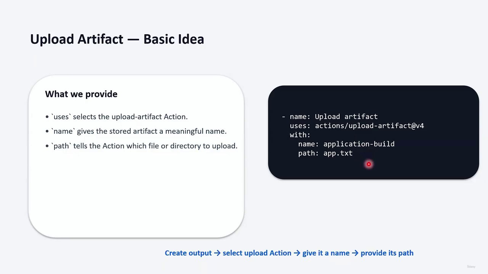
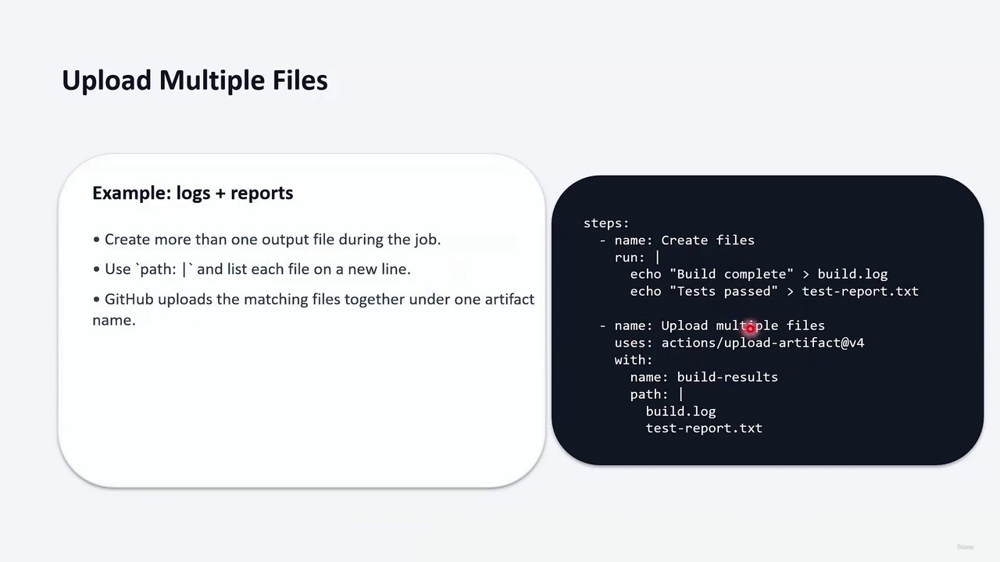
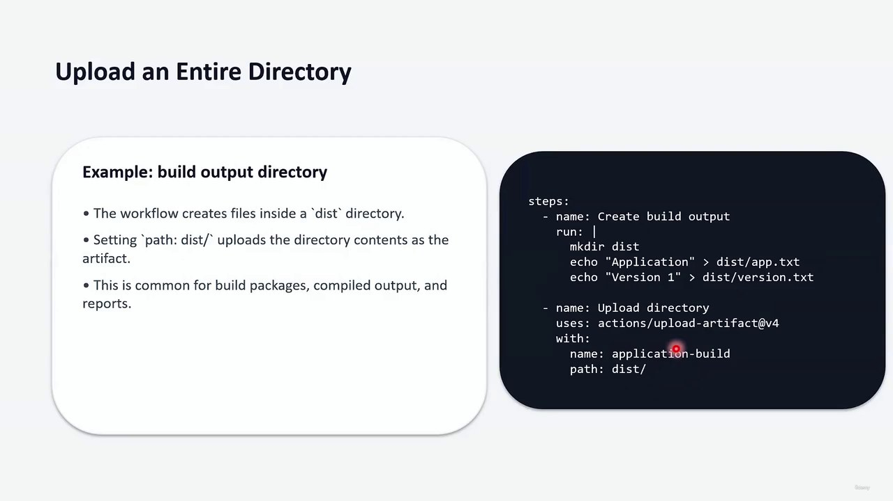
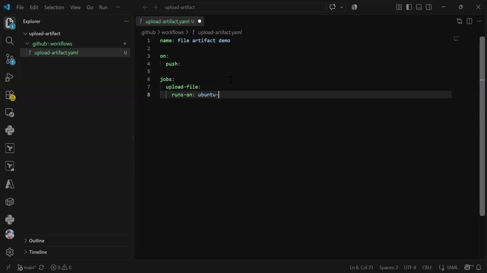
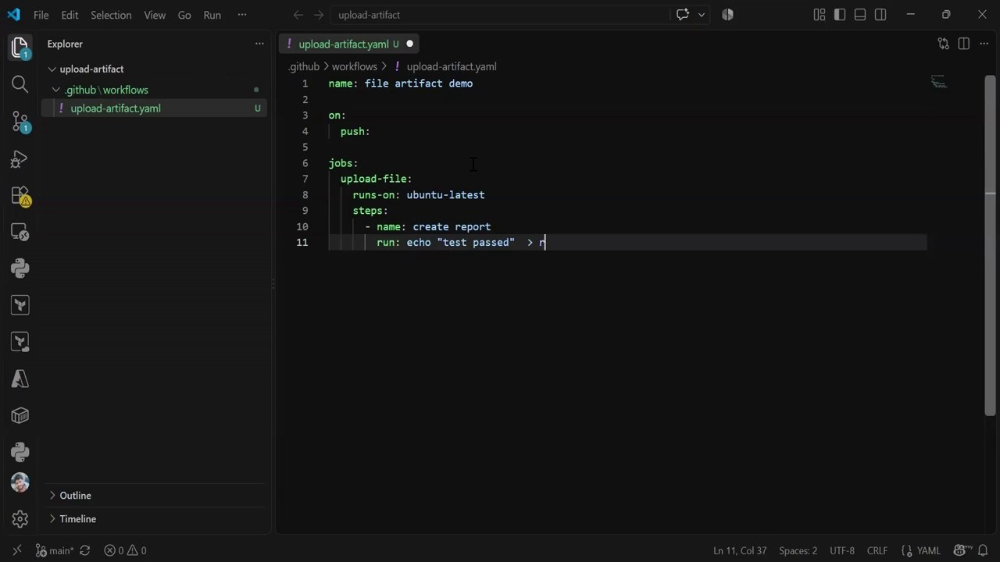
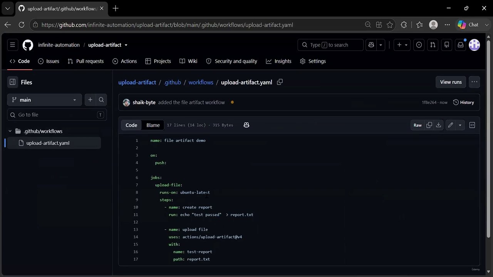
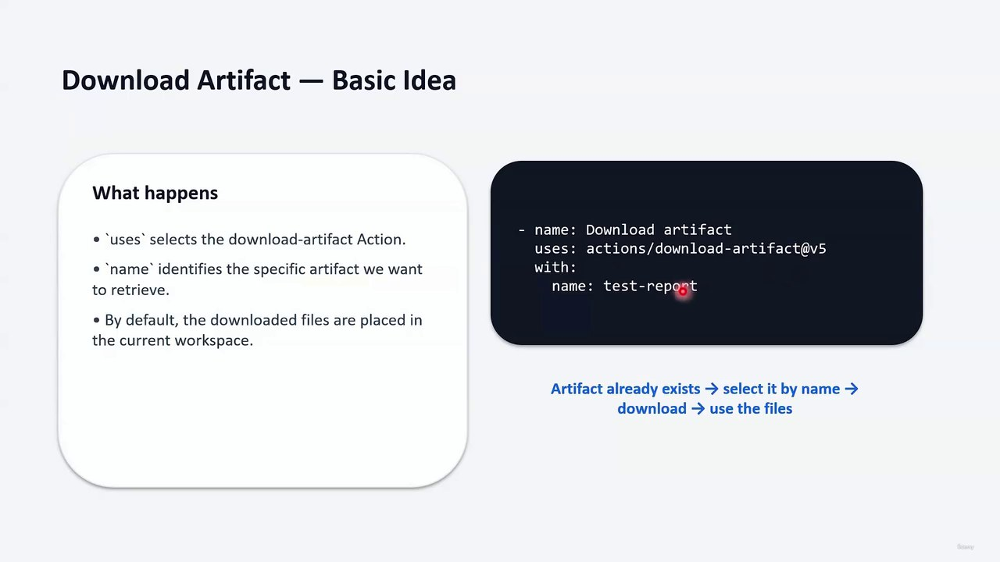
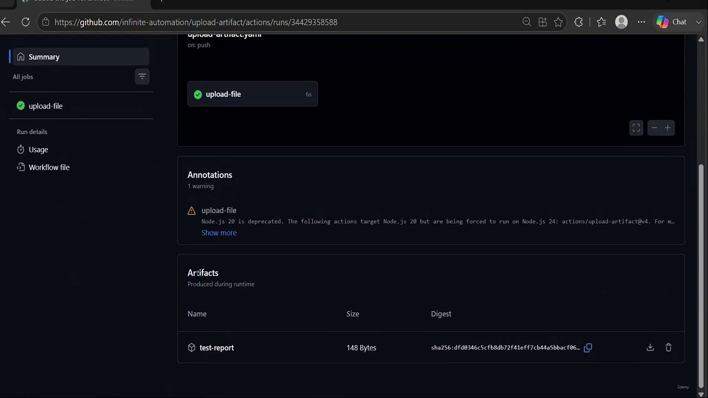
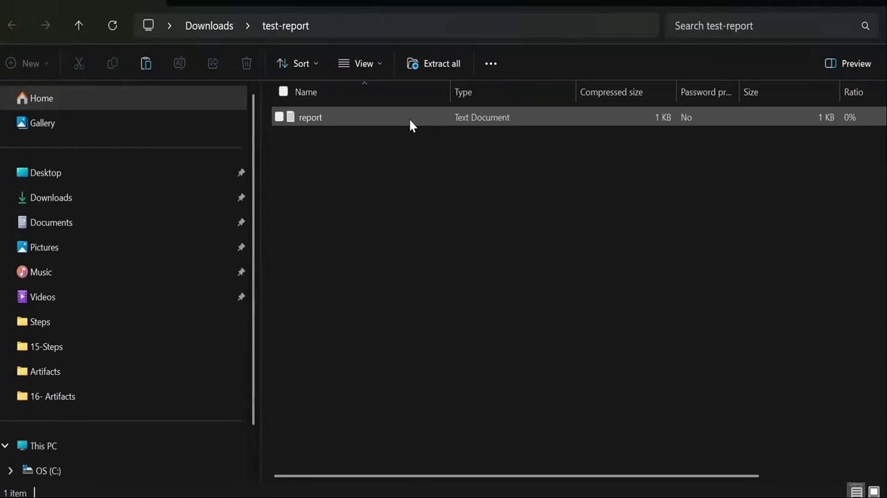

# GitHub Actions 实操：把 workflow 产物上传成 Artifact，再从 GitHub 下载回来（P073–P076）

> 读完这份文档，你应该能得到这样一个结果：本地新建一个仓库 → 写好一个 workflow 文件 → push → GitHub 上自动跑一次 → 在 run 页面里看到 `report.txt` 变成一个可下载的 zip → 下载解压后打开，里面就是 `test passed`。
> 全程不需要装 Node、不需要 `npm install`、不需要 Docker。唯一要装的是 Git 和一个文本编辑器（课里用的是 VS Code）。

---

## 1. 这一节做什么

P073 和 P075 是纯概念课，P074 和 P076 是一前一后的实操：**P074 在云端造出一个产物并上传**，**P076 把这个产物从 GitHub 网页下载回本地并验证内容**。四段合起来是一条完整的链路：

```
本地仓库  --git push-->  GitHub
                            │
                            ▼
                    Actions 触发 workflow
                            │
                   ① Create report 步骤
                      run: echo "test passed" > report.txt
                      （文件只存在于 runner 上，仓库里没有）
                            │
                   ② Upload file 步骤
                      uses: actions/upload-artifact@v4
                      with: name=test report, path=report.txt
                            │
                            ▼
                  run 页面底部 Artifacts 区域出现 "test report"
                            │
                       点 Download
                            ▼
                  本地得到一个 zip → 解压 → report.txt
                            │
                     打开 → 内容是 test passed
```

这一节结束后你手上会有两样东西：

1. 仓库里一个文件：`.github/workflows/upload-artifact.yml`；
2. 本地一个从 GitHub 下载回来的 zip（按讲师的说法，下载下来叫 `testreport.zip`，解压后是 `report.txt`）。

目录结构（这就是全部，没有别的文件）：

```
upload-artifact/                 ← git clone 下来的仓库根目录
└── .github/
    └── workflows/
        └── upload-artifact.yml  ← 本课唯一新增/提交的文件
```

依赖与环境（写全，但确实很少）：

| 项 | 值 | 说明 |
|---|---|---|
| Runner 镜像 | `ubuntu-latest` | 讲师原话「Ubuntu GitHub host state runner」，即 GitHub 托管的 Ubuntu runner |
| Action 及其版本 | `actions/upload-artifact@v4` | 讲师明确说了 `version v4`，这个版本号不要改 |
| 语言运行时 | 无 | 本节 workflow 没跑 node / python / java，只用 shell 的 `echo` |
| 环境变量 | 无 | 课里没有用到任何自定义 env |
| 密钥 / Secrets | 无 | 课里没有用到任何 secret |
| 本地依赖 | Git、VS Code | 讲师的本地环境就是这两样 |
| 工作目录 | 仓库根目录 | `.github` 必须在仓库根，不能在子目录 |

关于「artifact 到底是什么」，讲师在 P073 开头是这么定位的：先有 workflow 产出文件，再用 upload artifact 这个 action 把文件连同名字和路径交给 GitHub 存起来。



---

## 2. 讲师原话（带时间戳）

**关于「上传 artifact 只需要三样东西」**（P073 是全课最关键的结论，后面所有 YAML 都是这三样东西的展开）：

> "要上传构件，主要需要三样东西：uses、name 和 path。这里的 uses 用来指定我们要使用哪个动作。"
> —— p073 [00:00]

（逐字稿里的 `users` 是 `uses` 的听写误差，就是 YAML 里的 `uses:` 键。同理后面出现的 `ml file` 是 `.yml file`，`grader symbol` 是 greater-than symbol 即 `>`。）

**关于整体流程**：

> "首先，我们的工作流会生成一些输出。然后，我们使用 upload-artifact 动作，给出构件名称，并提供输出的路径。"
> —— p073 [00:28]

**关于单文件**：

> "首先，工作流创建 report.txt；然后在下一步中，我们使用 upload-artifact 动作，给出构件名称并提供路径。这样它就会接收这个单独的文件，并将其保存为构件。"
> —— p073 [00:57]

**关于多文件：用一个竖线，一行一个路径**：

> "不必为每个文件分别创建构件上传步骤，我们可以把两个文件一起上传。为此，在 path 中使用竖线符号，并在每一行提供一个文件路径。"
> —— p073 [01:27]



**关于整个目录**：

> "我们可能已经有一个包含输出的完整目录……这种情况下，可以直接把该目录作为 path。GitHub 会把这个特定目录的内容作为输出上传。"
> —— p073 [01:54]



**实操开头：建目录、建文件**：

> "我们来创建 .github 和 workflows 目录。在 workflows 目录中，我们来创建 yml 文件，我将其命名为 upload-artifact.yml。"
> —— p074 [00:28]

**workflow 的骨架**：

> "我们把工作流名称命名为 upload demo，并添加 on 关键字，事件设为 push……任务名称设为 upload file。它将在 Ubuntu GitHub 托管运行器上调度执行。"
> —— p074 [00:52]

**第一个步骤：用 `>` 把文本写进文件**：

> "第一步名称设为 create report。我们添加 run 关键字，并添加 shell，在其中执行 echo test passed。这里再添加大于号，把文本写入名为 report.txt 的文件。"
> —— p074 [02:11]





**关键提醒：这个文件此刻只在 runner 上，仓库里没有**：

> "这个 report.txt 会在运行器上创建，但目前该文件只在工作流运行器上可用。我们希望把这个文件保存为 GitHub Actions 构件。"
> —— p074 [03:05]

**为什么这里用 `uses` 而不是 `run`**（这是前端同学最容易混的一处）：

> "这里不再使用 run，而是使用 uses。uses 仍然表示我们要使用一个现成的 GitHub Actions，它由我们的 GitHub 组织、他人或其他组织编写。在本例中，我们要使用 uses: actions/upload-artifact@v4。"
> —— p074 [03:33]

**把三要素填进 `with` 里**：

> "现在添加配置：构件名称设为 test report，文件 path 设为根目录下的 report.txt。"
> —— p074 [04:32]

**推送并验证**：

> "我们执行 git add .，再执行 git commit -m "新增了文件制品工作流"，这就是提交信息；然后用 git push 把本地系统的更改推送到远程仓库。"
> —— p074 [05:01]

**在 Actions 页面看结果**：

> "我们打开这个名为 upload file 的任务，展开它的步骤。可以看到，第一步 create report 已完成并成功运行……我们创建了 report.txt，退出码为 0，这意味着这次执行已经成功。"
> —— p074 [06:14]



> "我们的上传步骤也成功完成。这里 GitHub 使用 upload-artifact 动作，把 report.txt 作为构件上传。可以看到，这一行显示构件 report.zip 已成功完成，这是构件 ID，并且已成功上传。如果你想下载已上传的构件，这就是 URL。"
> —— p074 [07:24]

**P075：下载对应的 action 与它的唯一关键参数**：

> "为此，我们使用 download-artifact 动作。这里的 name 告诉 GitHub 我们要下载哪个构件。在本例中，我们下载名为 test report 的构件。"
> —— p075 [00:00]

> "在下载步骤中，我们给出相同的构件名称，GitHub 会找到该构件并为我们下载文件。之后，下一步就可以在工作流操作中读取并使用下载的文件。"
> —— p075 [00:26]



**P076：从网页手动下载**：

> "可以看到构件区域，这里列出了所有构件。这里我们有 test report 构件。我们点击这个下载按钮，它会为我们下载该构件；下载后的文件名为 testreport.zip。我们打开它，可以看到里面有 report.txt。"
> —— p076 [00:28]



**最后一步验证：打开文件看内容**：

> "现在我们打开这个文件。可以看到，test passed 文本已经写入 report.txt。这就是我们的工作流在该步骤中创建的相同内容。"
> —— p076 [00:56]



---

## 3. 从零复现

### 3.1 准备一个空仓库

讲师的原话是「I have created the empty GitHub repository named as upload artifact. And that has been cloned into my local system with the Git commands」。

在 GitHub 网页上新建一个 **空** 仓库（不要勾选 README、不要 .gitignore、不要 license，空仓库最省事），名字就叫 `upload-artifact`（名字只是名字，你叫别的也行，记得改下面命令）。

```bash
# 换成你自己的用户名
git clone git@github.com:<你的用户名>/upload-artifact.git
cd upload-artifact

# 确认是一个空仓库（应该没有任何文件输出）
ls -a

# 用 VS Code 打开当前目录
code .
```

如果你走 HTTPS 而不是 SSH，clone 地址换成 `https://github.com/<你的用户名>/upload-artifact.git`。

### 3.2 建目录

`.github` 是点开头的隐藏目录，注意两点：**在仓库根目录建**、`workflows` 是**复数**。

```bash
mkdir -p .github/workflows
```

Windows PowerShell 等价写法：

```powershell
New-Item -ItemType Directory -Force .github/workflows
```

### 3.3 写 workflow 文件

文件名用 `upload-artifact.yml`。讲师口述的是「upload artifact dot ml file」，实际就是 `.yml`；P074 后面他在网页上看仓库时说的是「we have the file called upload artifact.yaml」——`.yml` 和 `.yaml` GitHub 都认，选一个就行，本文统一用 `.yml`。

用 VS Code 在 `.github/workflows/` 下新建 `upload-artifact.yml`，把第 4 节的完整代码原样贴进去。**缩进必须用空格，不能用 Tab**。

### 3.4 提交并推送

讲师用的就是这三条（P074 [05:01]）：

```bash
git add .
git commit -m "added the file artifact workflow"
git push
```

推送前讲师还刷新了一次仓库页面，推送后再刷新，确认 `.github/workflows/upload-artifact.yml` 确实进了远程仓库——这一步别省，能立刻区分「没触发」是文件没推上去还是 workflow 写错了。

### 3.5 在 Actions 页面确认跑起来了

1. 打开仓库页面 → 点顶部 **Actions** 标签；
2. 左栏能看到 workflow 名 **upload demo**（就是 YAML 里的 `name:`）；
3. 点进最新一次 run → 点 job 名 **Upload file**；
4. 展开两个步骤：
   - `Create report`：日志里会打出 `test passed`，并且显示 **exit code 0**（讲师原话「with the exist code zero, which means this particular execution has been successful」）。exit code 非 0 就是这一步失败，右侧图标会变红。
   - `Upload file`：日志里会看到 artifact 被 finalized（讲师说的「artifact is report.jip successfully finalized」）、artifact ID，以及一条下载 URL。

具体字段名以你看到的实际输出为准——讲师这段是口述日志，逐字稿里能确认的只有「exit code zero」「artifact ID」「下载 URL」这三类信息。

### 3.6 下载回本地并验证

在同一个 run 页面往下滚一点，会看到 **Artifacts** 区域，里面列出了这次 run 产出的 artifact，名字就是你在 YAML 里写的 `test report`（讲师口述为「test report artifacts」）。

1. 点这个 artifact 右边的下载按钮；
2. 浏览器得到一个 zip（讲师说「downloaded as a testreport.gip」，即按 artifact 名命名的 zip，`.gip` 是 `zip` 的听写误差）；
3. 解压后得到 `report.txt`；
4. 双击打开，内容就是一行 `test passed`——讲师原话「test pass text has been injected into this report.exe」（`report.exe` 是 `report.txt` 的听写误差）。

到这一步，整条链路（runner 生成 → 上传 → 云端保存 → 本地下载 → 内容校验）就跑通了。

**这一步的意义**（讲师在 P076 结尾说的）：如果你想把测试结果、构建日志、截图之类的产物带给同事或留档，不需要在 CI 里接邮件、接网盘，直接从这个 Artifacts 区域下载就行。

---

## 4. 完整代码

### `.github/workflows/upload-artifact.yml`

```yaml
name: upload demo

on:
  push:

jobs:
  upload-file:
    name: Upload file
    runs-on: ubuntu-latest

    steps:
      - name: Create report
        shell: bash
        run: |
          echo "test passed" > report.txt

      - name: Upload file
        uses: actions/upload-artifact@v4
        with:
          name: test report
          path: report.txt
```

把它保存成 `.github/workflows/upload-artifact.yml`，`git add . && git commit -m "added the file artifact workflow" && git push`，然后在 Actions 页面看结果。

### 关于这份文件的两点说明

- **为什么没有 `actions/checkout`**：因为这个 workflow 根本不读仓库里的代码，它只在自己的 runner 上 `echo` 一个新文件出来。讲师全程没有加 checkout，也不需要。你如果需要先拿到仓库代码（比如跑 `npm test`），那是另一件事，见第 7 节。
- **job id 与展示名**：YAML 里 `upload-file:` 是 job 的 id（内部标识，用小写加连字符），`name: Upload file` 是页面上显示的名字。讲师口述的是「the job name would be upload file」，页面上看到的正是这个展示名。步骤名同理：`Create report`、`Upload file` 都是展示名，讲师在 P074 里说过步骤名「upload file or report either one can find let's use upload file」，也就是随便取，只要你自己看得懂。

---

## 5. 逐行解释

**`name: upload demo`**
整个 workflow 的名字。它决定 Actions 页面左栏列的标题，也决定你在仓库页面上看到的 workflow 名称。跟文件名无关，可以不一样。

**`on:` / `  push:`**
触发条件：往仓库 push 就触发。这里是「任何分支的任何 push」都触发。写成 `on: push`（一行）也可以，效果一样。课里没讲 `pull_request`、`workflow_dispatch` 这些其他触发方式——如果你想让页面出现一个手动「Run workflow」按钮，那需要另外加，课里没有。

**`jobs:`**
一个 workflow 可以包含多个 job，这里只有一个。注意 `jobs:` 下面的缩进层级，job id 是 `jobs` 的直接子项。

**`upload-file:`**
job 的 id。它的作用是被引用（比如 `needs: upload-file`），页面上不显示。这也是为什么下面还要单独写 `name:`。

**`name: Upload file`**
job 的展示名。P074 里讲师就是在这一步说「the job name would be upload file」，页面上展开的那个就是它。

**`runs-on: ubuntu-latest`**
指定 runner 镜像。讲师原话是「Ubuntu GitHub host state runner」，即 GitHub 托管的 Ubuntu 机器。`ubuntu-latest` 意味着这个镜像的版本由 GitHub 决定，你不用管 Ubuntu 是 22.04 还是 24.04。这一点对前端同学的实际含义是：**你的命令是在一台干净的 Linux 机器上跑的**，不是在你的 Mac/Windows 上跑，所以别写 `dir` 这种 Windows 命令。

**`steps:`**
步骤列表，按顺序从上到下执行。上一步失败（exit code 非 0）默认会中断后面所有步骤。

**`- name: Create report`**
第一个步骤的展示名。步骤名会出现在日志树的标题上，写清楚一点能省你以后排查的时间。

**`  shell: bash`**
指定用 bash 执行这条 `run`。在 `ubuntu-latest` 上默认就是 bash，所以这一行其实是显式写出来图个清楚（讲师在口述里说要「add a shell」，于是就有了这一行）。如果你把 `runs-on` 换成 `windows-latest`，这行就变得很关键了。

**`  run: |`**
`run` 表示「在 runner 上执行一条 shell 命令」。后面的 `|` 是 YAML 的多行文本写法（block scalar），意思是「下面这些行原样当成一段脚本文本」。前端类比：很像 JS 里的模板字符串，缩进被保留、内容不做解析。

**`    echo "test passed" > report.txt`**
这一行是本课的重点小技巧。拆开看：

- `echo "test passed"` 往标准输出打一行 `test passed`；
- `>` 是重定向符号（讲师口述的「grader symbol」），它**把输出写进文件而不是打印到屏幕**；
- `report.txt` 是目标文件名，没有路径前缀，所以它落在**当前工作目录**，也就是 runner 上的仓库根目录。讲师原话「the path of the file is report.txt in the root level」——这个「root level」很重要，因为没有 checkout，当前目录是 runner 给的一个空工作目录，`report.txt` 就在这个目录的最外层。

注意 `>` 是**覆盖**写入，不是追加（追加是 `>>`）。这里文件本来不存在，所以创建 + 写入一步完成。

**`- name: Upload file`**
第二个步骤的展示名。

**`  uses: actions/upload-artifact@v4`**
这是本节和第一个步骤最不一样的地方。讲师专门解释过：`run` 是「自己写命令去执行」，`uses` 是「复用别人已经写好的 action」。`actions/upload-artifact` 是 GitHub 官方维护的 action，`@v4` 是版本号——讲师明确说了 v4，不要写成 v3 或其他版本，不同大版本的参数行为可能不同。

这里就是 P073 三要素里的第一样：**uses**。

**`  with:`**
`with` 用来给 action 传参数。第一个步骤用的是 `run`，所以没有 `with`；第二个步骤用的是 `uses`，参数全靠 `with` 传进去。讲师口述时说的是「let's add the condition with the name of artifact」，这个 `with` 就是 YAML 的 `with:` 键。

**`    name: test report`**
artifact 的名字。这就是 P073 三要素里的第二样：**name**。它会显示在 run 页面下方的 Artifacts 区域，也会成为下载下来的 zip 的文件名（所以你在本地看到的是 `test report.zip` 这种形式）。名字里带空格是允许的。

**`    path: report.txt`**
要上传的文件路径，相对于仓库根（也就是 runner 的当前工作目录）。这就是 P073 三要素里的第三样：**path**。这里是单个文件。

P073 讲的另外两种写法（本节实操没用到，但你要知道怎么改）：

```yaml
# 多个文件：path 用竖线，一行一个
        with:
          name: build results
          path: |
            build.log
            test-report.txt

# 整个目录：直接给目录名，上传的是目录里的内容
        with:
          name: dist
          path: dist
```

讲师对目录写法的原话是「GitHub will upload the context of the particular directory」——上传的是目录里的**内容**。至于解压后是否多包一层同名目录，请以你实际下载的 zip 为准。

---

## 6. 复现检查清单

逐条打勾，卡住时按顺序回看：

- [ ] GitHub 上仓库是**空的**（建的时候没勾 README / .gitignore / license），本地 `git clone` 后 `ls -a` 只剩 `.git`。
- [ ] 目录是 `.github/workflows/`：`.github` 在**仓库根**，`workflows` 是**复数**，中间是斜杠不是点。
- [ ] 文件名是 `upload-artifact.yml`（或 `.yaml`），不是 `upload-artifact.yml.txt`（Windows 隐藏扩展名特别容易踩）。
- [ ] YAML 缩进全部是空格，没有 Tab；`jobs:` → job id → `steps:` → `- name:` 的层级没错位。
- [ ] `uses: actions/upload-artifact@v4` 版本写的是 v4。
- [ ] `with:` 下面同时有 `name:` 和 `path:` 两行，且都比 `with:` 多缩进。
- [ ] `path: report.txt` 和上一步生成的文件名**完全一致**（大小写、扩展名）。
- [ ] `git push` 后在网页上刷新，确认 `.github/workflows/upload-artifact.yml` 在仓库里。
- [ ] Actions 标签下出现 workflow `upload demo`，而不是「没有 workflow」。
- [ ] 点进 run，job 名是 `Upload file`，两个步骤都是绿色。
- [ ] `Create report` 步骤日志里能看到 `test passed`，并且 exit code 是 0。
- [ ] `Upload file` 步骤日志里能看到 artifact 被 finalized、artifact ID、下载 URL。
- [ ] run 页面往下滚，Artifacts 区域里有 `test report`。
- [ ] 点下载得到一个 zip，解压后是 `report.txt`（不是多一层目录、不是空文件）。
- [ ] 打开 `report.txt`，内容正好是 `test passed`，没有多余的乱码。

---

## 7. 课里没讲但你会撞上

**① `.github/workflows` 的层级错了，workflow 永远不会触发。**
这是新手第一坑。`workflow`（单数）、`workflowS`、`\.github/workflows` 写成了 `github/workflows`（漏点）、或者整个目录放在了某个子项目目录下——这几种情况 GitHub 都**不会报错**，它就是静静不跑。前端类比：跟 `.env` 文件漏了点、或者 `next.config.js` 放错目录一样，工具链默默忽略你。检查方式很土但有效：在仓库网页上确认路径一字不差。

**② YAML 用 Tab 缩进会直接解析失败。**
VS Code 默认会用空格，但如果你从别处复制粘贴，可能带进来 Tab。建议在 VS Code 右下角把缩进切到 `Spaces: 2`，并且打开 `Render Whitespace` 让空格可见。

**③ 没有 `actions/checkout`，所以「仓库里的文件」不在 runner 上。**
本节的 workflow 之所以能跑，是因为它压根不读仓库代码，只 `echo` 一个新文件。一旦你想跑 `npm ci && npm test`，就必须先加一步 `uses: actions/checkout@v4` 把仓库拉到 runner 上——**这一步课里没讲**，讲师全程没提 checkout。在这个 workflow 里加上它不会破坏什么，但属于多余。

**④ `report.txt` 不在你的仓库里，只在 runner 上。**
P074 里讲师特意强调过这一点。你在本地 `git status` 看不到它，在仓库网页上也看不到它。它只存在于那一次 run 的临时机器上，run 结束机器就没了——所以才需要 upload artifact 把它捞出来，这也是整个技巧存在的理由。前端类比：比如 `npm run build` 生成的 `dist/`，在你本地磁盘上，但不在 git 里；artifact 就是「把这个不在 git 里的产物存到 GitHub 上」。

**⑤ 想在 workflow 里下载 artifact（而不是网页点按钮），要用 `actions/download-artifact`。**
P075 讲了概念（`name` 指定要下载哪个 artifact，下载后「the next step can read and use the download file」），但**没有写 YAML 代码**，P076 也只是网页手动下载。所以下面这段不是讲师给的代码，是按 P075 讲的参数补出来的最小写法，版本号课里没讲（这里用 v4 与 upload 保持一致的写法，实际请以官方文档为准）：

```yaml
# 课里没讲的补充：在 workflow 内部把 artifact 取回来
jobs:
  download-file:
    name: Download file
    runs-on: ubuntu-latest
    steps:
      - name: Download artifact
        uses: actions/download-artifact@v4
        with:
          name: test report

      - name: Read the file
        shell: bash
        run: |
          ls -R
          cat report.txt
```

要点：`download-artifact` 下载后会落在 runner 的当前工作目录。**如果你要跨 job 下载**，还需要用 `needs:` 把两个 job 串起来，那是课里没讲的内容。

**⑥ 两个 run 上传同名 artifact 会怎样？**
课里没讲。讲师只演示了一次成功的 run。如果你连续 push 两次，会在 Actions 页面看到两次 run、两个同名 artifact——命名冲突和覆盖行为请以实际输出为准，别靠猜。真要区分，可以在 `name` 里塞变量（比如 `test report-${{ github.run_id }}`），但 `${{ }}` 表达式课里没讲。

**⑦ 下载下来的永远是 zip，哪怕你只上传了一个文件。**
`report.txt` 单个文件，下载得到的仍然是 zip（讲师说的 `testreport.zip`）。这是 GitHub 的行为，不是你的配置问题。前端同学的直觉可能是「下载应该直接给我文件」，但这里需要先解压。

**⑧ Artifact 有保留期。**
课里没讲。也就是说你一周后回来找这个 zip 可能已经没了。要长期留档的话需要另想办法（release、对象存储等），课里都没讲。

**⑨ 日志里的字段名不要凭印象背。**
我在第 3.5 节只敢写讲师口述里确实出现过的三类信息（exit code、artifact ID、下载 URL），其余字段名请以你实际的页面输出为准。同理，如果你以后想排查「为什么上传失败」，也先看日志原文，不要先套记忆里的字段名。

**⑩ 关于「并发 / 锁 / 事务」——本节确实不涉及。**
但既然你是前端转过来的，给一个对应关系：这个 workflow 的两次 run 之间是**完全隔离**的，各自跑在各自的 runner 机器上，没有共享文件系统，所以不存在 JS 里那种两个请求同时写同一个文件的竞态问题。真正的共享点是「云端同一个 artifact 名字」，也就是第 ⑥ 条那个课里没讲的问题。至于 Node 里怎么写文件——那是 `fs.writeFileSync('report.txt', 'test passed')`，这里用 `echo "test passed" > report.txt` 效果一样，只是不需要装 Node。