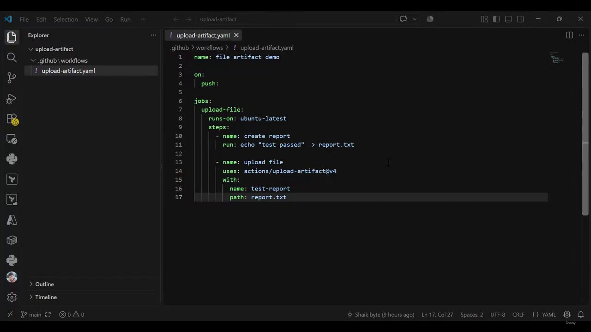
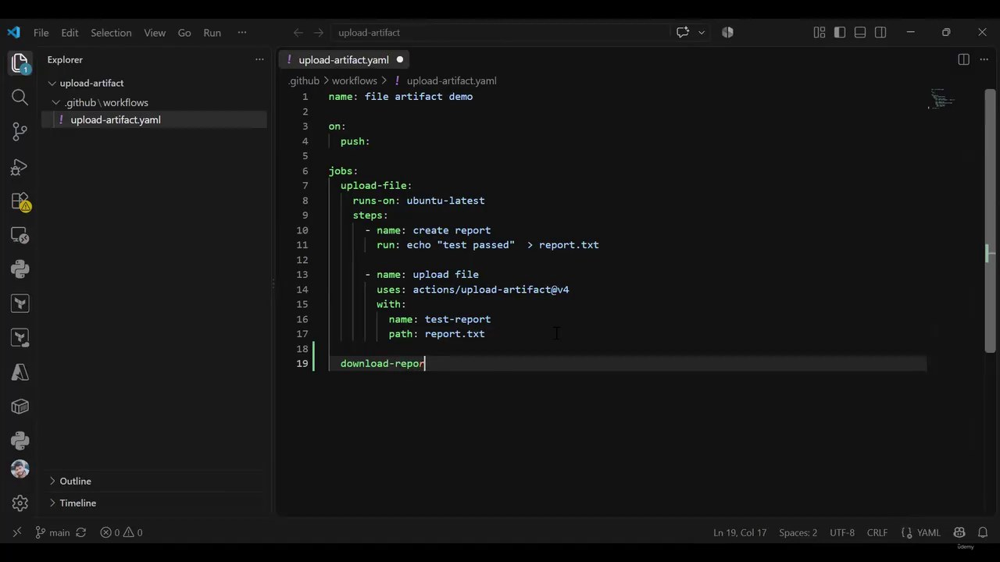
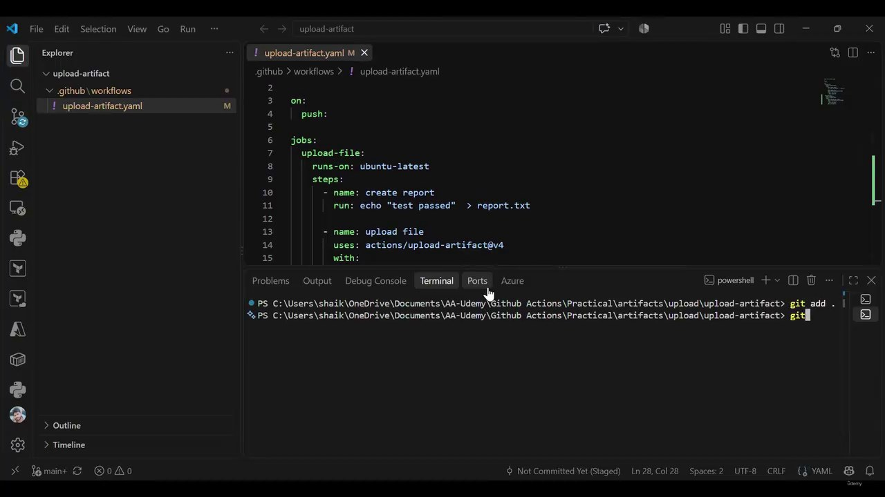
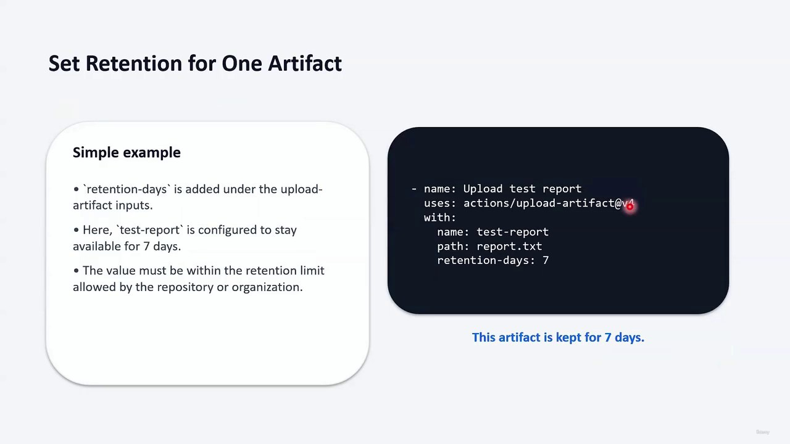
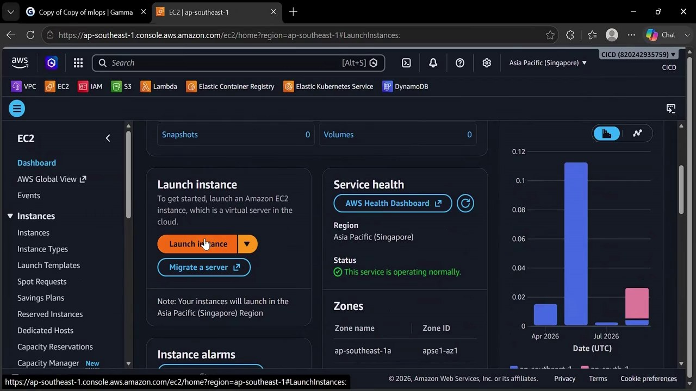
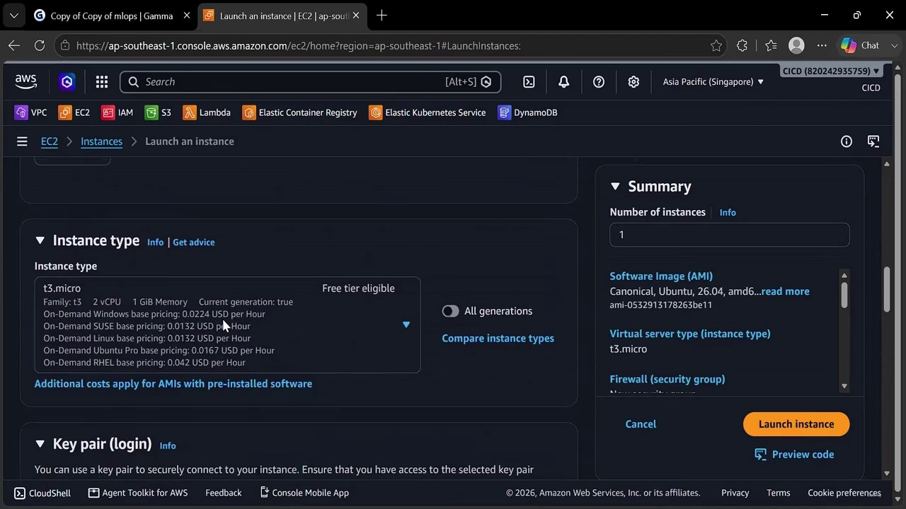
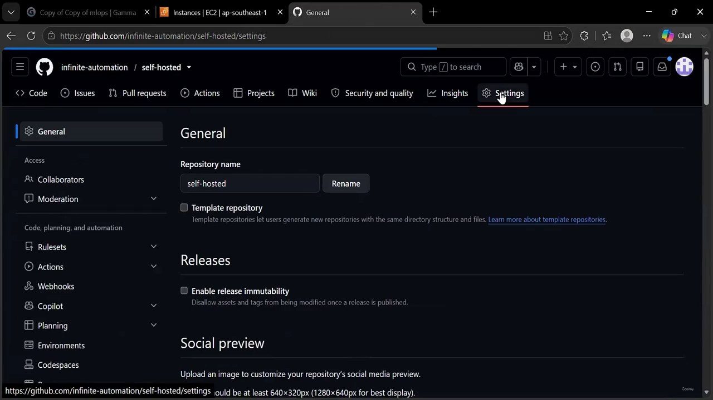
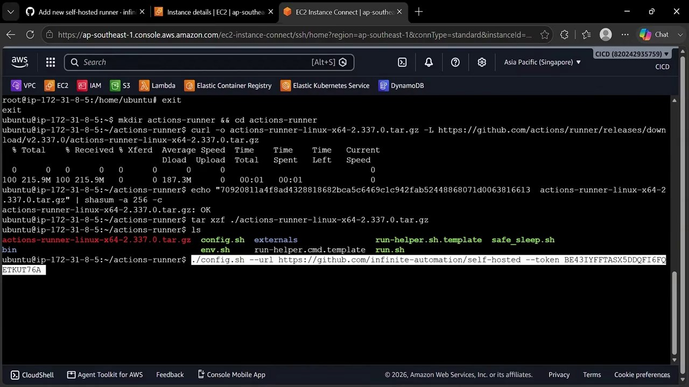
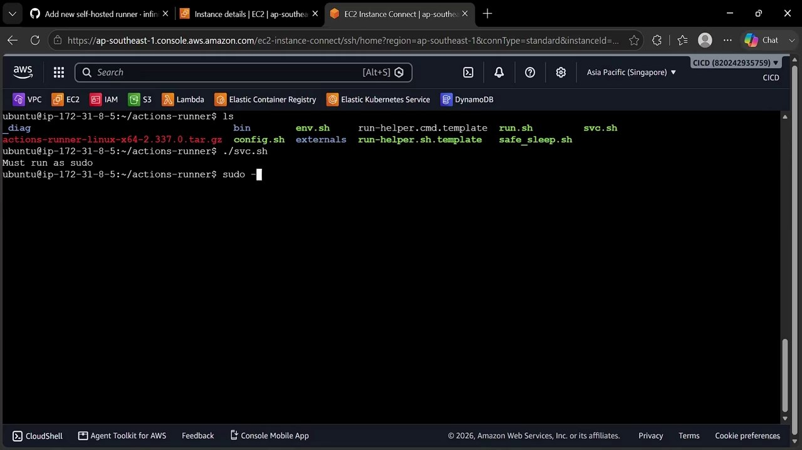
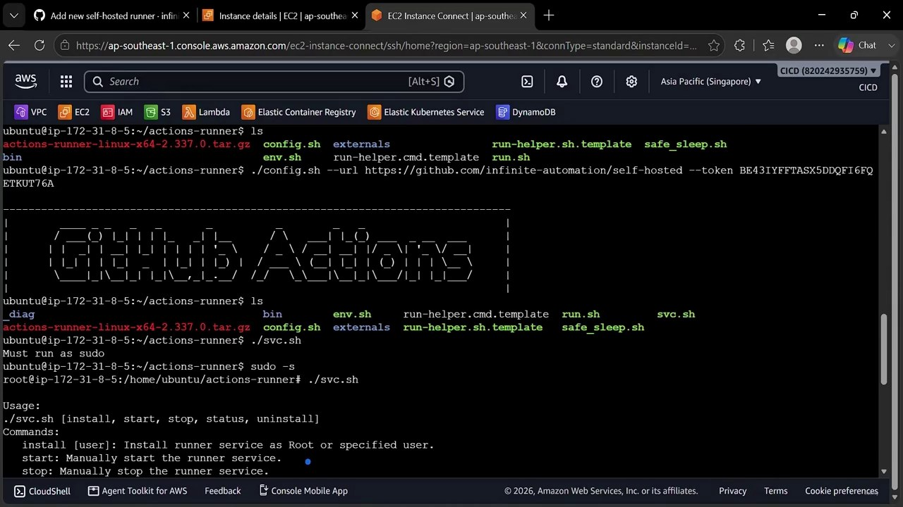

# GitHub Actions Complete（P77–P80）复现文档：Artifact 跨 Job 传递、保留策略与 AWS 自托管 Runner

> 本文覆盖 P77–P80。项目最终包含两部分：  
> 1）在同一个 workflow 里，第一个 job 生成 `report.txt` 并上传为 `TestReport` artifact，第二个 job 下载并读取它；  
> 2）在 AWS EC2 上准备一台 Ubuntu 服务器，把它注册成 GitHub Actions 的 self-hosted runner，并用 `runs-on: self-hosted` 验证任务能落到这台机器上。  
> 截图只用于辅助定位，实际按钮和输出以你当前 GitHub / AWS 控制台为准。

---

## 1. 这一节做什么

这一节不是单独讲几个 YAML 字段，而是把两个完整链路跑通。

### 链路 A：Artifact 在两个 Job 之间传递

上一节已经有一个“生成报告并上传 artifact”的 job。这一节新增第二个 job：

- 第二个 job 通过 `needs` 依赖第一个 job；
- 第一个 job 把 `report.txt` 上传为名字叫 `TestReport` 的 artifact；
- 第二个 job 使用 `actions/download-artifact@v6` 按名字下载 `TestReport`；
- 下载完成后，`report.txt` 出现在第二个 job 的 runner 工作目录里；
- 最后用 `cat report.txt` 把内容打印到 workflow 日志。

这相当于把“构建产物”从一台临时 runner 传给另一台临时 runner。用前端熟悉的说法：`needs` 像 Promise 链，前一个 job 完成后才进入下一个 job；artifact 像一次共享文件存储，第一个 job 写进去，第二个 job 按名字取出来。

最终 workflow 文件建议放在：

```text
.github/workflows/upload-artifact.yaml
```

目录结构如下：

```text
github-actions-artifact-demo/
├── .github/
│   └── workflows/
│       └── upload-artifact.yaml
└── README.md
```

### 链路 B：Artifact 保留策略

默认情况下，GitHub 会保留上传的 artifact 90 天。课程里通过在上传步骤下增加：

```yaml
retention-days: 7
```

让 `TestReport` 只保留 7 天。超过保留期后，GitHub 自动删除该 artifact。

### 链路 C：把 AWS EC2 配成 self-hosted runner

课程里先在 AWS 创建一台简单的 EC2：

- 名称：`GitHub Actions Runner`
- 操作系统：Ubuntu
- 实例类型：`t3.micro`
- 新建 key pair：课程里命名为 `self hosted key`
- 安全组：允许 SSH，同时为了演示也允许 HTTP / HTTPS
- 实例数量：1

然后在 GitHub 仓库中进入：

```text
Settings → Actions → Runners → New self-hosted runner
```

选择 Linux / x64，复制 GitHub 生成的下载、校验、解压、配置命令到 EC2 上执行。配置完成后，用 `svc.sh` 把 runner 安装成服务并启动，这样关闭 SSH 会话后 runner 仍然在线。最后在 workflow 中写：

```yaml
runs-on: self-hosted
```

任务就会交给这台 EC2 执行。

> 课程明确说明：这套 EC2 配置是为了学习 self-hosted runner，不是生产架构。真实组织可能会使用私有子网、自定义 VPC、不同安全组、IAM role 等，不能直接照抄成生产方案。

---

## 2. 讲师原话（带时间定位）

- “Add another job named download report. This job depends on upload report… With the needs…” —— p077 [00:27]  
  说明第二个 job 通过 `needs` 依赖第一个上传 job。

- “The step uses the reusable action as a users actions download artifact with the version v6… with the name of artifact that we have uploaded earlier.” —— p077 [01:24]  
  说明下载使用 `actions/download-artifact@v6`，并通过 `with: name:` 指定 artifact 名称。

- “The name of the artifact is TestReport…” —— p077 [02:22]  
  说明上传和下载必须使用同一个 artifact 名称 `TestReport`。

- “This will execute command as a cat report.txt which means it reads the file which downloaded.” —— p077 [02:52]  
  说明下载后直接读取 `report.txt`，把内容输出到日志。

- “By default, GitHub keeps our upload artifact for 90 days. We can also set a retention period while uploading the artifact… I have given retention days as a 7.” —— p078 [00:19]  
  说明默认保留 90 天，可以通过 `retention-days: 7` 改为 7 天。

- “Our main focus is… not about the AWS infrastructure creation… how can we take a server and configure that server as a GitHub action self-hosted runner.” —— p079 [00:29]  
  说明课程重点不是讲 AWS 网络架构，而是把服务器注册成 runner。

- “Our user instance is running on Ubuntu… architecture… x64.” —— p080 [01:18]  
  说明在 GitHub 添加 runner 时选择 Linux + x64。

- “If you run this command, the shell is open. And if you close the shell, the particular process, the runner will be off… So that's why we'd like to run this runner as a service.” —— p080 [06:02]  
  说明不要长期依赖 `run.sh` 前台运行，而是用 `svc.sh` 安装并启动服务。

- “Self-hosted runner has been currently ideal state… successfully connected.” —— p080 [07:28]  
  说明注册成功后，GitHub 的 Runners 页面会显示 runner 已连接，状态为 Idle。

---

## 3. 从零复现

### 3.1 准备本地仓库

如果你已经有上一节的仓库，直接进入仓库即可。若从零开始：

```bash
mkdir -p github-actions-artifact-demo/.github/workflows
cd github-actions-artifact-demo
git init
git branch -M main
```

创建 workflow 文件：

```bash
cat > .github/workflows/upload-artifact.yaml <<'YAML'
name: upload-artifact

on:
  push:

jobs:
  upload-file:
    runs-on: ubuntu-latest
    steps:
      - name: Create report
        run: echo "test pass" > report.txt

      - name: Upload file
        uses: actions/upload-artifact@v4
        with:
          name: TestReport
          path: report.txt
          retention-days: 7

  download-report:
    needs: upload-file
    runs-on: ubuntu-latest
    steps:
      - name: Download test report
        uses: actions/download-artifact@v6
        with:
          name: TestReport

      - name: Read report
        run: cat report.txt
YAML
```

这里有一个必须说明的点：逐字稿里同时出现过 `report.ext` 和 `report.txt` 两种写法。但后续读取命令明确是 `cat report.txt`，所以文档统一使用 `report.txt`，否则最后一步会找不到文件。  
另外，本段课程明确讲了 `download-artifact@v6`，但没有在本段口述 `upload-artifact` 的版本。上面为了给出可直接保存的完整文件，使用了常见的 `actions/upload-artifact@v4`；如果你上一节仓库里已经用了别的上传版本，就沿用你原来的版本。



### 3.2 提交并推送，触发 workflow

课程里的命令是：

```bash
git add .
git commit -m "added the job for download artifact"
git push
```

如果这是新仓库，还需要先配置远程地址：

```bash
git remote add origin https://github.com/<你的账号>/<你的仓库>.git
git push -u origin main
```

推上去后，打开 GitHub 仓库：

```text
Actions → upload-artifact
```

会看到一次新的 workflow run。第一个 job 是 `upload-file`，第二个 job 是 `download-report`。


### 3.3 验证第一个 job：上传 artifact

点开 `upload-file` job，展开步骤：

1. `Create report`：执行 `echo "test pass" > report.txt`，生成报告文件。
2. `Upload file`：把 `report.txt` 上传成名为 `TestReport` 的 artifact。

课程里在日志中确认了 artifact 上传成功，并展示了下载 URL。你实际看到的具体 URL 以页面为准。



### 3.4 验证第二个 job：下载并读取 artifact

点开 `download-report` job，展开步骤：

1. `Download test report`：按名字 `TestReport` 下载第一个 job 上传的 artifact。
2. `Read report`：执行 `cat report.txt`，日志中应该出现：

```text
test pass
```

课程里明确说：第一个 job 上传 artifact，第二个 job 下载同一个 artifact，下载后 `report.txt` 在 runner 上可用，最后读取内容。这就是跨 job 传递文件的最小闭环。



### 3.5 设置 artifact 保留 7 天

在 `actions/upload-artifact` 步骤下增加：

```yaml
retention-days: 7
```

课程解释：默认保留 90 天；设置 `retention-days: 7` 后，`TestReport` 保留 7 天，过期后 GitHub 自动删除。这个字段加在上传步骤，不是下载步骤。



### 3.6 创建 AWS EC2 服务器

进入 AWS 控制台，选择 EC2，点击 Launch instance。课程里的配置是：

| 配置项 | 课程里的值 |
|---|---|
| 名称 | `GitHub Actions Runner` |
| 操作系统 | Ubuntu |
| 实例类型 | `t3.micro` |
| Key pair | 新建，课程命名为 `self hosted key` |
| 网络 | 使用简单的默认网络选项 |
| 安全组 | 允许 SSH、HTTP、HTTPS |
| 实例数量 | 1 |
| 区域 | 课程演示使用新加坡区域 |

课程特别说明：IAM role、VPC、私有子网、自定义安全组等生产环境常见配置，这节课不展开。重点是把一台已经能登录的服务器注册成 runner。



创建并启动后，在 EC2 的 Instances 页面确认实例状态为 running。课程里创建出来的实例名称就是 `GitHub Actions Runner`。



> 这里不要直接当成生产方案。runner 通常只需要访问 GitHub 的出站网络，不一定需要把 HTTP / HTTPS 入站开放给公网。课程是为了简化演示才这样设置；生产环境应按组织安全要求收紧。

### 3.7 在 GitHub 添加 self-hosted runner

进入你的 GitHub 仓库：

```text
Settings → Actions → Runners → New self-hosted runner
```

课程里创建了一个名为 `selfhosted` 的仓库来演示。进入 Runners 页面后，选择：

- Operating system：Linux
- Architecture：x64

页面会生成一组命令，通常包含：

1. 创建并进入 `actions-runner` 目录；
2. 用 `curl` 下载 runner 包；
3. 用 `shasum` 做 checksum 校验；
4. 用 `tar` 解压；
5. 用 `./config.sh` 配置 runner。

课程里的顺序也是：先创建目录，再下载、校验、解压，最后配置。




### 3.8 在 EC2 上执行注册命令

先通过 EC2 控制台的 Connect 入口连接服务器。课程里用的是控制台提供的连接方式，不是本地 SSH 客户端。连接后：

```bash
sudo apt-get update
sudo apt-get upgrade -y
```

课程里先切换成 root 更新服务器，然后 `exit` 回到普通用户，再复制 GitHub 页面上的命令逐条执行。

下面的脚本把课程里的步骤整理成可复制版本。注意：`RUNNER_VERSION`、`RUNNER_SHA256`、`RUNNER_TOKEN` 必须从你 GitHub 页面实时复制，不能照抄别人的值。

```bash
# 在 EC2 的普通用户下执行
mkdir actions-runner && cd actions-runner

# 以下版本号、文件名、SHA256 从 GitHub 的 Add new self-hosted runner 页面复制
export RUNNER_VERSION="<GitHub 页面显示的版本号>"
export RUNNER_SHA256="<GitHub 页面显示的 SHA256>"
export REPO_URL="https://github.com/<owner>/<repo>"
export RUNNER_TOKEN="<GitHub 页面生成的一次性 token>"

curl -o "actions-runner-linux-x64-${RUNNER_VERSION}.tar.gz" \
  -L "https://github.com/actions/runner/releases/download/v${RUNNER_VERSION}/actions-runner-linux-x64-${RUNNER_VERSION}.tar.gz"

echo "${RUNNER_SHA256}  actions-runner-linux-x64-${RUNNER_VERSION}.tar.gz" | shasum -a 256 -c

tar xzf "./actions-runner-linux-x64-${RUNNER_VERSION}.tar.gz"

./config.sh --url "${REPO_URL}" --token "${RUNNER_TOKEN}"
```

`config.sh` 会进入交互配置。课程里的回答是：

```text
Enter the name of the runner group: 直接回车，使用 default
Enter the name of runner: self-hosted-EC2-runner
Enter any additional labels: 直接回车，跳过
Enter name of work folder: 直接回车，使用默认
```

配置完成后，课程里没有直接用 `./run.sh` 长期运行，而是安装成服务：

```bash
sudo ./svc.sh install
sudo ./svc.sh start
```

原因课程讲得很清楚：`run.sh` 是前台进程，SSH shell 一关，runner 进程就可能退出，runner 会变成 offline。用 `svc.sh` 安装成服务后，关闭 shell 仍然保持在线。





### 3.9 验证 runner 在线

回到 GitHub：

```text
Settings → Actions → Runners
```

课程里看到 self-hosted runner 已连接，状态为 Idle。页面还会显示默认标签，课程里提到可以看到 `self-hosted` 标签。



### 3.10 用最小 workflow 验证任务落到自托管 runner

课程在这一段末尾说会克隆仓库、运行简单 workflow，具体内容留到下一节。为了让你现在就能验证，下面给出一个最小 workflow。它不是课程里逐字展示的 YAML，只是验证连接是否成功的补充文件。

创建：

```text
.github/workflows/self-hosted-demo.yml
```

```yaml
name: self-hosted-demo

on:
  push:

jobs:
  hello:
    runs-on: self-hosted
    steps:
      - name: Show runner info
        run: |
          whoami
          uname -a
          pwd
          ls -la
```

提交并推送后，打开这次 workflow run，确认 job 的 runner 不是你平时的 `ubuntu-latest` 托管机，而是刚注册的 self-hosted runner。日志里的用户名、内核信息、当前目录会来自 EC2 服务器。

---

## 4. 完整代码

### 4.1 `.github/workflows/upload-artifact.yaml`

```yaml
name: upload-artifact

on:
  push:

jobs:
  upload-file:
    runs-on: ubuntu-latest
    steps:
      - name: Create report
        run: echo "test pass" > report.txt

      - name: Upload file
        uses: actions/upload-artifact@v4
        with:
          name: TestReport
          path: report.txt
          retention-days: 7

  download-report:
    needs: upload-file
    runs-on: ubuntu-latest
    steps:
      - name: Download test report
        uses: actions/download-artifact@v6
        with:
          name: TestReport

      - name: Read report
        run: cat report.txt
```

### 4.2 `.github/workflows/self-hosted-demo.yml`

```yaml
name: self-hosted-demo

on:
  push:

jobs:
  hello:
    runs-on: self-hosted
    steps:
      - name: Show runner info
        run: |
          whoami
          uname -a
          pwd
          ls -la
```

### 4.3 Runner 注册命令模板

```bash
# 在 EC2 的普通用户下执行
mkdir actions-runner && cd actions-runner

# 这些值从 GitHub 的 Settings → Actions → Runners → New self-hosted runner 页面复制
export RUNNER_VERSION="<GitHub 页面显示的版本号>"
export RUNNER_SHA256="<GitHub 页面显示的 SHA256>"
export REPO_URL="https://github.com/<owner>/<repo>"
export RUNNER_TOKEN="<GitHub 页面生成的一次性 token>"

curl -o "actions-runner-linux-x64-${RUNNER_VERSION}.tar.gz" \
  -L "https://github.com/actions/runner/releases/download/v${RUNNER_VERSION}/actions-runner-linux-x64-${RUNNER_VERSION}.tar.gz"

echo "${RUNNER_SHA256}  actions-runner-linux-x64-${RUNNER_VERSION}.tar.gz" | shasum -a 256 -c

tar xzf "./actions-runner-linux-x64-${RUNNER_VERSION}.tar.gz"

./config.sh --url "${REPO_URL}" --token "${RUNNER_TOKEN}"

sudo ./svc.sh install
sudo ./svc.sh start
```

---

## 5. 逐行解释

### 5.1 Artifact workflow

```yaml
name: upload-artifact
```

workflow 名称。GitHub Actions 页面会显示这个名字，便于在 Actions 列表里定位。

```yaml
on:
  push:
```

每次 push 触发。课程里是提交并推送到远程仓库后，在 Actions 页面看到新的 workflow run。

```yaml
jobs:
  upload-file:
    runs-on: ubuntu-latest
```

定义第一个 job，job ID 是 `upload-file`。`runs-on: ubuntu-latest` 表示使用 GitHub 托管的 Ubuntu runner。

```yaml
    steps:
      - name: Create report
        run: echo "test pass" > report.txt
```

第一步生成报告文件。`>` 是 shell 重定向，把 `test pass` 写入 `report.txt`。如果你用 Node.js 写，等价于：

```js
const fs = require("fs");
fs.writeFileSync("report.txt", "test pass");
```

```yaml
      - name: Upload file
        uses: actions/upload-artifact@v4
```

调用 GitHub 官方的上传 artifact action。课程没有在本段口述上传 action 的版本；这里用 `v4` 给出可运行示例。若你上一节已经用了别的版本，保持仓库内一致即可。

```yaml
        with:
          name: TestReport
          path: report.txt
          retention-days: 7
```

- `name: TestReport`：artifact 名称。下载时必须使用同一个名字。
- `path: report.txt`：要上传的文件。
- `retention-days: 7`：保留 7 天。默认是 90 天，课程明确讲过。

```yaml
  download-report:
    needs: upload-file
```

第二个 job。`needs: upload-file` 表示它依赖 `upload-file`，必须等第一个 job 完成后再执行。这个依赖很重要：如果第一个 job 还没上传完，第二个 job 就去下载，会找不到 artifact。

```yaml
    runs-on: ubuntu-latest
```

第二个 job 同样使用 GitHub 托管 runner。注意：默认情况下每个 job 可能运行在不同的临时机器上，所以不能假设第一个 job 的文件还留在磁盘上，必须通过 artifact 传递。

```yaml
      - name: Download test report
        uses: actions/download-artifact@v6
        with:
          name: TestReport
```

使用 `actions/download-artifact@v6` 下载 artifact。`with: name: TestReport` 指定要下载哪个 artifact。课程里特别强调：下载时要指定上传时的 artifact 名称。

```yaml
      - name: Read report
        run: cat report.txt
```

下载完成后，`report.txt` 在当前工作目录中，用 `cat` 打印内容。日志里应能看到 `test pass`。

### 5.2 Self-hosted workflow

```yaml
jobs:
  hello:
    runs-on: self-hosted
```

`runs-on: self-hosted` 是课程里明确给出的调度方式。它表示这个 job 不交给 GitHub 托管 runner，而是交给带有 `self-hosted` 标签的 runner。你刚注册的 EC2 runner 默认会带这个标签。

```yaml
    steps:
      - name: Show runner info
        run: |
          whoami
          uname -a
          pwd
          ls -la
```

这些命令用于验证任务确实跑在 EC2 上：

- `whoami`：当前执行用户；
- `uname -a`：系统内核信息；
- `pwd`：当前工作目录；
- `ls -la`：列出目录内容。

### 5.3 Runner 注册命令

```bash
mkdir actions-runner && cd actions-runner
```

创建 runner 安装目录。课程里也是先创建 `actions-runner` 目录。

```bash
curl -o "actions-runner-linux-x64-${RUNNER_VERSION}.tar.gz" \
  -L "https://github.com/actions/runner/releases/download/v${RUNNER_VERSION}/actions-runner-linux-x64-${RUNNER_VERSION}.tar.gz"
```

下载 GitHub Actions runner 包。版本号来自 GitHub 生成页面，不在课程逐字稿里固定。

```bash
echo "${RUNNER_SHA256}  actions-runner-linux-x64-${RUNNER_VERSION}.tar.gz" | shasum -a 256 -c
```

做 SHA256 校验。课程里执行 checksum 后确认结果 OK，再继续解压。

```bash
tar xzf "./actions-runner-linux-x64-${RUNNER_VERSION}.tar.gz"
```

解压 runner 包。课程里解压后用 `ls` 可以看到相关文件。

```bash
./config.sh --url "${REPO_URL}" --token "${RUNNER_TOKEN}"
```

把当前服务器注册到指定 GitHub 仓库。`--url` 是仓库地址，`--token` 是 GitHub 页面生成的一次性注册 token。执行后会交互式询问 runner group、runner name、labels、work folder。

```bash
sudo ./svc.sh install
sudo ./svc.sh start
```

把 runner 安装成服务并启动。课程里解释了为什么不直接长期运行 `./run.sh`：前台 shell 关闭后进程可能停止，runner 会离线。用服务方式更适合长期在线。

---

## 6. 复现检查清单

### Artifact 部分

- [ ] 仓库中有 `.github/workflows/upload-artifact.yaml`。
- [ ] workflow 的 `on:` 能在 push 后触发。
- [ ] 第一个 job 的 `Create report` 步骤生成了 `report.txt`。
- [ ] 上传步骤的 `name` 是 `TestReport`。
- [ ] 上传步骤的 `path` 是 `report.txt`。
- [ ] 上传步骤包含 `retention-days: 7`。
- [ ] 第二个 job 包含 `needs: upload-file`。
- [ ] 第二个 job 使用 `actions/download-artifact@v6`。
- [ ] 下载步骤的 `name` 与上传步骤完全一致，都是 `TestReport`。
- [ ] 最后一步执行 `cat report.txt`，日志中出现 `test pass`。
- [ ] 在 Actions 页面能看到两个 job，且下载 job 在上传 job 之后执行。

### EC2 部分

- [ ] AWS 中有一台 Ubuntu EC2 实例处于 running 状态。
- [ ] 实例类型为 `t3.micro` 或你自己确认可用的类型。
- [ ] 已创建并下载 key pair。
- [ ] 安全组允许你连接服务器；课程演示还允许 HTTP / HTTPS。
- [ ] 能通过 EC2 控制台 Connect 入口进入服务器。
- [ ] 系统更新命令执行成功。

### Runner 注册部分

- [ ] GitHub 仓库 Settings → Actions → Runners 已打开。
- [ ] 选择 Linux + x64。
- [ ] 在 EC2 上创建了 `actions-runner` 目录。
- [ ] runner 包下载成功。
- [ ] checksum 校验通过。
- [ ] 解压成功，目录中能看到 runner 相关文件。
- [ ] `config.sh` 执行完成，runner group 使用 default。
- [ ] runner 名称设置为 `self-hosted-EC2-runner` 或你自己的名称。
- [ ] 没有额外 label 时直接跳过。
- [ ] work folder 使用默认值。
- [ ] `svc.sh install` 成功。
- [ ] `svc.sh start` 成功。
- [ ] GitHub Runners 页面显示 runner 已连接，状态为 Idle。
- [ ] 使用 `runs-on: self-hosted` 的 workflow 能成功执行。

---

## 7. 课里没讲但你会撞上的

1. **AWS 安全组不要照抄到生产**  
   课程为了演示允许 SSH、HTTP、HTTPS。真实 runner 一般只需要出站访问 GitHub，入站开放越少越好。生产环境通常还会放进私有子网，通过 NAT 或代理出网。

2. **课程没有展开 IAM role、VPC、私有子网、自定义安全组**  
   讲师明确说这些不是本节重点。若公司要求 runner 在私有网络里，你需要另外补网络和权限设计。

3. **key pair 只在创建时下载一次**  
   课程里新建了 `self hosted key` 并下载到本地。实际使用时注意保存，丢失后需要重新创建或使用其他登录方式。

4. **runner token 是页面生成的一次性注册凭证**  
   课程里直接复制 GitHub 页面命令执行。token 过期或泄露时需要重新生成，不要把 token 提交到仓库。

5. **`run.sh` 和 `svc.sh` 的区别**  
   课程里明确建议用服务方式。`run.sh` 适合临时前台调试；`svc.sh` 适合让 runner 在 SSH 断开后仍保持在线。服务管理细节、日志位置、重启策略，课程没讲。

6. **self-hosted runner 不是“免费托管机”**  
   它跑在你自己的 EC2 上，EC2 的计算、存储、网络费用由你的 AWS 账号承担。课程没有讲成本和免费额度，创建前请在 AWS 控制台确认。

7. **self-hosted runner 的代码执行风险**  
   如果仓库是公开的，或者允许外部 PR 在你机器上跑 workflow，就要特别小心。课程没有展开权限和审批策略；生产上通常需要限制触发来源、使用独立 runner、定期清理环境。

8. **artifact 名称要一致，但课程没有讲命名限制**  
   上传和下载都用 `TestReport`。实际平台对 artifact 名称、文件数量、单文件大小、保留天数范围可能有约束，课程没讲，遇到报错时以 GitHub 当前文档和页面提示为准。

9. **`upload-artifact` 版本本段没有口述**  
   课程本段重点讲了 `download-artifact@v6`。上面的完整 YAML 为了可运行使用了 `actions/upload-artifact@v4`；如果你上一节使用的是其他版本，保持上传和下载 action 与仓库现状一致即可。

10. **逐字稿里的 `report.ext` 与 `report.txt` 不一致**  
    课程口述中同时出现这两个写法，但读取命令是 `cat report.txt`。复现时统一成 `report.txt`，否则最后一步会失败。

11. **self-hosted workflow 的具体内容课程留到下一节**  
    P80 只讲到配置 runner 和准备 workflow，没有逐字展示完整 self-hosted YAML。本文的 `self-hosted-demo.yml` 是最小验证文件，不是课程原样代码。

12. **runner 显示 Idle 只代表在线，不代表环境完全可用**  
    课程里验证到 runner 已连接、状态 Idle。实际还要确认 EC2 的出站网络能访问 GitHub、磁盘空间足够、必要命令存在。课里没有讲这些排障项，遇到 runner 接单失败时要逐项检查。