# GitHub Actions 实战：自托管 Runner 与 Slack 通知（P081–P084）

> 覆盖课程：GitHub Actions Complete（BV1CPap6DEjB）P081–P084
> 目标读者：前端转 AI 应用工程师。本文只讲「怎么把两个东西跑起来」：① 让 workflow 跑在自己的机器上（self-hosted runner）；② 让 workflow 的成功/失败结果自动推到 Slack 频道。

---

## 1. 这一节做什么

这四集连起来是一条完整的工程链路，可以拆成两个互相独立、都能单独复现的小项目：

**项目一（P081）：把 workflow 从 GitHub 云端挪到自己的机器上跑。**

讲师的仓库已经在本地 clone 好了，一台机器也已经注册成了 self-hosted runner（注册这一步在 P081 之前就做完了，这四集里没有讲怎么装 runner 本体）。P081 只做一件事：新建 `.github/workflows/selfhosted.yaml`，把 `runs-on` 写成 `self-hosted`，push 上去，然后在 Actions 页面确认这次 run 的日志里打印出来的是**那台自托管机器的主机名和用户名**，而不再是 GitHub 的云端 runner。

**项目二（P082 讲原理 + P083 配 Slack + P084 写 workflow）：把 workflow 结果推到 Slack。**

P082 是纯概念课，一句话概括：GitHub Actions 通过 Slack 的 **incoming webhook** 往频道里发消息，webhook URL 属于敏感信息，必须放在 GitHub Secrets 里，不能写进 YAML。P083 是纯 Slack 侧操作：建 workspace、建频道、建 Slack App、开启 Incoming Webhooks、选频道、拿到 URL。P084 回到代码：把 URL 存成 secret，写一个带 `if:` 条件的 workflow，成功推一条消息、失败推一条带分支名和 run URL 的消息。

两个项目合起来大概 40 分钟能复现完，产物是**两个可以直接提交到仓库的 YAML 文件**，以及一个 Slack secret。

---

## 2. 讲师原话（带时间戳）

**P081 —— 自托管 runner 的核心只有 `runs-on`：**

> "Now let's add the job section. The job name would be test runner. Let's use `runs-on`. Here we need to specify the `self-hosted`." —— p081 [01:25]

> "So since we just gave a runner name, not the runner tag, while we're configuring the runner. So that's why we are using the tag as a default, which was given by GitHub. So if we head to the settings and head to actions, runners... So this is a runner name, and these are all the tags. So we can use this tag to call our self-hoster." —— p081 [01:52]

> "And the main thing is that the step which ran on self-hosted runner... it has printed the hello from self-hosted render, and then it has given the host name, which is matching with our private IP, and Ubuntu is the user." —— p081 [06:08]

> "You can choose a cloud provider such as AWS, Azure, Google Cloud, even you can go with your on-premises data center to create the server. But the setup is same. We need to head to the settings, actions, we need to specify the download the runner packages into the runner, and then we need to configure it. Once the configuration is done, we can add that into workflows by specifying the tags, and you can customize the tags while you're creating the runner." —— p081 [06:36]

**P082 —— 为什么要用 webhook，以及为什么要用 Secrets：**

> "Imagine our CACD pipeline is running GitHub Action. So instead of opening GitHub every time to check the results, we can send the results directly to the Slack." —— p082 [00:00]

> "We can simply think of this URL as endpoint where GitHub Action can send the Slack messages. Now, we have the Webhook URL, but we should not add this directly into our YAML file. This URL is very sensitive, so we need to keep it as a secure. For that, we can store it in GitHub Secrets." —— p082 [00:55]

> "First, we configure the Slack and create the incoming webhook. Second, we store that webhook URL securely in GitHub Secrets. And finally, we add the Slack notification step in our workflow, and GitHub action can start sending the messages to the Slack." —— p082 [01:52]

**P083 —— Slack 侧的准备顺序：**

> "for this demo, I'm going to create a separate workspace from the scratch... Let's name a workspace as a integration." —— p083 [01:51]

> "So this channel will be used for our GitHub Actions notification. In real project, we may have a separate channels like deployment alerts, production alerts, or CI CD notification." —— p083 [04:09]

> "So for this demo, we are going to use one of the simplest method is incoming webhook... for our current requirement, we only want GitHub Actions to send notifications to a Slack channel. So that's why we are going to use Income Webhook." —— p083 [07:06]

> "So here Slack has generated our workflow URL, which means webhook URL... We don't need to provide our Slack username or password to GitHub Actions to communicate into your Slack channel. So this particular webhook itself provide the required authorizations." —— p083 [09:05]

**P084 —— 最关键的两个坑：`if:` 和 payload 里的 `text:`：**

> "the step name is send success message now let's use a condition over here success. Here, if success means this, this step will only runs if the previous step are successful." —— p084 [04:18]

> "So for this, let's verify the notification into the Slack... So white has not been received... Let's head to the YAML code... And we forgot to add a `text`. Let's add the `text`. So instead of text, we slightly added all the workflows. So we should add this as a `text`... This has to be text." —— p084 [15:12]–[16:10]

> "As you can see, our build has been failed because we have intentionally added `exit 1`... And as you can see, send success message has been skipped, but our send failure notification step has been executed." —— p084 [14:42]

---

## 3. 从零复现

### 3.0 前置条件（缺一个都跑不通）

| 需要的东西 | 说明 |
|---|---|
| GitHub 账号 + 一个仓库 | 项目一讲师用的仓库叫 self-hosted（逐字稿口音转写为 "自托管的 MT GitHub 仓库"），项目二叫他新建的空仓库叫 Slack GitHub，YAML 文件名就叫 `slack`。你自己命名无所谓，后面命令里的占位符替换掉即可。 |
| 一台机器当 runner | 讲师用的是云主机（AWS / Azure / GCP 都行，自建机房也一样）。**runner 的安装与注册这四集没讲** —— P081 开始的时候它已经注册好了。你需要在仓库 `Settings → Actions → Runners` 里点 New self-hosted runner，按页面给的命令装好并 `config`。装完之后这个 runner 会带上 GitHub 默认给的标签，其中就有 `self-hosted`。 |
| 本地 git + VS Code | 讲师用 VS Code，纯命令行也行。 |
| Slack 账号 | 免费版即可。 |

**课里没讲但你要知道的**：runner 注册完成后，`Settings → Actions → Runners` 列表里会显示 runner 名称、一组标签（含 `self-hosted`、`Linux`、`X64` 这类默认标签，以及你在 config 时自己加的自定义标签）、所属 group（默认 `default`）、以及这台机器的 IP。P081 里讲师就是拿这个页面的 IP 去和日志里的 `hostname` 输出做核对的。

### 3.1 项目一：把 workflow 跑在自托管 runner 上

**Step 1｜拿到仓库并建目录**

```bash
git clone https://github.com/<你的账号>/<你的仓库>.git
cd <你的仓库>
mkdir -p .github/workflows
```

目录名必须是 `.github/workflows`，一层都不能少、名字不能拼错，否则 GitHub 不会把它当成 workflow。

**Step 2｜创建 `.github/workflows/selfhosted.yaml`**

文件名讲师用的是 `selfhosted.yaml`（他在 Actions 页面里念成了 `selfhostedrunner.yaml`，以你自己本地文件名为准）。内容见第 4 节「代码 1」。

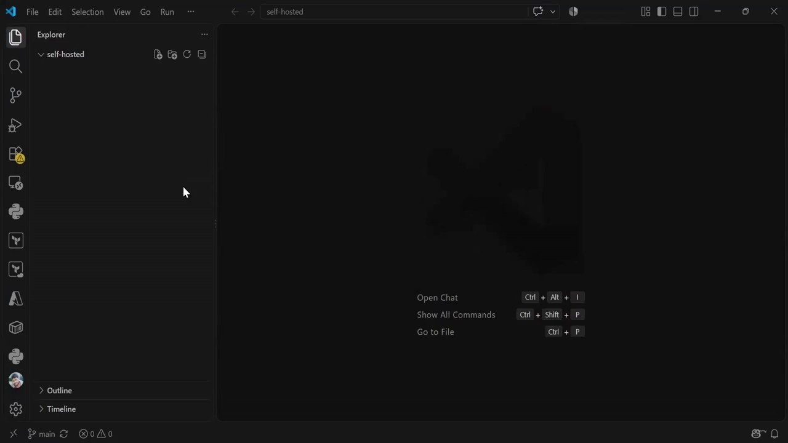

**Step 3｜写 `name` / `on` / `jobs` 三段骨架**

讲师先写 `name: Self Hosted Runner demo`，再写 `on: push`，然后进 `jobs`。

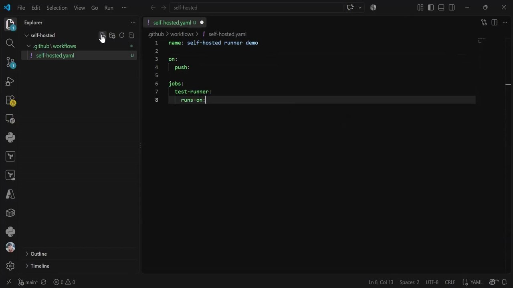

**Step 4｜`runs-on` 写 `self-hosted`**

这里是整节课的核心。`self-hosted` 不是 runner 的名字，而是**GitHub 在注册 runner 时默认打上的标签**。讲师特别解释了这一点：他注册时没有自己取额外的 tag，所以只能拿默认标签来调这台机器。

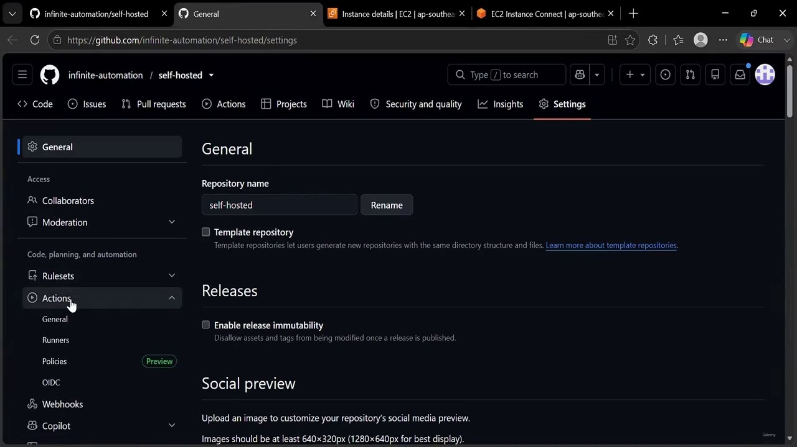

**Step 5｜步骤里跑多行 shell**

用一个 `run:` 配 `|`，连续跑三条命令：`echo`、`hostname`、`whoami`。

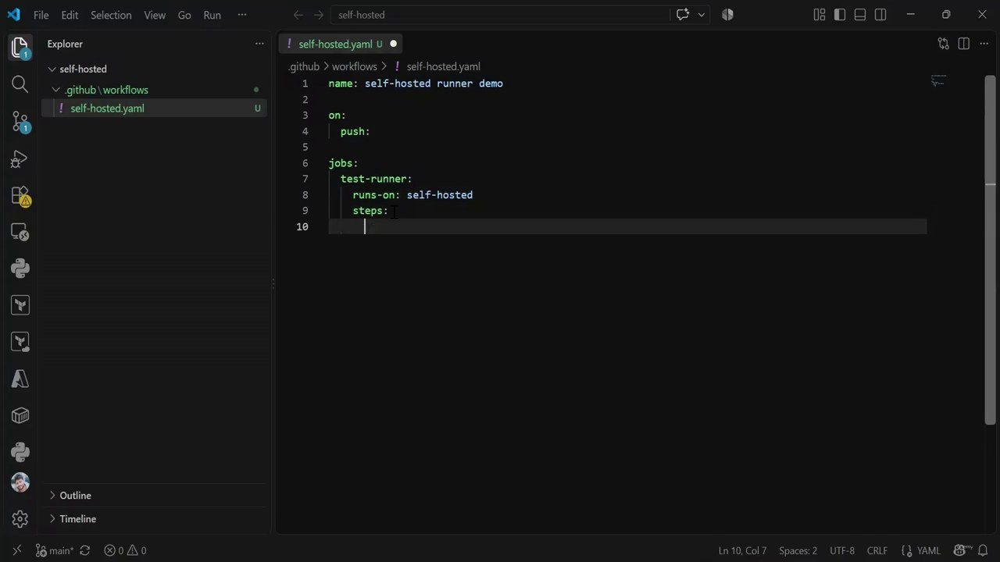

**Step 6｜提交并推送**

```bash
git add .
git commit -m "added the self-hosted runner workflow configuration"
git push
```

**Step 7｜在 GitHub Actions 页面验收**

进 Actions 标签页 → 点这次 run → 点 job `test-runner` → 展开步骤。要看三件事：

1. 日志里先出现 `hello from self hosted runner`；
2. `hostname` 打出来的应该是**你那台自托管机器的私有 IP**（讲师把它和 runner 列表里的 IP 对上了）；
3. `whoami` 打出来的应该是 runner 服务跑在哪个系统用户下（讲师那台输出的是 `ubuntu`）。

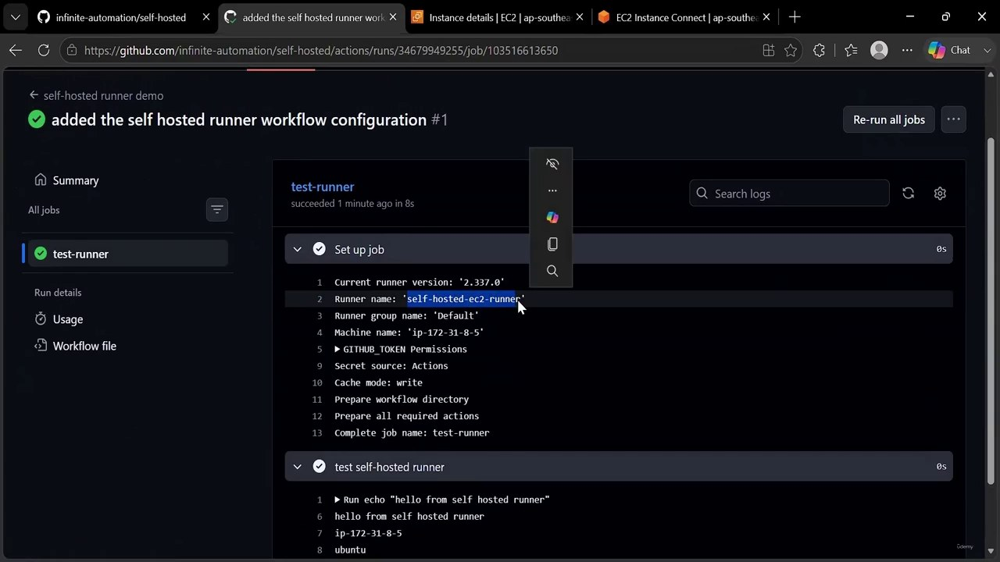

如果日志里 `hostname` 打印出来是 `fv-az...` 这种形式、`whoami` 是 `runner`，说明 `runs-on: self-hosted` 没生效、回落到 GitHub 云端 runner 了 —— 回去检查 YAML 缩进和标签拼写。

### 3.2 项目二 A：Slack 侧准备（P083）

这一段的顺序别乱，讲师的顺序就是最短路径。

**Step 1｜登录 Slack，建一个 workspace**

讲师的建议是 demo 单独建一个 workspace（他命名为 `integration`），接着填自己的用户名，邀请成员那步点 Don't Invite Anyone 跳过，套餐选 Free。

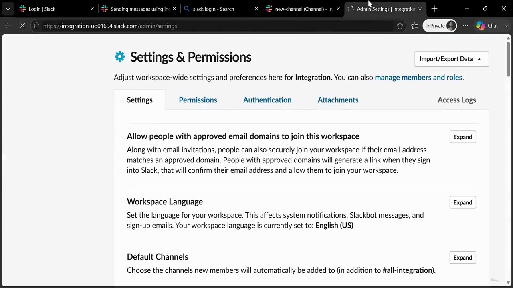

**Step 2｜在 workspace 里建频道**

频道名讲师取的是 `workflow-notification`（逐字稿念成 "工作流通知连字符通知"，实际就是一个连字符连接的频道名）。建的时候设为 Public，暂时不加人。他顺带提了一句真实项目里的做法：部署告警、生产告警、CI/CD 通知各开一个独立频道。

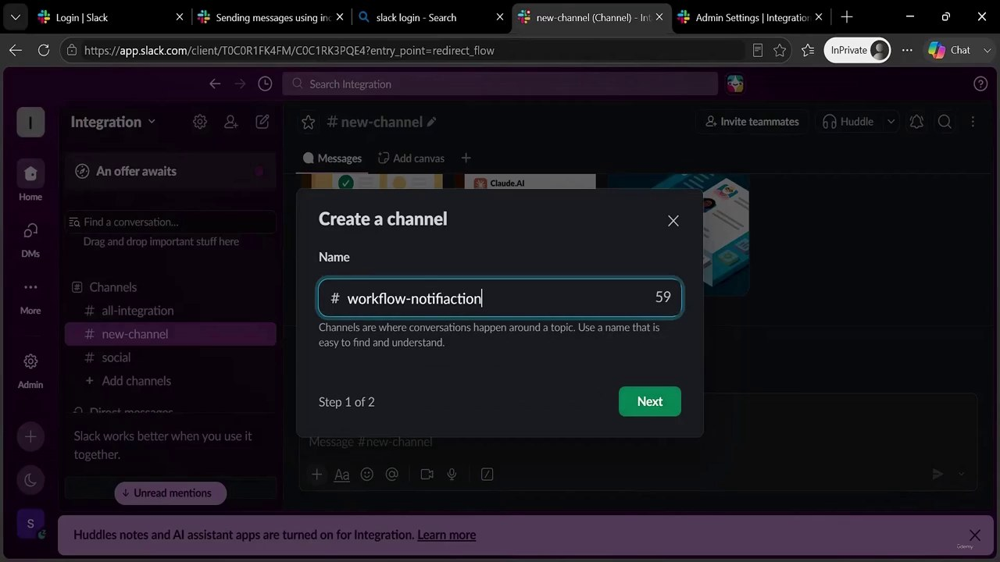

**Step 3｜去 Slack API 站点建一个 App**

打开 `api.slack.com/apps` → Create an app → 选 **From scratch**（不要用模板） → 填 App Name（讲师填 `workflow notification app`）→ 选你刚建的 workspace → Create。

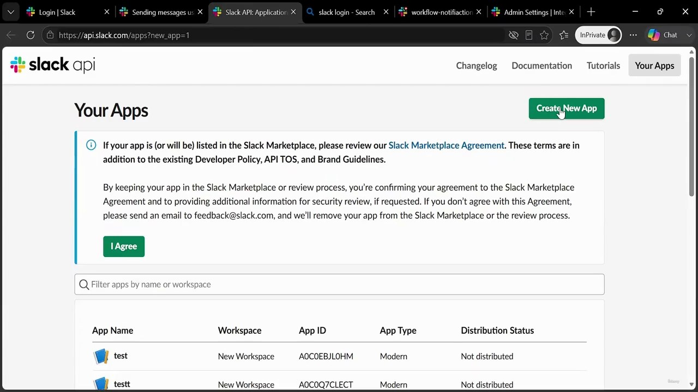

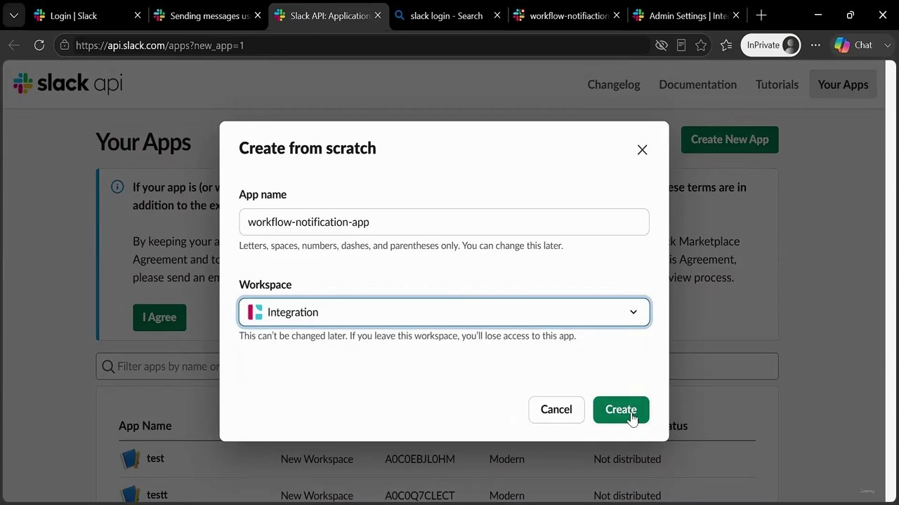

**Step 4｜开启 Incoming Webhooks 并生成 URL**

进入 App 的 settings 页 → 左侧 **Incoming Webhooks** → 把开关从 Off 打成 On → 滚到底部点 **Add New Webhook to Workspace** → 选择第 2 步建的频道 → Allow。页面会生成一条 `https://hooks.slack.com/...` 的 URL。

讲师强调了两点：① 这个 URL 本身就是授权凭证，**不需要**把 Slack 的账号密码交给 GitHub；② 一个 webhook 绑定一个频道，想发到别的频道就得再生成一条。

**Step 5｜把 URL 存进 GitHub Secrets**

复制那条 URL，回到 GitHub 仓库 → `Settings` → `Secrets and variables` → `Actions` → **New repository secret**，名字填 `SLACK_WEBHOOK_URL`（讲师原话是 "slack_webhook_URL"），值粘贴 URL，Add secret。

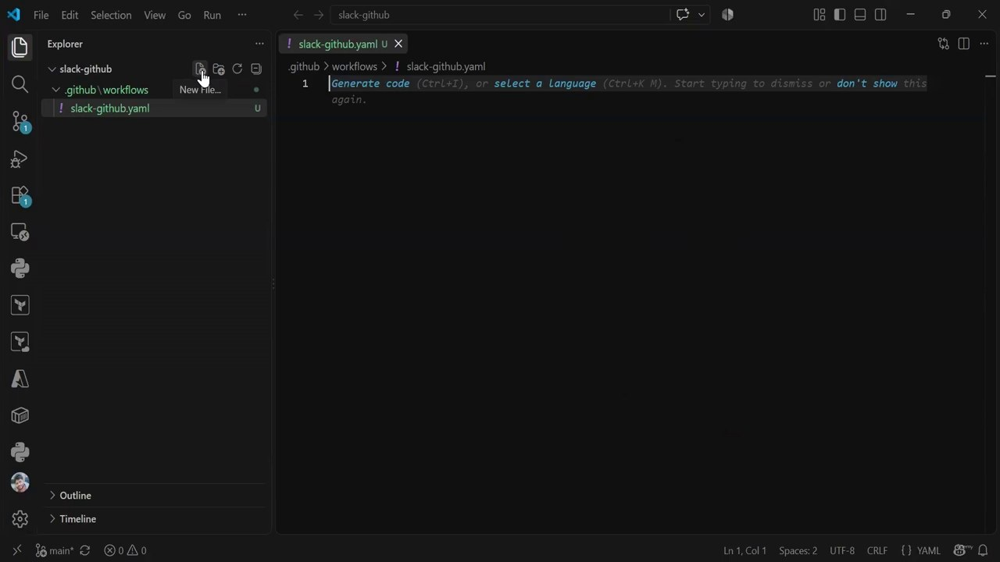

> 注意：secret 存进去之后**再也看不到明文**，只能覆盖重写。所以如果 URL 粘错了，不是"看一眼"，而是重新生成一条 webhook 覆盖进去。

### 3.3 项目二 B：写 workflow 并验证（P084）

**Step 1｜先写"只有成功通知"的版本**

文件：`.github/workflows/slack-github.yaml`（讲师建的 YAML 名叫 `slack`）。这一版 `build` 步骤只 `echo build complete`，一定会成功，方便你先确认链路通了。内容见第 4 节「代码 2A」。

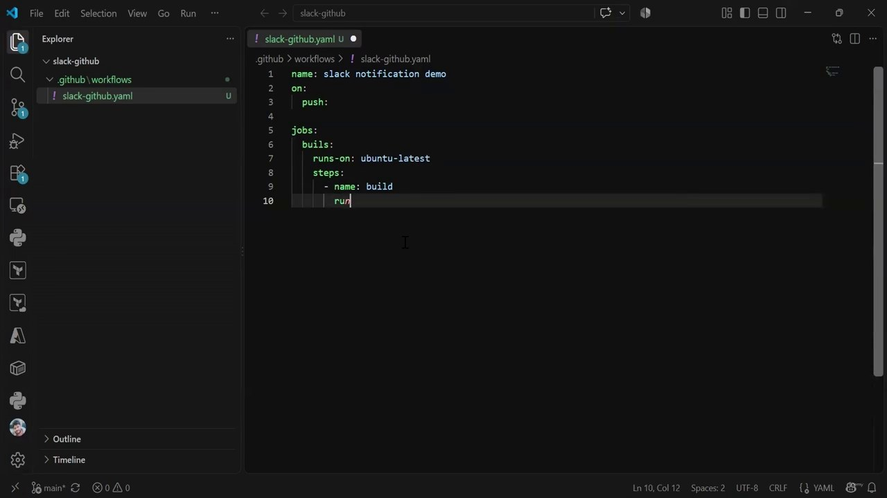

**Step 2｜成功步骤挂上 `if` 条件与复用 action**

动作是 `slackapi/slack-github-action@v4.0.0`（逐字稿念作 "Slack API、Slack GitHub Action，版本 v4.0.0"），`with` 里给三样东西：`webhook`（从 secret 取）、`webhook-type: incoming-webhook`、`payload`。

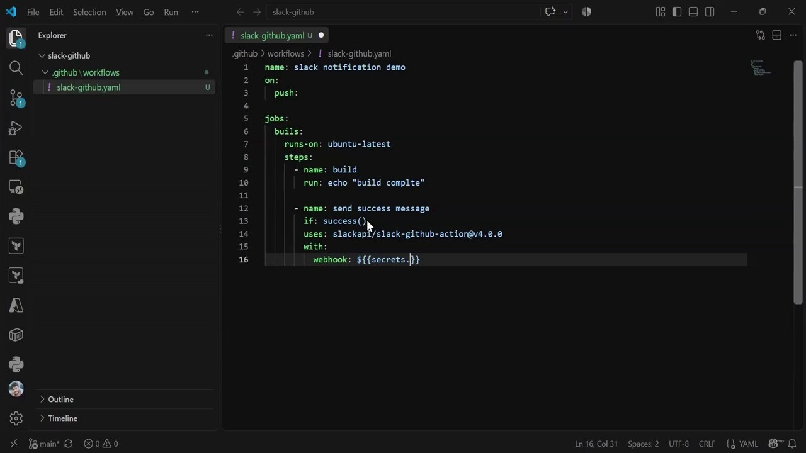

**Step 3｜提交推送，看 Actions 和 Slack 两边**

```bash
git add .
git commit -m "added the workflow integration"
git push
```

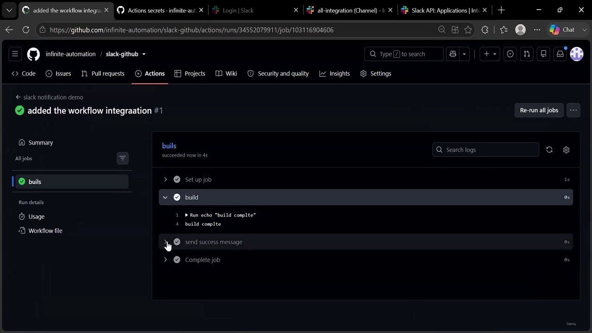

然后刷新 Slack 网页版，进 `workflow-notification` 频道，应该能看到 `workflow completed successfully`。

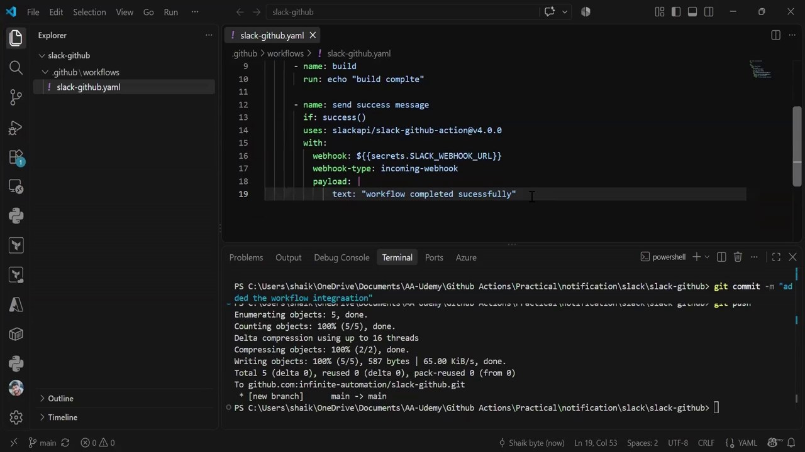

**Step 4｜故意让它失败，再补一条失败通知**

把 `build` 步骤的 `run:` 改成 `exit 1`，然后新增 `send failure notification` 步骤：`if` 用失败条件，action 和 `with` 的前两项跟成功步骤一模一样，payload 换成带 workflow 名、分支名、状态和 run URL 的多行文本。

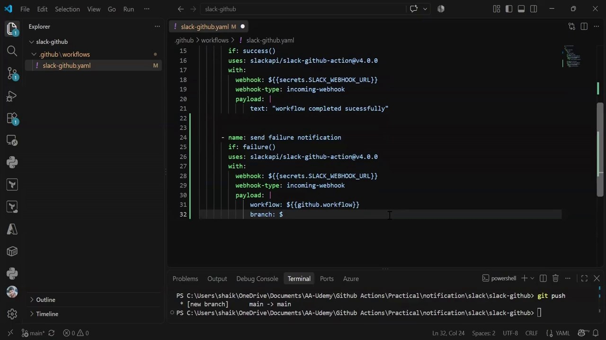

**Step 5｜再推一次，确认"成功步骤被 skip、失败步骤被执行"**

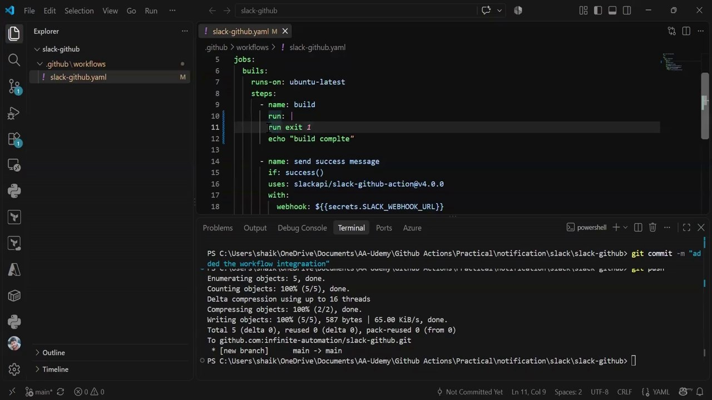

推送后进 Actions：`build` 失败，`send success message` 显示 skipped，`send failure notification` 执行。再回 Slack 刷新，这次收到的是带分支名 `main`、状态 `failure` 和可点击 run URL 的消息 —— 点 URL 会直接跳到那次失败的 job。

> **这里讲师踩了一个坑，你必须注意**：他第一次写失败通知时，payload 里没有用 `text:` 这个键，而是把 `workflows:` 之类的字段直接平铺，结果 GitHub Actions 侧步骤是"成功"的，但 **Slack 频道里什么也没收到**。把最外层改成 `text:` 之后消息立刻到了。这就是第 4 节代码 2B 里 payload 一定以 `text:` 开头的原因。

---

## 4. 完整代码

### 代码 1｜`.github/workflows/selfhosted.yaml`

```yaml
name: Self Hosted Runner demo

on: push

jobs:
  test-runner:
    runs-on: self-hosted
    steps:
      - name: Test self hosted runner
        run: |
          echo hello from self hosted runner
          hostname
          whoami
```

### 代码 2A｜`.github/workflows/slack-github.yaml`（第一版：只发成功通知）

```yaml
name: Slack notification

on: push

jobs:
  build:
    runs-on: ubuntu-latest
    steps:
      - name: build
        run: echo build complete

      - name: send success message
        if: success()
        uses: slackapi/slack-github-action@v4.0.0
        with:
          webhook: ${{ secrets.SLACK_WEBHOOK_URL }}
          webhook-type: incoming-webhook
          payload: |
            text: "workflow completed successfully"
```

### 代码 2B｜`.github/workflows/slack-github.yaml`（最终版：成功 + 失败通知）

```yaml
name: Slack notification

on: push

jobs:
  build:
    runs-on: ubuntu-latest
    steps:
      - name: build
        run: exit 1

      - name: send success message
        if: success()
        uses: slackapi/slack-github-action@v4.0.0
        with:
          webhook: ${{ secrets.SLACK_WEBHOOK_URL }}
          webhook-type: incoming-webhook
          payload: |
            text: "workflow completed successfully"

      - name: send failure notification
        if: failure()
        uses: slackapi/slack-github-action@v4.0.0
        with:
          webhook: ${{ secrets.SLACK_WEBHOOK_URL }}
          webhook-type: incoming-webhook
          payload: |
            text: |
              Workflow: ${{ github.workflow }}
              Branch: ${{ github.ref_name }}
              Status: ${{ job.status }}
              URL: https://github.com/OWNER/REPO/actions/runs/${{ github.run_id }}
```

> **必须替换**：`OWNER` 换成你的 GitHub 用户名/组织名，`REPO` 换成仓库名。逐字稿里这段 URL 是讲师从别处粘过来的、没有逐字念出来，只能确定它是「服务地址 + 仓库 + `/actions/runs/` + run ID」这个结构；不想拼就直接填你自己仓库 Actions 页面的地址前缀。

仓库里最终应该长这样：

```
<你的仓库>/
└── .github/
    └── workflows/
        ├── selfhosted.yaml        # 项目一
        └── slack-github.yaml      # 项目二
```

---

## 5. 逐行解释

### 5.1 `selfhosted.yaml`

- `name: Self Hosted Runner demo` —— workflow 显示名。它出现在 Actions 左侧列表和 Slack 消息的 `${{ github.workflow }}` 里，所以起个能认出来的名字。
- `on: push` —— 触发事件。这里是最简写法，任何分支任何 push 都会触发。要限定分支得写成 `on: push: branches: [main]`（**课里没讲**这种写法）。
- `jobs:` —— 所有 job 的容器。缩进两层，下面每个 key 是一个 job id。
- `test-runner:` —— job 的 id（讲师口述 "作业名称会是 test runner"）。这个 id 会成为 Actions 页面 URL 的一部分，用连字符是惯例；写成 `test runner` 带空格会报错。
- `runs-on: self-hosted` —— **整节课的重点**。值可以是单个标签，也可以是标签数组（`[self-hosted, linux]`）。这里只写 `self-hosted` 表示"交给任意一台注册时带了这个默认标签的机器"。如果只有一台，那就是它。注意：如果你有多台 runner 并且想固定某台，得在注册时自定义标签（讲师原话："你可以在创建 runner 时自定义标签"），然后 `runs-on` 写那个自定义标签。
- `steps:` —— 步骤数组，从上到下顺序执行。**step 之间是串行的**，这点和 job 之间默认并行不同。
- `- name: Test self hosted runner` —— 步骤显示名，出现在 Actions 日志的折叠标题上。
- `run: |` —— `|` 是 YAML 的块标量语法，表示"下面是多行字符串，保留换行"。这样一次 `run` 就能跑多条 shell 命令，等价于你在终端里敲了一个小脚本。讲师说的 "执行多 shell" 就是这个意思。
- `echo hello from self hosted runner` —— 打一行字，用来在日志里一眼定位到这个 step。
- `hostname` —— Linux 命令，打印主机名。在自托管机器上它通常解析成机器的私有 IP，所以讲师拿它去和 runner 列表里的 IP 做核对。
- `whoami` —— Linux 命令，打印当前用户名。用来确认 runner 服务是以哪个系统用户身份在跑。讲师原本还想加一条 `user`，最后说 "我们只保留 whoami"，只保留了 `whoami`。

> 给前端的一句话对照：`steps` 就是 `await` 串起来的顺序代码，`if:` 就是 `if (...) { ... }`；`jobs` 之间默认没有依赖关系，相当于几个 `Promise` 同时 `Promise.all`，要顺序执行得用 `needs:`（**课里没讲** `needs`）。

### 5.2 `slack-github.yaml`

- `name: Slack notification` —— workflow 名。它会出现在 Slack 消息体里。
- `on: push` —— 同上。
- `build:` —— job id，讲师口述 "作业名称是 build"。
- `runs-on: ubuntu-latest` —— 这里用的是 **GitHub 托管的云端 runner**，不是自托管。两个项目是独立的，别混淆。
- `- name: build` —— 第一步，模拟构建。
- `run: echo build complete` —— 第一版用这个，保证一定成功，方便先验证 Slack 链路。
- `run: exit 1` —— 最终版改成这个，`exit 1` 就是"以退出码 1 结束"，shell 的任何非零退出码都会被 Actions 判定为该步骤失败，进而让整个 job 失败。讲师原话："我们故意让这个构建步骤失败，这就是我们加上 exit 1 的原因"。
- `- name: send success message` —— 成功通知步骤。它**排在 build 之后**，所以只有 build 成功才会轮到它。
- `if: success()` —— 条件执行。讲师口述是 "这里的条件是 success"，YAML 里写成函数调用形式 `success()`（`failure()` 同理）。含义：前面所有步骤都成功跑完，才执行这一步。在 JS 里它对应 `try { ... } finally` 思路里的"正常分支"。
- `if: failure()` —— 前面有任意步骤失败则执行。对应 JS 里 `catch` 分支。**正是因为它，`build` 失败后 job 整体是红的，但失败通知仍然发得出去。**
- `uses: slackapi/slack-github-action@v4.0.0` —— 引用社区 action（复用别人写好的步骤，不用自己写 HTTP 请求）。`@v4.0.0` 是版本锁定，别写成 `@main`。
- `with:` —— 给 action 传参的块。
- `webhook: ${{ secrets.SLACK_WEBHOOK_URL }}` —— 从仓库 secret 注入。`${{ }}` 是表达式插值，`secrets.SLACK_WEBHOOK_URL` 对应你在 Settings 里建的那个 secret 名，**名字必须逐字一致**（secret 名大小写敏感）。
- `webhook-type: incoming-webhook` —— 告诉 action 这条 URL 属于 incoming webhook 类型。讲师原话："我们有一个 webhook 类型……这是传入 webhook"。
- `payload: |` —— 发给 Slack 的消息体，用块标量写成多行 YAML，action 会把它序列化后 POST 过去。
- `text: "..."` —— **payload 的必需外层键**。Slack incoming webhook 只认这个结构；没有 `text`，请求可能返回 200 但频道里什么都没有（讲师就是这么丢过一条消息的）。同理 `text: |` 是支持多行的写法。
- `Workflow: ${{ github.workflow }}` —— 插入 workflow 名（即 `Slack notification`）。
- `Branch: ${{ github.ref_name }}` —— 插入分支名，push 到 `main` 就是 `main`。
- `Status: ${{ job.status }}` —— 插入当前 job 状态，失败时是 `failure`。
- `URL: https://github.com/OWNER/REPO/actions/runs/${{ github.run_id }}` —— `github.run_id` 是本次运行的唯一 ID，拼在 `/actions/runs/` 后面就得到那次运行的直达链接，点进去正好落在失败的那个 job 上。

> 并发方面这四集没有涉及任何锁或事务，两个通知步骤是**同一条串行链上的两个分支**，任一时刻只会执行其中一个，不存在竞争。真正需要注意的是"两个 job 同时 push 到同一个频道"这种情况——课里没讲，见第 7 节。

---

## 6. 复现检查清单

**项目一：自托管 runner**

- [ ] 仓库里存在 `.github/workflows/selfhosted.yaml`（路径一层不差）
- [ ] YAML 里 `runs-on: self-hosted`，且 `self-hosted` 拼写与 runner 页面上的标签一字不差
- [ ] `Settings → Actions → Runners` 里能看到一台状态为 Idle/Online 的 runner
- [ ] push 之后 Actions 出现 `Self Hosted Runner demo` 这次运行
- [ ] 日志里能看到 `hello from self hosted runner`
- [ ] `hostname` 的输出 = 你在 runner 页面看到的私有 IP（不是你笔记本的公网 IP，也不是 `fv-az...`）
- [ ] `whoami` 的输出是那台机器的系统用户（讲师那台是 `ubuntu`）

**项目二：Slack**

- [ ] Slack workspace 建好，频道 `workflow-notification` 存在
- [ ] Slack App 已创建，**Incoming Webhooks 开关是 On**
- [ ] 已点过 Add New Webhook to Workspace，并且授权的是 `workflow-notification` 频道
- [ ] GitHub `Settings → Secrets and variables → Actions` 里有 `SLACK_WEBHOOK_URL`（名字完全一致）
- [ ] `.github/workflows/slack-github.yaml` 里 `webhook: ${{ secrets.SLACK_WEBHOOK_URL }}` 没有多余空格
- [ ] `webhook-type: incoming-webhook` 写上了
- [ ] `build` 步骤是 `echo build complete` 时，Slack 收到 `workflow completed successfully`
- [ ] 改成 `exit 1` 后，Actions 里 `send success message` 显示 skipped、`send failure notification` 执行
- [ ] Slack 收到第二条消息，含 Workflow / Branch / Status / URL，且 URL 点得进那次失败的 run
- [ ] 最终版 payload 的最外层键是 `text:`（不是 `workflows:` 也不是平铺字段）

---

## 7. 课里没讲但你会撞上的

**1）runner 怎么装、怎么注册 —— 完全没讲。**
P081 一开始 runner 就已经在那了。你需要自己在 `Settings → Actions → Runners → New self-hosted runner` 里拿到安装命令（下载包 + `config` + `run` 三步），讲师只提了一句宏观流程："把 runner 包下载到 runner 里，然后我们需要配置它"。另外 `./run.sh` 是前台进程，关掉终端就断线；生产上要装成系统服务（页面里会给出对应的 `svc.sh` 命令）。这部分以 GitHub 页面给出的命令为准，别照抄网上的旧教程。

**2）`runs-on: self-hosted` 在多 runner 场景下是"随便挑一台"。**
如果你有多台带这个默认标签的机器，GitHub 会挑任意一台空闲的，构建环境的差异会让你的构建随机失败。正确做法是注册时加自定义标签（例如 `gpu-runner`），然后 `runs-on: [self-hosted, gpu-runner]`。讲师在 P081 最后确实提到了可以自定义标签，但没演示。

**3）自托管 runner 扛公开仓库 = 安全灾难。**
任何人 fork 你的公开仓库提 PR，都能在**你的机器上执行任意代码**（你的磁盘、你的内网、你的云凭证）。自托管 runner 只配私有仓库用。这条课里完全没提。

**4）`if:` 的条件写法容易写错。**
`if: success` / `if: failure` 这种不带括号的写法会被当成字符串字面量，永远为真，导致两个通知步骤都执行，Slack 里一条成功一条失败两条消息同时出现。用 `success()` / `failure()`。想更灵活可以用 `if: ${{ failure() }}` 或 `if: github.ref == 'refs/heads/main'`（后者课里没讲）。

**5）payload 少写 `text:` 时不报错、也没消息。**
这是课程的实战坑：Actions 显示步骤绿色通过，Slack 里一片空白。排查顺序永远是——先看 Actions 里该步骤的日志有没有 HTTP 错误码，再检查 payload 最外层是不是 `text:`，最后确认 webhook 绑的频道是不是你现在看的这个频道（webhook 是绑死频道的，发到别的频道不会成功）。

**6）`github.run_id` 拼出来的 URL 少了 owner/repo 就是死链。**
逐字稿里这段是"粘过来的"，没有逐字念，所以你照抄讲义大概率拼错。最稳的做法：先去自己仓库的 Actions 页面打开任意一次运行，把地址栏里 `https://github.com/<owner>/<repo>/actions/runs/` 这一段复制下来，再在末尾加 `${{ github.run_id }}`。

**7）secret 在 fork 的 PR 里读不到。**
来自 fork 的 `pull_request` 事件默认拿不到 secrets，你的 Slack 步骤会静默失败。课里只演示了 `push`，所以碰不到这个边界。

**8）别把 webhook URL 贴进 Issue、日志、截图。**
它等价于"往这个频道发消息"的长期凭证。一旦泄露，去 Slack App 的 Incoming Webhooks 页面把那条 webhook 删掉，重新生成一条，覆盖 GitHub secret 即可（secret 无法查看明文，只能覆盖）。讲师在 P082 强调过 "我们不应该直接把它加到我们的 YAML 文件里"，但没讲泄露后的处置流程。

**9）`ubuntu-latest` 会漂移。**
它指向的镜像版本随 GitHub 更新，今天能跑的脚本半年后可能因为某个工具升级而挂。要稳定就钉死具体版本（如 `ubuntu-22.04`）。这四集用的是 `ubuntu-latest`，课里没讨论版本漂移问题。

**10）两个 workflow 同时 push 会同时往一个频道刷消息。**
如果你把项目一和项目二写在同一个仓库、一次 push 触发两个 workflow，Slack 会收到两条消息，且**到达顺序不确定**。课里两个项目分属两个仓库所以没这个问题。想控制并发，GitHub Actions 提供 `concurrency` 配置（课里没讲；概念上类似给你的 workflow 加一把按 key 命名的互斥锁，在 JS/Node 里对应一个"同一时刻只允许一个任务持有"的 mutex）。