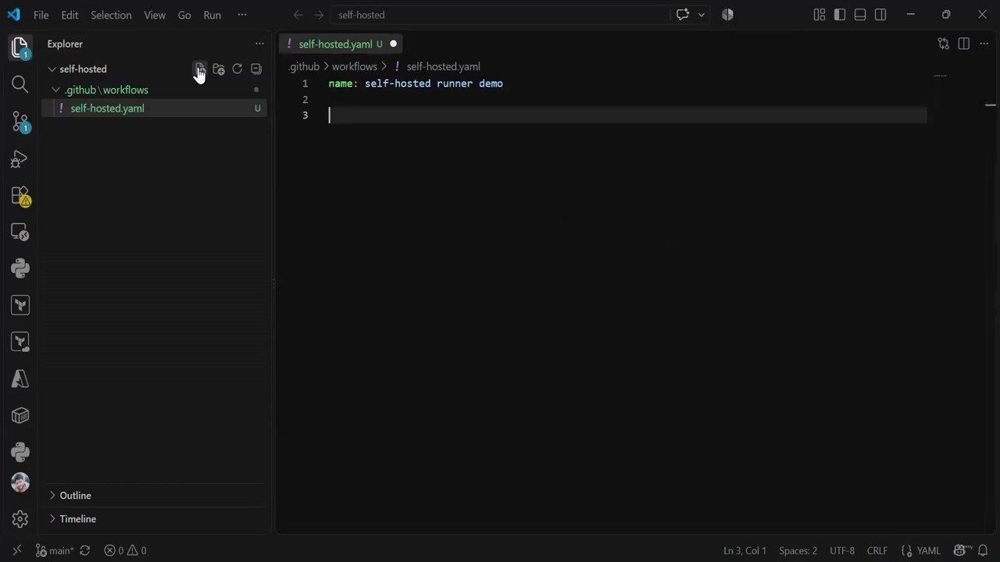
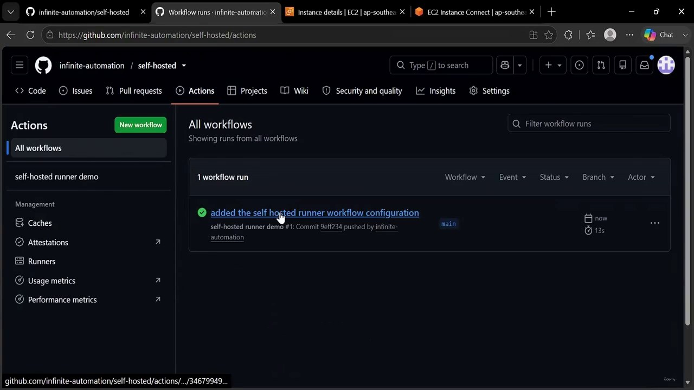
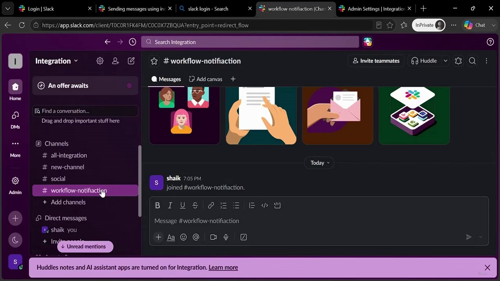
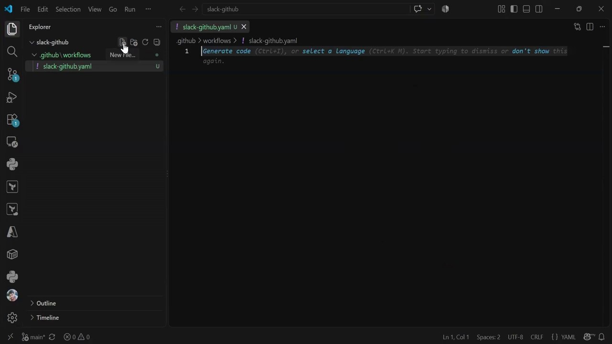
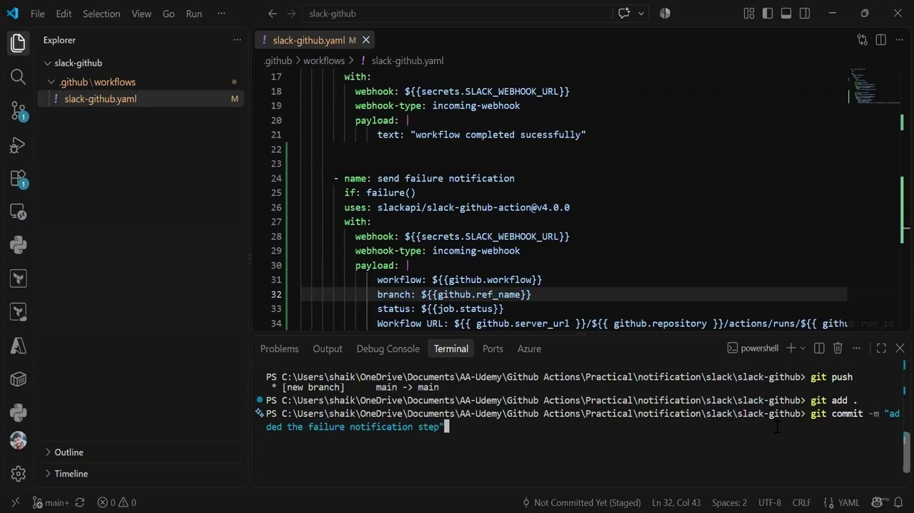
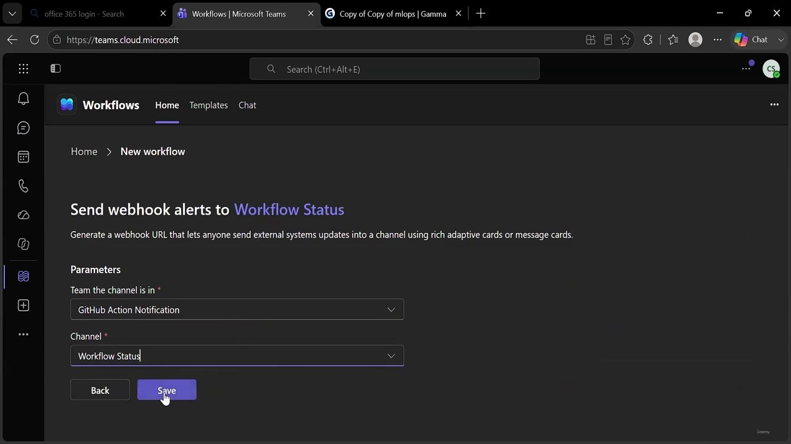
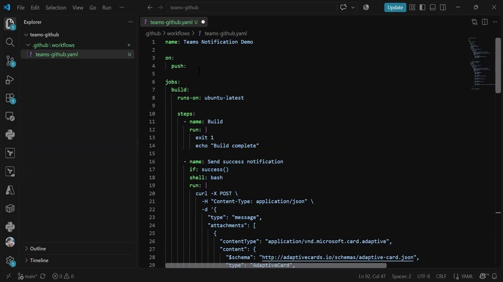
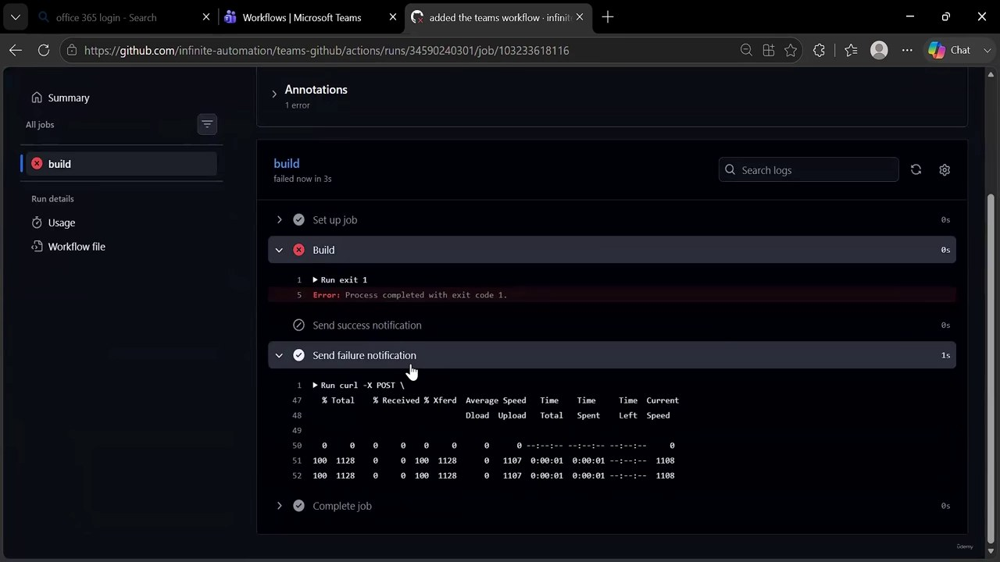

## 1. 这一节做什么

这 6 个视频（P81–P86）不是讲零散知识点，而是把 GitHub Actions 的三种“把流水线接到外部世界”的做法各跑一遍：

1. **P81：把 workflow 跑在 self-hosted runner 上**  
   在 GitHub 仓库里创建 `.github/workflows/selfhosted.yaml`，让 job 使用 `runs-on: self-hosted`，从而落到你自己配置的机器上执行。课里最终在 Actions 日志里看到 runner 版本、runner 名称、机器私网 IP、`whoami` 输出 `Ubuntu`。

2. **P82–P84：GitHub Actions 通知 Slack**  
   先在 Slack 创建 workspace、channel、Slack App、Incoming Webhook；再把 webhook URL 存进 GitHub Secrets；最后在 workflow 里用 `slackapi/slack-github-action@v4.0.0` 发成功/失败消息。课里专门演示了“成功时发一条，失败时发 workflow 名称、分支、状态、workflow URL”。

3. **P85–P86：GitHub Actions 通知 Microsoft Teams**  
   在 Teams 里创建 team/channel，用 “send webhook alerts to channel” 生成 webhook URL；把 URL 存进 `teams_webhook_URL`；workflow 里用 `curl` 向 Teams webhook 发 Adaptive Card。课里故意 `exit 1` 让 build 失败，验证失败通知能到 Teams 频道。

读者照着做时，建议开 **三个独立 GitHub 仓库**：  
- `self-hosted-runner-demo`  
- `slack-github`  
- `teams-github`  

不要混在一个仓库里，否则 workflow 会互相触发，排查时很乱。这里再补充一句：分开仓库的目的不是技术上的强制要求，而是让每次 push 只触发当前实验对应的 workflow，日志和 Secrets 也更容易对照；如果混在一起，Slack 和 Teams 的通知步骤可能同时执行，失败时不容易判断是哪条链路出的问题。

---

## 2. 讲师原话（带「—— pNNN [MM:SS]」）

下面只摘和“怎么复现”直接相关的原话，不按视频顺序流水账，按项目归类。

**关于 self-hosted runner：**

> "现在我们来添加 job 部分。job 名称设为 test runner。我们使用 runs on。这里需要指定 self hosted。"
> —— p081 [01:25]

> "因为我们只给了 runner 名称，没有给 runner 标签，而在配置 runner 时，我们用的是 GitHub 默认给的标签。"
> —— p081 [01:52]

> "如你所见，当前版本是 2.337.0，这是 runner 名称，它是一个 self-hosted runner，与我们之前在 GitHub 中添加的 self-hosted runner 配置相匹配。"
> —— p081 [05:10]

> "第一项打印了 hello from self-hosted render，然后给出了主机名，与我们的私有 IP 匹配，用户是 Ubuntu。"
> —— p081 [06:08]

**关于 Slack 的整体链路：**

> "GitHub Action 通过 Slack webhook 发送消息，我们在 Slack 频道中接收。"
> —— p082 [00:29]

> "首先，我们配置 Slack 并创建 incoming webhook。其次，将 webhook URL 安全地存储在 GitHub Secrets 中。最后，在工作流中添加 Slack 通知步骤。"
> —— p082 [01:24]

> "到这里 Slack 那边一切就绪，但 GitHub Action 仍然不知道我们创建的 Slack 工作区。"
> —— p083 [05:09]

**关于 Slack workflow 和失败通知：**

> "我们没有把它加到 ML 文件里，因为这是敏感信息。我们不希望把这些信息暴露在 ML 文件中，所以把它加到了 GitHub secrets 里。"
> —— p084 [01:52]

> "如你所见，我们的构建失败了，因为我们故意加了 exit one。因此退出码表明它必须失败，这就是这个步骤失败的原因。如你所见，send success message 被跳过了，但 send failure notification 步骤被执行了。"
> —— p084 [14:42]

**关于 Teams：**

> "首先，我们在 Microsoft Teams 中创建 webhook。然后，将 webhook URL 安全地存储在 GitHub Action Secrets 中。之后，配置 GitHub Action 工作流向 Teams 发送通知。"
> —— p085 [00:56]

> "在这个请求中，我们发送的是 adaptive code。这基本上是一种消息格式，控制我们想在 Teams 中显示哪些信息。"
> —— p086 [04:22]

> "对于失败工作流，我们在 body 层发送更有用的信息，比如工作流名称、分支、job 状态和工作流 URL。"
> —— p086 [04:52]

---

## 3. 从零复现

### 3.1 通用准备

你需要：

- 一个 GitHub 账号；
- 本机安装 Git；
- 本机安装 VS Code（课里用 VS Code 编辑 YAML）；
- 一个 Slack 账号；
- 一个 Microsoft 365 商业账号下的 Microsoft Teams（课里明确提醒：个人版 Teams 可能没有某些功能）。

先在本地准备仓库：

```bash
git clone https://github.com/<你的账号>/<仓库名>.git
cd <仓库名>
mkdir -p .github/workflows
```

这几条命令的完整解释如下：`git clone` 的作用是把 GitHub 上的远程仓库复制到本地，后面的 URL 必须替换成你自己的仓库地址；如果仓库是私有仓库，Git 会要求你登录或使用已配置的凭据。`cd <仓库名>` 是切换到刚克隆下来的仓库目录，后续所有文件操作都应该在这个目录里进行。`mkdir -p .github/workflows` 是创建 `.github` 下面的 `workflows` 目录，`-p` 表示父目录不存在时一并创建，而且目录已存在时不会报错。常见错误是只创建了 `.github/workflow` 单数目录，GitHub Actions 不会识别；另一个常见错误是没有在仓库根目录执行命令，导致 workflow 文件放到了错误的层级。与前台的对照是：打开 GitHub 仓库网页，点击 Code 按钮可以看到 clone URL；推送后网页上的仓库文件列表里应该能看到 `.github/workflows/` 目录。

课里创建目录结构的原话是：

> "我们来创建 .github 和 workflow 目录。在 workflow 目录中，创建 .yaml 文件。"
> —— p081 [00:29]

注意目录名是 `.github/workflows`，不是 `.github/workflow`。GitHub 只识别 `workflows` 复数目录。



---

### 3.2 项目一：self-hosted runner

#### 第一步：创建 workflow 文件

在仓库根目录执行：

```bash
mkdir -p .github/workflows
touch .github/workflows/selfhosted.yaml
```

`mkdir -p .github/workflows` 的作用和上面一样，是确保目录存在；`touch .github/workflows/selfhosted.yaml` 是创建一个空的 YAML 文件。`touch` 不会覆盖已有内容，如果文件已经存在，它只会更新时间戳。常见错误是文件名拼错，例如 `selfhosted.yml` 和 `selfhosted.yaml` 虽然都能被 GitHub 识别，但课里统一使用 `.yaml`，复现时建议保持一致，避免自己在对照截图时找不到文件。与前台的对照是：在 GitHub 网页的仓库文件列表中，进入 `.github/workflows/` 后应该能看到 `selfhosted.yaml`。

文件内容见第 4 节完整代码。

#### 第二步：在 GitHub 上配置 self-hosted runner

课里没有逐条演示 runner 安装命令，只说明了入口和结果：

> "我们需要进入 settings、actions，指定将 runner 包下载到 runner 中，然后进行配置。"
> —— p081 [06:36]

实际操作入口：

1. 打开 GitHub 仓库；
2. `Settings` → `Actions` → `Runners`；
3. 点击 `New self-hosted runner`；
4. 选择目标机器的操作系统和架构；
5. GitHub 页面会生成下载、解压、`config.sh`、`run.sh` 命令。**请直接复制页面上的命令**，不要照抄本文的占位符。

命令形状如下，仅示意，`<VERSION>`、`<RUNNER_TOKEN>`、`<owner>/<repo>` 必须换成页面给你的值：

```bash
mkdir actions-runner && cd actions-runner

# 下面这一行的文件名和版本号以 GitHub 页面为准
curl -o actions-runner-linux-x64-<VERSION>.tar.gz -L \
  https://github.com/actions/runner/releases/download/v<VERSION>/actions-runner-linux-x64-<VERSION>.tar.gz

tar xzf ./actions-runner-linux-x64-<VERSION>.tar.gz

./config.sh --url https://github.com/<owner>/<repo> --token <RUNNER_TOKEN>
./run.sh
```

这段命令需要逐条理解：`mkdir actions-runner && cd actions-runner` 是创建并进入 runner 安装目录；`curl -o ... -L ...` 是把 GitHub 页面给出的 runner 压缩包下载到本地，`-o` 指定保存文件名，`-L` 允许跟随重定向；`tar xzf ...` 是解压 `.tar.gz` 压缩包；`./config.sh --url ... --token ...` 是把当前机器注册到指定仓库，`--url` 指向仓库地址，`--token` 是 GitHub 页面生成的一次性注册令牌；`./run.sh` 是启动 runner 进程。常见错误包括：选错操作系统或架构导致包无法运行；`--token` 过期，通常需要回到 GitHub 页面重新生成；没有执行 `./run.sh` 或执行后终端关闭，导致 runner 离线；在错误的目录执行 `./config.sh`，提示找不到文件。与前台的对照是：GitHub 的 `Settings → Actions → Runners` 页面既生成这些命令，也显示 runner 的 Online/Idle 状态；如果页面显示离线，Actions 里的 job 就会一直排队。

课里 Actions 运行页显示 runner 版本是 `2.337.0`，你可以用这个信息判断自己机器上的 runner 是否和课程环境接近，但安装时仍以 GitHub 页面生成的版本为准。

#### 第三步：确认 runner 标签

课里特别解释了为什么 workflow 里写 `self-hosted`：

> "因为我们只给了 runner 名称，没有给 runner 标签……我们用的是 GitHub 默认给的标签。"
> —— p081 [01:52]

GitHub 默认会给 self-hosted runner 打上 `self-hosted` 标签。你的 workflow 写：

```yaml
runs-on: self-hosted
```

就会匹配到该 runner。如果你在配置 runner 时自己加了自定义标签，也可以写成：

```yaml
runs-on: [self-hosted, linux, x64]
```

但课里只用了默认的 `self-hosted`，所以本文按课里写法复现。这里要特别区分“runner 名称”和“runner 标签”：名称是你在配置时给这台机器的标识，标签是 workflow 用来选择机器的条件。常见错误是把 `runs-on` 写成 runner 名称，但该名称并没有作为标签存在，结果 job 一直 queued。排查时到 `Settings → Actions → Runners` 点进 runner，查看它实际拥有的标签，再让 `runs-on` 与标签一致。

#### 第四步：提交并推送

```bash
git add .
git commit -m "added the self-hosted runner workflow configuration"
git push
```

`git add .` 是把当前目录下新增和修改的文件加入暂存区；`git commit -m "..."` 是生成一次提交，引号里是提交说明；`git push` 是把本地提交推送到 GitHub 远程仓库。常见错误是当前目录不在仓库根目录，导致 `git add` 没有加入 workflow 文件；或者没有配置远程仓库和登录凭据，`git push` 被拒绝。与前台的对照是：推送成功后，GitHub 仓库网页的文件列表会出现新提交，Actions 页面会自动出现一次新的 workflow run。

课里原话：

> "我们使用 git add 和 git commit -m "添加自托管运行器工作流配置"。现在执行 git push。"
> —— p081 [03:18]

推送后打开 GitHub 仓库的 `Actions` 页，应该能看到 `Self Hosted Runner demo` 这次运行。点进 job，展开步骤，应该看到类似输出：

```text
hello from self hosted runner
<机器 hostname>
<当前用户>
```

课里看到用户是 `Ubuntu`，并且 hostname 与机器私网 IP 对应。如果看不到这次运行，先检查 workflow 文件是否真的在 `.github/workflows/` 下，再检查 YAML 是否被 GitHub 识别；如果运行出现但一直 queued，则优先检查 runner 是否在线以及标签是否匹配。



---

### 3.3 项目二：Slack 通知

#### 第一步：创建 Slack workspace 和 channel

课里为了演示，单独创建了一个 workspace，名字叫 `integration`。实际公司里通常直接用公司 workspace，不需要新建。

操作顺序：

1. 打开 Slack 网站并登录；
2. 如果没有 workspace，选择创建 workspace；
3. workspace 名称填 `integration`（课里演示名）；
4. 创建一个 channel，课里命名为 `workflow-notification`；
5. channel 类型选 public，课里没有邀请其他人，直接跳过。

课里说：

> "我们把频道命名为 workflow notification hyphen notification。这个频道将用于 GitHub Actions 通知。"
> —— p083 [04:09]

这一步没有命令行操作，全部在 Slack 网页前台完成。常见错误是 channel 创建成了 private，后续添加 webhook 时找不到或权限不对；或者 workspace 选错，导致 webhook 发到了另一个 workspace。与前台的对照是：Slack 左侧 channel 列表里应出现 `workflow-notification`，后面 Incoming Webhook 授权时也要选中这个 channel。

#### 第二步：创建 Slack App 并开启 Incoming Webhook

1. 打开 Slack API 网站；
2. 点击 `Create an app`；
3. 选择 `From scratch`；
4. App Name 填 `workflow notification app`；
5. Workspace 选择刚才的 `integration`；
6. 进入 App 设置后，找到 `Incoming Webhooks`；
7. 把 `Activate Incoming Webhooks` 打开；
8. 点击 `Add New Webhook to Workspace`；
9. 选择 channel `workflow-notification`；
10. 点击 `Allow`；
11. 复制生成的 Webhook URL。

课里强调这个 URL 很敏感：

> "这里是 webhook，这个 URL webhook 非常重要。GitHub Action 将使用这个 URL 向 Slack 发送消息。"
> —— p083 [09:05]

这里的“敏感”是指 webhook URL 本身相当于向该 channel 发消息的凭据，不应该直接写进 YAML 提交到仓库。常见错误是只创建了 Slack App 但没有激活 Incoming Webhooks；或者添加 webhook 时选错 channel；或者复制 URL 时漏掉字符。与前台的对照是：Slack API 的 Incoming Webhooks 页面会列出已添加的 webhook，GitHub Actions 运行后对应 channel 应收到消息。



#### 第三步：把 webhook URL 存进 GitHub Secrets

1. 打开 GitHub 仓库；
2. `Settings` → `Secrets and variables` → `Actions`；
3. 点击 `New repository secret`；
4. Name 填 `slack_webhook_URL`；
5. Secret 填刚才 Slack 复制的 webhook URL；
6. 点击 `Add secret`。

课里原话：

> "名称是 slack underscore webhook underscore URL。就是这个，这是 Webhook URL。我们没有把它加到 ML 文件里，因为这是敏感信息。"
> —— p084 [01:23]

注意：Secret 名称大小写要和你 YAML 里 `${{ secrets.slack_webhook_URL }}` 完全一致。课里是口述，实际创建时建议你统一成 `SLACK_WEBHOOK_URL` 或 `slack_webhook_URL`，但两处必须一致。常见错误是 Secret 名字写成 `slack_webhook_url` 而 YAML 里写 `slack_webhook_URL`，GitHub 不会报“名字拼错”，只会把未定义 secret 解析为空，最终 Slack 收不到消息或 action 报错。与前台的对照是：GitHub 的 Secrets 页面只显示 secret 名称，不显示值；创建后无法查看原值，只能更新。



#### 第四步：写 Slack workflow

完整 YAML 见第 4 节。核心结构：

- `name: Slack notification demo`
- `on: push`
- job `build` 跑在 `ubuntu-latest`
- 第一步 `Build` 执行 `echo "build complete"`
- 第二步 `Send success message`，`if: success()`，调用 `slackapi/slack-github-action@v4.0.0`
- 第三步 `Send failure notification`，`if: failure()`，同样调用 action，但 payload 带 workflow、branch、status、workflow URL

课里一开始只写了成功消息，后来为了验证失败通知，把 build 步骤改成 `exit 1`，并新增失败步骤。课里还踩了一个坑：失败 payload 一开始没有加 `text:` 根字段，Slack 没收到消息；补上 `text:` 后才收到。

> "所以不是用 text，我们稍微添加了所有工作流。我们应该把它作为 text 添加，这样它就会执行我们所有的工作流运行。"
> —— p084 [16:10]

这里的排查重点是：`if: success()` 和 `if: failure()` 控制步骤是否执行；`exit 1` 让 shell 返回非零状态码，GitHub Actions 会把该步骤标记为失败；失败通知步骤如果写了但没收到消息，先看 Actions 日志里该步骤是否执行，再检查 secret 名称、webhook URL 和 payload 根字段 `text:` 是否存在。

#### 第五步：验证成功通知

先保持 build 成功：

```yaml
- name: Build
  run: echo "build complete"
```

推送后打开 Actions，应该看到：

- `Build` 成功；
- `Send success message` 执行；
- Slack 的 `workflow-notification` channel 收到 `workflow completed successfully`。

常见错误是 push 后只看了 Slack 没看 Actions：如果 Actions 里 `Send success message` 根本没执行，问题在 workflow 触发或步骤条件；如果步骤执行了但 Slack 没消息，问题在 webhook 或 secret。与前台的对照是：Actions 页面看步骤状态，Slack channel 看最终消息，两边要一起对照。

#### 第六步：验证失败通知

把 build 改成故意失败：

```yaml
- name: Build
  run: exit 1
```

再推送。此时 Actions 里应该看到：

- `Build` 失败；
- `Send success message` 被 skipped；
- `Send failure notification` 执行；
- Slack 收到包含 workflow 名称、分支、状态、workflow URL 的消息。

如果失败通知没到，先确认 `Send failure notification` 是否真的执行；如果执行了但 Slack 没收到，检查失败 payload 是否有 `text:` 根字段，以及 `secrets.slack_webhook_URL` 是否和 Secrets 页面名称完全一致。



---

### 3.4 项目三：Microsoft Teams 通知

#### 第一步：创建 Teams team 和 channel

课里明确说使用 Microsoft 365 商业账号：

> "我用的是企业账户，不是个人账户。如果你用的是个人账户，Microsoft Teams 个人版可能不支持某些功能。"
> —— p085 [01:55]

操作：

1. 打开 Microsoft Teams；
2. 点击 `See all your Teams`；
3. 创建 team，名称填 `GitHub Actions notifications`；
4. channel 名称填 `workflow status`；
5. 创建完成后进入该 channel。

这一步全在 Teams 前台完成。常见错误是使用个人版 Teams，导致找不到课里演示的 workflow/webhook 功能；或者 team 和 channel 名称与后续选择不一致。与前台的对照是：创建完成后，Teams 左侧应出现 `GitHub Actions notifications` team，下面有 `workflow status` channel。

#### 第二步：创建 Teams webhook

课里的路径是：

1. 在 Teams 左侧点击 `+`；
2. 进入 `Apps and workflows`；
3. 点击 `Workflows`；
4. 点击齿轮/管理 workflows；
5. 选择 `Create workflow`；
6. 选择 `Send webhook alerts to channel`；
7. Team 选择 `GitHub Actions notifications`；
8. Channel 选择 `workflow status`；
9. 保存；
10. 复制生成的 webhook URL。

课里原话：

> "我们需要选择这个选项，叫做 send web book alerts to channel……然后保存。如你所见，我们的 Teams 工作流已成功创建……我们可以复制 webhook URL。"
> —— p085 [03:19]

这里的“Workflows”是 Teams 里的自动化模板入口，不是 GitHub Actions 的 workflow。常见错误是把 GitHub Actions 的 YAML 和 Teams 的 workflow 模板混为一谈；或者在 Teams 里创建了模板但没有复制最终 webhook URL。与前台的对照是：Teams 的 workflow 创建完成后会给出 webhook URL，GitHub Actions 侧只是把这个 URL 存进 Secrets，然后由 `curl` 调用。



#### 第三步：把 Teams webhook URL 存进 GitHub Secrets

1. GitHub 仓库 → `Settings`；
2. `Secrets and variables` → `Actions`；
3. `New repository secret`；
4. Name 填 `teams_webhook_URL`；
5. Value 粘贴 Teams webhook URL；
6. `Add secret`。

这里的名称必须和 YAML 里的 `${{ secrets.teams_webhook_URL }}` 一致。常见错误同样是大小写不一致；另外 Teams webhook URL 很长，复制时容易多带空格或漏字符，建议粘贴后不要手动改动。与前台的对照是：GitHub Secrets 页面创建成功后只显示名称，Teams 频道暂时不会收到消息，必须等 workflow 运行到 `curl` 步骤才会发消息。

#### 第四步：写 Teams workflow

完整 YAML 见第 4 节。结构：

- `name: Teams notification demo`
- `on: push`
- job `build` 跑在 `ubuntu-latest`
- 第一步 `Build` 故意 `exit 1`
- 第二步 `Send success notification`，`if: success()`，用 `curl` 向 Teams webhook 发 Adaptive Card
- 第三步 `Send failure notification`，`if: failure()`，发 workflow、branch、status、workflow URL

课里说 Teams 消息用的是 Adaptive Card：

> "在这个请求中，我们发送的是 adaptive code。这基本上是一种消息格式，控制我们想在 Teams 中显示哪些信息。"
> —— p086 [04:22]

`curl` 命令的完整解释是：`-H "Content-Type: application/json"` 设置请求头，告诉 Teams 请求体是 JSON；`-d '{ ... }'` 传入 JSON 数据；最后的 `"${{ secrets.teams_webhook_URL }}"` 是请求目标地址。常见错误包括：JSON 里的双引号没有正确转义、payload 外层缺少 Teams 要求的包装字段、webhook URL 失效或选错 channel。与前台的对照是：Actions 日志里能看到 `curl` 请求是否成功，Teams 的 `workflow status` channel 里能看到卡片消息。

课里没有逐字展示完整 Adaptive Card JSON，只展示了它包含 workflow name、branch、job status、workflow URL。本文第 4 节给出一个可运行的 JSON 模板；如果你的 Teams Workflow 模板要求字段不同，以 Teams 页面生成的模板为准。

#### 第五步：验证失败通知

因为 build 里写了：

```yaml
run: exit 1
```

所以每次 push 都会失败。Actions 里应该看到：

- `Build` 失败；
- `Send success notification` skipped；
- `Send failure notification` 执行；
- Teams 的 `workflow status` channel 收到消息。

课里看到的消息包含：

- workflow 名称；
- 分支 `main`；
- 状态 `failure`；
- workflow URL。

点击 URL 会跳回失败的那次 Actions run。如果 Teams 没收到消息，先看 Actions 里 `Send failure notification` 是否执行，再看 `curl` 步骤的日志是否返回非零；如果 `curl` 成功但 Teams 没消息，检查 webhook 是否还绑定在正确的 team/channel 上。





---

## 4. 完整代码

### 4.1 self-hosted runner 的 workflow

文件路径：

```text
<仓库根目录>/.github/workflows/selfhosted.yaml
```

完整内容：

```yaml
name: Self Hosted Runner demo

on:
  push:

jobs:
  test-runner:
    runs-on: self-hosted
    steps:
      - name: Test self hosted runner
        run: |
          echo "hello from self hosted runner"
          hostname
          whoami
```

说明：课里口述 job 名为 `test runner`，YAML 里写成 `test-runner` 或 `test_runner` 都可以；这里用 `test-runner`。`run: |` 表示多行 shell 命令，依次执行 `echo`、`hostname`、`whoami`。如果 job 一直 queued，优先检查 runner 是否 Online，以及 `runs-on` 是否匹配 runner 标签。

---

### 4.2 Slack 通知的 workflow

文件路径：

```text
<仓库根目录>/.github/workflows/slack.github.yaml
```

完整内容：

```yaml
name: Slack notification demo

on:
  push:

jobs:
  build:
    runs-on: ubuntu-latest
    steps:
      - name: Build
        run: echo "build complete"

      - name: Send success message
        if: success()
        uses: slackapi/slack-github-action@v4.0.0
        with:
          webhook: ${{ secrets.slack_webhook_URL }}
          webhook-type: incoming-webhook
          payload: |
            text: "Workflow completed successfully"

      - name: Send failure notification
        if: failure()
        uses: slackapi/slack-github-action@v4.0.0
        with:
          webhook: ${{ secrets.slack_webhook_URL }}
          webhook-type: incoming-webhook
          payload: |
            text: |
              Workflow: ${{ github.workflow }}
              Branch: ${{ github.ref_name }}
              Status: ${{ job.status }}
              Workflow URL: ${{ github.server_url }}/${{ github.repository }}/actions/runs/${{ github.run_id }}
```

课里演示的 action 版本是 `slackapi/slack-github-action@v4.0.0`，输入字段是 `webhook`、`webhook-type`、`payload`。如果你实际运行时 action 提示输入名不匹配，请以该版本 action 的 README 为准；课里没有展开讲版本兼容问题。常见排查顺序是：先看 Actions 里步骤是否执行，再看 secret 名称是否一致，最后看 payload 是否有 Slack 需要的 `text:` 根字段。

---

### 4.3 Teams 通知的 workflow

文件路径：

```text
<仓库根目录>/.github/workflows/teams.github.yaml
```

课里口述时先说 `teams.github.yml`，后面验证页显示 `teams.github.yaml`。`.yml` 和 `.yaml` 对 GitHub Actions 等价，本文统一用 `.yaml`。

完整内容：

```yaml
name: Teams notification demo

on:
  push:

jobs:
  build:
    runs-on: ubuntu-latest
    steps:
      - name: Build
        run: exit 1

      - name: Send success notification
        if: success()
        run: |
          curl -H "Content-Type: application/json" \
            -d '{
              "type": "message",
              "attachments": [
                {
                  "contentType": "application/vnd.microsoft.card.adaptive",
                  "contentUrl": null,
                  "content": {
                    "$schema": "http://adaptivecards.io/schemas/adaptive-card.json",
                    "type": "AdaptiveCard",
                    "version": "1.4",
                    "body": [
                      {
                        "type": "TextBlock",
                        "text": "Workflow completed successfully",
                        "wrap": true
                      }
                    ]
                  }
                }
              ]
            }' \
            "${{ secrets.teams_webhook_URL }}"

      - name: Send failure notification
        if: failure()
        run: |
          curl -H "Content-Type: application/json" \
            -d '{
              "type": "message",
              "attachments": [
                {
                  "contentType": "application/vnd.microsoft.card.adaptive",
                  "contentUrl": null,
                  "content": {
                    "$schema": "http://adaptivecards.io/schemas/adaptive-card.json",
                    "type": "AdaptiveCard",
                    "version": "1.4",
                    "body": [
                      {
                        "type": "TextBlock",
                        "text": "Workflow: ${{ github.workflow }}",
                        "wrap": true
                      },
                      {
                        "type": "TextBlock",
                        "text": "Branch: ${{ github.ref_name }}",
                        "wrap": true
                      },
                      {
                        "type": "TextBlock",
                        "text": "Status: ${{ job.status }}",
                        "wrap": true
                      },
                      {
                        "type": "TextBlock",
                        "text": "Workflow URL: ${{ github.server_url }}/${{ github.repository }}/actions/runs/${{ github.run_id }}",
                        "wrap": true
                      }
                    ]
                  }
                }
              ]
            }' \
            "${{ secrets.teams_webhook_URL }}"
```

再次说明：课里只讲了“用 HTTPS 请求向 Teams webhook 发 Adaptive Card”，没有逐字展示完整 JSON。上面是可运行的模板；如果你在 Teams 里创建的 workflow 模板要求不同的包装字段，按模板改。若 `curl` 返回非零，先检查 JSON 是否合法、webhook URL 是否完整、secret 名称是否一致。

---

## 5. 逐行解释

### 5.1 self-hosted workflow

```yaml
name: Self Hosted Runner demo
```

workflow 在 GitHub Actions 页面显示的名称。它只影响展示，不影响 runner 选择。

```yaml
on:
  push:
```

只要仓库收到 push 就触发。课里没有加分支过滤，所以任何分支 push 都会触发；实际项目里通常会加 `branches: [main]`，但课里没讲。常见错误是误以为 push 后没触发是 YAML 写错，实际可能是推送到了别的仓库或 workflow 文件不在默认分支。

```yaml
jobs:
  test-runner:
```

`test-runner` 是 job id，Actions 页面会显示成 “test-runner”。job id 用于内部引用，显示名可以用 `name:` 改，但课里没加 `name`。

```yaml
    runs-on: self-hosted
```

关键行。它要求 GitHub 把 job 派给带有 `self-hosted` 标签的 runner。课里解释过：配置 runner 时 GitHub 默认会给它 `self-hosted` 标签，所以这里不写机器名，只写标签。  
在 JS/Node 里可以类比成：你不是指定“某台机器”，而是指定“符合某个标签的 worker 池”。常见错误是 runner 离线或标签不匹配，表现为 job 一直 queued。

```yaml
    steps:
      - name: Test self hosted runner
```

步骤显示名。

```yaml
        run: |
          echo "hello from self hosted runner"
          hostname
          whoami
```

`run: |` 是 YAML 多行字符串。GitHub 会把这三行交给 runner 所在机器的 shell 执行。  
- `echo` 打印固定文本；  
- `hostname` 打印机器名；  
- `whoami` 打印当前执行用户。课里看到用户是 `Ubuntu`。

排查重点：如果 job 一直 queued，不是 YAML 语法错，而是没有在线 runner 匹配 `self-hosted` 标签。去 `Settings → Actions → Runners` 看 runner 是否 Idle/Online。

---

### 5.2 Slack workflow

```yaml
name: Slack notification demo
on:
  push:
```

push 触发。课里没有限制分支。

```yaml
jobs:
  build:
    runs-on: ubuntu-latest
```

使用 GitHub 托管的 Ubuntu runner，不是 self-hosted。课里这个 demo 没有特殊机器要求。

```yaml
      - name: Build
        run: echo "build complete"
```

模拟构建成功。后面要验证失败通知时，把这一行改成 `run: exit 1`。

```yaml
      - name: Send success message
        if: success()
```

`if: success()` 表示“前面所有步骤都成功时才执行”。如果 build 失败，这个步骤会变成 skipped。  
在 JS/Node 里类似：

```js
try {
  await build();
  await sendSuccess();
} catch (e) {
  await sendFailure(e);
}
```

`success()` 对应 try 里正常往下走，`failure()` 对应 catch。

```yaml
        uses: slackapi/slack-github-action@v4.0.0
```

调用现成的 Slack Action，不需要自己写 HTTP 请求。课里明确使用 `v4.0.0`。常见错误是 action 版本与输入字段不匹配，排查时以该版本 README 为准。

```yaml
        with:
          webhook: ${{ secrets.slack_webhook_URL }}
```

从 GitHub Secrets 读取 webhook URL。`secrets` 上下文在日志里不会明文打印，这是课里把它放进 Secrets 的原因。常见错误是 secret 名称大小写不一致，最终取到空值。

```yaml
          webhook-type: incoming-webhook
```

告诉 action 这是 Incoming Webhook 类型。课里说“webhook type is incoming webhook”。

```yaml
          payload: |
            text: "Workflow completed successfully"
```

payload 是发给 Slack 的消息内容。成功消息很简单，只有 `text`。

失败步骤：

```yaml
      - name: Send failure notification
        if: failure()
```

只要前面有步骤失败，这一步就执行。课里验证时 build 用 `exit 1` 失败，success 步骤 skipped，failure 步骤执行。

```yaml
          payload: |
            text: |
              Workflow: ${{ github.workflow }}
              Branch: ${{ github.ref_name }}
              Status: ${{ job.status }}
              Workflow URL: ${{ github.server_url }}/${{ github.repository }}/actions/runs/${{ github.run_id }}
```

- `github.workflow`：workflow 名称；
- `github.ref_name`：分支名，课里显示 `main`；
- `job.status`：当前 job 状态，课里显示 `failure`；
- `github.server_url` + `github.repository` + `actions/runs/` + `github.run_id`：拼出这次 Actions 运行的 URL。课里说点击这个 URL 会跳回失败 job。

课里踩的坑：失败 payload 必须保留 `text:` 根字段。讲师一开始把内容直接写在 payload 下，Slack 没收到；补成 `text: |` 后才成功。复现时不要省这个字段。

---

### 5.3 Teams workflow

```yaml
name: Teams notification demo
on:
  push:
```

同上，push 触发。

```yaml
      - name: Build
        run: exit 1
```

故意失败。`exit 1` 让 shell 返回非零退出码，GitHub Actions 把该步骤标记为 failure。课里就是用这个办法测试失败通知。

```yaml
      - name: Send success notification
        if: success()
```

如果 build 成功才发成功消息。由于课里 build 永远 `exit 1`，这个步骤在演示中一直是 skipped。

```yaml
        run: |
          curl -H "Content-Type: application/json" \
            -d '{ ... }' \
            "${{ secrets.teams_webhook_URL }}"
```

用 `curl` 向 Teams webhook 发 POST 请求：
- `-H "Content-Type: application/json"` 告诉 Teams 请求体是 JSON；
- `-d` 后面是 Adaptive Card JSON；
- 最后是 webhook URL，来自 `secrets.teams_webhook_URL`。

课里没有逐字讲 `curl` 的每个参数，只说“simple call command with the HTTPS requesting into Microsoft Teams”。上面是常见写法。常见排查是看 `curl` 是否返回非零、JSON 是否合法、URL 是否完整。

Adaptive Card 的关键结构：

```json
{
  "type": "message",
  "attachments": [
    {
      "contentType": "application/vnd.microsoft.card.adaptive",
      "content": {
        "$schema": "http://adaptivecards.io/schemas/adaptive-card.json",
        "type": "AdaptiveCard",
        "version": "1.4",
        "body": [
          { "type": "TextBlock", "text": "..." }
        ]
      }
    }
  ]
}
```

- `type: message`：Teams 消息；
- `attachments`：附件数组；
- `contentType`：声明这是 Adaptive Card；
- `body`：卡片正文，由多个 `TextBlock` 组成；
- `wrap: true`：文本自动换行，避免长 URL 被截断。

失败步骤：

```yaml
      - name: Send failure notification
        if: failure()
```

build 失败时执行。payload 里放：
- `Workflow: ${{ github.workflow }}`
- `Branch: ${{ github.ref_name }}`
- `Status: ${{ job.status }}`
- `Workflow URL: ...`

课里在 Teams 频道看到的就是这些信息。如果 Teams 消息没出现，先在 Actions 日志确认步骤是否执行，再确认 Teams webhook 是否仍然有效。

---

## 6. 复现检查清单

### self-hosted runner

- [ ] 仓库已 clone 到本地，存在 `.github/workflows/selfhosted.yaml`。  
  说明：路径必须是 `.github/workflows` 复数目录，文件名和课里一致，便于对照截图。

- [ ] 目标机器已按 GitHub `Settings → Actions → Runners → New self-hosted runner` 页面完成 runner 配置。  
  说明：安装命令必须用页面生成的版本和 token，不要照抄旧 token。

- [ ] runner 在 GitHub 页面显示 Online/Idle。  
  说明：离线 runner 不会接收 job；机器重启后可能需要重新执行 `./run.sh`。

- [ ] workflow 中 `runs-on: self-hosted` 与 runner 标签匹配。  
  说明：`runs-on` 匹配的是标签，不是随便写的 runner 名称；标签不一致会一直 queued。

- [ ] push 后 Actions 出现 `Self Hosted Runner demo`。  
  说明：如果没出现，先检查 workflow 文件是否在默认分支和正确目录。

- [ ] job 日志出现 `hello from self hosted runner`、`hostname`、`whoami`。  
  说明：这三行分别验证命令执行、机器名和当前用户。

- [ ] 如果一直 queued，检查 runner 是否离线或标签不匹配。  
  说明：queued 通常不是 YAML 语法问题，而是没有可用 runner。

### Slack

- [ ] Slack workspace 已创建并登录。  
  说明：后续 App 和 webhook 都绑定在这个 workspace 上。

- [ ] channel `workflow-notification` 已创建。  
  说明：Incoming Webhook 授权时要选中它，消息最终也发到这里。

- [ ] Slack App 已创建，Incoming Webhooks 已激活。  
  说明：只创建 App 不激活 Incoming Webhooks，不会生成可用 URL。

- [ ] Webhook 已添加到 `workflow-notification` channel。  
  说明：添加到别的 channel 时，消息会发错地方。

- [ ] GitHub Secret `slack_webhook_URL` 已创建，值与 Slack webhook 一致。  
  说明：名称大小写必须和 YAML 里 `${{ secrets.slack_webhook_URL }}` 完全一致。

- [ ] Slack workflow 文件路径为 `.github/workflows/slack.github.yaml`。  
  说明：路径正确才会被 GitHub Actions 识别。

- [ ] push 后 build 成功，Slack 收到 `Workflow completed successfully`。  
  说明：先验证成功链路，再改失败，排查更清晰。

- [ ] 把 build 改成 `exit 1` 后，success 步骤 skipped，failure 步骤执行。  
  说明：看 Actions 步骤状态即可确认 `if: success()` 和 `if: failure()` 是否生效。

- [ ] Slack 失败消息包含 workflow、branch、status、workflow URL。  
  说明：这些字段来自 `github.workflow`、`github.ref_name`、`job.status` 和 run URL。

- [ ] 失败 payload 中有 `text:` 根字段。  
  说明：课里踩过这个坑，缺少 `text:` 时 Slack 可能收不到消息。

### Teams

- [ ] 使用 Microsoft 365 商业账号登录 Teams。  
  说明：课里提醒个人版 Teams 可能没有某些功能。

- [ ] team `GitHub Actions notifications` 和 channel `workflow status` 已创建。  
  说明：后续创建 webhook 时要选择这个 team 和 channel。

- [ ] 已通过 `Send webhook alerts to channel` 生成 webhook URL。  
  说明：这是 Teams 侧的自动化模板，不是 GitHub Actions 的 YAML。

- [ ] GitHub Secret `teams_webhook_URL` 已创建。  
  说明：名称要和 YAML 里的 `${{ secrets.teams_webhook_URL }}` 一致。

- [ ] Teams workflow 文件路径为 `.github/workflows/teams.github.yaml`。  
  说明：`.yml` 和 `.yaml` 等价，但本文统一用 `.yaml`。

- [ ] push 后 Build 因 `exit 1` 失败。  
  说明：这是故意制造失败，用来验证 failure 通知。

- [ ] success 通知步骤 skipped。  
  说明：`if: success()` 在前面失败时不会执行。

- [ ] failure 通知步骤执行。  
  说明：`if: failure()` 会在前面失败时执行。

- [ ] Teams channel 收到 Adaptive Card 消息。  
  说明：消息内容来自 `curl` 发送的 JSON。

- [ ] 点击消息里的 workflow URL 能跳回失败 run。  
  说明：URL 由 `github.server_url`、`github.repository`、`github.run_id` 拼出。

---

## 7. 课里没讲但你会撞上的

1. **Secret 名称大小写**  
   课里口述 `slack underscore webhook underscore URL`，但 GitHub Secrets 名称大小写敏感。YAML 里写 `${{ secrets.slack_webhook_URL }}`，创建 Secret 时就必须叫 `slack_webhook_URL`。建议统一用全大写 `SLACK_WEBHOOK_URL`，然后 YAML 同步改；不要一半大写一半小写。

2. **self-hosted runner 安装命令课里没逐条演示**  
   课里只说了“下载 runner 包、配置、运行”，没有给完整安装命令。你必须用 GitHub 页面生成的命令，尤其 `--token` 是一次性的，不要复制网上的旧 token。

3. **runner 离线时 job 会一直 queued**  
   这不是 YAML 报错，而是没有可用 runner。去 `Settings → Actions → Runners` 看状态。如果 runner 机器重启后没有重新 `./run.sh`，也会离线。

4. **`runs-on` 写成 runner 名称或自定义标签时可能匹配不到**  
   课里只写默认标签 `self-hosted`，因为 GitHub 默认会给 self-hosted runner 打这个标签。如果你配置 runner 时只给了名称或自定义标签，workflow 里写 `self-hosted` 就可能匹配不到，表现为 job 一直 queued。排查时到 `Settings → Actions → Runners` 查看 runner 的实际标签，并让 `runs-on` 与标签一致。

5. **webhook URL 泄露或失效后要重新生成**  
   Slack 和 Teams 的 webhook URL 都相当于发消息的凭据，不应直接提交到 YAML。若 URL 失效、被重置或绑定频道改错，GitHub Actions 步骤可能失败或消息发不到目标频道。处理方式是回到 Slack/Teams 重新生成或确认 webhook，再更新 GitHub Secrets 中对应的值。

6. **失败通知先看步骤状态，再看消息端**  
   Slack/Teams 没收到消息时，不要只盯着聊天软件。先在 GitHub Actions 里确认 success/failure 步骤是否执行、`curl` 或 action 是否报错，再检查 Secrets 名称、webhook URL 和 payload 字段，这样排查顺序更稳定。