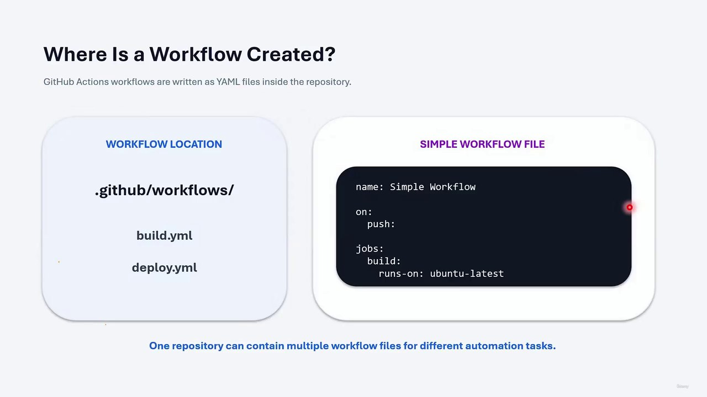
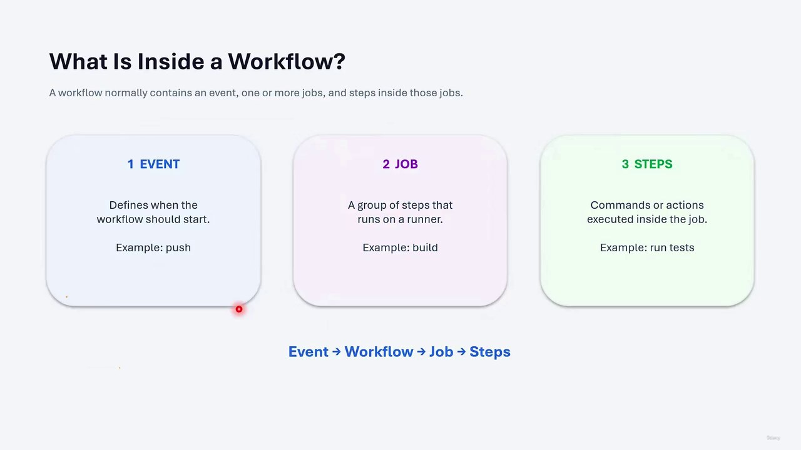
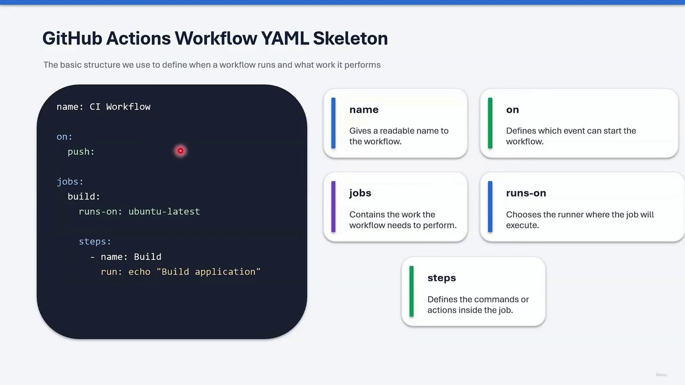
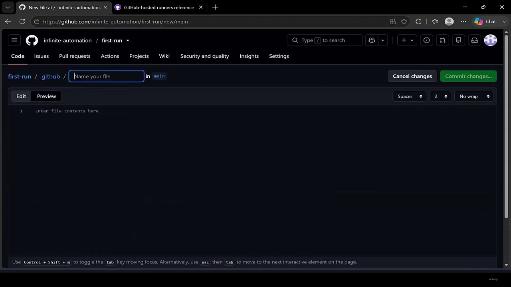
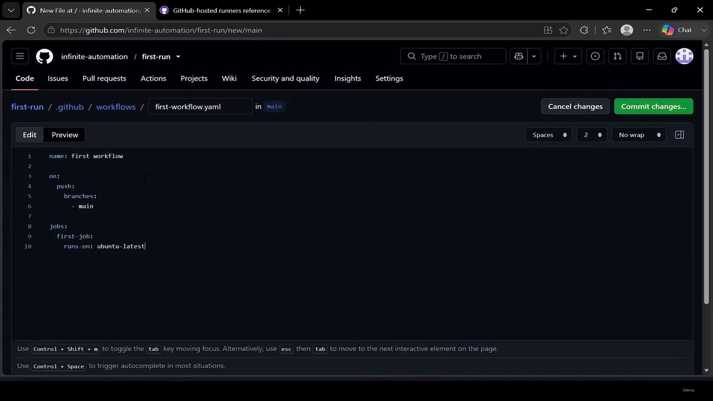
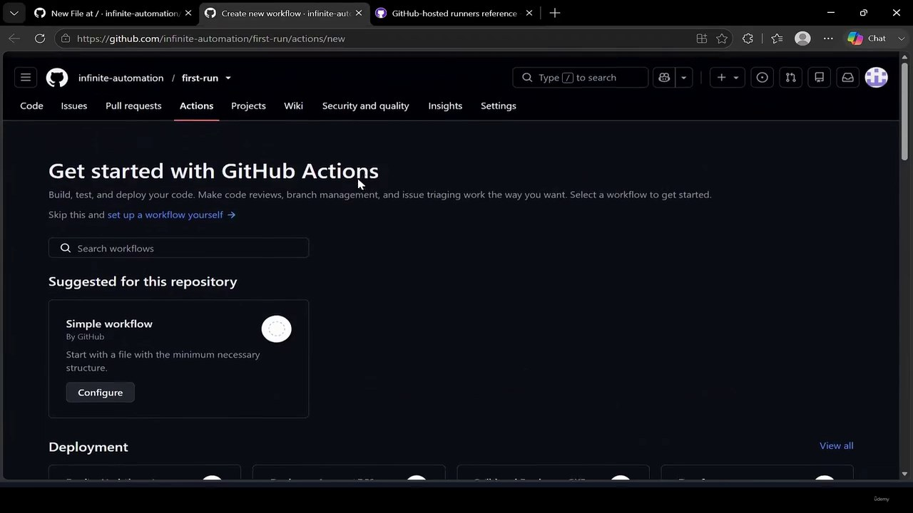
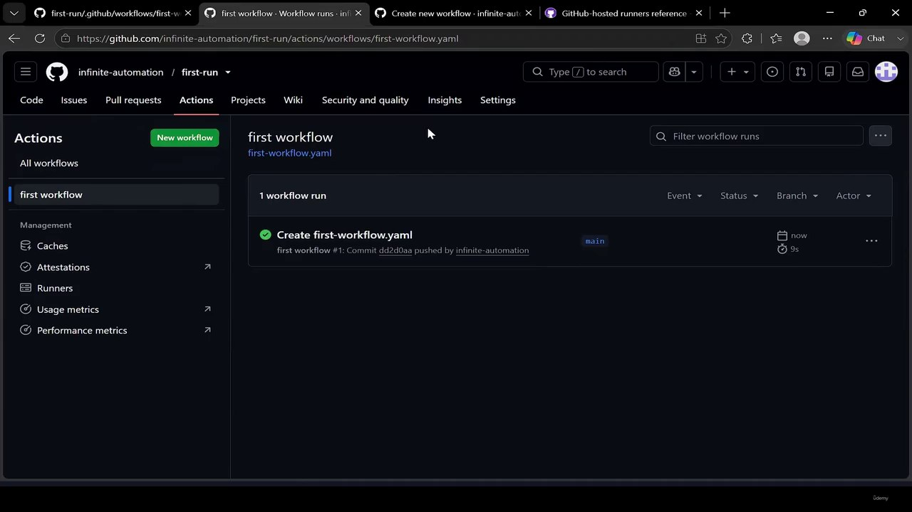
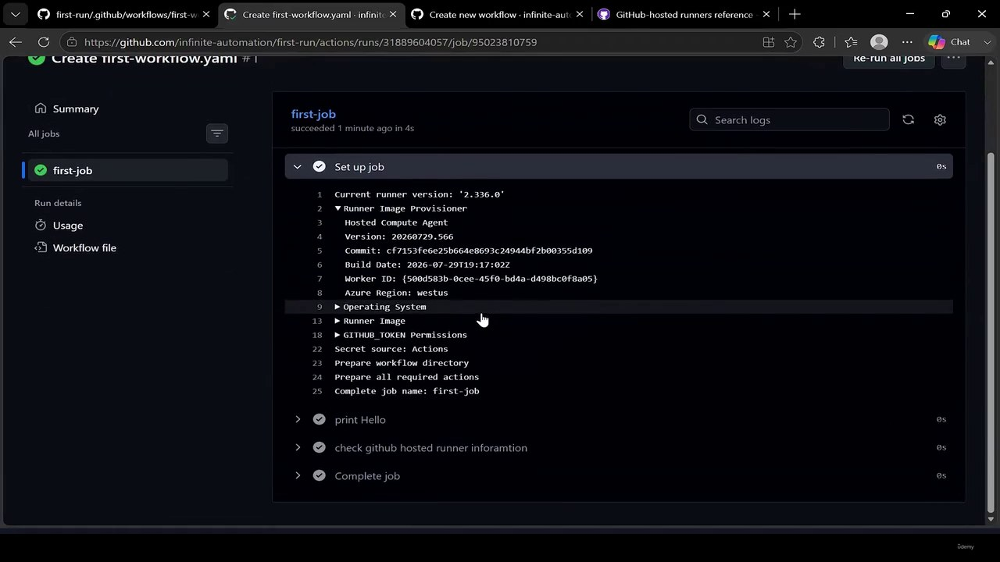

# GitHub Actions Complete（P009–P012）复现文档

> 范围：P009 概念、P010 YAML 骨架、P011 分支约定、P012 实操。
> 产出物：一个名为 `first-run` 的 GitHub 仓库，其中**只有一个文件** `.github/workflows/first-workflow.yaml`；只要往 `main` 分支 push，GitHub 就会自动在它提供的 Ubuntu 机器上执行几条 shell 命令，并在 Actions 页面看到完整日志。
> 读者画像：前端转 AI 应用工程师。文中凡是「课里没讲」的内容，都会显式标注。

---

## 1. 这一节做什么

这四讲是一个从**概念 → 骨架 → 约定 → 动手**的完整链条，最终只交付一个 YAML 文件，但它是后面所有复杂 pipeline 的最小可运行单元。

**P009 建立概念模型。** 讲师给 workflow 的定义是「在 GitHub Actions 里创建的一个自动化流程」：比如你 push 了代码，希望自动 build、自动测试、自动部署，这些原本手动做的事，交给 workflow 去做。

**P010 拆解 YAML 骨架。** 把一份 workflow 从上到下拆成五层：`name` → `on` → `jobs` → `runs-on` → `steps`。讲师反复强调「这个结构你会一遍又一遍地看到」。

**P011 定分支。** 全课程统一使用 `main` 分支做示例，理由是不想让分支策略把示例搞复杂。

**P012 真跑一次。** 建仓库 → 建 `.github/workflows/first-workflow.yaml` → 提交到 main → 打开 Actions 页面看 job 和每一步日志 → 再打一个「哑提交」验证 push 事件会**重复**触发。

最终你要拿到的东西长这样：

```
first-run/
└── .github/
    └── workflows/
        └── first-workflow.yaml
```

跑起来之后，Actions 页面上你会看到：一个叫 `first workflow` 的 workflow（来自 YAML 里的 `name`），下面挂着一次 run，run 里有一个 job（对应 `first-job`），job 里有若干 step，其中第一个是 GitHub 自动插入的 `Set up job`，后面才是你写的两个 step。

讲师对「什么时候该用 workflow」的表述很清楚：**别手动做，写进 YAML 让 GitHub 替你做**。

---

## 2. 讲师原话

> "这里，工作流就是在 GitHub Actions 中创建的自动化流程。例如，当我们推送一些代码时，可能希望构建应用、执行一些自动化操作并测试应用，还希望部署应用。"
> —— p009 [00:09]
> （译：workflow 就是我们在 GitHub Actions 里创建的一个自动化流程。比如你 push 代码后想构建、测试、部署应用。）

> "在 GitHub 中，我们以 YAML 文件的形式在 GitHub 仓库里创建工作流。因此，GitHub 为这些工作流文件规定了特定的目录结构，即 `.github/workflows/`。"
> —— p009 [00:27]–[00:57]
> （译：workflow 以 YAML 文件的形式放在仓库里，GitHub 规定的目录是 `.github/workflows`。）



> "首先是事件。事件告诉 GitHub 这个工作流应在何时启动。接下来是作业。作业是在运行器上执行的一组步骤。在作业内部，我们会有具体的步骤……在步骤中，我们可以运行 shell、bash、PowerShell，也可以使用可复用的操作。"
> —— p009 [01:27]–[01:56]
> （译：event 决定何时启动；job 是跑在 runner 上的一组 step；step 里可以跑 shell/bash/PowerShell，也可以用可复用的 action。）

> "只需记住这个简单流程：GitHub 中发生了某个事件，比如一次推送。推送事件会启动工作流，工作流包含作业，而作业内部则是我们的步骤。"
> —— p009 [01:56]
> （译：记住这个流向：push 之类的事件 → 触发 workflow → workflow 包含 job → job 里有 step。）



> "首先，这里有 `name`。它只是给我们的工作流命名……接下来是 `on`，它告诉 GitHub 这个工作流应在何时启动；这里我们用了 `push`……然后是 `jobs`。在这些作业中，我们定义要完成的工作；这里我们创建了一个名为 `build` 的作业……而这些作业需要一些机器来运行，因此 `runs-on` 告诉 GitHub 我们想用哪个运行器执行这个作业；这里我们使用 `ubuntu-latest`。"
> —— p010 [00:27]–[01:26]
> （译：name 是名字，on 是触发时机，jobs 里定义要干的活，job 需要机器所以用 runs-on 指定 runner，这里用 ubuntu-latest。）

> "所以首先需要指定 `name`，然后添加 `on`，说明我们希望由哪个事件触发这个工作流；还需要指定 `job` 部分……并指定希望用哪个运行器或哪台机器执行这个作业，然后指定 `steps`。"
> —— p010 [01:55]
> （译：顺序就是 name → on → jobs → runner → steps。）



> "在本课程中，我们的实践示例将使用 `main` 分支……在真实组织中，分支结构可能各不相同……但我不想用不同的分支策略把示例复杂化。"
> —— p011 [00:00]–[00:26]
> （译：全课统一用 main 分支；真实团队里分支策略可能不同，这里为了简化不引入。）

> "因此，我会创建路径 `.github/workflows/`，并将 YAML 文件命名为 `first-workflow.yaml`……也就是说，工作流文件应创建在仓库中的 `.github/workflows/` 目录下。"
> —— p012 [02:21]–[03:21]
> （译：路径是 `.github/workflows/`，文件名 `first-workflow.yaml`。）

> "这里我需要说明它应在哪个运行器上运行，是 GitHub 托管的运行器还是自托管运行器。如果是 GitHub 托管的运行器，只需指定 `runs-on`，并指定你想使用哪个 GitHub 托管运行器。这里我想使用 `ubuntu-latest`。"
> —— p012 [04:14]–[04:44]
> （译：用 `runs-on` 指定 runner；这里选 GitHub 托管的 `ubuntu-latest`。注：逐字稿里 "GitHub Actions 运行器" 是 "GitHub-hosted runner" 的转写误差，"Salesforce runner" 从上下文看指的是另一种托管方式，具体叫法以官方文档为准，课里没有展开。）

> "这里，在第二步中，我只是添加步骤名称，即“检查 GitHub 托管运行器信息”，并在运行自定义脚本处直接写了脚本命令……这里我运行 `whoami`、`pwd` 和 `date` 这几个 Linux 命令。"
> —— p012 [08:02]
> （译：第二步叫「Check GitHub hosted runner information」，里面 echo 一句话，再跑 `whoami`、`pwd`、`date`。）

> "如果我们进入 Actions，可以看到这个工作流已在“所有工作流”下被触发……这里是 YAML 文件对应的工作流名称。而这里是我们给工作流指定的名称。这是第一个工作流。"
> —— p012 [09:54]
> （译：进 Actions 页签就能看到 workflow 被触发；列表里同时显示文件名和你在 `name` 里起的名字。）

> "第一个是设置作业。它会调用 GitHub 托管的运行器、运行镜像预配程序，并显示我们在这里能看到的所有基本信息……因为我们选择的是 Ubuntu，所以这里匹配到 24.04 LTS，它作为默认版本提供。但这里我们要重点关注的是作业中的第一步，也就是打印 hello。"
> —— p012 [10:51]–[11:45]
> （译：日志里第一个 `Set up job` 步骤是 GitHub 自动加的，跟 YAML 无关；它显示镜像信息，课里那次显示的是 Ubuntu 24.04 LTS。真正要关注的是你写的第一步。）

> "那么如果我做一次占位提交……`echo testing 2`。我只是添加了一段随机文本……如果我在这里提交，也就是再做一次占位提交，那么这个工作流会再次触发所有这些作业和步骤。"
> —— p012 [13:13]–[13:42]
> （译：再加一行 `echo testing 2` 做哑提交，验证 push 事件会再次触发整个流程。）

---

## 3. 从零复现

### 3.1 前置条件

| 项 | 要求 | 说明 |
|---|---|---|
| GitHub 账号 | 必须有 | 讲师原话：「If you haven't created a GitHub account, I request you to do it before doing this activity.」 |
| 网络 | 能访问 github.com | Actions 页面、日志都要在线看 |
| 本地环境（可选） | git | 讲师全程在**网页 UI**里建文件、提交，没有用本地 git。本地方式见 3.4，标注为「课里没讲」 |
| 分支 | 统一用 `main` | 见 P011 |

### 3.2 第一步：创建仓库

1. 登录 GitHub，点右上角 `+` → **New repository**。
2. **Repository name** 填 `first-run`（讲师原话：「I'm naming it as a first run」）。
3. 可见性选 **Public**（课里明确选了 public：「keeping it as a public visibility」，并补了一句「如果你想选 private 也可以」）。
4. README / .gitignore / license 讲师**都没有勾**（页面上有这些选项，但示例仓库保持了空仓库）。
5. 点 **Create repository**。

### 3.3 第二步：在网页 UI 里创建 workflow 文件

这一步的关键是**路径必须一次敲对**。在仓库首页点 **Add file → Create new file**，然后在文件名输入框里**连着敲**：

```
.github/workflows/first-workflow.yaml
```

注意三点：
- `.github` 前面有个**点**；
- `workflows` 是**复数**，少一个 `s` GitHub 就不会识别；
- 你输入 `/` 的时候 GitHub 会自动把它变成目录层级，这是正常现象，不是建错了。



文件名敲完之后，在下方的编辑器里把第 4 节的完整 YAML 贴进去。



### 3.4 第三步：提交到 main

**网页方式（课里就是这么做的）：**
页面底部 **Commit changes** 区域，commit message 填 `create first workflow.yaml file`（讲师原话：「I'm just taking the commit message, create a first workflow.yaml file, and committing directly into the main branch」），确认目标是 `main` 分支，点 **Commit changes**。

**本地方式（课里没讲，但前端同学更习惯）：**

```bash
# 1. 建目录
mkdir first-run && cd first-run

# 2. 初始化仓库，默认分支叫 main
git init -b main

# 3. 建出 GitHub 要求的目录结构
mkdir -p .github/workflows

# 4. 在这里新建文件 .github/workflows/first-workflow.yaml，内容见第 4 节
#    （VS Code: code .github/workflows/first-workflow.yaml）

# 5. 提交
git add .
git commit -m "create first workflow.yaml file"

# 6. 关联远端（换成你自己的用户名）
git remote add origin git@github.com:<你的用户名>/first-run.git

# 7. 推上去，触发第一次运行
git push -u origin main
```

> 提示：如果你的 GitHub 已经开了 2FA，HTTPS 方式 push 需要 Personal Access Token，SSH 方式需要先把公钥传到 GitHub。这部分课里没讲。

### 3.5 第四步：观察运行结果

1. 打开仓库，点顶部 **Actions** 页签。
2. 左侧 **All workflows** 下会出现一条 `first workflow`——这就是你 YAML 里 `name` 的值；右侧同一行还会显示对应的文件名 `first-workflow.yaml`。
3. 点进 workflow，看到 run 列表：一次 run，触发来源写的是 commit message。
4. 点进这次 run，看到一个 job，名字就是 YAML 里 job 的 id。
5. 点进 job，看到步骤列表，从上到下依次是：
   - `Set up job`（GitHub 自动加的，YAML 里没写）
   - `Print hello`（你写的第一步）
   - `Check GitHub hosted runner information`（你写的第二步）
   - 收尾的清理步骤（同样是自动加的）





展开 `Print hello`，日志里能看到它实际执行的命令就是 `echo "Hello world"`，输出 `Hello world`。
展开 `Check GitHub hosted runner information`，课里那次运行的输出是这样的（**具体数值请以你实际输出为准**）：

- `echo` 那行：原样打印你写在引号里的字符串。
- `whoami`：打印当前登录用户，课里是 `runner`。
- `pwd`：打印工作目录，课里的形态是 `/home/runner/work/first-run/first-run`，即 `工作根目录/仓库名/仓库名`。
- `date`：打印服务器时间，课里显示的是 **UTC 时间**（讲师特别点了一句：因为 runner 布置在 Azure 的 West US 区域，那次运行显示的是 Ubuntu 24.04 LTS 镜像）。



运行结束后，日志末尾会显示 job 完成、清理流程、agent 断开。

### 3.6 第五步：验证「每次 push 都会触发」

讲师的验证方式很朴素：在同一个 YAML 文件里再加一行，制造一次「哑提交」。

在 `steps` 末尾追加：

```yaml
      - name: Dummy commit test
        run: echo "testing 2"
```

然后再提交一次（commit message 任意），回到 Actions 页面：会多出**一次新的 run**，同样跑完全部步骤并打印 `testing 2`。

这一步证明了两件事：
1. `on.push.branches: main` 是持续生效的，不是只能跑一次；
2. 每次 push 都是**一台全新的机器**，上一次的东西不会留到下一次（这也是为什么后面课程里做缓存会单独讲，课里没讲）。

---

## 4. 完整代码

### 4.1 目录结构

```
first-run/                              ← 仓库根目录
└── .github/                            ← 固定名字，前面有点
    └── workflows/                      ← 固定名字，复数
        └── first-workflow.yaml         ← 文件名可自定义，扩展名 .yaml 或 .yml
```

### 4.2 `.github/workflows/first-workflow.yaml`（完整文件，可直接保存运行）

```yaml
name: first workflow

on:
  push:
    branches:
      - main

jobs:
  first-job:
    runs-on: ubuntu-latest
    steps:
      - name: Print hello
        run: echo "Hello world"

      - name: Check GitHub hosted runner information
        run: |
          echo "This runner is hosted by GitHub"
          whoami
          pwd
          date
```

### 4.3 加哑提交之后的版本（3.6 用）

```yaml
name: first workflow

on:
  push:
    branches:
      - main

jobs:
  first-job:
    runs-on: ubuntu-latest
    steps:
      - name: Print hello
        run: echo "Hello world"

      - name: Check GitHub hosted runner information
        run: |
          echo "This runner is hosted by GitHub"
          whoami
          pwd
          date

      - name: Dummy commit test
        run: echo "testing 2"
```

> 说明：讲师在视频里是在网页编辑器里逐行敲的，因此逐字稿里出现了 `first workflow.yaml`、`first-workflow.yaml`、`createfirstworkflow.yaml` 等多种写法——那是语音转写的噪声。文件名叫 `first-workflow.yaml` 即可，**文件名本身不影响功能**，它只是显示在 Actions 列表里。真正影响显示的是 `name:` 字段。

---

## 5. 逐行解释

### 5.1 关于 YAML 本身（给前端同学）

YAML 之于 JSON，就像 JSX 之于 `React.createElement`：同一棵对象树，换一种更好读的写法。对照关系：

```json
{
  "name": "first workflow",
  "on": { "push": { "branches": ["main"] } },
  "jobs": {
    "first-job": {
      "runs-on": "ubuntu-latest",
      "steps": [
        { "name": "Print hello", "run": "echo \"Hello world\"" }
      ]
    }
  }
}
```

三条硬规则，踩了就直接报错：
1. **只能用空格缩进，不能用 Tab**。全篇统一 2 个空格，层级越深缩进越多。
2. `-` 表示「这是数组里的一项」，`-` 后面要有一个空格。
3. `键: 值` 冒号后面必须有一个空格。

### 5.2 逐行

| 行 | 内容 | 含义 |
|---|---|---|
| 1 | `name: first workflow` | workflow 的显示名。**只影响界面显示**，Actions 左侧列表里那一行就是它。改它不会改变触发逻辑。 |
| 3 | `on:` | 声明触发条件，回答「什么时候跑」。讲师原话：「the event tells GitHub when this workflow should start」。 |
| 4 | `push:` | 触发事件类型：有代码推上来。 |
| 5 | `branches:` | 进一步收窄到具体分支。 |
| 6 | `- main` | 只监听 `main`。推到 `dev` 不会触发——这一条和 P011 的分支约定是配套的。 |
| 8 | `jobs:` | 作业容器，下面可以挂多个 job（讲师强调「we can have multiple jobs over here but we are specifying only single job」）。 |
| 9 | `first-job:` | job 的 **id**。它会显示在 Actions 的 job 列表里。课里讲师口语说的是 "first job"，写成 `first-job` 一样能跑。 |
| 10 | `runs-on: ubuntu-latest` | 指定跑在哪种机器上。`ubuntu-latest` 是 GitHub 托管的 runner 标签，意思是「给我一台最新的 Ubuntu」。讲师提醒过：这个标签的能力（虚拟机上跑还是容器里跑、几核几 G、什么架构）会随 GitHub 更新而变化，用之前建议查官方 runner 文档。 |
| 11 | `steps:` | 步骤数组，**按顺序执行**。 |
| 12 | `- name: Print hello` | 第一步的显示名。日志里那一行标题就是这个。 |
| 13 | `run: echo "Hello world"` | 这一步要做的事：跑一条 shell 命令。`run` 是「执行命令」的入口，和它并列的另一种写法是 `uses`（引用现成的 action），P009 提过一句，本课这里没用。 |
| 15 | `- name: Check GitHub hosted runner information` | 第二步的显示名。 |
| 16 | `run: \|` | 关键语法：竖线 `\|` 表示**下面缩进的整块多行文本**都作为一段脚本传给 shell。不加 `\|` 而直接写命令，只能写一行。 |
| 17–20 | `echo ...` / `whoami` / `pwd` / `date` | 四条独立的 Linux 命令，按行依次执行。`whoami` 输出当前用户，`pwd` 输出当前目录，`date` 输出机器时间。 |

**在 JS/Node 里对应什么：**
- 一个 `job` ≈ 一次 `child_process.exec` 的宿主进程，而且是一台**用完即焚**的临时机器；
- `steps` ≈ 一个 `async` 函数里顺序 `await` 的几条语句，某一条抛错（非 0 退出码）默认会让后面的步骤不再执行；
- `run: |` 里的多行脚本 ≈ 一个 `.sh` 文件的内容，默认在 Linux runner 上由 bash 执行；
- `runs-on` ≈ 指定「这段代码在哪台机器上跑」，类比 `package.json` 里 `engines` 但作用强得多——它是真的换机器。

### 5.3 页面上看到的字段，哪些来自 YAML、哪些是自动的

- `Set up job`：**YAML 里没有**，GitHub 自动插入。展开后是镜像信息、runner 版本、区域等（课里显示 Ubuntu 24.04 LTS、Azure West US 区域）。这些字段名请以你实际输出为准。
- 步骤列表里的 `Print hello` / `Check GitHub hosted runner information`：来自你的 `name`。
- run 列表里显示的 commit message、commit ID、触发者：来自 Git 提交本身，不是在 YAML 里配的。

---

## 6. 复现检查清单

按顺序自查，任何一条不通过都会卡住：

| # | 检查项 | 通过标准 |
|---|---|---|
| 1 | 仓库存在 | 仓库名 `first-run`，可见性 Public（或 Private，但 Private 消耗额度） |
| 2 | 目录名正确 | 仓库根下能看到 `.github/workflows/` 两层，**点开头**、**workflows 是复数** |
| 3 | 文件名正确 | `first-workflow.yaml` |
| 4 | YAML 缩进 | 全篇 2 空格缩进，**没有 Tab**；`steps:` 下的每一项都以 `- ` 开头 |
| 5 | `on.push.branches` 是 `main` | 与仓库默认分支一致 |
| 6 | 文件已进入 main | 打开 `main` 分支的文件列表能看到它；不在 main 上，Actions 页面可能根本不显示这个 workflow |
| 7 | Actions 页签能看到 | 左侧列表出现 `first workflow` + `first-workflow.yaml` |
| 8 | 有一次 run | run 状态成功（绿色对勾），触发方式为 push |
| 9 | job 名匹配 | job 显示为 `first-job` |
| 10 | 步骤顺序 | `Set up job` → `Print hello` → `Check GitHub hosted runner information` → 清理步骤 |
| 11 | `Print hello` 日志 | 命令是 `echo "Hello world"`，输出 `Hello world` |
| 12 | 第二步日志 | 四行输出：一句话、用户名、目录路径（形如 `/home/runner/work/first-run/first-run`）、一个 UTC 时间 |
| 13 | 二次触发 | 追加 `echo "testing 2"` 再提交后，Actions 里出现**第二次** run |
| 14 | 换机器验证 | 第二次 run 的 `pwd` / 时间戳与第一次不同，说明每次都是新机器 |

---

## 7. 课里没讲但你会撞上的

以下内容**不是讲师说的**，是我按 GitHub Actions 的常规行为补充的排查经验，用不上可以跳过；但第一次跑几乎必然踩一到几条。

**7.1 「我提交了，但 Actions 里啥都没有」**
最常见三个原因：
- 目录写成了 `.github/workflow`（少了 s）或 `github/workflows`（少了前面的点）。GitHub 只认 `.github/workflows`。
- 文件不在默认分支上。先把文件合到 `main`，再回 Actions 页面刷新。
- `on.push.branches` 写的是 `main`，但你实际推的是 `master` 或 `dev`。检查仓库 Settings → Branches 里的默认分支名。

**7.2 「YAML 报错但不告诉你哪错」**
GitHub 的 YAML 校验只会给出错误行号，不会解释语义。两个高频坑：
- 缩进用了 Tab（很多编辑器从别处粘贴时会带进来）。**VS Code 里右下角切到「Spaces: 2」，再打开「Render Whitespace」肉眼确认。**
- `- name:` 前面的 `-` 和 `name` 之间漏了空格，变成了字符串 `-name`。
- 另外，某些编辑器/linter 会把顶层的 `on` 高亮成布尔值并标黄，那是 YAML 1.1 的老问题；GitHub 自己解析时不受影响，**不用管这个警告**。

**7.3 `runs-on` 写错会「一直排队」**
`ubuntu-latest` 拼成 `ubuntu-latest` 以外的任何东西（比如 `ubuntu`、`linux-latest`），job 要么直接失败报找不到 runner，要么卡在 queued。改回 `ubuntu-latest` 即可。

**7.4 Private 仓库会扣额度**
Public 仓库的 GitHub-hosted runner 不计量；Private 仓库按分钟数消耗免费额度。讲师在第 3.2 步特意选了 public，不是随口说的。

**7.5 每条 step 都是独立进程**
`run:` 里 `cd` 到某个目录，下一条 `run:` 不会记住——因为每一步是独立的 shell 进程。这跟 Node 里两个独立的 `exec` 调用是同一回事。要在同一步里做多件事，就像第 4 节那样用 `run: |` 把命令写在一块。

**7.6 每条命令的退出码决定成败**
shell 里某条命令返回非 0，该 step 就算失败，后面的 step 默认不执行。想在失败后继续，需要额外配置（本课没讲）。

**7.7 机器是新的，缓存不会自己留**
3.6 的哑提交已经说明了：两次 run 的 `pwd` 路径结构一样，但机器、时间戳都不同。所以后面真做构建时，`node_modules` 不会跨 run 保留，需要专门的缓存机制（本课没讲）。

**7.8 commit message 会被原样展示**
Actions 列表里那一行就是你写的 commit message。养成写清楚的习惯，因为排查问题时你只能靠它区分几十次 run。课里用的 `create first workflow.yaml file` 就是个好例子。

**7.9 时间永远是 UTC**
`date` 在 runner 上输出的是 UTC，不是你本地时区。写日志、算耗时的时候别被绕进去。

---

### 附：本课全部命令速查（复制即用）

```bash
# 本地初始化（课里没讲，网页方式可跳过）
mkdir first-run && cd first-run
git init -b main
mkdir -p .github/workflows

# 提交并触发
git add .
git commit -m "create first workflow.yaml file"
git remote add origin git@github.com:<你的用户名>/first-run.git
git push -u origin main
```

```yaml
# .github/workflows/first-workflow.yaml
name: first workflow

on:
  push:
    branches:
      - main

jobs:
  first-job:
    runs-on: ubuntu-latest
    steps:
      - name: Print hello
        run: echo "Hello world"

      - name: Check GitHub hosted runner information
        run: |
          echo "This runner is hosted by GitHub"
          whoami
          pwd
          date
```