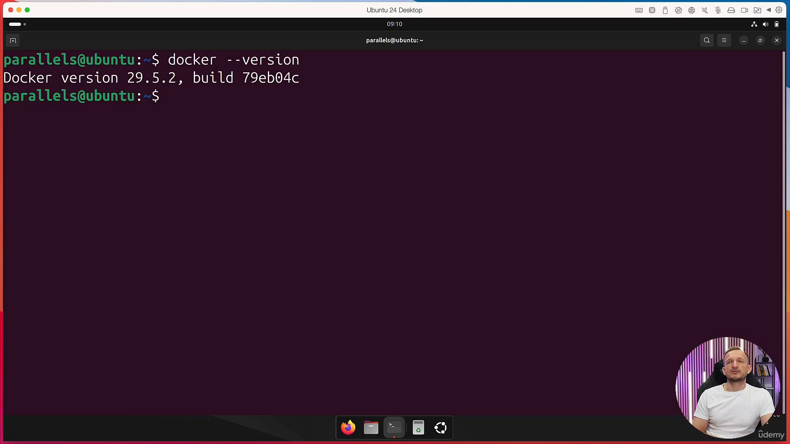
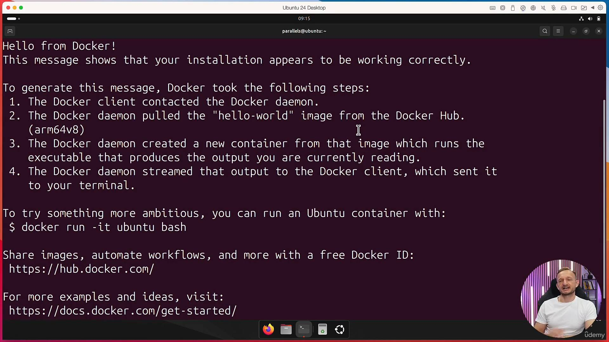
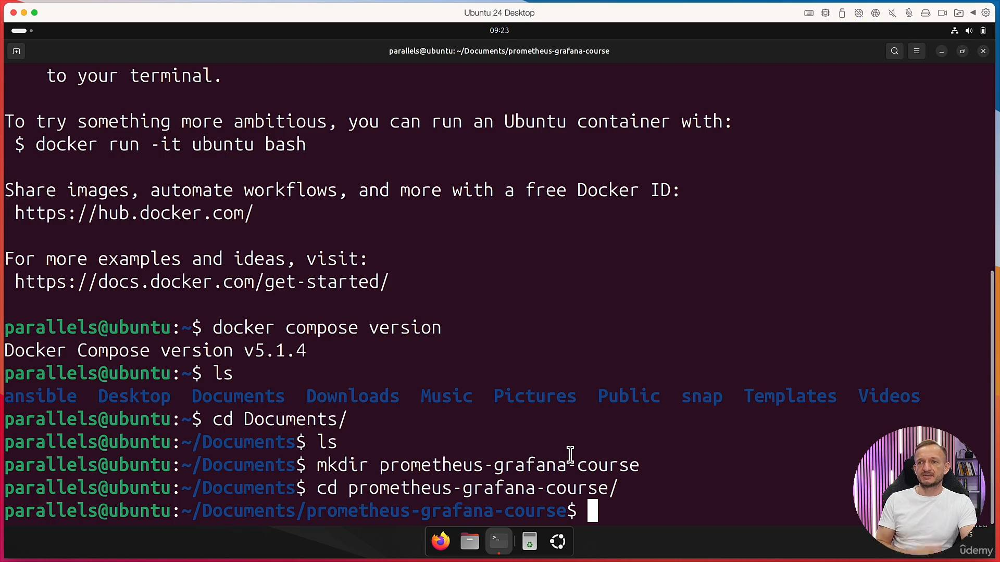
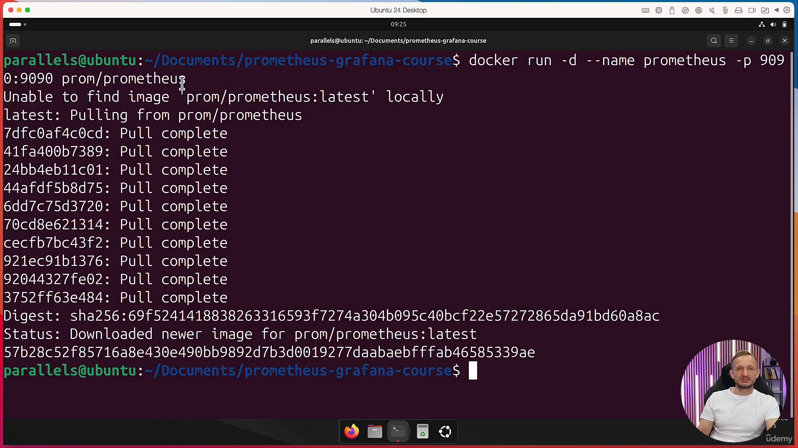
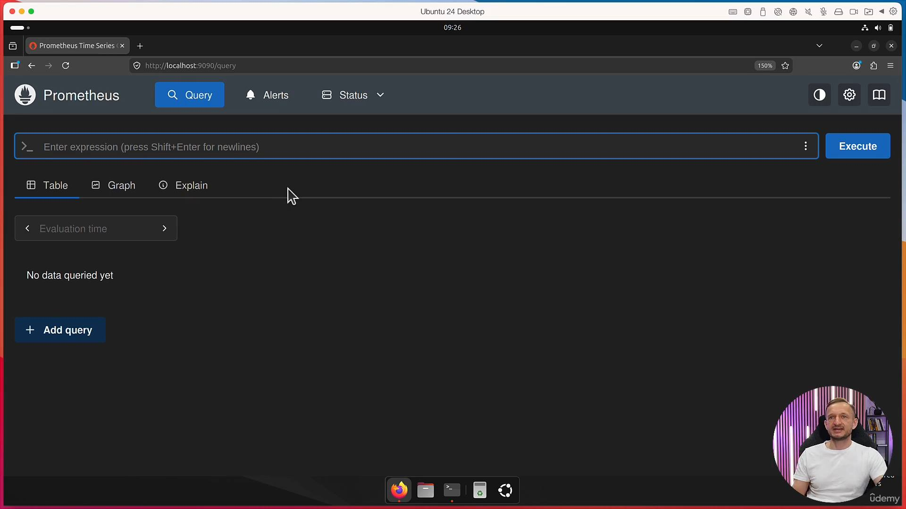
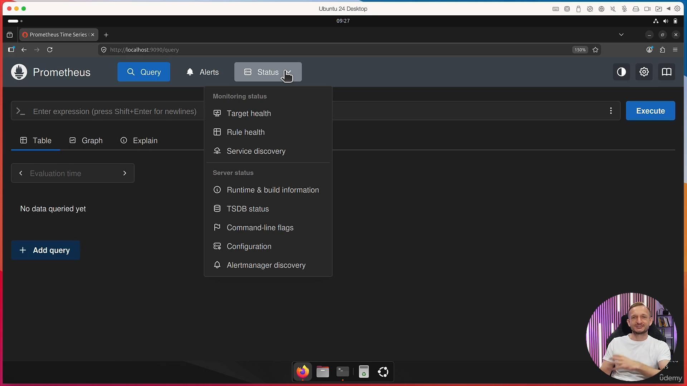
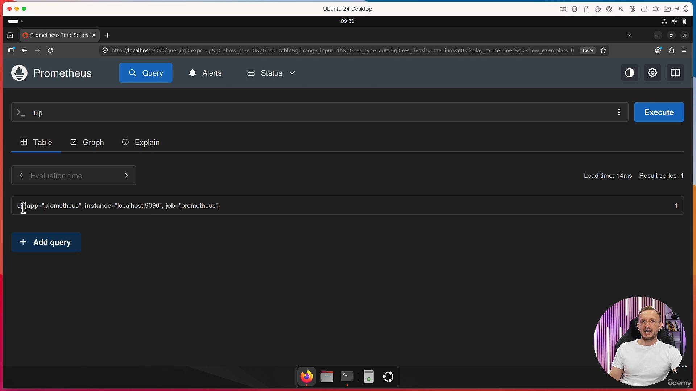
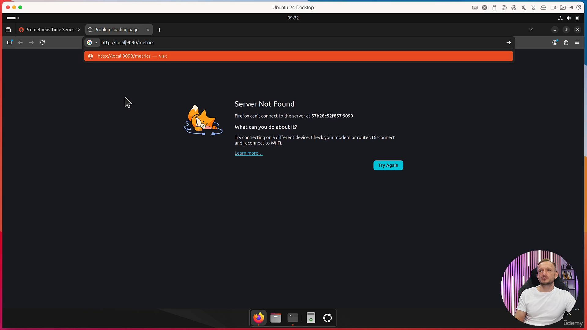
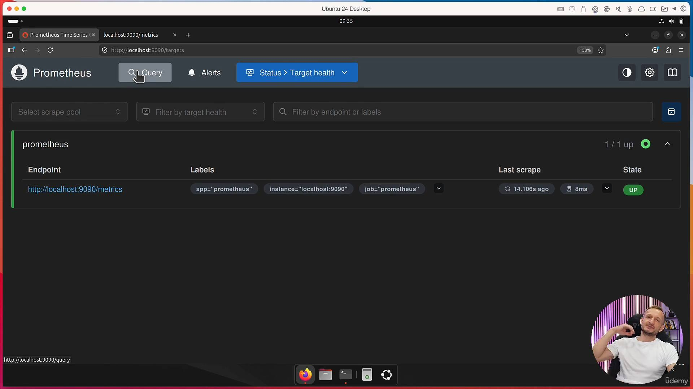

# Prometheus & Grafana 实战：P1–P4 复现文档

> 覆盖课程 BV1Ldjy6hE3t 的 P001–P004。读完后你本机应该有一个跑在 `localhost:9090` 的 Prometheus 容器，能在 UI 里执行 `up` 和 `prometheus_http_requests_total` 两条查询，能看懂 `/metrics` 的文本格式，并且知道默认 scrape 配置长什么样。Grafana 还没开始，按讲师的安排它会在下一节接进来。

---

## 1. 这一节做什么

这四集真正动手的部分只有两件事：**把 Docker 验证一遍**，**用一条 `docker run` 把 Prometheus 跑起来**。剩下的是概念铺垫和 UI 导览。

但概念铺垫不是废话。P002 讲清楚了一个会贯穿全课程的设计选择：Prometheus 是 **pull 模型**——不是你的应用把指标推给监控系统，而是 Prometheus 每隔固定时间主动去 `GET` 你的 `/metrics` 端点。这个选择直接决定了后面所有操作方式：你要监控一个服务，第一反应不是「往哪发数据」，而是「Prometheus 的配置里怎么把这个 target 加进去」。P004 里看到的 `Status -> Targets`、`Status -> Configuration`、`/metrics` 文本页，全是这个模型的直接产物。

P001 给了课程路线图：本地 Docker 起 Prometheus + Grafana → 写 PromQL → 给一个真实 Node.js 应用加自定义指标 → Grafana 建 dashboard、加变量、配 alert → 用 exporter 监控 Linux 服务器和 Docker 容器。P1–P4 只走到「起 Prometheus」这一步，Node.js instrumentation 和 Grafana 都还在后面。

学完这四集，你应该能回答三个问题：

1. 为什么 Prometheus 要主动 scrape，而不是应用主动 push？
2. `up` 这个指标是谁生成的，值为 1 和 0 分别代表什么？
3. `Status -> Configuration` 里那段 YAML 的 `scrape_configs` 在描述什么？

---

## 2. 讲师原话

课程一开始就定了调子：不讲幻灯片，直接上手。

> "这门课和其他所有课程一样，设计上就是完全动手实践、偏实用的。所以没有幻灯片，也没有纯理论，只有你和我直接使用这些工具，一步一步构建监控解决方案。"
> —— p001 [00:29]

工具选择上，Prometheus 负责采集和存储，Grafana 负责可视化，两者经常成对出现：

> "Prometheus 很擅长采集和存储指标，但它并不是为了漂亮的可视化而设计的。这正是 Grafana 发挥作用的地方，而且它们经常被作为一个组合来使用。"
> —— p002 [03:23]

关于 pull 模型，这是整节最核心的一句话：

> "Prometheus 特别之处在于它的拉取模型。不是由我们的应用把指标推送到中心服务器，而是由 Prometheus 从我们的服务中拉取这些指标；这管理起来容易得多，因为抓取由 Prometheus 控制，而不是由应用控制。"
> —— p002 [02:55]

采集频率：

> "Prometheus 会按固定间隔从应用和基础设施抓取指标。比如每 15 秒抓取一次，并把这些指标存储在时序数据库中，也就是说每个数据点都会带有一个特定的时间戳。"
> —— p002 [02:25]

环境验证部分，讲师依次跑了三条命令：

> "如果我输入 docker run hello-world，那会是一个很小的容器，用于我们的测试。"
> —— p003 [04:24]

> "所以我可以执行 docker compose version，然后会返回 Docker Compose 的版本信息。在较新的 Docker Desktop 安装中，Docker Compose 是内置的。"
> —— p003 [05:46]

工作目录：

> "我会运行 mkdir，比如创建一个 Prometheus Grafana course……那我们就执行 mkdir Prometheus，然后通过切换目录进入这个文件夹。"
> —— p003 [08:03]

启动 Prometheus 的命令，讲师逐段拆过：

> "命令是 docker run -d……-d 表示分离模式，这样我们现在就能拿回控制台。接着是名称，我们给它起名为 Prometheus……然后是 -p 用于端口映射，所以我们会把容器内的 9090 端口映射到本地主机，然后输入镜像，镜像是 prom/prometheus。"
> —— p004 [00:53]

Prometheus 默认监控自己：

> "默认情况下，Prometheus 实际上会监控它自己。所以比如在这里，你只会看到一个目标。"
> —— p004 [04:11]

`up` 指标的含义：

> "这个 up 指标是 Prometheus 为每个抓取目标维护的特殊指标。值为 1 表示该目标在线且健康；值为 0 则表示目标已宕机。"
> —— p004 [07:05]

（讲师这里说的 "done" 应为 "down"，结合上下文和 Prometheus 的实际语义，0 表示抓取失败。）

`/metrics` 的文本格式：

> "有些行以某种井号开头，这些其实是描述指标的注释。所以这是给我们看的、对我们更有意义的内容。而其他行才是实际的指标。"
> —— p004 [09:57]

> "这就是 Prometheus 的暴露格式；每个应用，或者我们稍后会讲到的导出器，以及我们监控的对象，实际上都会以大致相同的格式暴露数据。"
> —— p004 [10:56]

关于默认配置的来源，讲师明确说这一节没有自己写配置文件：

> "我们还没有在配置中设置任何内容，因为现在是以默认配置运行的，而这些默认配置目前已经内置在我们拉取的 Docker 镜像里了。下一节视频中，我们会实际处理这一点，并创建自己的配置文件。"
> —— p004 [14:50]

所以下面第 4 节的「完整代码」里，`start-prometheus.sh` 是复现脚本，`prometheus.yml` 是下一节的预习，不是本节必需。

---

## 3. 从零复现

### 3.1 前置条件

你需要一台能跑 Docker 的机器。讲师用的是 Ubuntu 24 Desktop，Mac 和 Windows 同样适用。P003 里给了三条安装路径：

- **Mac**：打开 `docker.com`，下载 Docker Desktop，按芯片选 Apple Silicon 或 Intel 版本，装 DMG。
- **Windows**：同样下载 Docker Desktop，选 AMD64 或 ARM64；安装器可能提示启用 WSL2（Windows Subsystem for Linux），按提示走，必要时重启。
- **Ubuntu/Debian**：终端里 `sudo apt update`，然后 `sudo apt install docker.io`。

课里没有逐步演示安装过程，讲师说的是「装完回来跑 `docker version` 能出版本就行」。

### 3.2 验证 Docker 三段式

打开终端，依次执行：

```bash
docker version
```

你应该看到 Client 和 Server 两段版本信息。讲师的原话是「getting something back」就说明 Docker 在了。如果报 `command not found`，回到 3.1 安装。

```bash
docker run hello-world
```

这是最小的验证容器。第一次跑会看到 `Unable to find image 'hello-world:latest' locally`，然后拉取镜像层，最后打印 `Hello from Docker!`。讲师特别强调这一步的意义：

> "这条消息表明你的安装似乎工作正常……现在我们知道已经安装了 Docker，并且可以运行容器，而这两件事实际上并不总是同时成立。"
> —— p003 [05:18]

也就是说，`docker version` 有输出不等于能跑容器，`hello-world` 成功才是真的通了。



```bash
docker compose version
```

这一条是为后面准备的。讲师说新版 Docker Desktop 自带 compose，应该能直接出版本号。本节还用不到 compose，但先确认可用，免得下一节卡住。



### 3.3 建工作目录

讲师在 `Documents` 下建了一个目录，名字口述时在 "Prometheus 与 Grafana 课程" 和 "Prometheus" 之间切换过。目录名不重要，关键是后面所有配置文件和代码都放这里：

```bash
mkdir -p ~/Documents/prometheus-grafana
cd ~/Documents/prometheus-grafana
```

`mkdir -p` 的 `-p` 是本文加的，表示父目录不存在就一起建、目录已存在也不报错。讲师原命令是直接 `mkdir`。

### 3.4 启动 Prometheus

这是本节唯一一条真正「起服务」的命令：

```bash
docker run -d --name prometheus -p 9090:9090 prom/prometheus
```

执行后会发生几件事（按讲师在屏幕上的顺序）：

1. 本地找不到 `prom/prometheus:latest`，开始从 Docker Hub 拉取镜像层；
2. 拉完后启动容器；
3. 终端打印一长串容器 ID。

讲师特意说明拉取速度取决于网络：

> "这个拉取过程取决于你的网络连接，可能会更慢或更快。最后我们应该会在这里得到一个 Docker 容器 ID，也就是末尾打印出来的那串长字符串。"
> —— p004 [02:16]



### 3.5 确认容器在跑

```bash
docker ps
```

输出里应该能找到一行：名字是 `prometheus`，状态是 `Up` 加一段时间，端口映射是 `9090->9090`。讲师看到的是「about a minute up」：

> "我看到这里的这个容器已经运行了大约一分钟，这里显示了端口映射，而这里是对我们有意义的名称。"
> —— p004 [02:45]

列名以你本机 `docker ps` 的实际输出为准，不同 Docker 版本可能略有差异。核心是确认三件事：容器在运行、端口映射对、名字是 `prometheus`。



### 3.6 打开 Prometheus UI

浏览器访问：

```text
http://localhost:9090
```

会看到 Prometheus 的 Web 界面。讲师对它的评价是「pretty minimal」且「intentional」——Prometheus 只负责采集和查询，好看的图交给 Grafana。



### 3.7 看 Status -> Targets

点顶部导航的 `Status`，再点 `Targets`。默认只有一个 target，也就是 Prometheus 自己：

- endpoint 指向 `http://localhost:9090/metrics`
- 带一组 labels，通常是 `instance="localhost:9090"` 和 `job="prometheus"`
- 有 `Last scrape` 时间
- `State` 显示 `UP`

讲师在这里演示了刷新：先看到「30 seconds ago」，再刷新变成「1 second」，说明 Prometheus 每隔一小段时间就抓一次。

> "你可以在这里看到最近一次抓取以及 up 状态……如果我刷新一下，就能看到它显示 30 秒前发生过一次抓取，而现在显示 1 秒前，所以这回到了默认设置：每 15 秒抓取一次。"
> —— p004 [05:09]

这里讲师口述把 **15 秒**说成了「15 minutes」，但同一段里「30 秒前 / 1 秒前」的刷新结果、以及后面 `Status -> Configuration` 页面里显示的 `scrape_interval: 15s`，都说明默认是 15 秒。以配置页为准。



### 3.8 执行第一条 PromQL：`up`

回到主界面，点 `Graph`，在 `Expression` 输入框里输入：

```promql
up
```

按回车或点 `Execute`。结果形如：

```text
up{instance="localhost:9090", job="prometheus"} 1
```

值 `1` 表示 target 抓取成功。讲师的原话：

> "这个 up 指标是 Prometheus 为每个抓取目标维护的特殊指标。值为 1 表示该目标在线且健康；值为 0 则表示目标已宕机。"
> —— p004 [07:05]

`up` 是 Prometheus 自动为每个 target 维护的指标，不需要你在应用里手动埋点。切到 `Graph` 标签能看到一条从容器启动时刻开始的线。



### 3.9 看 `/metrics` 原始文本

浏览器直接访问：

```text
http://localhost:9090/metrics
```

会看到一大片纯文本。讲师称之为「a wall of text」，并解释了结构：`#` 开头的是描述指标的注释，其余是实际数据点。

在这个页面里搜索 `up` 能找到刚才查询的指标；搜索 `prometheus_` 能看到 Prometheus 自己暴露的一大堆内部指标。讲师说：

> "这就是 Prometheus 的暴露格式；每个应用，或者我们稍后会讲到的导出器，以及我们监控的对象，实际上都会以大致相同的格式暴露数据。"
> —— p004 [10:56]



### 3.10 查询 `prometheus_http_requests_total`

回到 Graph 页面，把表达式换成：

```promql
prometheus_http_requests_total
```

执行后切到 `Graph`，会看到多条不同颜色的线。讲师解释了原因：

> "这个指标带有标签，会按某个 handler 和状态码进行拆分，而每一种标签组合实际上都是一个独立的时间序列。"
> —— p004 [12:26]

也就是说，同一个指标名 `prometheus_http_requests_total` 下，`handler`（比如 `/api/v1/query`、`/metrics`）和 `code`（比如 200）的每一种组合都是一条独立的时间序列。这是理解 Prometheus 数据模型的关键：**指标名 + label 组合 = 一条时间序列**。



### 3.11 看 Status -> Configuration

点 `Status` -> `Configuration`，会看到一整页 YAML。往下找到 `scrape_configs`，核心内容大致是：

```yaml
scrape_configs:
  - job_name: prometheus
    metrics_path: /metrics
    static_configs:
      - targets:
          - localhost:9090
    scrape_interval: 15s
```

讲师逐项念过：

> "我们有一个名为 Prometheus 的 job，有我们的 localhost，有我们的 /metrics，甚至还有 15 秒的抓取间隔。"
> —— p004 [14:20]

并强调这不是我们写的，是镜像自带的默认配置：

> "我们还没有在配置中设置任何内容，因为现在是以默认配置运行的，而这些默认配置目前已经内置在这个 Docker 镜像里。"
> —— p004 [14:50]

P004 在 13:23 左右展示了 Configuration 页面，但截图清单里没有这个时间点的帧，所以这里不放图，按上面文字对照即可。

### 3.12 保持容器运行

这一节结束时不要删容器。下一节要把 Grafana 接到这个 Prometheus 上，容器得活着：

> "我们让这个容器保持运行吧，因为下一节视频中我们会把 Grafana 连接到它。"
> —— p004 [15:19]

---

## 4. 完整代码

> 说明：P1–P4 讲师没有给任何项目源码文件，只给了终端命令。下面的 `start-prometheus.sh` 是本文把 P003–P004 的命令按顺序整理成的可重复执行脚本；`docker-compose.yml` 和 `prometheus.yml` 是可选/预习文件，均已在注释里标明来源，不是讲师在视频里提供的原始文件。

### 4.1 `start-prometheus.sh`（可直接保存运行）

保存到 `~/Documents/prometheus-grafana/start-prometheus.sh`，然后 `chmod +x start-prometheus.sh && ./start-prometheus.sh`。

```bash
#!/usr/bin/env bash
# 来源说明：
#   - docker version / hello-world / docker compose version 来自 P003
#   - mkdir 工作目录来自 P003
#   - docker run -d --name prometheus -p 9090:9090 prom/prometheus 来自 P004
#   - docker ps 来自 P004
# 本文补充（课里没讲）：
#   - set -euo pipefail、docker rm -f 的幂等清理、curl 自动检查 /metrics
#   - hello-world 加了 --rm，避免每次运行留下退出容器；讲师原命令没加
# 适用环境：macOS / Linux / Windows 的 WSL 或 Git Bash

set -euo pipefail

WORKDIR="${HOME}/Documents/prometheus-grafana"
CONTAINER_NAME="prometheus"
HOST_PORT="9090"
IMAGE="prom/prometheus"

echo "==> [1/7] 检查 Docker 是否可用"
docker version

echo "==> [2/7] 跑最小容器，确认能拉镜像、能运行"
docker run --rm hello-world

echo "==> [3/7] 检查 Docker Compose（本节不强依赖，下一节会用）"
docker compose version

echo "==> [4/7] 创建工作目录"
mkdir -p "${WORKDIR}"
cd "${WORKDIR}"
echo "    当前目录：$(pwd)"

echo "==> [5/7] 清理同名旧容器（保证脚本可重复执行）"
docker rm -f "${CONTAINER_NAME}" 2>/dev/null || true

echo "==> [6/7] 启动 Prometheus"
docker run -d \
  --name "${CONTAINER_NAME}" \
  -p "${HOST_PORT}:9090" \
  "${IMAGE}"

echo "==> [7/7] 确认容器在运行，并检查 /metrics 是否有返回"
docker ps

# 容器刚起来时 web server 可能还没 ready，轮询几次
for i in 1 2 3 4 5; do
  if curl -sS --max-time 2 "http://localhost:${HOST_PORT}/metrics" >/dev/null 2>&1; then
    echo "    /metrics 已可访问"
    break
  fi
  echo "    等待 Prometheus 启动... (${i}/5)"
  sleep 2
done

echo
echo "完成。打开 http://localhost:${HOST_PORT} 查看 Prometheus UI"
echo "停止容器：docker stop ${CONTAINER_NAME}"
echo "删除容器：docker rm -f ${CONTAINER_NAME}"
```

### 4.2 `docker-compose.yml`（可选，课里没给内容）

P003 只验证了 `docker compose version` 可用，讲师说「later we will use it to run multiple containers together」，但 P1–P4 没有展示 compose 文件内容。下面是与 3.4 的 `docker run` 等价的写法，想用 compose 管理就保存为 `~/Documents/prometheus-grafana/docker-compose.yml`，然后 `docker compose up -d`；不想用就跳过，直接跑 4.1 的脚本。

```yaml
services:
  prometheus:
    image: prom/prometheus
    container_name: prometheus
    ports:
      - "9090:9090"
```

### 4.3 `prometheus.yml`（下一节预习，本节不需要）

这是 `Status -> Configuration` 页面里默认配置的核心部分。讲师明确说下一节才会创建自己的配置文件，所以**本节不要挂载它**，放在这里只是为了让你对照页面上的 YAML。

```yaml
global:
  scrape_interval: 15s

scrape_configs:
  - job_name: prometheus
    metrics_path: /metrics
    static_configs:
      - targets:
          - localhost:9090
```

如果下一节要挂载进容器，命令形如：

```bash
docker run -d \
  --name prometheus \
  -p 9090:9090 \
  -v "$(pwd)/prometheus.yml:/etc/prometheus/prometheus.yml" \
  prom/prometheus
```

挂载路径 `/etc/prometheus/prometheus.yml` 是 Prometheus 官方镜像的默认配置路径，课里没有逐字念过这个路径，以你实际镜像文档为准。

---

## 5. 逐行解释

### 5.1 `docker version` / `docker run hello-world` / `docker compose version`

`docker version` 输出 Client 和 Server 两段。Client 是你敲命令的客户端，Server 是真正跑容器的 daemon。两段都有版本号，才说明客户端和 daemon 都正常。

`docker run hello-world` 做三件事：本地找镜像 → 找不到就去 Docker Hub 拉 → 用这个镜像启动一个容器并执行它的默认命令。容器打印 `Hello from Docker!` 后退出。它验证的是「拉取 + 运行」这条完整链路，比 `docker version` 更能说明问题。

`docker compose version` 只检查 compose 插件在不在。新版 Docker Desktop 把 compose 作为插件内置，命令是 `docker compose`（中间空格），老版本是独立的 `docker-compose`（连字符）。课里用的是前者。

**在前端/Node 里对应什么**：`docker version` 类似 `node -v && npm -v`，只证明工具装了；`docker run hello-world` 类似 `npx create-react-app` 跑通一次，证明网络、权限、运行时都 OK。

### 5.2 `docker run -d --name prometheus -p 9090:9090 prom/prometheus`

拆成四段：

- `docker run`：创建并启动一个新容器。
- `-d`：detach，容器在后台跑，终端立刻还给你。不加 `-d` 的话终端会被容器日志占住，关掉终端容器也可能停。**Node 对照**：相当于 `nohup node server.js &` 或 `pm2 start`，而不是前台 `npm run dev`。
- `--name prometheus`：给容器起个固定名字。后面 `docker stop prometheus`、`docker logs prometheus`、`docker rm prometheus` 都用这个名字，不用记容器 ID。不写 `--name` 的话 Docker 会随机生成一个名字。
- `-p 9090:9090`：端口映射，格式是 `主机端口:容器端口`。左边的 `9090` 是你本机（宿主机）的端口，右边的 `9090` 是容器内部的端口。Prometheus 默认在容器内监听 9090，映射之后你访问 `localhost:9090` 才能通。**Node 对照**：Node 里 `app.listen(3000)` 只监听容器内的 3000，外面访问不到；`-p 3000:3000` 才把它暴露到宿主机。如果你本机 9090 已被占用，改成 `-p 9091:9090`，然后访问 `localhost:9091`。
- `prom/prometheus`：镜像名，格式是 `仓库名/镜像名`，不写 tag 默认 `latest`。讲师说这是 Docker Hub 上的官方 Prometheus 镜像。

### 5.3 `docker ps`

只列出**正在运行**的容器。默认输出包含容器 ID、镜像、启动命令、创建时间、状态、端口、名字。你要确认的是名字 `prometheus` 在、状态是 `Up`、端口映射是 `9090->9090`。

课里没讲 `docker ps -a`，它列出所有容器，包括已经退出的。跑完 `hello-world` 之后想确认那个容器还在不在，就得用 `-a`。

### 5.4 UI 里的 `up`

`up` 不是应用埋的点，是 Prometheus 为每个 scrape target 自动生成的「心跳」指标。每次抓取成功记 1，失败记 0。它带两个核心 label：

- `instance`：抓取地址，默认配置下是 `localhost:9090`；
- `job`：对应 `scrape_configs` 里的 `job_name`，默认是 `prometheus`。

**数据模型**：Prometheus 里一条时间序列由「指标名 + 一组 label」唯一确定。`up{instance="localhost:9090", job="prometheus"}` 和 `up{instance="localhost:9091", job="prometheus"}` 是两条不同的序列。这跟前端埋点里的 `{page: "/home", userId: "..."}` 维度是一个思路：指标名是事件名，label 是维度。

### 5.5 `/metrics` 的 exposition format

打开 `http://localhost:9090/metrics`，文本大致长这样：

```text
# HELP prometheus_http_requests_total Counter of HTTP requests.
# TYPE prometheus_http_requests_total counter
prometheus_http_requests_total{code="200", handler="/api/v1/query"} 12
prometheus_http_requests_total{code="200", handler="/metrics"} 34
```

`# HELP` 是人类可读的描述，`# TYPE` 声明指标类型（counter、gauge、histogram 等）。其余每行是「指标名{label="值"} 数值」。讲师说的「`#` 开头是注释，其余是数据点」就是这个结构。

**Node 对照**：如果以后用 `prom-client` 在 Express 里暴露 `/metrics`，返回的就是这种纯文本，不是 JSON。浏览器能直接看，Prometheus 也能直接解析。

### 5.6 `prometheus_http_requests_total` 为什么有多条线

`_total` 后缀通常表示 counter（只增不减的计数器）。`prometheus_http_requests_total` 记录 Prometheus 自己处理的 HTTP 请求数，按 `handler`（哪个 API 路径）和 `code`（HTTP 状态码）拆分。每个 `handler` + `code` 组合是一条独立时间序列，所以 Graph 里会看到多条不同颜色的线。

讲师在 P004 里就是这么解释的：label 把同一个指标拆成了多个时间序列。

### 5.7 Configuration 里的 YAML

`Status -> Configuration` 显示的是 Prometheus 当前生效的完整配置。关键字段：

- `scrape_interval: 15s`：每 15 秒抓一次。讲师口述时说过「15 minutes」，但同页显示 15s，且 Targets 页刷新间隔也印证是 15 秒。
- `scrape_configs`：一个列表，每个元素是一个抓取任务。
- `job_name: prometheus`：任务名，会变成所有该任务指标的 `job` label。
- `metrics_path: /metrics`：抓取路径。
- `static_configs.targets`：静态 target 列表，默认只有 `localhost:9090`。

**YAML 注意点**：缩进用空格，不能用 Tab；层级靠缩进表达。**JS 对照**：它描述的对象等价于 `{ global: { scrape_interval: "15s" }, scrape_configs: [{ job_name: "prometheus", ... }] }`，但 JS 对象随便缩进，YAML 不行。Java 读者只需要知道这是配置文件格式，不是代码。

---

## 6. 复现检查清单

按顺序打勾，任何一项不过先别往下走：

- [ ] `docker version` 输出里有 Client 和 Server 两段版本信息
- [ ] `docker run --rm hello-world` 打印 `Hello from Docker!`
- [ ] `docker compose version` 打印版本号（本节不用，但下一节会用到）
- [ ] `~/Documents/prometheus-grafana` 目录存在，且终端已 `cd` 进去
- [ ] `docker run -d --name prometheus -p 9090:9090 prom/prometheus` 返回一长串容器 ID，没有报错
- [ ] `docker ps` 里能看到 `prometheus`，状态 `Up`，端口映射 `9090->9090`
- [ ] 浏览器打开 `http://localhost:9090` 能看到 Prometheus UI
- [ ] `Status -> Targets` 至少有一个 target，`State` 是 `UP`
- [ ] `Graph` 里执行 `up`，返回值为 `1`
- [ ] 浏览器打开 `http://localhost:9090/metrics` 能看到 `# HELP` 开头的文本
- [ ] 执行 `prometheus_http_requests_total` 并切到 `Graph`，能看到多条线
- [ ] `Status -> Configuration` 里能找到 `scrape_configs`、`job_name: prometheus`、`15s`
- [ ] 容器保持运行，没有 `docker stop` 或 `docker rm`

---

## 7. 课里没讲但你会撞上的

**1. 9090 端口被占用。** `docker run` 报 `port is already allocated` 或 `bind: address already in use`。说明本机已有进程占用 9090（可能是另一个 Prometheus，也可能是别的开发服务）。换端口：`-p 9091:9090`，然后访问 `localhost:9091`。课里没讲端口冲突的处理。

**2. 容器名冲突。** 重复执行 `docker run --name prometheus ...` 会报 `Conflict. The container name "/prometheus" is already in use`。先 `docker rm -f prometheus` 再跑。4.1 的脚本里已经加了这一步。

**3. Docker daemon 没启动。** Linux 上 `docker version` 只出 Client 不出 Server，或者报 `Cannot connect to the Docker daemon`，需要 `sudo systemctl start docker`。Mac/Windows 上则是 Docker Desktop 没打开，启动应用等鲸鱼图标变绿。课里默认你已经装好并启动了。

**4. Linux 权限问题。** 非 root 用户跑 `docker` 报 `permission denied while trying to connect to the Docker daemon socket`，需要把用户加进 `docker` 组（`sudo usermod -aG docker $USER`，然后重新登录），或者临时用 `sudo`。课里没讲。

**5. Apple Silicon
