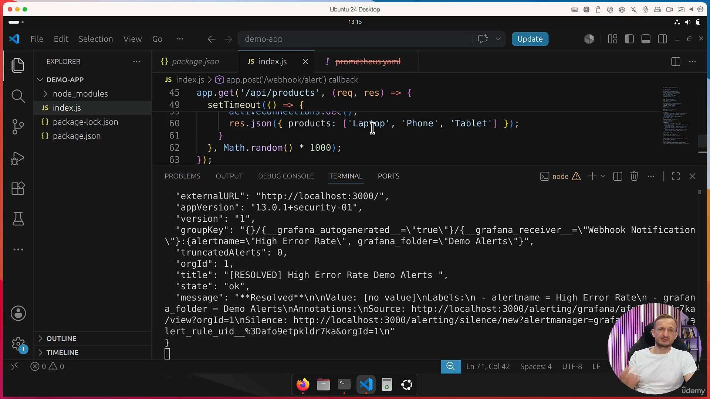
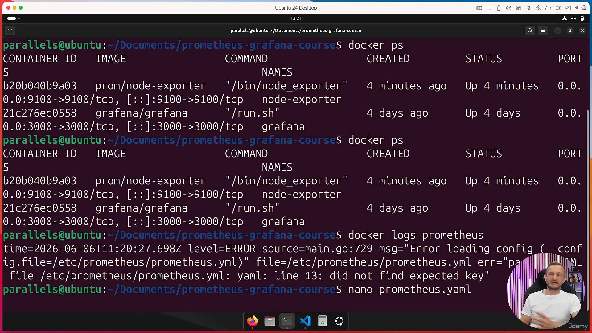
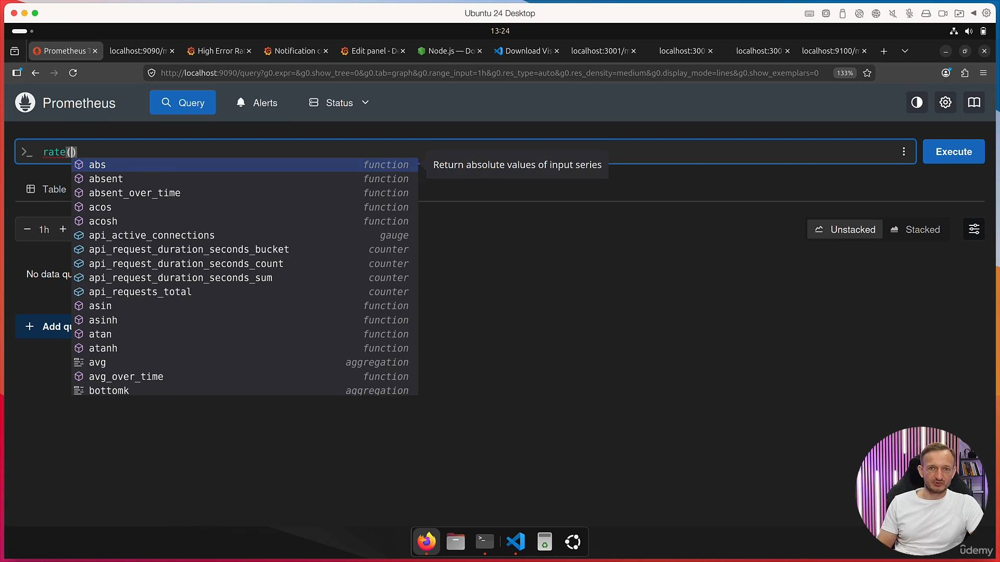
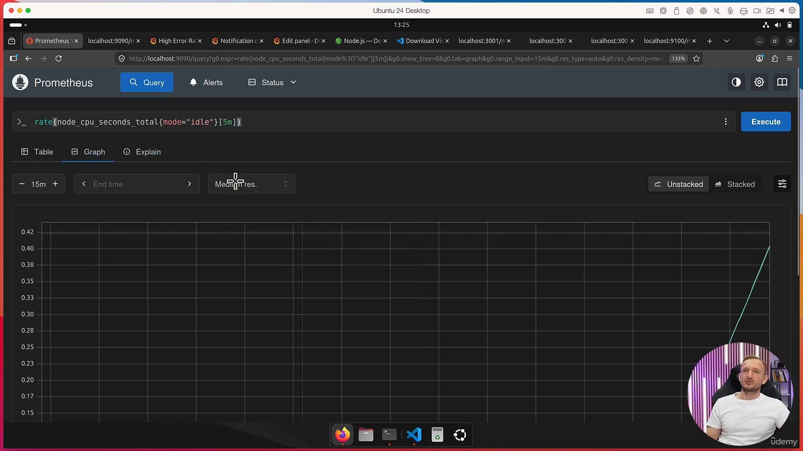
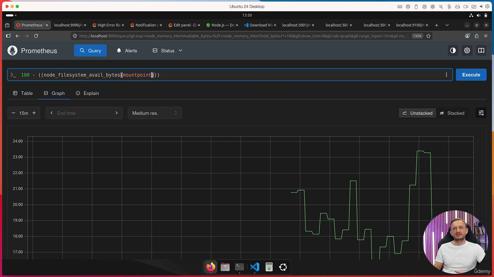
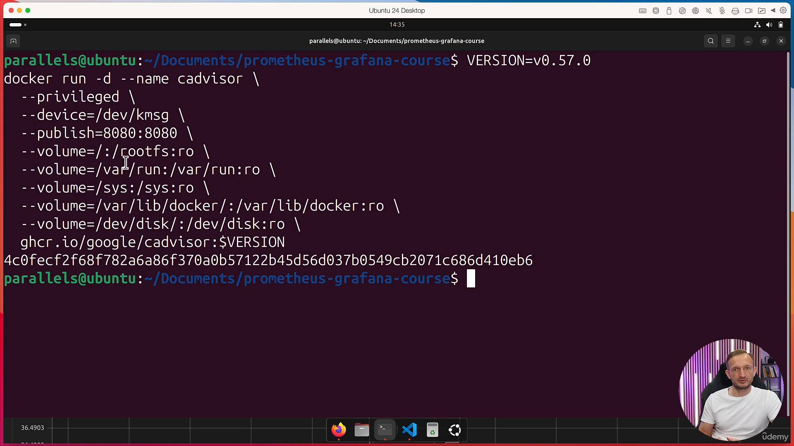
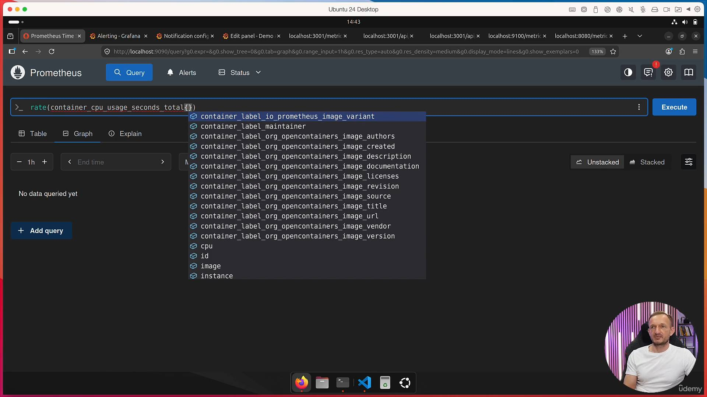
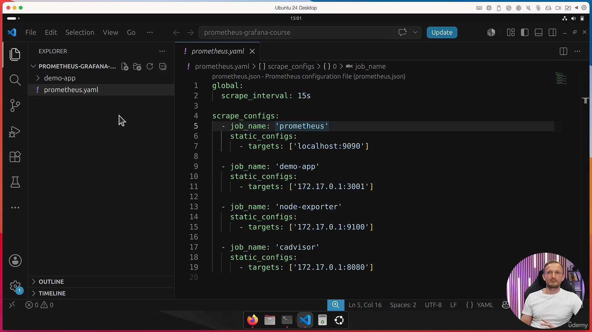
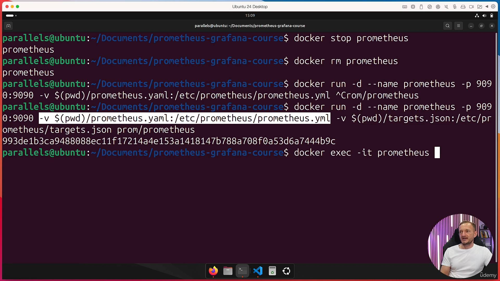
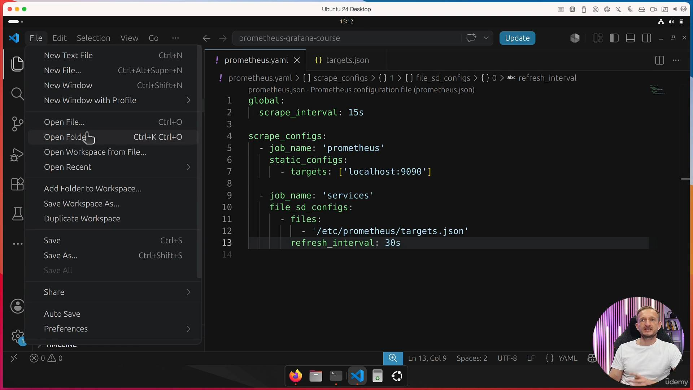

# Prometheus & Grafana 第 13–16 讲：基础设施监控、容器监控、服务发现与生产实践

> 适用人群：已经跟着前面几讲跑通了「Node.js demo app + Prometheus + Grafana + 告警」的同学。
> 本节结束时，你的机器上会跑着 **4 个容器**：Prometheus(9090)、Grafana(3000)、node_exporter(9100)、cAdvisor(8080)，并且 Prometheus 的抓取目标不再写死在 `prometheus.yml` 里，而是来自一份可以被热更新的 `targets.json`。

---

## 1. 这一节做什么

前面几讲你已经有了：一个用 Node.js 写的 demo 应用、一个 Prometheus、一个 Grafana，以及一条会从 firing 走到 resolved 的告警。这条链路监控的是**应用自己吐出来的业务/运行时指标**。

这一节要补的是「应用脚下那层」和「应用装它的那层」：

| 讲 | 加什么 | 解决什么问题 | 对外端口 |
|---|---|---|---|
| P013 | node_exporter | 宿主机 CPU / 内存 / 磁盘 / 网络 | 9100 |
| P014 | cAdvisor | 每个容器吃了多少 CPU / 内存 / 网络 | 8080 |
| P015 | 文件服务发现（file_sd） | 加删 target 不用再 stop/rm/run Prometheus | 无（复用 9090） |
| P016 | 无新组件 | 命名、基数、保留期、看板、告警、生产化 | 无 |

最终的数据流是这样：

```
                    ┌─────────────────────────────┐
   node_exporter :9100 ──┐                        │
   cAdvisor      :8080 ──┼──► Prometheus :9090 ───┼──► Grafana :3000
   demo app      :30xx ──┤      ▲                 │      （看板 + 告警展示）
   prometheus    :9090 ──┘      │                 │
                                │                 │
                    /etc/prometheus/targets.json  │
                    （file_sd 每 30s 重读一次）    │
                    └─────────────────────────────┘
```

一句话记住这四讲的关系：**P013/P014 是「多接两个数据源」，P015 是「把数据源列表从代码里搬出来」，P016 是「别把本地跑通的东西直接搬到生产」。**

---

## 2. 讲师原话

> "导出器就像小型程序，按 Prometheus 格式暴露特定系统的指标……node exporter 其实跟我们之前使用的 Node.js 没有关系。这个名字来自对集群中节点的监控。"
> —— p013 [01:27]

> "第 13 行没有找到期望的键。所以我在这个容器里，或者实际上在这个配置块里，犯了某种拼写错误……这就是我们执行 docker logs 的原因，我其实想知道里面发生了什么。"
> —— p013 [07:11] / [07:38]

> "这个 node exporter 其实运行在那个容器内部。因此我们实际监控的是容器内部的情况，而不是主机上的情况。因为 node exporter 需要运行在我们的主机上。所以这类 node exporter 通常不会本身作为 Docker 容器运行，而是安装到主机上。"
> —— p013 [17:13]

> "我们需要授予它访问 Docker 套接字和各个系统目录的权限，这样它才能真正检查其他那些容器，而不像当前其余容器那样被隔离得那么严重。"
> —— p014 [01:54]

> "Prometheus 最初是作为单节点系统设计的，本身并不内置集群或复制能力。"
> —— p016 [14:49]

> "默认情况下，你已经看到 Prometheus 和 Grafana 都没有太多身份验证。因此，只要能访问到 URL，任何人都能访问所有内容。"
> —— p016 [19:29]

---

## 3. 从零复现

下面按「你会真的照着敲」的顺序写。每一步都给出命令、预期现象、以及出错时先看哪里。

### 步骤 0：确认起点还活着

先确认前面几讲的容器还在跑：

```bash
docker ps
```

你至少要能看到 `prometheus` 和 `grafana` 这两个名字。如果只有一个，先回去把前面那讲的 `docker run` 补上再往下走。

> 说明：这一节里所有 target 地址，课里一律写成 `localhost:<端口>`。这在讲师的环境里能通，但在你的环境里不一定——原因和处理办法见第 7 节第一条，先别卡在这里。

### 步骤 1：启动 node_exporter，先用 curl 验，再去配 Prometheus

```bash
docker run -d --name node-exporter -p 9100:9100 prom/node-exporter
docker ps
```

`-d` 是后台（detach）运行，`-p 9100:9100` 是「宿主机 9100 → 容器 9100」，9100 是 node_exporter 的默认端口，这两个 9100 里左边那个才是你浏览器要访问的。

**先别急着改配置**，直接验证它有没有在工作：

```bash
curl -s http://localhost:9100/metrics | head -n 30
```

你会看到一屏 Prometheus 格式的纯文本，绝大多数行以 `node_` 开头（比如 CPU、内存、文件系统相关的），也有少量 `process_` 和 `promhttp_` 开头的。每一行都是 `指标名{标签="值"} 数字` 这种形状。



浏览器打开 `http://localhost:9100/metrics` 也能看到同一坨文本，滚动条会小得几乎拖不动——课里讲师原话是「Prometheus wall of text」。

### 步骤 2：把 node_exporter 加进 prometheus.yml（第一次踩 YAML 缩进坑）

打开你之前那份 `prometheus.yml`，在 `scrape_configs:` 下面**再追加一个 job**（不是替换）：

```yaml
  - job_name: node-exporter
    static_configs:
      - targets: ["localhost:9100"]
```

注意 `- job_name` 这一行的缩进必须和上面已有的 `- job_name: prometheus` 完全对齐（两个空格 + `- `），`static_configs` 再缩两格，`- targets` 再缩两格。YAML 只认缩进，不认大括号。

改完保存，然后重启容器。这里必须注意：**Prometheus 的配置文件是挂载进容器的，改文件不会自动生效，必须重启容器**。课里用的是「停 → 删 → 再 run」三步：

```bash
docker stop prometheus
docker rm prometheus
# 用你之前那条 docker run 命令重新起，别重新发明一条
docker run -d --name prometheus -p 9090:9090 \
  -v "$(pwd)/prometheus.yml:/etc/prometheus/prometheus.yml" \
  prom/prometheus
docker ps
```

**如果 `docker ps` 里看不到 prometheus**，说明它启动后立刻退出了。这时候别猜，直接看日志：

```bash
docker logs prometheus
```

课里第一次就是这么炸的，日志里写的是 `line 13 did not find expected key` —— 典型的缩进错位。



修好缩进后重复「stop → rm → run → ps」，直到 `docker logs prometheus` 里出现 `Server is ready to receive web requests.`（课里说的是 "服务器已准备好接收请求。"）。

然后打开 `http://localhost:9090` → 顶部 **Status → Target health**，应该能看到 `node-exporter` 这条，状态是 `UP`，Last Scrape 显示几秒前。

### 步骤 3：在 Prometheus 里跑三条 node 指标查询

进入 `http://localhost:9090` 的 **Graph** 标签页，逐条粘贴执行。

**CPU（原始形态，先看懂再看美化版）：**

```promql
rate(node_cpu_seconds_total{mode="idle"}[5m])
```

这条的读法：`node_cpu_seconds_total` 是「CPU 花在各个 mode 上的累计秒数」，是个只增不减的计数器（counter），所以不能直接画，必须套 `rate(...[5m])` 变成「每秒增长多少」。`{mode="idle"}` 只留空闲那一档。画出来是一条条按 CPU 核分开的线，**值越高说明越闲**。



**CPU（给人看的百分比形态）：**

```promql
100 - (avg by (instance) (rate(node_cpu_seconds_total{mode="idle"}[5m])) * 100)
```

课里讲师的解释是：这条算的是「CPU 时间中**不**处于 idle 的平均百分比」，也就是真正的使用率，落在 0–100 之间。`avg by (instance)` 把所有 CPU 核平均成一条线，`100 -` 做取反。



**内存（可用百分比）：**

```promql
node_memory_MemAvailable_bytes / node_memory_MemTotal_bytes * 100
```

**磁盘（根分区可用百分比）：**

```promql
node_filesystem_avail_bytes{mountpoint="/"} / node_filesystem_size_bytes{mountpoint="/"} * 100
```



**最后这条大概率会返回空结果**，这是这一讲最重要的一个坑，课里专门停下来讲了：因为 node_exporter 跑在容器里，它看到的 `/` 是**容器自己的**根文件系统，里面只有 `/etc/hostname`、`/etc/resolv.conf` 这种被挂进去的文件，没有你宿主机的那块盘。你把 `{mountpoint="/"}` 去掉，就会看到它只认得这两个 mountpoint。

讲师的原话是：node_exporter 通常**不**以容器方式部署，而是直接装在宿主机上（或者用 `--pid=host --net=host` 之类的方式让它看到宿主）。这一点在第 7 节还会再说。

### 步骤 4：启动 cAdvisor，拿到每个容器的资源数据

这条命令比前面几条长得多，课里是复制粘贴的，讲师特意用了 `--publish` / `--volume` 的全称而不是 `-p` / `-v`，就是为了让人读得懂：

```bash
docker run -d \
  --name=cadvisor \
  --publish=8080:8080 \
  --volume=/:/rootfs:ro \
  --volume=/var/run:/var/run:ro \
  --volume=/sys:/sys:ro \
  --volume=/var/lib/docker/:/var/lib/docker:ro \
  --volume=/dev/disk/:/dev/disk:ro \
  --privileged \
  gcr.io/cadvisor/cadvisor:v0.47.2
```

参数含义（对应讲师在 p014 [02:22]–[03:12] 的讲解）：

- `--publish=8080:8080`：就是把 8080 映射出来，跟前面 `-p` 完全一样。
- `--volume=/:/rootfs:ro`：把宿主机 `/` 以**只读**方式挂进容器，让 cAdvisor 能读取宿主文件系统信息。
- `--volume=/var/run:/var/run:ro`：Docker socket 所在目录，这是 cAdvisor 能「看见」其他容器的前提。
- `--volume=/sys:/sys:ro`、`--volume=/var/lib/docker/:/var/lib/docker:ro`、`--volume=/dev/disk/:/dev/disk:ro`：系统信息、Docker 数据目录、磁盘设备，同样是只读。
- `--privileged`：给容器更高的权限，课里说的是「给到它读取容器指标所需的权限」。
- 镜像**钉了版本号**而不是 `latest`，讲师专门强调了这一点。

> 课里没有念出镜像的具体 tag 数字，上面写的是可以拉到的常用版本；如果你拉不到，换成 `gcr.io/cadvisor/cadvisor:latest` 先跑通，再回来钉版本。

验证：

```bash
curl -s http://localhost:8080/metrics | head -n 20
```

浏览器打开 `http://localhost:8080` 还能看到一个简易 UI，列出当前所有容器，点进去能看单个容器的详情。



### 步骤 5：把 cAdvisor 也加进 Prometheus

先在 `prometheus.yml` 里再加一个 job：

```yaml
  - job_name: cadvisor
    static_configs:
      - targets: ["localhost:8080"]
```

然后老规矩 `docker stop prometheus && docker rm prometheus && docker run ...`。去 Target health 确认多了一条 `cadvisor`，状态 `UP`。

然后在 Graph 页试这几条（注意指标名前缀是 `container_`）：

```promql
rate(container_cpu_usage_seconds_total{name!=""}[5m])
```

```promql
sum by (name) (rate(container_cpu_usage_seconds_total{name!=""}[5m]))
```

`{name!=""}` 是讲师特意加的过滤：有些系统级指标没有 `name` 标签，加这个条件可以把它们排掉，只留真正的容器。`sum by (name)` 是把每个容器的多个 label 组合聚合成一条线，图上就只剩 4 条（cadvisor / grafana / node-exporter / prometheus）。



内存（注意这里**不套 rate**，因为它不是 counter）：

```promql
container_memory_usage_bytes{name!=""}
```

网络进出：

```promql
rate(container_network_receive_bytes_total{name!=""}[5m])
rate(container_network_transmit_bytes_total{name!=""}[5m])
```

判断一条指标该不该套 `rate()` 的经验法则（课里原话是「注意 metrics 可能不是 counter」）：**名字以 `_total` 结尾的通常是 counter，配 `rate`/`increase`；其余的多半是 gauge，直接画。** 这条法则在 P016 讲命名规范时又被拎出来说了一次。

### 步骤 6：把 target 从 yml 里搬出来，改成文件服务发现

到这一步 `prometheus.yml` 里已经有三个写死的 job 了。以后每加一个服务就要 stop/rm/run 一次 Prometheus，这期间监控是断的。P015 要解决的就是这个。

**6.1 新建 `targets.json`**，和 `prometheus.yml` 放同一个目录：

```json
[
  {
    "targets": ["localhost:3001"],
    "labels": {
      "job": "demo-app",
      "env": "local"
    }
  },
  {
    "targets": ["localhost:9100"],
    "labels": {
      "job": "node-exporter",
      "env": "local"
    }
  },
  {
    "targets": ["localhost:8080"],
    "labels": {
      "job": "cadvisor",
      "env": "local"
    }
  }
]
```

结构说明（讲师在 p015 [03:49] 讲得很细）：最外层是**数组**，数组里每个元素是一个**对象**；对象里 `targets` 又是一个数组（一个对象可以带多个地址），`labels` 里的键值对会被附加到这个 target 抓到的**每一条**指标上。

> 上面的 `localhost:3001` 是 demo app 的地址占位。13–16 讲里没有再念一遍 demo app 的端口，请换成你自己应用实际在跑的那个端口（注意别用 3000，Grafana 默认占了）。



**6.2 改 `prometheus.yml`**：把 node-exporter / cadvisor / demo-app 这三个 job 删掉，只留 `prometheus` 自己（静态的），然后在上面加一个走文件的服务发现 job：

```yaml
  - job_name: services
    file_sd_configs:
      - refresh_interval: 30s
        files:
          - /etc/prometheus/targets.json
```

`refresh_interval` 是「多久重读一次这个文件」，课里默认是 5 分钟，讲师为了演示改成了 30 秒。`files` 里写的是**容器内路径**，不是你的宿主机路径——这一点和第 7 节的多卷挂载直接相关。

**6.3 重新起 Prometheus，这次要挂两个 volume：**

```bash
docker stop prometheus && docker rm prometheus
docker run -d --name prometheus -p 9090:9090 \
  -v "$(pwd)/prometheus.yml:/etc/prometheus/prometheus.yml" \
  -v "$(pwd)/targets.json:/etc/prometheus/targets.json" \
  prom/prometheus
docker ps
```

**如果 prometheus 又没起来**，去看 `docker logs prometheus`。课里第二次踩的就是这个坑，日志原文是 `file service discovery config must contain at least one path name` —— 根因还是缩进：`refresh_interval` 和 `files` 必须缩在同一个 `- ` 列表项下面，写成兄弟关系，而不是把 `refresh_interval` 缩到 `files` 里面或者提到 `file_sd_configs` 外面。



**6.4 验证文件真的进了容器。** 这是个很好用的排查动作：

```bash
docker exec -it prometheus sh
ls /etc/prometheus
cat /etc/prometheus/targets.json
exit
```

如果 `ls` 里看不到 `targets.json`，说明你的 `-v` 左边路径写错了（比如没在 `prometheus.yml` 所在目录下执行 `docker run`，`$(pwd)` 指向了别处）。

**6.5 验证热更新。** 回到 `http://localhost:9090` → Target health，你会看到 `services` 这个 job 下面挂着 node-exporter、cadvisor、demo-app 三条，并且每条都带上了 `env="local"` 这个标签。



现在做真正的验证：**别动 Prometheus**，直接编辑 `targets.json`，复制一份 demo-app 的块，把端口改成 `3002`、`job` 改成 `second-demo-app`，保存。等 30 秒，刷新 Target health —— 新目标出现了，状态是 `DOWN`（因为 3002 上没有东西在跑）。

这就证明了：改 target 不再需要重启 Prometheus，也就没有那段监控空窗期。

### 步骤 7：在 Grafana 里建一个容器看板

1. 打开 `http://localhost:3000`（账号密码是前面建的那个，课里是 `admin` / `admin`，第一次登录会要求改）。
2. 左侧 **Dashboards → New → New dashboard → + Add visualization**。
3. 数据源选 `Prometheus`。
4. 查询框里粘 `rate(container_network_transmit_bytes_total{name!=""}[5m])`。
5. 面板标题改成 `container network out`。
6. 右上 **Save dashboard**，名字填 `containers metrics`。
7. 回到看板列表，你现在应该有两个看板：之前的 demo app 监控 + 这个 `containers metrics`。

后续可以照着同样的流程再加内存面板（`container_memory_usage_bytes{name!=""}`）和 CPU 面板（`sum by (name) (rate(container_cpu_usage_seconds_total{name!=""}[5m]))`），并在面板右侧把 **Unit** 设成 bytes / percent，让 Grafana 自己去格式化。

---

## 4. 完整代码

### 目录结构

```
prometheus-grafana/
├── prometheus.yml
├── targets.json
└── run.sh            # 可选：把四条 docker run 收在一起
```

### `prometheus.yml`（P013–P015 全部做完后的最终版）

```yaml
global:
  scrape_interval: 15s

scrape_configs:
  - job_name: prometheus
    static_configs:
      - targets: ["localhost:9090"]

  - job_name: services
    file_sd_configs:
      - refresh_interval: 30s
        files:
          - /etc/prometheus/targets.json
```

> 说明：`global.scrape_interval` 的具体数值在前几讲里定过，这里保持你原来的值即可；本节所有新增内容都在 `scrape_configs` 里。`prometheus` 这个 job 保留为静态，是为了演示「静态 + 动态可以共存」（讲师在 p015 [07:04] 明确说要保留它）。

### `targets.json`

```json
[
  {
    "targets": ["localhost:3001"],
    "labels": {
      "job": "demo-app",
      "env": "local"
    }
  },
  {
    "targets": ["localhost:9100"],
    "labels": {
      "job": "node-exporter",
      "env": "local"
    }
  },
  {
    "targets": ["localhost:8080"],
    "labels": {
      "job": "cadvisor",
      "env": "local"
    }
  }
]
```

热更新验证用的临时块（测完记得删）：

```json
  {
    "targets": ["localhost:3002"],
    "labels": {
      "job": "second-demo-app",
      "env": "local"
    }
  }
```

### `run.sh`

```bash
#!/usr/bin/env bash
set -e

# 1. node_exporter：宿主机系统指标
docker run -d --name node-exporter -p 9100:9100 prom/node-exporter

# 2. cAdvisor：容器级指标（需要 docker socket 与系统目录）
docker run -d \
  --name=cadvisor \
  --publish=8080:8080 \
  --volume=/:/rootfs:ro \
  --volume=/var/run:/var/run:ro \
  --volume=/sys:/sys:ro \
  --volume=/var/lib/docker/:/var/lib/docker:ro \
  --volume=/dev/disk/:/dev/disk:ro \
  --privileged \
  gcr.io/cadvisor/cadvisor:v0.47.2

# 3. Prometheus：配置文件 + 服务发现文件都要挂进去
docker run -d --name prometheus -p 9090:9090 \
  -v "$(pwd)/prometheus.yml:/etc/prometheus/prometheus.yml" \
  -v "$(pwd)/targets.json:/etc/prometheus/targets.json" \
  prom/prometheus

# 4. Grafana
docker run -d --name grafana -p 3000:3000 grafana/grafana

docker ps
```

> Grafana 那条是前面几讲已经起过的，这里只是补齐，重复执行会报 `name already in use`，可以跳过。

### PromQL 速查（本节出现过的全部查询）

```promql
# --- 宿主机 ---
rate(node_cpu_seconds_total{mode="idle"}[5m])
100 - (avg by (instance) (rate(node_cpu_seconds_total{mode="idle"}[5m])) * 100)
node_memory_MemAvailable_bytes / node_memory_MemTotal_bytes * 100
node_filesystem_avail_bytes{mountpoint="/"} / node_filesystem_size_bytes{mountpoint="/"} * 100

# --- 容器 ---
rate(container_cpu_usage_seconds_total{name!=""}[5m])
sum by (name) (rate(container_cpu_usage_seconds_total{name!=""}[5m]))
container_memory_usage_bytes{name!=""}
rate(container_network_receive_bytes_total{name!=""}[5m])
rate(container_network_transmit_bytes_total{name!=""}[5m])
```

---

## 5. 逐行解释

### `prometheus.yml`

- `global.scrape_interval`：全局默认抓取间隔。**它只影响「没单独写 interval 的 job」**，不是重启开关。
- `scrape_configs:`：一个数组，每个元素是一个抓取任务。
- `- job_name: prometheus`：静态任务，用来抓 Prometheus 自己。`localhost:9090` 指的是「Prometheus 容器自己的 9090」，这个在容器里是通的，因为它抓的就是自己。
- `- job_name: services`：这个 job 不给 `static_configs`，而是给 `file_sd_configs`——这是服务发现的类型名，`sd` = service discovery。
- `- refresh_interval: 30s`：重读文件的周期。注意它和 `files` 是**同一个列表项里的兄弟字段**，前面那个 `- ` 是列表项标记，不是减号。
- `files:` 是数组，可以写多个文件，Prometheus 会把它们的内容合并。
- `/etc/prometheus/targets.json`：**容器内路径**。你宿主机上的 `./targets.json` 必须通过 `-v` 映射到这个位置，两边路径不一致是最常见的失败原因。

### `targets.json`

对着 JS 看会更快：

```js
// 这就是一个数组
[
  {
    targets: ["localhost:9100"],   // string[]
    labels: { job: "node-exporter", env: "local" }  // Record<string, string>
  }
]
```

- 最外层 `[ ... ]` 决定它是「一个列表」，Prometheus 会遍历这个列表的每一项。
- 每一项里的 `targets` 是地址列表，可以写多个（同一个 job 的多副本）。
- `labels` 里的每个键值对会**下沉到每一条被采集的指标上**。所以你在 Prometheus 里查任何一条来自 node-exporter 的指标，都会看到 `env="local"`；Grafana 里可以用 `env` 做变量切换（P016 建议这么做）。
- 注意 JSON 里字符串必须用**双引号**，不能用单引号——这是它和 YAML 的一个显眼区别，讲师在 p015 [04:19] 专门提了一句。

### cAdvisor 那条 `docker run`

- `--publish` / `--volume` 是 `-p` / `-v` 的长写法，功能完全一致，只是可读性更好。
- `:ro` 后缀表示只读挂载。给采集程序挂宿主机目录时，**永远先想能不能只读**。
- `--privileged` 是「给容器接近宿主机的权限」。它和上面那几个 `:ro` 挂载一起，才让 cAdvisor 能读到别的容器的 cgroup 数据。这在前端视角里大致相当于「这个进程拿的是 root 权限 + 能读全局 fs」，属于明确的例外，不要在自己业务容器里这么干。
- 镜像带 `:v0.47.2` 而不是 `:latest`——课里专门强调了钉版本，因为 `latest` 会在某天悄悄变。

### PromQL 里的 `rate()` 怎么理解

`rate(x[5m])` 的语义是「在过去 5 分钟的窗口里，这个计数器平均每秒涨了多少」。

用 JS 类比：

```js
// 假设每 15 秒采到一个点，窗口里有一串值
const delta = last - first;        // 涨了多少
const perSecond = delta / 300;     // 除以窗口秒数
```

这也是为什么 **counter 必须套 rate**、**gauge 不能套 rate**：counter 是只增不减的累计量（比如「开机以来 CPU 花了多少秒」），`rate` 求的是它的增速；gauge 是瞬时值（比如「当前内存占用多少字节」），套 `rate` 得到的是没有物理意义的东西。

`sum by (name) (...)` 就是 SQL 里的 `GROUP BY name` + `SUM`，把同一容器上因为不同 label（镜像、容器 ID 等）分裂出来的多条线合并成一条。在 JS 里等价于：

```js
Object.values(rows.reduce((acc, r) => {
  (acc[r.name] ??= { name: r.name, v: 0 }).v += r.v;
  return acc;
}, {}));
```

---

## 6. 复现检查清单

跑完上面的步骤，逐条打勾：

- [ ] `docker ps` 能看到 4 个容器：`prometheus`、`grafana`、`node-exporter`、`cadvisor`
- [ ] `curl -s localhost:9100/metrics | head` 有 `node_` 开头的行
- [ ] `curl -s localhost:8080/metrics | head` 有 `container_` 开头的行
- [ ] `docker logs prometheus` 里**没有** `did not find expected key` / `must contain at least one path name`
- [ ] `http://localhost:9090` → Status → Target health 里，`prometheus`、`services`（下挂 node-exporter / cadvisor / demo-app）都是 UP
- [ ] Target health 里每条被发现的 target 都带 `env="local"` 标签
- [ ] 改完 `targets.json` 后 **30 秒内** Target health 自动出现新条目，且**没有重启过 Prometheus**
- [ ] `docker exec -it prometheus ls /etc/prometheus` 能看到 `prometheus.yml` 和 `targets.json`
- [ ] Prometheus Graph 页能画出 `100 - (avg by (instance) (rate(node_cpu_seconds_total{mode="idle"}[5m])) * 100)`，数值在 0–100
- [ ] `sum by (name) (rate(container_cpu_usage_seconds_total{name!=""}[5m]))` 能画出 4 条线，名字对得上你的容器
- [ ] Grafana 里有第二个看板 `containers metrics`，至少一个面板在出数据
- [ ] 你知道 `node_filesystem_avail_bytes{mountpoint="/"}` 为什么是空的（见下节）

---

## 7. 课里没讲但你会撞上的

**1）`localhost:9100` 在 Prometheus 容器里根本不通。**
这是最可能让你卡住的一条。`localhost` 在容器里指的是**容器自己**，不是你的宿主机。课里能通，说明讲师那边的 Prometheus 和这些端点在同一个网络命名空间（比如用了 host 网络）——但这一点在 13–16 讲里**没有明说**。你可以三选一：
- 在 `docker run prometheus` 时加 `--network host`（Linux 上最省事，但 9090 会直接占宿主机端口，`-p` 就不需要了）；
- 把 target 改成 `host.docker.internal:9100`（macOS / Windows 的 Docker Desktop 默认支持；Linux 上需要在 `docker run` 加 `--add-host=host.docker.internal:host-gateway`）；
- 写宿主机的局域网 IP，比如 `192.168.1.20:9100`。

**2）node_exporter 看到的是容器，不是你的宿主机。**
这个课里讲了（p013 [16:43]–[17:43]），但值得单独强调：`node_filesystem_avail_bytes{mountpoint="/"}` 返回空、`node_filesystem_*` 里只有 `/etc/hostname` 和 `/etc/resolv.conf` 这两个 mountpoint，都是这个原因。真要看宿主机磁盘，得把 node_exporter 装到宿主机上，或者用 `--pid=host --net=host` 加额外的 bind mount。**课程演示用的这套只是「能跑起来」，不是生产做法。**

**3）cAdvisor 在 Apple Silicon 上可能起不来。**
`gcr.io/cadvisor/cadvisor` 的某些版本没有 arm64 镜像，`docker run` 会直接报 exec format error。课里没提这个。遇到就换一个更新/更旧的 tag 试，或者用 `docker run --platform linux/amd64`（