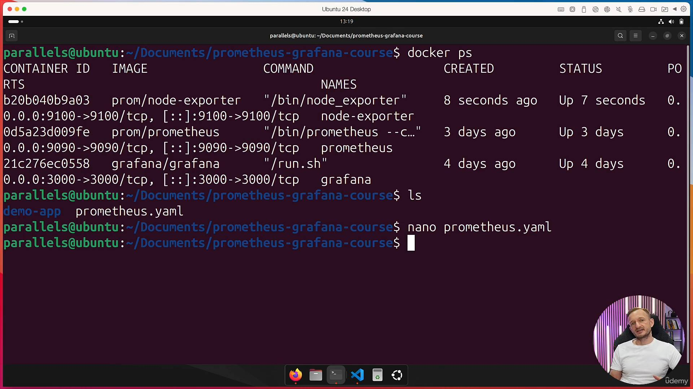
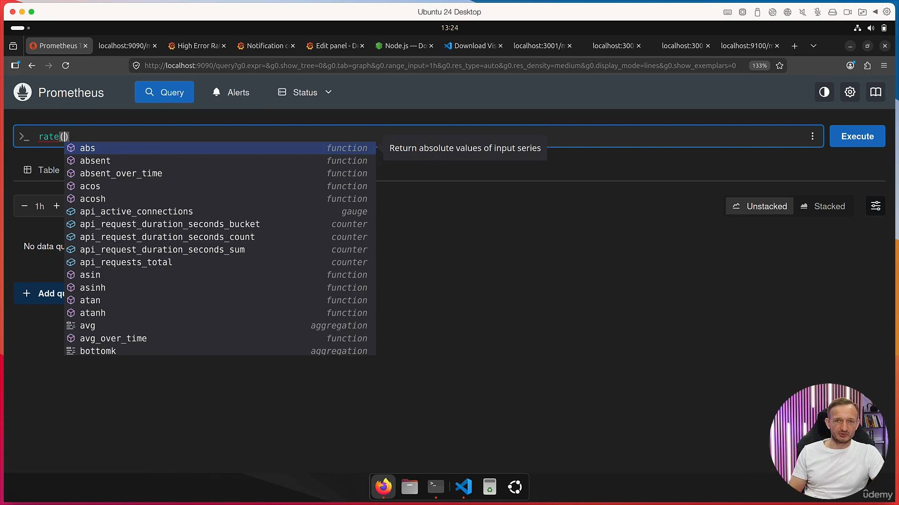
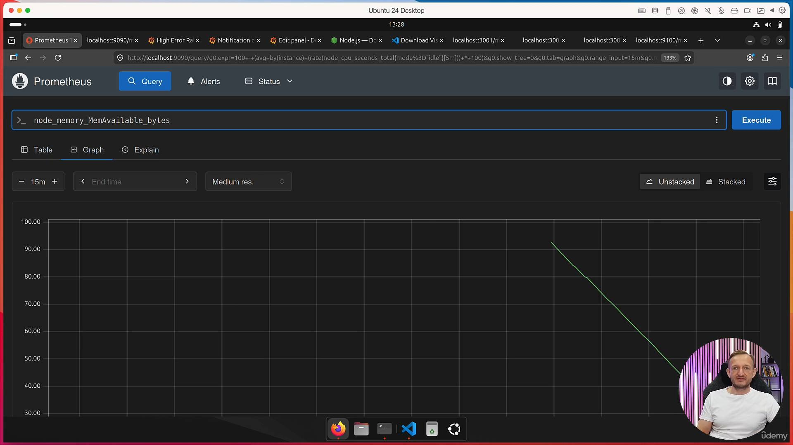
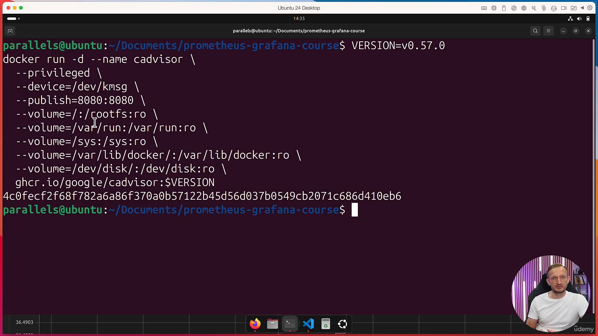
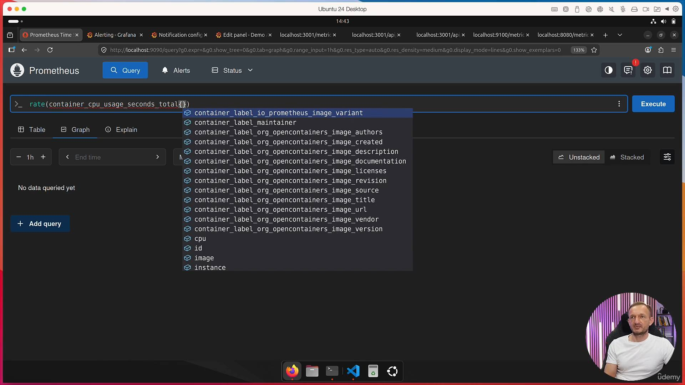
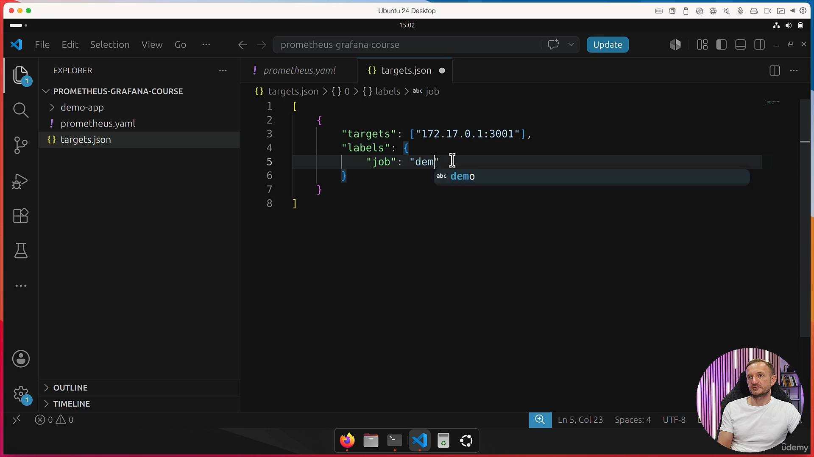
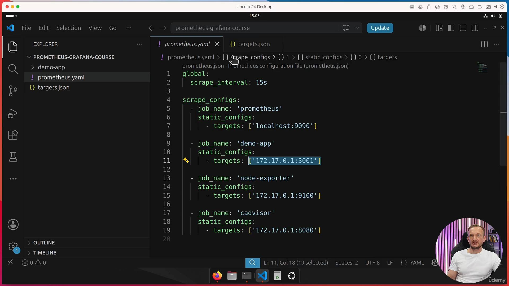

# Prometheus & Grafana 容器监控与文件服务发现复现（P13–P17）

## 1. 这一节做什么

这一节把前面只监控 Node.js 应用的链路，扩成一套“应用 + 容器 + 基础主机视角”的监控闭环：

1. **P13：接入 Node Exporter**  
   在已有 Prometheus、Grafana、demo 应用之外，再启动一个 Node Exporter 容器，暴露 `9100/metrics`。然后在 `prometheus.yml` 里新增 scrape job，让 Prometheus 抓取 Node Exporter 的指标；再用 PromQL 查询 CPU、内存、文件系统。  
   这里有一个非常重要的坑：课程中 Node Exporter 也是用 Docker 容器跑的，所以它看到的是**容器内部视角**，不是完整宿主机视角。讲师在磁盘查询查不到根挂载点时专门解释了这一点。

2. **P14：接入 cAdvisor**  
   cAdvisor 用来采集“每个容器”的 CPU、内存、网络、文件系统 I/O 等指标。启动时需要暴露 `8080`，挂载宿主机根文件系统、Docker socket、`/sys`、`/var/lib/docker` 等路径，并加 `--privileged`，否则它无法检查其他容器。  
   配好后再在 `prometheus.yml` 加一个 cAdvisor job，用 `container_*` 指标查询每个容器的资源使用，并在 Grafana 里建立容器监控 Dashboard。

3. **P15：文件服务发现（file-based service discovery）**  
   把原来写死在 `prometheus.yml` 里的 target 拆到 `targets.json`。Prometheus 每 30 秒检查一次文件，新增/删除 target 不需要 stop/rm/run Prometheus。  
   这一节还会复现两个典型 YAML 错误：缩进错误、`refresh_interval` 放错层级。

4. **P16：指标、Dashboard、告警和生产注意事项**  
   包括指标命名、标签基数、保留时间、Dashboard 设计、告警降噪、Prometheus 高可用、Federation、持久化存储、安全、监控系统自身。

5. **P17：清理容器与后续学习方向**  
   停止并删除 `prometheus`、`grafana`、`node-exporter`、`cadvisor` 四个容器；课程还提到 Thanos、Cortex、Mimir、recording rules、alerting rules 等后续方向。

最终目录建议如下，后面所有命令都以这个目录为工作目录：

```text
monitoring/
├── prometheus.yml
├── targets.json
└── run.sh          # 文档为方便复现补的启动脚本，课里是逐条敲 docker 命令
```

---

## 2. 讲师原话（带「—— pNNN [MM:SS]」）

- “exporters are just like small programs that expose metrics about specific systems in the Prometheus form… the most important exporter is probably the node exporter. And that collects some system level metrics.”  
  —— p013 [01:27]  
  讲师把 exporter 定义为“把某个系统的指标转成 Prometheus 格式的小程序”，Node Exporter 是最常用的系统级 exporter。

- “despite its name, the node exporter actually has nothing to do with this node.js… The name comes from monitoring nodes in a cluster.”  
  —— p013 [01:27]  
  Node Exporter 和 Node.js 没有关系，这里的 node 指集群节点。

- “this node exporter actually runs inside of that container. And that's why we are actually monitoring what is inside of the container, not actually what is on our host. Because this node exporter would need to run on our host.”  
  —— p013 [17:13]  
  这是 P13 最关键的结论：用容器跑 Node Exporter 时，查询到的文件系统挂载点不是完整宿主机；生产环境通常应把 Node Exporter 安装在宿主机上。

- “CAdvisory, which is actually for a container advisory, is an open source tool from Google that collects, aggregates and exports metrics about our running containers. It understands Docker natively and exposes container metrics in this Prometheus format.”  
  —— p014 [00:58]  
  cAdvisor 由 Google 开源，原生理解 Docker，把容器指标以 Prometheus 格式暴露出来。

- “The volume mounts give the CAdvisory read only access to the root file system… It also is for the Docker socket… and this privileged and these volume mounts are necessary because the CAdvisory needs to inspect the host system.”  
  —— p014 [02:49]  
  cAdvisor 需要挂载宿主机目录、Docker socket，并加 `--privileged`，才能读取其他容器统计。

- “with this file based service discovery, instead of hard coding those targets in this Prometheus YAML… we can put them in a separate JSON or a YAML file and Prometheus will watch this file and automatically pick up changes without needing of this restarts.”  
  —— p015 [01:53]  
  文件服务发现解决“每次加 target 都要重启 Prometheus”的问题。

- “error parsing YAML file service discovery config must contain at least one path name.”  
  —— p015 [11:46]  
  这是讲师把 `refresh_interval` 放错层级后，`docker logs prometheus` 给出的错误。正确写法是 `refresh_interval` 与 `files` 同级，位于 `file_sd_configs` 的列表项里。

- “5 times 20 times 5, so it would equal 500… Time series just for that one metric. So high cardinality can kill actually the Prometheus performance.”  
  —— p016 [04:42]  
  指标基数 = 指标名 × 标签值组合。标签不要放 user id、email、request id 这类无界值。

- “you should stop and remove the containers with Docker stop and then the name of the containers. So Prometheus, Grafana, node exporter and C advisor and then this Docker RM…”  
  —— p017 [01:44]  
  课程结束前要清理容器，释放本机资源。

---

## 3. 从零复现

> 说明：课里前面的 Prometheus、Grafana、demo 应用已经存在。下面为了让你从本节直接跑起来，给出完整的四个容器启动方式。  
> 课里没有逐字念出所有镜像 tag；课程只强调 cAdvisor 要“pin 到某个版本，不要随便 latest”。下面脚本先用 `latest` 跑通，生产请改成你验证过的固定 tag。

### 3.1 准备目录与文件

```bash
mkdir -p monitoring
cd monitoring
```

创建 `prometheus.yml`、`targets.json`、`run.sh`，内容见第 4 节。先给脚本执行权限：

```bash
chmod +x run.sh
```

### 3.2 启动四个容器

```bash
./run.sh
```

这个脚本会：

- 创建 Docker 网络 `monitoring`；
- 删除同名旧容器，避免端口冲突；
- 启动 `prometheus`，挂载 `prometheus.yml` 和 `targets.json`；
- 启动 `grafana`；
- 启动 `node-exporter`；
- 启动 `cadvisor`，并挂载 cAdvisor 需要的宿主机路径。

启动后检查：

```bash
docker ps
```

你应该能看到 `prometheus`、`grafana`、`node-exporter`、`cadvisor` 四个容器。课程中也是用 `docker ps` 确认这四个容器。

### 3.3 验证 Node Exporter 指标端点

```bash
curl -s http://localhost:9100/metrics | head
```

能看到大量以 `node_` 开头的指标，说明 Node Exporter 正在暴露指标。课程中讲师打开 `localhost:9100/metrics`，看到“Prometheus wall of text”，并说明大部分指标以 `node_` 开头。



### 3.4 验证 Prometheus target

打开：

```text
http://localhost:9090/targets
```

在 Targets 页面里应看到：

- `prometheus`：静态 job；
- `services`：文件服务发现 job；
- `services` 下会出现 `node-exporter:9100`、`cadvisor:8080`、`demo-app` 等 target。

如果某个 target 是 down，先看 Prometheus 日志：

```bash
docker logs prometheus
```

课程中配置写错时，就是通过 `docker logs Prometheus` 看到 YAML 报错，再回到编辑器修缩进。

### 3.5 在 Prometheus Graph 里查 CPU、内存、磁盘

打开 `http://localhost:9090`，进入 Graph 页面。

**CPU 使用率：**

```promql
100 - (avg by(instance) (rate(node_cpu_seconds_total{mode="idle"}[5m])) * 100)
```

课程中先查 `rate(node_cpu_seconds_total{mode="idle"}[5m])`，再用 `100 - avg by(instance)(...) * 100` 得到“非 idle 的 CPU 百分比”。



**内存可用百分比：**

```promql
(node_memory_MemAvailable_bytes / node_memory_MemTotal_bytes) * 100
```

课程中用 `node_memory_MemAvailable_bytes` 除以 `node_memory_MemTotal_bytes`，再乘 100，得到可用内存百分比；反过来就是内存使用率。



**文件系统可用百分比：**

```promql
(node_filesystem_avail_bytes / node_filesystem_size_bytes) * 100
```

如果你加上 `{mountpoint="/"}`，在课程环境里会查不到数据，因为 Node Exporter 跑在容器里，看到的挂载点只有容器内部的 `/etc/hostname`、`/etc/resolv.conf` 等。讲师正是用这个现象说明“容器内 Node Exporter ≠ 宿主机 Node Exporter”。

### 3.6 启动并验证 cAdvisor

```bash
curl -s http://localhost:8080/metrics | head
```

能看到大量以 `container_` 开头的指标。课程中打开 `localhost:8080` 是 cAdvisor 的 Web UI，打开 `localhost:8080/metrics` 是 Prometheus 指标端点。



Prometheus 的 `targets.json` 中已经有 `cadvisor:8080`，所以 target 页面中 cAdvisor 应该是 up。

### 3.7 查询容器指标

在 Prometheus Graph 中执行：

**每个容器 CPU 使用率：**

```promql
sum by(name) (rate(container_cpu_usage_seconds_total{name!=""}[5m]))
```

课程中先查 `rate(container_cpu_usage_seconds_total{name!=""}[5m])`，再用 `sum by(name)` 汇总，这样曲线按容器名分组。



**每个容器内存使用：**

```promql
max by(name) (container_memory_usage_bytes{name!=""})
```

**每个容器网络接收速率：**

```promql
sum by(name) (rate(container_network_receive_bytes_total{name!=""}[5m]))
```

**每个容器网络发送速率：**

```promql
sum by(name) (rate(container_network_transmit_bytes_total{name!=""}[5m]))
```

课程中强调：`container_memory_usage_bytes` 不是 counter，不要机械地套 `rate`；只有 counter 类型才适合 `rate`/`increase`。

### 3.8 Grafana 建 Dashboard

打开：

```text
http://localhost:3000
```

课程中 Grafana 默认账号密码是 `admin/admin`，并且点击了 skip。复现时请改掉默认密码。

配置 Prometheus 数据源：

```text
http://prometheus:9090
```

因为 Grafana 和 Prometheus 在同一个 `monitoring` Docker 网络里，可以直接用容器名访问。

新建 Dashboard：

1. 点击 `New dashboard`；
2. 点击 `Add panel`；
3. Data source 选 Prometheus；
4. 粘贴上面的容器 CPU / 内存 / 网络查询；
5. Visualization 选 Time series、Stat 或 Gauge；
6. 设置单位：bytes、seconds、percent 等；
7. 保存为 `containers metrics`。

课程中先建了一个容器网络出流量面板，然后说明可以继续加内存、CPU、网络入流量等面板。

### 3.9 验证文件服务发现热更新

打开 `targets.json`，增加一个不存在的 demo 应用 target：

```json
{
  "targets": ["host.docker.internal:3002"],
  "labels": {
    "job": "demo-app-2",
    "env": "local"
  }
}
```

保存后等 30 秒左右，刷新 `http://localhost:9090/targets`。你会看到新的 `demo-app-2` target 出现，状态是 down，因为 3002 没有服务。课程中就是用这个方式证明：修改 JSON 文件后不需要重启 Prometheus。





### 3.10 清理

课程最后要求停止并删除容器：

```bash
docker stop prometheus grafana node-exporter cadvisor
docker rm prometheus grafana node-exporter cadvisor
```

如果不再需要网络：

```bash
docker network rm monitoring
```


---

## 4. 完整代码

### 4.1 `monitoring/prometheus.yml`

```yaml
global:
  scrape_interval: 15s

scrape_configs:
  - job_name: prometheus
    static_configs:
      - targets:
          - localhost:9090

  - job_name: services
    file_sd_configs:
      - refresh_interval: 30s
        files:
          - /etc/prometheus/targets.json
```

说明：

- `prometheus` job 保留静态抓取自身；
- `services` job 使用 `file_sd_configs`；
- `refresh_interval: 30s` 必须放在 `file_sd_configs` 的列表项里，和 `files` 同级；
- `files` 指向容器内路径 `/etc/prometheus/targets.json`，对应启动时挂载进去的文件。

### 4.2 `monitoring/targets.json`

```json
[
  {
    "targets": ["node-exporter:9100"],
    "labels": {
      "job": "node-exporter",
      "env": "local"
    }
  },
  {
    "targets": ["cadvisor:8080"],
    "labels": {
      "job": "cadvisor",
      "env": "local"
    }
  },
  {
    "targets": ["host.docker.internal:3000"],
    "labels": {
      "job": "demo-app",
      "env": "local"
    }
  }
]
```

如果你没有 demo 应用，可以删除第三个对象。`host.docker.internal` 在 Docker Desktop 上可用；Linux 下脚本给 Prometheus 加了 `--add-host=host.docker.internal:host-gateway`。

### 4.3 `monitoring/run.sh`

> 这是文档为方便复现整理的脚本，课里是逐条敲 `docker run`。脚本会删除同名旧容器，请确认没有重要数据。

```bash
#!/usr/bin/env bash
set -euo pipefail

cd "$(dirname "$0")"

PROMETHEUS_IMAGE="${PROMETHEUS_IMAGE:-prom/prometheus:latest}"
GRAFANA_IMAGE="${GRAFANA_IMAGE:-grafana/grafana:latest}"
NODE_EXPORTER_IMAGE="${NODE_EXPORTER_IMAGE:-prom/node-exporter:latest}"
CADVISOR_IMAGE="${CADVISOR_IMAGE:-gcr.io/cadvisor/cadvisor:latest}"

docker network inspect monitoring >/dev/null 2>&1 || docker network create monitoring

docker rm -f prometheus grafana node-exporter cadvisor >/dev/null 2>&1 || true

docker run -d \
  --name prometheus \
  --network monitoring \
  --add-host=host.docker.internal:host-gateway \
  -p 9090:9090 \
  -v "$PWD/prometheus.yml:/etc/prometheus/prometheus.yml:ro" \
  -v "$PWD/targets.json:/etc/prometheus/targets.json:ro" \
  "$PROMETHEUS_IMAGE"

docker run -d \
  --name grafana \
  --network monitoring \
  -p 3000:3000 \
  "$GRAFANA_IMAGE"

docker run -d \
  --name node-exporter \
  --network monitoring \
  -p 9100:9100 \
  "$NODE_EXPORTER_IMAGE"

docker run -d \
  --name cadvisor \
  --network monitoring \
  --publish=8080:8080 \
  --volume=/:/rootfs:ro \
  --volume=/var/run:/var/run:ro \
  --volume=/sys:/sys:ro \
  --volume=/var/lib/docker/:/var/lib/docker:ro \
  --volume=/dev/disk/:/dev/disk:ro \
  --volume=/var/run/docker.sock:/var/run/docker.sock:ro \
  --privileged \
  --device=/dev/kmsg \
  "$CADVISOR_IMAGE"

echo "prometheus:    http://localhost:9090"
echo "grafana:       http://localhost:3000"
echo "node-exporter: http://localhost:9100/metrics"
echo "cadvisor:      http://localhost:8080/metrics"
```

### 4.4 Grafana 面板查询清单

```promql
# Node CPU 使用率
100 - (avg by(instance) (rate(node_cpu_seconds_total{mode="idle"}[5m])) * 100)

# Node 可用内存百分比
(node_memory_MemAvailable_bytes / node_memory_MemTotal_bytes) * 100

# Node 文件系统可用百分比（加 mountpoint="/" 在课程容器环境可能为空）
(node_filesystem_avail_bytes / node_filesystem_size_bytes) * 100

# 容器 CPU
sum by(name) (rate(container_cpu_usage_seconds_total{name!=""}[5m]))

# 容器内存
max by(name) (container_memory_usage_bytes{name!=""})

# 容器网络接收
sum by(name) (rate(container_network_receive_bytes_total{name!=""}[5m]))

# 容器网络发送
sum by(name) (rate(container_network_transmit_bytes_total{name!=""}[5m]))
```

### 4.5 P16 生产设计检查表（课程讲解的落地版）

| 主题 | 课程要点 | 复现时怎么做 |
|---|---|---|
| 指标命名 | 用下划线，不用 camelCase / 连字符；包含单位；counter 以 `_total` 结尾 | 自定义应用指标写成 `http_requests_total`、`request_duration_seconds` |
| 标签 | 小写、下划线；用有界值 | 用 `method`、`status_code`、`env`、`region`；不要放 `user_id`、`email`、`request_id` |
| 基数 | 指标名 × 标签组合数 | 5 个 method × 20 个 endpoint × 5 个 status = 500 条时间序列，标签越多越危险 |
| Dashboard | 重要信息在上；分组；单位；阈值颜色；变量 | 应用、容器、主机分 Dashboard；用 `$env`、`$instance` 变量复用 |
| 告警 | 只对需要人工立即处理的事情告警；加 pending 防抖 | 不要每个指标都告警；先 Dashboard 观察，再决定是否告警 |
| 保留 | 默认约 15 天；长期存储用远程后端 | 本地磁盘要监控；长期保留考虑远程存储 |
| 高可用 | Prometheus 单节点，无内置集群复制；跑多套相同实例 | 两个 Prometheus 抓同一批 target，Grafana 配多个数据源 |
| Federation | 分层 Prometheus，上层抓下层关键指标 | 每数据中心/集群一套，再汇总 |
| 持久化 | Docker 用命名卷；K8s 用 PVC | 不要用匿名卷存历史指标 |
| 安全 | Grafana 开认证；Prometheus 放反向代理后；TLS；最小权限 | 改默认密码；不要暴露 Prometheus 到公网；Grafana 只读权限 |
| 监控系统自身 | 监控 Prometheus down、磁盘、scrape 失败 | 给 Prometheus 自己加告警 |

---

## 5. 逐行解释

### 5.1 `prometheus.yml`

```yaml
global:
  scrape_interval: 15s
```

全局抓取间隔。课里没有重点改这个值，保持 15 秒即可。前端可以把它理解成“轮询间隔”。

```yaml
scrape_configs:
  - job_name: prometheus
    static_configs:
      - targets:
          - localhost:9090
```

保留 Prometheus 抓自己。`job_name` 是逻辑分组名；`targets` 是实际地址。Prometheus 容器内访问自己的 `localhost:9090` 是通的。

```yaml
  - job_name: services
    file_sd_configs:
      - refresh_interval: 30s
        files:
          - /etc/prometheus/targets.json
```

这是 P15 的核心。`file_sd_configs` 表示“从文件读取 target 列表”。`refresh_interval` 是 Prometheus 检查文件变化的间隔；课程从默认 5 分钟改成 30 秒，方便测试。`files` 是容器内路径。

课程中错误写法是把 `refresh_interval` 放到了 `files` 下面，导致：

```text
error parsing YAML file service discovery config must contain at least one path name
```

正确层级：

```yaml
file_sd_configs:
  - refresh_interval: 30s
    files:
      - /etc/prometheus/targets.json
```

不是：

```yaml
file_sd_configs:
  - files:
      - refresh_interval: 30s
        path: /etc/prometheus/targets.json
```

YAML 对缩进非常敏感。课程中第一次还遇到 `line 13 did not find expected key`，也是缩进/键位置问题。建议用 VS Code 的 YAML 插件做语法高亮。

### 5.2 `targets.json`

```json
[
  {
    "targets": ["node-exporter:9100"],
    "labels": {
      "job": "node-exporter",
      "env": "local"
    }
  }
]
```

最外层是数组，每个元素是一个 target group。`targets` 是地址数组；`labels` 会附加到该组抓取到的指标上。课程中强调：你在这里写的 label，后面在 Prometheus/Grafana 里就能用来过滤和分组。

`node-exporter:9100` 用的是 Docker 网络里的容器名。因为 Prometheus 和 Node Exporter 在同一个 `monitoring` 网络，Docker 内部 DNS 能把 `node-exporter` 解析到容器 IP。课里原环境用的是宿主机端口方式；这里用容器名是为了复现更稳定。原理一样：Prometheus 需要能访问到 `/metrics`。

`cadvisor:8080` 同理。

`host.docker.internal:3000` 指从容器访问宿主机上的 demo 应用。Docker Desktop 原生支持；Linux 通过 `--add-host=host.docker.internal:host-gateway` 支持。

### 5.3 `docker run` 里的关键参数

```bash
--network monitoring
```

让 Prometheus、Grafana、Node Exporter、cAdvisor 在同一自定义网络里，可以用容器名互相访问。类似前端项目里把 API 服务名配成内网 hostname。

```bash
-p 9090:9090
-p 3000:3000
-p 9100:9100
-p 8080:8080
```

端口映射：宿主机端口:容器端口。课程中 Node Exporter 默认端口是 `9100`；cAdvisor 用 `8080`。

```bash
-v "$PWD/prometheus.yml:/etc/prometheus/prometheus.yml:ro"
-v "$PWD/targets.json:/etc/prometheus/targets.json:ro"
```

把本地配置文件挂进容器。`ro` 表示只读。课程中反复用 stop/rm/run 重启 Prometheus，就是为了让修改后的 YAML 生效；到 P15 后，`targets.json` 不需要重启，因为 Prometheus 会 watch 文件。

cAdvisor 的挂载：

```bash
--volume=/:/rootfs:ro
--volume=/var/run:/var/run:ro
--volume=/sys:/sys:ro
--volume=/var/lib/docker/:/var/lib/docker:ro
--volume=/dev/disk/:/dev/disk:ro
--volume=/var/run/docker.sock:/var/run/docker.sock:ro
--privileged
--device=/dev/kmsg
```

课程解释：cAdvisor 要检查宿主机和其他容器，所以需要只读挂载根文件系统、Docker socket 等，并需要 privileged 权限。没有这些，它无法读取容器统计。

### 5.4 PromQL 为什么这样写

```promql
rate(node_cpu_seconds_total{mode="idle"}[5m])
```

`node_cpu_seconds_total` 是 counter，记录 CPU 在各 mode 下累计的秒数。`rate(...[5m])` 算最近 5 分钟每秒增长量。`mode="idle"` 只取空闲时间。

```promql
100 - (avg by(instance) (rate(node_cpu_seconds_total{mode="idle"}[5m])) * 100)
```

`avg by(instance)` 按实例求平均；乘 100 变成百分比；`100 -` 把“空闲百分比”翻成“使用百分比”。所以高值表示 CPU 忙，低值表示空闲。

```promql
(node_memory_MemAvailable_bytes / node_memory_MemTotal_bytes) * 100
```

可用内存除以总内存。课程中说，反过来就是内存使用率。注意单位是 bytes，Grafana 里可以设置单位自动格式化。

```promql
sum by(name) (rate(container_cpu_usage_seconds_total{name!=""}[5m]))
```

`container_cpu_usage_seconds_total` 是容器 CPU 累计秒数；`rate` 求速率；`sum by(name)` 按容器名汇总。`name!=""` 用来过滤掉没有容器名的系统指标。课程中就是用这个过滤条件得到四个容器。

`container_memory_usage_bytes` 是 gauge，不是 counter，所以直接查或用 `max by(name)`，不要套 `rate`。这也是 P16 命名规范里“counter 要以 `_total` 结尾”的实际意义：看到 `_total` 才考虑 `rate`/`increase`。

### 5.5 文件服务发现为什么能热更新

静态配置：

```yaml
static_configs:
  - targets:
      - node-exporter:9100
```

每次改 target 都要改 YAML，然后重启 Prometheus。课程中前面一直这么做：`docker stop prometheus`、`docker rm prometheus`、`docker run ...`。

文件服务发现：

```yaml
file_sd_configs:
  - refresh_interval: 30s
    files:
      - /etc/prometheus/targets.json
```

Prometheus 每隔 30 秒读一次 `targets.json`。文件变了，target 列表自动变，不用重启，所以没有重启期间的监控空窗。课程中新增一个 `3002` 的 demo app，等一会儿就看到 target 出现，虽然状态是 down，但证明发现机制生效。

这跟前端把写死的 API 地址改成读配置文件/环境变量类似：改配置比改代码再重启更灵活。

---

## 6. 复现检查清单

- [ ] `docker ps` 能看到 `prometheus`、`grafana`、`node-exporter`、`cadvisor` 四个容器。
- [ ] `curl http://localhost:9100/metrics` 返回大量 `node_` 指标。
- [ ] `curl http://localhost:8080/metrics` 返回大量 `container_` 指标。
- [ ] `http://localhost:9090/targets` 中 `prometheus`、`services` 正常；`node-exporter:9100`、`cadvisor:8080` 为 up。
- [ ] `docker logs prometheus` 没有 YAML 解析错误；正常时应能看到类似 `Server is ready to receive web requests.` 的日志。
- [ ] Prometheus Graph 能查出 CPU、内存查询结果。
- [ ] 查询 `node_filesystem_avail_bytes` 时理解：加 `mountpoint="/"` 可能为空，因为 Node Exporter 在容器里；去掉 mountpoint 可看到容器内部挂载点。
- [ ] Grafana `http://localhost:3000` 能登录，Prometheus 数据源 URL 为 `http://prometheus:9090`。
- [ ] Grafana 容器 Dashboard 有 CPU、内存、网络面板，单位设置正确。
- [ ] 修改 `targets.json` 增加 `host.docker.internal:3002`，30 秒内 Targets 页面出现新 target。
- [ ] 新增 target 状态为 down 时，知道这是预期：3002 没有服务。
- [ ] 能复述 P13 的结论：容器内 Node Exporter 监控的是容器视角，不是完整宿主机；生产通常在宿主机安装。
- [ ] 能复述 P14 的结论：cAdvisor 需要 Docker socket、宿主机目录和 privileged 权限。
- [ ] 能复述 P15 的结论：文件服务发现避免改 target 就重启 Prometheus。
- [ ] 能复述 P16 的结论：高基数标签会拖垮 Prometheus；Grafana 默认密码必须改；Prometheus 不要直接暴露公网。
- [ ] 最后执行 `docker stop` / `docker rm` 清理四个容器。

---

## 7. 课里没讲但你会撞上的

1. **Node Exporter 用容器跑，看到的不是完整宿主机**  
   课程已经明确讲了这一点。你如果在容器里查 `node_filesystem_*{mountpoint="/"}` 查不到，不是查询写错，而是容器命名空间/挂载视图限制。生产监控宿主机，应在宿主机安装 Node Exporter，或使用能正确暴露宿主机 `/proc`、`/sys` 的方式；具体参数课程没讲。

2. **Docker Desktop 与 Linux 的 `host.docker.internal` 差异**  
   macOS/Windows 的 Docker Desktop 通常可直接用 `host.docker.internal`。Linux 上需要在 `docker run` 加 `--add-host=host.docker.internal:host-gateway`，本文脚本已加。课里没有展开这个差异。

3. **cAdvisor 的镜像 tag 和平台限制**  
   课程只说 cAdvisor 要 pin 版本，但没有念出具体 tag。本文用 `latest` 先跑通；生产请固定。cAdvisor 在 Docker Desktop 上可能读不到某些宿主机路径（如 `/var/lib/docker`、`/dev/disk`），完整指标建议在 Linux 环境验证。若启动报 volume 路径不存在，先检查本机路径。

4. **YAML 缩进错误比语法错误更常见**  
   课程中遇到 `line 13 did not find expected key` 和 `service discovery config must contain at least one path name`。前者通常是缩进/键位置；后者是 `refresh_interval` 放错层级。改完一定 `docker logs prometheus`。

5. **file_sd 里的 `job` label 可能与 `job_name` 表现不一致**  
   课程在 `targets.json` 的 `labels` 里写了 `job`。不同 Prometheus 版本/配置下，最终 Targets 页面显示的 `job` 标签以实际输出为准。如果发现 `job` 不是预期值，优先看 Targets 页面的 labels；课里没有深入讲 relabel 规则。

6. **Grafana 默认 `admin/admin` 必须改**  
   课程中点击了 skip，并提醒生产不要保留默认密码。复现时登录后立即改密码；生产接 LDAP/SAML 或至少强密码。

7. **Prometheus 默认没有内置登录**  
   课程明确说 Prometheus 没有内置认证，生产应放在 Nginx 等反向代理后，不要直接暴露公网。Grafana 有内置认证，但也要配置 TLS、权限和只读 Dashboard。

8. **Prometheus 本地存储默认保留时间有限**  
   课程提到默认约 15 天，可用 retention 参数调整；长期存储用远程后端。本文没有配持久化卷，容器删除后历史数据会丢。生产 Docker 要用命名卷，K8s 要用 PVC。

9. **高基数标签是性能杀手**  
   课程给了算式：5 method × 20 endpoint × 5 status = 500 条时间序列。不要把 `user_id`、`email`、`request_id` 放进 label。前端埋点也一样：不要把用户 ID 当维度打点到监控系统。

10. **清理容器时注意名字大小写**  
    课程里容器名是 `Prometheus`、`Grafana`、`node exporter`、`C advisor` 这种口语写法；实际 Docker 容器名以你 `docker ps` 看到的为准。本文统一用小写连字符：`prometheus`、`grafana`、`node-exporter`、`cadvisor`。执行 `docker stop`/`docker rm` 时替换成你的实际容器名。

11. **监控系统自身也要被监控**  
    课程最后提醒：给 Prometheus down、磁盘将满、scrape 失败增加告警。你可以在 Prometheus 里加 `up == 0` 这类查询做告警；具体告警规则课程只讲了思路，没有给出完整 rule 文件。